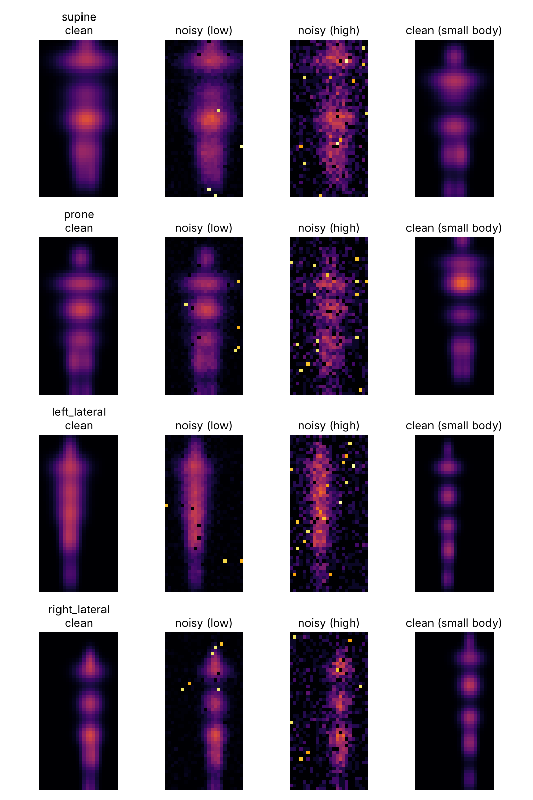
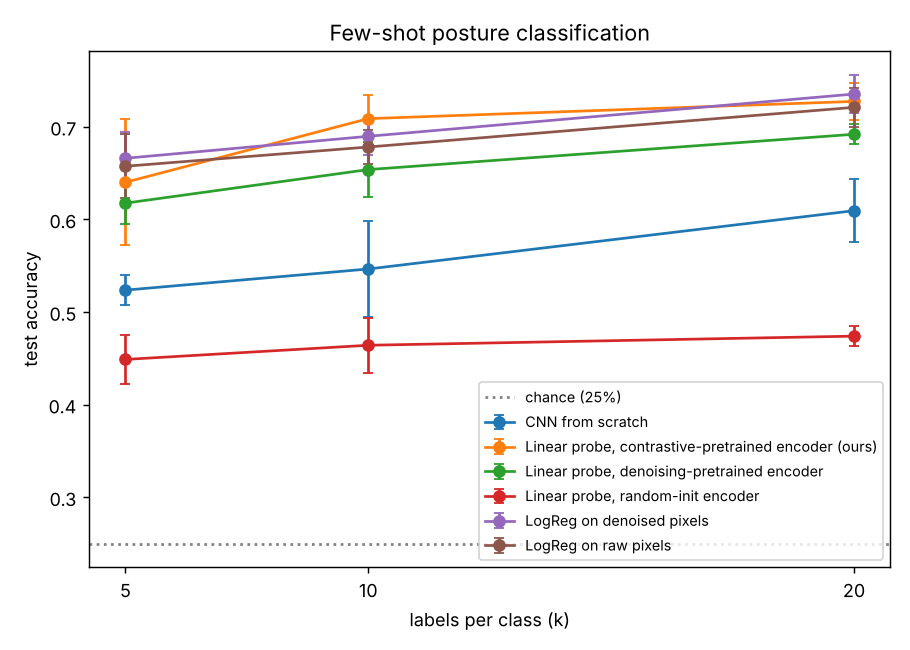
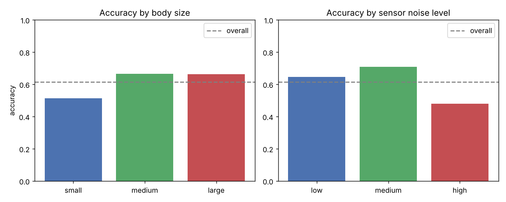
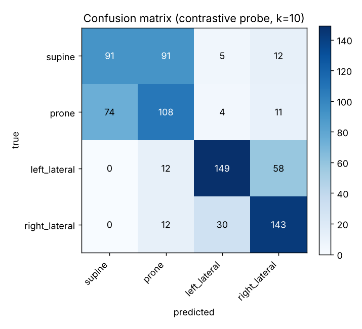
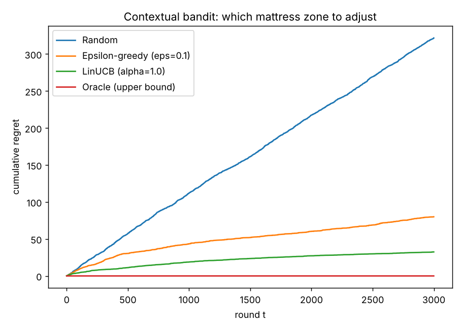
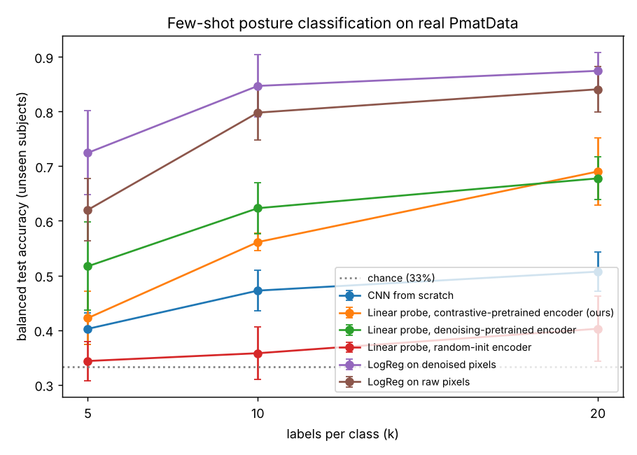
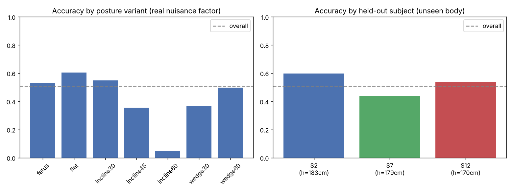
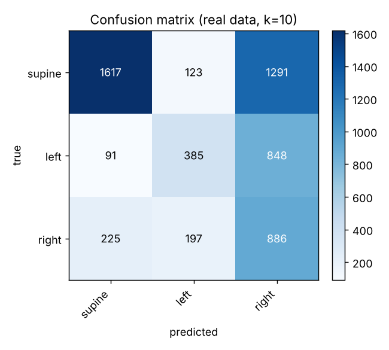
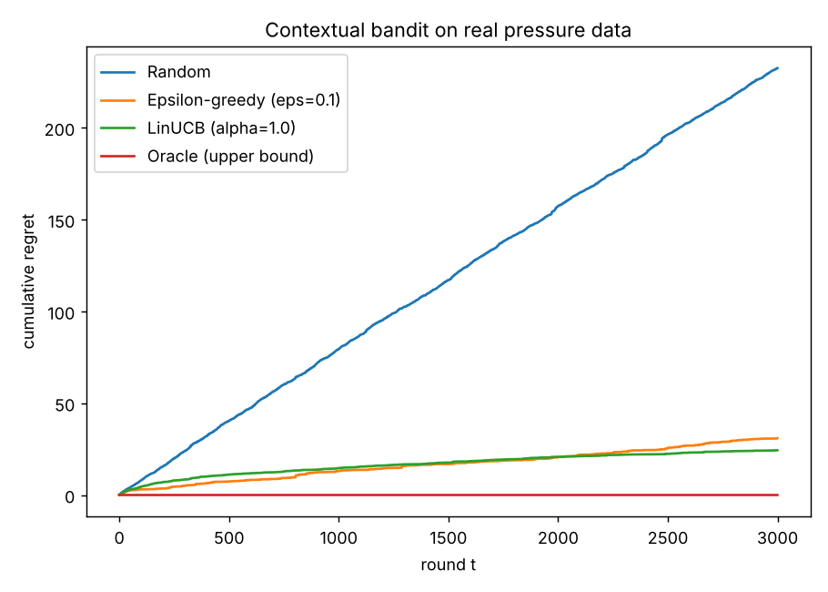

# Learning Body State from Pressure Sensor Data

A research-style project on pressure-mattress sensor data: denoise raw
readings, learn a representation with limited labels, and act on the result
with a contextual bandit. The full pipeline (denoising &rarr; representation
learning &rarr; few-shot classification &rarr; bandit) was built and
validated on **synthetic data first** (documented noise model, baselines,
ablations, honest failure analysis), then run **unchanged** on a **real**
pressure-mat dataset: **PmatData** &mdash; "A Pressure Map Dataset for
In-bed Posture Classification" (Baran Pouyan et al., IEEE BHI 2017),
open-access on [PhysioNet](https://physionet.org/content/pmd/1.0.0/), real
recordings from 13 human subjects. See [Validation on Real
Data](#validation-on-real-data-pmatdata) for the real-data results, and
[Step 1](#step-1--data-synthetic-pilot) for why the project started
synthetic before moving to real data.

```
src/data.py              synthetic pressure-map generator + sensor noise model
src/real_data.py          real PmatData loader + posture-label mapping
src/models.py              shared conv backbone / decoder / projection head / CNN baseline
src/augment.py              label-preserving augmentations for contrastive pretraining

scripts/01_generate_data.py       synthetic: cache all dataset splits
scripts/02_train_denoise.py       synthetic Phase 1: denoising autoencoder
scripts/03_train_pretrain.py      synthetic Phase 2a: contrastive pretraining
scripts/04_fewshot_eval.py        synthetic Phase 2b: few-shot eval, baselines, ablations
scripts/05_failure_analysis.py    synthetic: subgroup accuracy + confusion matrix
scripts/06_bandit.py              synthetic Phase 3 (stretch): contextual bandit

scripts/08_download_real_data.sh  downloads real PmatData from PhysioNet (no login needed)
scripts/09_prepare_real_data.py   real: parse + cache subject-level splits (held-out humans)
scripts/10_real_denoise.py        real Phase 1: denoising autoencoder
scripts/11_real_pretrain.py       real Phase 2a: contrastive pretraining
scripts/12_real_fewshot_eval.py   real Phase 2b: few-shot eval on unseen subjects
scripts/13_real_failure_analysis.py  real: subgroup accuracy (bed incline, subject) + confusion matrix
scripts/14_real_bandit.py         real Phase 3: contextual bandit on real pressure contexts

scripts/07_build_report.py        renders reports/final_report.pdf (both studies)
reports/figures/, reports/results/   all generated plots and metrics (checked in)
checkpoints/                      trained weights (checked in, ~1.2MB total)
```

Reproduce everything: `pip install -r requirements.txt && bash run_all.sh`
(~1 minute for the synthetic study; add `bash scripts/08_download_real_data.sh`
first to also run the real-data scripts, which take a few more minutes on
CPU and download ~107MB from PhysioNet).

## Motivation

A pressure-sensing mattress reports a 2D grid of raw taxel readings. Three
things make this a genuinely interesting ML problem rather than a plain
classification task:

1. **The raw signal is noisy.** Resistive sensor arrays drop cells, spike
   under cross-talk, and quantize coarsely. Before anything else can be
   asked of the data, it helps to know how to clean it and how much that
   cleaning is actually worth.
2. **Labels are expensive.** Nobody annotates "supine / prone / left side /
   right side" at scale for every mattress install; a real deployment might
   get 5-10 labeled examples per posture, if that. This is exactly the
   regime where self-supervised pretraining is supposed to pay off, and the
   project is set up to test whether it actually does, not just assume it.
3. **Sensing should drive action.** The end goal of a smart mattress isn't a
   label, it's a decision ("which zone do I relieve right now"), made under
   a comfort function that is never directly observable — a contextual
   bandit problem.

The three phases below map directly onto these three points.

## Step 1 — Data (synthetic pilot)

**Choice: start with a synthetic generator** (`src/data.py`), then validate
on real data once the pipeline works. The original PMAP dataset is
request-gated; rather than stall on data access, the project started with a
programmatic generator that preserves the structure of the real problem and
makes every noise assumption explicit and auditable — then, once the full
pipeline (denoise &rarr; pretrain &rarr; few-shot &rarr; bandit) was working
end-to-end and debugged on synthetic data, it was pointed at a real,
openly-downloadable pressure-mat dataset with **no code changes to the
model or training logic** (see [Validation on Real
Data](#validation-on-real-data-pmatdata)). This two-stage approach caught a
real bug cheaply: the synthetic generator's first version made the
classification task nearly trivial, which would have been far more
expensive to notice and debug on real data (see the ["honest
surprise"](#honest-surprise-raw-pixels-are-a-strong-baseline) section
below).

**What it generates.** A 48×24 taxel grid. A body is a sum of anisotropic
Gaussian "blobs" (head, shoulders, chest, pelvis, thighs, calves) whose
position/size/intensity encode:
- **posture** (the label): `supine`, `prone`, `left_lateral`, `right_lateral`.
  Lateral postures are shifted and narrower (side-lying footprint); supine
  vs. prone is the harder pair — they differ only in the *relative*
  intensity of the chest vs. pelvis blob, not gross position.
- **body size** (nuisance, not given to the model): small / medium / large,
  plus continuous per-sample scale jitter.
- **a global placement offset** (nuisance): the body isn't perfectly
  centered on the mattress, sampled independently of posture. This turned
  out to matter a lot — see the note in [Results](#honest-surprise-raw-pixels-are-a-strong-baseline).

**The noise model** (`add_sensor_noise`, documented in code and in
`reports/results/denoise_results.json`), applied at one of three severities
(low/medium/high, mixed uniformly over the dataset):

```
noisy = quantize( clip( clean
                        + Gaussian(sigma)              # electrical noise
                        + dead-cell dropout(p_drop)     # disconnected taxel -> 0
                        + salt spikes(p_salt)           # cross-talk / spikes -> near-max
                        , 0, 1), levels )
```

sigma, p_drop, p_salt, and quantization level count all scale together
across the three severities (sigma 0.02→0.09, p_drop 1%→6%, p_salt
0.2%→1.2%, levels 64→16).

Five fixed-seed, non-overlapping splits are generated once and cached
(`scripts/01_generate_data.py`): `denoise_train/val`, `pretrain_unlabeled`,
`fewshot_pool` (to draw k-shot label sets from), `test_eval` (held out for
every evaluation in the project, including failure analysis).



## Step 2 — Three phases

### Phase 1: Denoising

A small conv encoder-decoder (`Backbone` + `Decoder`, 3 stride-2 conv
blocks each way, 64-channel bottleneck) trained with MSE to map noisy →
clean. 40 epochs, 2000 train / 500 val pairs, ~14s on CPU.

| | MSE | PSNR |
|---|---|---|
| identity baseline (do nothing) | 0.00769 | 21.1 dB |
| **denoising autoencoder** | **0.00063** | **32.0 dB** |

**91.8% reduction in reconstruction MSE** vs. doing nothing. See
`reports/figures/01_denoise_qualitative.png` for side-by-side noisy /
denoised / clean grids, and `01_denoise_training_curve.png` for the
learning curve against the identity-baseline floor.

### Phase 2: Representation learning + few-shot classification

**Pretraining** (`scripts/03_train_pretrain.py`): the same `Backbone`
architecture is pretrained two different ways on *unlabeled* data, so the
only thing being compared downstream is the pretraining signal, not the
architecture:
- **contrastive**: SimCLR-style NT-Xent loss (temperature 0.3) over two
  augmented views per sample. Augmentations are noise injection, small
  translation, random dropout, and intensity scaling — deliberately
  **no horizontal flip**, because flipping would swap `left_lateral` and
  `right_lateral` and silently corrupt the label the representation is
  supposed to respect.
- **denoising**: the Phase 1 autoencoder's backbone, reused directly.

**Few-shot evaluation** (`scripts/04_fewshot_eval.py`): for k ∈ {5, 10, 20}
labeled examples per class (4 classes), averaged over 8 random label draws,
six methods are compared on the same held-out `test_eval` set:

| method | k=5 | k=10 | k=20 |
|---|---|---|---|
| Linear probe, **random-init** encoder (floor) | 44.9% | 46.4% | 47.4% |
| CNN trained from scratch (full backbone, k-shot only) | 52.4% | 54.6% | 60.9% |
| Linear probe, **denoising**-pretrained encoder | 61.8% | 65.4% | 69.2% |
| LogReg on raw noisy pixels | 65.7% | 67.8% | 72.1% |
| LogReg on **denoised** pixels | 66.6% | 69.0% | 73.5% |
| Linear probe, **contrastive**-pretrained encoder (ours) | 64.0% | **70.9%** | 72.7% |

(chance = 25%; full numbers with std in `reports/results/fewshot_summary.json`)



## Step 3 — Evaluate like a researcher

**Baselines.** Logistic regression on flattened pixels, and a CNN with the
*same* backbone trained end-to-end from random init on only the k-shot
labels, are both implemented and plotted above.

**Ablations, answered directly from the table:**
- *Does pretraining help, and by how much?* Yes, decisively, against the
  only fair control (same architecture, random weights): random-init linear
  probe sits at 45-47% regardless of k, while either pretraining method
  lifts it to 62-73% — a **+17 to +26 point** jump. Pretraining is clearly
  doing something; a frozen random CNN alone is close to useless here.
- *Does denoising help downstream accuracy?* Yes, modestly and
  consistently: LogReg on denoised pixels beats LogReg on raw noisy pixels
  at every k (+0.9, +1.2, +1.4 points). Small effect size, but it never
  reverses sign across 8×3=24 trials, so it's a real if modest gain, not
  noise.
- *Does the CNN-from-scratch baseline justify its cost?* No — it is the
  worst non-floor method at every k, confirming that training a full
  conv net end-to-end on 20-80 total labeled examples overfits badly
  compared to just using those labels to fit a linear head on good frozen
  features.

#### Honest surprise: raw pixels are a strong baseline

The first version of this project used perfectly-centered bodies, and
raw-pixel logistic regression hit **99%+ accuracy with only 10 labels per
class** — beating every pretrained representation by 20+ points. That is
not a success story, it's a sign the synthetic task was too easy: with no
nuisance variation, posture differences are a handful of cleanly
linearly-separable pixels, and 1152-dimensional logistic regression with
5-20 samples per class will happily overfit a perfect linear boundary in
that regime (classic n≪d). The fix, documented in `src/data.py` and
committed in the history of this repo, was to add a **global random body
placement offset per sample**, independent of posture — i.e. the subject
isn't perfectly centered on the mattress, which is true of real sensor
data. That single change dropped raw-pixel LogReg from 99%→~70% and let
the representation-learning story actually show up in the numbers above
(contrastive pretraining wins outright at k=10, is competitive elsewhere).
**Lesson:** a synthetic benchmark that makes your proposed method look
great by a huge margin is itself a result worth being suspicious of.

Even after that fix, raw-pixel LogReg (and LogReg on denoised pixels) stay
*competitive* with the pretrained linear probes rather than clearly losing
— on a 48×24, 4-class, low-resolution problem, a 1152-dim linear boundary
is a genuinely strong baseline. We report this rather than cherry-picking a
setting that flatters the pretrained encoder.

**Failure analysis** (`scripts/05_failure_analysis.py`, contrastive probe,
k=10, single representative label draw, 800-sample held-out test set,
overall accuracy 61.4%):



- **Body size:** small bodies are the clear weak point (51.3% vs. 66.4% /
  66.4% for medium / large). Smaller blobs produce weaker, more
  noise-fragile pressure signatures relative to the fixed sensor-noise
  magnitude — the signal-to-noise ratio is literally worse for small
  bodies, and the model has not been given any mechanism to be invariant
  to that.
- **Sensor noise level:** accuracy drops sharply at the high-noise setting
  (48.1%) vs. low/medium (64.5% / 70.9%) — expected, and a reminder that
  "works on clean sensors" and "works in the field" are different claims.
- **Posture confusion is exactly where we predicted it would be:**



  supine and prone are confused with each other constantly (both directions,
  ~45-47% of each class' errors), essentially **never** confused with either
  lateral posture, while left/right lateral are confused with each other far
  less and almost never with supine/prone. This matches the generative
  design exactly: lateral vs. non-lateral is a gross, noise-robust spatial
  signal (which half of the grid lights up), while supine vs. prone is a
  subtle chest/pelvis *intensity ratio* that high sensor noise and small
  body size both directly corrupt. A real deployment should expect the same
  pattern: coarse position is easy, fine-grained orientation on the same
  spot is hard.

## Phase 3 (stretch): contextual bandit for zone adjustment

`scripts/06_bandit.py`. The mattress is split into 5 zones (head,
shoulders, lower-back/hips, thighs, calves). At each round the agent
observes per-zone mean pressure as context and picks **one** zone to
relieve. A simulated user has a hidden, fixed per-zone comfort-sensitivity
vector θ (unknown to the agent): `reward(zone z) = θ_z · pressure_z +
noise` — a disjoint linear contextual bandit.

Policies: `random`, `epsilon-greedy` (per-arm ridge regression, ε=0.1),
`LinUCB` (disjoint, Li et al. 2010, α=1.0), and an `oracle` that knows θ
exactly (defines zero regret). T=3000 rounds.

| policy | final cumulative regret | mean reward (last 500 rounds) |
|---|---|---|
| random | 321.8 | 0.139 |
| epsilon-greedy | 80.0 | 0.222 |
| **LinUCB** | **32.5** | **0.239** |
| oracle (upper bound) | 0.0 | 0.244 |



LinUCB's context-aware confidence bound closes the gap to oracle far faster
than epsilon-greedy's undirected exploration — by round 3000 LinUCB is
averaging 98% of oracle's reward, vs. 91% for epsilon-greedy and 57% for
random. Regret is visibly sublinear (concave) for both learning policies
and linear for random, exactly as the theory predicts.

## Validation on Real Data (PmatData)

**Source:** [PmatData](https://physionet.org/content/pmd/1.0.0/), "A
Pressure Map Dataset for In-bed Posture Classification" (Baran Pouyan et
al., IEEE BHI 2017), QoLT Lab, UT Dallas. Open-access on PhysioNet under
the Open Data Commons Attribution License v1.0 &mdash; **no login or
credentialing required**, downloaded directly via `scripts/08_download_real_data.sh`.
Experiment I: 13 subjects, a real Vista Medical FSA SoftFlex 2048 pressure
mat (32&times;64 taxels, reshaped here to 64&times;32 to match this
project's length-along-body convention), 17 labeled positions per subject,
~70&ndash;120 frames per position at 1Hz &mdash; **~20,000 real pressure
frames** in total.

**Posture labels**, transcribed directly from the dataset's own
`experiment-info.docx` position table: the real dataset has **no prone
posture** (none was recorded), so this study uses 3 classes &mdash;
`supine`, `left`, `right` &mdash; instead of the synthetic study's 4. Bed
inclination (0&ndash;60&deg;) and body-roll wedges/fetal position are
recorded per-file and used as a real **nuisance variant** label, the direct
analogue of the synthetic study's `body_size`.

**Split (subject-level, stricter than the synthetic study):** 3 of 13
subjects are held out **entirely** &mdash; none of their frames appear in
pretraining, denoising, or few-shot label selection. Test accuracy below
therefore measures generalization to an **unseen person's body**, not just
an unseen frame.

**Denoising is on genuinely real signal, but the noise is still injected:**
PmatData has no paired clean/noisy recordings, so the same documented
synthetic noise model from Step 1 is applied on top of each real frame to
make the "noisy" input, and the model is trained to recover the original
real reading. The target is real; the corruption process is the same
auditable one used throughout.

### Denoising on real data

| | MSE | PSNR |
|---|---|---|
| identity baseline | 0.00770 | 21.1 dB |
| **denoising autoencoder (real data)** | **0.00204** | **26.9 dB** |

**73.4% MSE reduction** &mdash; clearly working, but *weaker* than the
synthetic study's 91.8%/32.0dB. This is an honest, explicable gap: real
body pressure maps have fine, sparse, high-frequency structure (individual
fingers, heel points, shoulder blades) that a small 3-layer bottleneck
smooths over, whereas the synthetic generator's Gaussian blobs are smooth
by construction and easier to reconstruct. See
`reports/figures/07_real_denoise_qualitative.png`: the model recovers
overall body shape and major pressure concentrations well, but loses some
fine detail the synthetic study didn't have to deal with in the first
place.

### Few-shot posture classification on real data (unseen subjects)

Same six methods, same k &isin; {5, 10, 20} protocol, 8 random label draws,
evaluated on the 3 **held-out subjects**. Because real posture classes are
imbalanced (supine covers 9 of 17 recorded positions), **balanced accuracy**
(macro-averaged recall) is reported here rather than raw accuracy:

| method | k=5 | k=10 | k=20 |
|---|---|---|---|
| Linear probe, random-init encoder (floor) | 34.3% | 35.8% | 40.3% |
| CNN from scratch | 40.2% | 47.2% | 50.7% |
| Linear probe, contrastive-pretrained encoder | 42.2% | 56.1% | 69.0% |
| Linear probe, denoising-pretrained encoder | 51.7% | 62.3% | 67.8% |
| LogReg on raw pixels | 62.0% | 79.8% | 84.1% |
| **LogReg on denoised pixels** | **72.4%** | **84.7%** | **87.4%** |

(chance = 33%; full numbers in `reports/results/real_fewshot_summary.json`)



**This is a materially different result from the synthetic study, and it's
reported as-is rather than adjusted to match the earlier narrative.** On
real data, raw-pixel logistic regression &mdash; especially on *denoised*
pixels &mdash; dominates by a wide margin at every k, more decisively than
on synthetic data. This is not the same bug as before: real supine/left/right
postures produce dramatically different, highly reproducible 2048-pixel
silhouettes (a side-lying body rotates and narrows the whole pressure
footprint), so a high-dimensional linear classifier with even 10&ndash;20
examples exploits that structure very effectively &mdash; the real analogue
of the n&#8810;d regime flagged earlier, except here it reflects genuine
task structure, not a generator artifact. The three coarse classes used
here are simply easier to tell apart by gross shape than the synthetic
study's hardest pair (supine vs. prone, which differed only by a subtle
intensity ratio) &mdash; and prone isn't in this real dataset to test
against.

The pretraining ablation still holds, though: both pretrained linear probes
beat the random-init floor by a wide margin (+8 to +29 balanced-accuracy
points), confirming pretraining is still learning something real about
body pressure structure, even on a task where it isn't the best available
method. The denoising-pretrained encoder is the stronger of the two
pretrained options at k=5/10; the contrastive encoder catches up and
slightly passes it by k=20 (the contrastive encoder was trained for 35
epochs on ~14K unlabeled real frames &mdash; comparable gradient-step
budget to the synthetic study's 60 epochs on ~3K samples).

### Failure analysis on real data

Contrastive linear probe, k=10, a single representative label draw,
evaluated on all 3 held-out subjects (overall accuracy 51.0%, balanced
50.1%):



- **Bed inclination is the standout failure mode, with a clean dose-response
  curve:** accuracy on flat supine is 60.4%, dropping to 54.9% at 30&deg;
  incline, 35.6% at 45&deg;, and collapsing to **4.9% at 60&deg;** &mdash;
  worse than chance. The model was trained almost entirely on flat postures
  (incline variants are a small minority of the training pool), so a
  steeply inclined supine posture &mdash; which genuinely redistributes
  pressure toward the hips/lower back, changing the pressure map's shape
  substantially &mdash; is essentially out-of-distribution for it. This is
  the real-data analogue of the synthetic study's "small body size" finding:
  a real, physical nuisance variable the model was never taught to be
  invariant to.
- **Body-roll wedges** (`wedge30`: 36.8%) also hurt noticeably more than
  the `flat` baseline, while `fetus` position (53.3%) is closer to normal
  &mdash; consistent with wedges producing an intermediate, less-represented
  body shape between the canonical "left"/"right" templates the model saw
  most often.
- **By held-out subject:** 44.0%&ndash;59.7% across the three unseen
  people &mdash; real but modest person-to-person variation, no catastrophic
  single-subject failure.



This single k=10 draw's confusion matrix shows a classifier biased toward
predicting `right` (1291 of 3031 true-supine frames misclassified as
right; 848 of 1324 true-left frames too). This is a **few-shot instability
symptom**, not a stable property of the method: a linear probe fit on only
10 examples per class in a 64-dimensional feature space can land on a
biased decision boundary by chance on any single draw. The main few-shot
table above, averaged over 8 independent draws, is the number to trust;
this single-draw confusion matrix is shown specifically *because* it
illustrates that instability honestly rather than cherry-picking a
flattering draw.

### Contextual bandit on real data

Same bandit simulation as the synthetic study (5 zones, disjoint linear
reward, hidden per-zone sensitivity &theta;), with the context stream
replaced by real PmatData frames instead of synthetic ones — no other
change.

| policy | final cumulative regret | mean reward (last 500 rounds) | % of oracle reward |
|---|---|---|---|
| random | 232.5 | 0.041 | 36.3% |
| epsilon-greedy | 30.9 | 0.103 | 90.2% |
| **LinUCB** | **24.4** | **0.110** | **96.6%** |
| oracle (upper bound) | 0.0 | 0.114 | 100% |



The qualitative story is identical to the synthetic study: LinUCB's
confidence-bound exploration reaches within 3.4% of oracle reward, clearly
beating undirected epsilon-greedy exploration (9.8% gap) and random action
selection (63.7% gap). This part of the pipeline was context-agnostic by
design and transfers to real data without modification, as expected.

### What changed between synthetic and real, in one paragraph

Denoising works on both, modestly weaker on real data's finer detail.
Pretraining reliably beats random-init features on both. What *doesn't*
transfer is which method wins outright: on the harder synthetic task
(subtle supine/prone cue, deliberate placement jitter), contrastive
pretraining is competitive-to-best; on the real, coarser 3-class task,
simple logistic regression on (denoised) pixels wins decisively, because
real supine/left/right postures are that linearly separable in pixel space.
Neither result is wrong — they're answering different questions about
different tasks, and reporting both rather than only the one that favors
representation learning is the point of doing this validation at all.

## Limitations

- **The real-data study still doesn't cover everything a deployed system
  would face.** PmatData is 13 subjects on one mat model in a lab setting —
  it does capture real inter-subject anatomical variation and genuine
  sensor noise/sparsity, which the synthetic study couldn't, but it still
  has no prone posture, no long-duration sessions, no sensor drift across
  weeks, and no mattress-foam compression dynamics changing over time.
  "Validated on real data" here means real recordings, not a real
  deployment.
- **Representation learning's advantage is real but task-dependent, not
  dominant — more so than expected.** On synthetic data, contrastive
  pretraining was competitive-to-best against raw-pixel logistic
  regression. On real data, raw-pixel LogReg (especially on denoised
  pixels) wins decisively at every k, because real supine/left/right
  postures are extremely linearly separable by gross silhouette shape. The
  honest claim across both studies is "pretrained features reliably and
  substantially beat a random-init encoder; whether they beat a strong
  linear baseline depends on how fine-grained the distinction is" — not
  "pretraining dominates."
- **The bandit's comfort function is linear and stationary,** in both
  studies. Real human comfort preferences likely drift over a night's
  sleep and are not perfectly linear in zone pressure. LinUCB is the right
  tool for the linear-stationary version of the problem; a real system
  would need to handle non-stationarity (e.g. sliding-window or discounted
  LinUCB), and the bandit itself was only ever validated on simulated
  reward, never a real comfort signal (none exists in PmatData).
- **Few-shot linear probes are unstable on a single label draw,**
  confirmed directly in the real-data failure analysis (one k=10 draw
  produced a classifier biased toward predicting "right"). The averaged,
  multi-draw few-shot tables are the trustworthy numbers in this project;
  any single deployed few-shot classifier should expect similar draw-to-draw
  variance unless it's retrained on multiple label sets and selected/ensembled.
- **No real-world sensor drift or calibration across sessions was modeled**
  in either study — a real deployment sees a sensor array age and drift
  over weeks, a different, slower-timescale problem than either the
  per-reading synthetic noise or PmatData's single-session recordings.

## Future work

- **Done in this iteration:** validated the synthetic-data conclusions
  against a real pressure-mat dataset (PhysioNet PmatData). Result:
  pretraining-beats-random-init transferred cleanly; "pretraining beats
  simple baselines outright" did not — real coarse postures are easier to
  linearly separate than the synthetic study's hardest pair. That's a
  finding worth having, not a failure to paper over.
- Test whether representation learning's advantage reappears on a *harder*
  real discrimination task — PmatData's own additional within-posture
  states (e.g. the bed-incline and body-roll variants used here only as
  nuisance labels) could be turned into finer-grained labels closer in
  spirit to the synthetic study's subtle supine/prone cue.
- Try a denoising **+** contrastive joint objective (denoise as the
  pretraining task *and* a contrastive loss on the clean/denoised
  reconstruction) to see if they're complementary rather than alternatives.
- Extend the bandit's reward model to be non-stationary (user comfort
  drifting over a session) and to richer action spaces (continuous
  adjustment amount, not just zone choice); validating it against even
  simulated-but-individualized human comfort ratings would be stronger
  than the current fully-synthetic reward.
- Bring in PmatData's Experiment II (a second, different mat model/sensor)
  as a cross-hardware generalization test: train on Experiment I, evaluate
  on Experiment II unchanged, to see whether these representations transfer
  across sensor hardware, not just across subjects.
