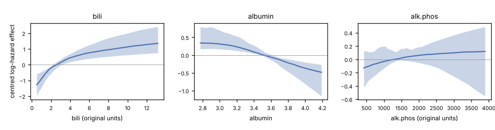
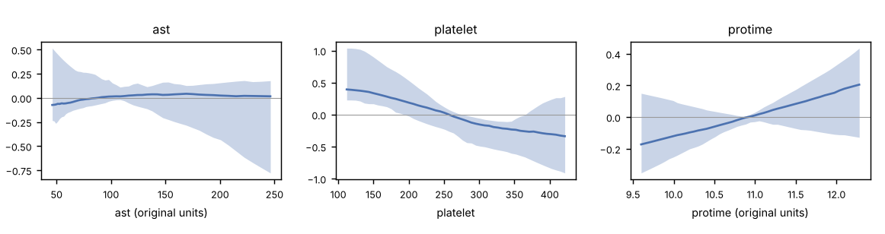
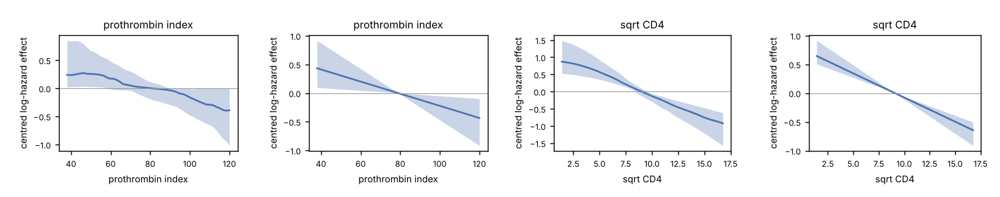

Journal main manuscript (Round 24, D165; updates the Round-23 version, which is kept unchanged). Generated
from saved records by <code>scripts/manuscript_journal_main_round24.py</code>; every number is read from a record, logged with
its source in <code>reports/manuscript_values_journal_main_round24.json</code> and required to be identical to a verified value
of the Supplementary Material (<code>reports/manuscript_round24.pdf</code>). <b>Draft for the owner's review: not peer reviewed; authors,
affiliations, funding and competing interests to be completed by the owner.</b>

**Authors:** [to be completed by the owner]  
**Status:** draft of a pre-registered empirical study; no novelty claim is made (D111).  
**Supplementary Material:** the cumulative study manuscript (`reports/manuscript_round24.pdf`, "S"); section and table
numbers prefixed with S refer to it.

## Abstract

**Background.** Clinical and engineering risk prediction often rests on covariates measured repeatedly over time.
Kolmogorov–Arnold networks (KANs) replace network weights by learnable univariate functions and have been adapted to
survival analysis with static covariates (Knottenbelt et al., 2025; Jose et al., 2025). Applied directly to trajectories, a
single-layer functional KAN under the Cox loss has the model form of the additive functional Cox model (AFCM)
(Cui et al., 2021), so its value has to be shown empirically: in the readability of its effects, in the tools it supports,
and in honest comparisons with simpler models.

**Methods.** We studied functional KAN survival models whose edges act on the trajectories themselves (a separable
bivariate layer, B2-S) under Cox, Weibull, log-normal and semiparametric accelerated failure time (AFT) losses, the
last with an error law estimated by Kaplan–Meier (NP-KAN-AFT). Three tools were added and tested in pre-registered
rounds on fresh simulation seeds: a fixed-weight symbolic distillation refit, a landmark anchor that adds the last
observed values and is kept only if confirmed in both halves of the validation split, and the semiparametric error
law. Comparators were AFCM, FPCA Cox, a two-stage mixed-effects Cox model, summary-based models, landmark Cox and, on the
clinical cohorts, a Bayesian multivariate joint model.
Real-data analyses covered four clinical cohorts used in earlier rounds, two untouched joineRML cohorts and four
C-MAPSS engine data sets, two of them untouched; a final round tested where the functional model helps, with more
splits, by thinning long histories and by blending the functional model with landmark Cox.

**Results.** The confirmatory comparison with AFCM was inconclusive (B2-S Cox − AFCM in identifiable shape error
+0.0065, 95% CI [−0.0506, +0.0635]), and
AFCM could not be validated even with per-channel marginal-likelihood smoothing (held-out check failed,
φ₁ 0.170). Both models recovered nonlinear effects far better than
linear functional models. The distillation refit was finite in all 40
refits and preserved the shapes. Cross-confirmed anchoring kept the gain when the last value carried the risk and
stayed within the registered margin otherwise (S-Sparse bound for Cox +0.0036).
NP-KAN-AFT was better than Cox and Weibull models under log-normal errors (−0.0135
and −0.0150 in survival-curve error).
Under a bimodal error law NP-KAN-AFT was better than all three parametric KAN models in every replicate
(−0.0423 against log-normal), and under heavy-tailed and
logistic laws better than the Cox and Weibull models (H-R22c supported). On two untouched cohorts anchoring and
distillation met their margins, but one baseline fit did not converge, so the registered all-finite criterion failed
(H-R22b not supported).
On every clinical cohort, no functional model was clearly better than landmark Cox on the last observed values, and
a blend of the two did not meet its non-inferiority margin (H-R23c not supported). On two untouched engine data sets with
long sensor histories NP-KAN-AFT had lower integrated Brier score than landmark Cox
(−0.0183 and −0.0139, both intervals below 0;
H-R23a supported), and on the clinical cohort with the longest histories thinning them to three visits made it clearly
worse (H-R23b supported). A pre-specified Bayesian joint model fitted on the same clinical partitions was not better
than NP-KAN-AFT on any cohort; NP-KAN-AFT was better on renal (−0.0439; H-R24a supported),
where the joint model fitted poorly, and non-inferiority to the joint model was not shown elsewhere (H-R24b not
supported).

**Conclusions.** Functional KANs give readable nonlinear trajectory effects, and the three tools make them safe to
summarise, to anchor and to use without choosing an error law; on small clinical cohorts with few visits a landmark
model on the last values is as good as the functional model and a Bayesian joint model, while on long, dense histories the functional model was better on untouched
data, and without that history it was worse.

## Keywords

Kolmogorov–Arnold networks; functional data; survival analysis; landmarking; accelerated failure time; symbolic
regression; interpretability; pre-registration.

## 1. Introduction

Risk models for chronic disease and for engineered systems increasingly use longitudinal covariates: repeated
laboratory values, biomarkers or sensor readings. Three families of methods are established. Landmark models
(van Houwelingen, 2007; van Houwelingen & Putter, 2012) use the most recent values at a prediction time; two-stage and joint
models (Laird & Ware, 1982; Wulfsohn & Tsiatis, 1997; Tsiatis & Davidian, 2004; Rizopoulos, 2010) summarise each trajectory through a mixed model;
functional regression models use the whole trajectory, linearly through functional principal components
(Yao et al., 2005; Kong et al., 2018) or nonlinearly in the additive functional Cox model (Cui et al., 2021), which places a smooth
bivariate surface F(x, t) inside the hazard. Neural survival models (Katzman et al., 2018; Lee et al., 2020) are flexible but hard to
read.

Kolmogorov–Arnold networks (Liu et al., 2025) place learnable univariate functions on the edges of a network, which can
be inspected, pruned and replaced by symbolic formulas. Survival versions exist for static covariates
(Knottenbelt et al., 2025; Jose et al., 2025; Mastroleo et al., 2026; Boulitsakis Logothetis et al., 2026). Applied to trajectories, a single functional KAN layer
under the Cox loss is a parametrisation of AFCM rather than a new model class, so any contribution must come from what
the parametrisation enables and must be shown against strong comparators, including those that do not use
trajectories at all.

This paper reports a sequence of pre-registered studies (Supplementary Section S2.8) organised around one thesis:
**functional KANs provide interpretable nonlinear survival modelling from longitudinal trajectories, with safe
symbolic distillation, conditional landmark anchoring and semiparametric AFT robustness, and the same studies show
where simpler landmark models suffice.** Each part of the thesis was tested by a registered hypothesis with fixed
criteria (Table 1), and the negative and inconclusive results are reported alongside the positive ones.

**Table 1. Pre-registered hypotheses and their verdicts.** Criteria, seeds and analyses were fixed before each run;
details in the Supplementary Material (H1 and H-R12: S3; Rounds 15–24: S5).

| Hypothesis | Stage | Question | Verdict |
|---|---|---|---|
| H1 | framing (b) | KAN-FAE − MLP-FAE, survival-curve error (simulation) | KAN-FAE worse |
| H-R12 | Round 12 | B2-S Cox − AFCM V3, identifiable RISE (simulation) | inconclusive |
| H-R15a / H-R16a | Rounds 15–16 | symbolic distillation refit finite and shape-preserving | not supported / supported |
| H-R15b / H-R16b | Rounds 15–16 | landmark-anchored B2-S: gain when the last value carries the risk, no loss otherwise | not supported / not supported |
| H-R17a / H-R17b | Round 17 | two-way gated anchoring (Cox / log-normal KAN-AFT) | not supported / supported |
| H-R18a / H-R18b | Round 18 | anchoring decided on a confirmation split (Cox / log-normal KAN-AFT) | supported / supported |
| H-R20a | Round 20 | NP-KAN-AFT under log-normal errors, against Cox and Weibull | supported |
| H-R20b | Round 20 | cross-confirmed anchoring against full-validation B2-S (three families) | supported |
| H-R21a / H-R21b / H-R21c | Round 21 | Round-20 methods on four clinical cohorts and C-MAPSS FD001 | not supported / supported / not supported |
| H-R22a | Round 22 | B2-S Cox − per-channel REML AFCM (run only if CK-6d passed) | not run (CK-6d failed) |
| H-R22b | Round 22 | untouched cohorts: every fit finite, anchoring and distillation within their margins | not supported |
| H-R22c | Round 22 | NP-KAN-AFT under bimodal, t₃ and logistic errors | supported |
| H-R23a | Round 23 | NP-KAN-AFT better than landmark Cox on untouched C-MAPSS FD002 and FD004 | supported |
| H-R23b | Round 23 | renal: thinning histories to three visits makes NP-KAN-AFT worse | supported |
| H-R23c (i) / (ii) | Round 23 | blend with landmark Cox: non-inferior on every clinical cohort / better on renal | not supported / not supported |
| H-R24a | Round 24 | renal: NP-KAN-AFT better than a Bayesian joint model | supported |
| H-R24b | Round 24 | NP-KAN-AFT non-inferior to the joint model on every clinical cohort | not supported |

## 2. Methods

### 2.1 Data, front end and functional layers

Subject i has longitudinal channels X_id(t) observed with noise in a history window rescaled to [0, 1], scalar
covariates z_i and a possibly right-censored outcome. Curves are reconstructed on a fixed grid by penalised B-spline
smoothing with the smoothing parameter chosen on training subjects only. The functional layer B2-S represents the
effect of channel d as a rank-two separable surface, φ_d(x, t) = Σ_m g_dm(x)h_dm(t), with every g and h a univariate
B-spline KAN edge, so that the effect is read separately in the value and in time; the linear predictor is
η = Σ_d ∫φ_d(X_d(t), t)dt + Σ_k ψ_k(z_k). Each model is a three-member ensemble with learning rate and weight decay
tuned on the validation loss (S2.3). The ensemble's prediction and its shape estimate are the members' means, which
is valid because η is additive in the edges; every functional effect is centred over the training data, the constant
being absorbed by the baseline.

Channel selection uses a sparsity penalty during training and a channel-level score, the mean absolute deviation of
the channel's integrated effect over the training subjects relative to the largest channel score; a channel whose
score falls below a threshold loses all its functional edges. Penalty and threshold are chosen by a parsimonious rule
on the validation loss (S2.5). The selected model is the object that is read, summarised and, where accepted, replaced
by formulas.

### 2.2 Survival losses

**Cox.** Exact partial likelihood (Cox, 1972) with Efron ties (Efron, 1977) and the Breslow baseline
(Breslow, 1974). **Parametric KAN-AFT.** log T = μ + η + σε with Weibull or log-normal ε. **NP-KAN-AFT.** The
location η is fitted by a smoothed Gehan rank objective and the error law is the Kaplan–Meier estimate (Kaplan & Meier, 1958)
of the training residuals, the classical semiparametric AFT model with a functional KAN location; it needs no choice of
error family (S5.7).

### 2.3 Symbolic distillation

Edges of the pruned model are fitted by a linear function, a library of affine-wrapped elementary functions and
symbolic regression (Cranmer, 2023), and accepted on validation R². Substituting accepted formulas without refit
reproduced the model, but an unconstrained refit drifted from it (S3.6). The **distillation refit** therefore refits
the substituted model with a fixed penalty towards the pruned model's predictions, rejects formulas whose argument
leaves the observed domain, falls back to the spline edge on any non-finite value and rolls back if the validation
loss rises (S5.2).

### 2.4 Conditional landmark anchoring

The anchored model adds the last observed value of each channel to B2-S, so it can use the most recent value as a
landmark model does. Because anchoring helps only when the last value carries the risk, it is used conditionally:
the validation split is halved, and the anchored model is kept only if it beats the unanchored model on both halves
by a registered margin; otherwise the unanchored ensemble is returned unchanged (**cross-confirmation**, S5.7). The
fallback is exact by construction, which was checked on every split.

### 2.5 Comparators and evaluation

Comparators were AFCM (a Python re-implementation with validation-chosen smoothing; S2.4), FPCA Cox (Kong et al., 2018),
a two-stage linear mixed-effects Cox model (Laird & Ware, 1982), Cox and random survival forest (Ishwaran et al., 2008) models on
trajectory summaries, landmark Cox on the last values (van Houwelingen, 2007) and, on the clinical cohorts, a
Bayesian multivariate joint model (Rizopoulos and Ghosh, 2011) (Section 4.4). In simulation the primary
measures were the identifiable relative integrated squared error of the functional effect (RISE) and the
survival-curve error against the oracle; on real data the inverse-probability-of-censoring weighted integrated Brier
score (Graf et al., 1999) (conditional on the covariates for the clinical cohorts), Harrell's and Uno's concordance
(Harrell et al., 1982; Uno et al., 2011) and D-calibration (Haider et al., 2020). Simulation contrasts were paired over replicates, with
equivalence by two one-sided tests (Schuirmann, 1987); real-data contrasts used five outer splits by subject and the
Nadeau–Bengio corrected interval (Nadeau & Bengio, 2003). Only the hypotheses of Table 1 are confirmatory.

### 2.6 Pre-registration and verification

Every round was registered in a decision log before its seeds or data were used, with the hypotheses, criteria,
seeds, models and analysis fixed; development work used seeds or data sets set aside for it, and every run, including
failed ones, is reported. Acceptance tests with fixed thresholds were written before the simulation, and a failure was
never converted by changing a seed or a threshold (S2.8). Every number in this paper and in the Supplementary Material
is rendered from the saved records and checked by an independent script (Appendix).

## 3. Simulation results

### 3.1 Design

The simulator generates three channels per subject on [0, 1] (a random level, trend and Fourier modes, observed with
noise), one of them a null channel, and a hazard that depends on a time-homogeneous sine effect of the first channel
and a time-varying effect of the second:

- **S-Add:** η = ∫sin(πX₁(t)/2)dt + ∫tanh(X₂(t))(1 + t)dt + 0.3z₁ − 0.3z₂, Weibull proportional hazards (shape 1.5), so the
  Cox model is correctly specified. φ₁ is time-homogeneous, φ₂ time-varying.
 Variants add sparse visits (S-Sparse), risk carried by the last
values (S-Last), and non-proportional hazards through an AFT location with non-Weibull errors (S-Misspec). Every
confirmatory test used seeds not used before (S3.1, S5.1). The identifiable RISE projects out directions of the effect
that no subject's trajectory can reveal, so that a model is not penalised for a component the data cannot identify
(S2.7).

### 3.2 Nonlinear effects: B2-S against AFCM

**Table 2. Confirmatory test H-R12 and sensitivity rows** (S-Add; a = B2-S, b = AFCM).

| Contrast (S-Add, identifiable RISE, 20 replicates) | Mean a | Mean b | Difference a − b | 95% CI | Paired-t p | Wilcoxon p | Replicates a < b / a > b | TOST p (±0.05) |
|---|---|---|---|---|---|---|---|---|
| **H-R12 (confirmatory): B2-S Cox (ensemble) − AFCM V3** | 0.1785 | 0.1720 | +0.0065 | [−0.0506, +0.0635] | 0.815 | 0.43 | 8 / 12 | 0.0634 |
| Sensitivity: B2-S Cox − AFCM V0 (Round-12a AFCM) | 0.1785 | 0.3578 | −0.1793 | [−0.2232, −0.1354] | 6.2e−8 | 3.81e−6 | 19 / 1 | 1 |
| Sensitivity: single-seed B2-S Cox − AFCM V3 | 0.2073 | 0.1720 | +0.0353 | [−0.0317, +0.1023] | 0.284 | 0.123 | 6 / 14 | 0.326 |
| Sensitivity: raw (Round-11) RISE | 0.1798 | 0.1742 | +0.0056 | [−0.0532, +0.0645] | 0.843 | 0.43 | 8 / 12 | 0.0655 |
| Per channel: φ₁ (homogeneous sin effect) | 0.2758 | 0.2453 | +0.0306 | [−0.0724, +0.1335] | 0.542 | 0.231 | 5 / 15 | 0.349 |
| Per channel: φ₂ (time-varying tanh effect) | 0.0812 | 0.0988 | −0.0176 | [−0.0356, +0.0003] | 0.0534 | 0.114 | 12 / 8 | 0.000639 |

B2-S and AFCM V3 recovered the nonlinear shapes to a similar degree and could not be separated: the confidence
interval included 0 and equivalence within ±0.05 was not shown, so H-R12 is **inconclusive** (Table 2). Both were far
better than models linear in functional principal component scores (Table 3).

**Table 3. S-Add, all models** (means over 20 replicates; RISE = identifiable RISE; "–" where a model has no
functional shape).

| Model | Mean RISE (φ₁, φ₂) | RISE φ₁ | RISE φ₂ | Curve error | IBS | Uno C | D-cal p < 0.05 |
|---|---|---|---|---|---|---|---|
| B2-S Cox (ensemble) | 0.1785 | 0.276 | 0.081 | 0.0487 | 0.1740 | 0.6628 | 5% |
| B2-S KAN-AFT | 0.2211 | 0.365 | 0.077 | 0.0497 | 0.1735 | 0.6638 | 0% |
| B2-H Cox | 0.1226 | 0.152 | 0.093 | 0.0469 | 0.1741 | 0.6631 | 0% |
| B2-H KAN-AFT | 0.1579 | 0.210 | 0.106 | 0.0484 | 0.1748 | 0.6616 | 0% |
| B2-S Cox, quantile input | 0.2336 | 0.395 | 0.072 | 0.0516 | 0.1747 | 0.6611 | 0% |
| AFCM V3 (not validated, CK-6c) | 0.1720 | 0.245 | 0.099 | 0.0476 | 0.1740 | 0.6629 | 0% |
| AFCM V0 | 0.3578 | 0.624 | 0.091 | 0.0572 | 0.1778 | 0.6535 | 0% |
| B1-FPCA-1 Cox | 0.7351 | 1.098 | 0.372 | 0.0898 | 0.1872 | 0.6257 | 5% |
| B1-FPCA-1 KAN-AFT | 0.6826 | 1.075 | 0.290 | 0.0795 | 0.1826 | 0.6381 | 0% |
| fpca_cox | 0.7082 | 1.125 | 0.291 | 0.0765 | 0.1820 | 0.6407 | 0% |
| B1-SUM Cox | – | – | – | 0.0879 | 0.1873 | 0.6276 | 5% |
| B1-SUM KAN-AFT | – | – | – | 0.0820 | 0.1853 | 0.6330 | 5% |
| sum_cox | – | – | – | 0.0744 | 0.1823 | 0.6394 | 0% |
| sum_rsf | – | – | – | 0.0904 | 0.1850 | 0.6353 | 10% |
| static CoxKAN (last values) | – | – | – | 0.1126 | 0.1937 | 0.5968 | 0% |

The functional models also had lower survival-curve error than the two-stage and summary models, and B2-S and AFCM did
not differ in curve error. The AFCM re-implementation failed its own
single-fit acceptance check; replacing its shared penalty by per-channel penalties estimated by a Fellner–Schall
update of the Laplace marginal likelihood (Wood, 2011; Wood and Fasiolo, 2017) passed three development seeds but failed on the
held-out seed (φ₁ 0.170; S5.10), so the confirmatory re-test was not
run and AFCM remains an unvalidated comparator.

### 3.3 Safe symbolic distillation

Distillation with a fixed penalty weight, the domain guard and the fallback was finite in all
40 refits and preserved the pruned shapes (S-Add RISE
difference −0.0004; H-R16a supported),
whereas its validation-tuned predecessor had failed (H-R15a). It carried over to the log-normal KAN-AFT (H-R17b, part
1). The refit is safe because it is strongly anchored to the pruned model, and for the same reason it does not improve
prediction over substitution alone.

**Table 4. Identifiable RISE of the symbolic models** (B2-S Cox, seed-0 member; S5.2).

| Model (identifiable RISE, mean over replicates) | Round 15 | Round 16 |
|---|---|---|
| S-Add, after pruning | 0.231 | 0.222 |
| S-Add, substituted, no refit | 0.230 | 0.222 |
| S-Add, old unconstrained refit | 1.202 | 1.214 |
| S-Add, distillation (R15: μ by validation; R16: μ = 10, NaN-safe) | 0.262 | 0.221 |
| S-Sparse, after pruning | 0.453 | 0.369 |
| S-Sparse, substituted, no refit | 0.453 | 0.369 |
| S-Sparse, old unconstrained refit | 10.999 | 3.539 |
| S-Sparse, distillation (R15: μ by validation; R16: μ = 10, NaN-safe) | 0.455 | 0.369 |

### 3.4 Conditional landmark anchoring

Anchoring to the last values is a trade-off. An always-anchored model was clearly better than B2-S Cox when the last
values carried the risk (S-Last, −0.0176)
and slightly worse when the whole trajectory did (S-Sparse,
+0.0032). Gating
on the validation loss did not remove that cost reliably (H-R17a), and deciding on a single confirmation split halved
the data available to each model (S5.5–S5.6). Cross-confirmation on both halves of the validation split, against
three-seed B2-S ensembles trained on the whole validation set, met every registered criterion for Cox, log-normal
KAN-AFT and NP-KAN-AFT on fresh seeds (H-R20b; Table 6), mainly by anchoring less often: on S-Sparse the Cox model
anchored in 1 of 20
replicates.

**Table 5. Survival-curve error of the always-anchored model** (Rounds 15 and 16; S5.3).

| Model (survival-curve error, mean over replicates) | Round 15 | Round 16 |
|---|---|---|
| S-Last, B2-S Cox | 0.1868 | 0.1869 |
| S-Last, landmark Cox | 0.1765 | 0.1768 |
| S-Last, static CoxKAN (last values) | 0.1690 | 0.1685 |
| S-Last, anchored, D133 gate | 0.1683 | 0.1688 |
| S-Last, anchored, non-cliff gate | – | 0.1693 |
| S-Sparse, B2-S Cox | 0.0823 | 0.0788 |
| S-Sparse, landmark Cox | 0.1074 | 0.1092 |
| S-Sparse, static CoxKAN (last values) | 0.1055 | 0.1072 |
| S-Sparse, anchored, D133 gate | 0.0869 | 0.0820 |
| S-Sparse, anchored, non-cliff gate | – | 0.0820 |

**Table 6. Round-20 hypotheses: NP-KAN-AFT (H-R20a) and cross-confirmed anchoring (H-R20b)** (fresh seeds; survival-curve
error).

| Hypothesis | S-Misspec: NP-AFT − B2-S Cox, 95% CI (rule: upper < 0) | S-Misspec: NP-AFT − B2-S Weibull AFT, 95% CI (rule: upper < 0) | Verdict |
|---|---|---|---|
| H-R20a (NP-AFT) | [−0.0165, −0.0106] | [−0.0189, −0.0111] | supported |

| Hypothesis | S-Last: cross-confirmed − full-validation B2-S, 95% CI (rule: upper < 0) | Trajectory scenario, 95% CI (rule: upper < +0.005) | Verdict |
|---|---|---|---|
| H-R20b, Cox | [−0.0153, −0.0042] | S-Sparse: [−0.0013, +0.0036] | supported |
| H-R20b, log-normal AFT | [−0.0190, −0.0109] | S-Misspec: [−0.0005, +0.0015] | supported |
| H-R20b, NP-AFT | [−0.0241, −0.0138] | S-Misspec: [−0.0005, +0.0015] | supported |
| H-R20b (all three families) |  |  | supported |

### 3.5 Semiparametric AFT robustness

The first step towards not assuming an error law was residual calibration: keeping the Weibull KAN-AFT's location
and scale but replacing its error law by the Kaplan–Meier estimate of the standardised training residuals. Under
log-normal errors it lowered curve error below B2-S Cox
(−0.0049),
but not under log-logistic errors (Table 7), because the location was still fitted under the wrong likelihood.
NP-KAN-AFT removes that dependence by fitting the location with a rank objective.

**Table 7. Error misspecification in Round 12** (S-Misspec; 20 replicates per error law).

| Error law | Model | Curve error | IBS | Mean D-cal p | Replicates with D-cal p < 0.05 |
|---|---|---|---|---|---|
| log-normal | B2-S Cox | 0.0493 | 0.1446 | 0.567 | 0% |
| log-normal | B2-S KAN-AFT (Weibull) | 0.0527 | 0.1452 | 0.175 | 25% |
| log-normal | B2-S KAN-AFT, residual-calibrated | 0.0445 | 0.1444 | 0.644 | 0% |
| log-normal | AFCM V3 | 0.0499 | 0.1450 | 0.500 | 0% |
| log-logistic | B2-S Cox | 0.0580 | 0.1777 | 0.541 | 5% |
| log-logistic | B2-S KAN-AFT (Weibull) | 0.0641 | 0.1792 | 0.308 | 15% |
| log-logistic | B2-S KAN-AFT, residual-calibrated | 0.0592 | 0.1786 | 0.581 | 0% |
| log-logistic | AFCM V3 | 0.0544 | 0.1765 | 0.571 | 5% |

**Table 8. NP-KAN-AFT on fresh seeds in Round 20** (survival-curve error).

| Fresh replicates | NP-AFT (rank_km) | B2-S Cox | B2-S Weibull AFT | B2-S log-normal AFT |
|---|---|---|---|---|
| S-Misspec | 0.0359 | 0.0495 | 0.0509 | 0.0370 |
| S-Sparse | 0.0837 | 0.0825 | – | – |

| Contrast (a − b) | Replicates | Mean difference | 95% CI | Paired-t p (two-sided) | a < b / a > b / ties |
|---|---|---|---|---|---|
| S-Misspec: NP-AFT − B2-S Cox | 20 | −0.0135 | [−0.0165, −0.0106] | 1.02e−8 | 20 / 0 / 0 |
| S-Misspec: NP-AFT − B2-S Weibull AFT | 20 | −0.0150 | [−0.0189, −0.0111] | 1.65e−7 | 20 / 0 / 0 |
| S-Sparse: NP-AFT − B2-S Cox (secondary) | 20 | +0.0012 | [−0.0007, +0.0031] | 0.202 | 9 / 11 / 0 |
| S-Misspec: NP-AFT − B2-S log-normal AFT (exploratory) | 20 | −0.0010 | [−0.0028, +0.0007] | 0.226 | 12 / 8 / 0 |
| S-Misspec, IBS: NP-AFT − B2-S Cox (exploratory) | 20 | −0.0034 | [−0.0048, −0.0020] | 7.63e−5 | 18 / 2 / 0 |
| S-Misspec, IBS: NP-AFT − B2-S Weibull AFT (exploratory) | 20 | −0.0022 | [−0.0037, −0.0007] | 0.00676 | 14 / 6 / 0 |

Under log-normal errors NP-KAN-AFT was better than B2-S Cox in 20
of 20 replicates and better than the Weibull KAN-AFT in
20 (H-R20a), but not shown to be better than the
correctly specified log-normal model (−0.0010). Round 22
tested three further error laws, each with mean 0 and SD 0.5 and twenty fresh replicates (H-R22c; Table 9).

**Table 9. NP-KAN-AFT against the parametric B2-S models under three further error laws** (survival-curve error, paired
t over replicates).

| Error law | Contrast, survival-curve error | Replicates | Mean difference | 95% CI | a < b / a > b |
|---|---|---|---|---|---|
| bimodal normal mixture | NP-KAN-AFT − Cox | 20 | −0.0422 | [−0.0452, −0.0392] | 20 / 0 |
| bimodal normal mixture | NP-KAN-AFT − Weibull AFT | 20 | −0.0443 | [−0.0469, −0.0418] | 20 / 0 |
| bimodal normal mixture | NP-KAN-AFT − log-normal AFT | 20 | −0.0423 | [−0.0445, −0.0400] | 20 / 0 |
| Student t, 3 df | NP-KAN-AFT − Cox | 20 | −0.0285 | [−0.0323, −0.0247] | 20 / 0 |
| Student t, 3 df | NP-KAN-AFT − Weibull AFT | 20 | −0.0385 | [−0.0445, −0.0325] | 20 / 0 |
| Student t, 3 df | NP-KAN-AFT − log-normal AFT | 20 | −0.0202 | [−0.0276, −0.0128] | 20 / 0 |
| logistic | NP-KAN-AFT − Cox | 20 | −0.0150 | [−0.0178, −0.0122] | 20 / 0 |
| logistic | NP-KAN-AFT − Weibull AFT | 20 | −0.0192 | [−0.0226, −0.0158] | 20 / 0 |
| logistic | NP-KAN-AFT − log-normal AFT | 20 | −0.0034 | [−0.0058, −0.0010] | 17 / 3 |

H-R22c was supported (Table 1). Under the bimodal law, which no parametric family in the comparison can represent,
NP-KAN-AFT had less than half the survival-curve error of the parametric models
(0.0328 against 0.0750
for B2-S Cox) and was better in every replicate against each. The advantage was smaller under the t₃ law and smallest
against the log-normal model under the logistic law, which is close to the normal
(−0.0034, upper bound
−0.0010; S5.12).

## 4. Real-data results

### 4.1 Cohorts

Four clinical cohorts were analysed in earlier rounds: PBC with six laboratory channels and two endpoints
(Murtaugh et al., 1994; Fleming & Harrington, 1991), `prothro` and `aids` (Rizopoulos, 2010; Andersen et al., 1993; Guo & Carlin, 2004). Two cohorts from
joineRML (Hickey et al., 2018) were used for the first time in Round 22: `renal` (glomerular filtration rate and
haematocrit after kidney transplantation, graft failure; (Rizopoulos and Ghosh, 2011)) and `heart.valve` (left-ventricular
mass index and valve gradient after aortic valve replacement, death; (Lim et al., 2008)). C-MAPSS turbofan data
(Saxena et al., 2008) served for calibration (FD001, and FD003, which had been analysed in an early round and so is not
untouched); FD002 and FD004, with six operating conditions each, were not used before Round 23. Up to Round 22 all
real-data comparisons are exploratory, on five outer splits per cohort, stratified on the event, with the history up
to a single landmark used as input and the residual time after it as outcome; Round 23 used ten engine splits and twenty
new clinical partitions (Section 4.3).

**Table 10. The earlier clinical cohorts at their landmarks** (descriptive).

| Data set | Landmark | Subjects | At risk at the landmark (cohort) | Events after the landmark | Visits in the window: median (IQR; range) |
|---|---|---|---|---|---|
| PBC, E2 (primary) | 730 (days) | 312 | 278 | 135 | 3 (3–3; range 1–5) |
| PBC, E1 (sensitivity) | 730 (days) | 312 | 278 | 107 | 3 (3–3; range 1–5) |
| prothro | 1 (years) | 488 | 332 | 183 | 3 (3–4; range 1–5) |
| aids | 6 (months) | 467 | 403 | 126 | 3 (2–3; range 1–3) |

**Table 11. The untouched joineRML cohorts at the one-year landmark.**

| Cohort | Patients | Landmark (years) | At risk at the landmark | Events after the landmark | Median visits before the landmark | Patients with no visit, channel 1 / 2 |
|---|---|---|---|---|---|---|
| renal | 407 | 1.0 | 407 | 126 | 97.0 | 1 / 0 |
| heart valve | 256 | 1.0 | 175 | 39 | 1.0 | 0 / 38 |

### 4.2 Prediction against simpler models

**Table 12. B2-S Cox minus three baselines on the earlier clinical cohorts** (integrated Brier score; mean and
Nadeau–Bengio corrected 95% interval over the outer splits).

| Data set | B2-S Cox − landmark Cox | B2-S Cox − two-stage mixed-effects Cox | B2-S Cox − FPCA Cox |
|---|---|---|---|
| PBC E2 | +0.023 [−0.026, +0.073] | +0.017 [−0.014, +0.047] | +0.017 [−0.011, +0.046] |
| PBC E1 | +0.011 [−0.002, +0.024] | +0.005 [−0.006, +0.016] | +0.007 [−0.008, +0.023] |
| prothro | +0.002 [−0.011, +0.016] | +0.002 [−0.015, +0.020] | −0.003 [−0.022, +0.017] |
| aids | +0.000 [−0.003, +0.004] | +0.002 [−0.000, +0.005] | +0.003 [−0.003, +0.009] |

No functional or KAN model was clearly better than the simple baselines on the earlier cohorts: every interval in Table 12
includes 0, and on PBC landmark Cox had the lowest mean integrated Brier score
(0.127 against
0.150 for B2-S Cox). The locked Round-20
methods behaved in the same way: NP-KAN-AFT was finite and D-calibrated but did not match the Weibull KAN-AFT on the
primary PBC endpoint (H-R21a not supported), and cross-confirmed anchoring never cost more than the registered margin
(H-R21b supported; S5.9; Table 13).

**Table 13. Round-21 hypotheses** (the four earlier clinical cohorts and C-MAPSS FD001; criteria fixed before the run).

| Hypothesis | Criterion | Result | Verdict |
|---|---|---|---|
| H-R21a (1) | all clinical NP-KAN-AFT fits finite | 20 fits | supported |
| H-R21a (2) | PBC E2 mean NP − Cox ≤ +0.005 and NP − Weibull ≤ 0 | −0.0095; +0.0044 | not supported |
| H-R21a (3) | PBC E2 D-cal p ≥ 0.05 on ≥ 4 of 5 splits | 5 of 5 | supported |
| H-R21a | all three parts |  | not supported |
| H-R21b | every data set: anchored − B2-S mean ≤ +0.005 (Cox and NP) and exact fallback |  | supported |
| H-R21c | C-MAPSS: better D-calibration than B2-S Cox with IBS ≤ 0.055 and Harrell C ≥ 0.88 |  | not supported |
| H-R21c, relative (secondary) | the same with IBS ≤ Cox + 0.005 and Harrell C ≥ Cox − 0.01 |  | supported |

**Table 14. Untouched cohorts: functional models against landmark Cox and the two-stage mixed-effects Cox model**
(conditional integrated Brier score; Nadeau–Bengio corrected and plain 95% intervals over five splits).

| Contrast (a − b), conditional IPCW IBS | Splits | Mean difference | Nadeau–Bengio 95% CI | Plain 95% CI | a < b / a > b |
|---|---|---|---|---|---|
| renal: NP-KAN-AFT − landmark Cox | 5 | −0.0096 | [−0.0475, +0.0283] | [−0.0329, +0.0137] | 3 / 2 |
| renal: B2-S Cox − landmark Cox | 5 | −0.0161 | [−0.0505, +0.0184] | [−0.0372, +0.0051] | 4 / 1 |
| renal: B2-S Cox − two-stage mixed-effects Cox | 5 | −0.0154 | [−0.0539, +0.0231] | [−0.0390, +0.0083] | 4 / 1 |
| heart valve: NP-KAN-AFT − landmark Cox | 5 | +0.0031 | [−0.0059, +0.0122] | [−0.0024, +0.0087] | 1 / 4 |
| heart valve: B2-S Cox − landmark Cox | 5 | −0.0014 | [−0.0240, +0.0213] | [−0.0152, +0.0125] | 2 / 3 |
| heart valve: B2-S Cox − two-stage mixed-effects Cox | 5 | −0.0069 | [−0.0307, +0.0169] | [−0.0214, +0.0077] | 4 / 1 |

On the untouched cohorts every interval in Table 14 includes 0. On renal several functional models had lower mean
conditional IBS than landmark Cox (B2-S Cox −0.0161,
lower on 4 of five splits); renal patients
had a median of 97.0 visits before the landmark against
1.0 for heart valve (Table 11), where the two models were
almost equal; five splits cannot turn this into a finding. Cross-confirmation accepted the anchor on at most one
split per family and cohort and cost at most +0.0046 (Table 15), and
distillation was finite on every split (Table 16), so parts 2 and 3 of H-R22b were met. Part 1 was not: the summary
Cox baseline did not converge on one heart-valve split, so **H-R22b is not supported** as registered (S5.11).

**Table 15. Cross-confirmed anchoring on the untouched cohorts** (H-R22b part 2).

| Cohort | Family | Splits confirming (of 5) | Anchored − unanchored, mean conditional IBS | Exact fallback | Within +0.005 with exact fallback |
|---|---|---|---|---|---|
| renal | Cox | 0 | +0.0000 | yes | yes |
| renal | log-normal AFT | 1 | +0.0023 | yes | yes |
| renal | NP-KAN-AFT | 1 | +0.0042 | yes | yes |
| heart valve | Cox | 1 | +0.0046 | yes | yes |
| heart valve | log-normal AFT | 1 | +0.0035 | yes | yes |
| heart valve | NP-KAN-AFT | 1 | +0.0033 | yes | yes |

**Table 16. Fixed-μ symbolic distillation on the untouched cohorts** (H-R22b part 3; seed-0 member of each ensemble).

| Cohort | Model (seed-0 member) | Edges substituted (mean share) | Rollbacks (of 5) | Conditional IBS, spline | After distillation | Mean change |
|---|---|---|---|---|---|---|
| renal | NP-KAN-AFT | 0.78 | 2 | 0.1543 | 0.1530 | −0.0013 |
| renal | B2-S Cox | 0.71 | 2 | 0.1504 | 0.1492 | −0.0011 |
| heart valve | NP-KAN-AFT | 0.80 | 4 | 0.1594 | 0.1592 | −0.0002 |
| heart valve | B2-S Cox | 0.45 | 2 | 0.1491 | 0.1492 | +0.0001 |

**Table 17. C-MAPSS FD003 Option B** (means over five engine splits; descriptive).

| Model | IBS | Harrell C | Uno C | D-cal p ≥ 0.05 (of 5) |
|---|---|---|---|---|
| B2-S Cox | 0.0885 | 0.873 | 0.877 | 0 |
| B2-S Weibull AFT | 0.0870 | 0.874 | 0.879 | 0 |
| B2-S log-normal AFT | 0.0850 | 0.874 | 0.879 | 1 |
| NP-KAN-AFT | 0.0834 | 0.878 | 0.884 | 1 |
| Cross-confirmed, NP-KAN-AFT | 0.0837 | 0.878 | 0.883 | 1 |
| Landmark Cox | 0.1020 | 0.838 | 0.843 | 0 |
| Summary Weibull AFT | 0.0863 | 0.868 | 0.874 | 0 |
| FPCA Weibull AFT | 0.0878 | 0.861 | 0.867 | 0 |

On FD003 NP-KAN-AFT had the lowest mean IBS (0.0834, against
0.1020 for landmark Cox), but D-calibration passed on at most one split for any
model (S5.11).

### 4.3 Where the functional model helps (Round 23)

Earlier rounds suggested a pattern that no interval could confirm: functional models had lower mean error than landmark
Cox on renal, whose patients had long histories, and on FD003, but not on the cohorts with few visits. Round 23
tested this directly, with more splits, because the Nadeau–Bengio correction leaves five splits with little power
(S5.13). On FD002 and FD004 the sensors were z-scored within each operating condition and windowed as for FD003;
NP-KAN-AFT, at one fixed setting to bound its cost, was compared with landmark Cox on the last raw or smoothed sensor
values (whichever had the lower validation error) and with the summary and FPCA Weibull AFT models, over ten engine
splits. On renal, NP-KAN-AFT was refitted after thinning every history to three visits. On all six clinical cohorts, a
blend of the two survival curves, with its weight chosen on validation, was compared with landmark Cox. The clinical
analyses used twenty new partitions of data analysed before, so they are re-analyses.

**Table 18. Untouched C-MAPSS FD002 and FD004** (means over ten engine splits).

| Model | FD002 IBS | FD002 Harrell C | FD002 D-cal p ≥ 0.05 (of 10) | FD004 IBS | FD004 Harrell C | FD004 D-cal p ≥ 0.05 (of 10) |
|---|---|---|---|---|---|---|
| NP-KAN-AFT | 0.0764 | 0.867 | 2 | 0.0864 | 0.855 | 5 |
| Landmark Cox (version chosen on validation) | 0.0947 | 0.835 | 0 | 0.1003 | 0.827 | 0 |
| Blend (landmark Cox and NP-KAN-AFT) | 0.0763 | 0.867 | 2 | 0.0865 | 0.853 | 2 |
| Summary Weibull AFT | 0.0821 | 0.856 | 0 | 0.0978 | 0.832 | 1 |
| FPCA Weibull AFT | 0.0876 | 0.847 | 0 | 0.0997 | 0.830 | 0 |

**Table 19. Round-23 contrasts** (test IBS for C-MAPSS, conditional IBS for renal; Nadeau–Bengio corrected 95% intervals).

| Contrast (a − b) | Splits | Mean difference | Nadeau–Bengio 95% CI | a < b / a > b |
|---|---|---|---|---|
| FD002: NP-KAN-AFT − landmark Cox | 10 | −0.0183 | [−0.0265, −0.0101] | 10 / 0 |
| FD002: NP-KAN-AFT − summary Weibull AFT | 10 | −0.0057 | [−0.0106, −0.0009] | 10 / 0 |
| FD002: NP-KAN-AFT − FPCA Weibull AFT | 10 | −0.0112 | [−0.0159, −0.0064] | 10 / 0 |
| FD004: NP-KAN-AFT − landmark Cox | 10 | −0.0139 | [−0.0253, −0.0024] | 9 / 1 |
| FD004: NP-KAN-AFT − summary Weibull AFT | 10 | −0.0114 | [−0.0207, −0.0021] | 9 / 1 |
| FD004: NP-KAN-AFT − FPCA Weibull AFT | 10 | −0.0133 | [−0.0244, −0.0022] | 10 / 0 |
| renal: NP-KAN-AFT, full history − three visits | 20 | −0.0287 | [−0.0468, −0.0106] | 19 / 1 |
| renal: NP-KAN-AFT, three visits − landmark Cox | 20 | +0.0217 | [+0.0034, +0.0400] | 1 / 19 |
| renal: NP-KAN-AFT, full history − landmark Cox | 20 | −0.0070 | [−0.0239, +0.0098] | 13 / 7 |

On both engine data sets NP-KAN-AFT was better than landmark Cox, with intervals excluding 0 (H-R23a supported), and
also better than the summary and FPCA AFT models (Tables 18 and 19); its Harrell C was higher by
+0.032 and +0.028. Its calibration was
weak: D-calibration passed on 2 of ten FD002 and 5 of ten FD004 splits, and on none for landmark Cox. On renal,
three visits instead of the full history raised NP-KAN-AFT's conditional IBS from
0.1498 to 0.1785 (H-R23b supported) and made it worse than landmark
Cox. The blend had a lower mean than landmark Cox on five of six clinical cohorts, but no upper bound was within the
registered +0.005, so non-inferiority was not shown (H-R23c not supported; Table 20).

**Table 20. Clinical cohorts, twenty new partitions each** (mean conditional IBS; Nadeau–Bengio corrected 95% intervals).

| Cohort | Median visits | NP-KAN-AFT | Landmark Cox | Blend | Blend − landmark Cox (NB 95% CI) | NP-KAN-AFT − landmark Cox (NB 95% CI) |
|---|---|---|---|---|---|---|
| PBC E2 | 3 | 0.1382 | 0.1389 | 0.1358 | −0.0031 [−0.0141, +0.0079] | −0.0007 [−0.0179, +0.0165] |
| PBC E1 | 3 | 0.1264 | 0.1300 | 0.1248 | −0.0052 [−0.0187, +0.0084] | −0.0036 [−0.0218, +0.0146] |
| prothro | 3 | 0.2167 | 0.2109 | 0.2137 | +0.0028 [−0.0047, +0.0104] | +0.0058 [−0.0047, +0.0163] |
| aids | 3 | 0.1753 | 0.1740 | 0.1738 | −0.0002 [−0.0058, +0.0055] | +0.0013 [−0.0062, +0.0089] |
| renal | 97 | 0.1498 | 0.1569 | 0.1491 | −0.0077 [−0.0218, +0.0063] | −0.0070 [−0.0239, +0.0098] |
| heart valve | 1 | 0.1388 | 0.1367 | 0.1353 | −0.0013 [−0.0209, +0.0182] | +0.0021 [−0.0213, +0.0256] |

### 4.4 Comparison with a Bayesian joint model (Round 24)

Joint models are the reference method for dynamic prediction from longitudinal markers, and none had been fitted in the
earlier rounds. Round 24 fitted a Bayesian multivariate joint model (`JMbayes2`) on the six clinical cohorts and the
Round-23 partitions, so that it pairs partition by partition with the NP-KAN-AFT and landmark Cox results (S5.14). It
was fitted on the training subjects' full observed histories: a linear mixed model per marker, with a straight-line or
natural-spline mean trajectory chosen on validation and a subject-specific intercept and slope, linked by the current
marker values to a Cox submodel with delayed entry at the landmark; test subjects received its dynamic prediction from
their history up to the landmark. Failed fits were recorded and not refitted, and C-MAPSS, where every engine window is
an event, was not analysed.

**Table 21. The joint model on the clinical cohorts** (mean conditional IBS over the Round-23 partitions; Nadeau–Bengio
corrected 95% intervals; S5.14).

| Cohort | NP-KAN-AFT | Landmark Cox | Joint model | NP-KAN-AFT − joint model (NB 95% CI) | Harrell C, NP-KAN-AFT / joint model | Joint model: D-calibration passed | Joint-model fits failed |
|---|---|---|---|---|---|---|---|
| PBC E2 | 0.1382 | 0.1389 | 0.1403 | −0.0021 [−0.0336, +0.0294] | 0.821 / 0.824 | 20 | 0 |
| PBC E1 | 0.1264 | 0.1300 | 0.1222 | +0.0042 [−0.0175, +0.0259] | 0.831 / 0.836 | 18 | 0 |
| prothro | 0.2167 | 0.2109 | 0.2150 | +0.0017 [−0.0102, +0.0136] | 0.577 / 0.589 | 20 | 0 |
| aids | 0.1753 | 0.1740 | 0.1704 | +0.0049 [−0.0047, +0.0146] | 0.699 / 0.709 | 20 | 0 |
| renal | 0.1498 | 0.1569 | 0.1939 | −0.0439 [−0.0758, −0.0120] | 0.699 / 0.645 | 1 | 1 |
| heart valve | 0.1388 | 0.1367 | 0.1352 | +0.0022 [−0.0193, +0.0237] | 0.674 / 0.687 | 18 | 2 |

The joint model was fitted on 117 of 120 partitions. On renal NP-KAN-AFT was better than
the joint model on every compared partition, with an interval below 0 (H-R24a supported), but the joint model was also
worse than landmark Cox there (−0.0375) and passed D-calibration on
1 partition: its straight-line or smooth-mean trajectories follow the long renal histories
poorly, so this shows a weakness of the pre-specified joint model rather than an advantage over joint models in
general. On the other five cohorts all three models were close and every interval of NP-KAN-AFT minus the joint model
included 0, but the upper bounds were above the registered +0.005, so non-inferiority was not shown (H-R24b not
supported). The joint model's sampler mixed poorly on many PBC and heart-valve partitions (S5.14).

### 4.5 Readable effects

{width=100%}

{width=100%}

**Figure 1. Time-averaged B2-S Cox effects on PBC** (endpoint death or transplantation): centred log-hazard effect of
each marker in original units, median and band over the bootstrap fits; first row bilirubin, albumin, alkaline
phosphatase; second row AST, platelets, prothrombin time (S4.4).

Pruning selected bilirubin, albumin and platelets in every PBC split; the leading effects were stable over
100 bootstrap fits and pointed in the
clinically expected directions (Figure 1), with one exception (the prothrombin index under B2-S; S4.4). Accepted
symbolic formulas, substituted without refit, reproduced the model on every data set (S4.3), so each leading effect
can be reported as a short formula in the original units (Table 22).

**Table 22. Accepted formulas carrying a large share of their layer's score** (PBC and the other earlier cohorts, split
0; S4.3).

| Data set | Input | Stage | Formula (x in the input's original units; log scale for log markers) | Validation R² | Share of layer score |
|---|---|---|---|---|---|
| PBC, E2 (primary) | log bili | library | `0.0664907*softplus(7.85335*x + 3.67257) + -0.400435` | 0.9975 | 0.27 |
| PBC, E2 (primary) | log bili | library | `0.873117*sin(0.604565*x + -0.705121) + 0.331042` | 0.9969 | 0.25 |
| PBC, E2 (primary) | albumin | pysr | `x*(x - 1*(-0.8958103))*0.05707035*tanh(sin(x - 1*0.3166966))` | 0.9994 | 0.16 |
| PBC, E2 (primary) | platelet | library | `-0.19994*softplus(0.0438834*x + -12.6488) + 0.0541648` | 0.9992 | 0.15 |
| PBC, E2 (primary) | baseline: age | library | `-0.284646*softplus(0.280064*x + -17.5709) + -0.0609961` | 0.9937 | 1.00 |
| PBC, E1 (sensitivity) | log bili | library | `0.0814239*softplus(6.30322*x + 3.65564) + -0.418803` | 0.9974 | 0.25 |
| PBC, E1 (sensitivity) | log bili | library | `0.0641378*softplus(6.8961*x + 4.19721) + -0.44711` | 0.9978 | 0.22 |
| PBC, E1 (sensitivity) | platelet | library | `-0.176997*softplus(0.045381*x + -15.3275) + 0.0120166` | 0.9958 | 0.10 |
| PBC, E1 (sensitivity) | baseline: age | library | `0.75958*gaussian(-0.053767*x + 3.46064) + -0.60234` | 0.9987 | 1.00 |
| prothro | prothrombin index | library | `-0.126149*softplus(0.150285*x + -12.5427) + 0.0713763` | 0.9956 | 0.53 |
| prothro | prothrombin index | library | `0.366361*softplus(0.053295*x + -4.74823) + -0.110088` | 0.9981 | 0.47 |
| prothro | baseline: prednisone | linear | `0.563702*x + 0.0159156` | 1.0000 | 1.00 |
| aids | sqrt CD4 | library | `-1.03429*tanh(-0.139629*x + 1.42946) + 0.644688` | 0.9996 | 1.00 |
| aids | baseline: prevOI_AIDS | linear | `0.681901*x + -0.233717` | 1.0000 | 1.00 |

**Table 23. Stability and clinical alignment of the leading effects** (bootstrap fits per model and data set; S4.4).

| Data set | Model | Channel | Bootstrap fits | Stability R² (time-averaged effect) | Mean pairwise cosine | Stated clinical direction of risk | Share of fits monotone (aligned if ≥ 80%) |
|---|---|---|---|---|---|---|---|
| PBC, E2 (primary) | B2-S Cox | log bili | 100 | 0.986 | 0.993 | increasing | 1.00 (aligned) |
| PBC, E2 (primary) | B2-S Cox | albumin | 100 | 0.966 | 0.954 | decreasing | 0.90 (aligned) |
| PBC, E2 (primary) | B2-S Cox | log alk.phos | 100 | 0.780 | 0.287 | – | – |
| PBC, E2 (primary) | B2-S Cox | log ast | 100 | 0.636 | 0.120 | – | – |
| PBC, E2 (primary) | B2-S Cox | platelet | 100 | 0.771 | 0.834 | – | – |
| PBC, E2 (primary) | B2-S Cox | log protime | 100 | 0.907 | 0.487 | increasing | 0.81 (aligned) |
| PBC, E2 (primary) | B1-FPCA-1 Cox | log bili | 100 | 1.000 | 1.000 | increasing | 1.00 (aligned) |
| PBC, E2 (primary) | B1-FPCA-1 Cox | albumin | 100 | 1.000 | 1.000 | decreasing | 1.00 (aligned) |
| PBC, E2 (primary) | B1-FPCA-1 Cox | log alk.phos | 100 | 1.000 | 0.543 | – | – |
| PBC, E2 (primary) | B1-FPCA-1 Cox | log ast | 100 | 1.000 | 0.960 | – | – |
| PBC, E2 (primary) | B1-FPCA-1 Cox | platelet | 100 | 1.000 | 0.772 | – | – |
| PBC, E2 (primary) | B1-FPCA-1 Cox | log protime | 100 | 1.000 | 0.772 | increasing | 0.94 (aligned) |
| prothro | B2-S Cox | prothrombin index | 100 | 0.832 | 0.774 | decreasing | 0.72 (**not aligned**) |
| prothro | B1-FPCA-1 Cox | prothrombin index | 100 | 1.000 | 0.921 | decreasing | 0.98 (aligned) |
| aids | B2-S Cox | sqrt CD4 | 100 | 0.985 | 0.993 | decreasing | 0.99 (aligned) |
| aids | B1-FPCA-1 Cox | sqrt CD4 | 100 | 1.000 | 1.000 | decreasing | 1.00 (aligned) |

{width=100%}

**Figure 2.** From left: prothro, B2-S Cox; prothro, B1-FPCA-1 Cox; aids, B2-S Cox; aids, B1-FPCA-1 Cox (prothrombin
index and square-root CD4 in original units). The linear-in-scores B1-FPCA-1 model can only scale one fixed shape,
whereas B2-S lets the shape follow the data.

## 5. Discussion

### 5.1 What the study supports

The evidence supports the thesis with clear boundaries. Functional KANs recover nonlinear trajectory effects as well
as the additive functional Cox model in our simulation, though the comparison was inconclusive and the comparator
unvalidated, and far better than linear functional models. Their edges can be pruned, read and summarised by formulas,
and a strongly anchored distillation refit makes the summaries safe. Landmark anchoring helps when the last value
carries the risk and, used conditionally with cross-confirmation, costs little when it does not. Estimating the AFT
error law by Kaplan–Meier removes the need to choose an error family, and helps most when no parametric family fits
the error law. On untouched engine data with long sensor histories the functional KAN-AFT predicted better than a
landmark model and two-stage AFT models, and without its long history it was worse than a landmark model. A standard
Bayesian joint model was not better than the functional model or landmark Cox on the clinical cohorts.

### 5.2 Where simpler landmark models suffice

On every clinical cohort, including the two untouched ones, no functional model was clearly better than landmark Cox
on the last observed values, and on the earlier cohorts landmark Cox often had the lowest mean. These cohorts have a
few hundred subjects and, in most of them, one to three visits before the landmark, so the most recent value carries
most of what a curve could add. Round 23 tested this reading: with long, dense sensor histories the functional model
was better than landmark Cox on untouched data, and thinning the longest clinical histories to three visits made it
worse than landmark Cox. A functional model therefore earns its cost when the history of the trajectory carries the
risk; with few visits, a landmark model on the last values is the sensible choice, and blending the two did not give a
gain that small validation sets could confirm.

### 5.3 Relation to prior work

The additive functional Cox model (Cui et al., 2021) already offers the model form of a single-layer functional CoxKAN, and
our inconclusive comparison is consistent with that. What the KAN parametrisation adds is a uniform toolkit (pruning,
symbolic summaries and composition of layers) and, in our hands, three tools that the toolkit made natural to build
and test. KAN survival models for static covariates (Knottenbelt et al., 2025; Jose et al., 2025; Mastroleo et al., 2026; Boulitsakis Logothetis et al., 2026) and a
KAN joint-model abstract (Lundin et al., 2025) address other input structures. Landmarking
(van Houwelingen, 2007; van Houwelingen & Putter, 2012; Putter & van Houwelingen, 2022) and joint models (Wulfsohn & Tsiatis, 1997; Rizopoulos, 2010; Rizopoulos and Ghosh, 2011)
remain the reference methods for dynamic prediction; in our clinical cohorts a pre-specified Bayesian joint model
(Rizopoulos and Ghosh, 2011) was not better than landmark Cox, and our real-data results agree with the common experience that
a well-specified landmark model is hard to beat on small cohorts. The semiparametric AFT model with a Kaplan–Meier error
law is classical; what we tested is its use with a functional KAN location and its robustness across error laws.

### 5.4 Limitations

The AFCM comparator could not be validated, so H-R12 cannot distinguish the two models. The Phase-2 tools were
designed after earlier failures and tuned on few seeds, although each was then tested on fresh ones. The simulation
has one data-generating design. The real cohorts are small and five splits cannot power superiority claims; FD003 is
not untouched and the heart-valve cohort has about one visit per patient before the landmark. In Round 23 NP-KAN-AFT
was fitted at one fixed setting on C-MAPSS to bound its cost and was poorly calibrated there; the clinical partitions
re-analyse known data, and the thinning test used one cohort. Only one joint-model specification was fitted, its
sampler mixed poorly on many partitions and it fitted renal poorly; no deep dynamic model was fitted, and our literature review was targeted rather than systematic, so we make no claim of
novelty. Full limitations are listed in S6.3.

### 5.5 Conclusions

Functional KANs are a workable, interpretable way to model nonlinear effects of longitudinal trajectories on
survival. With a strongly anchored distillation refit, cross-confirmed landmark anchoring and a Kaplan–Meier error
law, they can be summarised safely, adapt to whether the last value or the trajectory carries the risk, and avoid
choosing an AFT error family. They were not better than simpler landmark models on small clinical cohorts with few
visits, but were better on untouched engine data with long sensor histories, and the pre-registered record of where
they help and where they do not is the contribution.

## Declarations

- **Data availability.** PBC (`pbcseq`, R package `survival`), `aids` and `prothro` (JM), `renal` and `heart.valve`
  (joineRML) from CRAN; C-MAPSS FD001 to FD004 from the NASA prognostics data repository; checksums in `reports/run_manifest.json`.
- **Code availability.** All code, tests, pre-registrations, decision logs and records are in one repository.
- **Supplementary Material.** The cumulative study manuscript (`reports/manuscript_round24.pdf`), with every
  pre-registered round, all tables and the number-provenance appendix.
- **Use of AI tools.** The code, analyses and this draft were produced with an AI coding assistant (Claude Code)
  working under the owner's recorded decisions; every number was generated from saved records.
- **Authors' contributions, funding, competing interests, ethics.** To be completed by the owner. The data sets are
  public and de-identified.

## References

- Andersen et al. (1993). Andersen P.K., Borgan Ø., Gill R.D., Keiding N. *Statistical Models Based on Counting Processes.* Springer Series in Statistics. Springer. doi:10.1007/978-1-4612-4348-9
- Boulitsakis Logothetis et al. (2026). Boulitsakis Logothetis S., Wood A., Liò P. KAPLAN: Kolmogorov-Arnold prognostic learnable activation networks for survival analysis. arXiv:2605.23082
- Breslow (1974). Breslow N. Covariance analysis of censored survival data. *Biometrics* 30(1):89 (first page). doi:10.2307/2529620
- Cox (1972). Cox D.R. Regression models and life-tables. *Journal of the Royal Statistical Society, Series B* 34(2):187–202. doi:10.1111/j.2517-6161.1972.tb00899.x
- Cranmer (2023). Cranmer M. Interpretable machine learning for science with PySR and SymbolicRegression.jl. arXiv:2305.01582
- Cui et al. (2021). Cui E., Crainiceanu C.M., Leroux A. Additive functional Cox model. *Journal of Computational and Graphical Statistics* 30(3):780–793. doi:10.1080/10618600.2020.1853550
- Efron (1977). Efron B. The efficiency of Cox's likelihood function for censored data. *Journal of the American Statistical Association* 72(359):557–565. doi:10.1080/01621459.1977.10480613
- Fleming & Harrington (1991). Fleming T.R., Harrington D.P. *Counting Processes and Survival Analysis.* Wiley (online edition 2005). doi:10.1002/9781118150672
- Graf et al. (1999). Graf E., Schmoor C., Sauerbrei W., Schumacher M. Assessment and comparison of prognostic classification schemes for survival data. *Statistics in Medicine* 18(17–18):2529–2545
- Guo & Carlin (2004). Guo X., Carlin B.P. Separate and joint modeling of longitudinal and event time data using standard computer packages. *The American Statistician* 58(1):16–24. doi:10.1198/0003130042854
- Haider et al. (2020). Haider H., Hoehn B., Davis S., Greiner R. Effective ways to build and evaluate individual survival distributions. *Journal of Machine Learning Research* 21(85):1–63
- Harrell et al. (1982). Harrell F.E. et al. Evaluating the yield of medical tests. *JAMA* 247(18):2543 (first page). doi:10.1001/jama.1982.03320430047030
- Hickey et al. (2018). Hickey G.L., Philipson P., Jorgensen A., Kolamunnage-Dona R. joineRML: a joint model and software package for time-to-event and multivariate longitudinal outcomes. *BMC Medical Research Methodology* 18:50. doi:10.1186/s12874-018-0502-1
- Ishwaran et al. (2008). Ishwaran H., Kogalur U.B., Blackstone E.H., Lauer M.S. Random survival forests. *The Annals of Applied Statistics* 2(3):841–860. doi:10.1214/08-AOAS169
- Jose et al. (2025). Jose M., Francis J., Kattumannil S.K. A structured nonparametric framework for nonlinear accelerated failure time models (KAN-AFT). arXiv:2512.20305
- Kaplan & Meier (1958). Kaplan E.L., Meier P. Nonparametric estimation from incomplete observations. *Journal of the American Statistical Association* 53(282):457–481. doi:10.1080/01621459.1958.10501452
- Katzman et al. (2018). Katzman J.L., Shaham U., Cloninger A., Bates J., Jiang T., Kluger Y. DeepSurv: personalized treatment recommender system using a Cox proportional hazards deep neural network. *BMC Medical Research Methodology* 18:24. doi:10.1186/s12874-018-0482-1
- Knottenbelt et al. (2025). Knottenbelt W., McGough W., Wray R., Zhang W.Z., Liu J., Prata Machado I., Gao Z., Crispin-Ortuzar M. CoxKAN: Kolmogorov-Arnold networks for interpretable, high-performance survival analysis. *Bioinformatics* 41(8):btaf413. doi:10.1093/bioinformatics/btaf413
- Kong et al. (2018). Kong D., Ibrahim J.G., Lee E., Zhu H. FLCRM: functional linear Cox regression model. *Biometrics* 74(1):109–117. doi:10.1111/biom.12748
- Laird & Ware (1982). Laird N.M., Ware J.H. Random-effects models for longitudinal data. *Biometrics* 38(4):963 (first page). doi:10.2307/2529876
- Lee et al. (2020). Lee C., Yoon J., van der Schaar M. Dynamic-DeepHit: a deep learning approach for dynamic survival analysis with competing risks based on longitudinal data. *IEEE Transactions on Biomedical Engineering* 67(1):122–133. doi:10.1109/TBME.2019.2909027
- Lim et al. (2008). Lim E., Ali A., Theodorou P., Sousa I., Ashrafian H., Chamageorgakis T., Duncan A., Henein M., Diggle P., Pepper J. Longitudinal study of the profile and predictors of left ventricular mass regression after stentless aortic valve replacement. *The Annals of Thoracic Surgery* 85(6):2026–2029. doi:10.1016/j.athoracsur.2008.02.023
- Liu et al. (2025). Liu Z., Wang Y., Vaidya S., Ruehle F., Halverson J., Soljačić M., Hou T.Y., Tegmark M. KAN: Kolmogorov-Arnold networks. ICLR 2025. arXiv:2404.19756
- Lundin et al. (2025). Lundin S.K., Chen Y., Schulz P.E., Tao C. Artificial intelligence (AI)-based dynamic predictions of longitudinal and survival data of Alzheimer's disease. *Alzheimer's & Dementia* 21(S2):e103788. doi:10.1002/alz70856_103788
- Mastroleo et al. (2026). Mastroleo M., Archetti A., Mastroleo F., Matteucci M. SurvKAN: a fully parametric survival model based on Kolmogorov-Arnold networks. arXiv:2602.02179
- Murtaugh et al. (1994). Murtaugh P.A., Dickson R.E., Van Dam G.M., Malinchoc M., Grambsch P.M., Langworthy A.L., Gips C.H. Primary biliary cirrhosis: prediction of short-term survival based on repeated patient visits. *Hepatology* 20(1):126–134. doi:10.1002/hep.1840200120
- Nadeau & Bengio (2003). Nadeau C., Bengio Y. Inference for the generalization error. *Machine Learning* 52(3):239–281. doi:10.1023/A:1024068626366
- Putter & van Houwelingen (2022). Putter H., van Houwelingen H.C. Landmarking 2.0: bridging the gap between joint models and landmarking. *Statistics in Medicine* 41(11):1901–1917. doi:10.1002/sim.9336
- Rizopoulos (2010). Rizopoulos D. JM: an R package for the joint modelling of longitudinal and time-to-event data. *Journal of Statistical Software* 35(9). doi:10.18637/jss.v035.i09
- Rizopoulos and Ghosh (2011). Rizopoulos D., Ghosh P. A Bayesian semiparametric multivariate joint model for multiple longitudinal outcomes and a time-to-event. *Statistics in Medicine* 30(12):1366–1380. doi:10.1002/sim.4205
- Saxena et al. (2008). Saxena A., Goebel K., Simon D., Eklund N. Damage propagation modeling for aircraft engine run-to-failure simulation. 2008 International Conference on Prognostics and Health Management, 1–9. doi:10.1109/PHM.2008.4711414
- Schuirmann (1987). Schuirmann D.J. A comparison of the two one-sided tests procedure and the power approach for assessing the equivalence of average bioavailability. *Journal of Pharmacokinetics and Biopharmaceutics* 15(6):657–680. doi:10.1007/BF01068419
- Tsiatis & Davidian (2004). Tsiatis A.A., Davidian M. Joint modeling of longitudinal and time-to-event data: an overview. *Statistica Sinica* 14:809–834
- Uno et al. (2011). Uno H., Cai T., Pencina M.J., D'Agostino R.B., Wei L.J. On the C-statistics for evaluating overall adequacy of risk prediction procedures with censored survival data. *Statistics in Medicine* 30(10):1105–1117. doi:10.1002/sim.4154
- van Houwelingen (2007). van Houwelingen H.C. Dynamic prediction by landmarking in event history analysis. *Scandinavian Journal of Statistics* 34(1):70–85. doi:10.1111/j.1467-9469.2006.00529.x
- van Houwelingen & Putter (2012). van Houwelingen H.C., Putter H. *Dynamic Prediction in Clinical Survival Analysis.* Chapman & Hall/CRC (some sources give 2011)
- Wood (2011). Wood S.N. Fast stable restricted maximum likelihood and marginal likelihood estimation of semiparametric generalized linear models. *Journal of the Royal Statistical Society, Series B* 73(1):3–36. doi:10.1111/j.1467-9868.2010.00749.x
- Wood and Fasiolo (2017). Wood S.N., Fasiolo M. A generalized Fellner–Schall method for smoothing parameter optimization with application to Tweedie location, scale and shape models. *Biometrics* 73(4):1071–1081. doi:10.1111/biom.12666
- Wulfsohn & Tsiatis (1997). Wulfsohn M.S., Tsiatis A.A. A joint model for survival and longitudinal data measured with error. *Biometrics* 53(1):330 (first page). doi:10.2307/2533118
- Yao et al. (2005). Yao F., Müller H.-G., Wang J.-L. Functional data analysis for sparse longitudinal data. *Journal of the American Statistical Association* 100(470):577–590. doi:10.1198/016214504000001745

## Appendix. Number provenance

`scripts/manuscript_journal_main_round24.py` renders this paper from `docs/manuscript_journal_main_round24_template.md`
with the Supplementary Material's builder, loaded as a separate module instance. Every number is read from a saved
record and logged in `reports/manuscript_values_journal_main_round24.json`; `scripts/verify_manuscript_journal_main_round24.py`
(also run by `tests/test_manuscript_journal_main_round24.py`) requires every logged value to be identical, in source, format and text, to a
value of the verified Supplementary Material, re-renders the paper, checks every other number against a registered
design constant, checks citations and sections, and checks the compiled PDF (page count and no blank page).
