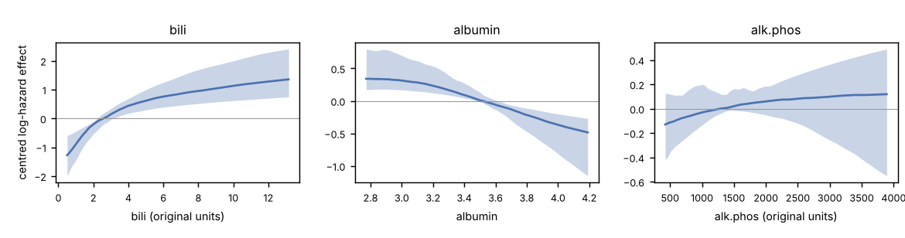
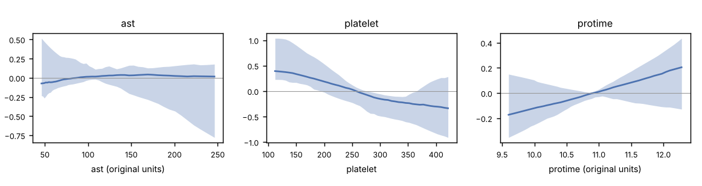
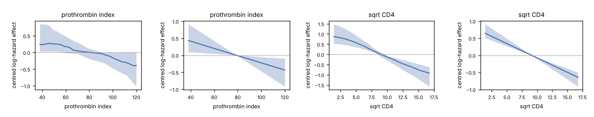

<b>Draft manuscript, not peer reviewed.</b> Author names, affiliations, funding and competing interests
are to be completed before submission.

**Authors:** [to be completed]  
**Supplementary Material:** the full study record ("S"), with every pre-registered analysis and all tables; section and
table numbers prefixed with S refer to it.

## Abstract

**Background.** Risk prediction in chronic disease and in engineered systems often rests on covariates measured
repeatedly over time. Kolmogorov–Arnold networks (KANs) replace network weights by learnable univariate functions that
can be inspected, and have been adapted to survival analysis with static covariates {{CP:knottenbelt2025;jose2025}}.
Applied directly to trajectories, a single-layer functional KAN under the Cox loss has the model form of the additive
functional Cox model (AFCM) {{CP:cui2021}}, so its value has to be shown empirically: in the readability of its
effects, in the tools it supports, and in fair comparisons with simpler models.

**Methods.** We studied functional KAN survival models whose edges act on the trajectories themselves (a separable
bivariate layer, B2-S) under Cox, Weibull, log-normal and semiparametric accelerated failure time (AFT) losses, the
last with an error law estimated by Kaplan–Meier (NP-KAN-AFT). Three additions were each tested against pre-registered
criteria on new simulation seeds: a symbolic distillation refit with a fixed penalty, a landmark anchor that adds the
last observed values and is kept only if confirmed in both halves of the validation split, and the semiparametric
error law. Comparators were AFCM, FPCA Cox, a two-stage mixed-effects Cox model, summary-based models, landmark Cox
and, on the clinical cohorts, a Bayesian multivariate joint model. Real-data analyses covered six clinical cohorts
and four C-MAPSS engine data sets; two of the cohorts and two of the engine data sets were held out until the methods
had been fixed. A final set of analyses asked where the functional model helps, using more data splits, histories
thinned to a few visits and a blend of the functional model with landmark Cox.

**Results.** The confirmatory comparison with AFCM was inconclusive (B2-S Cox − AFCM in identifiable shape error
{{V:reports/round12_summary.json/H_R12/mean_diff|+.4f}}, 95% CI {{V:reports/round12_summary.json/H_R12/ci95|+.4f}}), and AFCM could not be validated even with per-channel marginal-likelihood smoothing (held-out check
failed, φ₁ {{V:reports/round22/ck6d.json/shapes/phi1/rise_id|.3f}}). Both models recovered nonlinear effects far better than linear functional models. The distillation
refit was finite in all {{V:reports/round16_summary.json/family_a/H_R16a/n_finite|d}} refits and preserved the shapes. Cross-confirmed anchoring kept the gain when the last
value carried the risk and stayed within the registered margin otherwise (S-Sparse bound for Cox {{V:reports/round20_summary.json/H_R20b/cox/traj_upper|+.4f}}). NP-KAN-AFT was
better than Cox and Weibull models under log-normal errors ({{V:reports/round20_summary.json/H_R20a/misspec_vs_cox/mean_diff|+.4f}} and {{V:reports/round20_summary.json/H_R20a/misspec_vs_weibull/mean_diff|+.4f}} in survival-curve error). Under a bimodal
error law it was better than all three parametric KAN models in every replicate ({{V:reports/round22/analysis_summary.json/sims/bimodal/contrasts/b2s_npaft - b2s_lnaft/mean_diff|+.4f}} against log-normal), and under
heavy-tailed and logistic laws better than the Cox and Weibull models (H-R22c supported). On the two held-out clinical
cohorts anchoring and distillation met their margins, but one baseline fit did not converge, so the registered
criterion that every fit be finite failed (H-R22b not supported). On every clinical cohort, no functional model was
clearly better than landmark Cox on the last observed values, and a blend of the two did not meet its non-inferiority
margin (H-R23c not supported). On the two held-out engine data sets, which have long sensor histories, NP-KAN-AFT had
a lower integrated Brier score than landmark Cox ({{V:reports/round23/analysis_summary.json/H_R23a/per_dataset/FD002/mean_diff|+.4f}} and {{V:reports/round23/analysis_summary.json/H_R23a/per_dataset/FD004/mean_diff|+.4f}}, both intervals below 0; H-R23a supported), and on the
clinical cohort with the longest histories thinning them to three visits made it clearly worse (H-R23b supported). A
pre-specified Bayesian joint model fitted on the same clinical partitions was not better than NP-KAN-AFT on any
cohort; NP-KAN-AFT was better on renal ({{V:reports/round24/analysis_summary.json/H_R24a/mean_diff|+.4f}}; H-R24a supported), where the joint model fitted poorly, and
non-inferiority to the joint model was not shown elsewhere (H-R24b not supported).

**Conclusions.** Functional KANs give readable nonlinear trajectory effects, and the three tools make them safe to
summarise, to anchor and to use without choosing an error law. On small clinical cohorts with few visits a landmark
model on the last values is as good as the functional model and a Bayesian joint model; on long, dense histories the
functional model was better on held-out data, and without that history it was worse.

## Keywords

Kolmogorov–Arnold networks; functional data analysis; survival analysis; longitudinal covariates; landmarking;
accelerated failure time model; symbolic regression; interpretability; pre-registration.

## 1. Introduction

Risk models for chronic disease and for engineered systems increasingly use longitudinal covariates: repeated
laboratory values, biomarkers or sensor readings. Three families of methods are established. Landmark models
{{CP:vanhouwelingen2007;vanhouwelingen2012}} use the most recent values at a prediction time; two-stage and joint
models {{CP:laird1982;wulfsohn1997;tsiatis2004;rizopoulos2010}} summarise each trajectory through a mixed model;
functional regression models use the whole trajectory, linearly through functional principal components
{{CP:yao2005;kong2018}} or nonlinearly in the additive functional Cox model {{CP:cui2021}}, which places a smooth
bivariate surface F(x, t) inside the hazard. Neural survival models {{CP:katzman2018;lee2020}} are flexible but hard to
read.

Kolmogorov–Arnold networks {{CP:liu2025}} place learnable univariate functions on the edges of a network, which can
be inspected, pruned and replaced by symbolic formulas. Survival versions exist for static covariates
{{CP:knottenbelt2025;jose2025;mastroleo2026;boulitsakis2026}}. Applied to trajectories, a single functional KAN layer
under the Cox loss is a parametrisation of AFCM rather than a new model class, so any contribution must come from what
the parametrisation enables and must be shown against strong comparators, including those that do not use
trajectories at all.

This paper reports a sequence of pre-registered analyses (Supplementary Section S2.8) organised around one thesis:
**functional KANs provide interpretable nonlinear survival modelling from longitudinal trajectories, with safe
symbolic distillation, conditional landmark anchoring and semiparametric AFT robustness, and the same analyses show
where simpler landmark models suffice.** Each part of the thesis was tested by a hypothesis with criteria fixed in
advance (Table 1), and the negative and inconclusive results are reported alongside the positive ones. Hypotheses keep
the labels under which they were registered (for example H-R20a), so that each can be traced to its plan and to its
full results in the Supplementary Material.

**Table 1. Pre-registered hypotheses and their verdicts.** Criteria, seeds and analyses were fixed before each run;
details in the Supplementary Material (H1 and H-R12: S3; all later hypotheses: S5).

{{T:j_hyp}}

## 2. Methods

### 2.1 Data, front end and functional layers

Subject i has longitudinal channels X_id(t) observed with noise in a history window rescaled to [0, 1], scalar
covariates z_i and a possibly right-censored outcome. Curves are reconstructed on a fixed grid by penalised B-spline
smoothing with the smoothing parameter chosen on training subjects only. The functional layer B2-S represents the
effect of channel d as a rank-two separable surface, φ_d(x, t) = Σ_m g_dm(x)h_dm(t), with every g and h a univariate
B-spline KAN edge, so that the effect is read separately in the value and in time; the linear predictor is
η = Σ_d ∫φ_d(X_d(t), t)dt + Σ_k ψ_k(z_k). Each model is a three-member ensemble with learning rate and weight decay
tuned on the validation loss (S2.3). The ensemble's prediction and its shape estimate are the members' means, which
is valid because η is additive in the edges; every functional effect is centred over the training data, the constant
being absorbed by the baseline.

Channel selection uses a sparsity penalty during training and a channel-level score, the mean absolute deviation of
the channel's integrated effect over the training subjects relative to the largest channel score; a channel whose
score falls below a threshold loses all its functional edges. Penalty and threshold are chosen by a parsimonious rule
on the validation loss (S2.5). The selected model is the object that is read, summarised and, where accepted, replaced
by formulas.

### 2.2 Survival losses

**Cox.** Exact partial likelihood {{CP:cox1972}} with Efron ties {{CP:efron1977}} and the Breslow baseline
{{CP:breslow1974}}. **Parametric KAN-AFT.** log T = μ + η + σε with Weibull or log-normal ε. **NP-KAN-AFT.** The
location η is fitted by a smoothed Gehan rank objective and the error law is the Kaplan–Meier estimate {{CP:kaplan1958}}
of the training residuals. This is the classical semiparametric AFT model with a functional KAN location; it needs no
choice of error family (S5.7).

### 2.3 Symbolic distillation

Edges of the pruned model are fitted by a linear function, a library of affine-wrapped elementary functions and
symbolic regression {{CP:cranmer2023}}, and accepted on validation R². Substituting accepted formulas without refit
reproduced the model, but an unconstrained refit drifted from it (S3.6). The **distillation refit** therefore refits
the substituted model with a fixed penalty towards the pruned model's predictions, rejects formulas whose argument
leaves the observed domain, falls back to the spline edge on any non-finite value and rolls back if the validation
loss rises (S5.2).

### 2.4 Conditional landmark anchoring

The anchored model adds the last observed value of each channel to B2-S, so it can use the most recent value as a
landmark model does. Because anchoring helps only when the last value carries the risk, it is used conditionally:
the validation split is halved, and the anchored model is kept only if it beats the unanchored model on both halves
by a registered margin; otherwise the unanchored ensemble is returned unchanged (**cross-confirmation**, S5.7). The
fallback is exact by construction, which was checked on every split.

### 2.5 Comparators and evaluation

Comparators were AFCM (a Python re-implementation with validation-chosen smoothing, whose final version is labelled
V3 in the tables; S2.4), FPCA Cox {{CP:kong2018}},
a two-stage linear mixed-effects Cox model {{CP:laird1982}}, Cox and random survival forest {{CP:ishwaran2008}} models on
trajectory summaries, landmark Cox on the last values {{CP:vanhouwelingen2007}} and, on the clinical cohorts, a
Bayesian multivariate joint model {{CP:rizopoulos2011}} (Section 4.4). In simulation the primary
measures were the identifiable relative integrated squared error of the functional effect (RISE) and the
survival-curve error against the oracle; on real data the inverse-probability-of-censoring weighted integrated Brier
score {{CP:graf1999}} (IBS; conditional on the covariates for the clinical cohorts), Harrell's and Uno's concordance
{{CP:harrell1982;uno2011}} and D-calibration {{CP:haider2020}}. Simulation contrasts were paired over replicates, with
equivalence by two one-sided tests {{CP:schuirmann1987}}; real-data contrasts used outer splits by subject and the
Nadeau–Bengio corrected interval {{CP:nadeau2003}}, which widens the interval to allow for the overlap between
training sets. Only the hypotheses of Table 1 are confirmatory.

### 2.6 Pre-registration and verification

The work proceeded in stages: an initial simulation comparison with AFCM, revisions of the methods that were each re-tested on
new seeds, applications to clinical cohorts, analyses of held-out cohorts and engine data, and a comparison with a Bayesian
joint model. Before the seeds or data of a stage were used, its hypotheses, criteria, seeds, models and analysis were
written down and committed to the study's version-controlled decision log. The registration was therefore internal and
time-stamped, not deposited in a public registry. Method development used seeds or data sets set aside for it, and
every run, including failed ones, is reported. Acceptance tests with fixed thresholds were written before the
simulation, and a failure was never converted by changing a seed or a threshold (S2.8). Every number in this paper and
in the Supplementary Material is rendered from the saved results and checked by an independent script (Appendix).

## 3. Simulation results

### 3.1 Design

The simulator generates three channels per subject on [0, 1] (a random level, trend and Fourier modes, observed with
noise), one of them a null channel, and a hazard that depends on a time-homogeneous sine effect of the first channel
and a time-varying effect of the second:

- **S-Add:** η = ∫sin(πX₁(t)/2)dt + ∫tanh(X₂(t))(1 + t)dt + 0.3z₁ − 0.3z₂, Weibull proportional hazards (shape 1.5), so the
  Cox model is correctly specified. φ₁ is time-homogeneous, φ₂ time-varying.

Variants add sparse visits (S-Sparse), risk carried by the last values (S-Last), and non-proportional hazards through
an AFT location with non-Weibull errors (S-Misspec). Every confirmatory test used seeds that no earlier analysis had
used (S3.1, S5.1). The identifiable RISE projects out directions of the effect that no subject's trajectory can
reveal, so that a model is not penalised for a component the data cannot identify (S2.7).

### 3.2 Nonlinear effects: B2-S against AFCM

**Table 2. Confirmatory test H-R12 and sensitivity rows** (S-Add; a = B2-S, b = AFCM).

{{T:hr12}}

B2-S and AFCM recovered the nonlinear shapes to a similar degree and could not be separated: the confidence
interval included 0 and equivalence within ±0.05 was not shown, so H-R12 is **inconclusive** (Table 2). Both were far
better than models linear in functional principal component scores (Table 3).

**Table 3. S-Add, all models** (means over {{V:reports/round12_summary.json/H_R12/n|d}} replicates; RISE = identifiable RISE; "–" where a model has no
functional shape).

{{T:sadd}}

The functional models also had lower survival-curve error than the two-stage and summary models, and B2-S and AFCM did
not differ in curve error. The comparison has a weakness on the comparator's side: our AFCM re-implementation failed
its own single-fit acceptance check. Replacing its shared penalty by per-channel penalties estimated by a
Fellner–Schall update of the Laplace marginal likelihood {{CP:wood2011;wood2017}} passed on the three seeds used to
develop it but failed on the held-out seed (φ₁ {{V:reports/round22/ck6d.json/shapes/phi1/rise_id|.3f}}; S5.10), so the planned confirmatory re-test was not run and AFCM
remains an unvalidated comparator.

### 3.3 Safe symbolic distillation

Distillation with a fixed penalty weight, the domain guard and the fallback was finite in all {{V:reports/round16_summary.json/family_a/H_R16a/n_finite|d}} refits and preserved
the pruned shapes (S-Add RISE difference {{V:reports/round16_summary.json/family_a/add/distill_minus_pruned_rise/mean_diff|+.4f}}; H-R16a supported), whereas an earlier version that tuned the penalty
weight on validation had failed (H-R15a). The refit carried over to the log-normal KAN-AFT (H-R17b, part 1). It is safe
because it is strongly anchored to the pruned model, and for the same reason it does not improve prediction over
substitution alone.

**Table 4. Identifiable RISE of the symbolic models** (B2-S Cox, first ensemble member; initial and follow-up tests;
S5.2).

{{T:distill}}

### 3.4 Conditional landmark anchoring

Anchoring to the last values is a trade-off. An always-anchored model was clearly better than B2-S Cox when the last
values carried the risk (S-Last, {{V:reports/round16_summary.json/family_b/last/contrasts/b2s_anchor_cox_noncliff - b2s_cox/mean_diff|+.4f}}) and slightly worse when the whole trajectory did (S-Sparse, {{V:reports/round16_summary.json/family_b/sparse/contrasts/b2s_anchor_cox_noncliff - b2s_cox/mean_diff|+.4f}}). Gating on
the validation loss did not remove that cost reliably (H-R17a), and deciding on a single confirmation split halved
the data available to each model (S5.5–S5.6). Cross-confirmation on both halves of the validation split, against
three-seed B2-S ensembles trained on the whole validation set, met every registered criterion for Cox, log-normal
KAN-AFT and NP-KAN-AFT on new seeds (H-R20b; Table 6), mainly by anchoring less often: on S-Sparse the Cox model
anchored in {{V:reports/round20_summary.json/H_R20b/cox/traj/n_confirmed|d}} of {{V:reports/round20_summary.json/H_R20b/cox/traj/n|d}} replicates.

**Table 5. Survival-curve error of the always-anchored model** (initial and follow-up tests; the two gates are two
rules for switching the anchor off; S5.3).

{{T:anchor}}

**Table 6. Hypotheses on NP-KAN-AFT (H-R20a) and cross-confirmed anchoring (H-R20b)** (new seeds; survival-curve
error).

{{T:r20_hyp}}

### 3.5 Semiparametric AFT robustness

The first step towards not assuming an error law was residual calibration: keeping the Weibull KAN-AFT's location
and scale but replacing its error law by the Kaplan–Meier estimate of the standardised training residuals. Under
log-normal errors it lowered curve error below B2-S Cox ({{V:reports/round12_summary.json/secondary/S-Misspec-lognormal curve_error b2s_aft_rc - b2s_cox/mean_diff|+.4f}}), but not under log-logistic errors (Table 7), because
the location was still fitted under the wrong likelihood. NP-KAN-AFT removes that dependence by fitting the location
with a rank objective.

**Table 7. Error misspecification with residual calibration** (S-Misspec; {{V:reports/round12_summary.json/secondary/S-Misspec-lognormal curve_error b2s_aft_rc - b2s_cox/n|d}} replicates per error law).

{{T:misspec}}

**Table 8. NP-KAN-AFT on new seeds** (survival-curve error).

{{T:r20_np}}

Under log-normal errors NP-KAN-AFT was better than B2-S Cox in {{V:reports/round20_summary.json/H_R20a/misspec_vs_cox/n_neg|d}} of {{V:reports/round20_summary.json/H_R20a/misspec_vs_cox/n|d}} replicates and better than the Weibull
KAN-AFT in {{V:reports/round20_summary.json/H_R20a/misspec_vs_weibull/n_neg|d}} (H-R20a), but not shown to be better than the correctly specified log-normal model ({{V:reports/round20_summary.json/H_R20a/misspec_vs_lognormal/mean_diff|+.4f}}). A further
simulation tested three more error laws, each with mean 0 and SD 0.5 and twenty new replicates (H-R22c; Table 9).

**Table 9. NP-KAN-AFT against the parametric B2-S models under three further error laws** (survival-curve error, paired
t over replicates).

{{T:r22_sims_con}}

H-R22c was supported (Table 1). Under the bimodal law, which no parametric family in the comparison can represent,
NP-KAN-AFT had less than half the survival-curve error of the parametric models ({{V:reports/round22/analysis_summary.json/sims/bimodal/means/b2s_npaft/curve_error|.4f}} against {{V:reports/round22/analysis_summary.json/sims/bimodal/means/b2s_cox/curve_error|.4f}} for B2-S Cox) and
was better in every replicate against each. The advantage was smaller under the t₃ law and smallest against the
log-normal model under the logistic law, which is close to the normal ({{V:reports/round22/analysis_summary.json/sims/logistic05/contrasts/b2s_npaft - b2s_lnaft/mean_diff|+.4f}}, upper bound {{V:reports/round22/analysis_summary.json/sims/logistic05/contrasts/b2s_npaft - b2s_lnaft/ci95/1|+.4f}}; S5.12).

## 4. Real-data results

### 4.1 Cohorts

Four clinical cohorts were used throughout the study: PBC with six laboratory channels and two endpoints
{{CP:murtaugh1994;fleming1991}}, `prothro` and `aids` {{CP:rizopoulos2010;andersen1993;guo2004}}. Two further cohorts
from joineRML {{CP:hickey2018}} were held out until the methods had been fixed: `renal` (glomerular filtration rate
and haematocrit after kidney transplantation, graft failure; {{CP:rizopoulos2011}}) and `heart.valve`
(left-ventricular mass index and valve gradient after aortic valve replacement, death; {{CP:lim2008}}). C-MAPSS
turbofan data {{CP:saxena2008}} supplied engine-degradation histories: FD001 and FD003 were used to examine
calibration (FD003 had also been analysed at an early stage, so it does not count as held out), and FD002 and FD004,
with six operating conditions each, were held out until the long-history analysis of Section 4.3. Except where a
registered hypothesis is named, the real-data comparisons are exploratory. They use five outer splits per cohort,
stratified on the event, with the history up to a single landmark as input and the residual time after it as outcome;
the analyses of Sections 4.3 and 4.4 use ten engine splits and twenty new clinical partitions.

**Table 10. The four clinical cohorts at their landmarks** (descriptive).

{{T:cohorts}}

**Table 11. The two held-out joineRML cohorts at the one-year landmark.**

{{T:r22_cohorts}}

### 4.2 Prediction against simpler models

**Table 12. B2-S Cox minus three baselines on the four clinical cohorts** (integrated Brier score; mean and
Nadeau–Bengio corrected 95% interval over the outer splits).

{{T:j_real13}}

No functional or KAN model was clearly better than the simple baselines on these cohorts: every interval in Table 12
includes 0, and on PBC landmark Cox had the lowest mean integrated Brier score ({{V:reports/tables/r13_single_by_model.csv/dataset=pbc_E2,model=landmark_cox/ibs_mean|.3f}} against {{V:reports/tables/r13_single_by_model.csv/dataset=pbc_E2,model=b2s_cox/ibs_mean|.3f}} for B2-S Cox). The
methods fixed after the simulation tests behaved in the same way: NP-KAN-AFT was finite and D-calibrated but did not
match the Weibull KAN-AFT on the primary PBC endpoint (H-R21a not supported), and cross-confirmed anchoring never cost
more than the registered margin (H-R21b supported; S5.9; Table 13).

**Table 13. Hypotheses for the fixed methods on the four clinical cohorts and C-MAPSS FD001** (criteria fixed before
the run).

{{T:r21_hyp}}

**Table 14. Held-out cohorts: functional models against landmark Cox and the two-stage mixed-effects Cox model**
(conditional integrated Brier score; Nadeau–Bengio corrected and plain 95% intervals over five splits).

{{T:j_ext}}

On the held-out cohorts every interval in Table 14 includes 0. On renal several functional models had lower mean
conditional IBS than landmark Cox (B2-S Cox {{V:reports/round22/analysis_summary.json/cohorts/renal/contrasts/ibs_cond b2s_cox - landmark_cox/nb/mean_diff|+.4f}}, lower on {{V:reports/round22/analysis_summary.json/cohorts/renal/contrasts/ibs_cond b2s_cox - landmark_cox/nb/n_neg|d}} of five splits); renal patients had a median of {{V:reports/round22/analysis_summary.json/cohorts/renal/cohort/obs_per_subject_median|.1f}}
visits before the landmark against {{V:reports/round22/analysis_summary.json/cohorts/heart_valve/cohort/obs_per_subject_median|.1f}} for heart valve (Table 11), where the two models were almost equal; five
splits cannot turn this into a finding. Cross-confirmation accepted the anchor on at most one split per family and
cohort and cost at most {{V:reports/round22/analysis_summary.json/H_R22b/part2/heart_valve/cox/mean_shift|+.4f}} (Table 15), and distillation was finite on every split (Table 16), so parts 2 and 3 of
H-R22b were met. Part 1 was not: the summary Cox baseline did not converge on one heart-valve split, so **H-R22b is
not supported** as registered (S5.11).

**Table 15. Cross-confirmed anchoring on the held-out cohorts** (H-R22b part 2).

{{T:r22_cross}}

**Table 16. Symbolic distillation with a fixed penalty weight on the held-out cohorts** (H-R22b part 3; first member of
each ensemble).

{{T:r22_sym}}

**Table 17. C-MAPSS FD003** (means over five engine splits; descriptive).

{{T:r22_fd003}}

On FD003 NP-KAN-AFT had the lowest mean IBS ({{V:reports/round22/analysis_summary.json/fd003/means/b2s_npaft/ibs|.4f}}, against {{V:reports/round22/analysis_summary.json/fd003/means/landmark_cox/ibs|.4f}} for landmark Cox), but D-calibration passed on at most
one split for any model (S5.11).

### 4.3 Where the functional model helps

The analyses above suggested a pattern that no interval could confirm: functional models had lower mean error than
landmark Cox on renal, whose patients had long histories, and on FD003, but not on the cohorts with few visits. We
therefore tested the pattern directly, with more splits, because the Nadeau–Bengio correction leaves five splits with
little power (S5.13). On FD002 and FD004 the sensors were z-scored within each operating condition and windowed as for
FD003; NP-KAN-AFT, at one fixed setting to bound its cost, was compared with landmark Cox on the last raw or smoothed
sensor values (whichever had the lower validation error) and with the summary and FPCA Weibull AFT models, over ten
engine splits. On renal, NP-KAN-AFT was refitted after thinning every history to three visits. On all six clinical
cohorts, a blend of the two survival curves, with its weight chosen on validation, was compared with landmark Cox. The
clinical analyses used twenty new partitions of data analysed before, so they are re-analyses and not tests on
held-out data.

**Table 18. Held-out C-MAPSS FD002 and FD004** (means over ten engine splits).

{{T:j_r23_cm}}

**Table 19. Contrasts for the long-history analyses** (test IBS for C-MAPSS, conditional IBS for renal; Nadeau–Bengio
corrected 95% intervals).

{{T:j_r23_con}}

On both engine data sets NP-KAN-AFT was better than landmark Cox, with intervals excluding 0 (H-R23a supported), and
also better than the summary and FPCA AFT models (Tables 18 and 19); its Harrell C was higher by {{V:reports/round23/analysis_summary.json/cm/FD002/c_contrasts/b2s_npaft - landmark_cox/mean_diff|+.3f}} and {{V:reports/round23/analysis_summary.json/cm/FD004/c_contrasts/b2s_npaft - landmark_cox/mean_diff|+.3f}}. Its
calibration was weak: D-calibration passed on {{V:reports/round23/analysis_summary.json/cm/FD002/dcal_pass/b2s_npaft|d}} of ten FD002 and {{V:reports/round23/analysis_summary.json/cm/FD004/dcal_pass/b2s_npaft|d}} of ten FD004 splits, and on none for landmark
Cox. On renal, three visits instead of the full history raised NP-KAN-AFT's conditional IBS from {{V:reports/round23/analysis_summary.json/clinical/renal/means/ibs_cond/b2s_npaft|.4f}} to {{V:reports/round23/analysis_summary.json/clinical/renal/means/ibs_cond/b2s_npaft_sparse3|.4f}} (H-R23b
supported) and made it worse than landmark Cox. The blend had a lower mean than landmark Cox on five of six clinical
cohorts, but no upper bound was within the registered +0.005, so non-inferiority was not shown (H-R23c not supported;
Table 20).

**Table 20. Clinical cohorts, twenty new partitions each** (mean conditional IBS; Nadeau–Bengio corrected 95% intervals).

{{T:r23_clin}}

### 4.4 Comparison with a Bayesian joint model

Joint models are the reference method for dynamic prediction from longitudinal markers. We fitted a Bayesian
multivariate joint model (`JMbayes2`) on the six clinical cohorts and the same twenty partitions, so that it pairs
partition by partition with the NP-KAN-AFT and landmark Cox results (S5.14). It was fitted on the training subjects'
full observed histories: a linear mixed model per marker, with a straight-line or natural-spline mean trajectory
chosen on validation and a subject-specific intercept and slope, linked by the current marker values to a Cox submodel
with delayed entry at the landmark. Test subjects received its dynamic prediction from their history up to the
landmark. Failed fits were recorded and not refitted. C-MAPSS, where every engine window is an event, is not a
joint-model setting and was not analysed.

**Table 21. The joint model on the clinical cohorts** (mean conditional IBS over the twenty partitions; Nadeau–Bengio
corrected 95% intervals; S5.14).

{{T:j_r24}}

The joint model was fitted on {{V:reports/round24/analysis_summary.json/n_ok|d}} of {{V:reports/round24/analysis_summary.json/n_records|d}} partitions. On renal NP-KAN-AFT was better than the joint model on every
compared partition, with an interval below 0 (H-R24a supported), but the joint model was also worse than landmark Cox
there ({{V:reports/round24/analysis_summary.json/cohorts/renal/contrasts/landmark_cox - jm/mean_diff|+.4f}}) and passed D-calibration on {{V:reports/round24/analysis_summary.json/cohorts/renal/dcal_pass/jm|d}} partition: its straight-line or smooth-mean trajectories follow the long
renal histories poorly, so this shows a weakness of the pre-specified joint model rather than an advantage over joint
models in general. On the other five cohorts all three models were close and every interval of NP-KAN-AFT minus the
joint model included 0, but the upper bounds were above the registered +0.005, so non-inferiority was not shown (H-R24b
not supported). The joint model's sampler mixed poorly on many PBC and heart-valve partitions (S5.14).

### 4.5 Readable effects

{width=100%}

{width=100%}

**Figure 1. Time-averaged B2-S Cox effects on PBC** (endpoint death or transplantation): centred log-hazard effect of
each marker in original units, median and band over the bootstrap fits; first row bilirubin, albumin, alkaline
phosphatase; second row AST, platelets, prothrombin time (S4.4).

Pruning selected bilirubin, albumin and platelets in every PBC split; the leading effects were stable over {{V:reports/round13_summary.json/stability/pbc_E2%2Fb2s_cox/log bili/n_fits|d}}
bootstrap fits and pointed in the clinically expected directions (Figure 1), with one exception (the prothrombin index
under B2-S; S4.4). Accepted symbolic formulas, substituted without refit, reproduced the model on every data set
(S4.3), so each leading effect can be reported as a short formula in the original units (Table 22).

**Table 22. Accepted formulas carrying a large share of their layer's score** (PBC and the other three clinical
cohorts, split 0; S4.3).

{{T:formulas}}

**Table 23. Stability and clinical alignment of the leading effects** (bootstrap fits per model and data set; S4.4).

{{T:stab}}

{width=100%}

**Figure 2.** From left: prothro, B2-S Cox; prothro, B1-FPCA-1 Cox; aids, B2-S Cox; aids, B1-FPCA-1 Cox (prothrombin
index and square-root CD4 in original units). The linear-in-scores B1-FPCA-1 model can only scale one fixed shape,
whereas B2-S lets the shape follow the data.

## 5. Discussion

### 5.1 What the study supports

The evidence supports the thesis with clear boundaries. Functional KANs recover nonlinear trajectory effects as well
as the additive functional Cox model in our simulation, though the comparison was inconclusive and the comparator
unvalidated, and far better than linear functional models. Their edges can be pruned, read and summarised by formulas,
and a strongly anchored distillation refit makes the summaries safe. Landmark anchoring helps when the last value
carries the risk and, used conditionally with cross-confirmation, costs little when it does not. Estimating the AFT
error law by Kaplan–Meier removes the need to choose an error family, and helps most when no parametric family fits
the error law. On held-out engine data with long sensor histories the functional KAN-AFT predicted better than a
landmark model and two-stage AFT models, and without its long history it was worse than a landmark model. A standard
Bayesian joint model was not better than the functional model or landmark Cox on the clinical cohorts.

### 5.2 Where simpler landmark models suffice

On every clinical cohort, including the two held-out ones, no functional model was clearly better than landmark Cox
on the last observed values, and on the four cohorts used throughout landmark Cox often had the lowest mean. These
cohorts have a few hundred subjects and, in most of them, one to three visits before the landmark, so the most recent
value carries most of what a curve could add. The long-history analyses tested this reading: with long, dense sensor
histories the functional model was better than landmark Cox on held-out data, and thinning the longest clinical
histories to three visits made it worse than landmark Cox. A functional model therefore earns its cost when the
history of the trajectory carries the risk; with few visits, a landmark model on the last values is the sensible
choice, and blending the two did not give a gain that small validation sets could confirm.

### 5.3 Relation to prior work

The additive functional Cox model {{CP:cui2021}} already offers the model form of a single-layer functional CoxKAN, and
our inconclusive comparison is consistent with that. What the KAN parametrisation adds is a uniform toolkit (pruning,
symbolic summaries and composition of layers) and, in our hands, three tools that the toolkit made natural to build
and test. KAN survival models for static covariates {{CP:knottenbelt2025;jose2025;mastroleo2026;boulitsakis2026}} and a
KAN joint-model abstract {{CP:lundin2025}} address other input structures. Landmarking
{{CP:vanhouwelingen2007;vanhouwelingen2012;putter2022}} and joint models {{CP:wulfsohn1997;rizopoulos2010;rizopoulos2011}}
remain the reference methods for dynamic prediction; in our clinical cohorts a pre-specified Bayesian joint model
{{CP:rizopoulos2011}} was not better than landmark Cox, and our real-data results agree with the common experience that
a well-specified landmark model is hard to beat on small cohorts. The semiparametric AFT model with a Kaplan–Meier error
law is classical; what we tested is its use with a functional KAN location and its robustness across error laws.

### 5.4 Limitations

The AFCM comparator could not be validated, so H-R12 cannot distinguish the two models. The three tools were designed
after earlier versions had failed and were tuned on few seeds, although each was then tested on new ones. The
simulation has one data-generating design. The pre-registration was internal, in a time-stamped decision log, not in a
public registry. The real cohorts are small and five splits cannot power superiority claims; FD003 was not held out,
and the heart-valve cohort has about one visit per patient before the landmark. On FD002 and FD004 NP-KAN-AFT was
fitted at one fixed setting to bound its cost and was poorly calibrated; the twenty clinical partitions re-analyse
data used before, and the thinning test used one cohort. Only one joint-model specification was fitted, its sampler
mixed poorly on many partitions and it fitted renal poorly; no deep dynamic model was fitted, and our literature review
was targeted rather than systematic, so we make no claim of novelty. Full limitations are listed in S6.3.

### 5.5 Conclusions

Functional KANs are a workable, interpretable way to model nonlinear effects of longitudinal trajectories on
survival. With a strongly anchored distillation refit, cross-confirmed landmark anchoring and a Kaplan–Meier error
law, they can be summarised safely, adapt to whether the last value or the trajectory carries the risk, and avoid
choosing an AFT error family. They were not better than simpler landmark models on small clinical cohorts with few
visits, but were better on held-out engine data with long sensor histories, and the pre-registered record of where
they help and where they do not is the contribution.

## Declarations

- **Data availability.** PBC (`pbcseq`, R package `survival`), `aids` and `prothro` (JM), `renal` and `heart.valve`
  (joineRML) from CRAN; C-MAPSS FD001 to FD004 from the NASA prognostics data repository; file checksums are recorded
  with the code.
- **Code availability.** All code, tests, pre-registered plans, decision logs and saved results are in one repository.
- **Supplementary Material.** The full study record, with every pre-registered analysis, all tables and the
  number-provenance appendix.
- **Use of AI tools.** The code, analyses and this draft were produced with an AI coding assistant (Claude Code)
  working under the investigators' recorded decisions; every number was generated from saved results.
- **Authors' contributions, funding, competing interests, ethics.** To be completed before submission. The data sets
  are public and de-identified.

## References

{{REFLIST}}

## Appendix. Number provenance

No number in this paper was typed by hand. The paper is rendered from a text template by a script that reads each
value from the saved results and logs it with its source. A second, independent script re-reads every logged value
and requires it to be identical, in source, format and text, to a value of the verified Supplementary Material;
re-renders the paper and compares it with this version; checks every remaining number against a design constant in the
pre-registered plans; and checks the citations, the sections and the compiled PDF. The scripts and logs are
`scripts/manuscript_journal_main_round24.py`, `scripts/verify_manuscript_journal_main_round24.py`,
`tests/test_manuscript_journal_main_round24.py` and `reports/manuscript_values_journal_main_round24.json`.
