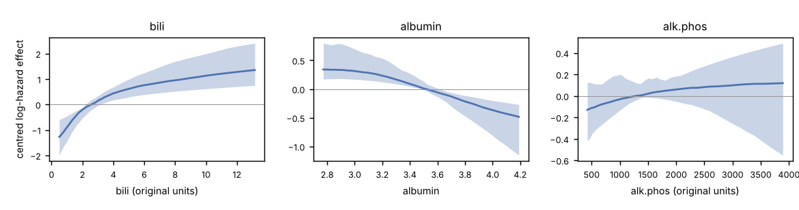
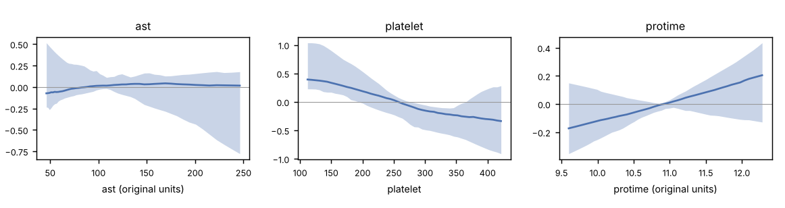
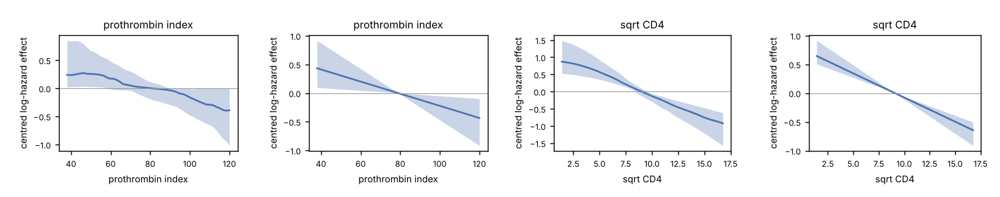

Journal main manuscript (Round 22, D159). Generated from saved records by
<code>scripts/manuscript_journal_main.py</code>; every number is read from a record, logged with its source in
<code>reports/manuscript_values_journal_main.json</code> and required to be identical to a verified value of the Supplementary
Material (<code>reports/manuscript_round22.pdf</code>). <b>Draft for the owner's review: not peer reviewed; authors,
affiliations, funding and competing interests to be completed by the owner.</b>

**Authors:** [to be completed by the owner]  
**Status:** draft of a pre-registered empirical study; no novelty claim is made (D111).  
**Supplementary Material:** the cumulative study manuscript (`reports/manuscript_round22.pdf`, "S"); section and table
numbers prefixed with S refer to it.

## Abstract

**Background.** Clinical and engineering risk prediction often rests on covariates measured repeatedly over time.
Kolmogorov–Arnold networks (KANs) replace network weights by learnable univariate functions and have been adapted to
survival analysis with static covariates {{CP:knottenbelt2025;jose2025}}. Applied directly to trajectories, a
single-layer functional KAN under the Cox loss has the model form of the additive functional Cox model (AFCM)
{{CP:cui2021}}, so its value has to be shown empirically: in the readability of its effects, in the tools it supports,
and in honest comparisons with simpler models.

**Methods.** We studied functional KAN survival models whose edges act on the trajectories themselves (a separable
bivariate layer, B2-S) under Cox, Weibull, log-normal and semiparametric accelerated failure time (AFT) losses, the
last with an error law estimated by Kaplan–Meier (NP-KAN-AFT). Three tools were added and tested in pre-registered
rounds on fresh simulation seeds: a fixed-weight symbolic distillation refit, a landmark anchor that adds the last
observed values and is kept only if confirmed in both halves of the validation split, and the semiparametric error
law. Comparators were AFCM, FPCA Cox, a two-stage mixed-effects Cox model, summary-based models and landmark Cox.
Real-data analyses covered four clinical cohorts used in earlier rounds, two untouched joineRML cohorts and two
C-MAPSS engine data sets.

**Results.** The confirmatory comparison with AFCM was inconclusive (B2-S Cox − AFCM in identifiable shape error
{{V:reports/round12_summary.json/H_R12/mean_diff|+.4f}}, 95% CI {{V:reports/round12_summary.json/H_R12/ci95|+.4f}}), and
AFCM could not be validated even with per-channel marginal-likelihood smoothing (held-out check failed,
φ₁ {{V:reports/round22/ck6d.json/shapes/phi1/rise_id|.3f}}). Both models recovered nonlinear effects far better than
linear functional models. The distillation refit was finite in all {{V:reports/round16_summary.json/family_a/H_R16a/n_finite|d}}
refits and preserved the shapes. Cross-confirmed anchoring kept the gain when the last value carried the risk and
stayed within the registered margin otherwise (S-Sparse bound for Cox {{V:reports/round20_summary.json/H_R20b/cox/traj_upper|+.4f}}).
NP-KAN-AFT was better than Cox and Weibull models under log-normal errors ({{V:reports/round20_summary.json/H_R20a/misspec_vs_cox/mean_diff|+.4f}}
and {{V:reports/round20_summary.json/H_R20a/misspec_vs_weibull/mean_diff|+.4f}} in survival-curve error).
<!-- J_ABS_R22 -->
On every clinical cohort, no functional model was clearly better than landmark Cox on the last observed values.

**Conclusions.** Functional KANs give readable nonlinear trajectory effects, and the three tools make them safe to
summarise, to anchor and to use without choosing an error law; on small clinical cohorts with few visits a landmark
model on the last values is as good, and a functional model is worth its cost mainly when the trajectory, not its
last value, carries the risk.

## Keywords

Kolmogorov–Arnold networks; functional data; survival analysis; landmarking; accelerated failure time; symbolic
regression; interpretability; pre-registration.

## 1. Introduction

Risk models for chronic disease and for engineered systems increasingly use longitudinal covariates: repeated
laboratory values, biomarkers or sensor readings. Three families of methods are established. Landmark models
{{CP:vanhouwelingen2007;vanhouwelingen2012}} use the most recent values at a prediction time; two-stage and joint
models {{CP:laird1982;wulfsohn1997;tsiatis2004;rizopoulos2010}} summarise each trajectory through a mixed model;
functional regression models use the whole trajectory, linearly through functional principal components
{{CP:yao2005;kong2018}} or nonlinearly in the additive functional Cox model {{CP:cui2021}}, which places a smooth
bivariate surface F(x, t) inside the hazard. Neural survival models {{CP:katzman2018;lee2020}} are flexible but hard to
read.

Kolmogorov–Arnold networks {{CP:liu2025}} place learnable univariate functions on the edges of a network, which can
be inspected, pruned and replaced by symbolic formulas. Survival versions exist for static covariates
{{CP:knottenbelt2025;jose2025;mastroleo2026;boulitsakis2026}}. Applied to trajectories, a single functional KAN layer
under the Cox loss is a parametrisation of AFCM rather than a new model class, so any contribution must come from what
the parametrisation enables and must be shown against strong comparators, including those that do not use
trajectories at all.

This paper reports a sequence of pre-registered studies (Supplementary Section S2.8) organised around one thesis:
**functional KANs provide interpretable nonlinear survival modelling from longitudinal trajectories, with safe
symbolic distillation, conditional landmark anchoring and semiparametric AFT robustness, and the same studies show
where simpler landmark models suffice.** Each part of the thesis was tested by a registered hypothesis with fixed
criteria (Table 1), and the negative and inconclusive results are reported alongside the positive ones.

**Table 1. Pre-registered hypotheses and their verdicts.** Criteria, seeds and analyses were fixed before each run;
details in the Supplementary Material (H1 and H-R12: S3; Rounds 15–22: S5).

{{T:j_hyp}}

## 2. Methods

### 2.1 Data, front end and functional layers

Subject i has longitudinal channels X_id(t) observed with noise in a history window rescaled to [0, 1], scalar
covariates z_i and a possibly right-censored outcome. Curves are reconstructed on a fixed grid by penalised B-spline
smoothing with the smoothing parameter chosen on training subjects only. The functional layer B2-S represents the
effect of channel d as a rank-two separable surface, φ_d(x, t) = Σ_m g_dm(x)h_dm(t), with every g and h a univariate
B-spline KAN edge, so that the effect is read separately in the value and in time; the linear predictor is
η = Σ_d ∫φ_d(X_d(t), t)dt + Σ_k ψ_k(z_k). Each model is a three-member ensemble with learning rate and weight decay
tuned on the validation loss (S2.3). The ensemble's prediction and its shape estimate are the members' means, which
is valid because η is additive in the edges; every functional effect is centred over the training data, the constant
being absorbed by the baseline.

Channel selection uses a sparsity penalty during training and a channel-level score, the mean absolute deviation of
the channel's integrated effect over the training subjects relative to the largest channel score; a channel whose
score falls below a threshold loses all its functional edges. Penalty and threshold are chosen by a parsimonious rule
on the validation loss (S2.5). The selected model is the object that is read, summarised and, where accepted, replaced
by formulas.

### 2.2 Survival losses

**Cox.** Exact partial likelihood {{CP:cox1972}} with Efron ties {{CP:efron1977}} and the Breslow baseline
{{CP:breslow1974}}. **Parametric KAN-AFT.** log T = μ + η + σε with Weibull or log-normal ε. **NP-KAN-AFT.** The
location η is fitted by a smoothed Gehan rank objective and the error law is the Kaplan–Meier estimate {{CP:kaplan1958}}
of the training residuals, the classical semiparametric AFT model with a functional KAN location; it needs no choice of
error family (S5.7).

### 2.3 Symbolic distillation

Edges of the pruned model are fitted by a linear function, a library of affine-wrapped elementary functions and
symbolic regression {{CP:cranmer2023}}, and accepted on validation R². Substituting accepted formulas without refit
reproduced the model, but an unconstrained refit drifted from it (S3.6). The **distillation refit** therefore refits
the substituted model with a fixed penalty towards the pruned model's predictions, rejects formulas whose argument
leaves the observed domain, falls back to the spline edge on any non-finite value and rolls back if the validation
loss rises (S5.2).

### 2.4 Conditional landmark anchoring

The anchored model adds the last observed value of each channel to B2-S, so it can use the most recent value as a
landmark model does. Because anchoring helps only when the last value carries the risk, it is used conditionally:
the validation split is halved, and the anchored model is kept only if it beats the unanchored model on both halves
by a registered margin; otherwise the unanchored ensemble is returned unchanged (**cross-confirmation**, S5.7). The
fallback is exact by construction, which was checked on every split.

### 2.5 Comparators and evaluation

Comparators were AFCM (a Python re-implementation with validation-chosen smoothing; S2.4), FPCA Cox {{CP:kong2018}},
a two-stage linear mixed-effects Cox model {{CP:laird1982}}, Cox and random survival forest {{CP:ishwaran2008}} models on
trajectory summaries, and landmark Cox on the last values {{CP:vanhouwelingen2007}}. In simulation the primary
measures were the identifiable relative integrated squared error of the functional effect (RISE) and the
survival-curve error against the oracle; on real data the inverse-probability-of-censoring weighted integrated Brier
score {{CP:graf1999}} (conditional on the covariates for the clinical cohorts), Harrell's and Uno's concordance
{{CP:harrell1982;uno2011}} and D-calibration {{CP:haider2020}}. Simulation contrasts were paired over replicates, with
equivalence by two one-sided tests {{CP:schuirmann1987}}; real-data contrasts used five outer splits by subject and the
Nadeau–Bengio corrected interval {{CP:nadeau2003}}. Only the hypotheses of Table 1 are confirmatory.

### 2.6 Pre-registration and verification

Every round was registered in a decision log before its seeds or data were used, with the hypotheses, criteria,
seeds, models and analysis fixed; development work used seeds or data sets set aside for it, and every run, including
failed ones, is reported. Acceptance tests with fixed thresholds were written before the simulation, and a failure was
never converted by changing a seed or a threshold (S2.8). Every number in this paper and in the Supplementary Material
is rendered from the saved records and checked by an independent script (Appendix).

## 3. Simulation results

### 3.1 Design

The simulator generates three channels per subject on [0, 1] (a random level, trend and Fourier modes, observed with
noise), one of them a null channel, and a hazard that depends on a time-homogeneous sine effect of the first channel
and a time-varying effect of the second:

- **S-Add:** η = ∫sin(πX₁(t)/2)dt + ∫tanh(X₂(t))(1 + t)dt + 0.3z₁ − 0.3z₂, Weibull proportional hazards (shape 1.5), so the
  Cox model is correctly specified. φ₁ is time-homogeneous, φ₂ time-varying.
 Variants add sparse visits (S-Sparse), risk carried by the last
values (S-Last), and non-proportional hazards through an AFT location with non-Weibull errors (S-Misspec). Every
confirmatory test used seeds not used before (S3.1, S5.1). The identifiable RISE projects out directions of the effect
that no subject's trajectory can reveal, so that a model is not penalised for a component the data cannot identify
(S2.7).

### 3.2 Nonlinear effects: B2-S against AFCM

**Table 2. Confirmatory test H-R12 and sensitivity rows** (S-Add; a = B2-S, b = AFCM).

{{T:hr12}}

B2-S and AFCM V3 recovered the nonlinear shapes to a similar degree and could not be separated: the confidence
interval included 0 and equivalence within ±0.05 was not shown, so H-R12 is **inconclusive** (Table 2). Both were far
better than models linear in functional principal component scores (Table 3).

**Table 3. S-Add, all models** (means over {{V:reports/round12_summary.json/H_R12/n|d}} replicates; RISE = identifiable RISE; "–" where a model has no
functional shape).

{{T:sadd}}

The functional models also had lower survival-curve error than the two-stage and summary models, and B2-S and AFCM did
not differ in curve error. The AFCM re-implementation failed its own
single-fit acceptance check; replacing its shared penalty by per-channel penalties estimated by a Fellner–Schall
update of the Laplace marginal likelihood {{CP:wood2011;wood2017}} passed three development seeds but failed on the
held-out seed (φ₁ {{V:reports/round22/ck6d.json/shapes/phi1/rise_id|.3f}}; S5.10), so the confirmatory re-test was not
run and AFCM remains an unvalidated comparator.

### 3.3 Safe symbolic distillation

Distillation with a fixed penalty weight, the domain guard and the fallback was finite in all
{{V:reports/round16_summary.json/family_a/H_R16a/n_finite|d}} refits and preserved the pruned shapes (S-Add RISE
difference {{V:reports/round16_summary.json/family_a/add/distill_minus_pruned_rise/mean_diff|+.4f}}; H-R16a supported),
whereas its validation-tuned predecessor had failed (H-R15a). It carried over to the log-normal KAN-AFT (H-R17b, part
1). The refit is safe because it is strongly anchored to the pruned model, and for the same reason it does not improve
prediction over substitution alone.

**Table 4. Identifiable RISE of the symbolic models** (B2-S Cox, seed-0 member; S5.2).

{{T:distill}}

### 3.4 Conditional landmark anchoring

Anchoring to the last values is a trade-off. An always-anchored model was clearly better than B2-S Cox when the last
values carried the risk (S-Last, {{V:reports/round16_summary.json/family_b/last/contrasts/b2s_anchor_cox_noncliff - b2s_cox/mean_diff|+.4f}})
and slightly worse when the whole trajectory did (S-Sparse,
{{V:reports/round16_summary.json/family_b/sparse/contrasts/b2s_anchor_cox_noncliff - b2s_cox/mean_diff|+.4f}}). Gating
on the validation loss did not remove that cost reliably (H-R17a), and deciding on a single confirmation split halved
the data available to each model (S5.5–S5.6). Cross-confirmation on both halves of the validation split, against
three-seed B2-S ensembles trained on the whole validation set, met every registered criterion for Cox, log-normal
KAN-AFT and NP-KAN-AFT on fresh seeds (H-R20b; Table 6), mainly by anchoring less often: on S-Sparse the Cox model
anchored in {{V:reports/round20_summary.json/H_R20b/cox/traj/n_confirmed|d}} of {{V:reports/round20_summary.json/H_R20b/cox/traj/n|d}}
replicates.

**Table 5. Survival-curve error of the always-anchored model** (Rounds 15 and 16; S5.3).

{{T:anchor}}

**Table 6. Round-20 hypotheses: NP-KAN-AFT (H-R20a) and cross-confirmed anchoring (H-R20b)** (fresh seeds; survival-curve
error).

{{T:r20_hyp}}

### 3.5 Semiparametric AFT robustness

The first step towards not assuming an error law was residual calibration: keeping the Weibull KAN-AFT's location
and scale but replacing its error law by the Kaplan–Meier estimate of the standardised training residuals. Under
log-normal errors it lowered curve error below B2-S Cox
({{V:reports/round12_summary.json/secondary/S-Misspec-lognormal curve_error b2s_aft_rc - b2s_cox/mean_diff|+.4f}}),
but not under log-logistic errors (Table 7), because the location was still fitted under the wrong likelihood.
NP-KAN-AFT removes that dependence by fitting the location with a rank objective.

**Table 7. Error misspecification in Round 12** (S-Misspec; {{V:reports/round12_summary.json/secondary/S-Misspec-lognormal curve_error b2s_aft_rc - b2s_cox/n|d}} replicates per error law).

{{T:misspec}}

**Table 8. NP-KAN-AFT on fresh seeds in Round 20** (survival-curve error).

{{T:r20_np}}

Under log-normal errors NP-KAN-AFT was better than B2-S Cox in {{V:reports/round20_summary.json/H_R20a/misspec_vs_cox/n_neg|d}}
of {{V:reports/round20_summary.json/H_R20a/misspec_vs_cox/n|d}} replicates and better than the Weibull KAN-AFT in
{{V:reports/round20_summary.json/H_R20a/misspec_vs_weibull/n_neg|d}} (H-R20a), but not shown to be better than the
correctly specified log-normal model ({{V:reports/round20_summary.json/H_R20a/misspec_vs_lognormal/mean_diff|+.4f}}). Round 22
tested three further error laws, each with mean 0 and SD 0.5 and twenty fresh replicates (H-R22c; Table 9).

**Table 9. NP-KAN-AFT against the parametric B2-S models under three further error laws** (survival-curve error, paired
t over replicates).

{{T:r22_sims_con}}

<!-- J_R22C -->

## 4. Real-data results

### 4.1 Cohorts

Four clinical cohorts were analysed in earlier rounds: PBC with six laboratory channels and two endpoints
{{CP:murtaugh1994;fleming1991}}, `prothro` and `aids` {{CP:rizopoulos2010;andersen1993;guo2004}}. Two cohorts from
joineRML {{CP:hickey2018}} were used for the first time in Round 22: `renal` (glomerular filtration rate and
haematocrit after kidney transplantation, graft failure; {{CP:rizopoulos2011}}) and `heart.valve` (left-ventricular
mass index and valve gradient after aortic valve replacement, death; {{CP:lim2008}}). C-MAPSS turbofan data
{{CP:saxena2008}} served for calibration (FD001, and FD003, which had been analysed in an early round and so is not
untouched). All real-data comparisons are exploratory, on five outer splits per cohort, stratified on the event,
with the history up to a single landmark used as input and the residual time after it as outcome.

**Table 10. The earlier clinical cohorts at their landmarks** (descriptive).

{{T:cohorts}}

**Table 11. The untouched joineRML cohorts at the one-year landmark.**

{{T:r22_cohorts}}

### 4.2 Prediction against simpler models

**Table 12. B2-S Cox minus three baselines on the earlier clinical cohorts** (integrated Brier score; mean and
Nadeau–Bengio corrected 95% interval over the outer splits).

{{T:j_real13}}

No functional or KAN model was clearly better than the simple baselines on the earlier cohorts: every interval in Table 12
includes 0, and on PBC landmark Cox had the lowest mean integrated Brier score
({{V:reports/tables/r13_single_by_model.csv/dataset=pbc_E2,model=landmark_cox/ibs_mean|.3f}} against
{{V:reports/tables/r13_single_by_model.csv/dataset=pbc_E2,model=b2s_cox/ibs_mean|.3f}} for B2-S Cox). The locked Round-20
methods behaved in the same way: NP-KAN-AFT was finite and D-calibrated but did not match the Weibull KAN-AFT on the
primary PBC endpoint (H-R21a not supported), and cross-confirmed anchoring never cost more than the registered margin
(H-R21b supported; S5.9; Table 13).

**Table 13. Round-21 hypotheses** (the four earlier clinical cohorts and C-MAPSS FD001; criteria fixed before the run).

{{T:r21_hyp}}

**Table 14. Untouched cohorts: functional models against landmark Cox and the two-stage mixed-effects Cox model**
(conditional integrated Brier score; Nadeau–Bengio corrected and plain 95% intervals over five splits).

{{T:j_ext}}

<!-- J_R22B -->

**Table 15. Cross-confirmed anchoring on the untouched cohorts** (H-R22b part 2).

{{T:r22_cross}}

**Table 16. Fixed-μ symbolic distillation on the untouched cohorts** (H-R22b part 3; seed-0 member of each ensemble).

{{T:r22_sym}}

**Table 17. C-MAPSS FD003 Option B** (means over five engine splits; descriptive).

{{T:r22_fd003}}

<!-- J_R22B_FD003 -->

### 4.3 Readable effects

{width=100%}

{width=100%}

**Figure 1. Time-averaged B2-S Cox effects on PBC** (endpoint death or transplantation): centred log-hazard effect of
each marker in original units, median and band over the bootstrap fits; first row bilirubin, albumin, alkaline
phosphatase; second row AST, platelets, prothrombin time (S4.4).

Pruning selected bilirubin, albumin and platelets in every PBC split; the leading effects were stable over
{{V:reports/round13_summary.json/stability/pbc_E2%2Fb2s_cox/log bili/n_fits|d}} bootstrap fits and pointed in the
clinically expected directions (Figure 1), with one exception (the prothrombin index under B2-S; S4.4). Accepted
symbolic formulas, substituted without refit, reproduced the model on every data set (S4.3), so each leading effect
can be reported as a short formula in the original units (Table 18).

**Table 18. Accepted formulas carrying a large share of their layer's score** (PBC and the other earlier cohorts, split
0; S4.3).

{{T:formulas}}

**Table 19. Stability and clinical alignment of the leading effects** (bootstrap fits per model and data set; S4.4).

{{T:stab}}

{width=100%}

**Figure 2.** From left: prothro, B2-S Cox; prothro, B1-FPCA-1 Cox; aids, B2-S Cox; aids, B1-FPCA-1 Cox (prothrombin
index and square-root CD4 in original units). The linear-in-scores B1-FPCA-1 model can only scale one fixed shape,
whereas B2-S lets the shape follow the data.

## 5. Discussion

### 5.1 What the study supports

The evidence supports the thesis with clear boundaries. Functional KANs recover nonlinear trajectory effects as well
as the additive functional Cox model in our simulation, though the comparison was inconclusive and the comparator
unvalidated, and far better than linear functional models. Their edges can be pruned, read and summarised by formulas,
and a strongly anchored distillation refit makes the summaries safe. Landmark anchoring helps when the last value
carries the risk and, used conditionally with cross-confirmation, costs little when it does not. Estimating the AFT
error law by Kaplan–Meier removes the need to choose an error family.

### 5.2 Where simpler landmark models suffice

On every clinical cohort, including the two untouched ones, landmark Cox on the last observed values was at least as
good as every functional model. These cohorts have a few hundred subjects and, in most of them, few visits before the
landmark, so the most recent value carries most of what a curve could add; a functional model earns its cost when the
shape or history of the trajectory carries the risk, as in our simulated scenarios, and the cross-confirmed anchor is
the tool that lets one model behave like either. We read this as a statement about the information in these data, not
as a failure of the method, but it was not itself tested.

### 5.3 Relation to prior work

The additive functional Cox model {{CP:cui2021}} already offers the model form of a single-layer functional CoxKAN, and
our inconclusive comparison is consistent with that. What the KAN parametrisation adds is a uniform toolkit (pruning,
symbolic summaries and composition of layers) and, in our hands, three tools that the toolkit made natural to build
and test. KAN survival models for static covariates {{CP:knottenbelt2025;jose2025;mastroleo2026;boulitsakis2026}} and a
KAN joint-model abstract {{CP:lundin2025}} address other input structures. Landmarking
{{CP:vanhouwelingen2007;vanhouwelingen2012;putter2022}} and joint models {{CP:wulfsohn1997;rizopoulos2010;rizopoulos2011}}
remain the reference methods for dynamic prediction, and our real-data results agree with the common experience that a
well-specified landmark model is hard to beat on small cohorts. The semiparametric AFT model with a Kaplan–Meier error
law is classical; what we tested is its use with a functional KAN location and its robustness across error laws.

### 5.4 Limitations

The AFCM comparator could not be validated, so H-R12 cannot distinguish the two models. The Phase-2 tools were
designed after earlier failures and tuned on few seeds, although each was then tested on fresh ones. The simulation
has one data-generating design. The real cohorts are small and five splits cannot power superiority claims; FD003 is
not untouched and the heart-valve cohort has about one visit per patient before the landmark. No joint model or deep
dynamic model was fitted, and our literature review was targeted rather than systematic, so we make no claim of
novelty. Full limitations are listed in S6.3.

### 5.5 Conclusions

Functional KANs are a workable, interpretable way to model nonlinear effects of longitudinal trajectories on
survival. With a strongly anchored distillation refit, cross-confirmed landmark anchoring and a Kaplan–Meier error
law, they can be summarised safely, adapt to whether the last value or the trajectory carries the risk, and avoid
choosing an AFT error family. They were not better than simpler landmark models on small clinical cohorts, and the
pre-registered record of where they help and where they do not is the contribution.

## Declarations

- **Data availability.** PBC (`pbcseq`, R package `survival`), `aids` and `prothro` (JM), `renal` and `heart.valve`
  (joineRML) from CRAN; C-MAPSS from the NASA prognostics data repository; checksums in `reports/run_manifest.json`.
- **Code availability.** All code, tests, pre-registrations, decision logs and records are in one repository.
- **Supplementary Material.** The cumulative study manuscript (`reports/manuscript_round22.pdf`), with every
  pre-registered round, all tables and the number-provenance appendix.
- **Use of AI tools.** The code, analyses and this draft were produced with an AI coding assistant (Claude Code)
  working under the owner's recorded decisions; every number was generated from saved records.
- **Authors' contributions, funding, competing interests, ethics.** To be completed by the owner. The data sets are
  public and de-identified.

## References

{{REFLIST}}

## Appendix. Number provenance

`scripts/manuscript_journal_main.py` renders this paper from `docs/manuscript_journal_main_template.md` with the
Supplementary Material's builder, loaded as a separate module instance. Every number is read from a saved record and
logged in `reports/manuscript_values_journal_main.json`; `scripts/verify_manuscript_journal_main.py` (also run by
`tests/test_manuscript_journal_main.py`) requires every logged value to be identical, in source, format and text, to a
value of the verified Supplementary Material, re-renders the paper, checks every other number against a registered
design constant, checks citations and sections, and checks the compiled PDF (page count and no blank page).
