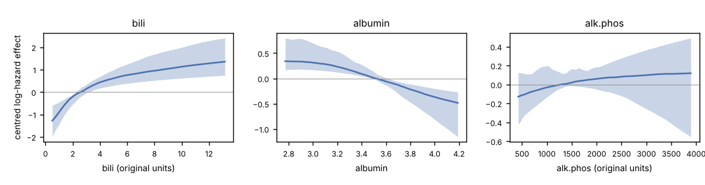
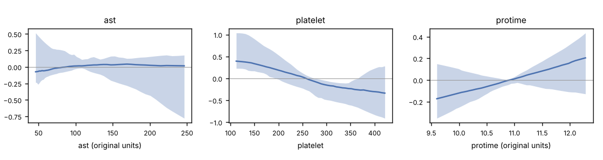
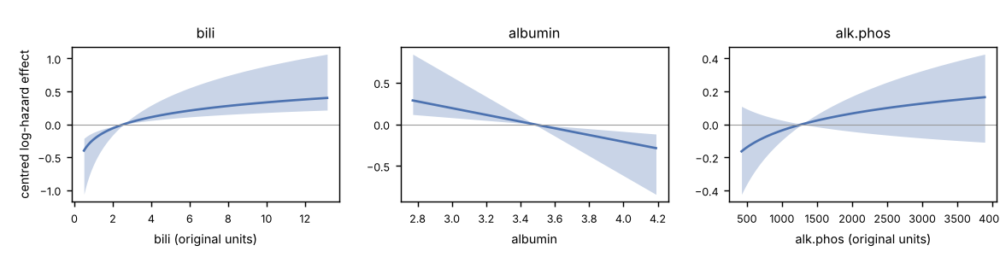
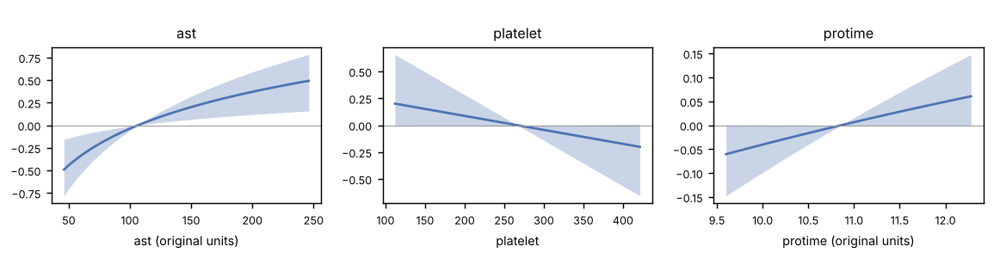
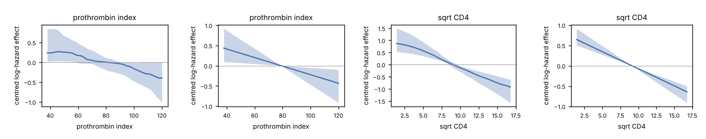

Manuscript draft, Round 17 (D141–D143; supersedes the Round-16 draft, which is kept unchanged, as is
the Round-14 draft). Generated from saved records by <code>scripts/manuscript_round17.py</code>; every number below is
read from a record and logged with its source in <code>reports/manuscript_values_round17.json</code> (Appendix A). <b>Draft for the owner's review: not peer reviewed; authors, affiliations, funding and competing
interests to be completed by the owner.</b>

**Authors:** [to be completed by the owner]  
**Status:** draft manuscript of a pre-registered empirical study; no novelty claim (D111).

## Abstract

**Background.** Kolmogorov–Arnold networks (KANs) replace the weights of a neural network by learnable univariate
functions and have been adapted to survival analysis with static covariates {{CP:knottenbelt2025;jose2025}}. Many
clinical and engineering problems instead have covariates measured repeatedly over time. A single-layer functional KAN
under the Cox loss has the same model form as the additive functional Cox model (AFCM) {{CP:cui2021}}, so any
contribution must be empirical.

**Methods.** We report a sequence of pre-registered studies. A motivating study (framing b) embedded KAN blocks in a
functional autoencoder (KAN-FAE) and compared it with a parameter-matched MLP autoencoder (MLP-FAE). The primary study
(framing a) evaluated direct functional KAN survival models: functional CoxKAN and functional KAN-AFT with
time-homogeneous (B2-H), separable bivariate (B2-S) and two-layer (B2-deep) functional layers; two-stage models on
functional principal component scores or trajectory summaries (B1); and stacked landmark supermodels (B3). Comparators
were a re-implementation of AFCM, an FPCA Cox model, a two-stage mixed-effects Cox model, summary-based Cox and random
survival forest models and a landmark Cox model. A simulation study (four scenarios, {{V:reports/round12_summary.json/H_R12/n|d}} replicates each) had a single
confirmatory test (H-R12): B2-S Cox minus AFCM in identifiable shape error (RISE). Real-data analyses (PBC, two JM
data sets, C-MAPSS) were exploratory. A second phase (Rounds 15–16) tested, on fresh simulation seeds and with
pre-registered two-part criteria, a distillation refit for the symbolic summaries and a landmark-anchored functional
model that adds the last observed values to B2-S.

**Results.** H-R12 was **inconclusive**: B2-S Cox minus AFCM V3 was {{V:reports/round12_summary.json/H_R12/mean_diff|+.4f}}
(95% CI {{V:reports/round12_summary.json/H_R12/ci95|+.4f}}; paired-t p {{V:reports/round12_summary.json/H_R12/p_t|.3f}};
equivalence within ±0.05 not shown, TOST p {{V:reports/round12_summary.json/H_R12/p_tost|.4f}}), and the AFCM comparator
failed its own single-fit acceptance check. Both direct functional models recovered nonlinear shapes far better than a
linear-in-scores FPCA model (B2-S minus B1-FPCA-1: {{V:reports/round12_summary.json/secondary/S-Add RISE b2s_cox - b1_fpca1_cox/mean_diff|+.4f}},
better in {{V:reports/round12_summary.json/secondary/S-Add RISE b2s_cox - b1_fpca1_cox/n_neg|d}} of
{{V:reports/round12_summary.json/secondary/S-Add RISE b2s_cox - b1_fpca1_cox/n|d}} replicates). Substituting accepted
symbolic formulas preserved the learned shapes (S-Add RISE {{V:reports/round12_summary.json/selection_symbolic/S-Add/rise_after_pruning|.3f}}
before and {{V:reports/round12_summary.json/selection_symbolic/S-Add/rise_after_substitution_before_refit|.3f}} after
substitution), whereas the customary unconstrained refit degraded them ({{V:reports/round12_summary.json/selection_symbolic/S-Add/rise_after_substitution|.3f}}).
On the real data no functional or KAN model predicted clearly better than simple landmark baselines; every
Nadeau–Bengio interval for the integrated Brier score of B2-S Cox minus a baseline included 0. In Phase 2, a
distillation refit with a fixed anchor weight, a NaN-safe fallback and a bound on formula arguments kept all {{V:reports/round16_summary.json/family_a/H_R16a/n_finite|d}} refits
finite and preserved the pruned shapes (H-R16a supported, S-Add RISE difference
{{V:reports/round16_summary.json/family_a/add/distill_minus_pruned_rise/mean_diff|+.4f}}; its validation-tuned predecessor H-R15a had
failed). A landmark-anchored model that adds the last observed values to B2-S was clearly better than B2-S Cox when
risk depended on the last values (S-Last, {{V:reports/round16_summary.json/family_b/last/contrasts/b2s_anchor_cox_noncliff - b2s_cox/mean_diff|+.4f}})
but slightly worse when it depended on the whole trajectory (S-Sparse,
{{V:reports/round16_summary.json/family_b/sparse/contrasts/b2s_anchor_cox_noncliff - b2s_cox/mean_diff|+.4f}}), so H-R15b and H-R16b were
not supported. Pruning selected a
stable, clinically plausible set of PBC markers, and the leading effects were stable over
{{V:reports/round13_summary.json/stability/pbc_E2%2Fb2s_cox/log bili/n_fits|d}} bootstrap fits and
aligned with the pre-stated clinical directions, with one exception (prothrombin index under B2-S). In the motivating
study, KAN-FAE had higher survival-curve error than MLP-FAE in the confirmatory test (H1: {{V:reports/step3_summary.json/H1/curve_error/mean_diff|+.4f}},
p {{V:reports/step3_summary.json/H1/curve_error/p_t|.3f}}), the two were equivalent under reconstruction pre-training on
fresh seeds ({{V:reports/round12_summary.json/P0/curve_error/mean_diff|+.4f}}, TOST p {{V:reports/round12_summary.json/P0/curve_error/p_tost|.4f}}),
and the autoencoder's KAN edges acted on abstract features rather than on clinical trajectories.

**Conclusions.** Direct functional KAN survival models are a workable, interpretable parametrisation of the additive
functional Cox model, with usable pruning and symbolic summaries when the formulas are substituted without refitting.
We found no evidence of a predictive advantage over established methods, and placing KAN blocks inside a functional
autoencoder gave neither better prediction nor readable effects. A strongly anchored refit makes the symbolic
summaries safe to refit but does not improve on substitution alone. All findings beyond the registered hypotheses (H1,
H-R12, H-R15a/b, H-R16a/b) are exploratory.

## Keywords

Kolmogorov–Arnold networks; functional data; survival analysis; additive functional Cox model; landmarking;
pre-registration; equivalence testing; negative results; symbolic regression; interpretability.

## 1. Introduction

### 1.1 Functional covariates in survival analysis

Repeated measurements of a biomarker or a sensor are naturally viewed as a curve X(t) observed with noise at a few
times {{CP:ramsay2005}}. The linear functional Cox model enters the curve through ∫β(t)X(t)dt {{CP:gellar2015;kong2018}},
and its coefficient can also vary with follow-up time {{CP:du2024}}. The additive
functional Cox model (AFCM) of {{C:cui2021}} replaces the linear term by ∫F(X(s), s)ds with a bivariate smooth F,
following functional generalised additive models {{CP:mclean2014}}; it is estimated with penalised tensor-product
splines. Sparse, irregular visits are commonly handled by principal components analysis through conditional
expectation (PACE) {{CP:yao2005}}. Dynamic prediction uses joint models {{CP:wulfsohn1997;tsiatis2004;rizopoulos2010}},
landmarking and landmark supermodels {{CP:vanhouwelingen2007;vanhouwelingen2012;putter2022}}, or deep models of the
covariate history {{CP:lee2020;hu2025;gao2025}}.

Neural Cox models such as DeepSurv {{CP:katzman2018}} gain flexibility at the cost of readable effects. KANs
{{CP:liu2025}} place a learnable univariate function on every edge, which makes each edge a candidate for
visualisation, pruning and symbolic regression. CoxKAN {{CP:knottenbelt2025}}, KAN-AFT {{CP:jose2025}}, SurvKAN
{{CP:mastroleo2026}} and KAPLAN {{CP:boulitsakis2026}} all use static covariates; their time-varying elements concern
effects that change with follow-up time, not covariates measured over time. A KAN joint model with yearly landmarks
was found only as a conference abstract {{CP:lundin2025}}, and F-KAN feeds functional principal component scores to a
KAN for a scalar response {{CP:qin2026}}.

### 1.2 Architectural motivation: KAN blocks inside a functional autoencoder

The project began (Rounds 1–9) with a different architecture: a functional autoencoder {{CP:wu2024}} whose encoder
used KAN blocks, with an AFT survival head on the latent representation (KAN-FAE), against a parameter-matched MLP
encoder (MLP-FAE). The hope was that a KAN encoder would give both better prediction and readable effects. Two
findings ended that line (Section 3.7 gives the numbers).

1. **No predictive advantage.** The conventional MLP-FAE first had to pass a pre-registered learnability gate; every
   design failed it until Round 8 (Table 1 lists the gate looks with saved verdict records). Under the configuration
   that passed, the single confirmatory test (H1) found
   KAN-FAE *worse* than MLP-FAE in survival-curve error. With reconstruction pre-training (strategy S3) the two were
   indistinguishable, and a fresh-seed re-test in Round 12 declared them equivalent within a pre-registered margin.
2. **No clinical readability.** In an autoencoder the KAN edges act on abstract front-end features and feed latent
   units that a further head combines into risk. Pruning removed almost no edge, and the symbolic formulas, though
   accurate, described maps between abstract coordinates rather than effects of a clinical variable.

**Table 1. The MLP-FAE learnability gate across design revisions** (C = concordance on the gate seed; the gate also
required representation-probe and calibration criteria; full criteria in each round's decision log).

{{T:gates}}

These results motivated the direct design studied in the rest of this paper: put the KAN where the clinical
variable enters, ∫φ(X(t), t)dt, so that each learned function is an effect of a measured trajectory.

### 1.3 What the direct models add, and what they do not

A targeted (not systematic) literature review was completed before any functional KAN was implemented (Round 10;
`docs/literature_review_round10.md`). Its gap assessment is binding for this paper:

| Model | Closest existing work | Assessment |
|---|---|---|
| CoxKAN with exact Efron/Breslow partial likelihood and Breslow baseline | CoxKAN {{CP:knottenbelt2025}} | Not new: a re-implementation with exact tie handling instead of CoxKAN's fast approximation |
| B1: FPCA/PACE scores or trajectory summaries into CoxKAN or KAN-AFT | FLCRM {{CP:kong2018}}; F-KAN {{CP:qin2026}}; CoxKAN, KAN-AFT | A composition of published components |
| B2: Σ_d ∫φ_d(X_d(t), t)dt with KAN-parametrised φ_d, under Cox and AFT losses | AFCM {{CP:cui2021}}; FGAM {{CP:mclean2014}} | Single-layer B2 under the Cox loss **has the same model form as AFCM**; it differs in parametrisation, training, pruning, symbolic extraction and composability. An additive functional AFT model was not found in the targeted search, which is not proof of absence |
| B3: stacked landmark supermodel with KAN effects | Landmark supermodel {{CP:vanhouwelingen2012}}; JM-KAN {{CP:lundin2025}} | Partly covered by JM-KAN, whose design could not be compared from its abstract |
| KAN-FAE | Functional autoencoders {{CP:wu2024}}; KAN survival models | Serves as the motivating negative result |

**Claim policy (D111).** We make no novelty or "first" claim; that would require a systematic review including the
full texts of JM-KAN, F-KAN and KAPLAN. We claim no superiority where an interval includes 0 or where the comparator
was not validated. The contributions are: (i) a pre-registered empirical comparison of functional KAN survival models
with AFCM and other functional methods; (ii) a measured evaluation of shape recovery, channel selection, symbolic
extraction, stability and clinical alignment; (iii) the negative architectural result for KAN-FAE; (iv) a reproducible
benchmark in which every number is traceable to a saved record.

## 2. Models and estimation

### 2.1 Data and notation

Subject i has D longitudinal channels X_id(t) observed with noise at times t_ij in a history window, rescaled to
[0, 1], scalar covariates z_i, and a possibly right-censored outcome (Y_i, δ_i). Curves are reconstructed on a fixed
grid of 50 points, either by per-subject penalised B-spline smoothing (12 basis functions; smoothing parameter chosen
on held-out points of training subjects) or by PACE {{CP:yao2005}}. Integrals are trapezoid quadratures on the grid.
Inputs to every KAN are standardised with training statistics so that each edge can be read in original units after
back-transformation.

### 2.2 Survival losses

**Cox.** The linear predictor η_i has no intercept. The negative log partial likelihood {{CP:cox1972}} is computed
exactly under the Breslow and Efron tie corrections {{CP:breslow1974;efron1977}} (Efron by default), and the baseline
cumulative hazard is the Breslow estimator, giving S(t | x) = exp(−Λ̂₀(t)e^η). CoxKAN's published fast approximation
of the loss is not used; this is a disclosed deviation. Acceptance tests confirmed the loss against `lifelines` and a
direct formula (difference below 1e-8) and the baseline against `lifelines` (below 1e-6).

**Accelerated failure time (KAN-AFT).** log T = μ + η + σε with a Weibull (Gumbel ε) likelihood. **Residual
calibration** (`b2s_aft_rc`) keeps the fitted location and scale but predicts S(t | x) = Ŝ_ε((log t − μ̂ − η̂)/σ̂), where
Ŝ_ε is the Kaplan–Meier estimate {{CP:kaplan1958}} of the standardised training residuals, so that the error law is not
assumed.

### 2.3 Model families

- **B1 (two-stage interpretable coordinates).** B1-FPCA: functional principal component scores per channel (95%
  variance explained, at most 5 components; PACE as an alternative front end in the sparse simulation), with z, feed a one-layer additive KAN (B1-FPCA-1)
  or a two-layer KAN [p → 4 → 1] (B1-FPCA-2). B1-SUM: per-channel summaries (last value, mean, OLS slope, residual SD)
  feed the same heads.
- **B2 (functional KAN layer on X(t)).**
  - B2-H (time-homogeneous): η = Σ_d ∫φ_d(X_d(t))dt + Σ_k ψ_k(z_k).
  - B2-S (separable bivariate, rank 2): φ_d(x, t) = Σ_m g_dm(x)h_dm(t), with every g and h a univariate KAN edge; the
    surface is read in x and t separately.
  - B2-deep: the functional summaries ∫g_dm(X_d(t))h_dm(t)dt feed a second KAN layer [D·M + p → 4 → 1], which can
    represent interactions between channels.
  - Each φ_d is centred over the training data (the constant is absorbed by the baseline). The primary input scale is
    standardised X; a quantile-transformed input {{CP:cui2021}} is a sensitivity analysis.
- **B3 (stacked landmark supermodel).** For each landmark t_L and subject at risk, features from the history window
  before t_L only, outcome administratively censored at t_L + w, one row per (subject, landmark); a CoxKAN with a
  landmark-stratified baseline and t_L as an additional input edge {{CP:vanhouwelingen2012}}. The linear comparator
  is the same supermodel with linear effects (`b3_cox`).

KAN layers are B-spline KANs (grid 5, order 3, SiLU base). Every KAN model is a three-member ensemble: learning rate
{1e-3, 3e-3} × weight decay {1e-4, 1e-3} tuned on the validation loss with seed 0, then seeds 0–2 trained at the chosen
setting (Adam, early stopping with patience 100, at most 3,000 epochs). The ensemble's prediction and shape estimate
are the members' means, which is valid because η is additive in φ; the seed-0 member is also reported.

### 2.4 Comparators

- **AFCM** {{CP:cui2021}}: ∫F(X(s), s)ds with F a 10 × 10 tensor-product cubic B-spline, difference penalties in x
  and t, penalised partial likelihood. R was not available, so AFCM is a Python re-implementation with smoothing
  parameters chosen by validation partial likelihood instead of REML in `mgcv`. **V3** (the primary comparator) uses
  a widened λ_x grid {1e-7, …, 1e1} × λ_t {1e-4, 1e-2, 1, 1e2, 1e4}, penalties normalised by basis size and a first- plus
  second-order difference penalty in t. **V0**, the earlier version, is a sensitivity row. **Validation caveat:** V3
  was chosen on one development seed and then failed its pre-registered single-fit acceptance check (CK-6c): on a fresh
  seed its identifiable RISE for the time-homogeneous effect was
  {{V:reports/logs/round12_ck.jsonl/ck=CK-6c,run_id=round12b_ck_acceptance/shapes/phi1/rise_id|.3f}} against a threshold
  of {{V:reports/logs/round12_ck.jsonl/ck=CK-6c,run_id=round12b_ck_acceptance/threshold_phi1|.2f}}. **AFCM is therefore an unvalidated comparator throughout.**
- **fpca_cox**: linear Cox on FPCA scores (the FLCRM model class {{CP:kong2018}}).
- **lme2_cox**: per-channel linear mixed model with random intercept and slope {{CP:laird1982}}, fitted by EM; the
  BLUPs at the landmark enter a Cox model (a two-stage, joint-model-style baseline; JM itself was not available).
- **sum_cox**, **sum_rsf**: Cox and random survival forest {{CP:ishwaran2008}} on trajectory summaries.
- **landmark_cox**: Cox on the last observed values at the landmark plus z {{CP:vanhouwelingen2007}}.
- **static CoxKAN**: CoxKAN on the last observed values plus z. **flat_ae**: an autoencoder on the curve values on
  the grid, flattened into one vector (sparse simulation only).

### 2.5 Pruning and channel selection

Training adds λ·(|Φ|₁ + 2·entropy(Φ) + |C|₁) to the loss. For channel selection the score of channel d is the mean
absolute deviation of its integrated functional effect over the training subjects, normalised by the largest channel
score; a channel scoring below θ_rel loses all its functional edges, and a pruned edge's mean is absorbed by the
baseline. The grid is λ {0, 1e-4, 1e-3, 1e-2, 3e-2} × θ_rel {0, 0.01, 0.02, 0.05, 0.10, 0.15, 0.20, 0.25}, each point
fine-tuned for 200 epochs with the mask fixed. The selection rule is parsimonious: among grid points within 0.01 (mean
negative log partial likelihood per event) of the minimum validation loss, the largest θ_rel, then the largest λ
(`select_lambda_theta`). A channel is "selected" if any of its edges survives.

### 2.6 Symbolic extraction, substitution and refit

Each surviving edge of the pruned model is fitted in three stages: a linear function, a library of affine-wrapped
elementary functions, and PySR symbolic regression {{CP:cranmer2023}} (60 s per edge; only edges carrying at least 5%
of their layer's score, at most 10 per model). A formula is accepted if its validation R² exceeds 0.99. Accepted
formulas replace their edges with trainable affine parameters. The registered procedure then refits all parameters,
which we did with unconstrained L-BFGS.

**Methodological finding.** In the simulation (Section 3.6) the substituted model **without** refit reproduced the
pruned model's shapes, whereas the unconstrained refit drifted far from them, and in a few fits a formula left its
domain (for example the logarithm of a negative argument) and produced non-finite risks. The owner therefore fixed,
before the real-data study, that the **primary** symbolic model is the substituted model without refit; the refitted
model is reported as secondary (D128). The real data confirmed the pattern (Section 4.3). Phase 2 tested a
constrained refit (Section 5.2).

### 2.7 Metrics and statistical analysis

- **Shape.** Relative integrated squared error (RISE) of the centred effect against the centred truth, weighted by
  the empirical density of (X(t), t) in the test data. Because some directions of φ cannot affect any subject's η (for
  example a component linear in x when ∫X dt is nearly constant across subjects), the primary metric is the
  **identifiable RISE**: error and truth are projected orthogonally to the directions of a 10 × 10 tensor B-spline
  space whose functional has relative variance below 3e-8 on the test curves. The time-homogeneous estimate of B2-H
  against the homogeneous truth uses a one-dimensional RISE. The primary shape summary is the mean over the two active
  channels.
- **Survival.** Survival-curve error against the simulation oracle; integrated Brier score (IBS) with inverse
  probability of censoring weights {{CP:graf1999}} (marginal, and conditional on z on real data); Harrell's C
  {{CP:harrell1982}}; Uno's C {{CP:uno2011}} (τ the 90% quantile); D-calibration p {{CP:haider2020}}. For B3: Brier
  score at the horizon, C within the horizon, and time-dependent AUC only when at least 10 cases and 10 controls exist.
- **Selection.** Recall of the active channels and false discovery rate (the null channel selected).
- **Inference.** Simulation: paired over replicates (mean difference, 95% t-interval, paired t, exact Wilcoxon, sign
  counts); equivalence by two one-sided tests (TOST) {{CP:schuirmann1987}}. Real data: 5 outer splits by subject with
  the Nadeau–Bengio corrected resampled t-interval {{CP:nadeau2003}}. In Phase 1 only H1 and H-R12 are confirmatory; everything
  else is exploratory without multiplicity correction. Phase 2 added four confirmatory hypotheses (Section 5.1).
- **Interpretability (real data).** Stability: mean pairwise R² (squared cosine, so sign- and scale-invariant) and
  mean pairwise cosine of the centred time-averaged effects over 5 splits × 20 bootstrap resamples, on a common 50-point
  grid between the 5th and 95th percentiles. Clinical alignment: an effect is aligned if it is monotone in the
  pre-stated direction in at least 80% of these fits.

### 2.8 Pre-registration and software verification

Every round was registered in a decision log before its seeds were used, and every run, including failures, is
reported. Twelve acceptance tests (CK-1 to CK-12) with fixed thresholds and seeds were written before the simulation;
failures were recorded and never converted by changing a seed or threshold. Five failed at first and led to recorded
owner decisions (repaired simulator and shape metric, convergence-based CoxKAN check, channel-level pruning score,
a stronger misspecification check), after which all but the AFCM check passed. The test suite at the end of
Round 16:

{{T:tests}}

## 3. Simulation study

### 3.1 Design

The simulator (DGP v2) generates n = 1,000 subjects per replicate with three channels on t ∈ [0, 1]: a random level,
a random linear trend and four Fourier modes per channel, observed with Gaussian noise at 40 dense times, or at 3–8
random visits in the sparse scenario. Channel 3 is a null channel. Train/validation/test splits are 60/20/20, and
censoring is about 30%. Each scenario has {{V:reports/round12_summary.json/H_R12/n|d}} replicates on fresh seeds (S-Add 3000–3019, S-Int 3100–3119, S-Sparse
3200–3219, S-Misspec 3300–3319, S-Int/P0 3400–3419).

- **S-Add:** η = ∫sin(πX₁(t)/2)dt + ∫tanh(X₂(t))(1 + t)dt + 0.3z₁ − 0.3z₂, Weibull proportional hazards (shape 1.5), so the
  Cox model is correctly specified. φ₁ is time-homogeneous, φ₂ time-varying.
- **S-Int:** S-Add's η plus 0.8 times the product of the two channels' functional summaries (a cross-channel
  interaction that no additive model can represent).
- **S-Sparse:** S-Add with 3–8 visits per subject; B-spline smoothing against PACE.
- **S-Misspec:** S-Add's η as an AFT location, log T = 1 − η/1.5 + 0.5ε with log-normal or log-logistic ε (non-PH; the
  Cox model is misspecified).
- **S-Int/P0:** the Round-1 simulator setting P0, re-testing KAN-FAE against MLP-FAE under strategy S3.

The study produced {{V:reports/round12_summary.json/n_records|d}} model records; {{V:reports/round12_summary.json/n_failed|d}}
pruning/symbolic cells failed on a non-finite refit, were rerun after an evaluation-only harness fix, and are reported
with their original failed records.

### 3.2 Confirmatory test H-R12

**Table 2. H-R12 and its sensitivity rows.** a = B2-S, b = AFCM.

{{T:hr12}}

The pre-registered rule declares "better" if the 95% CI lies below 0, "worse" if above, "equivalent" if within ±0.05
(TOST), and otherwise "inconclusive". **H-R12 is inconclusive.** The comparator failed its acceptance check (Section
2.4), so even a clear result would have compared B2-S with an unvalidated AFCM. Against the earlier AFCM V0, B2-S was
clearly better; V0 and V3 differ only in their penalty specification, so AFCM's shape recovery depends strongly on
it. The
time-varying effect φ₂ was recovered equivalently by both (TOST p {{V:reports/round12_summary.json/H_R12_sensitivity/phi2_b2s_vs_afcm_v3/p_tost|.2g}}).
Without the ensemble, single-seed B2-S had a higher mean RISE ({{V:reports/round12_summary.json/H_R12_sensitivity/single_seed_b2s_vs_afcm_v3/mean_a|.4f}}).

### 3.3 Nonlinear shape recovery and survival accuracy (S-Add)

**Table 3. S-Add, all models** (means over {{V:reports/round12_summary.json/H_R12/n|d}} replicates; RISE = identifiable RISE; "–" where a model has no
functional shape).

{{T:sadd}}

The direct functional models (B2-H and B2-S under both losses, and AFCM V3) recovered the nonlinear effects with
mean RISE between
{{V:reports/tables/r12_summary_by_model.csv/scenario=S-Add,sub=,model=b2h_cox,front=bspline/rise_mean_primary_mean|.3f}}
and {{V:reports/tables/r12_summary_by_model.csv/scenario=S-Add,sub=,model=b2s_aft,front=bspline/rise_mean_primary_mean|.3f}},
against {{V:reports/tables/r12_summary_by_model.csv/scenario=S-Add,sub=,model=b1_fpca1_cox,front=bspline/rise_mean_primary_mean|.3f}}
for the linear-in-scores B1-FPCA-1 Cox model and {{V:reports/tables/r12_summary_by_model.csv/scenario=S-Add,sub=,model=fpca_cox,front=bspline/rise_mean_primary_mean|.3f}}
for fpca_cox, which cannot represent sin(πx/2). The time-homogeneous B2-H Cox had the lowest mean RISE
({{V:reports/tables/r12_summary_by_model.csv/scenario=S-Add,sub=,model=b2h_cox,front=bspline/rise_mean_primary_mean|.4f}};
not a registered contrast). The functional models also had lower survival-curve error than the two-stage and summary
models; B2-S and AFCM V3 did not differ in curve error.

**Table 4. Pre-registered secondary contrasts** (exploratory; no multiplicity correction).

{{T:secondary}}

### 3.4 Sparse longitudinal trajectories (S-Sparse)

**Table 5. S-Sparse** (3–8 visits per subject).

{{T:sparse_int}}

With sparse visits the shape errors of the direct functional models roughly doubled or more (B2-S Cox
{{V:reports/tables/r12_summary_by_model.csv/scenario=S-Add,sub=,model=b2s_cox,front=bspline/rise_mean_primary_mean|.3f}} on S-Add,
{{V:reports/tables/r12_summary_by_model.csv/scenario=S-Sparse,sub=,model=b2s_cox,front=bspline/rise_mean_primary_mean|.3f}} on S-Sparse; AFCM V3
{{V:reports/tables/r12_summary_by_model.csv/scenario=S-Add,sub=,model=afcm_v3,front=bspline/rise_mean_primary_mean|.3f}} and
{{V:reports/tables/r12_summary_by_model.csv/scenario=S-Sparse,sub=,model=afcm_v3,front=bspline/rise_mean_primary_mean|.3f}}), while the already large
errors of the linear-in-scores models did not grow (B1-FPCA-1 Cox
{{V:reports/tables/r12_summary_by_model.csv/scenario=S-Add,sub=,model=b1_fpca1_cox,front=bspline/rise_mean_primary_mean|.3f}} and
{{V:reports/tables/r12_summary_by_model.csv/scenario=S-Sparse,sub=,model=b1_fpca1_cox,front=bspline/rise_mean_primary_mean|.3f}}). PACE gave B2-S a slightly lower RISE and curve error than
per-subject B-spline smoothing, but neither interval excluded 0 (Table 4); for B1-FPCA-1 PACE was worse. The flattened
autoencoder had far higher curve error than B2-S ({{V:reports/round12_summary.json/secondary/S-Sparse curve error flat_ae - b2s_cox (bspline)/mean_diff|+.4f}},
{{V:reports/round12_summary.json/secondary/S-Sparse curve error flat_ae - b2s_cox (bspline)/n_pos|d}} of
{{V:reports/round12_summary.json/secondary/S-Sparse curve error flat_ae - b2s_cox (bspline)/n|d}} replicates) and
failed D-calibration in {{V:reports/tables/r12_summary_by_model.csv/scenario=S-Sparse,sub=,model=flat_ae,front=raw/dcal_frac_p_lt_005|pct}}
of replicates.

### 3.5 Interactions (S-Int) and error misspecification (S-Misspec)

**Table 6. S-Int** (the interaction is not additive, so no shape metric applies).

{{T:int}}

The two-layer B2-deep, which can represent the interaction, did **not** improve on the additive B2-S; its curve error
was higher ({{V:reports/round12_summary.json/secondary/S-Int curve error b2deep_cox - b2s_cox/mean_diff|+.4f}}, p
{{V:reports/round12_summary.json/secondary/S-Int curve error b2deep_cox - b2s_cox/p_t|.2g}}). The two-layer B1-FPCA-2
was slightly better than B1-FPCA-1 ({{V:reports/round12_summary.json/secondary/S-Int curve error b1_fpca2_cox - b1_fpca1_cox/mean_diff|+.4f}}),
but both stayed far behind the functional models.

**Table 7. S-Misspec** ({{V:reports/round12_summary.json/secondary/S-Misspec-lognormal curve_error b2s_aft_rc - b2s_cox/n|d}} replicates per error law).

{{T:misspec}}

Under log-normal errors the Weibull KAN-AFT failed D-calibration in
{{V:reports/tables/r12_summary_by_model.csv/scenario=S-Misspec,sub=lognormal,model=b2s_aft,front=bspline/dcal_frac_p_lt_005|pct}}
of replicates (log-logistic: {{V:reports/tables/r12_summary_by_model.csv/scenario=S-Misspec,sub=loglogistic,model=b2s_aft,front=bspline/dcal_frac_p_lt_005|pct}}),
its residual-calibrated twin in {{V:reports/tables/r12_summary_by_model.csv/scenario=S-Misspec,sub=lognormal,model=b2s_aft_rc,front=bspline/dcal_frac_p_lt_005|pct}}
(log-logistic: {{V:reports/tables/r12_summary_by_model.csv/scenario=S-Misspec,sub=loglogistic,model=b2s_aft_rc,front=bspline/dcal_frac_p_lt_005|pct}}).
Residual calibration also lowered the log-normal curve error below B2-S Cox
({{V:reports/round12_summary.json/secondary/S-Misspec-lognormal curve_error b2s_aft_rc - b2s_cox/mean_diff|+.4f}},
{{V:reports/round12_summary.json/secondary/S-Misspec-lognormal curve_error b2s_aft_rc - b2s_cox/n_neg|d}} of
{{V:reports/round12_summary.json/secondary/S-Misspec-lognormal curve_error b2s_aft_rc - b2s_cox/n|d}} replicates),
but not the log-logistic one ({{V:reports/round12_summary.json/secondary/S-Misspec-loglogistic curve_error b2s_aft_rc - b2s_cox/mean_diff|+.4f}}).

### 3.6 Channel selection and symbolic substitution versus refit

**Table 8. Selection and symbolic extraction** (B2-S Cox, seed-0 member, {{V:reports/round12_summary.json/selection_symbolic/S-Add/n|d}} replicates; RISE = identifiable RISE).

{{T:selsym}}

Pruning kept the active channels (recall {{V:reports/round12_summary.json/selection_symbolic/S-Add/recall_mean|.2f}} on
S-Add) but did not reliably remove the null channel (FDR {{V:reports/round12_summary.json/selection_symbolic/S-Add/fdr_mean|.2f}}).
About two thirds of the active edges received an accepted formula. Substitution left the RISE essentially unchanged
in both scenarios; the refit of all parameters by unconstrained L-BFGS multiplied it several-fold, and
{{V:reports/round12_summary.json/selection_symbolic/S-Add/n_refit_nonfinite|d}} (S-Add) and
{{V:reports/round12_summary.json/selection_symbolic/S-Sparse/n_refit_nonfinite|d}} (S-Sparse) refits became non-finite.
A plausible explanation (not tested separately) is that the refit has no constraint keeping each substituted formula
near the edge it approximated, so the formulas' affine parameters can move their arguments outside the domain of
functions such as the logarithm.

### 3.7 Continuity with the KAN-FAE studies (framing b)

**Table 9. KAN-FAE versus MLP-FAE** (P0 setting; "KAN worse / better" counts replicates).

{{T:fae}}

H1, the only confirmatory test of Rounds 1–9, found KAN-FAE worse under the gated configuration (strategy S2: joint
training without reconstruction pre-training). With tuned reconstruction pre-training (S3) the survival gap
vanished in Round 9 (F1) at the price of worse reconstruction, and the pre-registered Round-12 re-test on
{{V:reports/round12_summary.json/P0/curve_error/n|d}} fresh seeds declared KAN and MLP **equivalent** within ±0.005 in curve error (90% CI
{{V:reports/round12_summary.json/P0/curve_error/ci90|+.4f}}). In no arm, strategy or setting was KAN-FAE found
better than MLP-FAE on survival. Its interpretability was also limited:

**Table 10. KAN-FAE pruning** (Round 8; risk-encoder edges of the seed-0 member).

{{T:kanfae_prune}}

Pruning removed almost nothing (Round 8 attributed this to BatchNorm making every encoder input unit-scale, so that
no edge is small), and the regularised variant lost reconstruction quality. Symbolic formulas were accepted for many encoder edges without loss
of accuracy, but each maps one abstract front-end feature to one latent unit, and the risk then passes through a
further head; no formula for risk in terms of a clinical trajectory results. The direct models of Sections 2–4 place
the KAN edge on the trajectory itself.

## 4. Real-data applications

### 4.1 Data and cohorts

- **PBC** (`pbcseq`, R package `survival` {{CP:therneau2026;therneau2000;murtaugh1994;fleming1991}}): six laboratory
  channels (log bilirubin, albumin, log alkaline phosphatase, log AST, platelets, log prothrombin time), age and sex;
  single landmark at 730 days with the whole history; endpoint E2 death or transplantation (primary) and E1 death
  (sensitivity).
- **prothro** (R package JM {{CP:rizopoulos2010;andersen1993}}): prothrombin index; prednisone versus placebo;
  landmark 1 year.
- **aids** (JM {{CP:rizopoulos2010;guo2004}}): CD4; drug, sex, previous opportunistic infection, AZT failure;
  landmark 6 months.
- **C-MAPSS FD001** {{CP:saxenagoebel2008;saxena2008}}: turbofan run-to-failure sensor windows (Option B), a
  secondary data set used for the calibration question only.

**Data-hygiene disclosures.** The `aids` CD4 values are already on the square-root scale (non-integer values, maximum
{{V:reports/round14/cohort_summary.json/raw_facts/aids_cd4_max|.1f}}), although the package documentation calls them
counts, so they were used as provided. `aids` has {{V:reports/round14/cohort_summary.json/raw_facts/aids_rows|,d}} rows,
not the 1,408 its documentation states. `prothro` has {{V:reports/round14/cohort_summary.json/raw_facts/prothro_patients|d}}
patients; its documentation gives both 488 and 467.

**Table 11. Single-landmark cohorts** (descriptive; re-derived without fitting any model).

{{T:cohorts}}

All models used {{V:reports/tables/r13_single_by_model.csv/dataset=pbc_E2,model=b2s_cox/n_splits|d}} outer splits by subject (60/20/20, stratified on the event). The real-data study produced
{{V:reports/round13_summary.json/n_records|d}} records; one cell failed: PACE returned non-finite curves for the PACE
sensitivity model on one PBC split, which was recorded and not rerun. Every real-data result is exploratory.

### 4.2 Single-landmark prediction

**Table 12. IBS and Uno C** (mean over the outer splits; the PACE row has
{{V:reports/tables/r13_single_by_model.csv/dataset=pbc_E2,model=b2s_cox_pace/n_splits|d}} PBC E2 splits).

{{T:single}}

**Table 13. B2-S Cox minus each baseline** (Nadeau–Bengio corrected 95% intervals over the outer splits).

{{T:contrasts13}}

No functional or KAN model was clearly better than the simple baselines. Every IBS interval in Table 13 includes 0;
the only interval excluding 0 is the Uno C contrast against sum_cox for PBC E1
({{V:reports/round13_summary.json/contrasts/pbc_E1: uno_c b2s_cox - sum_cox/mean_diff|+.3f}}). On PBC E2 the static
landmark Cox model on the last observed values had the lowest IBS
({{V:reports/tables/r13_single_by_model.csv/dataset=pbc_E2,model=landmark_cox/ibs_mean|.3f}}, against
{{V:reports/tables/r13_single_by_model.csv/dataset=pbc_E2,model=b2s_cox/ibs_mean|.3f}} for B2-S Cox). No
single-landmark model failed D-calibration in any split:

**Table 13b. D-calibration failures** (splits with D-calibration p < 0.05, of the splits run).

{{T:single_dcal}}

A plausible reading, not tested here, is that the cohorts give flexible functional effects little room: a few hundred
subjects, {{V:reports/round14/cohort_summary.json/pbc_E1/n_events|d}}–{{V:reports/round14/cohort_summary.json/prothro/n_events|d}} events after the landmark and a median of
{{V:reports/round14/cohort_summary.json/pbc_E2/visits_median|g}} visits in the history window, so that the most recent
value carries most of the information a curve could add.

### 4.3 Channel selection and symbolic formulas

**Table 14. Pruning and symbolic substitution** (B2-S Cox, seed-0 member, per split; means over the outer splits).

{{T:prune13}}

On PBC E2, bilirubin, albumin and platelets were selected in every split, alkaline phosphatase and prothrombin time
in one split, AST never. Substituting the accepted formulas **without** refit preserved the model on every data set
(risk correlation with the pruned model at least
{{V:reports/round13_summary.json/prune_symbolic/pbc_E1/fidelity_corr_no_refit|.4f}}; IBS essentially unchanged), whereas the refit
changed it (correlation {{V:reports/round13_summary.json/prune_symbolic/prothro/fidelity_corr_refit|.2f}} to
{{V:reports/round13_summary.json/prune_symbolic/pbc_E1/fidelity_corr_refit|.2f}}) and worsened IBS on PBC.

**Table 15. Accepted formulas carrying at least 5% of their layer's score, split 0.**

{{T:formulas}}

The formulas are stated in the input's original units; for example, the leading bilirubin edges are softplus- and
sine-shaped increasing functions of log bilirubin over its observed range. They describe single edges g_dm(x) of the
separable surface; the time profiles h_dm(t) and the rank-2 sum determine the full effect, whose time average Figure 1
shows.

### 4.4 Stability and clinical alignment

**Table 16. Stability and clinical alignment** (bootstrap fits per model and data set as listed).

{{T:stab}}

The leading B2-S effects were stable (time-averaged R² {{V:reports/round13_summary.json/stability/pbc_E2%2Fb2s_cox/log bili/r2_mean|.3f}}
for bilirubin, {{V:reports/round13_summary.json/stability/pbc_E2%2Fb2s_cox/albumin/r2_mean|.3f}} for albumin,
{{V:reports/round13_summary.json/stability/aids%2Fb2s_cox/sqrt CD4/r2_mean|.3f}} for CD4) and aligned with the pre-stated
clinical directions. The exception was the prothrombin index under B2-S, monotone in the stated direction in only
{{V:reports/round13_summary.json/stability/prothro%2Fb2s_cox/prothrombin index/frac_aligned|pct}} of fits (threshold
80%), while B1-FPCA-1 aligned there ({{V:reports/round13_summary.json/stability/prothro%2Fb1_fpca1_cox/prothrombin index/frac_aligned|.2f}}). For
B1-FPCA-1 every R² equals 1: its time-averaged effect is proportional to a single fixed function of x, and R² ignores
sign and scale, so the cosine (which can be low when the sign flips between fits) is the informative measure there.
The weaker PBC markers had less stable B2-S effects (AST: R²
{{V:reports/round13_summary.json/stability/pbc_E2%2Fb2s_cox/log ast/r2_mean|.2f}}, cosine
{{V:reports/round13_summary.json/stability/pbc_E2%2Fb2s_cox/log ast/cos_mean|.2f}}: the sign of the effect varied
between fits), consistent with their rare selection.

{width=100%}
{width=100%}

**Figure 1a.** PBC (E2), B2-S Cox: time-averaged centred log-hazard effect of each marker in original units (median and
90% band over the bootstrap fits; first row bilirubin, albumin, alkaline phosphatase; second row AST, platelets,
prothrombin time).

{width=100%}
{width=100%}

**Figure 1b.** PBC (E2), B1-FPCA-1 Cox, same display.

{width=100%}

**Figure 1c.** From left: prothro, B2-S Cox; prothro, B1-FPCA-1 Cox; aids, B2-S Cox; aids, B1-FPCA-1 Cox (prothrombin
index and square-root CD4 in original units).

### 4.5 Stacked landmark supermodels (B3)

**Table 17. B3 per landmark** (means over the outer splits; tdAUC only where ≥ 10 cases and ≥ 10 controls, number of splits
in parentheses).

{{T:b3}}

The KAN supermodel was not consistently better than the linear landmark-stratified supermodel: on PBC the linear
model had the lower Brier score at the first two landmarks and the KAN at the last two, and elsewhere the two were
close.

### 4.6 C-MAPSS calibration

**Table 18. C-MAPSS FD001 (Option B)** (outer splits by engine; number in the last column).

{{T:cmapss}}

All four models were miscalibrated in every split. Residual calibration raised the mean D-calibration p of the
KAN-AFT model but did not fix it, and IBS did not differ between models. Option B uses several windows per engine,
which are correlated, so the D-calibration test is anti-conservative here.

## 5. Phase 2: pre-registered methodological revisions (Rounds 15–17)

### 5.1 Motivation and design

Phase 1 left three open problems: the refit after symbolic substitution was unusable (Section 3.6), so the symbolic
model could only be used without refit; on the real data the last observed value appeared to carry most of the
information (Section 4.2); and the AFCM comparator was not validated (Section 2.4). Two further rounds tested targeted
revisions prospectively. Each was registered in the decision log before its seeds were used, after a development dry
run on other seeds: Round 15 on S-Add 3500–3519, S-Sparse 3600–3619 and S-Last 3700–3719, and Round 16 on S-Add 3800–3819,
S-Sparse 3900–3919 and S-Last 4000–4019. The simulator, sample size, splits, front end and ensembles were those of
Section 3.

- **Domain guard.** A substituted formula containing log, sqrt or 1/x is evaluated with a smooth floor at half the
  smallest argument seen in training, and exp with a smooth cap 10 above the training range, so a formula cannot leave
  its domain during a refit.
- **Functional distillation refit.** The refit minimises the Cox loss plus μ times the variance-normalised squared
  distance between the substituted model and the pruned model it summarises (the B2 surfaces at every training subject
  and grid time, and the static edge activations), so the formulas' parameters can adapt without drifting from the
  shapes they approximate. Round 15 chose μ ∈ {1e-2, 1e-1, 1, 10} by validation partial likelihood. Round 16 fixed
  μ = 10, rejected a library candidate whose inner argument |a x + b| exceeds 50 anywhere on the edge's training range,
  and made the refit safe: if it leaves a parameter or the objective non-finite, or does not lower the objective, every
  parameter is restored to its substituted value (a "fallback", which is recorded). Each refit used 200 L-BFGS iterations.
- **A landmark-anchored functional model (`b2s_anchor_cox`).** η = Σ_d ψ_d(X_d(t_L)) + Σ_d ∫φ_d(X_d(t), t)dt + Σ_k ψ_k(z_k):
  a static KAN edge on each channel's last observed value plus a gated B2-S term on the whole curve. The gate prunes
  functional channels by their integrated effect over the θ_rel grid of Section 2.5 and also offers "all off" (the
  model then reduces to a static CoxKAN on the last values). Round 15 chose among these settings with the parsimonious
  rule of Section 2.5 (tolerance 0.01), under which "all off" wins whenever it is within the tolerance; Round 16's
  **non-cliff** rule applies the same rule only among settings that keep a channel, and takes "all off" only if its
  validation loss is strictly lower than the best of them. A residual variant (`b2s_res_cox`; the curve term acts on
  X(t) − X(t_L)) was a registered secondary in Round 15.
- **A last-value scenario (S-Last).** η = sin(πX₁(1)/2) + 1.5 tanh(X₂(1)) + 0.3z₁ − 0.3z₂ with 3–8 visits: the risk
  depends only on the channels' values at the end of the window, so a static model on the last values is close to
  correctly specified.

**Hypotheses.** H-R15a (Round 15) and H-R16a (Round 16), on S-Add and S-Sparse: all 40 distillation refits finite,
and the S-Add mean difference in identifiable RISE (distilled minus after pruning, paired over replicates) has an
upper 95% bound below +0.05. H-R15b and H-R16b: on S-Last the survival-curve error of the anchored model minus B2-S
Cox has a 95% CI entirely below 0, and on S-Sparse the same difference has an upper 95% bound below +0.005 (the
anchored model may not lose to B2-S Cox where the trajectory matters). Both parts must hold. Everything else is
exploratory.

**Table 19. Phase-2 hypotheses.**

{{T:phase2_hyp}}

### 5.2 Symbolic summaries: functional distillation (H-R15a, H-R16a)

**Table 20. Identifiable RISE of the symbolic models** (B2-S Cox, seed-0 member; means over the replicates with a
finite value).

{{T:distill}}

**Table 21. Distillation contrasts** (paired over replicates; exploratory except the S-Add RISE row of each round).

{{T:distill_contrasts}}

In Round 15 distillation did what the unconstrained refit could not: it kept the substituted model close to the
pruned shapes (S-Add RISE {{V:reports/round15_summary.json/family_a/add/rise_means/distill|.3f}} against
{{V:reports/round15_summary.json/family_a/add/rise_means/refit_old|.3f}} after the old refit) and lowered the
validation loss slightly. H-R15a nevertheless failed on both parts. One S-Add replicate (seed 3515) became non-finite
at every μ: an accepted library formula on a baseline-covariate edge was nearly degenerate (a softplus with a very steep inner
argument and a tiny output scale), and the first L-BFGS step sent the parameters to overflow, a numerical
failure the domain guard cannot prevent. And validation selection often chose a loose anchor: at a fixed μ = 10 the
S-Add RISE change was {{V:reports/round15/posthoc_exploratory.json/add: distill_mu10 - after_pruning (RISE)/mean_diff|+.4f}}
({{V:reports/round15/posthoc_exploratory.json/add: distill_mu10 - after_pruning (RISE)/ci95|+.4f}}), whereas the
replicates in which validation chose μ = 0.1 changed by {{V:reports/round15/posthoc_exploratory.json/add: RISE change by chosen mu/0.1|+.3f}}
on average. These post-hoc observations motivated Round 16's three changes, which were then tested on fresh seeds.

In Round 16 all 40 distillation refits were finite and the fallback was never needed; the bound on |a x + b|
rejected {{V:reports/round16_summary.json/family_a/add/n_rejected_total|d}} (S-Add) and {{V:reports/round16_summary.json/family_a/sparse/n_rejected_total|d}}
(S-Sparse) previously accepted formulas. At μ = 10 the distilled model reproduced the pruned shapes (S-Add RISE
difference {{V:reports/round16_summary.json/family_a/add/distill_minus_pruned_rise/mean_diff|+.4f}},
{{V:reports/round16_summary.json/family_a/add/distill_minus_pruned_rise/ci95|+.4f}}), so **H-R16a is supported**. The anchor that makes the
refit safe also makes it nearly inert: relative to the substituted model without refit, neither the survival-curve
error ({{V:reports/round16_summary.json/family_a/add/distill_minus_noguard_curve_error/ci95|+.4f}} on S-Add) nor the validation loss
({{V:reports/round16_summary.json/family_a/add/distill_minus_noguard_val_loss/ci95|+.4f}}) changed. The result therefore shows that a refit,
if one is wanted, can be made safe by anchoring it strongly; it does not show that a refit adds anything to
substitution alone.

### 5.3 A landmark-anchored functional model (H-R15b, H-R16b)

**Table 22. Survival-curve error, family B** (means over 20 replicates per scenario and round).

{{T:anchor}}

**Table 23. Round-16 contrasts and gate decisions** (paired over replicates).

{{T:anchor_contrasts}}

In Round 15 the anchored model was clearly better than B2-S Cox on S-Last
({{V:reports/round15_summary.json/family_b/H_R15b/part1_ci95|+.4f}}) and better than landmark Cox on both scenarios,
but on S-Sparse its upper bound
({{V:reports/round15_summary.json/family_b/H_R15b/part2_upper95|+.4f}}) exceeded the margin. The loss came from
replicates in which the gate switched every functional channel off
({{V:reports/round15_summary.json/family_b/sparse/gate_all_off/b2s_anchor_cox|d}} of
{{V:reports/round15_summary.json/family_b/sparse/n|d}}; mean difference
{{V:reports/round15/posthoc_exploratory.json/sparse: anchor - b2s, gate all off/mean_diff|+.4f}} there, against
{{V:reports/round15/posthoc_exploratory.json/sparse: anchor - b2s, gate kept >= 1 channel/mean_diff|+.4f}} where it kept
a channel): a "cliff" at which the parsimonious rule preferred the simplest model although the trajectory carried
signal. The residual variant was worse than B2-S Cox on S-Sparse
({{V:reports/round15_summary.json/family_b/sparse/contrasts/b2s_res_cox - b2s_cox/mean_diff|+.4f}}): a nonlinear effect
of X(t) is not the sum of an effect of X(t_L) and one of X(t) − X(t_L). Before Round 16 used any seed, the non-cliff rule
was applied to the saved Round-15 gate grids: it would have reduced the S-Sparse replicates with every channel off only
from {{V:reports/round16/dev/gate_rule_on_round15_records.json/sparse/old_all_off|d}} to
{{V:reports/round16/dev/gate_rule_on_round15_records.json/sparse/new_all_off|d}}, because in the others "all off" was
strictly better on the validation data, so a repeat failure of the second part was anticipated
and recorded (D138, D139).

In Round 16 the S-Last part held again ({{V:reports/round16_summary.json/family_b/H_R16b/part1_ci95|+.4f}}), and the non-cliff rule kept
trajectory channels more often on S-Last (every channel off in {{V:reports/round16_summary.json/family_b/last/gate_all_off/b2s_anchor_cox_noncliff|d}}
replicates, against {{V:reports/round16_summary.json/family_b/last/gate_all_off/b2s_anchor_cox_d133|d}} under the D133 rule) without
changing the curve error. On S-Sparse, however, both rules switched every channel off in only
{{V:reports/round16_summary.json/family_b/sparse/gate_all_off/b2s_anchor_cox_noncliff|d}} replicate and made identical decisions, and the
anchored model was still slightly worse than B2-S Cox
({{V:reports/round16_summary.json/family_b/sparse/contrasts/b2s_anchor_cox_noncliff - b2s_cox/mean_diff|+.4f}},
{{V:reports/round16_summary.json/family_b/sparse/contrasts/b2s_anchor_cox_noncliff - b2s_cox/ci95|+.4f}}; worse in
{{V:reports/round16_summary.json/family_b/sparse/contrasts/b2s_anchor_cox_noncliff - b2s_cox/n_pos|d}} of
{{V:reports/round16_summary.json/family_b/sparse/contrasts/b2s_anchor_cox_noncliff - b2s_cox/n|d}} replicates), so **H-R16b is not
supported**. The anticipated mechanism was therefore wrong: post hoc, the loss was
{{V:reports/round16/posthoc_exploratory.json/sparse: anchor - b2s, gate kept >= 1 channel/mean_diff|+.4f}}
({{V:reports/round16/posthoc_exploratory.json/sparse: anchor - b2s, gate kept >= 1 channel/ci95|+.4f}}) in the
{{V:reports/round16/posthoc_exploratory.json/sparse: anchor - b2s, gate kept >= 1 channel/n|d}} replicates in which the gate kept a channel. Adding
static last-value edges costs a little accuracy when the effect runs through the whole trajectory and gains much more
when the risk is carried by the last value (S-Last); a gate on the trajectory term cannot remove that cost, which
would require gating the last-value edges as well (not tested).

<!-- R17 SECTION -->

### 5.5 Real data (Round 15, exploratory)

**Table 27. Anchored model on the real data** (Round-13 splits; Nadeau–Bengio corrected 95% intervals).

{{T:real15}}

On the real data the anchored model had a lower mean IBS than B2-S Cox on both PBC endpoints and prothro, but every
interval included 0, and landmark Cox had the lowest mean IBS on PBC. The Round-16 changes were not run on the real
data.

### 5.6 AFCM smoothing by Laplace marginal likelihood (development check)

To repair the comparator, smoothing parameters were chosen by a Laplace approximate marginal likelihood (LAML, with
the Breslow observed information) instead of validation loss. The registered pass rule (D134) required the CK-6c
criterion, φ₁ below 0.15 and φ₂ below 0.10, on all three seeds 22, 914, 966 before seed 24 would be used.

**Table 28. AFCM variants on the development seeds.**

{{T:afcm_dev}}

LAML improved seed 22 but not enough, and was worse than validation selection on seeds 914 and 966; no variant met
the criterion on every seed. Seed 24 was therefore not used, no AFCM model entered Rounds 15–16, and **AFCM remains an
unvalidated comparator**.

## 6. Discussion

### 6.1 Principal findings

1. **Direct functional KANs are a workable parametrisation of the additive functional Cox model, not a better one.**
   B2-S and AFCM V3 recovered the S-Add shapes to a similar degree and could not be separated by the confirmatory
   test; both were far better than linear-in-scores two-stage models when the effect is nonlinear.
2. **Interpretability tools work when used conservatively.** Channel-level pruning found the active channels (with
   imperfect removal of the null one); symbolic formulas substituted without refit reproduced the model; leading
   real-data effects were stable and pointed in clinically expected directions. An unconstrained refit after
   substitution should be avoided; a refit anchored to the pruned model at a fixed weight, with a fallback and a bound
   on formula arguments, was safe in every replicate (H-R16a) but did not improve prediction.
3. **No predictive advantage on small real cohorts.** Simple landmark models were at least as good; with so few
   visits per subject, the last observed value plausibly carried most of the information (an interpretation, not a
   tested finding).
4. **KAN blocks inside an autoencoder did not help.** KAN-FAE was worse than or equivalent to MLP-FAE in every
   comparison, and its edges were not readable as clinical effects.
5. **Anchoring to the last observed value is a trade-off, not a free gain.** The anchored model was better than B2-S
   Cox and landmark Cox when risk depended on the last values, and slightly worse than B2-S Cox when it depended on
   the trajectory, in both rounds. Changing the gate rule did not change this.

### 6.2 Relation to prior work

Our results are consistent with the view that the additive functional Cox model {{CP:cui2021}} already captures the
model form a single-layer functional CoxKAN offers. What KAN parametrisation adds is a uniform toolkit of pruning and
symbolic summaries and the option to compose layers; in our interaction scenario the composed B2-deep did not use that
option to advantage. KAN survival models with static covariates {{CP:knottenbelt2025;jose2025;mastroleo2026;boulitsakis2026}}
and the KAN joint model abstract {{CP:lundin2025}} address different input structures, and we make no claim relative
to work we could read only in abstract.

### 6.3 Limitations

- **Unvalidated comparator.** AFCM V3 failed its single-fit acceptance check; its shape recovery depends on how the
  validation-chosen penalties fall on a given data set (one λ_t shared by a time-homogeneous and a time-varying
  channel trades one against the other). AFCM is a Python re-implementation without REML; Laplace marginal-likelihood
  selection did not repair it (Section 5.6).
- **Phase 2 was motivated post hoc.** The Round-15 and Round-16 revisions were designed after looking at earlier
  rounds' failures (on other seeds), tested on one simulator, and the Round-16 changes were not run on real data; the
  Round-15 real-data analyses used the same data that motivated the anchored design.
- **One simulator, {{V:reports/round12_summary.json/H_R12/n|d}} replicates.** H-R12 rests on one DGP with three channels and n = 1,000.
- **Small real-data cohorts with few visits**, so all intervals are wide; five outer splits give limited resolution.
- **PACE failed on one PBC split** (non-finite curves on a gappy visit design); the PACE sensitivity row has
  {{V:reports/tables/r13_single_by_model.csv/dataset=pbc_E2,model=b2s_cox_pace/n_splits|d}} PBC E2 splits.
- **Coarse clinical alignment.** Monotonicity over the 5th–95th percentiles is a crude check; clinical sign-off is
  external, as is the choice of the PBC endpoint.
- **No joint model or deep dynamic model** (JM, Dynamic-DeepHit) was fitted; the two-stage mixed-effects Cox model
  stands in for the joint-model class.
- **Framing (b) is conditional** on configurations selected and gated for the MLP; it shows that the KAN encoder did
  not help under these configurations, not that it cannot.
- **Targeted literature review.** No systematic review was done, so no novelty claim is made.

### 6.4 Reproducibility

All code, decision logs, pre-registrations, raw records and this manuscript are in one repository. Public data were
obtained from CRAN (`survival` 3.8-12, JM 1.5-2) and NASA's prognostics repository, with checksums in the run
manifest. Each round's plan was committed before its seeds were used. Every number in this manuscript is rendered from
the saved records, logged with its source, and re-checked by an independent script and a unit test (Appendix A).

## 7. Conclusions

Functional CoxKAN and KAN-AFT models that apply KAN edges directly to longitudinal trajectories recover nonlinear
functional effects, support channel selection and give accurate symbolic summaries when the formulas are substituted
without refitting. In our pre-registered comparisons they were not better than the additive functional Cox model
(whose re-implementation could not itself be validated) or than simple landmark baselines on small clinical cohorts,
and burying KAN blocks inside a functional autoencoder gave neither better prediction nor clinically readable
effects. A second, pre-registered phase made the symbolic refit safe (a strongly anchored, NaN-safe distillation
refit), at the cost of making it nearly inert, and showed that anchoring a functional model to the last observed
values helps when the last value carries the risk and costs a little when the trajectory does. These negative,
equivalence and trade-off findings, with the full record behind them, are the contribution.

## Declarations

- **Data availability.** PBC (`pbcseq`, R package `survival` 3.8-12), `aids` and `prothro` (R package JM 1.5-2) from
  CRAN; C-MAPSS FD001 from the NASA prognostics data repository. Checksums are in `reports/run_manifest.json`.
- **Code availability.** The repository contains all code, tests, decision logs and records.
- **Use of AI tools.** The code, analyses and this draft were produced with an AI coding assistant (Claude Code)
  working under the owner's recorded decisions; every number was generated from saved records.
- **Authors' contributions, funding, competing interests, ethics.** To be completed by the owner. The data sets are
  public and de-identified.

## References

{{REFLIST}}

## Appendix A. Number provenance and verification

- **Generation.** `scripts/manuscript_round17.py` renders `docs/manuscript_round17_template.md` into this manuscript
  with the Round-16 builder and the Round-14 resolver (loaded as separate module instances, so the earlier drafts and
  their ledgers are unchanged). Every number is read, without computation, from a saved record: the Round-12, -13, -15,
  -16 and -17 analysis summaries, their per-model tables and development records, the Round-8/9 summaries, the gate
  verdict files, the descriptive cohort record and the reference table. Each value is logged with its source path and
  format in `reports/manuscript_values_round17.json`.
- **Verification.** `scripts/verify_manuscript_round17.py` (also run by `tests/test_round17_manuscript.py`), which
  applies the Round-14 verifier's checks to this manuscript,
  re-resolves every logged value with its own reader, re-formats it and checks it against the logged text; re-renders
  the manuscript and requires it to equal the committed file; requires every other number in the text to be a
  registered design constant found in its cited decision or design document; checks that every citation key is in
  the reference table and every listed reference is cited; and checks the compiled PDF (no blank page; every section
  and figure present).
