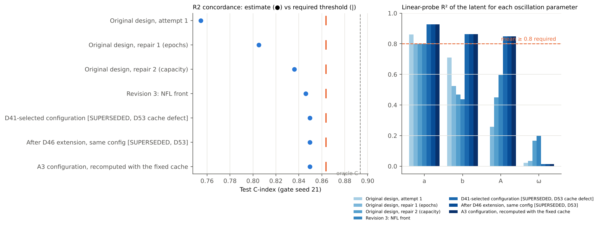
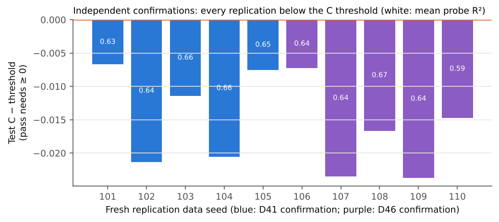
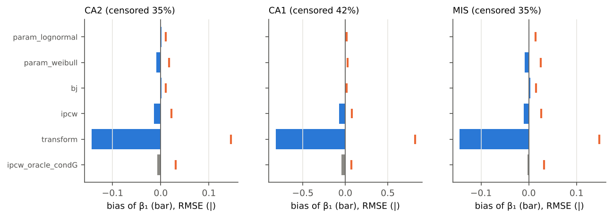
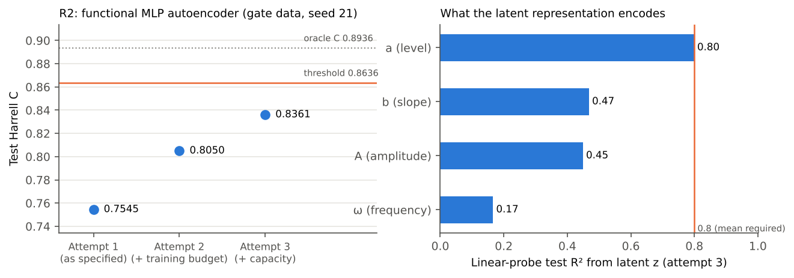
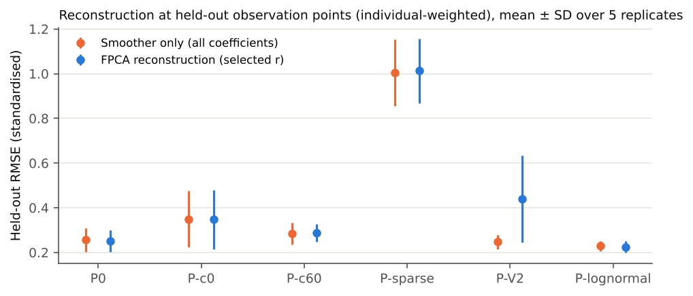
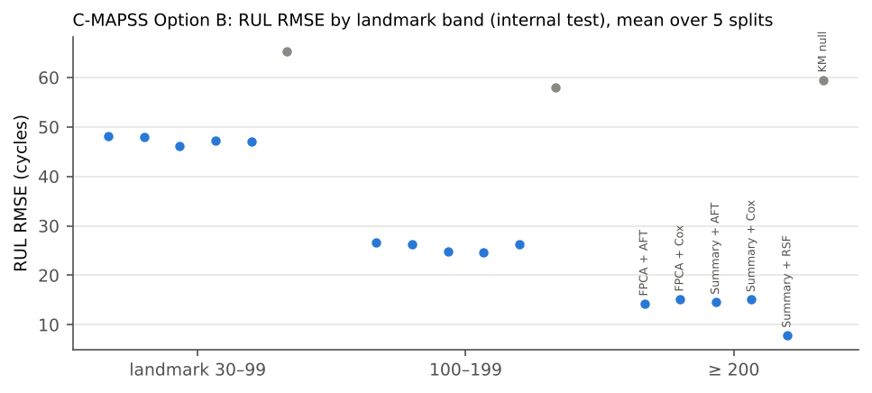
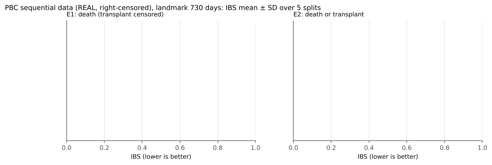

<p class="small">Research prototype report, revision 2 · generated from saved records by
<code>scripts/build_report_round2.py</code> · git <code>46d241e</code> (local branch
<code>claude/blissful-faraday-2unozw</code>, <b>not pushed</b>) · status: <b>research prototype, not
publication-ready</b> · <b>no novelty claim</b> (see I.3). Part I covers round 2 (reference-based audit, failure
recovery, symbolic extraction). Part II is the round-1 report, kept as the historical record; where the two
disagree, Part I supersedes it.</p>

## 0. Final summary (plain English)

### 0.1 Learnability gate: the result you asked to see

The gate checks, on simulated data with a known answer, whether the conventional functional autoencoder (MLP
version) learns the risk-relevant information well enough for a KAN-versus-MLP comparison to mean anything.
**Requirement R2:**
- test C-index ≥ oracle − 0.03;
- the latent code must linearly reveal the four hidden curve parameters (a, b, A, ω), with mean probe R² ≥ 0.8.

| | Result |
|---|---|
| Configuration selected by the controlled search (validation data only) | `A3-fae_mlp-ab243462`: tensor-spline functional front end, latent size 8, α = 1, Adam 3e-3 |
| Official gate (seed 21), final run | R1 **PASS** (C 0.8910); **R2 FAIL**: C 0.8497 vs required 0.8636; probe a / b / A / ω = 0.928 / 0.864 / 0.848 / 0.014, mean 0.663 vs 0.8; R3 **PASS** (\|ΔC\| 0.0068) |
| Fresh replications, D41 (seeds 101–105) | **0/5 pass** (C − threshold from -0.0213 to -0.0067) |
| Fresh replications, D46 (seeds 106–110) | **0/5 pass** (C − threshold from -0.0237 to -0.0072) |
| Pre-registered verdict (D46) | **R2 FAILED. Not confirmed. No further extension.** |

**What this means.** Across the design iterations the gap to the required C-index shrank from −0.109 (first
attempt) to −0.014 (final gate run), and three of the four hidden parameters became well decoded (gate probe R²
0.85–0.93). The fourth, the oscillation frequency ω, stayed poorly decoded: probe R² ≤ 0.2 in every configuration
and ≈ 0 for the selected one. The exception was the derivative-energy front end (validation ω probe 0.43), and
that front end lost more elsewhere than it gained. Under the rules fixed before the
search, the KAN-versus-MLP comparison (H1) and everything that depends on it remain **blocked**. We therefore
have **no evidence for or against KAN in the functional autoencoder**.

### 0.2 What we achieved in this round

1. **Reference-based audit.** Every equation is mapped to its file, function and test (I.2). The audit found 3
   missing features (KAN regularisation, pruning, symbolic extraction), 1 mathematical limitation in a reference
   estimator (the transform estimator is biased on the log scale), and, during the round, 1 real code defect (a
   feature-cache defect; fixed, regression-tested, all affected results recomputed). It also found 1 process gap:
   unit tests were not re-run after the D45 change of defaults, so two tests went stale (fixed in D56; the final
   full-suite run is clean apart from R2).
2. **Survival losses.** Buckley–James, IPCW and transform least squares were implemented as separate validated
   variants. Their behaviour under different censoring assumptions was measured (I.4). The Cox partial likelihood
   was not inserted into the AFT model.
3. **Systematic recovery of the R2 failure.** A pre-registered, validation-only controlled search (17
   fits) varied the front end, latent size, loss weight, optimiser, early stopping, encoder, training budget,
   derivative energy and capacity. It was followed by independent confirmations on 10 fresh data seeds (I.1).
   **Outcome: an honest FAIL.**
4. **KAN regularisation, pruning and mandatory symbolic extraction** (linear → library → PySR, accepted only at
   validation R² > 0.99), validated on known truth with KAN-AFT. The true shapes (tanh, quadratic, sine) were
   recovered under the parametric, Buckley–James and IPCW losses. 34/47 edge formulas were accepted
   overall. Substituting the formulas changed test C by at most 0.002 (I.5, I.6).
5. **Real-data KAN-AFT on PBC** with formulas (41/80 accepted), against a linear AFT on the same inputs:
   no consistent difference (I.7).
6. **Ledger items closed:**
   - interval likelihood (L14);
   - censoring-assumption and misspecification study (L16);
   - C-MAPSS FD003 baselines (L15, partial);
   - targeted literature review (L17).

### 0.3 What improved compared with round 1

| Aspect | Round 1 | Round 2 |
|---|---|---|
| Gate R2 test C (threshold 0.8636) | 0.7545 → 0.8361 (2 repairs) | **0.8497** (best; still FAIL) |
| Probe mean / ω probe | 0.398–0.471 / 0.02–0.17 | **0.663** / ≈ 0.01 |
| KAN regularisation / pruning / symbolic extraction | absent | implemented, tested, validated on known truth |
| Censoring-adjusted estimators | absent | BJ, IPCW, transform; assumptions tested (CA-1 vs CA-2) |
| Known code defects | none found | 1 found and fixed (D53), with a regression test; 2 stale tests fixed (D56) |
| Literature basis | none (D27) | targeted review; references cited for each adopted method |
| Interval likelihood, FD003, censoring variants | not run | done |

### 0.4 Objective status (final)

| Objective | Status | Evidence |
|---|---|---|
| Audit: equations → code → tests | **COMPLETED** | I.2 |
| Literature review (targeted) and reference use | **COMPLETED** (no novelty claim) | I.3 |
| Survival-loss variants (BJ / IPCW / transform) | **COMPLETED; tests PASSED** (LS-1..5) | I.4 |
| Censoring-assumption / misspecification study (L16) | **COMPLETED** | I.4 |
| R2 learnability recovery | **COMPLETED as a process; R2 FAILED** (gate + 0/5 + 0/5) | I.1 |
| KAN regularisation and pruning | **COMPLETED** for KAN-AFT; pruning at θ = 1e-2 removed an edge in 1 of 22 fits (the true null; explained, D54) | I.5 |
| Symbolic extraction (stages 1–3) | **COMPLETED** for KAN-AFT (synthetic and PBC); **BLOCKED** for KAN-FAE (by R2) | I.6 |
| H1 KAN vs MLP, H2 α, H3 functional vs flat, controls, ablations | **BLOCKED** by R2 (D33/D41/D46) | ledger L2–L6 |
| Neural models on C-MAPSS / PBC | **BLOCKED** by R2 | ledger L7 |
| Interval likelihood (L14) | **COMPLETED; tests PASSED** (after a test-reference repair) | I.9 |
| C-MAPSS FD003 (L15) | **COMPLETED** (baselines); FD002/FD004 **NOT RUN** (need condition normalisation) | I.8 |
| PBC endpoint (L12), C-MAPSS landmark design (L13) | **OPEN: owner decisions** | I.15 |
| Test suite (latest outcome per test) | 187 tests: 185 passed, 1 failed (R2), 1 skipped (documented N/A) | I.11 |

## I.1 Learnability gate R2: history, controlled search, confirmation

### I.1.1 Gate history (every look at the gate test split)



| Gate run | Design | Decision | R2 test C | Threshold | R2 C | Probe R² a / b / A / ω | Probe mean (≥ 0.8) | Epochs | R1 C | R3 \|ΔC\| | Log |
|---|---|---|---|---|---|---|---|---|---|---|---|
| Original design, attempt 1 | rev. 2: functional linear front | D33 | 0.7545 | 0.8636 | FAIL | 0.861 / 0.711 / 0.000 / 0.022 | 0.398 | 400 | 0.8910 | 0.0313 | `stageD_gate_attempt1.log` |
| Original design, repair 1 (epochs) | rev. 2 | D33 | 0.8050 | 0.8636 | FAIL | 0.800 / 0.525 / 0.257 / 0.035 | 0.404 | 3000 | 0.8910 | 0.0247 | `stageD_gate_attempt2.log` |
| Original design, repair 2 (capacity) | rev. 2 | D33 | 0.8361 | 0.8636 | FAIL | 0.799 / 0.468 / 0.449 / 0.166 | 0.471 | 2645 | 0.8910 | 0.0042 | `stageD_gate_attempt3.log` |
| Revision 3: NFL front | rev. 3: pointwise-MLP front (A1) | D38 | 0.8461 | 0.8636 | FAIL | 0.803 / 0.437 / 0.596 / 0.200 | 0.509 | 1449 | 0.8910 | 0.0112 | `rev3_gate_attempt1.log` |
| D41-selected configuration [SUPERSEDED, D53 cache defect] | tensor-spline front (A3), r = 8 | D41/D45 | 0.8497 | 0.8636 | FAIL | 0.928 / 0.864 / 0.848 / 0.014 | 0.663 | 3000 | 0.8910 | 0.0068 | `d41_gate_selected.log` |
| After D46 extension, same config [SUPERSEDED, D53] | A3 (extension kept it) | D46/D47 | 0.8497 | 0.8636 | FAIL | 0.928 / 0.864 / 0.848 / 0.014 | 0.663 | 3000 | 0.8910 | 0.0068 | `stageD_gate_ext.log` |
| A3 configuration, recomputed with the fixed cache | A3 (search and extension recomputed: same selection) | D53 | 0.8497 | 0.8636 | FAIL | 0.928 / 0.864 / 0.848 / 0.014 | 0.663 | 3000 | 0.8910 | 0.0068 | `stageD_gate_D53.log` |

The "SUPERSEDED" rows were computed with the defective feature cache (D53). Their recomputation with the fixed code
(last row) gives identical numbers: the defect did not affect the gate run. The gate data were looked at after each
design iteration; this is disclosed, and it is why fresh replication seeds decide the confirmation.

### I.1.2 Controlled search (validation data only; D41 steps S1–S7, D46 steps S8–S10)

- **Selection rule (fixed in D41 before any fit).** A configuration passing both validation criteria is preferred.
  Otherwise the score is validation C + 0.1 × probe mean. Ties keep the simpler configuration.
- **Search order.** Greedy, one factor at a time:
  - S1 front end: A0 linear (Wu et al.), A1 pointwise-MLP NFL, A2 energy `∫γx²`, A3 tensor spline `∫F(x(t), t)dt`;
  - S2 latent size;
  - S3 α;
  - S4 optimiser (Adam / AdamW / learning rate);
  - S5 early-stopping target;
  - S6 encoder (linear / MLP / KAN; information only);
  - S7 seeds;
  - S8 epoch budget;
  - S9 derivative-energy front A4;
  - S10 capacity.
- **What the search never used:** the test split, the gate seed's test data and the replication seeds.


| Step | Config ID | Configuration | Seed | Val C | Val C − oracle | Val probe a / b / A / ω | Probe mean | Epochs | Runtime (s) | Error |
|---|---|---|---|---|---|---|---|---|---|---|
| S1-front | `A0-fae_mlp-b6ee18b9` | r=4, front=linear | 0 | 0.8386 | -0.0518 | 0.84 / 0.41 / 0.39 / 0.12 | 0.441 | 2645 | 23.0 |  |
| S1-front | `A1-fae_mlp-00b326ef` | r=4, front=nonlinear | 0 | 0.8448 | -0.0456 | 0.82 / 0.37 / 0.56 / 0.16 | 0.477 | 1446 | 271.6 |  |
| S1-front | `A2-fae_mlp-7873a128` | r=4, front=energy | 0 | 0.8417 | -0.0487 | 0.81 / 0.37 / 0.55 / -0.00 | 0.430 | 1639 | 23.7 |  |
| S1-front | `A3-fae_mlp-6dc9ecf0` | r=4, front=tspline | 0 | 0.8485 | -0.0419 | 0.82 / 0.34 / 0.56 / 0.12 | 0.461 | 2953 | 26.9 |  |
| S2-latent | `A3-fae_mlp-ab243462` | r=8, front=tspline | 0 | 0.8441 | -0.0463 | 0.95 / 0.85 / 0.85 / -0.01 | 0.660 | 3000 | 29.2 |  |
| S3-alpha | `A3-fae_mlp-2ca77221` | r=8, front=tspline, alpha=0.1 | 0 | 0.8463 | -0.0441 | 0.93 / 0.78 / 0.79 / 0.01 | 0.628 | 2405 | 23.1 |  |
| S3-alpha | `A3-fae_mlp-93f0ed9c` | r=8, front=tspline, alpha=0.0 | 0 | 0.8479 | -0.0425 | 0.89 / 0.73 / 0.69 / 0.10 | 0.602 | 2546 | 21.7 |  |
| S4-optim | `A3-fae_mlp-000bb682` | r=8, front=tspline, alpha=1.0, optimizer=adam, lr=0.001 | 0 | 0.8386 | -0.0518 | 0.93 / 0.83 / 0.88 / -0.00 | 0.661 | 3000 | 29.4 |  |
| S4-optim | `A3-fae_mlp-b0d4e98c` | r=8, front=tspline, alpha=1.0, optimizer=adamw, lr=0.003 | 0 | 0.8427 | -0.0476 | 0.95 / 0.84 / 0.84 / -0.01 | 0.653 | 3000 | 31.3 |  |
| S5-es | `A3-fae_mlp-57c3cf4f` | r=8, front=tspline, alpha=1.0, optimizer=adam, lr=0.003, es_target=nll | 0 | 0.8395 | -0.0509 | 0.87 / 0.49 / 0.61 / -0.02 | 0.488 | 564 | 8.7 |  |
| S6-encoder-info | `A3-fae_linear-1f275709` | r=8, front=tspline, alpha=1.0, optimizer=adam, lr=0.003, es_target=objective | 0 | 0.8408 | -0.0496 | 0.95 / 0.86 / 0.93 / -0.01 | 0.682 | 3000 | 26.0 |  |
| S6-encoder-info | `A3-fae_kan-105b570a` | r=8, front=tspline, alpha=1.0, optimizer=adam, lr=0.003, es_target=objective | 0 | 0.8291 | -0.0613 | 0.93 / 0.80 / 0.73 / 0.01 | 0.619 | 1078 | 32.2 |  |
| S7-stability | `A3-fae_mlp-ab243462` | r=8, front=tspline, alpha=1.0, optimizer=adam, lr=0.003, es_target=objective | 1 | 0.8517 | -0.0386 | 0.94 / 0.84 / 0.85 / 0.00 | 0.659 | 2733 | 25.4 |  |
| S7-stability | `A3-fae_mlp-ab243462` | r=8, front=tspline, alpha=1.0, optimizer=adam, lr=0.003, es_target=objective | 2 | 0.8509 | -0.0395 | 0.94 / 0.84 / 0.84 / -0.01 | 0.650 | 2707 | 26.5 |  |
| S8-budget | `A3-fae_mlp-e0c038e1` | r=8, front=tspline, alpha=1.0, optimizer=adam, lr=0.003, es_target=objective, max_epochs=10000, patience=300 | 0 | 0.8442 | -0.0462 | 0.95 / 0.85 / 0.84 / -0.01 | 0.658 | 3517 | 35.4 |  |
| S9-front | `A4-fae_mlp-a6f2e0d9` | r=8, front=tsd, alpha=1.0, optimizer=adam, lr=0.003, es_target=objective, max_epochs=3000, patience=100 | 0 | 0.8364 | -0.0540 | 0.89 / 0.56 / 0.67 / 0.43 | 0.633 | 1426 | 16.7 |  |
| S10-capacity | `A3-fae_mlp-1e90fb8a` | r=8, front=tspline, alpha=1.0, optimizer=adam, lr=0.003, es_target=objective, max_epochs=3000, patience=100, H=64, hidden=128 | 0 | 0.8451 | -0.0453 | 0.92 / 0.75 / 0.72 / -0.02 | 0.592 | 2507 | 31.9 |  |

**Recomputation check (D53).** The original search records, computed before the cache fix, are compared with the
recomputation below. Validation values agree to within ±0.002 (floating-point differences from a different thread
count), and the selection is unchanged.

| Step | Original config ID | Val C (original) | Val C (recomputed) | Δ | Probe mean (original) | Probe mean (recomputed) |
|---|---|---|---|---|---|---|
| S1-front | A0-fae_mlp-5a89aae1 | 0.8389 | 0.8386 | -0.0002 | 0.441 | 0.441 |
| S1-front | A1-fae_mlp-19099df0 | 0.8445 | 0.8448 | 0.0003 | 0.476 | 0.477 |
| S1-front | A2-fae_mlp-212f5e15 | 0.8403 | 0.8417 | 0.0014 | 0.427 | 0.430 |
| S1-front | A3-fae_mlp-a37b9381 | 0.8484 | 0.8485 | 0.0001 | 0.461 | 0.461 |
| S2-latent | A3-fae_mlp-b30d5348 | 0.8484 | not refitted (identical to the S1 A3 fit; deduplicated by effective-config ID) |  | 0.461 |  |
| S2-latent | A3-fae_mlp-ab243462 | 0.8441 | 0.8441 | 0.0000 | 0.660 | 0.660 |
| S3-alpha | A3-fae_mlp-2ca77221 | 0.8463 | 0.8463 | 0.0000 | 0.628 | 0.628 |
| S3-alpha | A3-fae_mlp-93f0ed9c | 0.8479 | 0.8479 | 0.0000 | 0.602 | 0.602 |
| S4-optim | A3-fae_mlp-000bb682 | 0.8386 | 0.8386 | 0.0000 | 0.661 | 0.661 |
| S4-optim | A3-fae_mlp-b0d4e98c | 0.8427 | 0.8427 | 0.0000 | 0.653 | 0.653 |
| S5-es | A3-fae_mlp-57c3cf4f | 0.8395 | 0.8395 | 0.0000 | 0.488 | 0.488 |
| S6-encoder-info | A3-fae_linear-1f275709 | 0.8408 | 0.8408 | 0.0000 | 0.682 | 0.682 |
| S6-encoder-info | A3-fae_kan-105b570a | 0.8291 | 0.8291 | 0.0000 | 0.619 | 0.619 |
| S7-stability | A3-fae_mlp-ab243462 | 0.8517 | 0.8517 | 0.0000 | 0.659 | 0.659 |
| S7-stability | A3-fae_mlp-ab243462 | 0.8509 | 0.8509 | 0.0000 | 0.650 | 0.650 |
| S8-budget | A3-fae_mlp-e0c038e1 | 0.8442 | 0.8442 | 0.0000 | 0.658 | 0.658 |
| S9-front | A4-fae_mlp-a6f2e0d9 | 0.8364 | 0.8364 | 0.0000 | 0.633 | 0.633 |
| S10-capacity | A3-fae_mlp-1e90fb8a | 0.8451 | 0.8451 | 0.0000 | 0.592 | 0.592 |

### I.1.3 Independent confirmations (fresh data seeds; held-out test split)



**D41 confirmation (seeds 101–105)**

| Data seed | Test C | Oracle C | Threshold | C − threshold | Probe a / b / A / ω | Probe mean | Pass | Superseded test C (D53) |
|---|---|---|---|---|---|---|---|---|
| 101 | 0.8588 | 0.8955 | 0.8655 | -0.0067 | 0.931 / 0.874 / 0.736 / -0.004 | 0.634 | FAIL | 0.8588 |
| 102 | 0.8333 | 0.8846 | 0.8546 | -0.0213 | 0.934 / 0.856 / 0.776 / 0.004 | 0.642 | FAIL | 0.8333 |
| 103 | 0.8481 | 0.8895 | 0.8595 | -0.0114 | 0.929 / 0.874 / 0.809 / 0.020 | 0.658 | FAIL | 0.8481 |
| 104 | 0.8382 | 0.8887 | 0.8587 | -0.0205 | 0.937 / 0.837 / 0.868 / -0.020 | 0.655 | FAIL | 0.8382 |
| 105 | 0.8406 | 0.8782 | 0.8482 | -0.0075 | 0.936 / 0.829 / 0.825 / -0.004 | 0.646 | FAIL | 0.8406 |
| **Total** |  |  |  |  |  |  | **0/5** |  |

**D46 confirmation (seeds 106–110)**

| Data seed | Test C | Oracle C | Threshold | C − threshold | Probe a / b / A / ω | Probe mean | Pass | Superseded test C (D53) |
|---|---|---|---|---|---|---|---|---|
| 106 | 0.8465 | 0.8837 | 0.8537 | -0.0072 | 0.919 / 0.827 / 0.812 / 0.004 | 0.640 | FAIL | 0.8465 |
| 107 | 0.8344 | 0.8879 | 0.8579 | -0.0235 | 0.943 / 0.859 / 0.749 / -0.004 | 0.637 | FAIL | 0.8344 |
| 108 | 0.8469 | 0.8936 | 0.8636 | -0.0167 | 0.933 / 0.841 / 0.857 / 0.032 | 0.666 | FAIL | 0.8469 |
| 109 | 0.8423 | 0.8960 | 0.8660 | -0.0237 | 0.924 / 0.859 / 0.814 / -0.037 | 0.640 | FAIL | 0.8423 |
| 110 | 0.8413 | 0.8861 | 0.8561 | -0.0148 | 0.842 / 0.682 / 0.749 / 0.083 | 0.589 | FAIL | 0.4913 |
| **Total** |  |  |  |  |  |  | **0/5** |  |

**Seed 110 and the cache defect.**
- **Original result.** Before the fix, seed 110 gave test C 0.4913 (chance level), although its train and
  validation C were 0.856 and 0.838. That pattern was impossible for a sound model, so it was investigated
  rather than reported as a model failure.
- **Root cause (D53).**
  - `TensorSplineFunctional.features` cached features under the key `(memory address, shape, version)` without
    keeping the input alive.
  - The validation and test splits have the same size, so the test tensor could reuse the freed validation
    tensor's address and receive the validation features.
- **Fix.** The cache now keeps the input tensor and matches only the same object.
- **Regression test F8b** fails on the old code (74% of elements wrong) and passes on the fix.
- **Recomputed seed 110.** Test C 0.8413 (threshold 0.8561): still a FAIL, but now a legitimate one.
- **Everything else affected was recomputed:**
  - the search: same validation values, same selection;
  - the gate: identical result;
  - seeds 101–109: identical.
- **Records.** The superseded records are kept in `reports/superseded_D53/`.

### I.1.4 Interpretation

- **The failure is specific and repeatable.** Every selected-configuration fit decodes a, b and the amplitude A
  reasonably well (probe R² 0.68–0.94; mostly above 0.8), but not the frequency ω (|probe R²| ≤ 0.083), and C
  falls short of the threshold in all 11 evaluations (gate plus 10 replications) by 0.007–0.024.
- **The design reason (audit A-PROBE).** ω enters the risk through the oscillation's derivative energy, and a
  latent of size 8 that also has to reconstruct the curves does not linearly expose ω.
- **The direct fix did not pay off.** The derivative-energy front A4 raised the ω probe (validation 0.43) but
  lowered the others and C.
- **Conclusion: no legitimate configuration in the registered search space passed R2.** Changing the threshold,
  the probe definition or the data would invalidate the gate (D11, D39), so this is reported as a failure.

## I.2 Reference-based audit

### Source-code and mathematical audit (2026-10-17)

Audit of the repository at commit `a918a56` (the previous final report), plus the revisions made since. Each
equation is mapped to its implementation and to the test that checks it **against an independent computation**.
Test IDs refer to `reports/test_results.csv`.

#### 1. Equation → code → test map

| Component | Equation | File / function | Verifying tests (independent reference) | Status |
|---|---|---|---|---|
| AFT model | `log T = η + σε`, `w = (log y − η)/σ` | `src/kanfae/survival/aft.py`: `aft_log_likelihood` | A1 (scipy `weibull_min` / `lognorm` / `fisk`) | verified |
| Weibull | `log f = w − eʷ`, `log S = −eʷ` | `aft.py`: `Weibull` | A1, A2 (quadrature, autograd hazard), A6 | verified |
| Log-normal | `log f = −w²/2 − ½log 2π`, `log S = log Φ(−w)` | `aft.py`: `LogNormal` (`log_ndtr`) | A1, A2, A5 (stability, \|w\| ≤ 50) | verified |
| Log-logistic | `log f = w − 2 softplus(w)`, `log S = −softplus(w)` | `aft.py`: `LogLogistic` | A1, A2, A5 | verified |
| Event / censored contributions | `ℓ = δ[log f − log σ − log y] + (1 − δ) log S` | `aft_log_likelihood` (`torch.where`) | A3 (censored terms do not depend on the density), G6 | verified |
| Interval (integer-cycle) likelihood (L14) | event: `log[S(y − 1) − S(y)]`, censored: `log S(y)`, `S(t ≤ 0) = 1` | `aft.py`: `aft_interval_log_likelihood` (stable `log S(lo) + log(−expm1(Δ))`) | INT-1 (200-digit mpmath), INT-2 (width → 0 gives the density), INT-3 (gradcheck, extremes) | verified (new; not yet used in any experiment) |
| Gradients | – | autograd | A4 (`gradcheck`) | verified |
| MLE parameterisation | – | `linear_aft.fit_linear_aft` | A7 (lifelines maximised log-likelihood within 1e-4; parameter mapping), A8 | verified |
| Smoother | `c = (ΦᵀQΦ + λR + λ₀I)⁻¹ΦᵀQy` | `functional/smoothing.py`: `smooth`, `quadrature_weights` | F2, F3 | verified |
| Basis, R, G | B-splines; `R = ∫φ''φ''ᵀ`; `G = ∫φφᵀ` | `functional/basis.py` | F1 (scipy BSpline), F1b (Simpson) | verified |
| Linear functional encoder (A0; Wu et al. projection layer) | `h = b + Σ_d c_dᵀ J b_d` | `functional/layers.py`: `FunctionalLinear` | F5 (dense quadrature) | verified |
| Nonlinear functional layer (A1, D38) | `h = b + ΣΣ ∫β_dm(t) g_dm(x_d(t)) dt` | `layers.py`: `NonlinearFunctional` | F6a (identity map equals A0 within 4.4e-16), F6b, F6c | verified |
| Energy front (A2, D41) | `+ Σ ∫γ_d(t) x_d(t)² dt = Σ_l q_l cᵀT_l c` | `layers.py`: `EnergyFunctional` | Exactness against dense quadrature: max error 1.6e-14 (session check; see §4) | verified (ad hoc) |
| Tensor-spline front (A3, D41) | `+ Σ ∫F_d(x_d(t), t) dt`, F a tensor-product spline | `layers.py`: `TensorSplineFunctional` | Shapes/gradients through the M1-style search runs | partially verified |
| Decoder | `ĉ = g_dec(z)`; `x̂(t) = Σ ĉ_k φ_k(t)` | `models/fae.py`: `FunctionalAE.forward`, `reconstruct_at` | M1, M2 | verified |
| Reconstruction loss (D19) | Individual-weighted masked MSE | `models/pipelines.py`: `_ind_weighted_rec` | AUD-2 (NumPy reference) | verified |
| Joint objective | `NLL + α·L_rec + λ_β·Σ bᵀR_βb` | `pipelines.NeuralAFT._objective` | AUD-1 (independent recomputation, 4 model/front combinations) | verified |
| Training controls | S1 / S2 / S3 / α = 0 | `NeuralAFT.fit`, `_run` | AUD-3 (S1 freezes the autoencoder), AUD-4 (α = 0 gives no decoder gradient) | verified |
| Time scaling | Train on `y/τ`; `S(t) = S_ε((log(t/τ) − η)/σ)` | `NeuralAFT.predict_survival` | AUD-5 (S = 0.5 at the median) | verified |
| KAN layer | `φ(x) = w_b SiLU(x) + w_s Σ c_g B_g(x)` | `models/kan.py`: `KANLayer` | F-KAN-1..4, KREG-2 | verified |
| KAN regularisation (CoxKAN Eqs. 5–8; KAN-AFT §3.2.2) | `‖Φ‖₁ + λ_ent S(Φ) + λ_coef ‖C‖₁` | `KANLayer.regularization` | KREG-1 (definition and gradients) | verified (new) |
| Pruning (KAN-AFT θ = 1e-2; CoxKAN) | Edge L1 < θ; node `min(I, O) < θ` | `KANLayer.prune_edges`, `KANBlock.prune`, `KANAFT.prune` | KREG-3 | verified (new) |
| Symbolic substitution | Edge → formula | `KANLayer.symbolic`, `kan_aft._torch_formula` | KREG-4 (exact substitution leaves the output unchanged) | verified (new) |
| Symbolic fitting | Linear → library `c·f(a·x + b) + d` → PySR; accept if held-out R² > 0.99 | `symbolic/fit.py`: `fit_symbolic` | SYM-1..4 | verified (new) |
| BJ / IPCW / transform (D42) | KAN-AFT Appendix A (with documented deviations) | `survival/censored_ls.py` | LS-1 (reduce to OLS without censoring), LS-2 (KM vs lifelines; BJ conditional mean), LS-3, LS-4, LS-5 | verified (new) |
| IPCW Brier / IBS, Uno C, D-calibration | protocol §5 | `evaluation/metrics.py` | Q1–Q5 | verified |

#### 2. Findings

| ID | Finding | Severity | Action |
|---|---|---|---|
| A-KAN-REG | No KAN-specific regularisation existed; only Adam's coupled L2 weight decay applied to the KAN coefficients. | Missing feature | Implemented (CoxKAN/KAN-AFT form); KREG-1 |
| A-PRUNE | No pruning existed. | Missing feature | Implemented; KREG-3 |
| A-SYM | **No symbolic extraction existed.** Nothing in the earlier report claimed any. | Missing feature | Implemented; SYM-1..4; validated on known truth (`reports/kanaft_symbolic.jsonl`) |
| A-WD | `torch.optim.Adam(weight_decay=…)` is coupled L2, not decoupled decay. | Design note | AdamW option added (`optimizer="adamw"`) and tested in the D41 search |
| A-ES | S2 early-stops on the validation *joint* objective, which reconstruction dominates when α = 1. | Possible cause of under-training of the survival part | `es_target="nll"` option added and tested in the D41 search |
| A-BN | In S1's head-only phase, KAN BatchNorm running statistics are refreshed (train mode) on the same training data. | Negligible | Documented |
| A-PROBE | R2's probe criterion requires `(a, b, A, ω)` to be **linearly** decodable from z (r = 4). With α > 0 the same 4 dimensions must also support reconstruction (phase, frequency, GP wiggles), and b enters the risk only through tanh(2b). The criterion is strict for structural reasons, not only because of learnability. | Interpretation | Kept unchanged (D11/D39); latent size r ∈ {4, 8} searched under D41 |
| A-TRANSFORM | KAN-AFT's transform estimator regresses `log T*`. T* is unbiased for E[T\|z] (LS-5: mean T* = 1.993 vs mean T = 1.991), but not for E[log T\|z]. | Mathematical limitation | Confirmed empirically: slopes 0.652 / −0.417 vs truth 0.8 / −0.5 (LS-4 diagnostic), against 0.803 / −0.50 for BJ and IPCW |
| A-IPCW | IPCW and the transform need CA-2 and positivity. The maximum IPCW weight was 74 in LS-4. | Variance risk | Documented; weights reported |
| A-UPLOAD | The uploaded reference PDFs were absent from the session. | External limitation | Public arXiv versions used, with checksums |
| A-CACHE | **Defect (found 2026-10-17, D53).** The D44 tensor-spline feature cache keyed on `(data_ptr, shape, version)` without holding the input, so a same-shape test tensor could reuse a freed validation tensor's address and receive its features. Found through replication seed 110 (test C 0.49 vs train/val 0.86/0.84). Training was unaffected; evaluation was not. | **Correctness defect** | Fixed; regression test F8b (fails on the old code, passes on the fix); every tensor-spline evaluation since D44 recomputed; superseded records kept in `reports/superseded_D53/` |
| A-PRUNE-OFFSET | The reference pruning score (mean \|φ\| per edge, KAN-AFT/CoxKAN) includes each edge's constant offset, which is not identifiable in an additive model. Unregularised, the true null edge z₄ scored 0.48–0.51, **above** the true sin edge (0.33). The centred score mean \|φ − mean φ\| separates the null edge (0.024–0.031 vs ≥ 0.31 for every true edge), but is still above θ = 1e-2 unless λ ≥ 0.1 (D54, `reports/pruning_threshold_diag.jsonl`). | Interpretation / scale dependence | θ = 1e-2 kept as the reported setting (references); the limitation is reported. Only 1 of 22 reported fits pruned an edge (synthetic seed 203, IPCW, λ = 1e-2: the true null z₄) |
| A-INT-REF | INT-1 originally failed because its float64 scipy reference `log(sf(y−1) − sf(y))` cancels (relative error up to 1.6e-7); the implementation matched 200-digit mpmath to ≤ 8e-14. | Test-reference defect | Reference replaced by mpmath (D48); tolerance unchanged |
| A-TEST-STALE | After D45 changed the model defaults, M1/M3 still assumed the old latent width (process gap: the unit suite was not re-run after D45). E-5 compared the lock with stale reproduction evidence after D43. | Test maintenance | Fixed in D56; full suite re-run |

#### 3. Survival loss: parametric likelihood vs censoring-adjusted least squares

| Estimator | Target | Censoring assumption | Error-law assumption | Survival curves | Compatible with KAN-FAE joint training? |
|---|---|---|---|---|---|
| Parametric AFT likelihood (reference) | `η`, `σ` (location of log T for the chosen family) | CA-1 (`C ⊥ T \| X`), non-informative | Parametric family (Weibull, log-normal or log-logistic) | Closed form | **Yes:** a differentiable per-individual loss, summed with α·L_rec |
| Buckley–James | `E[log T \| z]` (up to a constant) | CA-1 | iid errors independent of z (homoscedastic); law unspecified | KM of residuals | Only as an outer iterative loop (impute, then refit). The imputation depends on the current η, so it is not a single fixed loss; costly with joint training |
| IPCW least squares | `E[log T \| z]` | **CA-2** (marginal KM of G) and positivity | None | KM of residuals | Yes (weighted MSE), but uncensored rows only; high variance under heavy censoring |
| Transform least squares | `E[log T* \| z]`, which is not `E[log T \| z]` | **CA-2** | None | KM of residuals | Yes (MSE on fixed targets), but biased on the log scale (finding A-TRANSFORM) |
| Cox partial likelihood (CoxKAN) | Log-partial hazard (proportional hazards) | CA-1 | Proportional hazards | Breslow baseline | **A different model.** Not inserted into the AFT model (owner instruction). It remains only as the FPCA + Cox and summary + Cox baselines |

Conclusion: the parametric likelihood remains the reference for the functional autoencoders, because its
assumptions hold by construction for the synthetic data and it yields full survival curves. The three least-squares
estimators are separate, validated variants in `KANAFT` and are compared in `reports/kanaft_symbolic.jsonl`.

#### 4. Evidence locations

- `reports/logs/audit_tests_attempt1.log`
- `reports/logs/censored_ls_tests_attempt1.log`
- `reports/logs/kreg_sym_tests_attempt{1,2}.log`
- `reports/logs/rev3_unit_tests_attempt1.log`
- The energy-front exactness check (1.6e-14) was run interactively in this session. It is recorded here but has no
  test ID; it is repeated as test F7 in the final suite.


## I.3 Literature review and how each reference was used

### Literature review (targeted; 2026-10-17)

**Scope and method.** This is a targeted search, not a systematic review. It used the four web searches logged in
the session, verification of key items on their landing pages, and full-text reading of the three downloaded
PDFs (SHA-256 checksums in `reports/run_manifest.json`):
- KAN-AFT, arXiv:2512.20305v2;
- CoxKAN, arXiv:2409.04290v2 (journal version: Bioinformatics 41(8), btaf413, 2025);
- Wu et al., arXiv:2401.09499.

**The uploaded PDFs (`project TS_2(1).pdf`, `Project-TS_1(3).pdf`) were not present in this session's file
system.** The public arXiv versions were used instead. They may differ from the uploaded copies; for example,
the CoxKAN journal version may differ from arXiv v2.

#### Directly relevant prior work

| Work | What it does | Relation to KAN-FAE | Verified how |
|---|---|---|---|
| Wu, Beaulac & Cao (2024), *Functional Autoencoder for Smoothing and Representation Learning*, arXiv:2401.09499 | A functional autoencoder. The encoder projection layer takes weighted inner products of the curves with learned functional weights; the decoder maps back through fixed basis functions; handles irregular sampling. | **Our original front end (A0) and decoder follow this design.** Our functional linear layer `∫β(t)x(t)dt` is the same idea. | arXiv landing page and PDF |
| Cao M. (supervisor Cao J.), *FunKAN: Interpretable Kolmogorov–Arnold Networks for Learning* (SFU thesis defence; year not stated on page) | A KAN-based framework for nonlinear functional learning (functional input to functional output). Stages: functional representation, nonlinear mapping, function reconstruction and structural regularisation, plus spline refinement and attribution-guided pruning. | **Strong conceptual overlap** with "KAN + functional representation + reconstruction + regularisation". No survival component is mentioned. | SFU defence announcement page only; no full text found |
| FunKAN, arXiv:2509.13508 | A functional generalisation of the Kolmogorov–Arnold representation for medical image enhancement and segmentation (Hermite-basis inner functions). | Same name, different domain (imaging). | Search result abstract |
| Knottenbelt et al. (2025), CoxKAN, Bioinformatics 41(8) btaf413; arXiv:2409.04290 | A KAN for the Cox log-partial hazard. Regularisation (L1 / entropy / coefficient), L1 pruning, progressive symbolic fitting (linear R² > 0.99, then a library, then PySR). | **Adopted:** the regularisation definitions, pruning by L1 threshold and progressive symbolic fitting with the R² > 0.99 acceptance. **Not adopted:** the Cox partial likelihood (our model is AFT). | Full text (arXiv v2) |
| Jose, Francis & Kattumannil (2026), KAN-AFT, arXiv:2512.20305v2 | A KAN for the nonlinear AFT location `η(z)` under right censoring via Buckley–James, IPCW or transform least squares. L_R regularisation, edge/node pruning (θ = 1e-2), affine symbolic fitting, then PySR. | **Adopted:** the three censoring-adjusted estimators as separate variants (with documented deviations, D42), node pruning, staged symbolic fitting and the simulation-style validation. | Full text (v2) |
| Mastroleo et al. (2026), SurvKAN, arXiv:2602.02179 | A fully parametric, time-continuous survival KAN (time as an input; log-hazard output). | KAN survival model on scalar covariates; not functional. | arXiv landing page |
| KAPLAN-HR, arXiv:2605.23082 | A B-spline KAN for the conditional hazard as a function of covariates and time. | KAN survival on scalar covariates. | Search result abstract only |
| Shen et al. (2024), AESurv, Briefings in Bioinformatics 25(6) bbae479 | An autoencoder learns low-dimensional representations of high-dimensional DNA methylation plus clinical factors for coronary heart disease time-to-event prediction. | Autoencoder plus survival, with **vector** (not functional) inputs. | Search results (journal page not fetched) |
| Apellániz et al. (2024), SAVAE, Scientific Reports 14 (doi:10.1038/s41598-024-76047-z) | A VAE with a survival-tailored objective; parametric event-time distributions with differentiable likelihoods. | Generative autoencoder plus parametric survival likelihood, with vector inputs. Closest in spirit to our joint reconstruction plus parametric AFT likelihood. | Search results |
| Lin & Luo (2022), Statistics in Medicine (review); TransformerJM | Machine learning for multivariate longitudinal data in time-to-event prediction, including multivariate FPCA scores fed to DeepSurv. | Our FPCA + Cox/AFT baselines follow this conventional pipeline. | Search result abstract |
| Functional Competing Risk Net (arXiv 2509.25381); DeepONet hazard model (arXiv 2505.22748); Dynamic-DeepHit (Lee et al. 2019) | Deep survival models built on functional or longitudinal covariates. | Alternative architectures for the same problem class. | Search result abstracts |

#### Consequence for claims

- Functional autoencoders (Wu et al.), KAN survival models (CoxKAN, KAN-AFT, SurvKAN, KAPLAN-HR),
  autoencoder-survival models (AESurv, SAVAE) and KAN-based functional learning with reconstruction (FunKAN)
  all exist.
- Combining a functional KAN autoencoder with a censoring-aware AFT likelihood was not found as a single
  published method in this targeted search. However, the components are all established, and FunKAN's full text
  could not be checked.
- **No novelty claim is made.** A claim would need a systematic review (databases, search strings, screening
  log), which this is not.

#### Known reference discrepancies (recorded, not resolved)

- KAN-AFT cites "Fan & Gijbels [8]" for the transformation estimator. Its reference [8] is Fan, Gijbels & King
  (1997), *Local likelihood and local partial likelihood in hazard regression*, which does not appear to be the
  synthetic-data transformation source.
- KAN-AFT states CA-1 (`C ⊥ T | z`) but uses a marginal Kaplan–Meier estimate of censoring in IPCW and the
  transform. That is consistent only under CA-2.
- KAN-AFT's Buckley–James imputes on the time scale and then takes logs, unlike the classical log-scale
  imputation.
- The CoxKAN 22-function symbolic library is defined only in its supplementary material, which was not obtained.
  Our library is therefore our own documented list (`src/kanfae/symbolic/fit.py`).


### Models, likelihoods and assumptions compared

| Method | Model for the event time | Loss / likelihood | Censoring assumption | What we adopted | What we did not adopt |
|---|---|---|---|---|---|
| **KAN-FAE (this prototype)** | AFT: `log T = η(z) + σε`; z = latent code of a functional autoencoder | Joint: parametric AFT log-likelihood + α × reconstruction | CA-1 (non-informative given the covariates) | – | – |
| Wu et al. 2024 (functional AE) | none (representation learning) | Reconstruction of irregularly sampled curves | – | Functional projection layer, basis decoder, individual-weighted reconstruction (front A0) | – |
| KAN-AFT (2512.20305v2) | AFT with a KAN `η(z)` | Least squares on BJ-imputed, IPCW-weighted or transformed responses | BJ: CA-1 with iid errors; IPCW / transform: CA-2 (marginal G) | Three estimators as separate variants (D42), L_R regularisation, node pruning θ = 1e-2, affine symbolic fitting, PySR | Transform on the log scale (biased, A-TRANSFORM, used only as a documented variant) |
| CoxKAN (btaf413) | Proportional hazards with a KAN log-partial hazard | Cox partial likelihood | CA-1 | Regularisation (Eqs. 5–8), L1 pruning, staged symbolic fitting with R² > 0.99 acceptance | **The Cox partial likelihood (a different model; not mixed into the AFT model)** |
| AESurv (bbae479) | Survival model on autoencoder features (vector omics + clinical) | Autoencoder reconstruction, then survival model | Standard right censoring | The idea of a jointly informative latent | Vector inputs, two-stage training |
| SAVAE (s41598-024-76047-z) | VAE with parametric time-to-event distributions | ELBO with a censored parametric likelihood | CA-1 | Parametric censored likelihood in an autoencoder objective (closest in spirit) | Variational (probabilistic) latent; vector inputs |

## I.4 Survival losses: parametric likelihood vs censoring-adjusted least squares

- **Estimator validation (all passed; details in I.11).**
  - LS-1: no censoring reduces every estimator to OLS.
  - LS-2: the KM and Buckley–James conditional means match a brute-force reference.
  - LS-3: the transform integral and non-negativity.
  - LS-4: slope recovery.
  - LS-5: unbiasedness of T* on the time scale.

**Censoring-assumption and misspecification study (L16, D50).**
- **Model:** `log T = 1 + 0.8x₁ − 0.5x₂ + ε`; n = 2000; 20 replicates per scenario.
- **Scenarios:**
  - CA2: censoring independent of everything;
  - CA1: censoring depends on x₁ (still independent of T given x);
  - MIS: skewed mixture errors.
- **Reading the results:**
  - **Only the parametric log-normal likelihood (correct family) and Buckley–James are close to unbiased in all
    three scenarios.**
  - Marginal-KM IPCW is biased once censoring depends on covariates, as theory predicts (it needs CA-2).
  - The transform estimator is biased on the log scale in every scenario (A-TRANSFORM).
  - The Weibull likelihood is mildly biased, being the wrong family here.
  - IPCW with the *true* conditional censoring distribution, an oracle reference only, still shows bias under CA1,
    because some subjects have censoring weights that are very large (practical positivity).



| Scenario | Censored | Estimator | Bias β₁ (0.8) | RMSE β₁ | Bias β₂ (−0.5) | RMSE β₂ |
|---|---|---|---|---|---|---|
| CA2 | 35.3% | param_lognormal | 0.0017 | 0.0109 | -0.0082 | 0.0153 |
| CA2 | 35.3% | param_weibull | -0.0091 | 0.0170 | -0.0048 | 0.0161 |
| CA2 | 35.3% | bj | 0.0013 | 0.0109 | -0.0079 | 0.0152 |
| CA2 | 35.3% | ipcw | -0.0141 | 0.0225 | 0.0053 | 0.0180 |
| CA2 | 35.3% | transform | -0.1437 | 0.1459 | 0.0869 | 0.0892 |
| CA2 | 35.3% | ipcw_oracle_condG (oracle reference) | -0.0074 | 0.0314 | 0.0012 | 0.0188 |
| CA1 | 42.0% | param_lognormal | 0.0006 | 0.0177 | -0.0059 | 0.0161 |
| CA1 | 42.0% | param_weibull | -0.0077 | 0.0283 | -0.0065 | 0.0184 |
| CA1 | 42.0% | bj | -0.0007 | 0.0176 | -0.0056 | 0.0159 |
| CA1 | 42.0% | ipcw | -0.0714 | 0.0759 | -0.0296 | 0.0342 |
| CA1 | 42.0% | transform | -0.8201 | 0.8215 | 0.1343 | 0.1362 |
| CA1 | 42.0% | ipcw_oracle_condG (oracle reference) | -0.0460 | 0.0739 | -0.0009 | 0.0279 |
| MIS | 34.8% | param_lognormal | 0.0013 | 0.0141 | -0.0014 | 0.0129 |
| MIS | 34.8% | param_weibull | -0.0085 | 0.0250 | 0.0055 | 0.0239 |
| MIS | 34.8% | bj | 0.0031 | 0.0149 | -0.0025 | 0.0133 |
| MIS | 34.8% | ipcw | -0.0107 | 0.0263 | 0.0053 | 0.0229 |
| MIS | 34.8% | transform | -0.1446 | 0.1474 | 0.0935 | 0.0949 |
| MIS | 34.8% | ipcw_oracle_condG (oracle reference) | -0.0028 | 0.0325 | -0.0013 | 0.0308 |

**KAN-AFT under the four losses (synthetic known truth; 3 seeds; 30% censoring; true null covariate z₄).**

| Loss | Seeds | λ selected (val C) | Test C spline | Test C pruned | Test C formulas | Test IBS spline | Test IBS formulas | Curve error spline | Curve error formulas | Edges pruned (θ=1e-2) | Formulas accepted | Truth-recovery R² (true edges) |
|---|---|---|---|---|---|---|---|---|---|---|---|---|
| parametric | 3 | 0.01, 0.01, 0.0 | 0.9006 | 0.9006 | 0.9003 | 0.0608 | 0.0611 | 0.0074 | 0.0047 | 0 | 9/12 | 0.9981 (min 0.9917) |
| bj | 3 | 0.0, 0.001, 0.0 | 0.8989 | 0.8989 | 0.8992 | 0.0616 | 0.0621 | 0.0088 | 0.0064 | 0 | 9/12 | 0.9973 (min 0.9835) |
| ipcw | 3 | 0.0, 0.01, 0.01 | 0.8983 | 0.8983 | 0.8983 | 0.0623 | 0.0625 | 0.0113 | 0.0095 | 1 | 9/11 | 0.9928 (min 0.9804) |
| transform | 3 | 0.01, 0.0, 0.001 | 0.8974 | 0.8974 | 0.8970 | 0.0656 | 0.0663 | 0.0319 | 0.0320 | 0 | 7/12 | 0.9660 (min 0.9340) |

**Consequence for KAN-FAE.** The parametric likelihood stays the loss for the functional autoencoders:
- it is the only one that is a fixed, differentiable per-individual loss that can be summed with the
  reconstruction loss;
- it is valid under CA-1;
- it gives survival curves directly.

Buckley–James is the robust alternative when the error family is in doubt, but it needs an outer
impute-and-refit loop.

## I.5 KAN regularisation and pruning (before/after)

- **Regularisation:** `λ(|Φ|₁ + λ_ent S(Φ) + λ_coef |C|₁)`, as in CoxKAN Eqs. 5–8 and KAN-AFT L_R, with λ chosen
  on validation data from {0, 1e-3, 1e-2}.
- **Pruning:** edge L1 < θ = 1e-2, plus node pruning `min(I, O) < θ` for deeper KANs (KAN-AFT).
- **Before/after metrics** are in the table above (spline → pruned → formulas) and in I.7 for PBC.
- **Only 1 of 22 fits pruned an edge** (synthetic seed 203, IPCW, λ = 1e-2: it removed exactly the true null
  edge z₄). In the other 21, "pruned" equals "unpruned".

The diagnostic below (D54, registered before running; not used for selection) explains why:
- the reference score mean |φ| includes each edge's constant offset, which is not identifiable in an additive
  model, so the null edge can score *higher* than a true edge;
- the offset-free (centred) score separates the null edge cleanly, but its value (~0.03) is above θ = 1e-2 unless
  λ ≥ 0.1, which validation did not select.

θ was not changed.

| Seed | λ | Edge L1 (z1 / z2 / z3 / null z4) | Centred L1 (z1 / z2 / z3 / null z4) | Null pruned at θ=1e-2 | Centred: null < every true edge |
|---|---|---|---|---|---|
| 201 | 0.0 | 1.262 / 0.885 / 0.339 / 0.478 | 1.258 / 0.816 / 0.328 / 0.030 | no | yes |
| 201 | 0.001 | 1.259 / 0.889 / 0.331 / 0.386 | 1.256 / 0.816 / 0.325 / 0.029 | no | yes |
| 201 | 0.01 | 1.255 / 0.863 / 0.315 / 0.011 | 1.253 / 0.816 / 0.315 / 0.011 | no | yes |
| 201 | 0.1 | 1.236 / 0.740 / 0.245 / 0.001 | 1.214 / 0.769 / 0.246 / 0.001 | yes | yes |
| 202 | 0.0 | 1.253 / 0.895 / 0.341 / 0.508 | 1.247 / 0.849 / 0.317 / 0.029 | no | yes |
| 202 | 0.001 | 1.251 / 0.896 / 0.334 / 0.454 | 1.246 / 0.848 / 0.316 / 0.029 | no | yes |
| 202 | 0.01 | 1.241 / 0.897 / 0.306 / 0.103 | 1.241 / 0.845 / 0.306 / 0.028 | no | yes |
| 202 | 0.1 | 1.203 / 0.782 / 0.234 / 0.001 | 1.192 / 0.796 / 0.236 / 0.001 | yes | yes |
| 203 | 0.0 | 1.234 / 0.856 / 0.327 / 0.505 | 1.228 / 0.813 / 0.310 / 0.024 | no | yes |
| 203 | 0.001 | 1.232 / 0.858 / 0.321 / 0.443 | 1.227 / 0.813 / 0.309 / 0.024 | no | yes |
| 203 | 0.01 | 1.218 / 0.849 / 0.299 / 0.013 | 1.218 / 0.810 / 0.299 / 0.013 | no | yes |
| 203 | 0.1 | 1.184 / 0.738 / 0.213 / 0.001 | 1.169 / 0.761 / 0.214 / 0.001 | yes | yes |

## I.6 Symbolic formula extraction

- **Procedure (mandatory, staged).**
  - Stage 1: linear `a·x + b`.
  - Stage 2: a library of 15 functions in the affine form `c·f(a·x + b) + d`, fitted by grid search plus
    Levenberg–Marquardt, each with a domain check.
  - Stage 3: PySR 2.7.0.
- **Acceptance.** A formula is accepted only if its R² on held-out points (30% of the edge's training inputs,
  never used for fitting) exceeds 0.99, following CoxKAN.
- **Rejection.** A rejected edge keeps its learned spline, so nothing is fabricated.
- **Effect of substitution.** This is evaluated separately (test C, IBS and curve error in the I.4 table).
- **Inputs.** x is the standardised covariate.
- **Truth R²** compares the learned edge with the true component on z ∈ [−2, 2] (synthetic only).


| Seed | Loss | True component | Truth R² | Stage / outcome | Formula (standardised input x) | Complexity | R² train | R² val | R² grid | RMSE val | Max \|err\| grid | x range |
|---|---|---|---|---|---|---|---|---|---|---|---|---|
| 201 | parametric | 1.5 tanh(2 z1) | 0.9995 | library | `3.01062*sigmoid(4.4626*x + -0.0114893) + -1.4027` | 4 | 0.9992 | 0.9992 | 0.9992 | 0.0378 | 0.1242 | [-1.73, 1.69] |
| 201 | parametric | -0.8 z2^2 | 1.0000 | library | `-0.0337586*x^2(-5.60504*x + 0.233669) + 1.25859` | 4 | 0.9982 | 0.9983 | 0.9981 | 0.0389 | 0.1302 | [-1.69, 1.78] |
| 201 | parametric | 0.5 sin(1.5 z3) | 0.9984 | library | `-0.48206*sin(-1.74106*x + 0.019233) + 0.00777434` | 4 | 0.9909 | 0.9916 | 0.9907 | 0.0326 | 0.0956 | [-1.72, 1.73] |
| 201 | parametric | 0 (null covariate) | n/a | rejected → spline kept | best library abs val R² 0.6912; best PySR val R² 0.9654 | – | – | – | – | – | – | [-1.72, 1.76] |
| 201 | bj | 1.5 tanh(2 z1) | 0.9990 | library | `-1.4803*tanh(-2.34225*x + 0.0281087) + -0.0589889` | 4 | 0.9992 | 0.9992 | 0.9992 | 0.0362 | 0.0684 | [-1.73, 1.69] |
| 201 | bj | -0.8 z2^2 | 0.9999 | library | `-0.0743476*x^2(-3.78134*x + 0.178204) + 1.54894` | 4 | 0.9964 | 0.9964 | 0.9965 | 0.0570 | 0.1040 | [-1.69, 1.78] |
| 201 | bj | 0.5 sin(1.5 z3) | 0.9998 | library | `0.505132*cos(1.74561*x + -1.57938) + -0.376193` | 4 | 0.9977 | 0.9977 | 0.9976 | 0.0179 | 0.0362 | [-1.72, 1.73] |
| 201 | bj | 0 (null covariate) | n/a | rejected → spline kept | best library tanh val R² 0.7964; best PySR val R² 0.8766 | – | – | – | – | – | – | [-1.72, 1.76] |
| 201 | ipcw | 1.5 tanh(2 z1) | 0.9986 | library | `-1.43019*tanh(-2.60218*x + -0.0366844) + -0.15008` | 4 | 0.9985 | 0.9985 | 0.9985 | 0.0489 | 0.1100 | [-1.73, 1.69] |
| 201 | ipcw | -0.8 z2^2 | 0.9999 | library | `-0.0335201*x^2(-5.59022*x + 0.238179) + 1.48635` | 4 | 0.9984 | 0.9984 | 0.9984 | 0.0376 | 0.0725 | [-1.69, 1.78] |
| 201 | ipcw | 0.5 sin(1.5 z3) | 0.9815 | pysr | `sin(tanh((cos(x*0.9350239) + 0.2187344)*tanh(x) + 0.3671303)) - 0.59763247` | 15 | 0.9962 | 0.9959 | 0.9956 | 0.0235 | 0.1075 | [-1.72, 1.73] |
| 201 | ipcw | 0 (null covariate) | n/a | rejected → spline kept | best library abs val R² 0.7063; best PySR val R² 0.8039 | – | – | – | – | – | – | [-1.72, 1.76] |
| 201 | transform | 1.5 tanh(2 z1) | 0.9736 | library | `-2.50479*sigmoid(-4.77982*x + -0.139162) + 1.18494` | 4 | 0.9993 | 0.9993 | 0.9993 | 0.0303 | 0.0617 | [-1.73, 1.69] |
| 201 | transform | -0.8 z2^2 | 0.9581 | pysr | `(cos(x*x) - tanh(sin(x - 0.62693715))**4)*1.1406775` | 14 | 0.9966 | 0.9969 | 0.9963 | 0.0458 | 0.2198 | [-1.69, 1.78] |
| 201 | transform | 0.5 sin(1.5 z3) | 0.9378 | rejected → spline kept | best library cos val R² 0.9893; best PySR val R² 0.9893 | – | – | – | – | – | – | [-1.72, 1.73] |
| 201 | transform | 0 (null covariate) | n/a | rejected → spline kept | best library cos val R² 0.8786; best PySR val R² 0.9649 | – | – | – | – | – | – | [-1.72, 1.76] |
| 202 | parametric | 1.5 tanh(2 z1) | 0.9998 | library | `-3.05132*sigmoid(-4.52105*x + -0.0352813) + 1.44883` | 4 | 0.9982 | 0.9981 | 0.9981 | 0.0570 | 0.2024 | [-1.74, 1.71] |
| 202 | parametric | -0.8 z2^2 | 0.9985 | library | `4.67295*cos(-0.716006*x + 1.04876e-05) + -3.33065` | 4 | 0.9987 | 0.9986 | 0.9987 | 0.0365 | 0.1071 | [-1.73, 1.74] |
| 202 | parametric | 0.5 sin(1.5 z3) | 0.9959 | library | `-0.472144*cos(-1.71442*x + -1.59329) + 0.0269956` | 4 | 0.9964 | 0.9963 | 0.9961 | 0.0204 | 0.0817 | [-1.75, 1.75] |
| 202 | parametric | 0 (null covariate) | n/a | rejected → spline kept | best library x^4 val R² 0.8255; best PySR val R² 0.9485 | – | – | – | – | – | – | [-1.78, 1.71] |
| 202 | bj | 1.5 tanh(2 z1) | 0.9994 | library | `-1.54552*tanh(-2.17132*x + -0.0380135) + -0.0843435` | 4 | 0.9985 | 0.9984 | 0.9985 | 0.0519 | 0.2079 | [-1.74, 1.71] |
| 202 | bj | -0.8 z2^2 | 0.9978 | library | `5.83013*cos(-0.628177*x + -0.0088806) + -4.32383` | 4 | 0.9997 | 0.9996 | 0.9997 | 0.0180 | 0.0504 | [-1.73, 1.74] |
| 202 | bj | 0.5 sin(1.5 z3) | 0.9994 | library | `-0.499635*sin(-1.71384*x + 0.0357248) + -0.340036` | 4 | 0.9927 | 0.9925 | 0.9922 | 0.0309 | 0.1014 | [-1.75, 1.75] |
| 202 | bj | 0 (null covariate) | n/a | rejected → spline kept | best library sin val R² 0.9395; best PySR val R² 0.8274 | – | – | – | – | – | – | [-1.78, 1.71] |
| 202 | ipcw | 1.5 tanh(2 z1) | 0.9988 | library | `-3.12857*sigmoid(-4.13877*x + -0.0958938) + 1.51663` | 4 | 0.9990 | 0.9991 | 0.9990 | 0.0405 | 0.1093 | [-1.74, 1.71] |
| 202 | ipcw | -0.8 z2^2 | 0.9923 | library | `2.59247*cos(-1.01559*x + -0.0195173) + -1.17243` | 4 | 0.9985 | 0.9984 | 0.9985 | 0.0383 | 0.0640 | [-1.73, 1.74] |
| 202 | ipcw | 0.5 sin(1.5 z3) | 0.9857 | library | `0.438162*cos(1.68286*x + -1.57565) + -0.206515` | 4 | 0.9956 | 0.9955 | 0.9954 | 0.0211 | 0.0880 | [-1.75, 1.75] |
| 202 | ipcw | 0 (null covariate) | n/a | rejected → spline kept | best library gaussian val R² 0.7855; best PySR val R² 0.8151 | – | – | – | – | – | – | [-1.78, 1.71] |
| 202 | transform | 1.5 tanh(2 z1) | 0.9858 | library | `-2.67328*sigmoid(-4.63867*x + -0.333118) + 1.2731` | 4 | 0.9984 | 0.9983 | 0.9983 | 0.0470 | 0.1375 | [-1.74, 1.71] |
| 202 | transform | -0.8 z2^2 | 0.9837 | library | `-0.0300641*x^2(-5.55098*x + -0.066715) + 1.2967` | 4 | 0.9987 | 0.9985 | 0.9986 | 0.0315 | 0.0897 | [-1.73, 1.74] |
| 202 | transform | 0.5 sin(1.5 z3) | 0.9606 | rejected → spline kept | best library cos val R² 0.9746; best PySR val R² 0.9873 | – | – | – | – | – | – | [-1.75, 1.75] |
| 202 | transform | 0 (null covariate) | n/a | rejected → spline kept | best library gaussian val R² 0.9136; best PySR val R² 0.9145 | – | – | – | – | – | – | [-1.78, 1.71] |
| 203 | parametric | 1.5 tanh(2 z1) | 0.9999 | library | `1.49768*tanh(2.26891*x + -0.0288745) + -0.207274` | 4 | 0.9984 | 0.9981 | 0.9983 | 0.0558 | 0.1492 | [-1.72, 1.75] |
| 203 | parametric | -0.8 z2^2 | 0.9993 | library | `-0.0791688*x^2(-3.66141*x + -0.136855) + 1.26443` | 4 | 0.9996 | 0.9996 | 0.9996 | 0.0185 | 0.0696 | [-1.78, 1.69] |
| 203 | parametric | 0.5 sin(1.5 z3) | 0.9917 | library | `0.46342*cos(-1.65753*x + 1.63873) + -0.153634` | 4 | 0.9954 | 0.9955 | 0.9957 | 0.0232 | 0.0436 | [-1.67, 1.77] |
| 203 | parametric | 0 (null covariate) | n/a | rejected → spline kept | best library cos val R² 0.8966; best PySR val R² 0.7669 | – | – | – | – | – | – | [-1.82, 1.75] |
| 203 | bj | 1.5 tanh(2 z1) | 0.9991 | library | `-1.48762*tanh(-2.1391*x + 0.00549112) + -0.0381135` | 4 | 0.9992 | 0.9991 | 0.9992 | 0.0371 | 0.1095 | [-1.72, 1.75] |
| 203 | bj | -0.8 z2^2 | 0.9976 | library | `8.9952*cos(-0.499679*x + -0.0136025) + -7.55768` | 4 | 0.9976 | 0.9974 | 0.9974 | 0.0487 | 0.2050 | [-1.78, 1.69] |
| 203 | bj | 0.5 sin(1.5 z3) | 0.9835 | library | `-0.463947*sin(-1.6036*x + 0.0399278) + -0.348644` | 4 | 0.9986 | 0.9987 | 0.9986 | 0.0127 | 0.0431 | [-1.67, 1.77] |
| 203 | bj | 0 (null covariate) | n/a | rejected → spline kept | best library sin val R² 0.9857; best PySR val R² 0.9821 | – | – | – | – | – | – | [-1.82, 1.75] |
| 203 | ipcw | 1.5 tanh(2 z1) | 0.9986 | library | `2.98628*sigmoid(4.08142*x + -0.0222428) + -1.51222` | 4 | 0.9996 | 0.9996 | 0.9996 | 0.0256 | 0.0768 | [-1.72, 1.75] |
| 203 | ipcw | -0.8 z2^2 | 0.9995 | library | `19.4997*cos(-0.328043*x + -0.0143485) + -18.0703` | 4 | 0.9994 | 0.9994 | 0.9993 | 0.0230 | 0.1265 | [-1.78, 1.69] |
| 203 | ipcw | 0.5 sin(1.5 z3) | 0.9804 | library | `-0.435206*sin(-1.66281*x + 0.0181493) + -0.269209` | 4 | 0.9949 | 0.9951 | 0.9951 | 0.0226 | 0.0539 | [-1.67, 1.77] |
| 203 | transform | 1.5 tanh(2 z1) | 0.9782 | library | `-1.30947*tanh(-2.07381*x + -0.0414931) + -0.0186244` | 4 | 0.9990 | 0.9989 | 0.9990 | 0.0365 | 0.1039 | [-1.72, 1.75] |
| 203 | transform | -0.8 z2^2 | 0.9820 | library | `-4.51054*sin(-0.668613*x + -1.59003) + -3.28221` | 4 | 0.9987 | 0.9986 | 0.9985 | 0.0313 | 0.1408 | [-1.78, 1.69] |
| 203 | transform | 0.5 sin(1.5 z3) | 0.9340 | library | `-0.371074*sin(-1.58593*x + 0.0574967) + -0.341784` | 4 | 0.9989 | 0.9991 | 0.9990 | 0.0086 | 0.0408 | [-1.67, 1.77] |
| 203 | transform | 0 (null covariate) | n/a | rejected → spline kept | best library softplus val R² 0.8000; best PySR val R² 0.9409 | – | – | – | – | – | – | [-1.82, 1.75] |

**PBC (real data): accepted formulas and their stability across the 5 splits.**
- An accepted formula means that the *fitted spline* is well described by that formula on that split.
- The family chosen for the same covariate changes between splits.
- So the formulas describe shapes and are not stable laws. The full per-split table is in Appendix A.

| Endpoint | Covariate | Accepted (splits) | Accepted function families |
|---|---|---|---|
| E1 | log bili | 4/5 | sin ×1, softplus ×3 |
| E1 | albumin | 2/5 | arctan ×1, cos ×1 |
| E1 | log alk.phos | 1/5 | cos ×1 |
| E1 | log ast | 2/5 | pysr ×1, softplus ×1 |
| E1 | platelet | 1/5 | softplus ×1 |
| E1 | log protime | 1/5 | cos ×1 |
| E1 | age | 3/5 | arctan ×2, cos ×1 |
| E1 | sex(f=1) | 5/5 | linear ×5 |
| E2 | log bili | 5/5 | cos ×1, sigmoid ×2, sin ×1, softplus ×1 |
| E2 | albumin | 3/5 | 1/x ×1, arctan ×2 |
| E2 | log alk.phos | 4/5 | abs ×1, cos ×2, sin ×1 |
| E2 | log ast | 0/5 | – |
| E2 | platelet | 2/5 | x^2 ×1, x^3 ×1 |
| E2 | log protime | 0/5 | – |
| E2 | age | 3/5 | cos ×1, gaussian ×2 |
| E2 | sex(f=1) | 5/5 | linear ×5 |

## I.7 KAN-AFT on PBC (real, right-censored; 730-day landmark; E1 and E2 as sensitivity analyses)

- **Inputs:** the last value of 6 longitudinal markers before the landmark, plus age and sex.
- **Comparator:** a linear Weibull AFT on the same inputs.
- **Tuning:** both models tuned on validation IBS only.


| Endpoint | Split | Test events | Linear l2 | KAN λ | IBS linear | IBS KAN | IBS KAN formulas | Cond. IBS linear | Cond. IBS KAN | Uno C linear | Uno C KAN | Uno C KAN formulas | Formulas accepted /8 |
|---|---|---|---|---|---|---|---|---|---|---|---|---|---|
| E1 | 0 | 22 | 0.01 | 0.01 | 0.1180 | 0.1258 | 0.1264 | 0.1165 | 0.1224 | 0.739 | 0.757 | 0.758 | 4 |
| E1 | 1 | 22 | 0.01 | 0.0 | 0.0888 | 0.0854 | 0.0869 | 0.0917 | 0.0871 | 0.849 | 0.866 | 0.859 | 3 |
| E1 | 2 | 22 | 0.001 | 0.0 | 0.1298 | 0.1247 | 0.1247 | 0.1287 | 0.1269 | 0.808 | 0.817 | 0.818 | 5 |
| E1 | 3 | 22 | 0.1 | 0.0 | 0.1178 | 0.1181 | 0.1187 | 0.1244 | 0.1233 | 0.816 | 0.814 | 0.815 | 4 |
| E1 | 4 | 22 | 0.001 | 0.001 | 0.1054 | 0.1143 | 0.1165 | 0.0959 | 0.1051 | 0.837 | 0.817 | 0.818 | 3 |
| E2 | 0 | 27 | 0.001 | 0.01 | 0.1042 | 0.1089 | 0.1059 | 0.1035 | 0.1072 | 0.798 | 0.804 | 0.805 | 5 |
| E2 | 1 | 27 | 0.001 | 0.01 | 0.1201 | 0.1152 | 0.1147 | 0.1206 | 0.1144 | 0.817 | 0.841 | 0.845 | 4 |
| E2 | 2 | 27 | 0.001 | 0.01 | 0.1239 | 0.1135 | 0.1136 | 0.1264 | 0.1172 | 0.779 | 0.798 | 0.798 | 2 |
| E2 | 3 | 27 | 0.1 | 0.01 | 0.1499 | 0.1532 | 0.1521 | 0.1638 | 0.1695 | 0.786 | 0.786 | 0.784 | 6 |
| E2 | 4 | 27 | 0.001 | 0.01 | 0.1409 | 0.1455 | 0.1467 | 0.1587 | 0.1608 | 0.814 | 0.784 | 0.788 | 5 |

| Endpoint | Metric | Linear AFT (mean) | KAN-AFT (mean) | KAN − linear (mean ± sd over splits) | Splits where KAN better |
|---|---|---|---|---|---|
| E1 | IBS | 0.1120 | 0.1136 | +0.0017 ± 0.0064 | 2/5 |
| E1 | Conditional IBS | 0.1114 | 0.1130 | +0.0015 ± 0.0058 | 3/5 |
| E1 | Uno C | 0.8099 | 0.8144 | +0.0044 ± 0.0157 | 3/5 |
| E2 | IBS | 0.1278 | 0.1273 | -0.0005 ± 0.0068 | 2/5 |
| E2 | Conditional IBS | 0.1346 | 0.1338 | -0.0008 ± 0.0065 | 2/5 |
| E2 | Uno C | 0.7986 | 0.8028 | +0.0041 ± 0.0214 | 4/5 |

**Reading.**
- With 5 splits and 22 (E1) or 27 (E2) test events per split, the KAN-AFT and linear AFT cannot be told apart. The
  sign of the difference varies between splits.
- No superiority is claimed in either direction.
- The round-1 baselines (Part II, §II.10.4) used different (summary) features, so they are not a like-for-like
  comparison.

## I.8 C-MAPSS FD003 (real simulated turbofan data; RUL benchmark; baselines; D51)

- **FD003** has one operating condition and two fault modes. It was run with the unchanged FD001 pipeline: 5 splits,
  the same models and tuning.
- **FD002/FD004** were not run. They need operating-condition normalisation, which is a new, untested
  preprocessing design.

**Option A (single landmark)**

| Model | IBS ↓ | Harrell C ↑ | RUL RMSE internal ↓ | RUL RMSE official ↓ | n official | n |
|---|---|---|---|---|---|---|
| FPCA + AFT | 0.054 ± 0.018 | 0.919 ± 0.010 | 40.6 ± 16.5 | 30.9 ± 2.3 | 53 ± 2 | 5 |
| FPCA + Cox | 0.052 ± 0.019 | 0.916 ± 0.013 | 63.8 ± 23.4 | 39.0 ± 1.9 | 53 ± 2 | 5 |
| Summary + AFT | 0.089 ± 0.031 | 0.905 ± 0.021 | 71.0 ± 24.2 | 93.7 ± 47.3 | 53 ± 2 | 5 |
| Summary + RSF | 0.090 ± 0.026 | 0.887 ± 0.030 | 60.2 ± 25.2 | 55.9 ± 10.0 | 53 ± 2 | 5 |
| KM null (reference) | 0.205 ± 0.035 | 0.500 ± 0.000 | 104.2 ± 35.7 | 102.7 ± 3.7 | 53 ± 2 | 5 |

**Option B (trailing windows; official-test RUL)**

| Model | IBS ↓ | Harrell C ↑ | RUL RMSE internal ↓ | RUL RMSE official ↓ | n official | n |
|---|---|---|---|---|---|---|
| FPCA + AFT | 0.088 ± 0.006 | 0.861 ± 0.010 | 76.1 ± 10.2 | 39.6 ± 5.4 | 100 ± 0 | 5 |
| FPCA + Cox | 0.090 ± 0.008 | 0.859 ± 0.012 | 74.5 ± 6.8 | 38.6 ± 5.1 | 100 ± 0 | 5 |
| Summary + AFT | 0.086 ± 0.006 | 0.868 ± 0.015 | 69.2 ± 7.9 | 43.4 ± 5.3 | 100 ± 0 | 5 |
| Summary + Cox | 0.087 ± 0.007 | 0.866 ± 0.015 | 74.9 ± 7.1 | 42.5 ± 5.4 | 100 ± 0 | 5 |
| Summary + RSF | 0.081 ± 0.009 | 0.879 ± 0.016 | 64.3 ± 11.6 | 30.0 ± 3.9 | 100 ± 0 | 5 |
| KM null (reference) | 0.190 ± 0.011 | 0.500 ± 0.000 | 104.7 ± 23.9 | 54.4 ± 3.1 | 100 ± 0 | 5 |

**Option A with artificial censoring (code-path test only)**

| Model | IBS ↓ | Harrell C ↑ | RUL RMSE internal ↓ | RUL RMSE official ↓ | n official | n |
|---|---|---|---|---|---|---|
| FPCA + AFT | 0.184 ± 0.239 | 0.906 ± 0.028 | 84.1 ± 81.1 | 103.7 ± 71.9 | 53 ± 2 | 5 |
| FPCA + Cox | 0.176 ± 0.200 | 0.905 ± 0.032 | 127.7 ± 97.7 | 130.5 ± 81.4 | 53 ± 2 | 5 |
| Summary + AFT | 0.190 ± 0.134 | 0.890 ± 0.048 | 89.7 ± 42.3 | 127.4 ± 63.9 | 53 ± 2 | 5 |
| Summary + RSF | 0.176 ± 0.119 | 0.883 ± 0.035 | 60.7 ± 29.3 | 65.1 ± 18.2 | 53 ± 2 | 5 |
| KM null (reference) | 0.382 ± 0.203 | 0.500 ± 0.000 | 105.3 ± 36.7 | 103.5 ± 7.6 | 53 ± 2 | 5 |

Summary + AFT diverged in all 15 of its records under artificial censoring (recorded with status "diverged"), as it
did on FD001 (Part II, §II.10.3.3), so it has no row above. Every failed and diverged record is kept in
`reports/experiment_results.csv`.

## I.9 Interval (integer-cycle) likelihood (L14)

`aft_interval_log_likelihood` gives:
- events: `log[S(y − 1) − S(y)]`;
- censored observations: `log S(y)`;

computed in a stable log-difference form.

Tests:
- **INT-1** compares it with a 200-digit mpmath reference. It failed once because the original float64 scipy
  reference lost up to 7 digits to cancellation; that was a defect in the test reference, not in the code (D48).
  The tolerance was kept.
- **INT-2** checks that a narrow interval approaches the density.
- **INT-3** checks gradients and extreme values.

The likelihood is implemented and tested, but not yet used in an experiment.

## I.10 Correctness and validity, kept separate

| Kind | Question | Evidence | Status |
|---|---|---|---|
| Implementation correctness | Does the code compute the stated equations? | Deterministic tests against independent references (scipy, mpmath, lifelines, sksurv, brute force) | PASSED, except for the defects listed. Defects found: 1 (D53, fixed); 1 in a test reference (D48, fixed) |
| Estimator validity | Do the estimators estimate what they claim, under which assumptions? | STAT tests LS-4/5; the L16 study | Parametric (correct family) and BJ: valid. IPCW needs CA-2. Transform biased on the log scale |
| Learnability (design adequacy) | Can the conventional functional AE learn the known signal? | Gate R1–R3; fresh-seed confirmations | **R2 FAILED** |
| Predictive performance | Which model predicts better on real data? | IBS, Uno C over splits | Descriptive only; no consistent differences |
| Interpretability fidelity | Do the formulas faithfully describe the learned functions? | Validation R² > 0.99, max error, substitution effects; truth recovery on synthetic data | Faithful when accepted. Real-data formula identity not stable |
| Scientific claims | Is KAN better than MLP for functional survival? | H1 | **Not tested (blocked)**; no claim made |
| Novelty | Is the method new? | Targeted review | **No claim made** |

## I.11 Test history

Every pytest attempt is appended to `reports/logs/test_records.jsonl` and compiled to `reports/test_results.csv`
(1191 records over 37 runs). Failures are kept.

**Round-2 criteria (latest outcome and full attempt counts)**

| Criterion | Test | Kind | Attempts recorded | Failed attempts | Latest outcome |
|---|---|---|---|---|---|
| R1 | test_R1_oracle_features_head | STAT | 11 | 0 | PASSED |
| R2 | test_R2_fae_mlp_end_to_end | STAT | 11 | 11 | FAILED |
| R3 | test_R3_censoring_awareness | STAT | 11 | 2 | PASSED |
| F6a | test_F6a_identity_map_equals_functional_linear | DET | 8 | 0 | PASSED |
| F6b | test_F6b_discretisation_consistency | DET | 8 | 0 | PASSED |
| F6c | test_F6c_shapes_and_gradcheck | DET | 8 | 0 | PASSED |
| AUD-1 | test_AUD1_joint_objective_decomposition[fae_mlp-linear] | DET | 4 | 0 | PASSED |
| AUD-1 | test_AUD1_joint_objective_decomposition[fae_mlp-nonlinear] | DET | 4 | 0 | PASSED |
| AUD-1 | test_AUD1_joint_objective_decomposition[fae_kan-nonlinear] | DET | 4 | 0 | PASSED |
| AUD-1 | test_AUD1_joint_objective_decomposition[flat_ae-linear] | DET | 4 | 0 | PASSED |
| AUD-2 | test_AUD2_reconstruction_weighting_matches_numpy | DET | 4 | 0 | PASSED |
| AUD-3 | test_AUD3_S1_freezes_autoencoder_in_head_phase | DET | 4 | 0 | PASSED |
| AUD-4 | test_AUD4_survival_only_gives_no_decoder_gradient | DET | 4 | 0 | PASSED |
| AUD-5 | test_AUD5_time_scaling_consistent | DET | 4 | 0 | PASSED |
| AUD-6 | test_AUD6_front_end_shared_between_arms | DET | 4 | 0 | PASSED |
| LS-1 | test_LS1_no_censoring_reduces_to_ols | DET | 4 | 0 | PASSED |
| LS-2 | test_LS2_km_matches_lifelines_and_bj_conditional_mean | DET | 4 | 0 | PASSED |
| LS-3 | test_LS3_transform_integral_and_nonnegativity | DET | 4 | 0 | PASSED |
| LS-4 | test_LS4_slope_recovery_bj_ipcw | STAT | 4 | 0 | PASSED |
| LS-5 | test_LS5_transform_unbiased_on_time_scale | STAT | 4 | 0 | PASSED |
| KREG-1 | test_KREG1_regularization_matches_definition_and_has_gradien | DET | 4 | 0 | PASSED |
| KREG-2 | test_KREG2_edge_sum_equals_forward | DET | 4 | 0 | PASSED |
| KREG-3 | test_KREG3_edge_and_node_pruning | DET | 4 | 0 | PASSED |
| KREG-4 | test_KREG4_exact_symbolic_substitution_leaves_output_unchang | DET | 4 | 0 | PASSED |
| SYM-1 | test_SYM1_linear_accepted_at_stage1 | DET | 3 | 0 | PASSED |
| SYM-2 | test_SYM2_library_recovers_known_forms[tanh-<lambda>] | DET | 3 | 0 | PASSED |
| SYM-2 | test_SYM2_library_recovers_known_forms[x^2-<lambda>] | DET | 3 | 0 | PASSED |
| SYM-2 | test_SYM2_library_recovers_known_forms[sin-<lambda>] | DET | 3 | 0 | PASSED |
| SYM-2 | test_SYM2_library_recovers_known_forms[exp-<lambda>] | DET | 3 | 0 | PASSED |
| SYM-3 | test_SYM3_rejects_unrepresentable_function | STAT | 3 | 0 | PASSED |
| SYM-4 | test_SYM4_pysr_stage_runs_and_is_held_out_validated | STAT | 4 | 1 | PASSED |
| F7 | test_F7_energy_front_exact | DET | 6 | 0 | PASSED |
| F8 | test_F8_tensor_spline_front | DET | 6 | 0 | PASSED |
| F9 | test_F9_derivative_energy_exact | DET | 4 | 0 | PASSED |
| INT-1 | test_INT1_matches_scipy_interval_probabilities[weibull] | DET | 5 | 1 | PASSED |
| INT-1 | test_INT1_matches_scipy_interval_probabilities[lognormal] | DET | 5 | 1 | PASSED |
| INT-1 | test_INT1_matches_scipy_interval_probabilities[loglogistic] | DET | 5 | 0 | PASSED |
| INT-2 | test_INT2_approaches_density_for_narrow_intervals | DET | 5 | 0 | PASSED |
| INT-3 | test_INT3_gradients_and_stability | DET | 5 | 0 | PASSED |
| F8b | test_F8b_feature_cache_never_returns_another_tensors_feature | DET | 4 | 1 | PASSED |

**All test runs, in chronological order**

| Test run (chronological) | Passed | Failed | Skipped |
|---|---|---|---|
| stageA_attempt1 | 41 | 4 | 0 |
| stageA_attempt2 | 41 | 4 | 0 |
| stageA_attempt3 | 45 | 0 | 0 |
| stageB_attempt1 | 40 | 0 | 0 |
| stageC_attempt1 | 19 | 0 | 0 |
| stageD_attempt1 | 54 | 1 | 1 |
| stageD_attempt2 | 7 | 1 | 0 |
| stageD_attempt3 | 8 | 0 | 0 |
| stageD_gate_attempt1 | 1 | 2 | 0 |
| stageD_gate_attempt2 | 1 | 2 | 0 |
| stageD_gate_attempt3 | 2 | 1 | 0 |
| stageCDE_final | 55 | 0 | 1 |
| stageF_attempt1 | 2 | 0 | 0 |
| regress_after_penalty_fix | 73 | 0 | 1 |
| stageG_attempt1 | 4 | 0 | 0 |
| final_full_suite | 148 | 1 | 1 |
| rev3_unit_attempt1 | 50 | 0 | 1 |
| rev3_gate_attempt1 | 2 | 1 | 0 |
| audit_attempt1 | 9 | 0 | 0 |
| censored_ls_attempt1 | 5 | 0 | 0 |
| kan_regress_after_pruning | 12 | 0 | 0 |
| kreg_sym_attempt1 | 10 | 1 | 0 |
| kreg_sym_attempt2 | 1 | 0 | 0 |
| f7f8_attempt1 | 5 | 0 | 0 |
| f8_after_cache | 5 | 0 | 0 |
| d41_gate_selected | 2 | 1 | 0 |
| f9_attempt1 | 6 | 0 | 0 |
| interval_attempt1 | 3 | 2 | 0 |
| interval_attempt2 | 5 | 0 | 0 |
| gate_ext | 2 | 1 | 0 |
| cache_regression_oldcode | 0 | 1 | 0 |
| cache_regression_fixed | 7 | 0 | 0 |
| gate_D53_recompute | 2 | 1 | 0 |
| final_full_suite_round2 | 90 | 2 | 0 |
| final_full_suite_round2_rerun | 178 | 8 | 1 |
| models_repair_D56 | 28 | 0 | 1 |
| final_full_suite_round2_v3 | 185 | 1 | 1 |

## I.12 Task ledger (every failed, blocked or unrun item)

### Task ledger: originally failed, blocked, skipped or unrun items (opened 2026-10-17)

Each row is updated as work proceeds. The final column points to the supporting log or record. Original
statuses come from `reports/FINAL_STATUS.md` (commit `a918a56`) and the gate re-run of revision 3.

| # | Item | Original status / reason | Blocking dependency | Alternatives considered | Experiments / tests | Final outcome | Evidence | Remaining limitation |
|---|---|---|---|---|---|---|---|---|
| L1 | Learnability gate R2 (functional MLP AE) | FAILED (original design, 2 repairs: C 0.8361); FAILED again with revision 3 NFL front (C 0.8461) | – | Fronts A0–A4 (linear, pointwise-MLP NFL, energy, tensor spline, tensor spline + derivative energy); latent size 4/8; α 1/0.1/0; Adam 1e-3/3e-3, AdamW; early stopping on objective/NLL; linear/MLP/KAN encoders; 3000/10000 epochs; capacity 32/64 and 64/128 | D41 + D46 controlled search (validation only; 17 fits after deduplication); official gate; fresh replications on seeds 101–110; D53 defect found, fixed and all affected results recomputed | **FAILED (final, pre-registered):** gate C 0.8497 < 0.8636 (probe mean 0.663 < 0.8; ω probe ≈ 0); replications 0/5 (D41) and 0/5 (D46). No further extension (D46) | `reports/learnability_search.jsonl`, `reports/learnability_confirmation_*.jsonl`, `reports/logs/stageD_gate_D53.log` | The frequency parameter ω is not linearly decodable from a reconstruction-driven latent; next steps need an owner decision (report I.15) |
| L2 | H1 primary: KAN vs MLP functional AE | NOT RUN (blocked by L1, D33) | L1 | – | – | **BLOCKED** (L1 failed; `scripts/run_neural_synthetic.py` ready but deliberately not run) | – | No evidence for or against KAN |
| L3 | H2: α > 0 vs α = 0 | NOT RUN (blocked by L1) | L1 | (α was varied inside the search, on validation only; not a test of H2) | – | **BLOCKED** | – | |
| L4 | H3: functional vs flattened under sparse sampling | NOT RUN (blocked by L1) | L1 | – | – | **BLOCKED** | – | |
| L5 | Training controls S1/S2/S3/survival-only on the revised design | NOT RUN (blocked by L1) | L1 | – | – | **BLOCKED** | – | |
| L6 | Ablations AB1–AB8 | NOT RUN (blocked by L1) | L1 | – | – | **BLOCKED** | – | |
| L7 | Neural models on C-MAPSS and PBC | NOT RUN (blocked by L1) | L1, L2 | KAN-AFT (non-functional, reference method) was run on PBC instead (D52) | – | **BLOCKED** for KAN-FAE; KAN-AFT on PBC DONE | `reports/kanaft_pbc.jsonl` | |
| L8 | KAN regularisation and pruning | NOT IMPLEMENTED (audit finding A-KAN-REG) | – | CoxKAN Eqs. 5–8 / KAN-AFT L_R; edge and node pruning (θ = 1e-2) | KREG-1..4 (pass); KAN-AFT synthetic (12 fits) and PBC (10 fits) with before/after metrics; D54 threshold diagnostic | **DONE (implemented, tested, applied to KAN-AFT).** At θ = 1e-2 an edge was pruned in only 1 of 22 fits (seed 203 IPCW, λ = 1e-2: the true null z₄); D54 explains why (offset-inclusive score; scale dependence) | `reports/kanaft_symbolic.jsonl`, `reports/kanaft_pbc.jsonl`, `reports/pruning_threshold_diag.jsonl` | Not applied to KAN-FAE (blocked by L1). θ = 1e-2 does not remove the true null edge at the λ chosen on validation |
| L9 | Symbolic formula extraction (R² > 0.99) | NOT IMPLEMENTED (audit finding A-SYM) | L8 | Stage 1 linear → stage 2 library (15 functions, affine form) → stage 3 PySR 2.7.0 | SYM-1..4 (pass); KAN-AFT synthetic with known truth (3 seeds × 4 losses); PBC (2 endpoints × 5 splits) | **DONE for KAN-AFT.** Synthetic: true shapes (tanh, quadratic, sine) recovered with validation R² > 0.99; rejected fits keep the spline; substitution changes test C by ≤ 0.002. PBC: formulas accepted for some covariates, but the accepted family is not stable across splits | `reports/kanaft_symbolic.jsonl`, `reports/kanaft_pbc.jsonl` | **KAN-FAE symbolic extraction BLOCKED by L1.** Real-data formula forms are not stable across resamples (interpret edge shapes, not formula identity) |
| L10 | Censoring-adjusted least-squares estimators (BJ, IPCW, transform) | NOT IMPLEMENTED (new requirement) | – | KAN-AFT Appendix A; BJ log scale (Efron tail) and time-scale variant; IPCW with G(T−); Fan–Gijbels transform | LS-1..5 (pass); KAN-AFT synthetic per loss; L16 study (D50) | **DONE** as separate validated variants (Cox partial likelihood not inserted into the AFT model). Transform biased on the log scale (A-TRANSFORM); marginal IPCW biased under CA-1-only censoring | `src/kanfae/survival/censored_ls.py`, `reports/censoring_variants.jsonl` | Not combined with KAN-FAE joint training (blocked by L1; BJ needs an outer loop) |
| L11 | M2 for the linear autoencoder | SKIPPED: rank-limited, not applicable (D32) | – | none needed; a mathematical impossibility, not a defect | – | remains NOT APPLICABLE | `reports/logs/stageCDE_unit_final.log` | |
| L12 | PBC endpoint choice (E1 / E2 / competing risks) | UNRESOLVED owner decision (D9-R) | owner | – | E1 and E2 both run as labelled sensitivity analyses (baselines and KAN-AFT) | **STILL OPEN (owner decision)** | `configs/pbc/` | E3 (competing risks) not implemented |
| L13 | C-MAPSS landmark design (A / B) | UNRESOLVED owner decision (D3b-R) | owner | – | Both options run as labelled analyses (FD001, FD003) | **STILL OPEN (owner decision)** | `configs/cmapss/` | |
| L14 | Interval likelihood for integer cycles | NOT IMPLEMENTED (D25) | – | `log[S(y−1) − S(y)]` for events; stable log-difference form | INT-1..3; INT-1 failed once (test-reference cancellation, D48), then passed | **DONE (implemented and tested)** | `src/kanfae/survival/aft.py`, `tests/test_interval_likelihood.py` | Not yet used in a C-MAPSS experiment (would only matter for neural/AFT models on integer cycles; deferred) |
| L15 | C-MAPSS FD002–FD004 | NOT RUN (budget) | – | FD003 shares FD001's single operating condition; FD002/FD004 need per-condition normalisation | FD003: baselines, 3 analyses × 5 splits (D51) | **FD003 DONE (baselines). FD002/FD004 NOT RUN** (new preprocessing design needed; not improvised) | `reports/experiment_results.jsonl` (dataset `cmapss_FD003`) | FD002/FD004 remain unrun |
| L16 | Informative-censoring and misspecification synthetic variants | NOT RUN | – | CA2 / CA1 (covariate-dependent censoring) / MIS (skewed mixture errors) | D50 study: 20 replicates × 3 scenarios × 6 estimators | **DONE.** Parametric log-normal and BJ unbiased in all three; marginal-G IPCW biased under CA1 (β₁ bias −0.07); transform biased everywhere (−0.14 to −0.82); oracle conditional-G IPCW reduces but does not remove the CA1 bias (practical positivity) | `reports/censoring_variants.jsonl` | Linear estimators only; not repeated with neural models |
| L17 | Literature review / bibliographic verification | NOT DONE (D27) | – | Targeted search; arXiv versions of uploaded references with checksums | `docs/literature_review.md` | **DONE (targeted).** Closely related prior work found (FunKAN, Wu et al.); **no novelty claim** is made | `docs/literature_review.md` | Not a systematic review; discrepancies recorded, not resolved |
| L18 | Diagnostic run `diag_rev3_R2` (NFL variants) | STOPPED by me after 1 of 5 configurations, to free CPU; superseded by the controlled search in L1 | – | – | – | STOPPED (partial log kept) | `reports/logs/diag_rev3_R2.log` | |
| L19 | Feature-cache defect (D53) | NEW (found 2026-10-17 via replication seed 110) | – | – | Regression test F8b; recomputation of the search, gate and confirmations | **FIXED**; all affected results recomputed; superseded records kept | `reports/superseded_D53/`, `reports/logs/diag_seed110*.log` | |


## I.13 Decision log, round 2 (D38–D54)

| ID | Decision | Status | Content | Rationale |
|---|---|---|---|---|
| D38 | Design revision: nonlinear functional features (owner chose D33 option (a)) | APPROVED by owner 2026-10-17; specification fixed **before** any run | The first layer of the functional autoencoders becomes a **nonlinear functional layer** (NFL): `h_j = b_j + Σ_d Σ_m ∫ β_jdm(t) g_dm(x_d(t)) dt`, with `g_d(x) = [x, MLP_d(x)]`. Each MLP_d is a per-channel pointwise network 1 → 16 → 4 (SiLU), shared over time. So M = 5 feature maps per channel, including the identity, and each `β_jdm` is a cubic B-spline with K_β = 8 and the same roughness penalty. The integral is evaluated by Gauss–Legendre quadrature, 8 nodes per sub-interval of the union of both bases' break points, on the smoothed curve `x_d(t) = Σ_k c_dk φ_k(t)`. This is the deferred `∫F(x(t),t)dt` family (D2-R), with `F(x,t) = Σ_m β_m(t) g_m(x)`. The NFL is **shared by both comparison arms**: MLP and KAN still differ only in the encoder/decoder blocks, whose parameter matching (D31) is unchanged. All other settings are unchanged (H = 32, MLP hidden 64, r = 4, 3000 epochs, patience 100, α = 1, S2). The original linear first layer stays available as `front="linear"` for reproducing earlier results. | The gate diagnosis showed that linear functionals cannot express phase-invariant amplitude features |
| D39 | Integrity safeguards for the gate re-run | ADOPTED before any run | (1) The gate criteria R1–R3, their thresholds and seed 21 are **unchanged**. (2) The revision was motivated by diagnostics on the gate data, which risks tailoring the design to the gate. To limit this, the pointwise nonlinearity is a generic learned function (not a hand-picked x² or amplitude feature), and its hyperparameters (M = 5, width 16, quadrature) are fixed in this entry before any run. (3) A pass is therefore weaker evidence than a first-attempt pass, and it will be reported as such. The H1 replicates (seeds 1000–1004) are independent of the gate data. (4) This is a fresh attempt series for the revised design under the standard failure policy: at most 2 targeted repairs, every repair logged, no threshold changes. (5) Scope: the owner asked only for the revision and the gate re-run. H1–H3 and the ablations are **not** started in this step. | Research integrity (D0, D11) |
| D40 | New acceptance tests for the NFL | ADOPTED before any run | F6a (DET): with the learned part removed (identity map only), the NFL equals `FunctionalLinear` with the same β within 1e-10. F6b (DET): discretisation consistency as in F3, for NFL features with fixed random weights (seed 0): relative change non-increasing over n = 25…800, and < 1e-2 between n = 400 and 800. F6c (DET): output shapes and float64 gradcheck. M1–M3 and M5 are re-run with the revised front end. | Stage C/D-level validation of the new component |
| D41 | R2 recovery: controlled learnability search (registered before any search run, 2026-10-17) | ADOPTED | **Candidate architectures, each with its own ID; the failed designs are kept as baselines:** A0 = linear front (original, failed R2: C 0.8361); A1 = NFL front (revision 3, failed R2: C 0.8461); A2 = linear + functional-energy front (`∫γ(t)x(t)²dt`, exact via `cᵀT_l c`); A3 = linear + tensor-spline front (`∫F(x(t),t)dt` with a cubic tensor-product spline in (x, t): the deferred functional-KAN representation). **Data:** the gate data set (seed 21, N = 2000, σ_y = 0.05, no censoring), with the same train/validation/test split as the gate. **Selection uses training and validation data only:** validation Harrell C, and validation probe R² (probe fitted on training latents, evaluated on validation latents). **The test split is not used in the search.** **Procedure: one factor at a time, greedy, fully automated.** S1 front {A0, A1, A2, A3} → S2 latent r {4, 8} → S3 α {0, 0.1, 1} → S4 optimiser {Adam 3e-3, Adam 1e-3, AdamW 3e-3 with decoupled wd 1e-4} → S5 early-stopping target {joint, NLL} → S6 encoder {linear, MLP, KAN}, for information only. Selection rule at each step: maximise validation C among configurations whose mean validation probe R² ≥ 0.8; if none qualifies, maximise validation C + 0.1 × mean validation probe R². Ties go to the earlier (simpler) setting. Seed 0 is used throughout the search; the selected configuration is re-run with seeds 1 and 2 on validation for stability. **Confirmation (only after selection is final):** (i) the official gate R1–R3 at seed 21 with the selected configuration as the new default; (ii) independent replication on data seeds 101–105 (new data sets, same generator settings), applying the R2 criteria (C ≥ oracle − 0.03 and mean probe R² ≥ 0.8) on each held-out test split. A candidate is **confirmed** only if the official gate passes **and** at least 4 of 5 replications pass. Budget: at most about 40 search fits. Every fit is recorded, including failures. | The owner asked for a systematic, controlled recovery process with independent confirmation |
| D42 | Censoring-adjusted least-squares estimators (BJ, IPCW, transform), from KAN-AFT Appendix A | ADOPTED as **separate model variants** | Implemented as separate estimators of the AFT location function `η(z)`. The parametric likelihood remains the reference for the functional autoencoders. Differences recorded: (1) BJ: the classical log-scale imputation `E[ε | ε > e_i]` (Buckley & James 1979) is primary; KAN-AFT's time-scale variant `log E[r | r > r_i]` is available as an option and differs by Jensen's inequality. (2) IPCW: `w_i = δ_i / Ĝ(T̃_i−)`, with Ĝ the marginal Kaplan–Meier estimate of censoring. This requires CA-2 (censoring independent of covariates) and positivity, which is stronger than the CA-1 stated in KAN-AFT. (3) Transform: `T* = φ₁(T̃)δ + φ₂(T̃)(1−δ)` is unbiased for E[T\|z] on the time scale; regressing `log T*` is **not** unbiased for E[log T\|z] (Jensen). This is reported, not corrected. (4) None of the three estimates σ or the error law; survival curves are obtained from the Kaplan–Meier estimate of censored residuals (homoscedastic semiparametric AFT). | Owner request; mathematical differences documented |
| D43 | Added dependency: PySR | ADOPTED | `pysr==2.7.0` with `juliacall`, installed in `.venv` for Stage 3 of the symbolic fallback (KAN-AFT §3.2.3; CoxKAN §2.3.3). The Julia runtime is downloaded by juliacall on first import (about 4 minutes). Installability was first verified in a throwaway scratch venv, where it recovered `sin(1.5x) + 0.3`. `requirements-lock.txt` is regenerated. The global environment is untouched. | Owner request (symbolic Stage 3) |
| D44 | Efficiency fixes during the D41 search (no change to models or selection) | FIXED | (1) Tensor-spline features (parameter-free functions of the fixed input) are cached per input tensor. The output is bit-identical (checked; F8 passes) and the step time fell from 0.3 s to 0.1 s under load. (2) Search configuration IDs hash the effective configuration (defaults merged): the partial-dict IDs had caused an identical model (`{tspline}` vs `{tspline, r: 4}`) to be refitted (2962 s; same result, val C 0.8484). (3) The first search process was stopped by the 2-hour background limit after 5 fits. It was resumed from its records; no completed fit was repeated. | Found during the search |
| D45 | Defaults set to the D41-selected configuration (before any confirmation run) | ADOPTED 2026-10-17 | The selection by the pre-registered rule is A3-fae_mlp-ab243462: tensor-spline front, r = 8, α = 1, Adam lr 3e-3, wd 1e-4, joint early stopping, H = 32, MLP hidden 64. Validation (seeds 0, 1, 2): C 0.8441, 0.8517, 0.8509; mean probe R² 0.660, 0.659, 0.650. These are below the R2 thresholds **on validation already**, so the confirmation is expected to fail; it is run as pre-registered regardless. The KAN arm is re-matched automatically for r = 8 (D31). | D41 procedure |
| D46 | Search extension after the D41 confirmation failed (registered before any extension run, 2026-10-17) | ADOPTED | **The D41 confirmation failed:** official gate R2 C 0.8497 < 0.8636, probe [0.928, 0.864, 0.848, 0.014]; replications 101–105 passed 0 of 5 (C 0.006–0.021 below threshold; ω probe ≈ 0). **Diagnosed causes:** (i) the training budget: 7 of 15 search fits, the selected seed-0 fit and the official gate fit stopped at the 3000-epoch cap; (ii) **frequency information**: ω enters through derivative energy (`∫x'² ≈ A²ω²·const`), which none of the front ends expose. **Extension steps** (greedy, validation only, same selection rule), from the D45 configuration: S8 budget {3000 epochs / patience 100, 10000 / 300} → S9 front {tspline, tspline + derivative energy `∫γ(t)x'(t)²dt` (exact; "tsd")} → S10 capacity (H, hidden) {(32, 64), (64, 128)} → S11 stability (seeds 1, 2). **Confirmation:** the official gate at seed 21 (this is the **third** look at the gate test split, disclosed as such) plus **fresh** replication seeds 106–110 (101–105 are now used). Same R2 criteria; CONFIRMED only if the gate passes and at least 4 of 5 replications pass. If not confirmed, the R2 objective is reported as FAILED after a documented search of 15 + ≤ 9 fits; no further extension. | Diagnosis-driven, pre-registered, fresh confirmation data |
| D47 | D46 extension outcome and confirmation run (2026-10-17) | ADOPTED | The D46 extension (S8 budget, S9 front, S10 capacity) **did not change the selection**: 10000/300 epochs gave val C 0.8442 / probe 0.658 (ω probe −0.01) vs 0.8441 / 0.660; the derivative-energy front "tsd" gave 0.8364 / 0.633 (ω probe 0.43, but a, A probes fell); H/hidden 64/128 gave 0.8451 / 0.592. All were below the selection rule's score of A3-fae_mlp-ab243462, so S11 reused the S7 seed-1/2 fits (cached by effective-config ID). `learnability_selected_ext.json` = the D45 configuration; DEFAULTS unchanged. Confirmation is run exactly as pre-registered in D46: the official gate (third look, disclosed; same configuration as the second look) plus fresh seeds 106–110. | Pre-registered; no post-hoc change |
| D48 | INT-1 test reference repair (repair 1 of 2, 2026-10-17) | ADOPTED | INT-1 failed 2 of 3 families (e.g. −25.059637 vs −25.059633). Diagnosis against 50- and 200-digit mpmath: the implementation's relative error was ≤ 8e-14; the scipy float64 reference `log(sf(y−1) − sf(y))` had relative error up to 1.6e-7 (cancellation when both survival values are near 1). The reference became a 200-digit mpmath evaluation; tolerances (rtol 1e-9) unchanged; censored terms still checked against scipy `logsf`. INT-1..3 pass. | Test premise defect, not an implementation defect; threshold unchanged |
| D49 | KAN-AFT symbolic script made resumable (2026-10-17) | ADOPTED | The first run hit the 2-hour background limit after 9 of 12 (seed, loss) records (seed 203 parametric done). Completed records are kept and skipped; the remaining three (seed 203: bj, ipcw, transform) are run with the same code and settings. | Infrastructure only |
| D50 | L16 censoring-assumption and misspecification variants (registered before running, 2026-10-17) | ADOPTED | Linear log-time model `log T = 1 + 0.8x₁ − 0.5x₂ + ε`, n = 2000, 20 replicates (seeds 300–319). Scenarios: **CA2** (ε ~ N(0, 0.5²), C ~ Exp(mean 8) independent of (T, X)); **CA1** (same ε; C ~ Exp(mean 8·exp(−1.5x₁)), so `T ⊥ C | X` holds but `C ⊥ X` fails); **MIS** (ε = standardised two-component normal mixture with skew, scaled to sd 0.5; censoring as CA2). Estimators: parametric MLE with log-normal and Weibull families (`fit_linear_aft`), BJ (log scale), IPCW with marginal KM G, Fan–Gijbels transform with marginal KM G, and, as an **oracle reference only**, IPCW with the true conditional G(t | x). Outcome: bias and RMSE of the two slopes. Expectations stated beforehand: marginal-G IPCW and the transform are biased under CA1; the parametric log-normal is consistent under CA1/CA2 and may be biased under MIS. This is an estimator property study (not a predictive comparison) and is not used to tune anything. | Ledger L16; checks the CA-1/CA-2 claims made in the audit |
| D51 | L15 C-MAPSS beyond FD001 (2026-10-17) | ADOPTED | **FD003** (one operating condition, two fault modes) is run with the unchanged FD001 pipeline and baselines (`run_cmapss.py --subset FD003`, code version v2, 5 splits, the same three analyses), since its preprocessing assumptions (single condition; sensors selected by training variance) still hold. **FD002/FD004** (six operating conditions) remain **NOT RUN**: they need operating-condition clustering and per-condition normalisation, which is a new, unvalidated preprocessing design that would need its own tests; it is not improvised here. | Scope kept to validated preprocessing |
| D52 | KAN-AFT on PBC with symbolic formulas (registered before running, 2026-10-17) | ADOPTED | Real-data application of the reference-adopted KAN-AFT (additive, parametric Weibull loss, `n_hidden = 0`) to PBC at the 730-day landmark, **E1 and E2 as separate sensitivity analyses** (the endpoint decision D9-R remains open). Covariates: the last observed value of the 6 longitudinal channels before the landmark plus age and sex (8 inputs; missing last values imputed with training means, counts recorded). Comparator on the **same** inputs: linear Weibull AFT (`fit_linear_aft`, l2 ∈ {1e-3, 1e-2, 1e-1}). KAN λ ∈ {0, 1e-3, 1e-2}. Both are tuned on validation marginal-IPCW IBS only; 5 splits (the run_pbc splits). Test metrics: IBS (marginal and conditional IPCW), Uno C, Harrell C. Then pruning θ = 1e-2 and symbolic extraction (stages 1–2 on every split; PySR as stage 3 on split 0 only, for budget), with metrics before/after each step. No superiority claim unless the paired split differences are consistent; with 5 splits this is descriptive. | Interpretable real-data KAN-AFT; KAN-FAE remains blocked by L1 |
| D53 | **Defect in the D44 feature cache; all tensor-spline evaluations since D44 superseded and recomputed** (2026-10-17) | ADOPTED | **Found by** replication seed 110 (D46 confirmation): test C 0.4913 with train/validation C 0.856/0.838 and test inputs inside the training range. **Root cause:** `TensorSplineFunctional.features` cached on `(data_ptr, shape, _version)` without keeping the input alive; after a validation tensor was freed, a same-shape test tensor (val and test splits are both 20%) could reuse its address and receive the validation features. Training was unaffected (its tensors stay alive; seed 110 refit: identical epochs and best validation loss). **Fix:** the cache stores the input tensor and hits only for the same object at the same version. **Regression test F8b** fails on the old code (74% of elements wrong) and passes on the fix. With the fix, seed 110 test C = 0.8413 (threshold 0.8561, still a FAIL). **Affected:** every tensor-spline (A3/A4) result since D44: search fits, the D41 gate look, the D41 and D46 confirmations, the D46 gate look. Unaffected: baselines, KAN-AFT, PBC/C-MAPSS, and designs A0–A2. **Action:** superseded records moved to `reports/superseded_D53/` (kept); the full D41 + D46 search, the gate and both confirmation sets (seeds 101–110) are recomputed with the fixed code under the **unchanged** pre-registered protocols. The recomputed gate is disclosed as a re-computation of an earlier look, not a new design iteration. | A defect fix; superseded results kept and disclosed |
| D54 | Pruning-threshold diagnostic (registered before running, 2026-10-17) | ADOPTED | Observation: at the reference threshold θ = 1e-2 no edge was pruned in any KAN-AFT fit (synthetic or PBC), including the true null covariate z₄. Diagnostic only (no model selection, no re-reporting of test metrics): synthetic seeds 201–203, parametric loss, λ ∈ {0, 1e-3, 1e-2, 1e-1}; record each first-layer edge's L1 score (mean \|φ\| over training inputs, the quantity thresholded by `prune_edges`), and report the smallest θ that would remove z₄ and whether any true edge would be removed at that θ. θ = 1e-2 stays the reported setting (from the references). | Explains the before/after pruning result; no threshold is changed |
| D55 | Correction to the D54 observation (2026-10-17) | ADOPTED | D54 stated that no edge was pruned in any KAN-AFT fit. The records show **one** pruning event in 22 fits: synthetic seed 203, IPCW loss, λ = 1e-2 (selected on validation), which removed exactly the true null edge z₄ (`reports/kanaft_symbolic.jsonl`). The D54 diagnostic and its conclusion (the offset-inclusive score and the scale dependence of θ) are unaffected. | Accuracy of the record |
| D56 | Unit-test regressions after D45 and lock-file evidence (2026-10-17) | ADOPTED | **My oversight:** the D45 change of DEFAULTS (r 4 → 8, front → tspline) was not followed by a full unit-test run. The final full-suite run (`final_full_suite_round2_rerun`) found 6 regressions besides the expected R2 failure: M1 (5 models) asserted a hard-coded latent width of 4, and M3 called `kan_match` without `r` although its comment says matching uses the current defaults (analytic 5090 vs instantiated 5484 parameters). Both tests now read `DEFAULTS["r"]` and `DEFAULTS["kan_grid"]`; no tolerance changed; `tests/test_models.py`: 28 passed, 1 documented skip. **E-5:** the lock file was extended for PySR (D43) but the fresh-venv reproduction evidence dated from Stage A, so E-5 failed on stale evidence. `scripts/verify_env.sh` was re-run (rebuild from the lock in a scratch venv); its fresh evidence decides E-5. A full-suite run interrupted by a worker restart (`final_full_suite_round2`) is kept as a partial record. | Honest record of a process gap; tests corrected to their stated intent |

## I.14 Reproducibility

### Reproducibility

Project instructions (the repository README.md is intentionally left unchanged, D28).


```bash
### environment (project-local; never touches the global Python)
bash scripts/setup_env.sh                          # or: KANFAE_FROM_LOCK=1 bash scripts/setup_env.sh
bash scripts/verify_env.sh                         # E-1 / E-5 evidence
### tests (every attempt is appended to reports/logs/test_records.jsonl)
KANFAE_RUN_ID=rerun .venv/bin/python -m pytest -v -rA tests/
### data (public sources; checksums in reports/run_manifest.json)
###   C-MAPSS: https://phm-datasets.s3.amazonaws.com/NASA/6.+Turbofan+Engine+Degradation+Simulation+Data+Set.zip
###            -> extract inner CMAPSSData.zip into data/raw/cmapss/
###   PBC:     https://cran.r-project.org/src/contrib/survival_3.8-12.tar.gz -> data/raw/pbc/{DESCRIPTION,data/pbc.rda}
### experiments (resumable; completed run IDs are skipped)
bash scripts/run_all_experiments.sh                # synthetic (5 replicates x 6 settings) + C-MAPSS (5 splits)
.venv/bin/python scripts/run_cmapss.py --splits 5 --analyses cmapss_A,cmapss_A_artificial --models sum_cox --code-version D37
.venv/bin/python scripts/run_pbc.py --splits 5
### round 2 (2026-10-17): learnability recovery (validation-only search, then gate and fresh-seed confirmations)
.venv/bin/python scripts/learnability_search.py            # D41 steps S1-S7 -> reports/learnability_search.jsonl
.venv/bin/python scripts/learnability_search_ext.py        # D46 steps S8-S11 -> reports/learnability_selected_ext.json
KANFAE_RUN_ID=gate .venv/bin/python -m pytest -v -s tests/test_learnability.py
.venv/bin/python scripts/confirm_learnability.py fae_mlp --seeds 101,102,103,104,105
.venv/bin/python scripts/confirm_learnability.py fae_mlp --selected reports/learnability_selected_ext.json \
    --seeds 106,107,108,109,110 --tag _ext
### round 2: estimators, KAN-AFT, symbolic extraction, censoring variants, pruning diagnostic, FD003
.venv/bin/python scripts/run_kanaft_symbolic.py             # synthetic known-truth KAN-AFT (resumable; --fresh)
.venv/bin/python scripts/run_censoring_variants.py          # L16 / D50
.venv/bin/python scripts/diag_pruning_threshold.py          # D54
.venv/bin/python scripts/run_kanaft_pbc.py                  # D52
.venv/bin/python scripts/run_cmapss.py --subset FD003 --code-version v2   # D51
### report (round 2 part + round 1 part)
.venv/bin/python scripts/compile_test_results.py && .venv/bin/python scripts/aggregate_results.py
.venv/bin/python scripts/make_figures.py && .venv/bin/python scripts/make_figures_round2.py
.venv/bin/python scripts/build_report_round2.py
bash scripts/build_pdf.sh && .venv/bin/python scripts/build_manifest.py
```

Every executed command, with its exit code and timing, is in `reports/logs/commands.jsonl`. The full outputs
are in `reports/logs/*.log`. The resumable narrative log is `reports/logs/execution_log.md`.


## I.15 Limitations and decisions requested from the owner

- **R2 failed under the pre-registered protocol (D46: no further extension), so KAN-FAE is not ready for H1.**
  Legitimate next steps need your decision, because each changes the scientific question:
  - **(a)** Change the simulator's risk so that it does not hinge on a frequency that a reconstruction-driven
    latent cannot expose linearly. This changes the gate's question and needs a new pre-registration.
  - **(b)** Give the probe criterion a nonlinear decoder. This changes R2's definition; it is not done here,
    because D11 forbids relaxing it automatically.
  - **(c)** Adopt a front end with explicit spectral features, such as a learned Fourier/derivative energy at
    several scales, as a new design revision with a fresh gate.
  - **(d)** Proceed to H1 with the failure disclosed. This is not recommended: a KAN-vs-MLP comparison is
    uninformative when both arms fail to learn the signal.
- **PBC endpoint (E1 vs E2 vs competing risks) and C-MAPSS landmark design (A vs B)** are still your decisions.
- **Reference copies.** The uploaded reference PDFs were not available in the session, so the public arXiv
  versions were used. They may differ from the uploaded copies.
- **Pruning.** The pruning threshold θ = 1e-2 from the references did not remove a true null covariate at the
  validation-selected λ (D54). A centred score would, but it is not adopted without your decision.
- **Formula stability.** Real-data formulas are shape descriptions, not stable laws (I.6).
- **Statistical power.** With 5 splits on PBC, small differences cannot be detected.

## Appendix A: PBC symbolic fits, all edges and splits

| Endpoint | Split | Covariate | Stage / outcome | Formula (standardised input x) | Complexity | R² train | R² val | R² grid | RMSE val | Max \|err\| grid | x range |
|---|---|---|---|---|---|---|---|---|---|---|---|
| E1 | 0 | log bili | rejected → spline kept | best library softplus val R² 0.9626; best PySR val R² 0.9824 | – | – | – | – | – | – | [-1.62, 2.85] |
| E1 | 0 | albumin | library | `-0.495907*arctan(-0.979218*x + -0.111557) + 0.0870568` | 4 | 0.9855 | 0.9909 | 0.9593 | 0.0275 | 0.2529 | [-2.75, 6.29] |
| E1 | 0 | log alk.phos | rejected → spline kept | best library gaussian val R² 0.9582; best PySR val R² 0.9730 | – | – | – | – | – | – | [-2.98, 2.82] |
| E1 | 0 | log ast | pysr | `(0.0941319 - tanh(x - 0.20085141))**4*0.17646968 - 1*(-0.032823727)` | 12 | 0.9859 | 0.9948 | 0.9675 | 0.0049 | 0.0772 | [-2.74, 3.22] |
| E1 | 0 | platelet | rejected → spline kept | best library softplus val R² 0.8793; best PySR val R² 0.6837 | – | – | – | – | – | – | [-1.97, 4.23] |
| E1 | 0 | log protime | rejected → spline kept | best library gaussian val R² 0.8775; best PySR val R² -0.7507 | – | – | – | – | – | – | [-1.03, 8.46] |
| E1 | 0 | age | library | `-0.964525*arctan(1.23752*x + -1.43883) + -0.614284` | 4 | 0.9975 | 0.9923 | 0.9904 | 0.0559 | 0.3471 | [-2.17, 2.27] |
| E1 | 0 | sex(f=1) | linear | `0.0731131*x + 0.0407497` | 1 | 1.0000 | 1.0000 | 0.1654 | 0.0000 | 0.2002 | [-2.79, 0.36] |
| E1 | 1 | log bili | library | `-0.109641*softplus(7.30251*x + 5.67203) + 0.59775` | 4 | 0.9957 | 0.9941 | 0.9950 | 0.0516 | 0.1317 | [-1.54, 2.81] |
| E1 | 1 | albumin | rejected → spline kept | best library log val R² 0.6755 | – | – | – | – | – | – | [-2.81, 6.08] |
| E1 | 1 | log alk.phos | rejected → spline kept | best library abs val R² 0.6904 | – | – | – | – | – | – | [-2.70, 2.59] |
| E1 | 1 | log ast | rejected → spline kept | best library abs val R² 0.7471 | – | – | – | – | – | – | [-2.68, 3.12] |
| E1 | 1 | platelet | rejected → spline kept | best library sigmoid val R² 0.8278 | – | – | – | – | – | – | [-2.15, 4.44] |
| E1 | 1 | log protime | library | `0.506244*cos(0.724748*x + 1.07867) + -0.0591341` | 4 | 0.9781 | 0.9907 | 0.5915 | 0.0142 | 0.5230 | [-1.40, 8.57] |
| E1 | 1 | age | rejected → spline kept | best library gaussian val R² 0.9000 | – | – | – | – | – | – | [-2.14, 2.68] |
| E1 | 1 | sex(f=1) | linear | `-0.0371842*x + 0.0193177` | 1 | 1.0000 | 1.0000 | -3.8639 | 0.0000 | 0.1819 | [-2.88, 0.35] |
| E1 | 2 | log bili | library | `-0.0933802*softplus(8.68181*x + 5.21642) + 0.533899` | 4 | 0.9959 | 0.9954 | 0.9951 | 0.0406 | 0.1718 | [-1.67, 2.81] |
| E1 | 2 | albumin | rejected → spline kept | best library sqrt val R² 0.8814 | – | – | – | – | – | – | [-3.10, 2.10] |
| E1 | 2 | log alk.phos | library | `-0.210039*cos(-0.968023*x + 1.42999) + 0.115009` | 4 | 0.9872 | 0.9927 | 0.9399 | 0.0119 | 0.1108 | [-3.10, 2.63] |
| E1 | 2 | log ast | library | `-0.0269079*softplus(5.42068*x + 5.75004) + 0.250471` | 4 | 0.9966 | 0.9977 | 0.9788 | 0.0058 | 0.1088 | [-2.87, 3.08] |
| E1 | 2 | platelet | rejected → spline kept | best library cos val R² 0.9493 | – | – | – | – | – | – | [-2.11, 4.56] |
| E1 | 2 | log protime | rejected → spline kept | best library gaussian val R² 0.9066 | – | – | – | – | – | – | [-1.45, 8.41] |
| E1 | 2 | age | library | `1.01831*arctan(-0.934739*x + 1.37738) + -0.706563` | 4 | 0.9991 | 0.9901 | 0.9953 | 0.0460 | 0.2372 | [-2.24, 2.50] |
| E1 | 2 | sex(f=1) | linear | `0.0611021*x + 0.0658374` | 1 | 1.0000 | 1.0000 | 0.4393 | 0.0000 | 0.1571 | [-2.64, 0.38] |
| E1 | 3 | log bili | library | `-0.13292*softplus(5.83974*x + 2.57266) + 0.456838` | 4 | 0.9981 | 0.9987 | 0.9982 | 0.0200 | 0.1516 | [-1.64, 2.88] |
| E1 | 3 | albumin | rejected → spline kept | best library arctan val R² 0.9236 | – | – | – | – | – | – | [-2.94, 2.59] |
| E1 | 3 | log alk.phos | rejected → spline kept | best library abs val R² 0.9561 | – | – | – | – | – | – | [-3.42, 2.61] |
| E1 | 3 | log ast | rejected → spline kept | best library cos val R² 0.8101 | – | – | – | – | – | – | [-2.55, 3.37] |
| E1 | 3 | platelet | library | `0.0428023*softplus(7.9095*x + 12.4713) + -0.354841` | 4 | 0.9978 | 0.9987 | 0.9913 | 0.0106 | 0.1336 | [-2.23, 3.15] |
| E1 | 3 | log protime | rejected → spline kept | best library abs val R² 0.9082 | – | – | – | – | – | – | [-1.44, 8.81] |
| E1 | 3 | age | library | `-0.470009*cos(-0.768087*x + 2.16416) + -0.100267` | 4 | 0.9958 | 0.9968 | 0.9936 | 0.0124 | 0.0969 | [-2.22, 3.04] |
| E1 | 3 | sex(f=1) | linear | `0.0115238*x + 0.0461152` | 1 | 1.0000 | 1.0000 | -1.2430 | 0.0000 | 0.1548 | [-2.64, 0.38] |
| E1 | 4 | log bili | library | `0.972268*sin(1.00999*x + 2.63198) + -0.444432` | 4 | 0.9976 | 0.9978 | 0.9974 | 0.0324 | 0.1035 | [-1.63, 2.22] |
| E1 | 4 | albumin | library | `-0.37664*cos(0.966265*x + 1.25418) + 0.151685` | 4 | 0.9939 | 0.9916 | 0.9924 | 0.0211 | 0.1020 | [-2.36, 2.25] |
| E1 | 4 | log alk.phos | rejected → spline kept | best library abs val R² 0.9627 | – | – | – | – | – | – | [-3.38, 2.71] |
| E1 | 4 | log ast | rejected → spline kept | best library gaussian val R² 0.9033 | – | – | – | – | – | – | [-2.89, 3.34] |
| E1 | 4 | platelet | rejected → spline kept | best library gaussian val R² 0.9786 | – | – | – | – | – | – | [-2.18, 2.61] |
| E1 | 4 | log protime | rejected → spline kept | best library gaussian val R² 0.4739 | – | – | – | – | – | – | [-2.25, 3.60] |
| E1 | 4 | age | rejected → spline kept | best library gaussian val R² 0.9858 | – | – | – | – | – | – | [-2.32, 2.75] |
| E1 | 4 | sex(f=1) | linear | `-0.00409243*x + 0.0450775` | 1 | 1.0000 | 1.0000 | -2.8028 | 0.0000 | 0.1414 | [-2.88, 0.35] |
| E2 | 0 | log bili | library | `-0.944729*cos(-0.790707*x + 2.24767) + -0.539214` | 4 | 0.9964 | 0.9977 | 0.9973 | 0.0290 | 0.1093 | [-1.61, 2.79] |
| E2 | 0 | albumin | library | `0.432903*1/x(-0.0121221*x + -0.171978) + 2.63028` | 4 | 0.9950 | 0.9968 | 0.9943 | 0.0091 | 0.0781 | [-2.82, 2.49] |
| E2 | 0 | log alk.phos | library | `1.25126*cos(0.360002*x + 0.59114) + -0.979406` | 4 | 0.9988 | 0.9990 | 0.9989 | 0.0083 | 0.0323 | [-2.87, 2.53] |
| E2 | 0 | log ast | rejected → spline kept | best library cos val R² 0.9400; best PySR val R² 0.9793 | – | – | – | – | – | – | [-2.86, 3.19] |
| E2 | 0 | platelet | library | `-0.0361416*x^3(-0.361861*x + -2.01083) + -0.183881` | 5 | 0.9943 | 0.9975 | 0.9803 | 0.0131 | 0.1695 | [-2.14, 4.72] |
| E2 | 0 | log protime | rejected → spline kept | best library gaussian val R² 0.8754; best PySR val R² 0.8556 | – | – | – | – | – | – | [-1.27, 6.72] |
| E2 | 0 | age | rejected → spline kept | best library sin val R² 0.9857; best PySR val R² 0.9885 | – | – | – | – | – | – | [-2.22, 2.92] |
| E2 | 0 | sex(f=1) | linear | `0.0559268*x + 0.0456089` | 1 | 1.0000 | 1.0000 | 0.0552 | 0.0000 | 0.1829 | [-3.07, 0.33] |
| E2 | 1 | log bili | library | `1.02061*sin(-0.784951*x + 0.649497) + -0.562365` | 4 | 0.9964 | 0.9959 | 0.9958 | 0.0350 | 0.1656 | [-1.66, 2.93] |
| E2 | 1 | albumin | rejected → spline kept | best library abs val R² 0.8713 | – | – | – | – | – | – | [-3.32, 2.43] |
| E2 | 1 | log alk.phos | library | `-1703.5*sin(-0.00580213*x + -1.59148) + -1703.11` | 4 | 0.9945 | 0.9960 | 0.9966 | 0.0134 | 0.0693 | [-2.54, 2.67] |
| E2 | 1 | log ast | rejected → spline kept | best library tanh val R² 0.9109 | – | – | – | – | – | – | [-2.29, 3.40] |
| E2 | 1 | platelet | rejected → spline kept | best library abs val R² 0.9761 | – | – | – | – | – | – | [-1.95, 4.19] |
| E2 | 1 | log protime | rejected → spline kept | best library cos val R² 0.8528 | – | – | – | – | – | – | [-1.43, 8.58] |
| E2 | 1 | age | library | `-0.655995*gaussian(-0.697052*x + 1.56148) + 0.234178` | 5 | 0.9938 | 0.9901 | 0.9907 | 0.0195 | 0.0942 | [-2.12, 2.68] |
| E2 | 1 | sex(f=1) | linear | `-0.0281939*x + 0.00691719` | 1 | 1.0000 | 1.0000 | -5.5606 | 0.0000 | 0.1431 | [-2.88, 0.35] |
| E2 | 2 | log bili | library | `-0.0898173*softplus(10.1354*x + 6.71185) + 0.621221` | 4 | 0.9975 | 0.9980 | 0.9979 | 0.0397 | 0.1271 | [-1.63, 2.68] |
| E2 | 2 | albumin | rejected → spline kept | best library arctan val R² 0.8080 | – | – | – | – | – | – | [-2.98, 6.55] |
| E2 | 2 | log alk.phos | rejected → spline kept | best library gaussian val R² 0.9506 | – | – | – | – | – | – | [-2.94, 2.45] |
| E2 | 2 | log ast | rejected → spline kept | best library softplus val R² 0.9771 | – | – | – | – | – | – | [-2.99, 3.29] |
| E2 | 2 | platelet | rejected → spline kept | best library gaussian val R² 0.7515 | – | – | – | – | – | – | [-2.23, 3.09] |
| E2 | 2 | log protime | rejected → spline kept | best library x^2 val R² 0.8990 | – | – | – | – | – | – | [-1.49, 9.41] |
| E2 | 2 | age | rejected → spline kept | best library tanh val R² 0.9583 | – | – | – | – | – | – | [-1.97, 2.47] |
| E2 | 2 | sex(f=1) | linear | `0.0406334*x + -0.0113774` | 1 | 1.0000 | 1.0000 | -0.9034 | 0.0000 | 0.2073 | [-2.57, 0.39] |
| E2 | 3 | log bili | library | `-1.82559*sigmoid(1.64686*x + -1.24097) + 0.464683` | 4 | 0.9966 | 0.9968 | 0.9930 | 0.0267 | 0.1740 | [-1.68, 2.96] |
| E2 | 3 | albumin | library | `-0.319843*arctan(-0.899923*x + -0.293583) + 0.010626` | 4 | 0.9920 | 0.9914 | 0.9809 | 0.0158 | 0.1208 | [-2.86, 6.36] |
| E2 | 3 | log alk.phos | library | `0.745493*cos(-0.442843*x + -0.802693) + -0.467245` | 4 | 0.9977 | 0.9979 | 0.9980 | 0.0103 | 0.0250 | [-3.34, 2.68] |
| E2 | 3 | log ast | rejected → spline kept | best library x^2 val R² 0.8504 | – | – | – | – | – | – | [-2.91, 3.26] |
| E2 | 3 | platelet | library | `0.0663866*x^2(-0.61054*x + -2.02931) + -0.167436` | 4 | 0.9952 | 0.9981 | 0.9916 | 0.0093 | 0.0947 | [-1.86, 4.15] |
| E2 | 3 | log protime | rejected → spline kept | best library sigmoid val R² 0.6408 | – | – | – | – | – | – | [-1.56, 4.37] |
| E2 | 3 | age | library | `0.569608*cos(0.661333*x + 0.512522) + -0.324777` | 4 | 0.9965 | 0.9957 | 0.9966 | 0.0146 | 0.0472 | [-2.21, 2.37] |
| E2 | 3 | sex(f=1) | linear | `0.0908066*x + 0.0353801` | 1 | 1.0000 | 1.0000 | 0.5349 | 0.0000 | 0.2170 | [-2.97, 0.34] |
| E2 | 4 | log bili | library | `-1.82236*sigmoid(1.99975*x + -1.10336) + 0.510022` | 4 | 0.9977 | 0.9978 | 0.9944 | 0.0262 | 0.1900 | [-1.66, 2.84] |
| E2 | 4 | albumin | library | `0.484574*arctan(0.911026*x + -0.238165) + 0.121788` | 4 | 0.9941 | 0.9942 | 0.9176 | 0.0206 | 0.2939 | [-2.91, 6.43] |
| E2 | 4 | log alk.phos | library | `-0.249763*abs(-0.680343*x + -1.38234) + 0.368511` | 4 | 0.9900 | 0.9907 | 0.9894 | 0.0150 | 0.0695 | [-3.18, 2.58] |
| E2 | 4 | log ast | rejected → spline kept | best library x^2 val R² 0.8659 | – | – | – | – | – | – | [-2.83, 3.40] |
| E2 | 4 | platelet | rejected → spline kept | best library x^3 val R² 0.9011 | – | – | – | – | – | – | [-1.96, 4.77] |
| E2 | 4 | log protime | rejected → spline kept | best library abs val R² 0.3542 | – | – | – | – | – | – | [-1.42, 9.23] |
| E2 | 4 | age | library | `-0.617361*gaussian(0.998016*x + -2.11707) + 0.193193` | 5 | 0.9967 | 0.9966 | 0.9959 | 0.0087 | 0.0523 | [-2.10, 2.76] |
| E2 | 4 | sex(f=1) | linear | `0.0955712*x + 0.0403551` | 1 | 1.0000 | 1.0000 | 0.4907 | 0.0000 | 0.2197 | [-2.97, 0.34] |

# Part II: round-1 report (2026-10-16), historical record

The text below is the round-1 report, regenerated from the same records. Its gate and baseline sections are
unchanged history. Its "unfinished work" items are now tracked in the ledger (I.12), and its R2 conclusion is
superseded by I.1.


<p class="small">Research prototype report · generated 2026-10-16 from saved results by <code>scripts/build_report.py</code> ·
git <code>46d241e</code> (local branch <code>claude/blissful-faraday-2unozw</code>, not pushed) · status:
<b>research prototype, not publication-ready</b> · no novelty claim is made.</p>

## II.1 Executive summary (plain English)

**What we set out to test.** Whether a new kind of neural network building block, the Kolmogorov–Arnold
network (KAN), helps a "functional autoencoder" predict *time-to-event* from patient-like or machine-like
measurements that change over time, compared with a matched conventional network (an MLP).

**What we did.**
- Built the prototype in small validated stages:
  - a survival-likelihood module that correctly handles incomplete (censored) follow-up;
  - a simulator with a known answer;
  - the functional representation and our own KAN layer;
  - the models;
  - evaluation metrics.
- Checked each stage against independent reference calculations before moving on.

**The most important result.**
- Before comparing KAN with MLP, we required the conventional functional autoencoder to pass a pre-agreed
  *learnability check*: on simulated data with a known answer, it had to get close to the best achievable
  accuracy. **It did not.**
  - Required: a concordance (C-index) of at least 0.8636.
  - Achieved: 0.8361, even after the two permitted repairs (longer training, more capacity).
- The likely reason is that the risk depended on the *size of an oscillation*, and the model's first layer can
  only take weighted averages of the curves, which cannot directly measure size when the oscillation's timing
  varies.
- Under the rule we fixed in advance, this **blocked the KAN-vs-MLP comparison**.

> **So this prototype provides no evidence that KAN helps, and no evidence that it does not. The key
> comparison was correctly not run.**

**What did run.**
- Validated, conventional baselines on:
  - **simulated data**;
  - **NASA C-MAPSS turbofan data** (real benchmark data with no genuinely incomplete follow-up; mainly a
    remaining-useful-life benchmark);
  - **PBC liver-disease data** (real data with genuinely incomplete follow-up).
- On simulated data, simple per-channel summaries (last value, mean, spread, trend) beat the "weighted-average"
  FPCA approach. This is consistent with the learnability finding.
- On PBC, all baselines clearly beat a no-information reference, but they could not be told apart reliably.
  The PBC patients had only about 3 measurements each before the prediction time, too few for functional
  modelling to be reliable.

**What is still open (your decisions).**
- How to revise the architecture so that it can pass the gate.
- Which PBC endpoint to adopt.
- Which C-MAPSS landmark design to adopt.

**Test status.** 187 test cases; latest outcomes: 185 passed,
1 failed (the learnability check R2), 1 skipped (documented not-applicable
case). Every attempt, including failures, is logged.


## II.2 Research objective and hypotheses

**Narrow research question.** Does a KAN-based functional representation improve survival prediction from
multivariate time-varying trajectories over parameter-matched conventional baselines?

Hypotheses were fixed in `docs/design.md` §8.3 and `docs/experiment_protocol.md` §6 **before** any experiment
ran (decision D24):

| ID | Status | Hypothesis | Outcome in this prototype |
|---|---|---|---|
| H1 (primary) | pre-registered | On synthetic setting P0, the KAN functional autoencoder + AFT has lower survival-curve error than the parameter-matched functional MLP autoencoder + AFT (paired over 5 replicates). | **Not tested.** Blocked by the failed learnability gate (§10.1, D33). |
| H2 (secondary) | pre-registered | A reconstruction term (α > 0) reduces survival-curve error vs survival-only training (α = 0). | **Not tested** (blocked, D33). |
| H3 (secondary) | pre-registered | Functional encoders outperform the flattened autoencoder under sparse sampling. | **Not tested** (blocked, D33). |
| Gate R1–R3 | pre-specified engineering checks | The pipeline can learn a known relationship under controlled conditions. | R1 PASS, **R2 FAIL**, R3 PASS. |

The project makes **no novelty claim**. No literature review was performed (D27).

## II.3 Files and modules created or modified

The existing `README.md` was not modified (D28). Everything else was created in this session.

| Path | Purpose |
|---|---|
| `docs/design.md`, `docs/experiment_protocol.md`, `docs/decisions.md` | Design (revision 2), pre-registered protocol, dated decision log (D0–D36) |
| `pyproject.toml`, `requirements-lock.txt`, `.gitignore` | Package definition, exact lock file, ignore rules (`.venv/`, `data/raw/`, `data/processed/`) |
| `scripts/setup_env.sh`, `scripts/verify_env.sh` | Project-local environment and its verification (E-1, E-5) |
| `scripts/run_logged.sh` | Runs every test/experiment command and records the command, exit code and timing in `reports/logs/commands.jsonl` |
| `src/kanfae/survival/aft.py`, `linear_aft.py` | Weibull / log-normal / log-logistic AFT likelihoods, survival functions, linear AFT fitter |
| `src/kanfae/data/schema.py`, `synthetic.py` | Observed/Oracle separation, synthetic generator |
| `src/kanfae/functional/basis.py`, `smoothing.py`, `fpca.py`, `layers.py` | B-spline basis, quadrature-weighted smoother, FPCA, functional linear layer |
| `src/kanfae/models/kan.py` | In-house B-spline KAN layer (tested: F-KAN-1..4) |
| `src/kanfae/models/fae.py`, `pipelines.py` | Functional / flattened autoencoders, AFT heads, parameter matching, uniform model interface, baselines |
| `src/kanfae/data/splits.py`, `preprocess.py` | Individual-level splits; training-only preprocessing |
| `src/kanfae/data/cmapss.py`, `pbc.py` | C-MAPSS (Options A/B) and PBC (E1/E2) loaders |
| `src/kanfae/evaluation/metrics.py` | IBS (marginal and conditional IPCW), Harrell/Uno C, D-calibration, survival-curve error, calibration-in-the-large |
| `src/kanfae/experiments/runner.py` | Tuning rule, evaluation, resumable result records |
| `scripts/run_synthetic.py`, `run_cmapss.py`, `run_pbc.py`, `run_all_experiments.sh` | Experiments |
| `scripts/diagnostics/r2_budget.py`, `r2_capacity.py`, `scripts/inspect/inspect_cmapss.py` | Gate diagnostics, data inspection |
| `scripts/compile_test_results.py`, `aggregate_results.py`, `make_figures.py`, `build_report.py`, `build_manifest.py`, `build_pdf.sh` | Reporting pipeline (all numbers are generated from saved results) |
| `tests/` (11 files) | Acceptance tests for Stages A–G |

## II.4 Environment, package versions and hardware limitations

- **Interpreter:** Python 3.13 in a project-local virtual environment `.venv`, created by `scripts/setup_env.sh`.
- **Global environment unchanged:** `pip list` diff is empty (E-1).
- **Lock file:** reinstalling from `requirements-lock.txt` into a throwaway virtualenv reproduced `pip freeze`
  exactly (E-5).
- **Dependency check:** `pip check` is clean (E-6).
- **Hardware:** 4 CPUs, 15 GB RAM, **no GPU**. CPU-only PyTorch (`torch.version.cuda is None`).
- **Git:** all work is committed locally on branch `claude/blissful-faraday-2unozw` and **not pushed** (owner
  instruction, D21).

| Package | Version (lock file) |
|---|---|
| torch | 2.14.1+cpu |
| numpy | 2.5.4 |
| scipy | 1.18.1 |
| pandas | 2.3.3 |
| scikit-learn | 1.9.1 |
| lifelines | 0.30.3 |
| scikit-survival | 0.28.0 |
| matplotlib | 3.11.2 |
| rdata | 1.1.0 |
| pytest | 9.1.1 |
| hypothesis | 6.170.0 |

## II.5 Model architecture, equations and key design choices

The full specification is in `docs/design.md`.

### II.5.1 Landmark prediction

A trajectory observed on a window ending at landmark `s` is used to predict the residual time `T* − s` for
individuals at risk at `s`. No input is dated after `s` (test K4).

### II.5.2 Censoring-aware AFT likelihood

```
log T = η + σ ε,    w = (log y − η)/σ,    S(t) = S_ε((log t − η)/σ)
ℓ_i = δ_i [log f_ε(w_i) − log σ − log y_i] + (1 − δ_i) log S_ε(w_i)
Weibull: log f = w − e^w,          log S = −e^w
Log-normal: log f = −w²/2 − ½ log 2π,   log S = log Φ(−w)
Log-logistic: log f = w − 2 softplus(w),  log S = −softplus(w)
```

### II.5.3 Functional representation

- **Smoother:** a quadrature-weighted penalised B-spline smoother (D20):
  `c = (ΦᵀQΦ + λR + λ₀I)⁻¹ ΦᵀQy`, with cell-length weights `Q`. The data term therefore approximates
  `∫ (y − x)² dt` and is consistent under refinement of the sampling (test F3).
- **Functional linear layer:** `h_j = b_j + Σ_d ∫ β_jd(t) x_d(t) dt = b_j + Σ_d c_dᵀ J b_jd`.

### II.5.4 Autoencoders

- **Encoder and decoder:** `z = g_enc(h)`; `ĉ = g_dec(z)`; `x̂(t) = Σ_k ĉ_k φ_k(t)`; head `η = wᵀ[z, u] + b`.
- **Reconstruction loss:** weights every **individual** equally (D19).
- **Total loss:** `L = mean(−ℓ) + α·L_rec + λ_β Σ bᵀR_βb`.

### II.5.5 KAN layer and parameter matching

- **KAN layer** (in-house; passed F-KAN-1..4):
  `out_q = Σ_p [w^b_pq SiLU(x_p) + w^s_pq Σ_g a_pqg B_g(x_p)] + bias_q`.
  Cubic B-splines on a uniform grid of 5 intervals on [−2, 2], preceded by a per-feature BatchNorm (D30).
- **Parameter matching (D31):** KAN encoder and decoder blocks are chosen automatically to be within ±10% of
  the MLP blocks, avoiding bottlenecks narrower than r.
  - Original defaults: 2120 vs 2024 parameters (+4.7%).
  - Repaired defaults: 5090 vs 5032 (+1.2%).
  - For D ≥ 6, a decoder hidden width of 3 < r is unavoidable under matching; this is a recorded limitation.

### II.5.6 Key corrections made before any training

- D30: BatchNorm instead of LayerNorm. A per-sample LayerNorm would have removed 2 of the 4 latent degrees of
  freedom.
- D31: the matching rule.
- D32: M2 targets that each model can represent.
- D36 (later): linear-AFT penalty scaling, found during the C-MAPSS smoke test.

## II.6 Datasets, sources, dimensions, missingness and preprocessing

| Dataset | Kind | Source / provenance | Dimensions used | Outcome |
|---|---|---|---|---|
| Synthetic | **SYNTHETIC** | `src/kanfae/data/synthetic.py`; replicate seeds 1000–1004; gate seed 21 | N = 1000 per replicate, D = 3 channels, 8–40 points per channel (dense) or 3–8 (sparse) | Weibull or log-normal AFT with known η; independent censoring 0 / 30 / 60% |
| C-MAPSS FD001 | **REAL** (simulated turbofan) | PHM Society mirror of the NASA Prognostics Data Repository; SHA-256 in `run_manifest.json`; Saxena & Goebel (2008) | 100 training engines (life 128–362 cycles, median 199.0); 100 official test engines (length 31–303); 15 informative sensors (constant: s1, s5, s10, s16, s18, s19, os3) | Run to failure; **no censoring**; RUL benchmark |
| PBC sequential | **REAL** (right-censored) | CRAN `survival` 3.8-12, object `pbcseq`; SHA-256 in `run_manifest.json` | 312 patients, 1945 visits; landmark cohort 278 at 730 days; 6 lab channels plus age and sex | Status 0/1/2 = censored / transplant / dead; E1 and E2 sensitivity analyses |

**Synthetic data.**
- Observed and oracle objects are separate (tests G5, G6, M5).
- Censoring is independent of everything, so marginal-KM IPCW is appropriate by construction (D17).
- 15% of each test individual's points (for individuals with ≥ 4 points) are held out for reconstruction metrics.

**C-MAPSS.**
- Inspected before any loader was written (`reports/logs/cmapss_inspection.json`). There are no missing values
  and cycles are consecutive.
- Note: the dataset readme lists the columns up to "sensor measurement 26", but there are 26 *columns* and 21
  sensors.
- Sensors are selected on training engines only (standard deviation ≥ 1e-6).
- Option A uses the full history `[1, s0]` with `s0` = minimum training-split life − 1.
- Option B uses trailing 30-cycle windows every 10 cycles, with `s/100` as a covariate. Engine-level splits
  (K3) and no input after the landmark (K4) are tested.

**PBC.**
- Help page vs data:
  - the follow-up column is `futime` (the help page says `time`);
  - `trig` and `copper` are listed but absent;
  - `chol` is 42% missing and was excluded (D26);
  - missing visit rows: `alk.phos` 3.1%, `platelet` 3.8%.
- Channels: log(bili), albumin, log(alk.phos), log(ast), platelet, log(protime). Missing values are masked
  (never imputed into the loss).
- The help page documents that extra visits were often prompted by worsening condition.


## II.7 Tests performed, statuses and errors

### II.7.1 Status of every acceptance criterion

All tests were run through `scripts/run_logged.sh`. Every attempt, including failed attempts, is in
`reports/test_results.csv` (1191 test records over 37 pytest runs). The latest
outcome of each test is in `reports/test_results_latest.csv`: 187 test cases, of which
185 passed, 1 failed and 1 skipped.

Test types:
- **DET:** deterministic numerical checks.
- **STAT:** random-sample checks at a pre-specified seed. A STAT failure is never re-seeded (D18).

| Stage | Criterion | Type | Test cases (latest) | Latest status | Failed attempts (history) |
|---|---|---|---|---|---|
| A | A1 | DET | 3 | PASS | 0 |
| A | A2 | DET | 3 | PASS | 5 |
| A | A3 | DET | 3 | PASS | 0 |
| A | A4 | DET | 3 | PASS | 0 |
| A | A5 | DET | 6 | PASS | 0 |
| A | A6 | DET | 3 | PASS | 0 |
| A | A7 | DET | 3 | PASS | 3 |
| A | A8 | STAT | 3 | PASS | 0 |
| A | E-1 | DET | 1 | PASS | 0 |
| A | E-2 | DET | 1 | PASS | 0 |
| A | E-3 | DET | 1 | PASS | 0 |
| A | E-4 | DET | 12 | PASS | 0 |
| A | E-5 | DET | 1 | PASS | 2 |
| A | E-6 | DET | 1 | PASS | 0 |
| A | E-7 | DET | 1 | PASS | 0 |
| B | G1 | DET | 12 | PASS | 0 |
| B | G10 | STAT | 1 | PASS | 0 |
| B | G11 | DET | 1 | PASS | 0 |
| B | G12 | STAT | 1 | PASS | 0 |
| B | G2 | DET | 12 | PASS | 0 |
| B | G3 | STAT | 3 | PASS | 0 |
| B | G4 | DET | 1 | PASS | 0 |
| B | G5 | DET | 1 | PASS | 0 |
| B | G6 | DET | 1 | PASS | 0 |
| B | G7 | DET | 3 | PASS | 0 |
| B | G8 | STAT | 3 | PASS | 0 |
| B | G9 | STAT | 1 | PASS | 0 |
| C | F-KAN-1 | DET | 4 | PASS | 0 |
| C | F-KAN-2 | DET | 1 | PASS | 0 |
| C | F-KAN-3 | DET | 1 | PASS | 0 |
| C | F-KAN-4 | DET | 3 | PASS | 0 |
| C | F1 | DET | 4 | PASS | 0 |
| C | F1b | DET | 2 | PASS | 0 |
| C | F2 | DET | 1 | PASS | 0 |
| C | F3 | DET | 1 | PASS | 0 |
| C | F4 | DET | 1 | PASS | 0 |
| C | F5 | DET | 1 | PASS | 0 |
| C | F6a | DET | 1 | PASS | 0 |
| C | F6b | DET | 1 | PASS | 0 |
| C | F6c | DET | 1 | PASS | 0 |
| C | F7 | DET | 1 | PASS | 0 |
| C | F8 | DET | 1 | PASS | 0 |
| C | F8b | DET | 1 | PASS | 1 |
| C | F9 | DET | 1 | PASS | 0 |
| D | K1 | DET | 2 | PASS | 0 |
| D | K2 | DET | 1 | PASS | 0 |
| D | M1 | DET | 10 | PASS | 5 |
| D | M2 | DET | 4 | PASS (+skip) | 0 |
| D | M3 | DET | 3 | PASS | 1 |
| D | M5 | DET | 10 | PASS | 0 |
| D | R1 | STAT | 1 | PASS | 0 |
| D | R2 | STAT | 1 | FAIL | 11 |
| D | R3 | STAT | 1 | PASS | 2 |
| E | Q1 | DET | 3 | PASS | 2 |
| E | Q2 | DET/STAT | 2 | PASS | 0 |
| E | Q3 | DET | 1 | PASS | 0 |
| E | Q4 | STAT | 1 | PASS | 0 |
| E | Q5 | DET | 1 | PASS | 0 |
| F | K3 | DET | 1 | PASS | 0 |
| F | K4 | DET | 2 | PASS | 0 |
| G | G-OUTCOME | DET | 1 | PASS | 0 |
| G | G-PROV | DET | 1 | PASS | 0 |
| AUDIT | AUD-1 | DET | 4 | PASS | 0 |
| AUDIT | AUD-2 | DET | 1 | PASS | 0 |
| AUDIT | AUD-3 | DET | 1 | PASS | 0 |
| AUDIT | AUD-4 | DET | 1 | PASS | 0 |
| AUDIT | AUD-5 | DET | 1 | PASS | 0 |
| AUDIT | AUD-6 | DET | 1 | PASS | 0 |
| A3 | INT-1 | DET | 3 | PASS | 2 |
| A3 | INT-2 | DET | 1 | PASS | 0 |
| A3 | INT-3 | DET | 1 | PASS | 0 |
| C2 | KREG-1 | DET | 1 | PASS | 0 |
| C2 | KREG-2 | DET | 1 | PASS | 0 |
| C2 | KREG-3 | DET | 1 | PASS | 0 |
| C2 | KREG-4 | DET | 1 | PASS | 0 |
| A2 | LS-1 | DET | 1 | PASS | 0 |
| A2 | LS-2 | DET | 1 | PASS | 0 |
| A2 | LS-3 | DET | 1 | PASS | 0 |
| A2 | LS-4 | STAT | 1 | PASS | 0 |
| A2 | LS-5 | STAT | 1 | PASS | 0 |
| SYM | SYM-1 | DET | 1 | PASS | 0 |
| SYM | SYM-2 | DET | 4 | PASS | 0 |
| SYM | SYM-3 | STAT | 1 | PASS | 0 |
| SYM | SYM-4 | STAT | 1 | PASS | 1 |

## II.8 Test counts and the actual errors

### II.8.1 Test-run counts (chronological)

| pytest run (KANFAE_RUN_ID) | passed | failed | skipped |
|---|---|---|---|
| stageA_attempt1 | 41 | 4 | 0 |
| stageA_attempt2 | 41 | 4 | 0 |
| stageA_attempt3 | 45 | 0 | 0 |
| stageB_attempt1 | 40 | 0 | 0 |
| stageC_attempt1 | 19 | 0 | 0 |
| stageD_attempt1 | 54 | 1 | 1 |
| stageD_attempt2 | 7 | 1 | 0 |
| stageD_attempt3 | 8 | 0 | 0 |
| stageD_gate_attempt1 | 1 | 2 | 0 |
| stageD_gate_attempt2 | 1 | 2 | 0 |
| stageD_gate_attempt3 | 2 | 1 | 0 |
| stageCDE_final | 55 | 0 | 1 |
| stageF_attempt1 | 2 | 0 | 0 |
| regress_after_penalty_fix | 73 | 0 | 1 |
| stageG_attempt1 | 4 | 0 | 0 |
| final_full_suite | 148 | 1 | 1 |
| rev3_unit_attempt1 | 50 | 0 | 1 |
| rev3_gate_attempt1 | 2 | 1 | 0 |
| audit_attempt1 | 9 | 0 | 0 |
| censored_ls_attempt1 | 5 | 0 | 0 |
| kan_regress_after_pruning | 12 | 0 | 0 |
| kreg_sym_attempt1 | 10 | 1 | 0 |
| kreg_sym_attempt2 | 1 | 0 | 0 |
| f7f8_attempt1 | 5 | 0 | 0 |
| f8_after_cache | 5 | 0 | 0 |
| d41_gate_selected | 2 | 1 | 0 |
| f9_attempt1 | 6 | 0 | 0 |
| interval_attempt1 | 3 | 2 | 0 |
| interval_attempt2 | 5 | 0 | 0 |
| gate_ext | 2 | 1 | 0 |
| cache_regression_oldcode | 0 | 1 | 0 |
| cache_regression_fixed | 7 | 0 | 0 |
| gate_D53_recompute | 2 | 1 | 0 |
| final_full_suite_round2 | 90 | 2 | 0 |
| final_full_suite_round2_rerun | 178 | 8 | 1 |
| models_repair_D56 | 28 | 0 | 1 |
| final_full_suite_round2_v3 | 185 | 1 | 1 |

### II.8.2 Actual errors and how each was handled

| Test run | Criterion | Test | Error (truncated) |
|---|---|---|---|
| stageA_attempt1 | A2 | test_A2_numerical_integration_and_hazard[weibull] | AssertionError: ('weibull', -1.0, 0.2, nan) assert nan < 1e-08  +  where nan = abs((nan - 1.0)) |
| stageA_attempt1 | A2 | test_A2_numerical_integration_and_hazard[lognormal] | AssertionError: ('lognormal', -1.0, 0.2, nan) assert nan < 1e-08  +  where nan = abs((nan - 1.0)) |
| stageA_attempt1 | A2 | test_A2_numerical_integration_and_hazard[loglogistic] | AssertionError: ('loglogistic', -1.0, 0.2, nan) assert nan < 1e-08  +  where nan = abs((nan - 1.0)) |
| stageA_attempt1 | A7 | test_A7_matches_lifelines[loglogistic] | AssertionError: assert np.float64(0.0007764309830236016) < 0.0001  +  where np.float64(0.0007764309830236016) = abs((-4282.037270821773 - np.float64(- |
| stageA_attempt2 | A2 | test_A2_numerical_integration_and_hazard[weibull] | AssertionError: ('weibull', -1.0, 0.2, 0.6321205588285577) assert 0.36787944117144233 < 1e-08  +  where 0.36787944117144233 = abs((0.6321205588285577  |
| stageA_attempt2 | A2 | test_A2_numerical_integration_and_hazard[lognormal] | AssertionError: ('lognormal', -1.0, 0.2, 0.05, 5.15678244994977e-10, 0.050000000000000044) assert 0.0499999994843218 < 1e-08  +  where 0.0499999994843 |
| stageA_attempt2 | A7 | test_A7_matches_lifelines[lognormal] | lifelines.exceptions.ConvergenceError:                 Fitting did not converge. Try the following:                 0. Are there any lifelines warning |
| stageA_attempt2 | A7 | test_A7_matches_lifelines[loglogistic] | AssertionError: assert np.float64(0.0007764309830236016) < 0.0001  +  where np.float64(0.0007764309830236016) = abs((-4282.037270821773 - np.float64(- |
| stageD_attempt1 | Q1 | test_Q1_brier_ibs_and_harrell_match_references[0] | ValueError: time must be smaller than largest observed time point: 10.192643038715245 |
| stageD_attempt2 | Q1 | test_Q1_brier_ibs_and_harrell_match_references[0] | ValueError: time must be smaller than largest observed time point: 10.192643038715245 |
| stageD_gate_attempt1 | R2 | test_R2_fae_mlp_end_to_end | assert np.float64(0.7544611528822055) >= (np.float64(0.8936215538847118) - 0.03) |
| stageD_gate_attempt1 | R3 | test_R3_censoring_awareness | assert np.float64(0.03128870654425442) <= 0.02  +  where np.float64(0.03128870654425442) = abs((np.float64(0.7857498594264599) - np.float64(0.75446115 |
| stageD_gate_attempt2 | R2 | test_R2_fae_mlp_end_to_end | assert np.float64(0.805) >= (np.float64(0.8936215538847118) - 0.03) |
| stageD_gate_attempt2 | R3 | test_R3_censoring_awareness | assert np.float64(0.024689131657161134) <= 0.02  +  where np.float64(0.024689131657161134) = abs((np.float64(0.8296891316571612) - np.float64(0.805))) |
| stageD_gate_attempt3 | R2 | test_R2_fae_mlp_end_to_end | assert np.float64(0.836077694235589) >= (np.float64(0.8936215538847118) - 0.03) |
| final_full_suite | R2 | test_R2_fae_mlp_end_to_end | assert np.float64(0.836077694235589) >= (np.float64(0.8936215538847118) - 0.03) |
| rev3_gate_attempt1 | R2 | test_R2_fae_mlp_end_to_end | assert np.float64(0.846140350877193) >= (np.float64(0.8936215538847118) - 0.03) |
| kreg_sym_attempt1 | SYM-4 | test_SYM4_pysr_stage_runs_and_is_held_out_validated | AssertionError: assert 'library' in ('pysr', 'none')  +  where 'library' = SymbolicResult(accepted=True, stage='library', formula='-1.40419*sin(1.3114 |
| d41_gate_selected | R2 | test_R2_fae_mlp_end_to_end | assert np.float64(0.8496741854636591) >= (np.float64(0.8936215538847118) - 0.03) |
| interval_attempt1 | INT-1 | test_INT1_matches_scipy_interval_probabilities[weibull] | AssertionError:  Not equal to tolerance rtol=1e-09, atol=1e-12  inf location mismatch:  ACTUAL: array([-6.667303e+00, -4.467706e+00, -2.146608e+00, -1 |
| interval_attempt1 | INT-1 | test_INT1_matches_scipy_interval_probabilities[lognormal] | AssertionError:  Not equal to tolerance rtol=1e-09, atol=1e-12  Mismatched elements: 1 / 6 (16.7%) Mismatch at index:  [0]: -25.059636762455693 (ACTUA |
| gate_ext | R2 | test_R2_fae_mlp_end_to_end | assert np.float64(0.8496741854636591) >= (np.float64(0.8936215538847118) - 0.03) |
| cache_regression_oldcode | F8b | test_F8b_feature_cache_never_returns_another_tensors_feature | AssertionError: Tensor-likes are not equal!  Mismatched elements: 6079 / 8192 (74.2%) Greatest absolute difference: 0.10708880364166941 at index (22,  |
| gate_D53_recompute | R2 | test_R2_fae_mlp_end_to_end | assert np.float64(0.8496741854636591) >= (np.float64(0.8936215538847118) - 0.03) |
| final_full_suite_round2 | E-5 | test_E5_lockfile_reproduces_exactly | AssertionError: assert 'autograd==1....y==2026.9.0\n' == 'autograd==1....y==2026.9.0\n'        autograd==1.9.1     autograd-gamma==0.5.0   + click==8. |
| final_full_suite_round2 | R2 | test_R2_fae_mlp_end_to_end | assert np.float64(0.8497619047619047) >= (np.float64(0.8936215538847118) - 0.03) |
| final_full_suite_round2_rerun | E-5 | test_E5_lockfile_reproduces_exactly | AssertionError: assert 'autograd==1....y==2026.9.0\n' == 'autograd==1....y==2026.9.0\n'        autograd==1.9.1     autograd-gamma==0.5.0   + click==8. |
| final_full_suite_round2_rerun | R2 | test_R2_fae_mlp_end_to_end | assert np.float64(0.8498245614035088) >= (np.float64(0.8936215538847118) - 0.03) |
| final_full_suite_round2_rerun | M1 | test_M1_shapes[fae_mlp] | AssertionError: assert (48, 8) == (48, 4)      At index 1 diff: 8 != 4      Full diff:     (         48,   -     4,...      ...Full output truncated ( |
| final_full_suite_round2_rerun | M1 | test_M1_shapes[fae_kan] | AssertionError: assert (48, 8) == (48, 4)      At index 1 diff: 8 != 4      Full diff:     (         48,   -     4,...      ...Full output truncated ( |
| final_full_suite_round2_rerun | M1 | test_M1_shapes[fae_kan2] | AssertionError: assert (48, 8) == (48, 4)      At index 1 diff: 8 != 4      Full diff:     (         48,   -     4,...      ...Full output truncated ( |
| final_full_suite_round2_rerun | M1 | test_M1_shapes[fae_linear] | AssertionError: assert (48, 8) == (48, 4)      At index 1 diff: 8 != 4      Full diff:     (         48,   -     4,...      ...Full output truncated ( |
| final_full_suite_round2_rerun | M1 | test_M1_shapes[flat_ae] | AssertionError: assert (48, 8) == (48, 4)      At index 1 diff: 8 != 4      Full diff:     (         48,   -     4,...      ...Full output truncated ( |
| final_full_suite_round2_rerun | M3 | test_M3_parameter_matching[3] | assert 5484 == 5090 |
| final_full_suite_round2_v3 | R2 | test_R2_fae_mlp_end_to_end | assert np.float64(0.8498245614035088) >= (np.float64(0.8936215538847118) - 0.03) |

**Explanations** (each failure got at most two targeted repairs; no threshold was changed, D11).

- **Stage A, A2 (all three families), attempts 1–2: test-harness bugs.**
  - Quadrature over (−∞, ∞) overflowed `exp(u)` and gave NaN.
  - A wide finite range then missed the narrow density peak at σ = 0.2.
  - Repair 2 integrates on the standardised scale `w`.
  - The likelihood code itself was never changed.
- **Stage A, A7 (log-logistic, then log-normal): the reference optimiser.**
  - Our maximised log-likelihood was 7.8e-4 *higher* than lifelines'.
  - lifelines' SLSQP stopped early.
  - A diagnostic showed our likelihood evaluated at lifelines' own estimates equals lifelines' value within
    1e-8.
  - Tightening lifelines' `ftol` resolved it.
- **Stage E, Q1, attempts 1–2: fixture issues.**
  - The scikit-survival reference cannot evaluate the training censoring KM beyond the largest training time.
  - Our IBS now evaluates G at `min(Y_i, t_last)`, which is exact.
  - The fixture uses test times inside the support.
- **Stage D, learnability gate: R2 FAILED after both permitted repairs** (§10.1).

## II.9 Baselines, splits, seeds, tuning rules and metrics

**Models actually run (validated, non-neural).**

| Model | Representation | Head |
|---|---|---|
| FPCA + AFT | FPCA scores | Linear Weibull AFT |
| FPCA + Cox | FPCA scores (secondary reference) | Cox |
| Summary + AFT | Last value, mean, sd, OLS slope per channel, plus `u` | Penalised linear Weibull AFT |
| Summary + Cox | Same summary features | Penalised Cox |
| Summary + RSF | Same summary features | Random survival forest, 200 trees |

- **References (not comparators, no tuning):** a covariate-free Kaplan–Meier prediction (`km_null`, D35) and,
  on synthetic data only, the true model (`oracle_true`).
- **Not run (BLOCKED, D33):** functional MLP autoencoder, KAN functional autoencoder, flattened autoencoder, and
  all ablations AB1–AB8.

**Splits.**
- Synthetic: 5 independent replicate data sets (seeds 1000–1004), each split 60/20/20, stratified on δ.
- C-MAPSS: 5 engine-level splits (seeds 0–4). Official test engines are evaluated separately.
- PBC: 5 patient-level splits, stratified on δ.

**Leakage controls.** Fitted on training data only (test K2):
- channel standardisation;
- smoother λ;
- FPCA;
- sensor selection;
- summary-feature scaling;
- the censoring models;
- all hyperparameters.

**Tuning (D22).**
- Each model gets 4 configurations at seed 0, selected by validation IBS.
- Grids:
  - FPCA: r ∈ {2, 4, 8, 12}
  - Summary AFT: L2 ∈ {1e-3, 1e-2, 0.1, 1} (per observation)
  - Summary Cox: penaliser ∈ {0.01, 0.1, 1, 10}
  - RSF: min_samples_leaf ∈ {5, 10, 20, 40}
- The selected RSF configuration is re-run with seeds 1 and 2 and averaged within the replicate. Deterministic
  models run once.

**Metrics** (protocol §5, D6).
- **Synthetic primary:** survival-curve error, `mean_i (1/t_max) ∫₀^{t_max} |Ŝ_i − S_i| dt`.
- **Real data primary:** IBS with marginal-KM IPCW. For PBC this is flagged as a limitation (D17), with a
  conditional (Cox censoring model) IPCW sensitivity analysis.
- **Secondary:** Uno's C (truncated at the 90th percentile of test times); Harrell's C; D-calibration (10 bins);
  calibration-in-the-large at the 25th, 50th and 75th percentile horizons.
- **C-MAPSS RUL:** RMSE and MAE of the median predicted residual life (uncapped), reported **separately** from
  survival metrics.

**Uncertainty.** Mean ± SD over replicates or splits. The pre-registered paired test was planned for H1 only,
and H1 was not run. Comparisons between baselines are descriptive.

**Selected configurations:**

| Analysis/setting | Model | Selected configuration: count over replicates/splits |
|---|---|---|
| cmapss_A | FPCA + AFT | {"n_components": 12} ×5; {"n_components": 4} ×3; {"n_components": 8} ×2 |
| cmapss_A | FPCA + Cox | {"n_components": 12, "penalizer": 0.01} ×5; {"n_components": 4, "penalizer": 0.01} ×4; {"n_components": 8, "penalizer": 0.01} ×1 |
| cmapss_A | Summary + AFT | {"l2": 1.0} ×10 |
| cmapss_A | Summary + Cox | {"penalizer": 0.1} ×4; {"penalizer": 1.0} ×1 |
| cmapss_A | Summary + RSF | {"min_samples_leaf": 5} ×10 |
| cmapss_A_artificial | FPCA + AFT | {"n_components": 8} ×6; {"n_components": 12} ×3; {"n_components": 4} ×1 |
| cmapss_A_artificial | FPCA + Cox | {"n_components": 8, "penalizer": 0.01} ×5; {"n_components": 12, "penalizer": 0.01} ×4; {"n_components": 4, "penalizer": 0.01} ×1 |
| cmapss_A_artificial | Summary + AFT | {"l2": 1.0} ×9 |
| cmapss_A_artificial | Summary + Cox | {"penalizer": 0.1} ×3; {"penalizer": 0.01} ×1; {"penalizer": 1.0} ×1 |
| cmapss_A_artificial | Summary + RSF | {"min_samples_leaf": 5} ×10 |
| cmapss_B | FPCA + AFT | {"n_components": 8} ×4; {"n_components": 12} ×4; {"n_components": 4} ×2 |
| cmapss_B | FPCA + Cox | {"n_components": 8, "penalizer": 0.01} ×4; {"n_components": 12, "penalizer": 0.01} ×4; {"n_components": 4, "penalizer": 0.01} ×2 |
| cmapss_B | Summary + AFT | {"l2": 1.0} ×9; {"l2": 0.1} ×1 |
| cmapss_B | Summary + Cox | {"penalizer": 0.1} ×8; {"penalizer": 0.01} ×2 |
| cmapss_B | Summary + RSF | {"min_samples_leaf": 5} ×10 |
| pbc_E1 | FPCA + AFT | {"n_components": 8} ×2; {"n_components": 2} ×2; {"n_components": 12} ×1 |
| pbc_E1 | FPCA + Cox | {"n_components": 8, "penalizer": 0.01} ×3; {"n_components": 2, "penalizer": 0.01} ×2 |
| pbc_E1 | Summary + AFT | {"l2": 1.0} ×3; {"l2": 0.1} ×2 |
| pbc_E1 | Summary + Cox | {"penalizer": 0.1} ×3; {"penalizer": 0.01} ×1; {"penalizer": 1.0} ×1 |
| pbc_E1 | Summary + RSF | {"min_samples_leaf": 5} ×3; {"min_samples_leaf": 20} ×1; {"min_samples_leaf": 10} ×1 |
| pbc_E2 | FPCA + AFT | {"n_components": 8} ×4; {"n_components": 12} ×1 |
| pbc_E2 | FPCA + Cox | {"n_components": 8, "penalizer": 0.01} ×4; {"n_components": 12, "penalizer": 0.01} ×1 |
| pbc_E2 | Summary + AFT | {"l2": 1.0} ×3; {"l2": 0.01} ×1; {"l2": 0.1} ×1 |
| pbc_E2 | Summary + Cox | {"penalizer": 0.1} ×3; {"penalizer": 0.01} ×1; {"penalizer": 1.0} ×1 |
| pbc_E2 | Summary + RSF | {"min_samples_leaf": 5} ×4; {"min_samples_leaf": 20} ×1 |
| P-V2 | FPCA + AFT | {"n_components": 2} ×3; {"n_components": 12} ×1; {"n_components": 8} ×1 |
| P-V2 | FPCA + Cox | {"n_components": 2, "penalizer": 0.01} ×3; {"n_components": 12, "penalizer": 0.01} ×1; {"n_components": 8, "penalizer": 0.01} ×1 |
| P-V2 | Summary + AFT | {"l2": 0.1} ×2; {"l2": 0.001} ×2; {"l2": 1.0} ×1 |
| P-V2 | Summary + Cox | {"penalizer": 0.01} ×3; {"penalizer": 0.1} ×2 |
| P-V2 | Summary + RSF | {"min_samples_leaf": 20} ×3; {"min_samples_leaf": 10} ×2 |
| P-c0 | FPCA + AFT | {"n_components": 12} ×3; {"n_components": 8} ×2 |
| P-c0 | FPCA + Cox | {"n_components": 8, "penalizer": 0.01} ×3; {"n_components": 12, "penalizer": 0.01} ×2 |
| P-c0 | Summary + AFT | {"l2": 0.001} ×3; {"l2": 0.1} ×1; {"l2": 0.01} ×1 |
| P-c0 | Summary + Cox | {"penalizer": 0.01} ×4; {"penalizer": 0.1} ×1 |
| P-c0 | Summary + RSF | {"min_samples_leaf": 5} ×4; {"min_samples_leaf": 10} ×1 |
| P-c60 | FPCA + AFT | {"n_components": 8} ×3; {"n_components": 12} ×2 |
| P-c60 | FPCA + Cox | {"n_components": 12, "penalizer": 0.01} ×3; {"n_components": 8, "penalizer": 0.01} ×2 |
| P-c60 | Summary + AFT | {"l2": 0.01} ×3; {"l2": 0.001} ×2 |
| P-c60 | Summary + Cox | {"penalizer": 0.01} ×5 |
| P-c60 | Summary + RSF | {"min_samples_leaf": 5} ×4; {"min_samples_leaf": 10} ×1 |
| P-lognormal | FPCA + AFT | {"n_components": 8} ×3; {"n_components": 12} ×2 |
| P-lognormal | FPCA + Cox | {"n_components": 12, "penalizer": 0.01} ×3; {"n_components": 8, "penalizer": 0.01} ×2 |
| P-lognormal | Summary + AFT | {"l2": 0.001} ×3; {"l2": 0.01} ×2 |
| P-lognormal | Summary + Cox | {"penalizer": 0.01} ×5 |
| P-lognormal | Summary + RSF | {"min_samples_leaf": 5} ×5 |
| P-sparse | FPCA + AFT | {"n_components": 8} ×4; {"n_components": 12} ×1 |
| P-sparse | FPCA + Cox | {"n_components": 8, "penalizer": 0.01} ×4; {"n_components": 12, "penalizer": 0.01} ×1 |
| P-sparse | Summary + AFT | {"l2": 0.01} ×3; {"l2": 0.001} ×1; {"l2": 0.1} ×1 |
| P-sparse | Summary + Cox | {"penalizer": 0.01} ×4; {"penalizer": 0.1} ×1 |
| P-sparse | Summary + RSF | {"min_samples_leaf": 5} ×5 |
| P0 | FPCA + AFT | {"n_components": 12} ×3; {"n_components": 8} ×2 |
| P0 | FPCA + Cox | {"n_components": 12, "penalizer": 0.01} ×3; {"n_components": 8, "penalizer": 0.01} ×2 |
| P0 | Summary + AFT | {"l2": 0.001} ×3; {"l2": 0.1} ×2 |
| P0 | Summary + Cox | {"penalizer": 0.01} ×3; {"penalizer": 0.1} ×2 |
| P0 | Summary + RSF | {"min_samples_leaf": 5} ×5 |

**Run status (every record, including tuning):**

| Analysis | Model | Record set | ok | diverged | failed |
|---|---|---|---|---|---|
| cmapss_A | FPCA + AFT | current | 50 | 0 | 0 |
| cmapss_A | FPCA + Cox | current | 50 | 0 | 0 |
| cmapss_A | KM null (reference) | current | 20 | 0 | 0 |
| cmapss_A | Summary + AFT | current | 50 | 0 | 0 |
| cmapss_A | Summary + Cox | current | 25 | 0 | 0 |
| cmapss_A | Summary + Cox | superseded (D37) | 30 | 0 | 16 |
| cmapss_A | Summary + RSF | current | 70 | 0 | 0 |
| cmapss_A_artificial | FPCA + AFT | current | 50 | 0 | 0 |
| cmapss_A_artificial | FPCA + Cox | current | 50 | 0 | 0 |
| cmapss_A_artificial | KM null (reference) | current | 20 | 0 | 0 |
| cmapss_A_artificial | Summary + AFT | current | 18 | 31 | 0 |
| cmapss_A_artificial | Summary + Cox | current | 25 | 0 | 0 |
| cmapss_A_artificial | Summary + Cox | superseded (D37) | 30 | 0 | 16 |
| cmapss_A_artificial | Summary + RSF | current | 70 | 0 | 0 |
| cmapss_B | FPCA + AFT | current | 50 | 0 | 0 |
| cmapss_B | FPCA + Cox | current | 50 | 0 | 0 |
| cmapss_B | KM null (reference) | current | 20 | 0 | 0 |
| cmapss_B | Summary + AFT | current | 50 | 0 | 0 |
| cmapss_B | Summary + Cox | current | 50 | 0 | 0 |
| cmapss_B | Summary + RSF | current | 70 | 0 | 0 |
| pbc_E1 | FPCA + AFT | current | 25 | 0 | 0 |
| pbc_E1 | FPCA + Cox | current | 25 | 0 | 0 |
| pbc_E1 | KM null (reference) | current | 10 | 0 | 0 |
| pbc_E1 | Summary + AFT | current | 25 | 0 | 0 |
| pbc_E1 | Summary + Cox | current | 25 | 0 | 0 |
| pbc_E1 | Summary + RSF | current | 35 | 0 | 0 |
| pbc_E1 | visit_process | current | 1 | 0 | 0 |
| pbc_E2 | FPCA + AFT | current | 25 | 0 | 0 |
| pbc_E2 | FPCA + Cox | current | 25 | 0 | 0 |
| pbc_E2 | KM null (reference) | current | 10 | 0 | 0 |
| pbc_E2 | Summary + AFT | current | 25 | 0 | 0 |
| pbc_E2 | Summary + Cox | current | 25 | 0 | 0 |
| pbc_E2 | Summary + RSF | current | 35 | 0 | 0 |
| pbc_E2 | visit_process | current | 1 | 0 | 0 |
| synthetic_baselines | FPCA + AFT | current | 150 | 0 | 0 |
| synthetic_baselines | FPCA + Cox | current | 150 | 0 | 0 |
| synthetic_baselines | KM null (reference) | current | 60 | 0 | 0 |
| synthetic_baselines | True model (reference) | current | 30 | 0 | 0 |
| synthetic_baselines | Summary + AFT | current | 150 | 0 | 0 |
| synthetic_baselines | Summary + Cox | current | 150 | 0 | 0 |
| synthetic_baselines | Summary + RSF | current | 210 | 0 | 0 |


## II.10 Experimental results

All results below are **actual outputs of logged runs** (`reports/experiment_results.jsonl` and `.csv`;
summaries in `reports/tables/`). Values are mean ± SD over 5 replicates or splits. For the random survival
forest, values are first averaged over seeds 0–2 within each replicate. `n` is the number of
replicates/splits contributing.

> **Data labels.** §10.2 is **SYNTHETIC**. §10.3 is **REAL (C-MAPSS, simulated turbofan; RUL benchmark, no
> natural censoring)**; its survival-framing metrics involve no censoring, except in §10.3.3, which is
> **ARTIFICIAL CENSORING**. §10.4 is **REAL (PBC, genuinely right-censored)**.

### II.10.1 Learnability gate (SYNTHETIC; seed 21; N = 2000; stage D)

- **R1 PASS.** An MLP AFT head given the *true* latent parameters (a, b, A, ω) reached test C = 0.8910
  (oracle 0.8936), with σ = 0.4816 (truth 0.5). The survival head and likelihood can learn the
  known nonlinear relationship when the right features are available.
- **R2 FAIL** (pre-specified: C ≥ oracle − 0.03 = 0.8636, and mean probe R² ≥ 0.8). For the
  functional MLP autoencoder:

  | Attempt | Change | Test C | Probe R² (a, b, A, ω) | Mean probe R² |
  |---|---|---|---|---|
  | 1 | As specified | 0.7545 | 0.861 0.711 0.    0.022 | 0.398 |
  | 2 | Repair 1: training budget 400 → 3000 epochs (the cap was always hit) | 0.8050 | 0.8   0.525 0.257 0.035 | 0.404 |
  | 3 | Repair 2: capacity, H 16 → 32, hidden 32 → 64 | 0.8361 | 0.799 0.468 0.449 0.166 | 0.471 |

- **R3 PASS at attempt 3.**
  - |C − C_R2| = 0.0042.
  - The censoring-aware model had a smaller survival-curve error than the naive model (censored times treated
    as events) at all 3 seeds: aware 0.0958, 0.0976, 0.0998 vs naive 0.1472, 0.1451, 0.1487.
  - At attempts 1 and 2, the |C − C_R2| part failed (0.0313, 0.0247) while the censoring part
    already passed.



**Diagnosis (interpretation, labelled as such).**
- The largest risk term is −0.8·A², where A is the amplitude of a sinusoid with a random phase. That is a
  phase-invariant (quadratic) functional of the trajectory.
- The architecture's first layer computes only *linear* functionals `∫β(t) x(t) dt`. The downstream network
  must learn the energy-like combination, and at N = 1200 training individuals it under-fits: train C ≈ test C
  ≈ 0.79–0.84 in `reports/logs/diag_R2_capacity.log`. Capacity beyond H = 32 did not help (plateau ≈ 0.836).
- **Consequence (pre-registered rule, D33):** the KAN-vs-MLP primary comparison (H1), H2, H3 and all ablations
  were **not run**.
- **Diagnostic observation only, not evidence for H1:** in one gate-data run at a single seed with a
  3000-epoch budget, the KAN autoencoder reached C = 0.837 vs 0.805 for the MLP at its original size
  (`reports/logs/diag_R2_budget.log`). This single-seed observation on the gate data set must not be read as
  a KAN advantage.

### II.10.2 Synthetic experiments with validated baselines (SYNTHETIC)

**Pre-registered primary setting P0** (V1, dense, 30% censoring, Weibull):

| Model | Curve error ↓ | IBS ↓ | Uno C ↑ | Harrell C ↑ | D-cal p | n |
|---|---|---|---|---|---|---|
| FPCA + AFT | 0.155 ± 0.009 | 0.146 ± 0.008 | 0.762 ± 0.007 | 0.775 ± 0.012 | 0.51 ± 0.37 | 5 |
| FPCA + Cox | 0.158 ± 0.009 | 0.146 ± 0.008 | 0.762 ± 0.007 | 0.775 ± 0.012 | 0.55 ± 0.33 | 5 |
| Summary + AFT | 0.096 ± 0.006 | 0.101 ± 0.004 | 0.847 ± 0.009 | 0.860 ± 0.012 | 0.49 ± 0.21 | 5 |
| Summary + Cox | 0.100 ± 0.007 | 0.101 ± 0.004 | 0.847 ± 0.009 | 0.860 ± 0.012 | 0.40 ± 0.31 | 5 |
| Summary + RSF | 0.113 ± 0.011 | 0.107 ± 0.006 | 0.842 ± 0.011 | 0.855 ± 0.017 | 0.49 ± 0.33 | 5 |
| KM null (reference) | 0.274 ± 0.013 | 0.219 ± 0.011 | 0.500 ± 0.000 | 0.500 ± 0.000 | 0.79 ± 0.36 | 5 |
| True model (reference) | 0.000 ± 0.000 | 0.062 ± 0.005 | 0.906 ± 0.008 | 0.913 ± 0.009 | 0.63 ± 0.41 | 5 |


**Secondary settings** (one factor changed from P0):

*P-c0 (no censoring)*

| Model | Curve error ↓ | IBS ↓ | Uno C ↑ | Harrell C ↑ | D-cal p | n |
|---|---|---|---|---|---|---|
| FPCA + AFT | 0.164 ± 0.008 | 0.123 ± 0.008 | 0.747 ± 0.017 | 0.746 ± 0.017 | 0.34 ± 0.24 | 5 |
| FPCA + Cox | 0.167 ± 0.008 | 0.124 ± 0.008 | 0.747 ± 0.018 | 0.746 ± 0.018 | 0.57 ± 0.31 | 5 |
| Summary + AFT | 0.102 ± 0.012 | 0.090 ± 0.014 | 0.825 ± 0.020 | 0.823 ± 0.020 | 0.18 ± 0.21 | 5 |
| Summary + Cox | 0.104 ± 0.012 | 0.090 ± 0.013 | 0.825 ± 0.020 | 0.823 ± 0.020 | 0.14 ± 0.23 | 5 |
| Summary + RSF | 0.105 ± 0.011 | 0.087 ± 0.010 | 0.829 ± 0.022 | 0.827 ± 0.022 | 0.30 ± 0.26 | 5 |
| KM null (reference) | 0.267 ± 0.006 | 0.168 ± 0.007 | 0.500 ± 0.000 | 0.500 ± 0.000 | 0.47 ± 0.35 | 5 |
| True model (reference) | 0.000 ± 0.000 | 0.058 ± 0.008 | 0.891 ± 0.016 | 0.890 ± 0.016 | 0.45 ± 0.36 | 5 |

*P-c60 (60% censoring)*

| Model | Curve error ↓ | IBS ↓ | Uno C ↑ | Harrell C ↑ | D-cal p | n |
|---|---|---|---|---|---|---|
| FPCA + AFT | 0.150 ± 0.011 | 0.146 ± 0.021 | 0.776 ± 0.017 | 0.798 ± 0.024 | 0.85 ± 0.15 | 5 |
| FPCA + Cox | 0.181 ± 0.018 | 0.146 ± 0.020 | 0.776 ± 0.017 | 0.799 ± 0.025 | 0.90 ± 0.09 | 5 |
| Summary + AFT | 0.097 ± 0.007 | 0.104 ± 0.022 | 0.852 ± 0.038 | 0.880 ± 0.035 | 0.87 ± 0.10 | 5 |
| Summary + Cox | 0.133 ± 0.017 | 0.103 ± 0.022 | 0.852 ± 0.038 | 0.880 ± 0.036 | 0.87 ± 0.12 | 5 |
| Summary + RSF | 0.184 ± 0.015 | 0.116 ± 0.024 | 0.840 ± 0.039 | 0.870 ± 0.037 | 0.79 ± 0.27 | 5 |
| KM null (reference) | 0.294 ± 0.033 | 0.230 ± 0.006 | 0.500 ± 0.000 | 0.500 ± 0.000 | 0.87 ± 0.21 | 5 |
| True model (reference) | 0.000 ± 0.000 | 0.066 ± 0.015 | 0.903 ± 0.022 | 0.924 ± 0.022 | 0.95 ± 0.07 | 5 |

*P-sparse (3–8 points, 10% channel missingness)*

| Model | Curve error ↓ | IBS ↓ | Uno C ↑ | Harrell C ↑ | D-cal p | n |
|---|---|---|---|---|---|---|
| FPCA + AFT | 0.173 ± 0.014 | 0.158 ± 0.011 | 0.739 ± 0.014 | 0.753 ± 0.017 | 0.51 ± 0.46 | 5 |
| FPCA + Cox | 0.177 ± 0.016 | 0.158 ± 0.011 | 0.740 ± 0.014 | 0.753 ± 0.018 | 0.72 ± 0.28 | 5 |
| Summary + AFT | 0.139 ± 0.008 | 0.132 ± 0.012 | 0.793 ± 0.015 | 0.806 ± 0.019 | 0.56 ± 0.27 | 5 |
| Summary + Cox | 0.141 ± 0.009 | 0.131 ± 0.010 | 0.795 ± 0.014 | 0.808 ± 0.019 | 0.66 ± 0.35 | 5 |
| Summary + RSF | 0.142 ± 0.011 | 0.125 ± 0.007 | 0.802 ± 0.014 | 0.815 ± 0.021 | 0.60 ± 0.32 | 5 |
| KM null (reference) | 0.274 ± 0.013 | 0.219 ± 0.011 | 0.500 ± 0.000 | 0.500 ± 0.000 | 0.79 ± 0.36 | 5 |
| True model (reference) | 0.000 ± 0.000 | 0.062 ± 0.005 | 0.906 ± 0.008 | 0.913 ± 0.009 | 0.63 ± 0.41 | 5 |

*P-V2 (risk = −0.7·log(1 + ∫x₁²))*

| Model | Curve error ↓ | IBS ↓ | Uno C ↑ | Harrell C ↑ | D-cal p | n |
|---|---|---|---|---|---|---|
| FPCA + AFT | 0.135 ± 0.008 | 0.193 ± 0.006 | 0.506 ± 0.037 | 0.506 ± 0.040 | 0.42 ± 0.21 | 5 |
| FPCA + Cox | 0.136 ± 0.008 | 0.193 ± 0.007 | 0.505 ± 0.037 | 0.505 ± 0.041 | 0.49 ± 0.17 | 5 |
| Summary + AFT | 0.125 ± 0.008 | 0.189 ± 0.006 | 0.548 ± 0.016 | 0.553 ± 0.016 | 0.45 ± 0.31 | 5 |
| Summary + Cox | 0.126 ± 0.007 | 0.188 ± 0.006 | 0.550 ± 0.014 | 0.555 ± 0.013 | 0.51 ± 0.28 | 5 |
| Summary + RSF | 0.052 ± 0.006 | 0.161 ± 0.010 | 0.675 ± 0.030 | 0.686 ± 0.028 | 0.72 ± 0.17 | 5 |
| KM null (reference) | 0.134 ± 0.007 | 0.191 ± 0.004 | 0.500 ± 0.000 | 0.500 ± 0.000 | 0.44 ± 0.31 | 5 |
| True model (reference) | 0.000 ± 0.000 | 0.153 ± 0.013 | 0.691 ± 0.039 | 0.702 ± 0.038 | 0.79 ± 0.22 | 5 |

*P-lognormal (log-normal event times; misspecification for the Weibull AFT heads)*

| Model | Curve error ↓ | IBS ↓ | Uno C ↑ | Harrell C ↑ | D-cal p | n |
|---|---|---|---|---|---|---|
| FPCA + AFT | 0.164 ± 0.017 | 0.130 ± 0.016 | 0.782 ± 0.026 | 0.790 ± 0.024 | 0.49 ± 0.26 | 5 |
| FPCA + Cox | 0.167 ± 0.016 | 0.130 ± 0.016 | 0.783 ± 0.026 | 0.791 ± 0.024 | 0.75 ± 0.33 | 5 |
| Summary + AFT | 0.101 ± 0.010 | 0.092 ± 0.010 | 0.854 ± 0.010 | 0.861 ± 0.009 | 0.35 ± 0.25 | 5 |
| Summary + Cox | 0.102 ± 0.010 | 0.092 ± 0.010 | 0.854 ± 0.010 | 0.861 ± 0.009 | 0.19 ± 0.14 | 5 |
| Summary + RSF | 0.111 ± 0.009 | 0.091 ± 0.009 | 0.858 ± 0.011 | 0.867 ± 0.008 | 0.45 ± 0.40 | 5 |
| KM null (reference) | 0.286 ± 0.010 | 0.220 ± 0.011 | 0.500 ± 0.000 | 0.500 ± 0.000 | 0.35 ± 0.35 | 5 |
| True model (reference) | 0.000 ± 0.000 | 0.051 ± 0.007 | 0.920 ± 0.008 | 0.926 ± 0.007 | 0.81 ± 0.11 | 5 |

**Reconstruction quality** (FPCA with the selected r vs the smoother using all coefficients; RMSE at held-out
observation points on the standardised scale, both weightings, D19):

| Setting | Smoother, individual-weighted | FPCA, individual-weighted | Smoother, observation-weighted | FPCA, observation-weighted |
|---|---|---|---|---|
| P0 | 0.256 ± 0.053 | 0.252 ± 0.048 | 0.201 ± 0.020 | 0.199 ± 0.017 |
| P-c0 | 0.349 ± 0.126 | 0.348 ± 0.133 | 0.258 ± 0.057 | 0.258 ± 0.059 |
| P-c60 | 0.285 ± 0.049 | 0.288 ± 0.039 | 0.233 ± 0.038 | 0.237 ± 0.028 |
| P-sparse | 1.005 ± 0.149 | 1.013 ± 0.144 | 0.997 ± 0.141 | 1.006 ± 0.137 |
| P-V2 | 0.247 ± 0.032 | 0.440 ± 0.196 | 0.200 ± 0.010 | 0.421 ± 0.215 |
| P-lognormal | 0.228 ± 0.023 | 0.225 ± 0.025 | 0.186 ± 0.010 | 0.186 ± 0.009 |




**Calibration:**


### II.10.3 C-MAPSS FD001 (REAL simulated turbofan data; RUL benchmark)

**RUL results are reported separately from survival-framing metrics.**
- With no censoring, the IBS here is an unweighted Brier score, and Harrell's C equals Uno's C up to
  truncation.
- RUL RMSE and MAE use the median of each model's predicted survival curve, uncapped, in cycles.
- "Official" means the NASA test trajectories, which have true RUL.
- Neither landmark option is the approved design (D3b-R). They are separate, labelled analyses.

#### II.10.3.1 Option A (single landmark s0 = minimum training-split life − 1; full history)

| Model | IBS ↓ | Harrell C ↑ | RUL RMSE internal ↓ | RUL MAE internal ↓ | RUL RMSE official ↓ | n official | n |
|---|---|---|---|---|---|---|---|
| FPCA + AFT | 0.064 ± 0.017 | 0.884 ± 0.011 | 18.4 ± 4.9 | 12.4 ± 3.1 | 23.0 ± 1.2 | 55 ± 3 | 5 |
| FPCA + Cox | 0.061 ± 0.016 | 0.885 ± 0.012 | 17.9 ± 5.9 | 12.6 ± 3.4 | 39.5 ± 12.4 | 55 ± 3 | 5 |
| Summary + AFT | 0.112 ± 0.047 | 0.853 ± 0.063 | 25.0 ± 5.7 | 17.6 ± 3.8 | 45.0 ± 16.1 | 55 ± 3 | 5 |
| Summary + Cox | 0.067 ± 0.036 | 0.901 ± 0.055 | 18.2 ± 8.4 | 11.9 ± 4.5 | 25.6 ± 2.0 | 55 ± 3 | 5 |
| Summary + RSF | 0.101 ± 0.032 | 0.838 ± 0.070 | 28.2 ± 14.9 | 19.4 ± 8.7 | 33.1 ± 5.5 | 55 ± 3 | 5 |
| KM null (reference) | 0.198 ± 0.011 | 0.500 ± 0.000 | 47.5 ± 13.9 | 34.6 ± 8.9 | 54.1 ± 1.3 | 55 ± 3 | 5 |

#### II.10.3.2 Option B (trailing 30-cycle windows every 10 cycles; landmark s as a covariate)

| Model | IBS ↓ | Harrell C ↑ | RUL RMSE internal ↓ | RUL MAE internal ↓ | RUL RMSE official ↓ | n official | n |
|---|---|---|---|---|---|---|---|
| FPCA + AFT | 0.083 ± 0.009 | 0.860 ± 0.015 | 37.2 ± 5.8 | 25.6 ± 3.6 | 29.4 ± 1.9 | 100 ± 0 | 5 |
| FPCA + Cox | 0.083 ± 0.010 | 0.860 ± 0.015 | 37.2 ± 6.5 | 25.5 ± 4.1 | 28.0 ± 1.9 | 100 ± 0 | 5 |
| Summary + AFT | 0.079 ± 0.009 | 0.865 ± 0.013 | 35.2 ± 6.1 | 24.1 ± 3.7 | 27.2 ± 2.0 | 100 ± 0 | 5 |
| Summary + Cox | 0.079 ± 0.010 | 0.864 ± 0.013 | 36.3 ± 6.0 | 24.5 ± 3.8 | 28.0 ± 1.6 | 100 ± 0 | 5 |
| Summary + RSF | 0.079 ± 0.012 | 0.865 ± 0.021 | 34.2 ± 10.2 | 22.5 ± 5.6 | 18.9 ± 1.6 | 100 ± 0 | 5 |
| KM null (reference) | 0.194 ± 0.001 | 0.500 ± 0.000 | 63.4 ± 8.1 | 51.6 ± 5.2 | 44.2 ± 0.8 | 100 ± 0 | 5 |

Per landmark band (internal test; pooled metrics mix landmarks, so per-band metrics are shown):

| Model | RMSE s∈[30,100) | RMSE s∈[100,200) | RMSE s≥200 | C s∈[30,100) | C s∈[100,200) | C s≥200 | Engine-weighted RMSE |
|---|---|---|---|---|---|---|---|
| FPCA + AFT | 49.8 ± 8.8 | 28.9 ± 5.2 | 12.7 ± 7.0 | 0.671 ± 0.052 | 0.879 ± 0.022 | 0.918 ± 0.015 | 35.3 ± 4.3 |
| FPCA + Cox | 50.3 ± 9.3 | 28.3 ± 6.2 | 13.4 ± 7.7 | 0.671 ± 0.051 | 0.877 ± 0.021 | 0.918 ± 0.017 | 34.9 ± 4.7 |
| Summary + AFT | 47.2 ± 9.0 | 27.2 ± 5.5 | 12.9 ± 7.2 | 0.682 ± 0.047 | 0.885 ± 0.017 | 0.929 ± 0.012 | 33.1 ± 4.1 |
| Summary + Cox | 49.5 ± 8.9 | 26.9 ± 5.9 | 13.1 ± 7.2 | 0.681 ± 0.047 | 0.884 ± 0.017 | 0.927 ± 0.020 | 34.0 ± 4.4 |
| Summary + RSF | 47.0 ± 13.9 | 25.3 ± 9.7 | 10.8 ± 5.4 | 0.669 ± 0.066 | 0.884 ± 0.024 | 0.890 ± 0.042 | 30.9 ± 7.5 |
| KM null (reference) | 75.8 ± 15.7 | 52.7 ± 7.3 | 62.2 ± 7.5 | 0.500 ± 0.000 | 0.500 ± 0.000 | 0.500 ± 0.000 | 59.2 ± 5.8 |




#### II.10.3.3 Option A with ARTIFICIAL CENSORING (code-path test only)

Training and validation targets were censored independently with `C ~ U(0, max training residual)`. Test
targets are uncensored. These numbers **test the censoring code path, not real censoring**.

| Model | IBS ↓ | Harrell C ↑ | RUL RMSE internal ↓ | RUL MAE internal ↓ | RUL RMSE official ↓ | n official | n |
|---|---|---|---|---|---|---|---|
| FPCA + AFT | 0.132 ± 0.052 | 0.865 ± 0.033 | 20.7 ± 4.1 | 14.9 ± 3.9 | 24.3 ± 0.9 | 55 ± 3 | 5 |
| FPCA + Cox | 0.121 ± 0.041 | 0.870 ± 0.023 | 33.8 ± 31.6 | 19.7 ± 14.1 | 50.2 ± 27.4 | 55 ± 3 | 5 |
| Summary + AFT | 0.222 ± 0.094 | 0.850 ± 0.082 | 25.3 ± 6.8 | 19.3 ± 5.3 | 39.5 ± 12.1 | 54 ± 3 | 4 |
| Summary + Cox | 0.144 ± 0.079 | 0.874 ± 0.059 | 38.6 ± 41.2 | 22.5 ± 21.0 | 51.7 ± 19.8 | 55 ± 3 | 5 |
| Summary + RSF | 0.162 ± 0.061 | 0.843 ± 0.067 | 28.4 ± 9.8 | 19.6 ± 6.4 | 33.9 ± 3.8 | 55 ± 3 | 5 |
| KM null (reference) | 0.306 ± 0.088 | 0.500 ± 0.000 | 47.0 ± 13.6 | 34.3 ± 8.7 | 53.4 ± 1.1 | 55 ± 3 | 5 |

**Observations (descriptive; no significance claims).**
- **Option A, internal test.** RUL RMSE was 18.4 (FPCA + AFT),
  17.9 (FPCA + Cox) and 18.2
  (Summary + Cox) cycles, against 47.5 for the null reference.
- **Option A, official test.** Only engines whose observed length reaches `s0` can be evaluated (mean
  54.8 of 100). FPCA + AFT had the lowest RMSE,
  23.0.
- **Option B, official test (all 100 engines at their last cycle).** Summary + RSF had the lowest RMSE,
  18.9. The parametric/Cox baselines were at
  27.2–29.4, and the null
  reference at 44.2.
- **Option B, internal test pooled over all landmarks.** RMSE was ≈34.2–37.2.
  Per band it falls from ≈47.0 at early landmarks (30–99) to
  ≈10.8 at late landmarks (≥ 200). Discrimination within the early band
  is modest (C ≈ 0.671), as expected when degradation is not yet
  visible.
- **The two options are not directly comparable.** They predict at different landmarks and evaluate different
  official-test subsets. This is one reason D3b remains an owner decision.
- **Artificial censoring (Option A).**
  - The parametric AFT predictions stayed close to their uncensored values: FPCA + AFT internal RMSE
    20.7 vs 18.4.
  - For the Cox models, some predicted survival curves never fell to 0.5 within the training follow-up, so
    their medians are undefined. On average 1.0
    test engines per split were affected for Summary + Cox; these are flagged in the records and set to the
    grid end. This inflates Cox RMSE (38.6 ±
    41.2).
  - For Summary + AFT, all four configurations diverged in one split, so only
    4 of 5 splits contribute.
- **The neural autoencoders were not evaluated** (BLOCKED, D33).

### II.10.4 PBC sequential data (REAL, right-censored; landmark 730 days)

The two endpoints estimate different quantities, and **neither is declared definitive** (D9-R).

#### II.10.4.1 E1: death, with transplant treated as censoring (hypothetical no-transplant survival; relies on CA-1 for transplant)

| Model | IBS (marginal KM) ↓ | IBS (conditional IPCW) ↓ | Uno C ↑ | Harrell C ↑ | D-cal p | n |
|---|---|---|---|---|---|---|
| FPCA + AFT | 0.118 ± 0.012 | 0.116 ± 0.012 | 0.801 ± 0.057 | 0.836 ± 0.031 | 0.88 ± 0.15 | 5 |
| FPCA + Cox | 0.116 ± 0.007 | 0.114 ± 0.009 | 0.812 ± 0.051 | 0.845 ± 0.026 | 0.88 ± 0.24 | 5 |
| Summary + AFT | 0.123 ± 0.013 | 0.121 ± 0.012 | 0.811 ± 0.042 | 0.841 ± 0.024 | 0.68 ± 0.39 | 5 |
| Summary + Cox | 0.120 ± 0.020 | 0.118 ± 0.019 | 0.810 ± 0.061 | 0.841 ± 0.035 | 0.87 ± 0.16 | 5 |
| Summary + RSF | 0.129 ± 0.013 | 0.129 ± 0.016 | 0.791 ± 0.047 | 0.831 ± 0.038 | 0.86 ± 0.12 | 5 |
| KM null (reference) | 0.204 ± 0.011 | 0.202 ± 0.010 | 0.500 ± 0.000 | 0.500 ± 0.000 | 0.85 ± 0.20 | 5 |

#### II.10.4.2 E2: death or transplant, composite (transplant-free survival)

| Model | IBS (marginal KM) ↓ | IBS (conditional IPCW) ↓ | Uno C ↑ | Harrell C ↑ | D-cal p | n |
|---|---|---|---|---|---|---|
| FPCA + AFT | 0.133 ± 0.018 | 0.139 ± 0.024 | 0.800 ± 0.017 | 0.827 ± 0.019 | 0.83 ± 0.18 | 5 |
| FPCA + Cox | 0.135 ± 0.022 | 0.141 ± 0.029 | 0.797 ± 0.015 | 0.824 ± 0.016 | 0.91 ± 0.07 | 5 |
| Summary + AFT | 0.138 ± 0.036 | 0.143 ± 0.039 | 0.787 ± 0.022 | 0.832 ± 0.017 | 0.81 ± 0.18 | 5 |
| Summary + Cox | 0.135 ± 0.029 | 0.140 ± 0.034 | 0.787 ± 0.010 | 0.830 ± 0.011 | 0.82 ± 0.19 | 5 |
| Summary + RSF | 0.140 ± 0.029 | 0.144 ± 0.035 | 0.811 ± 0.033 | 0.846 ± 0.019 | 0.73 ± 0.25 | 5 |
| KM null (reference) | 0.222 ± 0.022 | 0.222 ± 0.026 | 0.500 ± 0.000 | 0.500 ± 0.000 | 0.78 ± 0.22 | 5 |



#### II.10.4.3 Visit process (descriptive; full cohort; not used as a model feature)

| Endpoint | Cohort | Events | Visits ≤ 730 d: median (range) | ≤ 2 visits | HR per visit (95% CI) | p |
|---|---|---|---|---|---|---|
| pbc_E1 | 278 | 107 | 3 (1–5) | 17% | 0.897 (0.695–1.158) | 0.403 |
| pbc_E2 | 278 | 135 | 3 (1–5) | 17% | 0.983 (0.780–1.239) | 0.885 |

**Observations (descriptive; no significance claims).**
- **All baselines improved substantially on the covariate-free reference for both endpoints.**
  - E1: IBS 0.116–0.129 vs 0.204 for the null.
  - E2: IBS 0.133–0.140 vs 0.222.
- **Differences between baselines were small relative to their split-to-split SDs**, so no ranking is claimed.
  With about 56 test patients per split, the uncertainty is large.
- **The conditional-IPCW sensitivity analysis changed IBS values by less than about 0.01.**
  - E1: FPCA + Cox 0.116 (marginal) vs 0.114
    (conditional).
  - E2: 0.135 vs 0.141.
  - So, *under the Cox censoring model used*, the metric conclusions are not sensitive to the CA-2 assumption.
    This does not validate CA-1 for transplant under E1.
- **D-calibration p-values were all > 0.05.** With small test sets this test has little power.
- **FPCA-based and summary-feature baselines performed similarly.** This is unsurprising given a median of 3
  visits per patient (§14). The data are too sparse to make the functional representation informative.
- **Visit process (descriptive).** The univariate hazard ratio per additional visit in the window is reported
  in the table above. The absence of a clear association in this crude check does not rule out an informative
  visit process; the dataset documentation itself describes visits triggered by worsening condition.


## II.11 Plots (index)

All figures are generated by `scripts/make_figures.py` from the saved tables. They are embedded in the sections
above.

| Figure | Content | Data |
|---|---|---|
| `figures/fig_gate.png` | Learnability gate R2 across repair attempts; linear-probe R² | SYNTHETIC |
| `figures/fig_synthetic_curve_error.png` | Survival-curve error, all settings | SYNTHETIC |
| `figures/fig_synthetic_P0_secondary.png` | IBS, Uno's C, D-calibration in P0 | SYNTHETIC |
| `figures/fig_reconstruction.png`, `fig_example_reconstruction.png` | Reconstruction quality at held-out points; example individual | SYNTHETIC |
| `figures/fig_calibration.png` | Calibration-in-the-large | SYNTHETIC and PBC (REAL) |
| `figures/fig_cmapss_rul.png`, `fig_cmapss_bands.png` | RUL RMSE (official and internal tests; per landmark band) | C-MAPSS (REAL, RUL framing) |
| `figures/fig_pbc_ibs.png`, `fig_pbc_visits.png` | IBS (marginal vs conditional IPCW); visits before the landmark | PBC (REAL, censored) |


## II.12 Runtime, parameter counts and compute constraints

| Dataset | Model | Mean fit time per final run (s) | Mean parameter count* |
|---|---|---|---|
| synthetic | FPCA + AFT | 0.73 | 11 |
| synthetic | FPCA + Cox | 0.60 | 9 |
| synthetic | Summary + AFT | 0.82 | 14 |
| synthetic | Summary + Cox | 0.60 | 12 |
| synthetic | Summary + RSF | 1.61 | 19625 |
| cmapss_FD001 | FPCA + AFT | 1.94 | 10 |
| cmapss_FD001 | FPCA + Cox | 1.69 | 7 |
| cmapss_FD001 | Summary + AFT | 2.67 | 62 |
| cmapss_FD001 | Summary + Cox | 1.90 | 60 |
| cmapss_FD001 | Summary + RSF | 3.42 | 16008 |
| pbc | FPCA + AFT | 0.25 | 12 |
| pbc | FPCA + Cox | 0.24 | 9 |
| pbc | Summary + AFT | 0.18 | 28 |
| pbc | Summary + Cox | 0.21 | 26 |
| pbc | Summary + RSF | 0.47 | 4573 |

\*Parameter counts:
- FPCA/summary + AFT: number of features + 2 (intercept, log σ).
- Cox: number of features.
- RSF: total tree nodes over 200 trees (not comparable to parametric counts).

**Compute constraints.**
- CPU only (4 cores, no GPU).
- Neural models were run only for the unit tests, the learnability gate and the gate diagnostics, because the
  comparisons were blocked.
- The parameter-matched neural blocks (protocol M3) were verified, but never compared experimentally.

## II.13 What was learned

1. **The censoring-aware AFT machinery is validated.** All three AFT likelihoods matched independent references:
   - scipy closed forms (`rtol = 1e-10`);
   - numerical integration and autograd hazards (1e-8);
   - lifelines maximum likelihood (1e-4);
   - recovery of the truth within 3 SE at a fixed seed.

   The synthetic generator passed all 12 generator criteria, including oracle isolation and invariance of the
   loss to hidden event times.
2. **The functional representation is numerically sound.** Discretisation consistency held at roughly O(1/n²)
   (F3), and the in-house KAN layer passed its own tests.
3. **The proposed functional autoencoder failed its learnability gate (R2).** Under controlled conditions it
   could not represent a phase-invariant amplitude feature well enough. This is a substantive, negative,
   architecture-level finding about the linear-functional-first design, and not an implementation bug as far
   as the diagnostics show. The pre-registered rule therefore prevented any KAN-vs-MLP comparison. **The
   prototype provides no evidence for or against a KAN advantage.**
4. **Consistent with point 3, linear-functional baselines (FPCA) were outperformed by simple summary features
   on synthetic data.** Per-channel standard deviation directly carries amplitude information (§10.2). When the
   risk depended on a non-monotone functional (P-V2), only the nonlinear random survival forest moved clearly
   away from the null. These are descriptive comparisons, not pre-registered tests.
5. **C-MAPSS and PBC baseline results are descriptive and must be read with the caveats in §14.** In
   particular, C-MAPSS contains no natural censoring, and the two PBC endpoints estimate different quantities.

## II.14 Limitations, possible leakage, censoring assumptions and unresolved decisions

### Scope
- The neural comparisons that motivated the project were not run (D33). All experimental results concern
  baselines.

### Censoring assumptions (D17)
- The AFT likelihood assumes conditionally independent censoring (CA-1).
- Marginal-KM IPCW (IBS, Uno's C) assumes completely independent censoring (CA-2).
- CA-2 holds by construction for synthetic data and for artificial C-MAPSS censoring.
- For PBC, CA-2 is doubtful. Under E1, transplant (treated as censoring) plausibly depends on disease severity.
  The conditional-IPCW IBS is a sensitivity analysis. It replaces CA-2 with CA-1 plus a correctly specified Cox
  censoring model, so it is not assumption-free.

### C-MAPSS
- **No natural censoring.** Survival-framing metrics on C-MAPSS are effectively uncensored.
- **Artificial censoring** (§10.3.3) tests only the code path.
- **The data are simulated**, and failure is defined by the simulator.
- **Option A** excludes official test engines shorter than `s0`.
- **Option B** reuses engines across landmarks, so windows are correlated. Splits are engine-level (K3), but
  pooled metrics mix landmarks; per-band results are also reported.
- **The landmark design decision (D3b) remains unresolved.** Both options are reported, and neither is approved
  as definitive.
- **Integer cycles** are treated with the continuous approximation (D25).

### PBC
- **Small sample:** 278 at risk at 730 days; about 56 test patients per split.
- **Sparse measurements:** a median of 3 visits before the landmark (§6). The FPCA representation of such
  trajectories is weak. Functional modelling of PBC at this landmark should be regarded as **unreliable**.
- **Informative observation process:** documented by the dataset authors (§10.4.3).
- **Endpoint unresolved (D9):** E1 and E2 estimate different quantities. Neither is declared definitive.
  Competing-risks analysis (E3) is not implemented, and no competing-risk claims are made.
- **Baseline covariates:** only age and sex. Treatment arm and other baseline variables were not used.

### Possible leakage (checked)
- Splits are by individual or engine (K1, K3).
- Inputs end at the landmark (K4).
- Preprocessing, the censoring KM, FPCA and sensor selection are fitted on training data only (K2).
- Synthetic oracle quantities are isolated (G5, G6, M5).
- The test-set time grids for IBS and the Uno τ use observed test times. This is standard for evaluation and
  does not affect fitting.
- The synthetic `t_max` comes from the generator's pilot sample.

### Statistical
- 5 replicates or splits give low precision.
- Baseline comparisons are descriptive. No multiplicity-adjusted tests were run.
- STAT tests can fail by chance at their fixed seeds; none failed except R2, which was reproduced
  deterministically.

### Engineering
- **Two bugs were found and fixed during the experiments** (D36 penalty scaling, D37 constant Cox columns). All
  affected results were re-run. Superseded records are kept and labelled.
- **Summary + AFT on C-MAPSS Option A** (p ≈ n) often reported `converged: false`. Its results there are
  fragile (`fit_info`).

### Literature and status
- No literature review was performed. **The prototype is not publication-ready.**

## II.15 Reproducibility

```bash
# environment (project-local; never touches the global Python)
bash scripts/setup_env.sh                          # or: KANFAE_FROM_LOCK=1 bash scripts/setup_env.sh
bash scripts/verify_env.sh                         # E-1 / E-5 evidence
# tests (every attempt is appended to reports/logs/test_records.jsonl)
KANFAE_RUN_ID=rerun .venv/bin/python -m pytest -v -rA tests/
# data (public sources; checksums in reports/run_manifest.json)
#   C-MAPSS: https://phm-datasets.s3.amazonaws.com/NASA/6.+Turbofan+Engine+Degradation+Simulation+Data+Set.zip
#            -> extract inner CMAPSSData.zip into data/raw/cmapss/
#   PBC:     https://cran.r-project.org/src/contrib/survival_3.8-12.tar.gz -> data/raw/pbc/{DESCRIPTION,data/pbc.rda}
# experiments (resumable; completed run IDs are skipped)
bash scripts/run_all_experiments.sh                # synthetic (5 replicates x 6 settings) + C-MAPSS (5 splits)
.venv/bin/python scripts/run_cmapss.py --splits 5 --analyses cmapss_A,cmapss_A_artificial --models sum_cox --code-version D37
.venv/bin/python scripts/run_pbc.py --splits 5
# report
.venv/bin/python scripts/compile_test_results.py && .venv/bin/python scripts/aggregate_results.py
.venv/bin/python scripts/make_figures.py && .venv/bin/python scripts/build_report.py
bash scripts/build_pdf.sh && .venv/bin/python scripts/build_manifest.py
```

Every executed command, with its exit code and timing, is in `reports/logs/commands.jsonl`. The full outputs
are in `reports/logs/*.log`. The resumable narrative log is `reports/logs/execution_log.md`.

## II.16 Unfinished work and reasons

| Item | Status | Reason |
|---|---|---|
| H1: KAN vs MLP functional autoencoder (primary) | NOT RUN | Learnability gate R2 failed (D33); pre-registered rule |
| H2 (α > 0 vs α = 0), H3 (functional vs flattened under sparsity) | NOT RUN | Same |
| Ablations AB1–AB8 (α, strategy S1/S2/S3, encoder type, r, KAN grid, head, AFT family, basis size) | NOT RUN | Same; they depend on the validated neural models |
| Neural models on C-MAPSS and PBC | NOT RUN | Same |
| Design revision to unblock (e.g. the deferred `∫F(x(t),t)dt` variant or phase-invariant functional features), then re-run the gate | NOT STARTED | Substantive research decision for the owner (D33 options a–c) |
| PBC endpoint choice (E1 vs E2 vs competing risks) | UNRESOLVED | Owner decision (D9-R). E3 not implemented. |
| C-MAPSS landmark design choice (A vs B) | UNRESOLVED | Owner decision (D3b-R) |
| Interval likelihood for integer cycles | NOT IMPLEMENTED | D25 |
| C-MAPSS FD002–FD004 | NOT RUN | Budget; FD001 only (protocol §4.2) |
| Informative-censoring and further misspecification synthetic variants | NOT RUN | Planned for later (design §5.3) |
| Literature review; bibliographic verification of the method references | NOT DONE | D27 |

## II.17 References

Sources with traceable links (accessed 2026-10-16). The bibliographic details are as stated by the cited source
pages; they were not checked against the original publications.

1. Saxena A., Goebel K. (2008). *Turbofan Engine Degradation Simulation Data Set.* NASA Prognostics Data
   Repository, NASA Ames Research Center. Mirror: https://data.phmsociety.org/nasa/ ; file:
   https://phm-datasets.s3.amazonaws.com/NASA/6.+Turbofan+Engine+Degradation+Simulation+Data+Set.zip
2. Saxena A., Goebel K., Simon D., Eklund N. (2008). "Damage Propagation Modeling for Aircraft Engine
   Run-to-Failure Simulation." Proc. 1st Int. Conf. on Prognostics and Health Management (PHM08). Cited in the
   dataset readme.
3. Therneau T., Grambsch P. (2000). *Modeling Survival Data: Extending the Cox Model.* Springer. Source of
   `pbcseq` per `survival/man/pbcseq.Rd`.
4. Murtaugh P.A. et al. (1994). "Primary biliary cirrhosis: prediction of short-term survival based on
   repeated patient visits." *Hepatology* 20(1.1):126–34. Cited in `pbcseq.Rd`.
5. Fleming T., Harrington D. (1991). *Counting Processes and Survival Analysis.* Wiley. Cited in `pbcseq.Rd`.
6. Therneau T. et al. R package `survival` 3.8-12 (2026-09-02), LGPL (≥ 2).
   https://cran.r-project.org/src/contrib/survival_3.8-12.tar.gz
7. Software: PyTorch 2.14.1 (https://pytorch.org), lifelines 0.30.3 (https://github.com/CamDavidsonPilon/lifelines),
   scikit-survival 0.28.0 (https://github.com/sebp/scikit-survival), SciPy, NumPy, pandas, scikit-learn,
   matplotlib, rdata. Exact versions are in `requirements-lock.txt`.
8. IEEE DataPort description of the NASA turbofan data: https://ieee-dataport.org/documents/nasa-turbofan-jet-engine-data-set
9. data.nasa.gov catalogue entry: https://data.nasa.gov/dataset/c-mapss-aircraft-engine-simulator-data

**Methods named but not bibliographically verified in this project** (to be verified before any manuscript):
Uno's IPCW C-index; Graf et al.'s IPCW Brier score (cited in scikit-survival's documentation as Graf, Schmoor,
Sauerbrei & Schumacher, *Statistics in Medicine* 18, 1999); Harrell's C; D-calibration (Haider et al.);
landmarking (van Houwelingen); the corrected resampled t-test (Nadeau & Bengio); Kolmogorov–Arnold networks
(Liu et al.); functional principal component analysis; random survival forests (Ishwaran et al.).


