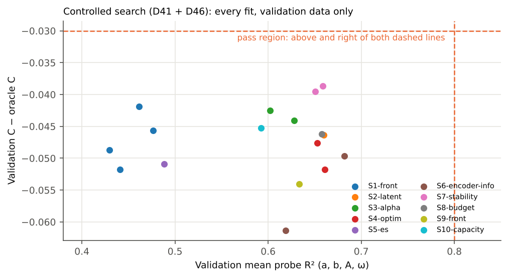
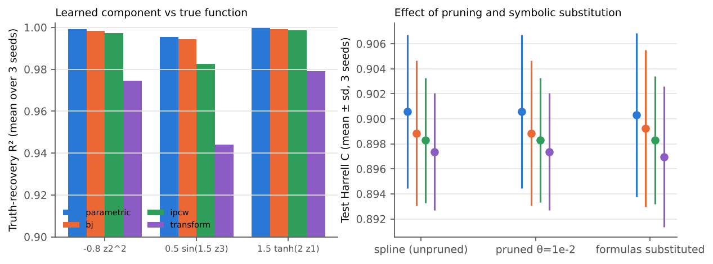
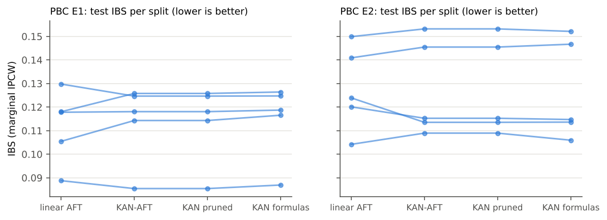
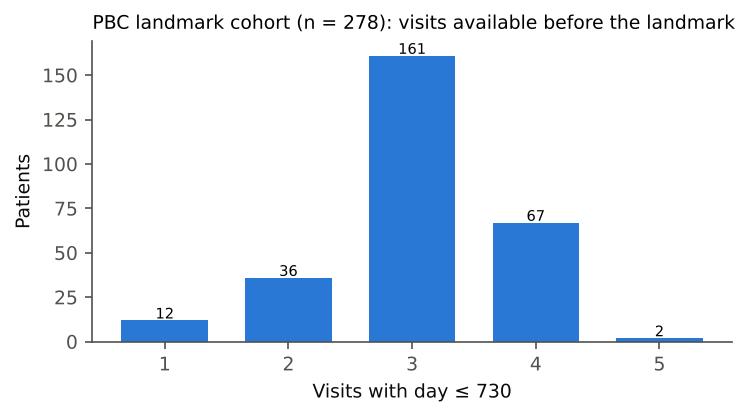
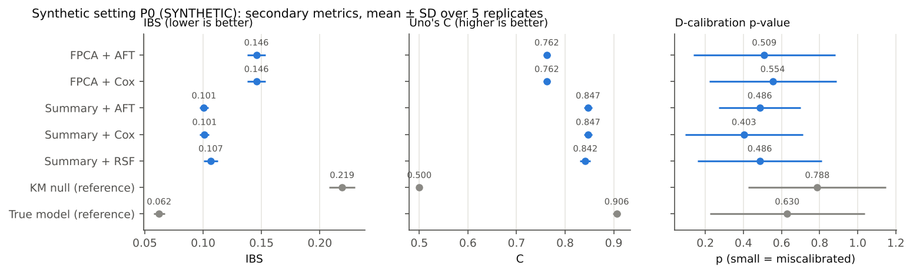
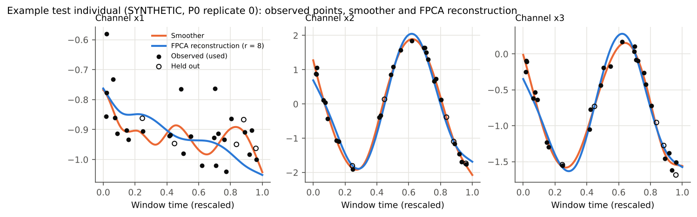
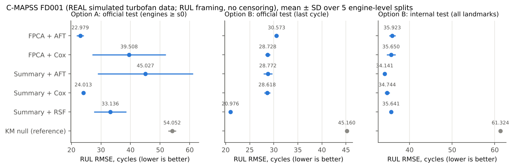

<p class="small">Research prototype report, revision 10 · generated from saved records by
<code>scripts/build_report_round10.py</code> · git <code>a7ff68b</code> (local branch
<code>claude/blissful-faraday-2unozw</code>, <b>not pushed</b>) · status: <b>research prototype, not
publication-ready; no novelty claim</b>. Part A is round 10 (owner decisions D110): the literature review, the design
note and the pre-registration of Rounds 11–13. No model was fitted and no data were acquired in this round. Parts B–J
are the round-9 to round-1 reports, each regenerated from its own round's records.</p>

## 0. Round-10 summary (plain English)

### 0.1 Outcome

| Item | Result |
|---|---|
| Literature review (targeted, documented) | Done: 14 search strings; 26 table entries, each verified individually (R10.2). Not a systematic review |
| Gap analysis | **Single-layer functional CoxKAN (B2) has the same model form as the additive functional Cox model of Cui, Crainiceanu & Leroux (2021)**; B1 composes published parts; no KAN survival model with functional covariates was found, but a KAN joint model with landmarks exists as a conference abstract (R10.3) |
| Claim policy | **No novelty claim.** The paper contributes a pre-registered comparison with AFCM and other functional methods, an interpretability evaluation, the KAN-FAE negative result and a reproducible benchmark (D111) |
| Design note | Written: losses, KAN machinery, B1/B2/B3, baselines, simulation DGPs, metrics, analysis plan, real-data plan, acceptance tests (R10.4) |
| Pre-registration | Round 11 (D112: implementation and 12 acceptance tests), Round 12 (D113: 5 scenarios × 20 fresh-seed replicates; single confirmatory test H-R12), Round 13 (D114: PBC, prothro, aids, C-MAPSS; interpretability measures fixed). Committed (`a7ff68b`) before any Round-11 code |
| Tests | Final suite: 244 tests: 231 passed, 1 failed (the 4f gate's original R1, not gating), 10 expected failures, 2 skipped. No model code changed in this round |

### 0.2 What the review changed in the plan

1. **The direct competitor is AFCM, not a strawman.**
   - Cui et al.'s model already uses ∫F(X(s), s)ds with penalised tensor-product splines under the Cox loss.
   - A single-layer functional CoxKAN is that model with a different parametrisation and training procedure.
   - The primary test therefore compares shape recovery against AFCM (H-R12), not against a linear model.
2. **Every published KAN survival model uses static covariates.** CoxKAN, KAN-AFT, SurvKAN and KAPLAN all do. Their
   "time-varying" features concern effects that change with time, not covariates measured over time.
3. **Two pieces of closely related work could only be checked at abstract level.**
   - JM-KAN (a KAN joint model with yearly landmarks; conference abstract).
   - F-KAN (FPC scores → KAN for a scalar response).
   - Their full texts are needed before any "first" wording.
4. **No R in this environment.** AFCM and the joint-model-style baseline will be Python re-implementations with their
   own acceptance tests (CK-6, CK-12), disclosed as deviations from `mgcv`/`JM`.

### 0.3 Roadmap (Rounds 11–14)

| Round | Content | Gate to the next round |
|---|---|---|
| 11 | Implement CoxKAN (exact ties), PACE, B1, B2, B3 builder, AFCM, two-stage LME, residual-calibrated KAN-AFT; run CK-1..CK-12 | All acceptance tests run; any failure reported to the owner before Round 12 |
| 12 | Simulation: S-Add, S-Int (+ P0 continuity), S-Sparse, S-Misspec; N = 20; H-R12 | Pre-registered analysis only |
| 13 | Real data: PBC (single landmark + B3), prothro, aids, C-MAPSS; stability, effect plots, clinical alignment, symbolic formulas | – |
| 14 | Paper draft: framing (a) + (b); no novelty claim | Owner review |

## R10.1 Owner decisions and fact check (D110)

- **Framing.** Functional CoxKAN / KAN-AFT (B1, B2, B3) is the main study; KAN-FAE (Rounds 1–9) is the motivating
  architectural section.
- **Scope.** Full scope as listed in D110: baselines, the four simulation scenarios with N = 20, the real data sets,
  and measured interpretability.
- **Fact check.** Every cited work exists as named. The AFCM model form is as stated. aids and prothro are in JM 1.5-2
  (prothro's documentation is internally inconsistent: 488 vs 467 patients). CoxKAN's own loss approximates ties, so
  our exact Efron/Breslow implementation is a disclosed deviation. R is unavailable, so AFCM and the joint-model-style
  baseline will be re-implemented.

## R10.2 Literature review

### Literature review, Round 10 (2026-10-19): functional and longitudinal survival models, KAN survival models

**Scope and method.** This is a targeted review, not a systematic one: no database protocol, no screening log, no
double screening. It extends the round-2 review (`docs/literature_review.md`, kept unchanged). The questions are those
the owner set in D110:
- What exists for survival analysis with functional or longitudinal covariates (functional linear Cox, additive
  functional Cox, joint models, landmarking, deep dynamic models)?
- What exists for KAN-based survival models?
- What exists for KAN-based functional regression?
- Where do the planned Functional CoxKAN / KAN-AFT models (B1, B2, B3) sit relative to all of these?

Each item was verified by a web search, its landing page, its arXiv abstract page, or Crossref metadata
(api.crossref.org), as marked in the tables. "Abstract" means only the abstract or metadata was read, so claims about
methodological detail beyond it are not made. Search date: 2026-10-19.

**Search strings used.**
1. "Additive functional Cox model" Cui Crainiceanu Leroux
2. Cox regression models with functional covariates (Gellar et al.)
3. FLCRM functional linear Cox regression model
4. Dynamic-DeepHit longitudinal competing risks
5. Kolmogorov-Arnold network functional data / longitudinal covariates survival
6. functional Kolmogorov-Arnold network functional regression
7. van Houwelingen landmarking; landmark supermodel
8. JM R package joint modelling aids prothro
9. Yao Müller Wang PACE sparse longitudinal
10. Functional generalized additive models (McLean et al.)
11. CoxKAN; KAN-AFT; SurvKAN; KAPLAN
12. neural additive models for survival
13. deep learning with functional covariates for survival
14. Crossref look-ups for Wulfsohn & Tsiatis, Putter & van Houwelingen, Katzman et al., van Houwelingen (2007) and
    F-KAN

#### 1. Functional-covariate survival models (non-KAN)

| Reference | What it does | Relevance to this project | Verified |
|---|---|---|---|
| Gellar, Colantuoni, Needham & Crainiceanu (2015), *Cox regression models with functional covariates for survival data*, Statistical Modelling 15(3):256–278, doi:10.1177/1471082X14565526 | Linear functional Cox model: log-hazard contains ∫β(t)X(t)dt for a densely sampled baseline functional covariate. Penalised signal regression, penalised partial likelihood; R package `pcox` | The **linear** functional Cox baseline. Our `fpca_cox` is the FPCA-basis version of the same model class | Journal abstract page, PMC record |
| Kong, Ibrahim, Lee & Zhu (2018), *FLCRM: Functional linear Cox regression model*, Biometrics 74(1):109–117, doi:10.1111/biom.12748 | FPCA of the functional predictor plus a Cox regression on the scores and on scalar covariates; convergence rates; score test for a zero slope function | **B1's linear analogue** (FPCA scores into Cox). B1 replaces the linear Cox on the scores with a KAN | Abstract / RePEc record |
| Cui, Crainiceanu & Leroux (2021), *Additive Functional Cox Model*, J. Computational and Graphical Statistics 30(3):780–793, doi:10.1080/10618600.2020.1853550 | Additive functional Cox model (AFCM): log-hazard contains ∫F(X(s), s)ds, with F a bivariate smooth estimated by penalised tensor-product splines. Uses transformations of X (e.g. quantile) to address weak identifiability where data are sparse | **The direct non-KAN competitor of B2.** A single-layer B2 under the Cox loss has the same model form (∫φ(X(t), t)dt); only the parametrisation, training and regularisation differ | PMC author manuscript (PMC8664082), Crossref |
| McLean, Hooker, Staicu, Scheipl & Ruppert (2014), *Functional Generalized Additive Models*, JCGS 23(1):249–269, doi:10.1080/10618600.2012.729985 | Scalar-on-function regression with ∫F(X(t), t)dt (FGAM); tensor-product B-splines with roughness penalties; quantile transformation; R package `refund` | The origin of the ∫F(X(t), t)dt form that AFCM brings to survival | PMC record (PMC3982924) |
| Du & Leroux (2024), *Time-Varying Functional Cox Model*, arXiv:2412.14478 | Linear functional Cox with a coefficient varying in the functional domain *and* event time; Cox–Poisson and landmark estimation via `mgcv` | Time-varying functional effects; a possible extension, not a planned baseline | arXiv abstract |
| Yao, Müller & Wang (2005), *Functional Data Analysis for Sparse Longitudinal Data*, JASA 100:577–590, doi:10.1198/016214504000001745 | PACE: pooled mean and covariance smoothing, FPC scores by conditional expectation; works with few irregular measurements per subject (applied to CD4 data) | **The sparse-data front end for B1 and B2** (S-Sparse, aids, prothro) | Abstract, author-hosted PDF listing |

#### 2. Joint models, landmarking and dynamic prediction

| Reference | What it does | Relevance | Verified |
|---|---|---|---|
| Wulfsohn & Tsiatis (1997), *A Joint Model for Survival and Longitudinal Data Measured with Error*, Biometrics 53(1):330–, doi:10.2307/2533118 | Shared random-effects joint model: Cox survival with a longitudinal covariate measured with error; EM estimation | Classical joint model | Crossref |
| Tsiatis & Davidian (2004), *Joint modeling of longitudinal and time-to-event data: an overview*, Statistica Sinica 14:809–834 | Review of joint models with shared latent random effects | Background | Duke record |
| Rizopoulos (2010), *JM: An R Package for the Joint Modelling of Longitudinal and Time-to-Event Data*, J. Statistical Software 35(9):1–33, doi:10.18637/jss.v035.i09 | Shared-parameter joint models; bundles the `aids`, `prothro` and `pbc2` data | Source of the `aids` and `prothro` data sets (Round 13); joint-model reference. **R is not installed here**, so the round-13 joint-model-style baseline is a two-stage mixed-effects re-implementation, not JM itself (D112) | JSS page; CRAN listing (JM 1.5-2, 2022-08-08); package manual pages for `aids`, `prothro` |
| van Houwelingen (2007), *Dynamic Prediction by Landmarking in Event History Analysis*, Scandinavian J. Statistics 34(1):70–85, doi:10.1111/j.1467-9469.2006.00529.x | Landmarking: fit a survival model at a landmark time to subjects still at risk, using covariate values up to the landmark | **B3** and the landmark Cox baseline | Crossref |
| van Houwelingen & Putter (2012), *Dynamic Prediction in Clinical Survival Analysis*, Chapman & Hall/CRC (some sources give 2011) | Book; includes the **landmark supermodel**: one model fitted to the stacked landmark data, with landmark-dependent effects and baseline | **B3's stacked supermodel design** | Library and publisher records; the slide deck attributing the supermodel to the book |
| Putter & van Houwelingen (2022), *Landmarking 2.0: Bridging the gap between joint models and landmarking*, Statistics in Medicine 41(11):1901–1917, doi:10.1002/sim.9336 | Landmarking that models the longitudinal process at the landmark; comparison with joint models | Design reference for B3 | Crossref |
| Lee, Yoon & van der Schaar (2020), *Dynamic-DeepHit*, IEEE Trans. Biomedical Engineering 67(1):122–133, doi:10.1109/TBME.2019.2909027 | Deep dynamic survival with competing risks from the full history of repeated measurements; no assumed longitudinal model | Deep dynamic-prediction reference (not implemented as a baseline; disclosed as a limitation) | Journal listing, search summaries |
| Katzman et al. (2018), *DeepSurv*, BMC Medical Research Methodology 18, doi:10.1186/s12874-018-0482-1 | MLP Cox model on static covariates | Background for neural Cox | Crossref |
| Hu & Nan (2025), *Nonparametric Estimation of Conditional Survival Function with Time-Varying Covariates Using DeepONet*, arXiv:2505.22748 | Hazard as a nonlinear operator of entire covariate histories (DeepONet); full-likelihood loss; ADNI application | Closest deep "operator on X(·)" model; not interpretable by design | arXiv abstract |
| Gao et al. (2025), *Deep Survival Analysis for Competing Risk Modeling with Functional Covariates and Missing Data Imputation* (FCRN), arXiv:2509.25381 | Discrete-time competing-risks deep model with a basis layer for functional covariates | Deep functional survival; interpretability not discussed | arXiv abstract |

#### 3. KAN and KAN-based survival models

| Reference | What it does | Inputs | Verified |
|---|---|---|---|
| Liu et al. (2024/2025), *KAN: Kolmogorov–Arnold Networks*, arXiv:2404.19756, ICLR 2025 | Learnable univariate spline functions on edges; pruning; symbolic regression | – | arXiv, ICLR page |
| Knottenbelt et al. (2025), *CoxKAN*, Bioinformatics 41(8), btaf413; arXiv:2409.04290 | KAN for the Cox log-partial hazard; L1 + entropy + coefficient regularisation; pruning by L1 threshold (validation-chosen); auto-symbolic (linear R² > 0.99, then a 22-function library), PySR optional; uses a *fast approximation* of the Cox loss that is slightly inaccurate under heavy ties; 13 data sets | **Static** covariates only. The authors list inheriting the PH assumption as a limitation | arXiv full text (HTML v1, first 100,000 characters); round-2 full text (v2) |
| Jose, Francis & Kattumannil (2025/2026), *KAN-AFT* (arXiv:2512.20305; v2 title "A Structured Nonparametric Framework for Nonlinear Accelerated Failure Time Models") | KAN for the AFT location; Buckley–James, IPCW and transformation estimators; pruning; symbolic forms | **Static** covariates | arXiv abstract; round-2 full text |
| Mastroleo et al. (2026), *SurvKAN*, arXiv:2602.02179 | Fully parametric, time-continuous survival KAN; time as an input; log-hazard output | Covariate type not stated; time-varying *effects*, not time-varying covariates | arXiv abstract |
| Boulitsakis Logothetis, Wood & Liò (2026), *KAPLAN*, arXiv:2605.23082 | B-spline KAN for the conditional hazard as a joint function of covariates and time; a single layer reduces to a GAM | Time-varying *effects*; repeated measurements not addressed | arXiv abstract |
| Lundin, Chen, Schulz & Tao (2025), *AI-based dynamic predictions of longitudinal and survival data of Alzheimer's disease*, Alzheimer's & Dementia 21(S2):e103788, doi:10.1002/alz70856_103788 | **JM-KAN**: a KAN-based joint model of longitudinal and survival data; yearly landmarks; NACC data; integrated AUC 0.789, IBS 0.118 | **Longitudinal** covariates with landmarking. How the trajectories enter the KAN, the loss and any interpretability analysis are **not stated in the available text** (conference abstract) | PMC page (PMC12737850) |
| Neural additive models for survival (SurvNAM, TimeNAM, PseudoNAM, DNAMite) | Per-feature networks giving shape functions under Cox/GAM-type survival losses | Static covariates; the NAM analogue of a single-layer KAN | Search summaries only |

#### 4. KAN-based functional regression (non-survival)

| Reference | What it does | Verified |
|---|---|---|
| Qin & Li (2026), *F-KAN: a novel framework for functional regression based on Kolmogorov–Arnold networks*, Computational Statistics 41(5), article 114, doi:10.1007/s00180-026-01791-x | Per search summaries: a nonlinear extension of functional principal component regression, i.e. FPC scores into a KAN; consistency of the estimator; spectroscopy applications; conformal prediction intervals. **Scalar, not survival, response** | Crossref (title, authors, venue); method summary from search results only, full text not accessible |
| Cao M. (supervisor Cao J.), FunKAN (SFU thesis defence) | KAN for function-to-function learning with reconstruction and regularisation | Defence page only (round-2 review) |
| FunKAN, arXiv:2509.13508 | Functional KAN for medical image enhancement and segmentation | Search abstract |

#### 5. Gap analysis (what the planned models add, and what they do not)

| Planned model | Closest existing work | Assessment |
|---|---|---|
| **Real CoxKAN** (exact Breslow/Efron partial likelihood, Breslow baseline) | CoxKAN (Knottenbelt et al.) | **Not new.** A re-implementation with exact tie handling instead of CoxKAN's fast approximation, which is a documented deviation |
| **B1**: FPCA / PACE scores, or trajectory summaries, into CoxKAN or KAN-AFT | FLCRM (FPCA → linear Cox); F-KAN (FPCA → KAN, scalar response); CoxKAN/KAN-AFT (KAN on static covariates) | **A direct composition of published components.** We found no paper applying FPCA scores → KAN under a censored-survival loss, but this is an incremental combination, not a methodological novelty |
| **B2**: η = Σ_d ∫ φ_d(X_d(t), t) dt, with φ_d a KAN, under the Cox and AFT losses; homogeneous special case ∫φ_d(X_d(t))dt | AFCM (Cui et al., Cox, tensor-product penalised splines); FGAM (non-survival) | **Single-layer B2 under the Cox loss has the same model form as AFCM.** Its differences are the parametrisation (KAN edges, separable or KAN-composed φ), training (gradient-based with L1/entropy regularisation instead of REML), pruning, symbolic extraction, and the option to compose layers (B2-deep). An **AFT version** of the additive functional model was not found in this search, which is not proof that it does not exist. Any claim must be about the empirical comparison with AFCM, not about the model form |
| **B3**: stacked landmark supermodel with KAN effects (landmark time as an input) | Landmark supermodel (van Houwelingen & Putter); JM-KAN (KAN + landmarks; method details unavailable) | **Partly covered by JM-KAN**, whose design cannot be compared from the available abstract. No novelty claim |
| **KAN-FAE** (Rounds 1–9) | Functional autoencoders (Wu et al. 2024); FunKAN; autoencoder-survival models | Already reviewed in round 2. Round 9 found no advantage over the MLP; it serves as the paper's motivating negative result |

**Claim policy (D111).** No novelty claim will be made from this targeted review. The paper's contributions will be
stated as:
- an empirical, pre-registered comparison of functional KAN survival models against established functional survival
  methods, in particular AFCM;
- the shape-recovery, selection and symbolic-interpretability evaluation;
- the negative architectural result for KAN-FAE;
- a fully reproducible benchmark.

Any wording such as "first" requires a systematic review first. That review should include the full text of JM-KAN,
F-KAN, FunKAN and KAPLAN.

#### 6. Data sources identified (to be acquired in Round 13; not downloaded in Round 10)

| Data set | Source | Content (per package documentation) | Notes |
|---|---|---|---|
| `pbcseq` | R package `survival` (already acquired in round 1: `data/raw/pbc`) | Mayo Clinic PBC, repeated laboratory measurements | Used in rounds 1–9 (single 730-day landmark) |
| `prothro` / `prothros` | R package JM 1.5-2 (CRAN tarball reachable, HTTP 206 on a range request, 2026-10-19) | Prednisone vs placebo in liver cirrhosis; longitudinal prothrombin index; time to death; treatment | The documentation is inconsistent: 488 patients in the description, 467 in the format section. To be checked on acquisition. Original reference: Andersen, Borgan, Gill & Keiding (1993) |
| `aids` / `aids.id` | R package JM 1.5-2 | ddI vs ddC trial; 467 patients; 1,408 CD4 observations; time to death; drug, gender, prevOI, AZT | References: Goldman et al. (1996), JAIDS 11:161–169; Guo & Carlin (2004), Am. Statistician 58:16–24 |
| C-MAPSS FD001 | NASA (already acquired in round 1) | Turbofan run-to-failure | Secondary engineering data set |


## R10.3 Gap analysis and claim policy

The gap table (review §5) and the claim policy (D111) are binding for Rounds 11–14.
- **Contributions** will be stated as empirical, pre-registered findings:
  - shape recovery, selection and symbolic interpretability against AFCM and the other baselines;
  - the KAN-FAE negative result;
  - a reproducible benchmark.
- **Not claimed:** a new model class.

## R10.4 Design note and pre-registration of Rounds 11–13

### Round 10 design note and pre-registration of Rounds 11–13 (2026-10-19)

Owner decisions: D110. Literature and claim policy: D111 (`docs/literature_review_round10.md`). Pre-registrations:
D112 (Round 11), D113 (Round 12), D114 (Round 13). This document is the binding specification. Any change after
the commit that registers it needs an owner-approved decision entry and is reported as a deviation.

**Notation.**
- Subject i has D longitudinal channels X_id(t), observed at times t_ij (with noise) on a history window rescaled to
  [0, 1], scalar covariates z_i, and the outcome (Y_i, δ_i).
- G is a fixed grid of 50 equispaced points on [0, 1]. Integrals ∫·dt are trapezoid quadratures on G.
- In tests, X̂_id(·) denotes the reconstructed curve on G: smoother output (dense data) or PACE conditional
  expectation (sparse data).

#### 1. Survival losses and the shared KAN machinery (Round 11)

- **Cox (CoxKAN).**
  - η_i = f(·) (no intercept).
  - Negative log partial likelihood with **exact Breslow** and **Efron** tie handling (both implemented; Efron is the
    default, as in `lifelines`).
  - Breslow estimator of the baseline cumulative hazard Λ̂_0(t). Predicted survival S(t | x) = exp(−Λ̂_0(t) e^η).
  - CoxKAN's original fast approximation is not used; this is a documented deviation.
- **AFT (KAN-AFT).**
  - log T = μ + η + σε.
  - Losses already in the code base: parametric Weibull, IPCW, transform least squares, Buckley–James.
  - New: **non-parametric residual calibration**. Survival is predicted as S(t | x) = Ŝ_ε((log t − μ̂ − η̂)/σ̂), with
    Ŝ_ε the Kaplan–Meier estimate of the standardised residuals on the training data. This is used for KAN-AFT under
    S-Misspec and for C-MAPSS.
- **KAN layers.**
  - Existing B-spline KAN layer (`kanfae.models.kan`): grid 5, order 3, SiLU base.
  - Inputs are standardised with training statistics, not BatchNorm, so that edge functions are readable in original
    units after back-transformation.
  - Grid range: [−3, 3] in standardised units, plus an extension for out-of-range inputs.
- **Regularisation and scale-aware pruning** (replaces the absolute θ = 1e-2 rule; round 8 showed it prunes nothing
  on unit-scale inputs).
  - Loss + λ·(|Φ|₁ + 2·S(Φ) + |C|₁).
  - The edge score s_e = mean over training inputs of |φ_e − mean φ_e| (centred, D54), normalised as
    s̃_e = s_e / max_e' s_e' within the layer.
  - An edge is pruned if s̃_e < θ_rel. A pruned edge's mean is absorbed into the output bias.
  - Grid: λ ∈ {0, 1e-4, 1e-3, 1e-2} × θ_rel ∈ {0, 0.01, 0.02, 0.05, 0.10}.
  - Procedure: train at each λ; prune at each θ_rel; fine-tune 200 epochs with the mask fixed.
  - Selection by validation loss (Cox: validation negative log partial likelihood, Efron; AFT: the training
    loss on the validation split). Ties go to the larger θ_rel, then the larger λ.
  - **Channel selection:** a channel is "selected" if any of its edges survives pruning.
- **Symbolic extraction** (`kanfae.symbolic.fit`):
  - stage 1: linear;
  - stage 2: library;
  - stage 3: PySR.
  - Acceptance: validation R² > 0.99.
  - PySR (60 s per edge) runs only on edges carrying at least 5% of the layer's total centred score, at most 10 per
    model.
  - Metrics are reported before pruning, after pruning and after substitution.

#### 2. Model families

**B1: two-stage interpretable coordinates.**
- **B1-FPCA.** FPCA scores per channel, with K_d chosen by 95% fraction of variance explained (max 5).
  - Dense data: eigen-decomposition of the smoothed curves on G.
  - Sparse data: **PACE** (Yao, Müller & Wang 2005), new module `kanfae.functional.pace`. Mean and covariance by local
    linear smoothing with a bandwidth chosen by leave-one-subject-out CV; scores by conditional expectation.
  - The scores, together with z, feed:
    - a 1-layer additive KAN [p → 1] (B1-FPCA-1), or
    - a 2-layer KAN [p → 4 → 1] (B1-FPCA-2);
    - under the Cox loss (CoxKAN) or AFT loss (KAN-AFT).
  - Effect curves in X are recovered as φ_d(·) composed with the eigenfunctions (reported as β-type functions).
- **B1-SUM.** Per channel:
  - the level (last value before the landmark, and the mean);
  - the slope (OLS);
  - the variability (residual SD).
  - These feed the same KAN heads.

**B2: functional KAN layer on X(t)**, new module `kanfae.models.fkan`.
- **B2-H (time-homogeneous):** η = Σ_d ∫₀¹ φ_d(X̂_d(t)) dt + Σ_k ψ_k(z_k). Each φ_d and ψ_k is a univariate KAN
  edge.
- **B2-S (separable bivariate, rank M = 2):** φ_d(x, t) = Σ_{m=1..M} g_dm(x)·h_dm(t). Each g and h is a univariate
  KAN edge (h on t ∈ [0, 1]). The learned surface and its symbolic form are read in x and t separately.
- **B2-deep (for interactions):**
  - Functional summaries s_dm = ∫ g_dm(X̂_d(t)) h_dm(t) dt feed a second KAN layer [D·M + p → 4 → 1].
- **Input scale.**
  - Primary: X̂ standardised by the training mean and SD pooled over G, then back-transformed for plots and
    formulas.
  - Sensitivity: the pointwise quantile transform x̃(t) = F̂_t(X̂(t)) of Cui et al.
- **Identifiability.**
  - Each φ_d is centred: E over training (i, t) of φ_d = 0, with the constant absorbed in the baseline.
  - For B2-S, g and h are rescaled after training so that ||h_dm||₂ = 1.
- **Losses.** Cox (Efron) or AFT (parametric Weibull primary; residual-calibrated variant).
- **Training.** Adam, lr {1e-3, 3e-3} × weight decay {1e-4, 1e-3} tuned on validation loss; early stopping with
  patience 100; maximum 3,000 epochs; the 3-seed ensemble (seeds 0–2) is the primary prediction.
- **Ensemble shapes.** Shape estimates are the mean of the members' centred φ̂, which is valid because η is additive
  in φ.

**B3: stacked landmark supermodel (real data, Round 13).**
- Landmarks t_L on a pre-registered grid per data set (§5).
- For each subject at risk at t_L: features from history up to t_L only (B1-SUM, B1-FPCA/PACE, or B2 on the window
  [t_L − W, t_L]). The outcome is time since the landmark, administratively censored at horizon w.
- The stacked data set has one row per (subject, landmark).
- Model: CoxKAN with a landmark-stratified baseline, and t_L also entering as a KAN edge input, so that effects can
  vary with the landmark (supermodel).
- Splits are by subject. Evaluation uses time-dependent AUC and Brier score at t_L + w, and C within the horizon,
  per landmark.

#### 3. Baselines (Round 11 implementation; all under the same splits and metrics)

| ID | Model | Implementation |
|---|---|---|
| `fpca_cox` | Linear functional Cox (FPCA scores) | existing (round 1) |
| `sum_cox`, `sum_aft` | Linear Cox / Weibull AFT on summaries | existing |
| `afcm` | **Additive functional Cox model** (Cui et al. 2021): ∫F(X(t), t)dt, F a tensor-product cubic B-spline (10 × 10 basis) with second-order difference penalties in x and t; penalised partial likelihood (Efron). Smoothing parameters chosen by validation partial likelihood on a 5 × 5 grid, **instead of REML in `mgcv`**, because R is not available | **Python re-implementation** (`kanfae.models.afcm`); a deviation from the reference software, disclosed |
| `lme2_cox` | Two-stage mixed-effects + Cox: per-channel linear mixed model (random intercept and slope, Gaussian), BLUPs of intercept and slope at the landmark into a Cox model (joint-model-style two-stage) | Python re-implementation (EM for the LME), since R/JM is not available |
| `landmark_cox` | Cox on last observed values at the landmark (static) | lifelines |
| `sum_rsf` | RSF on summaries | existing |
| `static_coxkan`, `static_kanaft` | CoxKAN / KAN-AFT on last values + z | new Cox head; existing KAN-AFT |
| `fae_mlp_s2`, `fae_mlp_s3`, `fae_kan_s2`, `fae_kan_s3`, `fae_kan_unb_s3` | Locked autoencoders (C4F; S2/S3; Mode A unbottlenecked) | existing (rounds 8–9) |

#### 4. Simulation study (Round 12): data-generating processes

**Common to all scenarios.**
- n = 1,000 subjects (train/validation/test 60/20/20, the existing `split_groups`), D = 3 channels on t ∈ [0, 1].
- Curves: X_d(t) = μ_d(t) + Σ_{k=1..4} ξ_dk ψ_k(t), with ψ_k orthonormal Fourier functions,
  ξ_dk ~ N(0, λ_k), λ = (1, 0.5, 0.25, 0.125), and μ_d(t) = 0.5·d·t.
- Observations X_d(t_ij) + N(0, 0.2²).
  - Dense: 40 equispaced times.
  - Sparse (S-Sparse only): 3–8 visits (uniform count) at uniform random times.
- Scalar covariates: z_1 ~ N(0, 1) (linear effect 0.3), z_2 ~ Bernoulli(0.5) (effect −0.3).
- Censoring: independent uniform, calibrated per scenario to about 30%.
- Truth is stored in the oracle for every subject.

| Scenario | True linear predictor (channel 3 is a null channel in every scenario) | Event model |
|---|---|---|
| **S-Add** | η = ∫ φ₁(X₁(t)) dt + ∫ φ₂(X₂(t), t) dt + 0.3 z₁ − 0.3 z₂; φ₁(x) = sin(πx/2) (homogeneous); φ₂(x, t) = tanh(x)·(1 + t) (separable, rank 1) | Weibull PH, shape 1.5 (log-hazard η; Cox is correct) |
| **S-Int** | η = S-Add's η + 0.8·[∫φ₁(X₁)dt]·[∫ tanh(X₂(t)) dt] (cross-channel multiplicative interaction) | Weibull PH, shape 1.5 |
| **S-Int/P0** (continuity) | Round-1 simulator setting P0 (V1 risk, dense, 30% censoring); KAN-FAE S3 vs MLP-FAE S3 (C4F with strategy S3, tuned) on fresh seeds | as round 1 |
| **S-Sparse** | S-Add's η; sparse observation scheme (3–8 visits) | Weibull PH, shape 1.5 |
| **S-Misspec** | S-Add's η used as an AFT location: log T = 1 + η' + 0.5ε with η' = −η/1.5, ε log-normal (Gaussian ε) or log-logistic (two sub-scenarios). Non-PH, so Cox is misspecified | log-normal / log-logistic AFT |

**Replicates and seeds** (verified unused on 2026-10-19):
- N = 20 per scenario.
- S-Add 3000–3019; S-Int 3100–3119; S-Sparse 3200–3219; S-Misspec 3300–3319 (each seed generates both sub-scenarios
  from independent streams); S-Int/P0 continuity 3400–3419.

**Models per scenario.**
- S-Add, S-Sparse: B2-H, B2-S (Cox and AFT); B1-FPCA-1 (Cox, AFT); B1-SUM; afcm; fpca_cox; sum_cox; sum_rsf;
  static_coxkan.
  - S-Sparse adds the PACE front end for B1/B2 against the fixed B-spline front end, and flat_ae.
- S-Int: the above, plus B1-FPCA-2 and B2-deep.
- S-Int/P0: fae_kan_s3 vs fae_mlp_s3 only.
- S-Misspec: CoxKAN vs KAN-AFT (parametric Weibull; residual-calibrated) for B2-S, plus afcm.

**Metrics.**
- Survival: survival-curve error against the oracle, IBS (marginal IPCW), Harrell C, Uno C (τ = 90% quantile),
  D-calibration p.
- Shape (S-Add, S-Sparse, S-Misspec): **relative ISE**:
  - RISE_d = ∫∫ (φ̂_d^c − φ_d^c)² w_d dx dt / ∫∫ (φ_d^c)² w_d dx dt, with the superscript c denoting centring and w_d
    the empirical density of (X_d(t), t) in the test data.
  - Homogeneous effects integrate over x only.
  - For Cox, φ is identified up to a constant (centring). For AFT, the comparison uses −φ̂/σ̂-scaled shapes against
    the PH-equivalent truth only in S-Add, and the AFT truth in S-Misspec.
  - Primary shape summary: the mean RISE over the active channels (1, 2).
- Selection: recall of the active channels {1, 2} and the false discovery rate (null channel 3 selected), from
  pruning.
- Symbolic: acceptance rate and validation R² of edges; formula RISE after substitution.

**Statistical analysis.**
- Paired over replicates; mean difference, SD, 95% t-CI (df 19), paired-t p, exact Wilcoxon p, sign counts.
- **Single confirmatory test of Round 12 (H-R12):**
  - **Quantity:** in **S-Add**, B2-S under the Cox loss (functional CoxKAN) minus `afcm` in mean RISE over the
    active channels.
  - **Test:** two-sided paired t-test, α = 0.05, N = 20.
  - **Interpretation, fixed now:**
    - If the 95% CI lies entirely below 0, B2-S recovers shapes better than AFCM.
    - If it lies entirely above 0, worse.
    - If it lies inside ±0.05 (absolute RISE), the two are declared **equivalent within the margin** (TOST at α =
      0.05 each side).
    - Otherwise, inconclusive.
- **Pre-registered secondary tests (exploratory, no multiplicity correction):**
  - S-Add survival-curve error, B2-S vs afcm.
  - B2-S vs B1-FPCA-1 (RISE).
  - Selection recall/FDR.
  - S-Int: B2-deep vs B2-S, and B1-FPCA-2 vs B1-FPCA-1 (curve error).
  - **S-Int/P0 continuity:** TOST equivalence of fae_kan_s3 vs fae_mlp_s3 in survival-curve error, margin ±0.005
    (about 5% of the round-9 MLP S3 error, 0.0915). This re-confirms the round-9 F1 finding with fixed criteria on
    fresh seeds.
  - S-Sparse: PACE vs fixed B-spline front end (RISE, curve error); flat_ae vs B2.
  - S-Misspec: KAN-AFT (residual-calibrated) vs CoxKAN (curve error, D-calibration).
- **Every run is reported.** Failed fits are recorded and counted.

#### 5. Real data (Round 13)

| Data set | Cohort / endpoint | Channels | Single landmark | B3 landmarks (horizon w) |
|---|---|---|---|---|
| PBC (`pbcseq`) | E2 death or transplant (primary), E1 death (sensitivity) | The 6 round-1 channels, as in `kanfae.data.pbc.CHANNELS`: log bilirubin, albumin, log alkaline phosphatase, log AST, platelets, log prothrombin time; age, sex | 730 days (aligned with rounds 1–9) | 1, 2, 3, 4 years; w = 5 years; window W = 2 years |
| `prothro` (JM) | Death | Prothrombin index; treatment | 1 year | 0.5, 1, 2, 3 years; w = 5 years; W = 2 years |
| `aids` (JM) | Death | CD4 (sqrt scale, as conventional); drug, gender, prevOI, AZT | 6 months | 2, 6, 12 months; w = 12 months; W = full history |
| C-MAPSS FD001 (secondary) | End of life (Option B windows) | Informative sensors | Option B as round 1 | – |

**Real-data protocol.**
- 5 outer splits by subject (seeds 0–4) and the same models as S-Add, with lme2_cox and landmark_cox added.
- Metrics: IBS (marginal and conditional IPCW), Harrell and Uno C, D-calibration; for B3, time-dependent AUC and Brier
  per landmark.
- KAN vs reference comparisons use the Nadeau–Bengio corrected t-interval.
- C-MAPSS: KAN-AFT with residual calibration (the calibration fix) against round 1's parametric AFT; D-calibration
  reported.

**Interpretability deliverables (pre-registered measures).**
- **Stability:** for each selected effect, the centred φ̂_d across the 5 outer splits × 20 bootstrap resamples of the
  training split. Report the mean pairwise R² and mean pairwise cosine similarity on a common x-grid (the 5th–95th
  percentile of pooled X).
- **Effect plots** with bootstrap 90% bands, in original clinical units.
- **Clinical alignment.** Directions fixed now, from established clinical knowledge:
  - PBC: higher bilirubin increases risk; higher albumin decreases risk; longer prothrombin time increases risk.
  - prothro: a lower prothrombin index increases risk.
  - aids: a lower CD4 count increases risk.
  - An effect "aligns" if its centred φ̂ is monotone in the stated direction over the 5th–95th percentile range in at
    least 80% of the split × bootstrap fits.
- **Symbolic formulas** in original units for accepted edges, reported with validation R².

#### 6. Round 11 acceptance tests (unit tests written before any Round-12/13 run)

Thresholds are fixed now. A STAT test failure at its pre-specified seed is recorded as FAIL and is never converted
by changing the seed, sample size or threshold.

| ID | Type | Criterion |
|---|---|---|
| CK-1 | DET | Breslow and Efron negative log partial likelihoods equal `lifelines` (Efron) and a direct Breslow formula, for fixed linear η with ties, within 1e-8 |
| CK-2 | DET | The Breslow baseline cumulative hazard equals `lifelines`' baseline for the same linear fit within 1e-6 |
| CK-3 | STAT | CoxKAN with linear edges recovers lifelines' Cox coefficients within 0.05 (n = 2,000, seed 11) |
| CK-4 | DET | The quadrature of the functional layer with φ(x) = x reproduces ∫X(t)dt for analytic curves within 1e-3 |
| CK-5 | STAT | B2-S (Cox) recovers S-Add's φ₁ and φ₂ with RISE < 0.10 each (n = 2,000, seed 12) |
| CK-6 | STAT | The `afcm` re-implementation recovers a known F(x, t) with RISE < 0.10 (n = 2,000, seed 13) |
| CK-7 | STAT | PACE on sparse curves (3–8 visits) recovers the first eigenfunction with \|cosine\| > 0.95 and reconstructs curves with lower mean ISE than per-subject B-spline smoothing (n = 1,000, seed 14) |
| CK-8 | STAT | Scale-aware pruning with validation-selected (λ, θ_rel) removes the null channel and keeps both active channels in S-Add (n = 2,000, seed 15) |
| CK-9 | DET | The stacked landmark builder uses no observation after t_L, includes only subjects at risk at t_L, and censors at t_L + w |
| CK-10 | DET | Symbolic stages 1–2 recover sin, tanh and quadratic edges with validation R² > 0.99 |
| CK-11 | STAT | The residual-calibrated KAN-AFT has D-calibration p > 0.05 on log-normal AFT data where the Weibull-loss AFT has p < 0.05 (n = 2,000, seed 16) |
| CK-12 | DET | The two-stage LME's BLUPs equal closed-form BLUPs for known variance components within 1e-8 |

Unit-test seeds 11–16 are training/data seeds for tests only (never used for Round 12/13 data).

#### 7. Compute budget and order

- Round 12: about 5 scenarios × 20 replicates × about 12 models × 3 training seeds, single-threaded, 4 parallel
  lanes. Planning budget: 12 h wall clock.
- If the budget is exceeded, these cells are dropped first, in this order:
  - B2 quantile sensitivity;
  - S-Misspec log-logistic;
  - flat_ae;
  - sum_rsf.
- H-R12 cells (S-Add B2-S Cox and afcm) are never dropped.
- Round 13: 4 data sets × 5 splits; the bootstrap stability analysis (20 resamples) only for the selected B2 and B1
  models.

#### 8. Known limitations accepted at registration

- AFCM and the joint-model baseline are Python re-implementations (no R), so differences from `mgcv`/`JM` are
  possible.
- Dynamic-DeepHit and JM-KAN are not implemented.
- n = 1,000 synthetic subjects; three channels only.
- The clinical-alignment directions are coarse (monotonicity).
- Clinical sign-off for PBC endpoints is external.


## R10.5 Decisions in round 10 (D110–D115)

| ID | Decision | Status | Content | Rationale |
|---|---|---|---|---|
| D110 | **Owner decisions, Round 10 (2026-10-19): Rounds 10–14 roadmap** | ADOPTED (owner) | (1) **Framing (a) + (b):** primary focus is a methods and interpretability study of **Functional CoxKAN and Functional KAN-AFT** (B1, B2, plus the stacked multi-landmark B3 on real data), evaluated against existing functional survival methods, with no novelty claim where classical functional additive models exist. Rounds 1–9 (KAN-FAE) become the motivating architectural section. (2) **Scope:** a real CoxKAN (Efron/Breslow ties, Breslow baseline, validation-tuned scale-aware pruning, 3-stage symbolic); B1 (FPCA/PACE → CoxKAN/KAN-AFT; trajectory summaries → CoxKAN/KAN-AFT); B2 (∫φ_d(X_d(t), t)dt and the homogeneous case, under the Cox and AFT losses); B3 (stacked landmark supermodel). (3) **Baselines:** fpca_cox, sum_cox/sum_aft, the additive functional Cox model of Cui, Crainiceanu & Leroux, two-stage mixed-effects + Cox and landmark Cox, sum_rsf, static CoxKAN/KAN-AFT, locked MLP-/KAN-FAE (S2, S3, Mode A). (4) **Simulation (Round 12, N ≥ 20):** S-Add (shape recovery, selection, symbolic R², survival metrics), S-Int (interaction, plus a fresh-seed re-confirmation of the frozen S3 autoencoder comparison), S-Sparse (3–8 visits; PACE vs fixed B-splines), S-Misspec (CoxKAN vs KAN-AFT with and without residual calibration). (5) **Real data (Round 13):** PBC `pbcseq` (single 730-day landmark E2/E1, and multi-landmark B3), `prothro` and/or `aids` (R package JM), C-MAPSS FD001 secondary with an AFT calibration fix; measured interpretability (split/bootstrap stability, effect plots, clinical alignment, symbolic formulas in clinical units). (6) **Round 10 itself:** literature review, design note and pre-registration of Rounds 11–13; report revision 10 (Part A = Round 10; Parts B–J = Rounds 9–1); local commits only. **Fact check:** every cited work exists as named (`docs/literature_review_round10.md`). The AFCM form ∫F(X(s), s)ds with penalised tensor-product splines is correct. `aids` and `prothro` are in JM 1.5-2 (CRAN tarball reachable); the prothro documentation is internally inconsistent (488 vs 467 patients), to be checked on acquisition. CoxKAN's published loss uses a fast approximation under ties, so the exact Efron/Breslow implementation is a deviation (an improvement) to disclose. R is not installed, so AFCM and the joint-model-style baseline will be Python re-implementations (D112). | Owner decision; facts verified |
| D111 | **Literature review, Round 10 (2026-10-19): result and claim policy** | ADOPTED | Targeted (not systematic) review: 14 search strings and per-item verification (`docs/literature_review_round10.md`). **Findings:** (i) Functional-covariate survival: functional linear Cox (Gellar et al. 2015; FLCRM, Kong et al. 2018), the **additive functional Cox model** (Cui, Crainiceanu & Leroux 2021: ∫F(X(s), s)ds, penalised tensor-product splines), FGAM (McLean et al. 2014), the time-varying functional Cox (Du & Leroux 2024 preprint), PACE for sparse data (Yao, Müller & Wang 2005). (ii) Dynamic prediction: joint models (Wulfsohn & Tsiatis 1997; Tsiatis & Davidian 2004; JM, Rizopoulos 2010), landmarking (van Houwelingen 2007) and the landmark supermodel (van Houwelingen & Putter 2012), Landmarking 2.0 (Putter & van Houwelingen 2022), Dynamic-DeepHit (Lee et al. 2020), DeepONet hazard (Hu & Nan 2025 preprint), FCRN (Gao et al. 2025 preprint). (iii) KAN survival models (CoxKAN 2025; KAN-AFT 2025/26; SurvKAN 2026; KAPLAN 2026) all use **static** covariates; JM-KAN (Lundin et al. 2025, conference abstract) combines KAN, longitudinal data and yearly landmarks, but its method details are unavailable. (iv) KAN functional regression: F-KAN (Qin & Li 2026, Computational Statistics; FPC scores → KAN, scalar response); FunKAN (thesis). **Gap assessment:** the real CoxKAN is not new; B1 is a composition of published components (FLCRM/F-KAN + CoxKAN/KAN-AFT); **single-layer B2 under the Cox loss has the same model form as AFCM** and differs only in parametrisation, training, pruning, symbolic extraction and composability; an additive functional *AFT* model was not found (not proof of absence); B3 is partly covered by JM-KAN. **Claim policy:** no novelty claim. The contributions are to be stated as a pre-registered empirical comparison with AFCM and other functional methods, shape-recovery/selection/symbolic evaluation, the KAN-FAE negative result and a reproducible benchmark. "First"-type wording requires a systematic review including the full texts of JM-KAN, F-KAN, FunKAN and KAPLAN. | Owner rule: no novelty claim without a documented review |
| D112 | **Pre-registration: Round 11, implementation and acceptance tests** (registered 2026-10-19, before any Round-11 code) | ADOPTED | Specification: `docs/design_note_round10.md` §§1–3 and §6. **New modules:** Cox partial likelihood (exact Breslow and Efron) and Breslow baseline, a CoxKAN head, scale-aware pruning (centred, layer-normalised edge scores; the grid λ {0, 1e-4, 1e-3, 1e-2} × θ_rel {0, 0.01, 0.02, 0.05, 0.10} selected by validation loss with 200-epoch masked fine-tuning), symbolic stages 1–3 (PySR on at most 10 edges carrying ≥ 5% of the score, 60 s), `kanfae.functional.pace` (PACE), `kanfae.models.fkan` (B2-H, B2-S rank 2, B2-deep), B1 heads (FPCA-1, FPCA-2, SUM), residual-calibrated KAN-AFT, the B3 stacked-landmark builder and supermodel, and baselines `afcm` (10 × 10 tensor-product cubic B-splines with difference penalties; smoothing by validation partial likelihood on a 5 × 5 grid, **instead of mgcv REML**, because R is unavailable), `lme2_cox` (random intercept + slope LME by EM, BLUPs → Cox), `landmark_cox`, static CoxKAN/KAN-AFT. **Acceptance tests CK-1..CK-12** with fixed thresholds and seeds 11–16 (design note §6); a STAT failure is recorded as FAIL, never converted. Round 12 starts only after CK-1..CK-12 have run, with any failure reported to the owner. Existing modules keep their defaults: the rounds 1–9 tests must still pass. | Owner decision D110 |
| D113 | **Pre-registration: Round 12, simulation study** (registered 2026-10-19) | ADOPTED | Design note §4. DGPs: S-Add (φ₁(x) = sin(πx/2) homogeneous; φ₂(x, t) = tanh(x)(1 + t); channel 3 null; z effects ±0.3; Weibull PH shape 1.5), S-Int (+0.8 × a product of channel-1 and channel-2 functional summaries), S-Int/P0 (round-1 P0; fae_kan_s3 vs fae_mlp_s3), S-Sparse (S-Add with 3–8 visits), S-Misspec (AFT log-normal / log-logistic with the same additive location). n 1,000; D 3; 4-term Fourier curves with noise 0.2; about 30% censoring. **N = 20 replicates per scenario; fresh seeds** S-Add 3000–3019, S-Int 3100–3119, S-Sparse 3200–3219, S-Misspec 3300–3319, S-Int/P0 3400–3419 (verified unused in all records and code, 2026-10-19). Training ensembles of seeds 0–2. **Metrics:** survival-curve error, IBS, Harrell C, Uno C, D-calibration; RISE (density-weighted, centred) per active channel; selection recall/FDR; symbolic acceptance and R². **Single confirmatory test H-R12:** S-Add, B2-S (Cox) − afcm in mean RISE over the active channels; two-sided paired t, α 0.05, N 20. Interpretation fixed: CI < 0 means better, CI > 0 worse, CI within ±0.05 equivalent (TOST), otherwise inconclusive. **Secondary (exploratory, no multiplicity correction):** as in design note §4, including the **S-Int/P0 TOST equivalence of fae_kan_s3 vs fae_mlp_s3 in curve error, margin ±0.005**. Budget 12 h with a pre-registered drop order (B2 quantile sensitivity, S-Misspec log-logistic, flat_ae, sum_rsf); the H-R12 cells are never dropped. Every run reported. | Owner decision D110 |
| D114 | **Pre-registration: Round 13, real data** (registered 2026-10-19; no new data acquired or inspected in Round 10) | ADOPTED | Design note §5. **Data:** PBC `pbcseq` (single 730-day landmark, E2 primary and E1 sensitivity, aligned with rounds 1–9; B3 landmarks 1–4 years, horizon 5 years, window 2 years); `prothro` (landmark 1 year; B3 at 0.5, 1, 2, 3 years; horizon 5 years); `aids` (landmark 6 months; B3 at 2, 6, 12 months; horizon 12 months; sqrt CD4); C-MAPSS FD001 Option B (secondary; KAN-AFT with residual calibration). JM 1.5-2 from CRAN, provenance and checksums recorded on acquisition. **Protocol:** 5 outer splits by subject (seeds 0–4); Nadeau–Bengio corrected intervals; IBS (marginal/conditional IPCW), Harrell/Uno C, D-calibration; for B3, time-dependent AUC and Brier per landmark. **Interpretability measures fixed now:** stability = mean pairwise R² and cosine of centred φ̂ over 5 splits × 20 bootstrap resamples on the 5th–95th percentile x-grid; effect plots with 90% bootstrap bands in clinical units; **clinical-alignment directions fixed now** (PBC: bilirubin ↑ risk, albumin ↓ risk, prothrombin time ↑ risk; prothro: lower prothrombin index ↑ risk; aids: lower CD4 ↑ risk), aligned = monotone in the stated direction over the 5th–95th percentiles in ≥ 80% of fits; symbolic formulas in original units with validation R². All real-data results are exploratory. | Owner decision D110 |
| D115 | **Report rendering fix (Round 10)** (2026-10-19) | ADOPTED | Found while building revision 10: the decision-table filters of the round-7, round-8 and round-9 builders were open-ended (D9x/1xx and D10x/1xx), so those historical parts also listed later decisions; the same defect D98 fixed for rounds 2–6. Bounded to their own ranges: D91–D98, D99–D106, D107–D109; round 10 lists D110–D115. No number, test or result changes. | Correct rendering |

## R10.6 Tests

| Full-suite run | Passed | Failed | Skipped | Expected failures (xfail) | Total | Failed tests |
|---|---|---|---|---|---|---|
| final_full_suite | 148 | 1 | 1 | 0 | 150 | test_R2_fae_mlp_end_to_end (test_learnability.py) |
| final_full_suite_round2_v3 | 185 | 1 | 1 | 0 | 187 | test_R2_fae_mlp_end_to_end (test_learnability.py) |
| final_full_suite_round3 | 198 | 2 | 1 | 1 | 202 | test_R1_oracle_features_head (test_learnability_fa.py); test_R2_fae_mlp_end_to_end (test_learnability_fa.py) |
| final_full_suite_round4_rerun | 203 | 2 | 1 | 3 | 209 | test_R1_oracle_features_head (test_learnability_fa4b.py); test_R2_fae_mlp_end_to_end (test_learnability_fa4b.py) |
| final_full_suite_round5 | 212 | 2 | 1 | 5 | 220 | test_R1_oracle_features_head (test_learnability_fa4c.py); test_R2_fae_mlp_end_to_end (test_learnability_fa4c.py) |
| final_full_suite_round6 | 215 | 0 | 1 | 7 | 223 | – |
| final_full_suite_round6_rerun | 215 | 0 | 2 | 7 | 224 | – |
| final_full_suite_round7 | 216 | 3 | 2 | 7 | 228 | test_R1_oracle_features_head (test_learnability_fa4e.py); test_R2_fae_mlp_end_to_end (test_learnability_fa4e.py); test_R3_censoring_awareness (test_learnability_fa4e.py) |
| final_full_suite_round8 | 226 | 1 | 2 | 10 | 239 | test_R1_oracle_features_head (test_learnability_fa4f.py) |
| final_full_suite_round9 | 231 | 1 | 2 | 10 | 244 | test_R1_oracle_features_head (test_learnability_fa4f.py) |
| final_full_suite_round10 | 231 | 1 | 2 | 10 | 244 | test_R1_oracle_features_head (test_learnability_fa4f.py) |

**All test runs, in chronological order** (every failure is kept; `reports/test_results.csv` has every record)

| Test run (chronological) | Passed | Failed | Skipped | Expected failures (xfail) | Total |
|---|---|---|---|---|---|
| stageA_attempt1 | 41 | 4 | 0 | 0 | 45 |
| stageA_attempt2 | 41 | 4 | 0 | 0 | 45 |
| stageA_attempt3 | 45 | 0 | 0 | 0 | 45 |
| stageB_attempt1 | 40 | 0 | 0 | 0 | 40 |
| stageC_attempt1 | 19 | 0 | 0 | 0 | 19 |
| stageD_attempt1 | 54 | 1 | 1 | 0 | 56 |
| stageD_attempt2 | 7 | 1 | 0 | 0 | 8 |
| stageD_attempt3 | 8 | 0 | 0 | 0 | 8 |
| stageD_gate_attempt1 | 1 | 2 | 0 | 0 | 3 |
| stageD_gate_attempt2 | 1 | 2 | 0 | 0 | 3 |
| stageD_gate_attempt3 | 2 | 1 | 0 | 0 | 3 |
| stageCDE_final | 55 | 0 | 1 | 0 | 56 |
| stageF_attempt1 | 2 | 0 | 0 | 0 | 2 |
| regress_after_penalty_fix | 73 | 0 | 1 | 0 | 74 |
| stageG_attempt1 | 4 | 0 | 0 | 0 | 4 |
| final_full_suite | 148 | 1 | 1 | 0 | 150 |
| rev3_unit_attempt1 | 50 | 0 | 1 | 0 | 51 |
| rev3_gate_attempt1 | 2 | 1 | 0 | 0 | 3 |
| audit_attempt1 | 9 | 0 | 0 | 0 | 9 |
| censored_ls_attempt1 | 5 | 0 | 0 | 0 | 5 |
| kan_regress_after_pruning | 12 | 0 | 0 | 0 | 12 |
| kreg_sym_attempt1 | 10 | 1 | 0 | 0 | 11 |
| kreg_sym_attempt2 | 1 | 0 | 0 | 0 | 1 |
| f7f8_attempt1 | 5 | 0 | 0 | 0 | 5 |
| f8_after_cache | 5 | 0 | 0 | 0 | 5 |
| d41_gate_selected | 2 | 1 | 0 | 0 | 3 |
| f9_attempt1 | 6 | 0 | 0 | 0 | 6 |
| interval_attempt1 | 3 | 2 | 0 | 0 | 5 |
| interval_attempt2 | 5 | 0 | 0 | 0 | 5 |
| gate_ext | 2 | 1 | 0 | 0 | 3 |
| cache_regression_oldcode | 0 | 1 | 0 | 0 | 1 |
| cache_regression_fixed | 7 | 0 | 0 | 0 | 7 |
| gate_D53_recompute | 2 | 1 | 0 | 0 | 3 |
| final_full_suite_round2 | 90 | 2 | 0 | 0 | 92 |
| final_full_suite_round2_rerun | 178 | 8 | 1 | 0 | 187 |
| models_repair_D56 | 28 | 0 | 1 | 0 | 29 |
| final_full_suite_round2_v3 | 185 | 1 | 1 | 0 | 187 |
| fq_attempt1 | 7 | 4 | 0 | 0 | 11 |
| fq_attempt2 | 9 | 2 | 0 | 0 | 11 |
| fq_attempt3 | 10 | 1 | 0 | 0 | 11 |
| fq_attempt4 | 11 | 0 | 0 | 0 | 11 |
| revised_gate_fa | 1 | 2 | 0 | 0 | 3 |
| fq10 | 3 | 0 | 0 | 0 | 3 |
| final_full_suite_round3 | 198 | 2 | 1 | 1 | 202 |
| hr_attempt1 | 3 | 0 | 0 | 0 | 3 |
| revised_gate_fa4b | 2 | 2 | 0 | 0 | 4 |
| final_full_suite_round4 | 200 | 5 | 1 | 3 | 209 |
| flat_ae_fix_D78 | 4 | 0 | 0 | 0 | 4 |
| final_full_suite_round4_rerun | 203 | 2 | 1 | 3 | 209 |
| rs_attempt1 | 3 | 1 | 0 | 0 | 4 |
| rs_attempt2 | 4 | 0 | 0 | 0 | 4 |
| ceil_attempt1 | 3 | 0 | 0 | 0 | 3 |
| revised_gate_fa4c | 2 | 2 | 0 | 0 | 4 |
| final_full_suite_round5 | 212 | 2 | 1 | 5 | 220 |
| gate_fa4c_reproduction | 2 | 2 | 0 | 0 | 4 |
| bi_attempt1 | 7 | 0 | 0 | 0 | 7 |
| final_full_suite_round6 | 215 | 0 | 1 | 7 | 223 |
| final_full_suite_round6_rerun | 215 | 0 | 2 | 7 | 224 |
| 20261018T175917 | 0 | 0 | 1 | 0 | 1 |
| revised_gate_fa4e | 1 | 3 | 0 | 0 | 4 |
| final_full_suite_round7 | 216 | 3 | 2 | 7 | 228 |
| nf_tests_dev | 4 | 0 | 0 | 0 | 4 |
| regression_4f_dev | 35 | 0 | 1 | 0 | 36 |
| revised_gate_fa4f | 3 | 1 | 0 | 0 | 4 |
| st_tests_dev | 7 | 0 | 0 | 0 | 7 |
| final_full_suite_round8 | 226 | 1 | 2 | 10 | 239 |
| fc_tests_dev | 4 | 1 | 0 | 0 | 5 |
| fc_tests_dev2 | 15 | 0 | 0 | 0 | 15 |
| final_full_suite_round9 | 231 | 1 | 2 | 10 | 244 |
| final_full_suite_round10 | 231 | 1 | 2 | 10 | 244 |

## R10.7 Task ledger

### Task ledger: originally failed, blocked, skipped or unrun items (opened 2026-10-17)

Each row is updated as work proceeds. The final column points to the supporting log or record. Original
statuses come from `reports/FINAL_STATUS.md` (commit `a918a56`) and the gate re-run of revision 3.

| # | Item | Original status / reason | Blocking dependency | Alternatives considered | Experiments / tests | Final outcome | Evidence | Remaining limitation |
|---|---|---|---|---|---|---|---|---|
| L1 | Learnability gate R2 (functional MLP AE) | FAILED (original design, 2 repairs: C 0.8361); FAILED again with revision 3 NFL front (C 0.8461) | – | Fronts A0–A4 (linear, pointwise-MLP NFL, energy, tensor spline, tensor spline + derivative energy); latent size 4/8; α 1/0.1/0; Adam 1e-3/3e-3, AdamW; early stopping on objective/NLL; linear/MLP/KAN encoders; 3000/10000 epochs; capacity 32/64 and 64/128 | D41 + D46 controlled search (validation only; 17 fits after deduplication); official gate; fresh replications on seeds 101–110; D53 defect found, fixed and all affected results recomputed | **FAILED (final, pre-registered):** gate C 0.8497 < 0.8636 (probe mean 0.663 < 0.8; ω probe ≈ 0); replications 0/5 (D41) and 0/5 (D46). No further extension (D46) | `reports/learnability_search.jsonl`, `reports/learnability_confirmation_*.jsonl`, `reports/logs/stageD_gate_D53.log` | The frequency parameter ω is not linearly decodable from a reconstruction-driven latent; next steps need an owner decision (report I.15) Round 3 (owner option (c), D57/D61): frequency-aware representation; validation-only search (11 fits); revised gate on fresh seed 41: **R2 FAILED** (C 0.8189 < 0.8656; ω probe 0.865); fresh confirmations 111–115: 0/5. Diagnosis D65 (overfitting of the spectral block; a compact summary meets the probe criterion on validation but not C) and D66 (R1's σ check not robust) Round 4 (owner D67, pre-registered D71): Revision 4b (compact front + head weight decay): fresh seed 61 R2 FAILED (C 0.8372 < 0.8662); confirmations 121–125: 0/5. Diagnosis D74/D75: the R2 concordance criterion is at or beyond the information limit of the data (near-optimal estimates + true risk function below the threshold on 9/10 fresh seeds) Round 5 (owner D80): Revision 4c Step 1 PASSED (instability and stopping conflict fixed on validation); Step 2 amended gate (seed 81) NOT CONFIRMED: concordance part passed, probe part failed (0.772 < 0.78); confirmations 131–135: 1/5 (D84) Round 6 (owner D86): Revision 4d Step 1 FAILED (no candidate met the multi-seed eligibility; closest short by 0.001 on one seed's probe); gate not run (D89) |
| L2 | H1 primary: KAN vs MLP functional AE | NOT RUN (blocked by L1, D33) | L1 | – | – | **BLOCKED** (L1 failed; `scripts/run_neural_synthetic.py` ready but deliberately not run) | – | No evidence for or against KAN |
| L3 | H2: α > 0 vs α = 0 | NOT RUN (blocked by L1) | L1 | (α was varied inside the search, on validation only; not a test of H2) | – | **BLOCKED** | – | |
| L4 | H3: functional vs flattened under sparse sampling | NOT RUN (blocked by L1) | L1 | – | – | **BLOCKED** | – | |
| L5 | Training controls S1/S2/S3/survival-only on the revised design | NOT RUN (blocked by L1) | L1 | – | – | **BLOCKED** | – | |
| L6 | Ablations AB1–AB8 | NOT RUN (blocked by L1) | L1 | – | – | **BLOCKED** | – | |
| L7 | Neural models on C-MAPSS and PBC | NOT RUN (blocked by L1) | L1, L2 | KAN-AFT (non-functional, reference method) was run on PBC instead (D52) | – | **BLOCKED** for KAN-FAE; KAN-AFT on PBC DONE | `reports/kanaft_pbc.jsonl` | |
| L8 | KAN regularisation and pruning | NOT IMPLEMENTED (audit finding A-KAN-REG) | – | CoxKAN Eqs. 5–8 / KAN-AFT L_R; edge and node pruning (θ = 1e-2) | KREG-1..4 (pass); KAN-AFT synthetic (12 fits) and PBC (10 fits) with before/after metrics; D54 threshold diagnostic | **DONE (implemented, tested, applied to KAN-AFT).** At θ = 1e-2 an edge was pruned in only 1 of 22 fits (seed 203 IPCW, λ = 1e-2: the true null z₄); D54 explains why (offset-inclusive score; scale dependence) | `reports/kanaft_symbolic.jsonl`, `reports/kanaft_pbc.jsonl`, `reports/pruning_threshold_diag.jsonl` | Not applied to KAN-FAE (blocked by L1). θ = 1e-2 does not remove the true null edge at the λ chosen on validation |
| L9 | Symbolic formula extraction (R² > 0.99) | NOT IMPLEMENTED (audit finding A-SYM) | L8 | Stage 1 linear → stage 2 library (15 functions, affine form) → stage 3 PySR 2.7.0 | SYM-1..4 (pass); KAN-AFT synthetic with known truth (3 seeds × 4 losses); PBC (2 endpoints × 5 splits) | **DONE for KAN-AFT.** Synthetic: true shapes (tanh, quadratic, sine) recovered with validation R² > 0.99; rejected fits keep the spline; substitution changes test C by ≤ 0.002. PBC: formulas accepted for some covariates, but the accepted family is not stable across splits | `reports/kanaft_symbolic.jsonl`, `reports/kanaft_pbc.jsonl` | **KAN-FAE symbolic extraction BLOCKED by L1.** Real-data formula forms are not stable across resamples (interpret edge shapes, not formula identity) |
| L10 | Censoring-adjusted least-squares estimators (BJ, IPCW, transform) | NOT IMPLEMENTED (new requirement) | – | KAN-AFT Appendix A; BJ log scale (Efron tail) and time-scale variant; IPCW with G(T−); Fan–Gijbels transform | LS-1..5 (pass); KAN-AFT synthetic per loss; L16 study (D50) | **DONE** as separate validated variants (Cox partial likelihood not inserted into the AFT model). Transform biased on the log scale (A-TRANSFORM); marginal IPCW biased under CA-1-only censoring | `src/kanfae/survival/censored_ls.py`, `reports/censoring_variants.jsonl` | Not combined with KAN-FAE joint training (blocked by L1; BJ needs an outer loop) |
| L11 | M2 for the linear autoencoder | SKIPPED: rank-limited, not applicable (D32) | – | none needed; a mathematical impossibility, not a defect | – | remains NOT APPLICABLE | `reports/logs/stageCDE_unit_final.log` | |
| L12 | PBC endpoint choice (E1 / E2 / competing risks) | UNRESOLVED owner decision (D9-R) | owner | – | E1 and E2 both run as labelled sensitivity analyses (baselines and KAN-AFT) | **DECIDED (D58, provisional):** E2 primary, E1 sensitivity; to be confirmed with the owner's professor | `docs/design.md` §9.1 | E3 (competing risks) future work |
| L13 | C-MAPSS landmark design (A / B) | UNRESOLVED owner decision (D3b-R) | owner | – | Both options run (FD001, FD003); Option B re-run with engine-cluster bootstrap (v3, D62) | **DECIDED (D59):** Option B primary, Option A secondary | `docs/design.md` §9.2 | |
| L14 | Interval likelihood for integer cycles | NOT IMPLEMENTED (D25) | – | `log[S(y−1) − S(y)]` for events; stable log-difference form | INT-1..3; INT-1 failed once (test-reference cancellation, D48), then passed | **DONE (implemented and tested)** | `src/kanfae/survival/aft.py`, `tests/test_interval_likelihood.py` | Not yet used in a C-MAPSS experiment (would only matter for neural/AFT models on integer cycles; deferred) |
| L15 | C-MAPSS FD002–FD004 | NOT RUN (budget) | – | FD003 shares FD001's single operating condition; FD002/FD004 need per-condition normalisation | FD003: baselines, 3 analyses × 5 splits (D51) | **FD003 DONE (baselines). FD002/FD004 NOT RUN** (new preprocessing design needed; not improvised) | `reports/experiment_results.jsonl` (dataset `cmapss_FD003`) | FD002/FD004 remain unrun |
| L16 | Informative-censoring and misspecification synthetic variants | NOT RUN | – | CA2 / CA1 (covariate-dependent censoring) / MIS (skewed mixture errors) | D50 study: 20 replicates × 3 scenarios × 6 estimators | **DONE.** Parametric log-normal and BJ unbiased in all three; marginal-G IPCW biased under CA1 (β₁ bias −0.07); transform biased everywhere (−0.14 to −0.82); oracle conditional-G IPCW reduces but does not remove the CA1 bias (practical positivity) | `reports/censoring_variants.jsonl` | Linear estimators only; not repeated with neural models |
| L17 | Literature review / bibliographic verification | NOT DONE (D27) | – | Targeted search; arXiv versions of uploaded references with checksums | `docs/literature_review.md` | **DONE (targeted).** Closely related prior work found (FunKAN, Wu et al.); **no novelty claim** is made | `docs/literature_review.md` | Not a systematic review; discrepancies recorded, not resolved |
| L18 | Diagnostic run `diag_rev3_R2` (NFL variants) | STOPPED by me after 1 of 5 configurations, to free CPU; superseded by the controlled search in L1 | – | – | – | STOPPED (partial log kept) | `reports/logs/diag_rev3_R2.log` | |
| L19 | Feature-cache defect (D53) | NEW (found 2026-10-17 via replication seed 110) | – | – | Regression test F8b; recomputation of the search, gate and confirmations | **FIXED**; all affected results recomputed; superseded records kept | `reports/superseded_D53/`, `reports/logs/diag_seed110*.log` | |
| L20 | Revision 4b (compact frequency summary + survival-generalisation fix) | NEW (round 3 diagnosis D65) | owner approval + new pre-registration | survival-path regularisation (early stopping, head dropout, head weight decay, weight decay, latent size) | D70 diagnosis; D71 search (11 + 2 fits), gate seed 61, confirmations 121–125 | **DONE: FAILED R2** (NOT CONFIRMED) | `reports/revised_gate_verdict_fa4b.json` | Recommendation: re-reference R2's concordance criterion (L23) |
| L21 | Robustness of the R1 σ criterion | NEW (round 3 diagnosis D66) | owner decision | prospective amendment R1-A (owner D68) | fresh seeds 601–610 and gate seed 61: original check 0/11 pass, R1-A 11/11 pass | **DONE (amendment adopted prospectively; original results unchanged)** | `reports/r1a_fresh_seeds.jsonl` | |
| L22 | H1 / H2 / H3 / controls / ablations AB1–AB8 / KAN-FAE pruning (uncentred + centred) and symbolic extraction / D31 check for D ≥ 6 | BLOCKED (D57) | L1 | – | guard verified for the revision-4, 4b and 4c selections | **BLOCKED / NOT RUN** (no design has passed the gate) | `reports/revised_gate_verdict_fa4c.json` | |
| L23 | Attainable reference for R2's concordance criterion | NEW (round 4, D75) | owner decision | – | owner amendment D80/D82 (C_ceiling − 0.015) | **DONE (amended prospectively; used for the 4c gate)** | `src/kanfae/evaluation/ceiling.py` | |
| L24 | Training stability of the frequency-aware front | NEW (round 4, D77) | owner decision | spectral balance, clipping, lr, AdamW | Step-1 search D81; full-budget diagnostic D83 | **DONE: fixed** (jumps 12 → 0; thread spread 0.013 → 0.0006) | `reports/diag_4c_stability.json` | |
| L25 | E3 competing-risks analysis (PBC) | FUTURE WORK (owner D58/D69) | separate specification and tests | cause-specific hazards / Fine–Gray | – | **NOT RUN**; no competing-risk claims | `docs/pbc_endpoint_justification.md` | |
| L26 | Determinism of neural fits | NEW (round 5, D79) | – | single-threaded fits | determinism check | **DONE** (all round-5 fits single-threaded; reproducible) | `reports/logs/determinism_check_4b.log` | Round-4 search selection may partly reflect numerical noise (disclosed) |
| L27 | Stopping rule that preserves both the representation and the survival optimum | NEW (round 5, D84) | owner approval | two_checkpoint / two_state_refit × burn-in {300, 500} × lr {1e-3, 3e-3}; multi-seed selection | D87 search, 24 fits | **DONE: Step 1 FAILED** (stopping is no longer the constraint; the latent's encoding of b and A is) | `reports/learnability_selected_fa4d.json` | |
| L28 | Representation capacity for b and A (latent size r ∈ {12, 16}; objective patience ∈ {100, 300}) with two-checkpoint stopping, lr 1e-3, multi-seed rule | NEW (round 6 diagnosis D89) | owner approval + new pre-registration | – | – | **APPROVED as Revision 4e (D91)**, with an owner Tier-2 fallback and a re-referenced R2 probe part; see L29 | `reports/learnability_search_fa4d.jsonl` | |
| L29 | Revision 4e: Step 1 search (r × patience × α, two-tier rule), Step 2 gate (seed 92) + confirmations 141–145, Step 3 if CONFIRMED | NEW (round 7, D91) | D92/D93 pre-registration | – | – | **DONE: Step 1 PASSED (Tier 1, r 16); Step 2 NOT CONFIRMED** (seed 92: R2 C short by 0.0022, R3 \|ΔC\| 0.0254; confirmations 4/5); Step 3 not run | `reports/learnability_selected_fa4e.json` | |
| L30 | Concordance gap to C_ceiling (linear AFT head vs nonlinear risk; training-seed variance) and R3's two-sided tolerance | NEW (round 7, D95–D97) | owner decision + new pre-registration + new fresh seeds (92 and 141–145 are now used) | – | – | **APPROVED as Revision 4f (D99)**: nonlinear head / seed ensemble; R2 margin 0.025; one-sided R3-A; see L31 | `reports/revised_gate_verdict_fa4e.json`, `reports/diag_4e_seed92.json` | |
| L31 | Revision 4f: Step 1 (head mode × ensemble), Step 2 gate (seed 93) + confirmations 151–155, Step 3 if CONFIRMED | NEW (round 8, D99) | D100/D101 pre-registration | – | – | **DONE: Step 1 PASSED; Step 2 CONFIRMED (first gate passed); Step 3 run in full** (H1 favours MLP weakly; H3 reversed; D106) | `reports/learnability_selected_fa4f.json` | |
| L32 | Next steps after the first confirmed gate: KAN-favourable fairness check (e.g. S3 training, decoder width ≥ r), write-up of H1–H3 as exploratory evidence, PBC endpoint confirmation | NEW (round 8, D106) | owner decision | – | – | **DONE (round 9, D107–D109)**: (1) fairness study D108/D109: under S3 KAN ≈ MLP on survival with or without the decoder bottleneck, KAN never better, bottleneck limits reconstruction; (2) H1 stays the only confirmatory test, the rest exploratory, no novelty claim; (3) PBC E2 primary / E1 sensitivity, the comparisons' conclusions are the same under both endpoints (point estimates differ), clinical sign-off external | `reports/step3_summary.json` | |
| L33 | Round 10: literature review, design note, pre-registration of Rounds 11–13 | NEW (round 10, D110) | owner decision | `docs/literature_review_round10.md`, `docs/design_note_round10.md` | – | **DONE (D110–D114)** | report revision 10 | |
| L34 | Round 11: implement CoxKAN (exact ties), PACE, B1, B2 (fkan), B3 builder, AFCM / LME2 / landmark baselines, residual-calibrated KAN-AFT; tests CK-1..CK-12 | NEW (D112) | Round 10 committed | – | – | PENDING (next round) | – | |
| L35 | Round 12: simulation study (S-Add, S-Int + P0 continuity, S-Sparse, S-Misspec; N 20; H-R12 confirmatory) | NEW (D113) | Round 11 tests run | – | – | PENDING | – | |
| L36 | Round 13: real data (PBC single + B3, prothro, aids, C-MAPSS secondary) with the interpretability measures | NEW (D114) | Round 11 | – | – | PENDING | – | |
| L37 | Round 14: paper draft (framing (a) + (b); no novelty claim per D111) | NEW (D110) | Rounds 12–13 | – | – | PENDING | – | |


## R10.8 Reproducibility

### Reproducibility

Project instructions (the repository README.md is intentionally left unchanged, D28).


```bash
### environment (project-local; never touches the global Python)
bash scripts/setup_env.sh                          # or: KANFAE_FROM_LOCK=1 bash scripts/setup_env.sh
bash scripts/verify_env.sh                         # E-1 / E-5 evidence
### tests (every attempt is appended to reports/logs/test_records.jsonl)
KANFAE_RUN_ID=rerun .venv/bin/python -m pytest -v -rA tests/
### data (public sources; checksums in reports/run_manifest.json)
###   C-MAPSS: https://phm-datasets.s3.amazonaws.com/NASA/6.+Turbofan+Engine+Degradation+Simulation+Data+Set.zip
###            -> extract inner CMAPSSData.zip into data/raw/cmapss/
###   PBC:     https://cran.r-project.org/src/contrib/survival_3.8-12.tar.gz -> data/raw/pbc/{DESCRIPTION,data/pbc.rda}
### experiments (resumable; completed run IDs are skipped)
bash scripts/run_all_experiments.sh                # synthetic (5 replicates x 6 settings) + C-MAPSS (5 splits)
.venv/bin/python scripts/run_cmapss.py --splits 5 --analyses cmapss_A,cmapss_A_artificial --models sum_cox --code-version D37
.venv/bin/python scripts/run_pbc.py --splits 5
### round 2 (2026-10-17): learnability recovery (validation-only search, then gate and fresh-seed confirmations)
.venv/bin/python scripts/learnability_search.py            # D41 steps S1-S7 -> reports/learnability_search.jsonl
.venv/bin/python scripts/learnability_search_ext.py        # D46 steps S8-S11 -> reports/learnability_selected_ext.json
KANFAE_RUN_ID=gate .venv/bin/python -m pytest -v -s tests/test_learnability.py
.venv/bin/python scripts/confirm_learnability.py fae_mlp --seeds 101,102,103,104,105
.venv/bin/python scripts/confirm_learnability.py fae_mlp --selected reports/learnability_selected_ext.json \
    --seeds 106,107,108,109,110 --tag _ext
### round 2: estimators, KAN-AFT, symbolic extraction, censoring variants, pruning diagnostic, FD003
.venv/bin/python scripts/run_kanaft_symbolic.py             # synthetic known-truth KAN-AFT (resumable; --fresh)
.venv/bin/python scripts/run_censoring_variants.py          # L16 / D50
.venv/bin/python scripts/diag_pruning_threshold.py          # D54
.venv/bin/python scripts/run_kanaft_pbc.py                  # D52
.venv/bin/python scripts/run_cmapss.py --subset FD003 --code-version v2   # D51
### round 3 (2026-10-17): revision 4 (frequency-aware front), pre-registered in D61 before these runs
.venv/bin/python scripts/diag_frequency_information.py     # D60 (seed-21 training split only)
.venv/bin/python -m pytest -v tests/test_frequency_front.py # FQ-1..FQ-10
.venv/bin/python scripts/learnability_search_fa.py         # validation-only search -> reports/learnability_selected_fa.json
KANFAE_RUN_ID=revised_gate_fa .venv/bin/python -m pytest -v -s tests/test_learnability_fa.py   # fresh seed 41
.venv/bin/python scripts/confirm_learnability.py fae_mlp --selected reports/learnability_selected_fa.json \
    --seeds 111,112,113,114,115 --tag _fa
.venv/bin/python scripts/revised_gate_verdict.py           # -> reports/revised_gate_verdict.json (D61 rule)
.venv/bin/python scripts/run_neural_synthetic.py           # refuses to run unless the verdict is CONFIRMED (D57)
.venv/bin/python scripts/diag_fa_overfitting.py            # D65 (validation only)
.venv/bin/python scripts/diag_r1_seeds.py                  # D66
.venv/bin/python scripts/run_cmapss.py --subset FD001 --analyses cmapss_B --code-version v3   # D62
.venv/bin/python scripts/run_cmapss.py --subset FD003 --analyses cmapss_B --code-version v3
### round 4 (2026-10-18): Revision 4b, pre-registered in D71 before these runs
.venv/bin/python scripts/diag_overfit_curves.py            # D70 (seed-21 train/validation only)
.venv/bin/python -m pytest -v tests/test_survival_regularisation.py   # HR-1..HR-3
.venv/bin/python scripts/learnability_search_fa4b.py       # -> reports/learnability_selected_fa4b.json
KANFAE_RUN_ID=revised_gate_fa4b .venv/bin/python -m pytest -v -s tests/test_learnability_fa4b.py   # fresh seed 61
.venv/bin/python scripts/confirm_learnability.py fae_mlp --selected reports/learnability_selected_fa4b.json \
    --seeds 121,122,123,124,125 --tag _fa4b
.venv/bin/python scripts/revised_gate_verdict.py fa4b     # -> reports/revised_gate_verdict_fa4b.json (D71 rule)
.venv/bin/python scripts/diag_r1_seeds.py --seeds 601,602,603,604,605,606,607,608,609,610 --out reports/r1a_fresh_seeds.jsonl
.venv/bin/python scripts/diag_4b_ceiling.py               # D74
.venv/bin/python scripts/diag_data_ceiling.py             # D75 (seed 21 validation)
.venv/bin/python scripts/diag_data_ceiling_seeds.py       # D75 (fresh seeds 701-710)
.venv/bin/python scripts/make_figures_round4.py && .venv/bin/python scripts/build_report_round4.py
### round 5 (2026-10-18): Revision 4c, pre-registered in D81/D82 before these runs; all fits single-threaded (D79)
OMP_NUM_THREADS=1 .venv/bin/python -m pytest -v tests/test_training_stability.py tests/test_ceiling.py   # RS, CEIL
OMP_NUM_THREADS=1 .venv/bin/python scripts/learnability_search_fa4c.py        # Step 1 -> reports/learnability_selected_fa4c.json
OMP_NUM_THREADS=1 KANFAE_RUN_ID=revised_gate_fa4c .venv/bin/python -m pytest -v -s tests/test_learnability_fa4c.py  # seed 81
OMP_NUM_THREADS=1 .venv/bin/python scripts/confirm_learnability.py fae_mlp --selected reports/learnability_selected_fa4c.json \
    --seeds 131,132,133,134,135 --tag _fa4c --amended --threads 1
.venv/bin/python scripts/revised_gate_verdict.py fa4c     # -> reports/revised_gate_verdict_fa4c.json (D82 rule)
.venv/bin/python scripts/diag_4c_stability.py             # D83 diagnostics
.venv/bin/python scripts/build_report_round5.py           # report revision 5 (all parts, per-round snapshots)
### round 6 (2026-10-18): every run_logged command and the pytest session are single-threaded (D86)
scripts/run_logged.sh bi_tests .venv/bin/python -m pytest -v tests/test_burn_in.py          # BI-2..BI-4
scripts/run_logged.sh search_fa4d .venv/bin/python scripts/learnability_search_fa4d.py      # Step 1 (D87)
### Step 2 would be: tests/test_learnability_fa4d.py (seed 92) and
###   confirm_learnability.py fae_mlp --selected reports/learnability_selected_fa4d.json --seeds 141,142,143,144,145 \
###   --tag _fa4d --amended --ceiling-margin 0.02 --threads 1 ; revised_gate_verdict.py fa4d   (not run: Step 1 failed)
KANFAE_RUN_ID=final_full_suite_round6_rerun scripts/run_logged.sh final_full_suite_round6_rerun \
    .venv/bin/python -m pytest -v -rA -s tests/                                          # final suite (D90)
.venv/bin/python scripts/compile_test_results.py
.venv/bin/python scripts/build_report_round6.py           # report revision 6
bash scripts/build_pdf.sh && .venv/bin/python scripts/build_manifest.py && .venv/bin/python scripts/verify_deliverables.py
### round 7 (2026-10-18; owner D91)
scripts/run_logged.sh search_fa4e .venv/bin/python scripts/learnability_search_fa4e.py      # Step 1 (D92)
KANFAE_RUN_ID=revised_gate_fa4e scripts/run_logged.sh revised_gate_fa4e \
    .venv/bin/python -m pytest -v -s -rA tests/test_learnability_fa4e.py                       # gate, seed 92 (D93)
scripts/run_logged.sh confirm_fa4e .venv/bin/python scripts/confirm_learnability.py fae_mlp \
    --selected reports/learnability_selected_fa4e.json --seeds 141,142,143,144,145 --tag _fa4e \
    --amended --ceiling-margin 0.02 --probe-rule 4e --threads 1                               # confirmations
scripts/run_logged.sh verdict_fa4e .venv/bin/python scripts/revised_gate_verdict.py fa4e  # -> NOT CONFIRMED (D95)
scripts/run_logged.sh diag_4e_seed92 .venv/bin/python scripts/diag_4e_seed92.py            # D96 (train/validation only)
KANFAE_RUN_ID=final_full_suite_round7 scripts/run_logged.sh final_full_suite_round7 \
    .venv/bin/python -m pytest -v -rA -s tests/
.venv/bin/python scripts/compile_test_results.py
.venv/bin/python scripts/build_report_round7.py           # report revision 7
### round 8 (2026-10-18; owner D99)
.venv/bin/python -m pytest -v tests/test_revision_4f.py tests/test_step3_tools.py              # NF-1..4, ST-1..3
scripts/run_logged.sh search_fa4f .venv/bin/python scripts/learnability_search_fa4f.py      # Step 1 (D100)
KANFAE_RUN_ID=revised_gate_fa4f scripts/run_logged.sh revised_gate_fa4f \
    .venv/bin/python -m pytest -v -s -rA tests/test_learnability_fa4f.py                       # gate, seed 93 (D101)
scripts/run_logged.sh confirm_fa4f .venv/bin/python scripts/confirm_learnability.py fae_mlp \
    --selected reports/learnability_selected_fa4f.json --seeds 151,152,153,154,155 --tag _fa4f \
    --amended --ceiling-margin 0.025 --probe-rule 4f --ensemble 3 --threads 1                 # confirmations
scripts/run_logged.sh verdict_fa4f .venv/bin/python scripts/revised_gate_verdict.py fa4f  # -> CONFIRMED (D103)
reports/step3/lanes.sh A|B|C|D        # Step 3 (D104): KANFAE_RESULTS=reports/step3/<group>.jsonl scripts/run_neural_synthetic.py
                                      #   --analyses H1 | H2,CONTROLS | H3 | SECONDARY | AB1,AB3 | AB4 | AB5,AB6,AB7,AB8;
                                      #   scripts/kanfae_prune_symbolic.py --variant plain | reg
KANFAE_RESULTS=reports/step3/real_pbc.jsonl .venv/bin/python scripts/run_neural_real.py --data pbc        # D105
KANFAE_RESULTS=reports/step3/real_cmapss.jsonl .venv/bin/python scripts/run_neural_real.py --data cmapss
.venv/bin/python scripts/analyse_step3.py                 # -> reports/step3_summary.json, reports/tables/step3_*.csv
KANFAE_RUN_ID=final_full_suite_round8 scripts/run_logged.sh final_full_suite_round8 .venv/bin/python -m pytest -v -rA -s tests/
.venv/bin/python scripts/build_report_round8.py           # report revision 8
### round 9 (2026-10-19; owner D107)
.venv/bin/python -m pytest -v tests/test_kan_fairness.py                                     # FC-1..FC-5
reports/round9/lanes.sh 1|2|3|4       # D108: KANFAE_RESULTS=reports/round9/laneN.jsonl scripts/run_kan_fairness.py --cells
                                      #   mlp:S2,mlp:S3,mlp_wide:S2 | kan:S2,kan:S3 | kan_shared:S2,kan_shared:S3 |
                                      #   kan_unb:S2,kan_unb:S3,mlp_wide:S3
cd scripts && ../.venv/bin/python analyse_round9.py && cd ..   # -> reports/round9_summary.json, reports/tables/r9_*.csv
KANFAE_RUN_ID=final_full_suite_round9 scripts/run_logged.sh final_full_suite_round9 .venv/bin/python -m pytest -v -rA -s tests/
.venv/bin/python scripts/compile_test_results.py
.venv/bin/python scripts/build_report_round9.py           # report revision 9
### round 10 (2026-10-19; owner D110): documents only. The literature review (docs/literature_review_round10.md) and the
### design note / pre-registration of Rounds 11-13 (docs/design_note_round10.md; D111-D114). No model code changed,
### no data acquired.
KANFAE_RUN_ID=final_full_suite_round10 scripts/run_logged.sh final_full_suite_round10 .venv/bin/python -m pytest -v -rA -s tests/
.venv/bin/python scripts/compile_test_results.py
.venv/bin/python scripts/build_report_round10.py          # report revision 10
bash scripts/build_pdf.sh && .venv/bin/python scripts/build_manifest.py && .venv/bin/python scripts/verify_deliverables.py
bash scripts/build_pdf.sh && .venv/bin/python scripts/build_manifest.py && .venv/bin/python scripts/verify_deliverables.py
bash scripts/build_pdf.sh && .venv/bin/python scripts/build_manifest.py && .venv/bin/python scripts/verify_deliverables.py
### report (round 3 part + round 2 part + round 1 part): replace build_report_round2.py by
.venv/bin/python scripts/build_report_round3.py
### report (round 2 part + round 1 part)
.venv/bin/python scripts/compile_test_results.py && .venv/bin/python scripts/aggregate_results.py
.venv/bin/python scripts/make_figures.py && .venv/bin/python scripts/make_figures_round2.py
.venv/bin/python scripts/build_report_round2.py
bash scripts/build_pdf.sh && .venv/bin/python scripts/build_manifest.py
```

Every executed command, with its exit code and timing, is in `reports/logs/commands.jsonl`. The full outputs
are in `reports/logs/*.log`. The resumable narrative log is `reports/logs/execution_log.md`.


# Parts B–J: historical records

Part B (round 9), Part C (round 8), Part D (round 7), Part E (round 6), Part F (round 5), Part G (round 4), Part H
(round 3), Part I (round 2) and Part J (round 1) are regenerated from the same records. Each part renders from the test
records up to its own round's final suite run. Their numbers are unchanged history. Embedded living documents (audit,
ledger, decision rows, reproducibility) show their current version.


# Part B: round-9 report (2026-10-19), historical record

<p class="small">Research prototype report, revision 9 · generated from saved records by
<code>scripts/build_report_round9.py</code> · git <code>a7ff68b</code> (local branch
<code>claude/blissful-faraday-2unozw</code>, <b>not pushed</b>) · status: <b>research prototype, not
publication-ready; no novelty claim</b>. Part B is round 9 (owner decisions D107, closing L32). Parts C–J are the
round-8 to round-1 reports, each regenerated from its own round's records.</p>

## R9-0. Round-9 summary (plain English)

### R9-0.1 Outcome

| Item | Result |
|---|---|
| **L32 decision 1: KAN-fairness study** (D108; P0, replicates 1000–1004; 10 cells, 400 runs, all completed) | **Run.** Under tuned S3 the KAN–MLP survival gap vanishes (F1: curve error −0.0001, 95% CI [−0.0030, +0.0028]). Removing the decoder bottleneck does **not** close the gap under S2 (F2, F3) and does not help under S3. **In no arm or strategy is KAN-FAE better than the MLP on survival** |
| Determinism | The repeated S2 cells reproduce the round-8 H1 records **bit for bit** |
| **L32 decision 2: reporting scope** | H1 (R8.8) stays the single confirmatory test: **not supported**. Everything else is exploratory. **No novelty claim** |
| **L32 decision 3: PBC endpoint** | E2 primary, E1 sensitivity. The comparisons' conclusions are the same under both endpoints, but the point estimates differ (R9.7). Clinical sign-off is external |
| Ledger L32 | **Closed** (D107–D109) |

### R9-0.2 What we learned

1. **The round-8 H1 deficit is a training-strategy effect.**
   - With reconstruction pre-training (S3), tuned, the KAN encoder matches the MLP on survival: curve error, IBS,
     Harrell C and Uno C differences are all ≈ 0 with CIs straddling 0.
   - This holds with the D31 decoder and with an unbottlenecked KAN decoder.
2. **The decoder bottleneck is not what held KAN back on survival.**
   - Under S2, removing it narrows the curve-error gap from +0.0078 to about +0.005 but does not close it.
   - Under S3, swapping in the MLP decoder makes KAN slightly *worse* (+0.006, 5/5).
3. **The bottleneck does limit reconstruction, strongly.**
   - KAN's test reconstruction error is 0.31–0.53 with the width-3 decoder, against 0.12–0.16 with either
     unbottlenecked decoder.
   - This is consistent with the owner's hypothesis for the S1 collapse (round 8). The survival head does not depend
     on reconstruction quality here.
4. **S3 helps every architecture.** It lowers curve error by 0.006–0.016 in all five arms, most for KAN.
5. **No configuration shows a KAN advantage.** The best survival cells (C 0.864–0.868; curve error 0.091–0.093) include
   both KAN and MLP arms and are indistinguishable at n = 5.

### R9-0.3 Scientific claims and their status (L32 decision 2)

| Claim | Status |
|---|---|
| The conventional MLP functional autoencoder learns the synthetic representation and survival structure (gate) | **Confirmed** under pre-registered criteria on fresh seeds (Revision 4f, round 8) |
| **H1 (primary, confirmatory): KAN-FAE improves on a parameter-matched MLP-FAE** | **Not supported.** Under C4F the KAN arm had higher survival-curve error (R8.8, repeated below); this is the protocol's single confirmatory test |
| KAN-fairness contrasts F1–F3 (round 9) | Exploratory, without multiplicity correction (R9.3–R9.6) |
| H2, H3, controls, secondary settings, AB1–AB8, pruning and symbolic extraction, real data | Exploratory (Part C) |
| Novelty | **No claim** |

### R9-0.4 Evidence, kept separate by kind

| Kind | Status |
|---|---|
| **Software correctness (tests)** | Final suite: 244 tests: 231 passed, 1 failed (the 4f gate's original R1, reported and not gating, as in every round), 10 expected failures (historical gates, strict), 2 skipped. New: FC-1..FC-5 |
| **Learnability (gate)** | Achieved in round 8 (unchanged) |
| **KAN vs MLP** | H1 not supported (confirmatory). Round-9 fairness evidence: R9.3–R9.6 (exploratory) |
| **Survival prediction (real data)** | Exploratory; PBC E2 primary, E1 sensitivity (R9.7) |
| **Scientific novelty** | **No claim** |
| **Publication readiness** | **No** |

## R9.1 Owner decisions and fact check (D107)

- **Decisions.**
  - (1) A pre-registered KAN-fairness study.
  - (2) H1 under C4F stays the single confirmatory test, and everything else is exploratory, with no novelty claim.
  - (3) PBC: E2 primary, E1 sensitivity; clinical sign-off is external.
  - (4) Same discipline throughout.
- **Fact check.**
  - **Parameter counts: correct.** fae_mlp encoder 3,152 + decoder 3,428 = 6,580; KAN encoder 5,136 + D31 decoder
    1,599 = 6,735.
  - **R8.9 controls: correct.** S3 C 0.8656 / 0.8669; S1 KAN 0.7438.
  - **The bottleneck explanation of the S1 collapse** is a hypothesis; round 9 tests it indirectly (R9.5).
  - **PBC invariance: qualified.** It holds for the conclusions, not for the point estimates (R9.7).

## R9.2 Fairness design (D108)

| Arm | Encoder block | Decoder block | Encoder + decoder parameters |
|---|---|---|---|
| fae_mlp (C4F) | MLP 32→64→16 | MLP 16→64→36 | 6580 |
| fae_kan (C4F; D31 decoder 16→3→36) | KAN 32→16 | KAN 16→3→36 | 6735 |
| fae_kan, Mode B (MLP decoder) | KAN 32→16 | MLP 16→64→36 | 8564 |
| fae_kan, Mode A (KAN decoder 16→36) | KAN 32→16 | KAN 16→36 | 10932 |
| fae_mlp_wide (hidden 107) | MLP 32→107→16 | MLP 16→107→36 | 10966 |

**Modes.**
- **Mode B** keeps the exact C4F KAN encoder (its initialisation is bit-identical) and gives it fae_mlp's decoder
  architecture. It is decoder-matched; its encoder + decoder total is 30% larger than fae_mlp's (disclosed).
- **Mode A** replaces the D31 decoder with a single KAN layer 16 → 36, so no hidden width is below r. It is
  compared with an MLP whose hidden width (107) matches its encoder + decoder parameters (+0.3%).

**Protocol.** Every arm uses C4F and protocol 2.1 tuning (lr × wd at seed 0, by validation IBS). The primary result
per replicate is the 3-seed ensemble on test. Test reconstruction error is the individual-weighted MSE of the
objective-state model on the observed test points, averaged over members.

**Tests.** FC-1..FC-5 were written and passed before any fairness fit. A first run failed on a construction error in
FC-2's setup; it is kept in the records.

| Criterion | Test (tests/test_kan_fairness.py) | Attempts | Failed attempts | Latest |
|---|---|---|---|---|
| FC-1 | test_FC1_default_fae_kan_is_the_D31_design | 3 | 0 | PASSED |
| FC-2 | test_FC2_mode_B_shares_the_mlp_decoder_and_keeps_the_kan_encoder | 3 | 1 | PASSED |
| FC-3 | test_FC3_mode_A_single_layer_kan_decoder_has_no_bottleneck | 3 | 0 | PASSED |
| FC-4 | test_FC4_wide_mlp_is_parameter_matched_to_mode_A | 3 | 0 | PASSED |
| FC-5 | test_FC5_reconstruction_eval_is_the_member_mean | 3 | 0 | PASSED |

## R9.3 Results by arm and strategy

| Arm | Strategy | n | Parameters (whole model) | Harrell C | Uno C | IBS | Curve error | D-cal p | Reconstruction (test) |
|---|---|---|---|---|---|---|---|---|---|
| fae_mlp (C4F) | S2 | 5 | 14329 | 0.8584 ± 0.0128 | 0.8440 ± 0.0114 | 0.1017 ± 0.0058 | 0.0992 ± 0.0053 | 0.466 ± 0.278 | 0.1790 ± 0.1090 |
| fae_mlp (C4F) | S3 | 5 | 14329 | 0.8644 ± 0.0093 | 0.8500 ± 0.0053 | 0.0996 ± 0.0066 | 0.0915 ± 0.0068 | 0.448 ± 0.239 | 0.1023 ± 0.0229 |
| fae_kan (C4F; D31 decoder 16→3→36) | S2 | 5 | 14484 | 0.8482 ± 0.0133 | 0.8346 ± 0.0135 | 0.1088 ± 0.0072 | 0.1071 ± 0.0063 | 0.602 ± 0.337 | 0.3069 ± 0.0204 |
| fae_kan (C4F; D31 decoder 16→3→36) | S3 | 5 | 14484 | 0.8650 ± 0.0085 | 0.8517 ± 0.0071 | 0.0973 ± 0.0069 | 0.0914 ± 0.0088 | 0.454 ± 0.235 | 0.5318 ± 0.2220 |
| fae_kan, Mode B (MLP decoder) | S2 | 5 | 16313 | 0.8522 ± 0.0085 | 0.8384 ± 0.0101 | 0.1065 ± 0.0079 | 0.1042 ± 0.0062 | 0.436 ± 0.292 | 0.1451 ± 0.0663 |
| fae_kan, Mode B (MLP decoder) | S3 | 5 | 16313 | 0.8604 ± 0.0133 | 0.8472 ± 0.0125 | 0.1028 ± 0.0083 | 0.0976 ± 0.0097 | 0.399 ± 0.210 | 0.1342 ± 0.0124 |
| fae_kan, Mode A (KAN decoder 16→36) | S2 | 5 | 18681 | 0.8524 ± 0.0117 | 0.8390 ± 0.0134 | 0.1067 ± 0.0088 | 0.1041 ± 0.0063 | 0.548 ± 0.260 | 0.1228 ± 0.0181 |
| fae_kan, Mode A (KAN decoder 16→36) | S3 | 5 | 18681 | 0.8675 ± 0.0083 | 0.8545 ± 0.0073 | 0.1000 ± 0.0086 | 0.0911 ± 0.0101 | 0.230 ± 0.271 | 0.1614 ± 0.0298 |
| fae_mlp_wide (hidden 107) | S2 | 5 | 18715 | 0.8572 ± 0.0115 | 0.8428 ± 0.0089 | 0.1025 ± 0.0050 | 0.0987 ± 0.0060 | 0.736 ± 0.116 | 0.1428 ± 0.0908 |
| fae_mlp_wide (hidden 107) | S3 | 5 | 18715 | 0.8663 ± 0.0096 | 0.8522 ± 0.0059 | 0.0979 ± 0.0066 | 0.0931 ± 0.0067 | 0.536 ± 0.250 | 0.0767 ± 0.0064 |

**Determinism check:** the repeated S2 cells against the round-8 H1 records.

| Arm (S2, repeated) | Records | H1 records | Round-9 records | Survival metrics bit-identical |
|---|---|---|---|---|
| fae_mlp (C4F) | ensemble | 5 | 5 | **yes** |
| fae_mlp (C4F) | final | 15 | 15 | **yes** |
| fae_kan (C4F; D31 decoder 16→3→36) | ensemble | 5 | 5 | **yes** |
| fae_kan (C4F; D31 decoder 16→3→36) | final | 15 | 15 | **yes** |

**Tuning choices** (protocol 2.1, per replicate):

| Arm | Strategy | Selected lr, wd per replicate (1000–1004) |
|---|---|---|
| fae_kan (C4F; D31 decoder 16→3→36) | S2 | lr 0.001, wd 0.001; lr 0.001, wd 0.0001; lr 0.001, wd 0.0001; lr 0.001, wd 0.0001; lr 0.001, wd 0.0001 |
| fae_kan (C4F; D31 decoder 16→3→36) | S3 | lr 0.001, wd 0.0001; lr 0.001, wd 0.0001; lr 0.001, wd 0.001; lr 0.001, wd 0.001; lr 0.001, wd 0.0001 |
| fae_kan, Mode B (MLP decoder) | S2 | lr 0.001, wd 0.0001; lr 0.001, wd 0.0001; lr 0.001, wd 0.0001; lr 0.001, wd 0.001; lr 0.001, wd 0.001 |
| fae_kan, Mode B (MLP decoder) | S3 | lr 0.001, wd 0.001; lr 0.001, wd 0.0001; lr 0.003, wd 0.001; lr 0.001, wd 0.001; lr 0.001, wd 0.0001 |
| fae_kan, Mode A (KAN decoder 16→36) | S2 | lr 0.001, wd 0.001; lr 0.001, wd 0.0001; lr 0.001, wd 0.0001; lr 0.001, wd 0.001; lr 0.001, wd 0.0001 |
| fae_kan, Mode A (KAN decoder 16→36) | S3 | lr 0.001, wd 0.001; lr 0.001, wd 0.001; lr 0.003, wd 0.001; lr 0.001, wd 0.0001; lr 0.001, wd 0.001 |
| fae_mlp (C4F) | S2 | lr 0.001, wd 0.0001; lr 0.001, wd 0.001; lr 0.003, wd 0.001; lr 0.001, wd 0.001; lr 0.001, wd 0.0001 |
| fae_mlp (C4F) | S3 | lr 0.003, wd 0.0001; lr 0.001, wd 0.0001; lr 0.003, wd 0.0001; lr 0.003, wd 0.0001; lr 0.001, wd 0.0001 |
| fae_mlp_wide (hidden 107) | S2 | lr 0.001, wd 0.0001; lr 0.001, wd 0.001; lr 0.003, wd 0.001; lr 0.001, wd 0.0001; lr 0.001, wd 0.0001 |
| fae_mlp_wide (hidden 107) | S3 | lr 0.003, wd 0.0001; lr 0.001, wd 0.0001; lr 0.001, wd 0.0001; lr 0.003, wd 0.0001; lr 0.001, wd 0.0001 |

**Run status** (every run counted):

| Arm | Strategy | ensemble ok | final ok | tune ok |
|---|---|---|---|---|
| fae_kan (C4F; D31 decoder 16→3→36) | S2 | 5 | 15 | 20 |
| fae_kan (C4F; D31 decoder 16→3→36) | S3 | 5 | 15 | 20 |
| fae_kan, Mode B (MLP decoder) | S2 | 5 | 15 | 20 |
| fae_kan, Mode B (MLP decoder) | S3 | 5 | 15 | 20 |
| fae_kan, Mode A (KAN decoder 16→36) | S2 | 5 | 15 | 20 |
| fae_kan, Mode A (KAN decoder 16→36) | S3 | 5 | 15 | 20 |
| fae_mlp (C4F) | S2 | 5 | 15 | 20 |
| fae_mlp (C4F) | S3 | 5 | 15 | 20 |
| fae_mlp_wide (hidden 107) | S2 | 5 | 15 | 20 |
| fae_mlp_wide (hidden 107) | S3 | 5 | 15 | 20 |

## R9.4 F1: KAN vs MLP under tuned S3 (standard D31 matching)

| ID | Contrast (paired, 5 replicates, ensembles) | Metric | Mean diff | SD | 95% CI (t, df 4) | p (t) | + / − | p (exact Wilcoxon) |
|---|---|---|---|---|---|---|---|---|
| F1 | kan_S3 − mlp_S3 (D31 matching, tuned S3) | Curve error | -0.0001 | 0.0023 | [-0.0030, +0.0028] | 0.961 | 2 / 3 | 1.0000 |
| F1 | kan_S3 − mlp_S3 (D31 matching, tuned S3) | IBS | -0.0023 | 0.0037 | [-0.0069, +0.0023] | 0.243 | 1 / 4 | 0.3125 |
| F1 | kan_S3 − mlp_S3 (D31 matching, tuned S3) | Harrell C | +0.0005 | 0.0030 | [-0.0032, +0.0042] | 0.719 | 3 / 2 | 1.0000 |
| F1 | kan_S3 − mlp_S3 (D31 matching, tuned S3) | Uno C | +0.0017 | 0.0030 | [-0.0020, +0.0054] | 0.266 | 4 / 1 | 0.1875 |
| F1 | kan_S3 − mlp_S3 (D31 matching, tuned S3) | D-cal p | +0.0064 | 0.1820 | [-0.2196, +0.2324] | 0.941 | 2 / 3 | 1.0000 |
| F1 | kan_S3 − mlp_S3 (D31 matching, tuned S3) | Reconstruction (test) | +0.4294 | 0.2361 | [+0.1363, +0.7226] | 0.015 | 5 / 0 | 0.0625 |

**Reading.**
- **Survival: no difference.** With reconstruction pre-training, the D31-matched KAN arm and the MLP agree on every
  survival metric (all CIs include 0).
- **Reconstruction: much worse for KAN.** Its test error is about five times the MLP's (0.53 vs 0.10). That is what a
  width-3 decoder would cause, and it does not carry over to survival.

For reference, the confirmatory H1 under C4F (S2, tuned; round 8):

| Metric (fae_kan − fae_mlp; ensembles; P0; 5 replicates) | Mean difference | SD | 95% CI (t, df 4) | p (paired t) | Replicates kan > mlp / kan < mlp | p (exact Wilcoxon) |
|---|---|---|---|---|---|---|
| **Survival-curve error (primary)** | +0.0078 | 0.0062 | [+0.0002, +0.0155] | 0.047 | 5 / 0 | 0.0625 |
| IBS | +0.0070 | 0.0045 | [+0.0014, +0.0126] | 0.025 | 4 / 1 | 0.1250 |
| Uno C | -0.0094 | 0.0080 | [-0.0193, +0.0005] | 0.058 | 1 / 4 | 0.1250 |
| Harrell C | -0.0101 | 0.0087 | [-0.0210, +0.0007] | 0.060 | 1 / 4 | 0.1250 |
| D-calibration p | +0.1355 | 0.4209 | [-0.3871, +0.6581] | 0.511 | 2 / 3 | 0.8125 |

## R9.5 F2: removing the decoder bottleneck by sharing the MLP decoder (Mode B)

| ID | Contrast (paired, 5 replicates, ensembles) | Metric | Mean diff | SD | 95% CI (t, df 4) | p (t) | + / − | p (exact Wilcoxon) |
|---|---|---|---|---|---|---|---|---|
| F2 | kan_shared − mlp, S2 | Curve error | +0.0050 | 0.0047 | [-0.0008, +0.0108] | 0.074 | 4 / 1 | 0.1250 |
| F2 | kan_shared − mlp, S2 | IBS | +0.0047 | 0.0034 | [+0.0005, +0.0089] | 0.035 | 4 / 1 | 0.1250 |
| F2 | kan_shared − mlp, S2 | Harrell C | -0.0061 | 0.0090 | [-0.0173, +0.0051] | 0.204 | 1 / 4 | 0.3125 |
| F2 | kan_shared − mlp, S2 | Uno C | -0.0055 | 0.0085 | [-0.0160, +0.0050] | 0.217 | 1 / 4 | 0.4375 |
| F2 | kan_shared − mlp, S2 | D-cal p | -0.0303 | 0.2073 | [-0.2877, +0.2272] | 0.761 | 3 / 2 | 1.0000 |
| F2 | kan_shared − mlp, S2 | Reconstruction (test) | -0.0339 | 0.1510 | [-0.2214, +0.1537] | 0.642 | 3 / 2 | 1.0000 |
| F2 | kan_shared − mlp, S3 | Curve error | +0.0061 | 0.0035 | [+0.0018, +0.0105] | 0.017 | 5 / 0 | 0.0625 |
| F2 | kan_shared − mlp, S3 | IBS | +0.0033 | 0.0053 | [-0.0033, +0.0098] | 0.239 | 4 / 1 | 0.1250 |
| F2 | kan_shared − mlp, S3 | Harrell C | -0.0040 | 0.0069 | [-0.0127, +0.0046] | 0.262 | 2 / 3 | 0.3125 |
| F2 | kan_shared − mlp, S3 | Uno C | -0.0027 | 0.0079 | [-0.0126, +0.0071] | 0.483 | 2 / 3 | 0.6250 |
| F2 | kan_shared − mlp, S3 | D-cal p | -0.0485 | 0.2979 | [-0.4184, +0.3215] | 0.734 | 2 / 3 | 0.8125 |
| F2 | kan_shared − mlp, S3 | Reconstruction (test) | +0.0319 | 0.0152 | [+0.0130, +0.0507] | 0.009 | 5 / 0 | 0.0625 |
| F2 | kan_shared − kan, S2 (bottleneck effect within KAN) | Curve error | -0.0028 | 0.0029 | [-0.0064, +0.0008] | 0.096 | 1 / 4 | 0.1250 |
| F2 | kan_shared − kan, S2 (bottleneck effect within KAN) | IBS | -0.0023 | 0.0027 | [-0.0056, +0.0010] | 0.127 | 1 / 4 | 0.1875 |
| F2 | kan_shared − kan, S2 (bottleneck effect within KAN) | Harrell C | +0.0040 | 0.0054 | [-0.0027, +0.0107] | 0.170 | 4 / 1 | 0.3125 |
| F2 | kan_shared − kan, S2 (bottleneck effect within KAN) | Uno C | +0.0039 | 0.0061 | [-0.0037, +0.0115] | 0.232 | 4 / 1 | 0.3125 |
| F2 | kan_shared − kan, S2 (bottleneck effect within KAN) | D-cal p | -0.1658 | 0.2413 | [-0.4654, +0.1339] | 0.199 | 2 / 3 | 0.4375 |
| F2 | kan_shared − kan, S2 (bottleneck effect within KAN) | Reconstruction (test) | -0.1617 | 0.0832 | [-0.2650, -0.0584] | 0.012 | 0 / 5 | 0.0625 |
| F2 | kan_shared − kan, S3 (bottleneck effect within KAN) | Curve error | +0.0062 | 0.0024 | [+0.0032, +0.0092] | 0.005 | 5 / 0 | 0.0625 |
| F2 | kan_shared − kan, S3 (bottleneck effect within KAN) | IBS | +0.0055 | 0.0032 | [+0.0016, +0.0095] | 0.017 | 5 / 0 | 0.0625 |
| F2 | kan_shared − kan, S3 (bottleneck effect within KAN) | Harrell C | -0.0046 | 0.0065 | [-0.0126, +0.0035] | 0.190 | 1 / 4 | 0.3125 |
| F2 | kan_shared − kan, S3 (bottleneck effect within KAN) | Uno C | -0.0044 | 0.0068 | [-0.0129, +0.0040] | 0.218 | 1 / 4 | 0.1875 |
| F2 | kan_shared − kan, S3 (bottleneck effect within KAN) | D-cal p | -0.0549 | 0.2752 | [-0.3966, +0.2868] | 0.679 | 3 / 2 | 0.8125 |
| F2 | kan_shared − kan, S3 (bottleneck effect within KAN) | Reconstruction (test) | -0.3976 | 0.2317 | [-0.6853, -0.1099] | 0.019 | 0 / 5 | 0.0625 |

**Reading.**
- **Reconstruction improves strongly.** Giving the KAN encoder the MLP's decoder lowers its reconstruction error
  (−0.16 under S2, −0.40 under S3, 5/5).
- **Survival does not.** The KAN encoder with the shared decoder stays behind the MLP: +0.005 under S2, and
  +0.006 under S3 with the CI excluding 0. Under S3 it is even slightly worse than the bottlenecked KAN.
- **So the encoder comparison does not favour KAN** once the decoder is held identical. Note that this arm has 30%
  more encoder + decoder parameters than fae_mlp.

## R9.6 F3: unbottlenecked KAN decoder vs parameter-matched wide MLP (Mode A); S3 vs S2

| ID | Contrast (paired, 5 replicates, ensembles) | Metric | Mean diff | SD | 95% CI (t, df 4) | p (t) | + / − | p (exact Wilcoxon) |
|---|---|---|---|---|---|---|---|---|
| F3 | kan_unb − mlp_wide, S2 | Curve error | +0.0055 | 0.0048 | [-0.0004, +0.0114] | 0.062 | 5 / 0 | 0.0625 |
| F3 | kan_unb − mlp_wide, S2 | IBS | +0.0042 | 0.0047 | [-0.0016, +0.0100] | 0.113 | 4 / 1 | 0.1875 |
| F3 | kan_unb − mlp_wide, S2 | Harrell C | -0.0048 | 0.0076 | [-0.0143, +0.0047] | 0.232 | 2 / 3 | 0.3125 |
| F3 | kan_unb − mlp_wide, S2 | Uno C | -0.0038 | 0.0063 | [-0.0116, +0.0041] | 0.252 | 1 / 4 | 0.1875 |
| F3 | kan_unb − mlp_wide, S2 | D-cal p | -0.1874 | 0.3505 | [-0.6227, +0.2478] | 0.298 | 3 / 2 | 0.8125 |
| F3 | kan_unb − mlp_wide, S2 | Reconstruction (test) | -0.0200 | 0.0752 | [-0.1134, +0.0735] | 0.585 | 3 / 2 | 0.8125 |
| F3 | kan_unb − mlp_wide, S3 | Curve error | -0.0020 | 0.0041 | [-0.0070, +0.0031] | 0.335 | 1 / 4 | 0.4375 |
| F3 | kan_unb − mlp_wide, S3 | IBS | +0.0021 | 0.0036 | [-0.0024, +0.0065] | 0.265 | 4 / 1 | 0.3125 |
| F3 | kan_unb − mlp_wide, S3 | Harrell C | +0.0012 | 0.0067 | [-0.0071, +0.0095] | 0.710 | 4 / 1 | 0.6250 |
| F3 | kan_unb − mlp_wide, S3 | Uno C | +0.0024 | 0.0060 | [-0.0050, +0.0098] | 0.423 | 4 / 1 | 0.6250 |
| F3 | kan_unb − mlp_wide, S3 | D-cal p | -0.3060 | 0.1915 | [-0.5437, -0.0682] | 0.023 | 0 / 5 | 0.0625 |
| F3 | kan_unb − mlp_wide, S3 | Reconstruction (test) | +0.0848 | 0.0284 | [+0.0496, +0.1200] | 0.003 | 5 / 0 | 0.0625 |

**Supplementary: S3 − S2 within each arm:**

| ID | Contrast (paired, 5 replicates, ensembles) | Metric | Mean diff | SD | 95% CI (t, df 4) | p (t) | + / − | p (exact Wilcoxon) |
|---|---|---|---|---|---|---|---|---|
| S | mlp: S3 − S2 | Curve error | -0.0077 | 0.0035 | [-0.0120, -0.0034] | 0.008 | 0 / 5 | 0.0625 |
| S | mlp: S3 − S2 | IBS | -0.0022 | 0.0062 | [-0.0099, +0.0056] | 0.481 | 2 / 3 | 0.4375 |
| S | mlp: S3 − S2 | Harrell C | +0.0061 | 0.0084 | [-0.0043, +0.0165] | 0.180 | 3 / 2 | 0.3125 |
| S | mlp: S3 − S2 | Uno C | +0.0060 | 0.0095 | [-0.0057, +0.0178] | 0.227 | 3 / 2 | 0.3125 |
| S | mlp: S3 − S2 | D-cal p | -0.0188 | 0.2103 | [-0.2800, +0.2424] | 0.851 | 2 / 3 | 0.8125 |
| S | mlp: S3 − S2 | Reconstruction (test) | -0.0767 | 0.0864 | [-0.1839, +0.0306] | 0.118 | 0 / 5 | 0.0625 |
| S | kan: S3 − S2 | Curve error | -0.0156 | 0.0058 | [-0.0228, -0.0085] | 0.004 | 0 / 5 | 0.0625 |
| S | kan: S3 − S2 | IBS | -0.0114 | 0.0050 | [-0.0177, -0.0052] | 0.007 | 0 / 5 | 0.0625 |
| S | kan: S3 − S2 | Harrell C | +0.0168 | 0.0095 | [+0.0050, +0.0286] | 0.017 | 5 / 0 | 0.0625 |
| S | kan: S3 − S2 | Uno C | +0.0171 | 0.0094 | [+0.0055, +0.0288] | 0.015 | 5 / 0 | 0.0625 |
| S | kan: S3 − S2 | D-cal p | -0.1479 | 0.2103 | [-0.4090, +0.1132] | 0.191 | 1 / 4 | 0.1875 |
| S | kan: S3 − S2 | Reconstruction (test) | +0.2249 | 0.2189 | [-0.0469, +0.4967] | 0.083 | 3 / 2 | 0.3125 |
| S | kan_shared: S3 − S2 | Curve error | -0.0066 | 0.0054 | [-0.0133, +0.0000] | 0.051 | 1 / 4 | 0.1250 |
| S | kan_shared: S3 − S2 | IBS | -0.0036 | 0.0071 | [-0.0124, +0.0052] | 0.318 | 2 / 3 | 0.6250 |
| S | kan_shared: S3 − S2 | Harrell C | +0.0082 | 0.0103 | [-0.0046, +0.0209] | 0.151 | 3 / 2 | 0.3125 |
| S | kan_shared: S3 − S2 | Uno C | +0.0088 | 0.0102 | [-0.0039, +0.0215] | 0.126 | 4 / 1 | 0.1875 |
| S | kan_shared: S3 − S2 | D-cal p | -0.0370 | 0.3588 | [-0.4826, +0.4085] | 0.829 | 3 / 2 | 1.0000 |
| S | kan_shared: S3 − S2 | Reconstruction (test) | -0.0109 | 0.0685 | [-0.0960, +0.0741] | 0.739 | 3 / 2 | 0.8125 |
| S | kan_unb: S3 − S2 | Curve error | -0.0130 | 0.0046 | [-0.0187, -0.0073] | 0.003 | 0 / 5 | 0.0625 |
| S | kan_unb: S3 − S2 | IBS | -0.0067 | 0.0045 | [-0.0123, -0.0011] | 0.029 | 0 / 5 | 0.0625 |
| S | kan_unb: S3 − S2 | Harrell C | +0.0151 | 0.0091 | [+0.0037, +0.0264] | 0.021 | 5 / 0 | 0.0625 |
| S | kan_unb: S3 − S2 | Uno C | +0.0155 | 0.0082 | [+0.0054, +0.0257] | 0.013 | 5 / 0 | 0.0625 |
| S | kan_unb: S3 − S2 | D-cal p | -0.3186 | 0.3939 | [-0.8077, +0.1705] | 0.145 | 1 / 4 | 0.1875 |
| S | kan_unb: S3 − S2 | Reconstruction (test) | +0.0386 | 0.0312 | [-0.0002, +0.0774] | 0.051 | 5 / 0 | 0.0625 |
| S | mlp_wide: S3 − S2 | Curve error | -0.0056 | 0.0014 | [-0.0073, -0.0038] | 0.001 | 0 / 5 | 0.0625 |
| S | mlp_wide: S3 − S2 | IBS | -0.0046 | 0.0029 | [-0.0082, -0.0009] | 0.025 | 0 / 5 | 0.0625 |
| S | mlp_wide: S3 − S2 | Harrell C | +0.0091 | 0.0059 | [+0.0017, +0.0164] | 0.027 | 5 / 0 | 0.0625 |
| S | mlp_wide: S3 − S2 | Uno C | +0.0094 | 0.0055 | [+0.0025, +0.0162] | 0.019 | 5 / 0 | 0.0625 |
| S | mlp_wide: S3 − S2 | D-cal p | -0.2001 | 0.2637 | [-0.5275, +0.1274] | 0.165 | 2 / 3 | 0.3125 |
| S | mlp_wide: S3 − S2 | Reconstruction (test) | -0.0661 | 0.0941 | [-0.1829, +0.0506] | 0.191 | 1 / 4 | 0.3125 |

**Reading.**
- **Parameter-matched and unbottlenecked:**
  - under S2, the KAN arm is again slightly behind (curve error +0.0055, KAN worse in 5/5; CI just includes 0);
  - under S3 the two are indistinguishable on survival (−0.0020, CI [−0.0070, +0.0031]), while KAN has worse
    reconstruction (+0.085) and lower D-calibration p.
- **Strategy.** S3 lowers curve error in every arm. The improvement is largest for the KAN arms (−0.013 to −0.016),
  which is why they catch up.

## R9.7 PBC endpoint (L32 decision 3)

**Endpoints.** E2 (death or liver transplantation; transplant-free survival) remains the **primary** reported PBC endpoint,
and E1 (death, transplantation censored) the **sensitivity** analysis. The supervising professor's clinical sign-off
is outside the codebase.

**What does and does not depend on the choice.** Every PBC model comparison in this project reaches the same
conclusion under both endpoints: no detectable difference. This covers KAN-AFT vs linear AFT (round 2) and fae_kan vs
fae_mlp (round 8). The point estimates are **not** identical, and some change sign. So the invariance is claimed for
the conclusions only.

| Comparison (5 outer splits) | Metric | Reference | KAN | Mean difference | Splits + / − |
|---|---|---|---|---|---|
| KAN-AFT − linear AFT (E2) | Harrell C | 0.8363 | 0.8368 | +0.0004 | 2 / 3 |
| KAN-AFT − linear AFT (E2) | Uno C | 0.7986 | 0.8028 | +0.0041 | 4 / 1 |
| KAN-AFT − linear AFT (E2) | IBS | 0.1278 | 0.1273 | -0.0005 | 3 / 2 |
| KAN-AFT − linear AFT (E1) | Harrell C | 0.8423 | 0.8392 | -0.0031 | 3 / 2 |
| KAN-AFT − linear AFT (E1) | Uno C | 0.8099 | 0.8144 | +0.0044 | 3 / 2 |
| KAN-AFT − linear AFT (E1) | IBS | 0.1120 | 0.1136 | +0.0017 | 3 / 2 |
| fae_kan − fae_mlp (E2; NB 95% CI [-0.0440, +0.0335]) | IBS |  |  | -0.0053 | 2 / 3 |
| fae_kan − fae_mlp (E2; NB 95% CI [-0.0868, +0.0610]) | Uno C |  |  | -0.0129 | 1 / 4 |
| fae_kan − fae_mlp (E2; NB 95% CI [-0.0550, +0.0553]) | Harrell C |  |  | +0.0001 | 1 / 4 |
| fae_kan − fae_mlp (E1; NB 95% CI [-0.0659, +0.0557]) | IBS |  |  | -0.0051 | 3 / 2 |
| fae_kan − fae_mlp (E1; NB 95% CI [-0.0690, +0.0555]) | Uno C |  |  | -0.0067 | 1 / 4 |
| fae_kan − fae_mlp (E1; NB 95% CI [-0.0749, +0.0622]) | Harrell C |  |  | -0.0063 | 1 / 4 |

## R9.8 Decisions, tests, ledger and reproducibility

| ID | Decision | Status | Content | Rationale |
|---|---|---|---|---|
| D107 | **Owner decisions, Round 9 (2026-10-19): closing L32** | ADOPTED (owner) | (1) **KAN-fairness sensitivity study** on P0 (D108). (2) **Reporting scope:** H1 under C4F (R8.8) stays the single pre-registered primary confirmatory test. The round-9 fairness contrasts F1–F3, H2, H3, controls, secondary settings, AB1–AB8, KAN-FAE pruning/symbolic extraction and the real-data runs are secondary/exploratory evidence without multiplicity correction. **No novelty claim.** (3) **PBC endpoint:** E2 (death or transplantation) stays the primary reported endpoint and E1 (death; transplantation censored) the sensitivity analysis; final clinical sign-off with the supervising professor is external to the codebase. (4) Same discipline: pre-registration committed before any fit; single-threaded; Rounds 1–8 intact; `build_report_round9.py` (Round 9 = Part A, Rounds 8–1 = Parts C–J); full suite; PDF verified; local commits only. **Fact check:** (i) fae_mlp encoder 32·64 + 64 + 64·16 + 16 = 3,152 and decoder 16·64 + 64 + 64·36 + 36 = 3,428, total 6,580; the single KAN encoder layer 32 → 16 (grid 5, order 3) has 5,136; the D31 decoder 16 → 3 → 36 has 1,599, total 6,735 (+2.4%). All correct (`kan_match`, `mlp_block_params`). (ii) R8.9 controls (untuned C4F): S3 KAN/MLP C 0.8656 / 0.8669, curve error 0.0922 / 0.0933; S1 KAN 0.7438 vs MLP 0.8274. Correct. The bottleneck explanation for S1 is the owner's hypothesis; round 9 tests it only indirectly (Mode B). (iii) **PBC invariance, qualified:** the *conclusions* are the same under E1 and E2. KAN-AFT vs linear AFT: \|ΔC\| ≤ 0.003, with no consistent sign (`reports/kanaft_pbc.jsonl`). fae_kan vs fae_mlp: every Nadeau–Bengio CI includes 0 (D106). The *point estimates* are not invariant: KAN-AFT − linear Harrell C is −0.0031 (E1) vs +0.0004 (E2), and IBS +0.0017 vs −0.0005. The ledger records invariance at the conclusion level only. | Owner decision; facts verified, one qualified |
| D108 | **Pre-registration: KAN-fairness sensitivity study (Round 9)** (registered 2026-10-19, before any fairness fit) | ADOPTED | **Mechanisms** (defaults unchanged): `dec_block="mlp"` (**Mode B**) gives fae_kan the MLP decoder [16, 64, 36] (3,428 parameters, the same architecture as fae_mlp's) and keeps the C4F single-layer KAN encoder (5,136; its initialisation is bit-identical to C4F fae_kan's); encoder + decoder 8,564, i.e. +30% vs fae_mlp, so Mode B is decoder-matched, not total-matched (disclosed). `kan_dec="single"` (**Mode A**) gives fae_kan a single-layer KAN decoder 16 → 36 (5,796; no hidden width below r), total 10,932. **fae_mlp_wide** = fae_mlp with hidden width 107 (encoder + decoder 10,966, +0.3% vs Mode A; widths 100–110 span 10,252–11,272, and 107 is the closest). Tests FC-1..FC-5 pass (`reports/logs/fc_tests_dev2.log`; a first run failed on a construction error in FC-2's setup, `fc_tests_dev.log`, kept). `runner.reconstruction_eval`: test reconstruction error = individual-weighted MSE of the objective-state model on the observed test points (standardised scale), averaged over ensemble members. **Cells** (`scripts/run_kan_fairness.py`; P0, replicates 1000–1004, n 1000; C4F; protocol 2.1 tuning lr {1e-3, 3e-3} × wd {1e-4, 1e-3} at seed 0 by validation IBS; seeds 1–2 of the selected configuration; primary = 3-seed ensemble on test; single-threaded): arms mlp, kan, kan_shared (Mode B), kan_unb (Mode A), mlp_wide, each under **S2** and **S3** (10 cells). The mlp/kan S2 cells repeat H1 exactly (same data, configuration and tuning) in order to add reconstruction error. Their survival metrics must be bit-identical to the H1 records (a determinism check); if they are not, the H1 records are used for the survival metrics and the discrepancy is reported. **Contrasts** (paired over the 5 replicates; mean, SD, 95% t-CI df 4, paired-t p, exact Wilcoxon p, sign counts; metrics curve error, IBS, Harrell C, Uno C, D-calibration p, test reconstruction): **F1** kan(S3) − mlp(S3). **F2** kan_shared − mlp under S2 and S3, and kan_shared − kan under S2 and S3 (bottleneck effect within KAN). **F3** kan_unb − mlp_wide under S2 and S3. Supplementary: S3 − S2 within each arm. All are exploratory, without multiplicity correction (D107); H1 stays the only confirmatory test. Results in `reports/round9/*.jsonl`; analysis `scripts/analyse_round9.py`. | Owner decision D107 |
| D109 | **Outcome: KAN-fairness sensitivity study (Round 9)** (2026-10-19; lanes 07:28–08:58 UTC; 400 runs, all ok) | ADOPTED | **Determinism:** the repeated mlp/kan S2 cells reproduce the round-8 H1 records bit for bit (survival metrics, ensembles and all per-seed records). **F1** (tuned S3, D31 matching), kan − mlp: curve error −0.0001 [−0.0030, +0.0028], Harrell C +0.0005 [−0.0032, +0.0042], IBS −0.0023 [−0.0069, +0.0023]. **No survival difference: the H1 deficit vanishes under S3.** KAN's test reconstruction is much worse: 0.532 vs 0.102, +0.429 [+0.136, +0.723], 5/5. **F2** (Mode B, shared MLP decoder): kan_shared − mlp curve error +0.0050 [−0.0008, +0.0108] (S2) and **+0.0061 [+0.0018, +0.0105] (S3, 5/5)**. kan_shared − kan: −0.0028 [−0.0064, +0.0008] (S2) and **+0.0062 [+0.0032, +0.0092] (S3, 5/5)**. Reconstruction improves strongly with the MLP decoder (−0.162 S2, −0.398 S3, 5/5 each). So removing the bottleneck fixes reconstruction but does not make the KAN encoder match the MLP on survival; under S3 it makes survival slightly worse. **F3** (Mode A, single-layer KAN decoder vs wide MLP, parameter-matched): curve error +0.0055 [−0.0004, +0.0114] (S2; KAN worse 5/5, exact Wilcoxon p 0.0625) and −0.0020 [−0.0070, +0.0031] (S3); Harrell C −0.0048 (S2) and +0.0012 (S3), CIs include 0. Under S3, reconstruction is worse for KAN (+0.085 [+0.050, +0.120]) and its D-calibration p lower (−0.306 [−0.544, −0.068]). **S3 − S2** lowers curve error in every arm: −0.0077 mlp, −0.0156 kan, −0.0066 kan_shared, −0.0130 kan_unb, −0.0056 mlp_wide; the CI excludes 0 in all but kan_shared. **Reading:** (i) the round-8 H1 deficit is a training-strategy effect, not a decoder-bottleneck effect. Removing the bottleneck under S2 narrows the curve-error gap from +0.0078 to +0.0050/+0.0055 without closing it, while S3 closes it with or without the bottleneck. (ii) In no arm or strategy is KAN better than the MLP on survival with a CI excluding 0. (iii) The bottleneck severely limits reconstruction (KAN D31 decoder 0.31–0.53 vs 0.12–0.16 for the unbottlenecked KAN decoders), consistent with the owner's S1 hypothesis (D107) for the reconstruction path. All exploratory, without multiplicity correction; H1 (R8.8) remains the only confirmatory test (D107). | Results as obtained; none omitted |

| Full-suite run | Passed | Failed | Skipped | Expected failures (xfail) | Total | Failed tests |
|---|---|---|---|---|---|---|
| final_full_suite | 148 | 1 | 1 | 0 | 150 | test_R2_fae_mlp_end_to_end (test_learnability.py) |
| final_full_suite_round2_v3 | 185 | 1 | 1 | 0 | 187 | test_R2_fae_mlp_end_to_end (test_learnability.py) |
| final_full_suite_round3 | 198 | 2 | 1 | 1 | 202 | test_R1_oracle_features_head (test_learnability_fa.py); test_R2_fae_mlp_end_to_end (test_learnability_fa.py) |
| final_full_suite_round4_rerun | 203 | 2 | 1 | 3 | 209 | test_R1_oracle_features_head (test_learnability_fa4b.py); test_R2_fae_mlp_end_to_end (test_learnability_fa4b.py) |
| final_full_suite_round5 | 212 | 2 | 1 | 5 | 220 | test_R1_oracle_features_head (test_learnability_fa4c.py); test_R2_fae_mlp_end_to_end (test_learnability_fa4c.py) |
| final_full_suite_round6 | 215 | 0 | 1 | 7 | 223 | – |
| final_full_suite_round6_rerun | 215 | 0 | 2 | 7 | 224 | – |
| final_full_suite_round7 | 216 | 3 | 2 | 7 | 228 | test_R1_oracle_features_head (test_learnability_fa4e.py); test_R2_fae_mlp_end_to_end (test_learnability_fa4e.py); test_R3_censoring_awareness (test_learnability_fa4e.py) |
| final_full_suite_round8 | 226 | 1 | 2 | 10 | 239 | test_R1_oracle_features_head (test_learnability_fa4f.py) |
| final_full_suite_round9 | 231 | 1 | 2 | 10 | 244 | test_R1_oracle_features_head (test_learnability_fa4f.py) |

**All test runs, in chronological order** (every failure is kept; `reports/test_results.csv` has every record)

| Test run (chronological) | Passed | Failed | Skipped | Expected failures (xfail) | Total |
|---|---|---|---|---|---|
| stageA_attempt1 | 41 | 4 | 0 | 0 | 45 |
| stageA_attempt2 | 41 | 4 | 0 | 0 | 45 |
| stageA_attempt3 | 45 | 0 | 0 | 0 | 45 |
| stageB_attempt1 | 40 | 0 | 0 | 0 | 40 |
| stageC_attempt1 | 19 | 0 | 0 | 0 | 19 |
| stageD_attempt1 | 54 | 1 | 1 | 0 | 56 |
| stageD_attempt2 | 7 | 1 | 0 | 0 | 8 |
| stageD_attempt3 | 8 | 0 | 0 | 0 | 8 |
| stageD_gate_attempt1 | 1 | 2 | 0 | 0 | 3 |
| stageD_gate_attempt2 | 1 | 2 | 0 | 0 | 3 |
| stageD_gate_attempt3 | 2 | 1 | 0 | 0 | 3 |
| stageCDE_final | 55 | 0 | 1 | 0 | 56 |
| stageF_attempt1 | 2 | 0 | 0 | 0 | 2 |
| regress_after_penalty_fix | 73 | 0 | 1 | 0 | 74 |
| stageG_attempt1 | 4 | 0 | 0 | 0 | 4 |
| final_full_suite | 148 | 1 | 1 | 0 | 150 |
| rev3_unit_attempt1 | 50 | 0 | 1 | 0 | 51 |
| rev3_gate_attempt1 | 2 | 1 | 0 | 0 | 3 |
| audit_attempt1 | 9 | 0 | 0 | 0 | 9 |
| censored_ls_attempt1 | 5 | 0 | 0 | 0 | 5 |
| kan_regress_after_pruning | 12 | 0 | 0 | 0 | 12 |
| kreg_sym_attempt1 | 10 | 1 | 0 | 0 | 11 |
| kreg_sym_attempt2 | 1 | 0 | 0 | 0 | 1 |
| f7f8_attempt1 | 5 | 0 | 0 | 0 | 5 |
| f8_after_cache | 5 | 0 | 0 | 0 | 5 |
| d41_gate_selected | 2 | 1 | 0 | 0 | 3 |
| f9_attempt1 | 6 | 0 | 0 | 0 | 6 |
| interval_attempt1 | 3 | 2 | 0 | 0 | 5 |
| interval_attempt2 | 5 | 0 | 0 | 0 | 5 |
| gate_ext | 2 | 1 | 0 | 0 | 3 |
| cache_regression_oldcode | 0 | 1 | 0 | 0 | 1 |
| cache_regression_fixed | 7 | 0 | 0 | 0 | 7 |
| gate_D53_recompute | 2 | 1 | 0 | 0 | 3 |
| final_full_suite_round2 | 90 | 2 | 0 | 0 | 92 |
| final_full_suite_round2_rerun | 178 | 8 | 1 | 0 | 187 |
| models_repair_D56 | 28 | 0 | 1 | 0 | 29 |
| final_full_suite_round2_v3 | 185 | 1 | 1 | 0 | 187 |
| fq_attempt1 | 7 | 4 | 0 | 0 | 11 |
| fq_attempt2 | 9 | 2 | 0 | 0 | 11 |
| fq_attempt3 | 10 | 1 | 0 | 0 | 11 |
| fq_attempt4 | 11 | 0 | 0 | 0 | 11 |
| revised_gate_fa | 1 | 2 | 0 | 0 | 3 |
| fq10 | 3 | 0 | 0 | 0 | 3 |
| final_full_suite_round3 | 198 | 2 | 1 | 1 | 202 |
| hr_attempt1 | 3 | 0 | 0 | 0 | 3 |
| revised_gate_fa4b | 2 | 2 | 0 | 0 | 4 |
| final_full_suite_round4 | 200 | 5 | 1 | 3 | 209 |
| flat_ae_fix_D78 | 4 | 0 | 0 | 0 | 4 |
| final_full_suite_round4_rerun | 203 | 2 | 1 | 3 | 209 |
| rs_attempt1 | 3 | 1 | 0 | 0 | 4 |
| rs_attempt2 | 4 | 0 | 0 | 0 | 4 |
| ceil_attempt1 | 3 | 0 | 0 | 0 | 3 |
| revised_gate_fa4c | 2 | 2 | 0 | 0 | 4 |
| final_full_suite_round5 | 212 | 2 | 1 | 5 | 220 |
| gate_fa4c_reproduction | 2 | 2 | 0 | 0 | 4 |
| bi_attempt1 | 7 | 0 | 0 | 0 | 7 |
| final_full_suite_round6 | 215 | 0 | 1 | 7 | 223 |
| final_full_suite_round6_rerun | 215 | 0 | 2 | 7 | 224 |
| 20261018T175917 | 0 | 0 | 1 | 0 | 1 |
| revised_gate_fa4e | 1 | 3 | 0 | 0 | 4 |
| final_full_suite_round7 | 216 | 3 | 2 | 7 | 228 |
| nf_tests_dev | 4 | 0 | 0 | 0 | 4 |
| regression_4f_dev | 35 | 0 | 1 | 0 | 36 |
| revised_gate_fa4f | 3 | 1 | 0 | 0 | 4 |
| st_tests_dev | 7 | 0 | 0 | 0 | 7 |
| final_full_suite_round8 | 226 | 1 | 2 | 10 | 239 |
| fc_tests_dev | 4 | 1 | 0 | 0 | 5 |
| fc_tests_dev2 | 15 | 0 | 0 | 0 | 15 |
| final_full_suite_round9 | 231 | 1 | 2 | 10 | 244 |

### Task ledger: originally failed, blocked, skipped or unrun items (opened 2026-10-17)

Each row is updated as work proceeds. The final column points to the supporting log or record. Original
statuses come from `reports/FINAL_STATUS.md` (commit `a918a56`) and the gate re-run of revision 3.

| # | Item | Original status / reason | Blocking dependency | Alternatives considered | Experiments / tests | Final outcome | Evidence | Remaining limitation |
|---|---|---|---|---|---|---|---|---|
| L1 | Learnability gate R2 (functional MLP AE) | FAILED (original design, 2 repairs: C 0.8361); FAILED again with revision 3 NFL front (C 0.8461) | – | Fronts A0–A4 (linear, pointwise-MLP NFL, energy, tensor spline, tensor spline + derivative energy); latent size 4/8; α 1/0.1/0; Adam 1e-3/3e-3, AdamW; early stopping on objective/NLL; linear/MLP/KAN encoders; 3000/10000 epochs; capacity 32/64 and 64/128 | D41 + D46 controlled search (validation only; 17 fits after deduplication); official gate; fresh replications on seeds 101–110; D53 defect found, fixed and all affected results recomputed | **FAILED (final, pre-registered):** gate C 0.8497 < 0.8636 (probe mean 0.663 < 0.8; ω probe ≈ 0); replications 0/5 (D41) and 0/5 (D46). No further extension (D46) | `reports/learnability_search.jsonl`, `reports/learnability_confirmation_*.jsonl`, `reports/logs/stageD_gate_D53.log` | The frequency parameter ω is not linearly decodable from a reconstruction-driven latent; next steps need an owner decision (report I.15) Round 3 (owner option (c), D57/D61): frequency-aware representation; validation-only search (11 fits); revised gate on fresh seed 41: **R2 FAILED** (C 0.8189 < 0.8656; ω probe 0.865); fresh confirmations 111–115: 0/5. Diagnosis D65 (overfitting of the spectral block; a compact summary meets the probe criterion on validation but not C) and D66 (R1's σ check not robust) Round 4 (owner D67, pre-registered D71): Revision 4b (compact front + head weight decay): fresh seed 61 R2 FAILED (C 0.8372 < 0.8662); confirmations 121–125: 0/5. Diagnosis D74/D75: the R2 concordance criterion is at or beyond the information limit of the data (near-optimal estimates + true risk function below the threshold on 9/10 fresh seeds) Round 5 (owner D80): Revision 4c Step 1 PASSED (instability and stopping conflict fixed on validation); Step 2 amended gate (seed 81) NOT CONFIRMED: concordance part passed, probe part failed (0.772 < 0.78); confirmations 131–135: 1/5 (D84) Round 6 (owner D86): Revision 4d Step 1 FAILED (no candidate met the multi-seed eligibility; closest short by 0.001 on one seed's probe); gate not run (D89) |
| L2 | H1 primary: KAN vs MLP functional AE | NOT RUN (blocked by L1, D33) | L1 | – | – | **BLOCKED** (L1 failed; `scripts/run_neural_synthetic.py` ready but deliberately not run) | – | No evidence for or against KAN |
| L3 | H2: α > 0 vs α = 0 | NOT RUN (blocked by L1) | L1 | (α was varied inside the search, on validation only; not a test of H2) | – | **BLOCKED** | – | |
| L4 | H3: functional vs flattened under sparse sampling | NOT RUN (blocked by L1) | L1 | – | – | **BLOCKED** | – | |
| L5 | Training controls S1/S2/S3/survival-only on the revised design | NOT RUN (blocked by L1) | L1 | – | – | **BLOCKED** | – | |
| L6 | Ablations AB1–AB8 | NOT RUN (blocked by L1) | L1 | – | – | **BLOCKED** | – | |
| L7 | Neural models on C-MAPSS and PBC | NOT RUN (blocked by L1) | L1, L2 | KAN-AFT (non-functional, reference method) was run on PBC instead (D52) | – | **BLOCKED** for KAN-FAE; KAN-AFT on PBC DONE | `reports/kanaft_pbc.jsonl` | |
| L8 | KAN regularisation and pruning | NOT IMPLEMENTED (audit finding A-KAN-REG) | – | CoxKAN Eqs. 5–8 / KAN-AFT L_R; edge and node pruning (θ = 1e-2) | KREG-1..4 (pass); KAN-AFT synthetic (12 fits) and PBC (10 fits) with before/after metrics; D54 threshold diagnostic | **DONE (implemented, tested, applied to KAN-AFT).** At θ = 1e-2 an edge was pruned in only 1 of 22 fits (seed 203 IPCW, λ = 1e-2: the true null z₄); D54 explains why (offset-inclusive score; scale dependence) | `reports/kanaft_symbolic.jsonl`, `reports/kanaft_pbc.jsonl`, `reports/pruning_threshold_diag.jsonl` | Not applied to KAN-FAE (blocked by L1). θ = 1e-2 does not remove the true null edge at the λ chosen on validation |
| L9 | Symbolic formula extraction (R² > 0.99) | NOT IMPLEMENTED (audit finding A-SYM) | L8 | Stage 1 linear → stage 2 library (15 functions, affine form) → stage 3 PySR 2.7.0 | SYM-1..4 (pass); KAN-AFT synthetic with known truth (3 seeds × 4 losses); PBC (2 endpoints × 5 splits) | **DONE for KAN-AFT.** Synthetic: true shapes (tanh, quadratic, sine) recovered with validation R² > 0.99; rejected fits keep the spline; substitution changes test C by ≤ 0.002. PBC: formulas accepted for some covariates, but the accepted family is not stable across splits | `reports/kanaft_symbolic.jsonl`, `reports/kanaft_pbc.jsonl` | **KAN-FAE symbolic extraction BLOCKED by L1.** Real-data formula forms are not stable across resamples (interpret edge shapes, not formula identity) |
| L10 | Censoring-adjusted least-squares estimators (BJ, IPCW, transform) | NOT IMPLEMENTED (new requirement) | – | KAN-AFT Appendix A; BJ log scale (Efron tail) and time-scale variant; IPCW with G(T−); Fan–Gijbels transform | LS-1..5 (pass); KAN-AFT synthetic per loss; L16 study (D50) | **DONE** as separate validated variants (Cox partial likelihood not inserted into the AFT model). Transform biased on the log scale (A-TRANSFORM); marginal IPCW biased under CA-1-only censoring | `src/kanfae/survival/censored_ls.py`, `reports/censoring_variants.jsonl` | Not combined with KAN-FAE joint training (blocked by L1; BJ needs an outer loop) |
| L11 | M2 for the linear autoencoder | SKIPPED: rank-limited, not applicable (D32) | – | none needed; a mathematical impossibility, not a defect | – | remains NOT APPLICABLE | `reports/logs/stageCDE_unit_final.log` | |
| L12 | PBC endpoint choice (E1 / E2 / competing risks) | UNRESOLVED owner decision (D9-R) | owner | – | E1 and E2 both run as labelled sensitivity analyses (baselines and KAN-AFT) | **DECIDED (D58, provisional):** E2 primary, E1 sensitivity; to be confirmed with the owner's professor | `docs/design.md` §9.1 | E3 (competing risks) future work |
| L13 | C-MAPSS landmark design (A / B) | UNRESOLVED owner decision (D3b-R) | owner | – | Both options run (FD001, FD003); Option B re-run with engine-cluster bootstrap (v3, D62) | **DECIDED (D59):** Option B primary, Option A secondary | `docs/design.md` §9.2 | |
| L14 | Interval likelihood for integer cycles | NOT IMPLEMENTED (D25) | – | `log[S(y−1) − S(y)]` for events; stable log-difference form | INT-1..3; INT-1 failed once (test-reference cancellation, D48), then passed | **DONE (implemented and tested)** | `src/kanfae/survival/aft.py`, `tests/test_interval_likelihood.py` | Not yet used in a C-MAPSS experiment (would only matter for neural/AFT models on integer cycles; deferred) |
| L15 | C-MAPSS FD002–FD004 | NOT RUN (budget) | – | FD003 shares FD001's single operating condition; FD002/FD004 need per-condition normalisation | FD003: baselines, 3 analyses × 5 splits (D51) | **FD003 DONE (baselines). FD002/FD004 NOT RUN** (new preprocessing design needed; not improvised) | `reports/experiment_results.jsonl` (dataset `cmapss_FD003`) | FD002/FD004 remain unrun |
| L16 | Informative-censoring and misspecification synthetic variants | NOT RUN | – | CA2 / CA1 (covariate-dependent censoring) / MIS (skewed mixture errors) | D50 study: 20 replicates × 3 scenarios × 6 estimators | **DONE.** Parametric log-normal and BJ unbiased in all three; marginal-G IPCW biased under CA1 (β₁ bias −0.07); transform biased everywhere (−0.14 to −0.82); oracle conditional-G IPCW reduces but does not remove the CA1 bias (practical positivity) | `reports/censoring_variants.jsonl` | Linear estimators only; not repeated with neural models |
| L17 | Literature review / bibliographic verification | NOT DONE (D27) | – | Targeted search; arXiv versions of uploaded references with checksums | `docs/literature_review.md` | **DONE (targeted).** Closely related prior work found (FunKAN, Wu et al.); **no novelty claim** is made | `docs/literature_review.md` | Not a systematic review; discrepancies recorded, not resolved |
| L18 | Diagnostic run `diag_rev3_R2` (NFL variants) | STOPPED by me after 1 of 5 configurations, to free CPU; superseded by the controlled search in L1 | – | – | – | STOPPED (partial log kept) | `reports/logs/diag_rev3_R2.log` | |
| L19 | Feature-cache defect (D53) | NEW (found 2026-10-17 via replication seed 110) | – | – | Regression test F8b; recomputation of the search, gate and confirmations | **FIXED**; all affected results recomputed; superseded records kept | `reports/superseded_D53/`, `reports/logs/diag_seed110*.log` | |
| L20 | Revision 4b (compact frequency summary + survival-generalisation fix) | NEW (round 3 diagnosis D65) | owner approval + new pre-registration | survival-path regularisation (early stopping, head dropout, head weight decay, weight decay, latent size) | D70 diagnosis; D71 search (11 + 2 fits), gate seed 61, confirmations 121–125 | **DONE: FAILED R2** (NOT CONFIRMED) | `reports/revised_gate_verdict_fa4b.json` | Recommendation: re-reference R2's concordance criterion (L23) |
| L21 | Robustness of the R1 σ criterion | NEW (round 3 diagnosis D66) | owner decision | prospective amendment R1-A (owner D68) | fresh seeds 601–610 and gate seed 61: original check 0/11 pass, R1-A 11/11 pass | **DONE (amendment adopted prospectively; original results unchanged)** | `reports/r1a_fresh_seeds.jsonl` | |
| L22 | H1 / H2 / H3 / controls / ablations AB1–AB8 / KAN-FAE pruning (uncentred + centred) and symbolic extraction / D31 check for D ≥ 6 | BLOCKED (D57) | L1 | – | guard verified for the revision-4, 4b and 4c selections | **BLOCKED / NOT RUN** (no design has passed the gate) | `reports/revised_gate_verdict_fa4c.json` | |
| L23 | Attainable reference for R2's concordance criterion | NEW (round 4, D75) | owner decision | – | owner amendment D80/D82 (C_ceiling − 0.015) | **DONE (amended prospectively; used for the 4c gate)** | `src/kanfae/evaluation/ceiling.py` | |
| L24 | Training stability of the frequency-aware front | NEW (round 4, D77) | owner decision | spectral balance, clipping, lr, AdamW | Step-1 search D81; full-budget diagnostic D83 | **DONE: fixed** (jumps 12 → 0; thread spread 0.013 → 0.0006) | `reports/diag_4c_stability.json` | |
| L25 | E3 competing-risks analysis (PBC) | FUTURE WORK (owner D58/D69) | separate specification and tests | cause-specific hazards / Fine–Gray | – | **NOT RUN**; no competing-risk claims | `docs/pbc_endpoint_justification.md` | |
| L26 | Determinism of neural fits | NEW (round 5, D79) | – | single-threaded fits | determinism check | **DONE** (all round-5 fits single-threaded; reproducible) | `reports/logs/determinism_check_4b.log` | Round-4 search selection may partly reflect numerical noise (disclosed) |
| L27 | Stopping rule that preserves both the representation and the survival optimum | NEW (round 5, D84) | owner approval | two_checkpoint / two_state_refit × burn-in {300, 500} × lr {1e-3, 3e-3}; multi-seed selection | D87 search, 24 fits | **DONE: Step 1 FAILED** (stopping is no longer the constraint; the latent's encoding of b and A is) | `reports/learnability_selected_fa4d.json` | |
| L28 | Representation capacity for b and A (latent size r ∈ {12, 16}; objective patience ∈ {100, 300}) with two-checkpoint stopping, lr 1e-3, multi-seed rule | NEW (round 6 diagnosis D89) | owner approval + new pre-registration | – | – | **APPROVED as Revision 4e (D91)**, with an owner Tier-2 fallback and a re-referenced R2 probe part; see L29 | `reports/learnability_search_fa4d.jsonl` | |
| L29 | Revision 4e: Step 1 search (r × patience × α, two-tier rule), Step 2 gate (seed 92) + confirmations 141–145, Step 3 if CONFIRMED | NEW (round 7, D91) | D92/D93 pre-registration | – | – | **DONE: Step 1 PASSED (Tier 1, r 16); Step 2 NOT CONFIRMED** (seed 92: R2 C short by 0.0022, R3 \|ΔC\| 0.0254; confirmations 4/5); Step 3 not run | `reports/learnability_selected_fa4e.json` | |
| L30 | Concordance gap to C_ceiling (linear AFT head vs nonlinear risk; training-seed variance) and R3's two-sided tolerance | NEW (round 7, D95–D97) | owner decision + new pre-registration + new fresh seeds (92 and 141–145 are now used) | – | – | **APPROVED as Revision 4f (D99)**: nonlinear head / seed ensemble; R2 margin 0.025; one-sided R3-A; see L31 | `reports/revised_gate_verdict_fa4e.json`, `reports/diag_4e_seed92.json` | |
| L31 | Revision 4f: Step 1 (head mode × ensemble), Step 2 gate (seed 93) + confirmations 151–155, Step 3 if CONFIRMED | NEW (round 8, D99) | D100/D101 pre-registration | – | – | **DONE: Step 1 PASSED; Step 2 CONFIRMED (first gate passed); Step 3 run in full** (H1 favours MLP weakly; H3 reversed; D106) | `reports/learnability_selected_fa4f.json` | |
| L32 | Next steps after the first confirmed gate: KAN-favourable fairness check (e.g. S3 training, decoder width ≥ r), write-up of H1–H3 as exploratory evidence, PBC endpoint confirmation | NEW (round 8, D106) | owner decision | – | – | **DONE (round 9, D107–D109)**: (1) fairness study D108/D109: under S3 KAN ≈ MLP on survival with or without the decoder bottleneck, KAN never better, bottleneck limits reconstruction; (2) H1 stays the only confirmatory test, the rest exploratory, no novelty claim; (3) PBC E2 primary / E1 sensitivity, the comparisons' conclusions are the same under both endpoints (point estimates differ), clinical sign-off external | `reports/step3_summary.json` | |
| L33 | Round 10: literature review, design note, pre-registration of Rounds 11–13 | NEW (round 10, D110) | owner decision | `docs/literature_review_round10.md`, `docs/design_note_round10.md` | – | **DONE (D110–D114)** | report revision 10 | |
| L34 | Round 11: implement CoxKAN (exact ties), PACE, B1, B2 (fkan), B3 builder, AFCM / LME2 / landmark baselines, residual-calibrated KAN-AFT; tests CK-1..CK-12 | NEW (D112) | Round 10 committed | – | – | PENDING (next round) | – | |
| L35 | Round 12: simulation study (S-Add, S-Int + P0 continuity, S-Sparse, S-Misspec; N 20; H-R12 confirmatory) | NEW (D113) | Round 11 tests run | – | – | PENDING | – | |
| L36 | Round 13: real data (PBC single + B3, prothro, aids, C-MAPSS secondary) with the interpretability measures | NEW (D114) | Round 11 | – | – | PENDING | – | |
| L37 | Round 14: paper draft (framing (a) + (b); no novelty claim per D111) | NEW (D110) | Rounds 12–13 | – | – | PENDING | – | |


### Reproducibility

Project instructions (the repository README.md is intentionally left unchanged, D28).


```bash
### environment (project-local; never touches the global Python)
bash scripts/setup_env.sh                          # or: KANFAE_FROM_LOCK=1 bash scripts/setup_env.sh
bash scripts/verify_env.sh                         # E-1 / E-5 evidence
### tests (every attempt is appended to reports/logs/test_records.jsonl)
KANFAE_RUN_ID=rerun .venv/bin/python -m pytest -v -rA tests/
### data (public sources; checksums in reports/run_manifest.json)
###   C-MAPSS: https://phm-datasets.s3.amazonaws.com/NASA/6.+Turbofan+Engine+Degradation+Simulation+Data+Set.zip
###            -> extract inner CMAPSSData.zip into data/raw/cmapss/
###   PBC:     https://cran.r-project.org/src/contrib/survival_3.8-12.tar.gz -> data/raw/pbc/{DESCRIPTION,data/pbc.rda}
### experiments (resumable; completed run IDs are skipped)
bash scripts/run_all_experiments.sh                # synthetic (5 replicates x 6 settings) + C-MAPSS (5 splits)
.venv/bin/python scripts/run_cmapss.py --splits 5 --analyses cmapss_A,cmapss_A_artificial --models sum_cox --code-version D37
.venv/bin/python scripts/run_pbc.py --splits 5
### round 2 (2026-10-17): learnability recovery (validation-only search, then gate and fresh-seed confirmations)
.venv/bin/python scripts/learnability_search.py            # D41 steps S1-S7 -> reports/learnability_search.jsonl
.venv/bin/python scripts/learnability_search_ext.py        # D46 steps S8-S11 -> reports/learnability_selected_ext.json
KANFAE_RUN_ID=gate .venv/bin/python -m pytest -v -s tests/test_learnability.py
.venv/bin/python scripts/confirm_learnability.py fae_mlp --seeds 101,102,103,104,105
.venv/bin/python scripts/confirm_learnability.py fae_mlp --selected reports/learnability_selected_ext.json \
    --seeds 106,107,108,109,110 --tag _ext
### round 2: estimators, KAN-AFT, symbolic extraction, censoring variants, pruning diagnostic, FD003
.venv/bin/python scripts/run_kanaft_symbolic.py             # synthetic known-truth KAN-AFT (resumable; --fresh)
.venv/bin/python scripts/run_censoring_variants.py          # L16 / D50
.venv/bin/python scripts/diag_pruning_threshold.py          # D54
.venv/bin/python scripts/run_kanaft_pbc.py                  # D52
.venv/bin/python scripts/run_cmapss.py --subset FD003 --code-version v2   # D51
### round 3 (2026-10-17): revision 4 (frequency-aware front), pre-registered in D61 before these runs
.venv/bin/python scripts/diag_frequency_information.py     # D60 (seed-21 training split only)
.venv/bin/python -m pytest -v tests/test_frequency_front.py # FQ-1..FQ-10
.venv/bin/python scripts/learnability_search_fa.py         # validation-only search -> reports/learnability_selected_fa.json
KANFAE_RUN_ID=revised_gate_fa .venv/bin/python -m pytest -v -s tests/test_learnability_fa.py   # fresh seed 41
.venv/bin/python scripts/confirm_learnability.py fae_mlp --selected reports/learnability_selected_fa.json \
    --seeds 111,112,113,114,115 --tag _fa
.venv/bin/python scripts/revised_gate_verdict.py           # -> reports/revised_gate_verdict.json (D61 rule)
.venv/bin/python scripts/run_neural_synthetic.py           # refuses to run unless the verdict is CONFIRMED (D57)
.venv/bin/python scripts/diag_fa_overfitting.py            # D65 (validation only)
.venv/bin/python scripts/diag_r1_seeds.py                  # D66
.venv/bin/python scripts/run_cmapss.py --subset FD001 --analyses cmapss_B --code-version v3   # D62
.venv/bin/python scripts/run_cmapss.py --subset FD003 --analyses cmapss_B --code-version v3
### round 4 (2026-10-18): Revision 4b, pre-registered in D71 before these runs
.venv/bin/python scripts/diag_overfit_curves.py            # D70 (seed-21 train/validation only)
.venv/bin/python -m pytest -v tests/test_survival_regularisation.py   # HR-1..HR-3
.venv/bin/python scripts/learnability_search_fa4b.py       # -> reports/learnability_selected_fa4b.json
KANFAE_RUN_ID=revised_gate_fa4b .venv/bin/python -m pytest -v -s tests/test_learnability_fa4b.py   # fresh seed 61
.venv/bin/python scripts/confirm_learnability.py fae_mlp --selected reports/learnability_selected_fa4b.json \
    --seeds 121,122,123,124,125 --tag _fa4b
.venv/bin/python scripts/revised_gate_verdict.py fa4b     # -> reports/revised_gate_verdict_fa4b.json (D71 rule)
.venv/bin/python scripts/diag_r1_seeds.py --seeds 601,602,603,604,605,606,607,608,609,610 --out reports/r1a_fresh_seeds.jsonl
.venv/bin/python scripts/diag_4b_ceiling.py               # D74
.venv/bin/python scripts/diag_data_ceiling.py             # D75 (seed 21 validation)
.venv/bin/python scripts/diag_data_ceiling_seeds.py       # D75 (fresh seeds 701-710)
.venv/bin/python scripts/make_figures_round4.py && .venv/bin/python scripts/build_report_round4.py
### round 5 (2026-10-18): Revision 4c, pre-registered in D81/D82 before these runs; all fits single-threaded (D79)
OMP_NUM_THREADS=1 .venv/bin/python -m pytest -v tests/test_training_stability.py tests/test_ceiling.py   # RS, CEIL
OMP_NUM_THREADS=1 .venv/bin/python scripts/learnability_search_fa4c.py        # Step 1 -> reports/learnability_selected_fa4c.json
OMP_NUM_THREADS=1 KANFAE_RUN_ID=revised_gate_fa4c .venv/bin/python -m pytest -v -s tests/test_learnability_fa4c.py  # seed 81
OMP_NUM_THREADS=1 .venv/bin/python scripts/confirm_learnability.py fae_mlp --selected reports/learnability_selected_fa4c.json \
    --seeds 131,132,133,134,135 --tag _fa4c --amended --threads 1
.venv/bin/python scripts/revised_gate_verdict.py fa4c     # -> reports/revised_gate_verdict_fa4c.json (D82 rule)
.venv/bin/python scripts/diag_4c_stability.py             # D83 diagnostics
.venv/bin/python scripts/build_report_round5.py           # report revision 5 (all parts, per-round snapshots)
### round 6 (2026-10-18): every run_logged command and the pytest session are single-threaded (D86)
scripts/run_logged.sh bi_tests .venv/bin/python -m pytest -v tests/test_burn_in.py          # BI-2..BI-4
scripts/run_logged.sh search_fa4d .venv/bin/python scripts/learnability_search_fa4d.py      # Step 1 (D87)
### Step 2 would be: tests/test_learnability_fa4d.py (seed 92) and
###   confirm_learnability.py fae_mlp --selected reports/learnability_selected_fa4d.json --seeds 141,142,143,144,145 \
###   --tag _fa4d --amended --ceiling-margin 0.02 --threads 1 ; revised_gate_verdict.py fa4d   (not run: Step 1 failed)
KANFAE_RUN_ID=final_full_suite_round6_rerun scripts/run_logged.sh final_full_suite_round6_rerun \
    .venv/bin/python -m pytest -v -rA -s tests/                                          # final suite (D90)
.venv/bin/python scripts/compile_test_results.py
.venv/bin/python scripts/build_report_round6.py           # report revision 6
bash scripts/build_pdf.sh && .venv/bin/python scripts/build_manifest.py && .venv/bin/python scripts/verify_deliverables.py
### round 7 (2026-10-18; owner D91)
scripts/run_logged.sh search_fa4e .venv/bin/python scripts/learnability_search_fa4e.py      # Step 1 (D92)
KANFAE_RUN_ID=revised_gate_fa4e scripts/run_logged.sh revised_gate_fa4e \
    .venv/bin/python -m pytest -v -s -rA tests/test_learnability_fa4e.py                       # gate, seed 92 (D93)
scripts/run_logged.sh confirm_fa4e .venv/bin/python scripts/confirm_learnability.py fae_mlp \
    --selected reports/learnability_selected_fa4e.json --seeds 141,142,143,144,145 --tag _fa4e \
    --amended --ceiling-margin 0.02 --probe-rule 4e --threads 1                               # confirmations
scripts/run_logged.sh verdict_fa4e .venv/bin/python scripts/revised_gate_verdict.py fa4e  # -> NOT CONFIRMED (D95)
scripts/run_logged.sh diag_4e_seed92 .venv/bin/python scripts/diag_4e_seed92.py            # D96 (train/validation only)
KANFAE_RUN_ID=final_full_suite_round7 scripts/run_logged.sh final_full_suite_round7 \
    .venv/bin/python -m pytest -v -rA -s tests/
.venv/bin/python scripts/compile_test_results.py
.venv/bin/python scripts/build_report_round7.py           # report revision 7
### round 8 (2026-10-18; owner D99)
.venv/bin/python -m pytest -v tests/test_revision_4f.py tests/test_step3_tools.py              # NF-1..4, ST-1..3
scripts/run_logged.sh search_fa4f .venv/bin/python scripts/learnability_search_fa4f.py      # Step 1 (D100)
KANFAE_RUN_ID=revised_gate_fa4f scripts/run_logged.sh revised_gate_fa4f \
    .venv/bin/python -m pytest -v -s -rA tests/test_learnability_fa4f.py                       # gate, seed 93 (D101)
scripts/run_logged.sh confirm_fa4f .venv/bin/python scripts/confirm_learnability.py fae_mlp \
    --selected reports/learnability_selected_fa4f.json --seeds 151,152,153,154,155 --tag _fa4f \
    --amended --ceiling-margin 0.025 --probe-rule 4f --ensemble 3 --threads 1                 # confirmations
scripts/run_logged.sh verdict_fa4f .venv/bin/python scripts/revised_gate_verdict.py fa4f  # -> CONFIRMED (D103)
reports/step3/lanes.sh A|B|C|D        # Step 3 (D104): KANFAE_RESULTS=reports/step3/<group>.jsonl scripts/run_neural_synthetic.py
                                      #   --analyses H1 | H2,CONTROLS | H3 | SECONDARY | AB1,AB3 | AB4 | AB5,AB6,AB7,AB8;
                                      #   scripts/kanfae_prune_symbolic.py --variant plain | reg
KANFAE_RESULTS=reports/step3/real_pbc.jsonl .venv/bin/python scripts/run_neural_real.py --data pbc        # D105
KANFAE_RESULTS=reports/step3/real_cmapss.jsonl .venv/bin/python scripts/run_neural_real.py --data cmapss
.venv/bin/python scripts/analyse_step3.py                 # -> reports/step3_summary.json, reports/tables/step3_*.csv
KANFAE_RUN_ID=final_full_suite_round8 scripts/run_logged.sh final_full_suite_round8 .venv/bin/python -m pytest -v -rA -s tests/
.venv/bin/python scripts/build_report_round8.py           # report revision 8
### round 9 (2026-10-19; owner D107)
.venv/bin/python -m pytest -v tests/test_kan_fairness.py                                     # FC-1..FC-5
reports/round9/lanes.sh 1|2|3|4       # D108: KANFAE_RESULTS=reports/round9/laneN.jsonl scripts/run_kan_fairness.py --cells
                                      #   mlp:S2,mlp:S3,mlp_wide:S2 | kan:S2,kan:S3 | kan_shared:S2,kan_shared:S3 |
                                      #   kan_unb:S2,kan_unb:S3,mlp_wide:S3
cd scripts && ../.venv/bin/python analyse_round9.py && cd ..   # -> reports/round9_summary.json, reports/tables/r9_*.csv
KANFAE_RUN_ID=final_full_suite_round9 scripts/run_logged.sh final_full_suite_round9 .venv/bin/python -m pytest -v -rA -s tests/
.venv/bin/python scripts/compile_test_results.py
.venv/bin/python scripts/build_report_round9.py           # report revision 9
### round 10 (2026-10-19; owner D110): documents only. The literature review (docs/literature_review_round10.md) and the
### design note / pre-registration of Rounds 11-13 (docs/design_note_round10.md; D111-D114). No model code changed,
### no data acquired.
KANFAE_RUN_ID=final_full_suite_round10 scripts/run_logged.sh final_full_suite_round10 .venv/bin/python -m pytest -v -rA -s tests/
.venv/bin/python scripts/compile_test_results.py
.venv/bin/python scripts/build_report_round10.py          # report revision 10
bash scripts/build_pdf.sh && .venv/bin/python scripts/build_manifest.py && .venv/bin/python scripts/verify_deliverables.py
bash scripts/build_pdf.sh && .venv/bin/python scripts/build_manifest.py && .venv/bin/python scripts/verify_deliverables.py
bash scripts/build_pdf.sh && .venv/bin/python scripts/build_manifest.py && .venv/bin/python scripts/verify_deliverables.py
### report (round 3 part + round 2 part + round 1 part): replace build_report_round2.py by
.venv/bin/python scripts/build_report_round3.py
### report (round 2 part + round 1 part)
.venv/bin/python scripts/compile_test_results.py && .venv/bin/python scripts/aggregate_results.py
.venv/bin/python scripts/make_figures.py && .venv/bin/python scripts/make_figures_round2.py
.venv/bin/python scripts/build_report_round2.py
bash scripts/build_pdf.sh && .venv/bin/python scripts/build_manifest.py
```

Every executed command, with its exit code and timing, is in `reports/logs/commands.jsonl`. The full outputs
are in `reports/logs/*.log`. The resumable narrative log is `reports/logs/execution_log.md`.


# Parts C–J: historical records

Part C (round 8), Part D (round 7), Part E (round 6), Part F (round 5), Part G (round 4), Part H (round 3), Part I
(round 2) and Part J (round 1) are regenerated from the same records. Each part renders from the test records up to
its own round's final suite run. Their numbers are unchanged history. Embedded living documents (audit, ledger,
decision rows, reproducibility) show their current version.


# Part C: round-8 report (2026-10-18), historical record

<p class="small">Research prototype report, revision 8 · generated from saved records by
<code>scripts/build_report_round8.py</code> · git <code>a7ff68b</code> (local branch
<code>claude/blissful-faraday-2unozw</code>, <b>not pushed</b>) · status: <b>research prototype, not
publication-ready; no novelty claim</b>. Part C is round 8 (owner decisions D99). Parts D–J are the round-7 to round-1
reports, each regenerated from its own round's records.</p>

## R8-0. Round-8 summary (plain English)

### R8-0.1 Outcome

| Step | Result |
|---|---|
| **Step 1: Revision 4f search** (risk head × multi-seed averaging; seed-21 train/validation only) | **PASSED**: selected the **nonlinear_joint** head (a small MLP AFT head trained jointly) with risk averaged over **3** training seeds. The 4e linear fits reproduced bit for bit |
| **Step 2: gate, fresh seed 93** | R1-A PASS; **R2 PASS** (ensemble C 0.8405 ≥ 0.8322; probe 0.865, ω 0.908); **R3-A PASS** |
| Confirmations, fresh seeds 151–155 | **5/5 pass** |
| Verdict (pre-registered, D101) | **CONFIRMED**: the first gate any design has passed. It also holds under round 7's stricter concordance margin and two-sided R3 (R8.5) |
| **Step 3** | **Run** (D104, D105): H1, H2, H3, controls, secondary settings, all ablations AB1–AB8, KAN-FAE pruning and symbolic extraction, PBC and C-MAPSS |
| **H1 (primary): KAN-FAE vs MLP-FAE** | fae_kan − fae_mlp in survival-curve error **+0.0078**, 95% CI [+0.0002, +0.0155], p 0.047, replicates KAN worse / better 5 / 0. **No evidence that KAN helps; weak evidence it is worse** |

### R8-0.2 What we learned

1. **The conventional baseline finally qualifies.**
   - A nonlinear risk head on the r = 16 representation, with risk averaged over three training seeds, passed the
     gate on fresh seed 93 and 5/5 fresh confirmations.
   - It would also have passed under round 7's stricter criteria, so the verdict does not rest on the round-8
     relaxations.
2. **H1 (primary): no KAN advantage.**
   - On P0, KAN-FAE has slightly *higher* survival-curve error than the parameter-matched MLP-FAE: +0.0078, 95% CI
     [+0.0002, +0.0155], worse on 5/5 replicates. IBS points the same way.
   - By the protocol this is weak evidence that the KAN encoder is worse under this configuration. It is not
     evidence of an advantage.
3. **The pattern repeats elsewhere.**
   - fae_kan is worse than fae_mlp in every secondary synthetic setting and on C-MAPSS (Harrell C −0.021, Nadeau–Bengio
     CI excludes 0).
   - On PBC the two are indistinguishable.
4. **H2: reconstruction did not help survival.** α = 1 vs α = 0 makes no detectable difference, and the AB1 α sweep
   (0–10) is flat.
5. **H3 is reversed.** Under sparse sampling the *flattened* autoencoder has lower curve error than both functional
   autoencoders (−0.014 vs fae_mlp, 5/5 replicates).
6. **Training strategy matters more than the encoder family.**
   - Reconstruction pre-training followed by joint training (S3) is best for both encoders (C 0.867 / 0.866), and
     under S3 the KAN–MLP gap disappears.
   - A *linear* encoder block (AB3) does as well as either nonlinear one: the frequency-aware front does the
     nonlinear work.
7. **KAN pruning removes almost nothing, and symbolic substitution changes nothing.**
   - At the reference threshold, pruning removes 0–1 of 512 risk-encoder edges; survival metrics are unchanged and
     reconstruction gets worse.
   - Symbolic formulas replace 56% of the risk-encoder edges with no loss. But they map abstract front features to
     latent units, so they are not interpretable risk formulas.

### R8-0.3 What this does and does not show

- **Statistical strength.** Five replicates, and one pre-registered primary test (p = 0.047). Everything else is
  exploratory, with no correction for multiplicity.
- **H1 is conditional on C4F.** C4F was selected and gated for the MLP. The KAN arm shares it (as the protocol
  requires) and, to stay parameter-matched at r = 16, carries a width-3 decoder bottleneck. The S3 control shows the
  KAN deficit can vanish under another training strategy. H1 therefore says "not better under the MLP-selected
  configuration", not "KAN cannot help".
- **How the gate criteria evolved.** They were relaxed over rounds 5–8, every change disclosed. 4f passes the round-7
  set as well; the strict round-5 margin (0.015) would fail it on the gate seed.
- **Real data.** PBC E2 is still a provisional endpoint. C-MAPSS calibration is poor for both neural arms
  (D-calibration p ≈ 0). The neural arms are not better than the round-1 comparators on either data set.
- **Symbolic formulas** describe single encoder edges on abstract features, so they do not add interpretability at
  the level of the curve parameters or covariates.

### R8-0.4 Evidence, kept separate by kind

| Kind | Status |
|---|---|
| **Software correctness (tests)** | Final suite: 239 tests: 226 passed, 1 failed (the 4f gate's original R1, which is reported but not gating, as in every round), 10 expected failures (historical gates, strict), 2 skipped |
| **Learnability (gate)** | **Achieved** by the conventional MLP (Revision 4f), under pre-registered criteria, on fresh seeds |
| **KAN vs MLP (H1)** | Run. Primary contrast favours the MLP (R8.8) |
| **Survival prediction (real data)** | Neural arms run on PBC and C-MAPSS (R8.11). Exploratory; PBC E2 provisional |
| **Symbolic approximation** | KAN-FAE: edge formulas for the risk-state encoder (replicate 1000). These are formulas in abstract front features, **not** clinical or curve-parameter formulas (R8.10) |
| **Scientific novelty** | **No claim** |
| **Publication readiness** | **No** |

## R8.1 Owner decisions and fact check (D99)

- **Revision 4f.**
  - The 4e representation is fixed.
  - Risk head: linear, nonlinear trained jointly, or nonlinear refitted on the frozen latent.
  - Risk and survival averaged over training seeds 0–2, or not.
- **Gate criteria.**
  - R2 probe part restored to 0.78 / 0.80.
  - R2 concordance margin widened to C_ceiling − 0.025.
  - R3 made one-sided (R3-A).
  - Fresh seeds 93 and 151–155.
- **Fact check.** All the cited round-7 numbers are correct. Two statements were corrected:
  - the original protocol had no 0.025 tolerance relative to a data ceiling; R2 was C ≥ C_oracle − 0.03;
  - RSF in round 1 averaged *metrics* over three separately fitted seeds; it did not average predictions.
- **Disclosure.** Under the round-8 criteria, the round-7 model would already have been CONFIRMED. R8.5 shows this,
  and also that the 4f verdict does not depend on it.

## R8.2 Step 1: pre-registered search (D100) and result (D102)

| Head mode | Ensemble seeds | Val C (k 1: mean of seeds; k 3: ensemble) | Single-seed val C (0 / 1 / 2) | Mean probe (≥ 0.80) | Min seed probe (≥ 0.78) | Min seed ω (≥ 0.80) | Max jumps | Eligible |  |
|---|---|---|---|---|---|---|---|---|---|
| linear | 1 | 0.8484 | 0.8486 / 0.8487 / 0.8478 | 0.847 | 0.829 | 0.863 | 0 | **yes** |  |
| linear | 3 | 0.8496 | 0.8486 / 0.8487 / 0.8478 | 0.847 | 0.829 | 0.863 | 0 | **yes** |  |
| nonlinear_joint | 1 | 0.8493 | 0.8479 / 0.8511 / 0.8488 | 0.821 | 0.806 | 0.827 | 0 | **yes** |  |
| nonlinear_joint | 3 | 0.8510 | 0.8479 / 0.8511 / 0.8488 | 0.821 | 0.806 | 0.827 | 0 | **yes** | **selected** |
| nonlinear_refit | 1 | 0.8429 | 0.8423 / 0.8433 / 0.8432 | 0.847 | 0.829 | 0.863 | 0 | **yes** |  |
| nonlinear_refit | 3 | 0.8456 | 0.8423 / 0.8433 / 0.8432 | 0.847 | 0.829 | 0.863 | 0 | **yes** |  |

**Per seed** (and the information-only fae_linear and fae_kan fits under the selected rule):

| Step | Model | Head mode | Training seed | Val C | Val probe a / b / A / ω | Probe mean | Jumps | Objective-min epoch | Risk-state epoch | Refit stop epoch | Parameters |
|---|---|---|---|---|---|---|---|---|---|---|---|
| head0 | fae_mlp | linear | 0 | 0.8486 | 0.912 / 0.698 / 0.824 / 0.882 | 0.829 | 0 | 1144 | 647 | – | 14057 |
| head0 | fae_mlp | linear | 1 | 0.8487 | 0.925 / 0.782 / 0.838 / 0.871 | 0.854 | 0 | 944 | 703 | – | 14057 |
| head0 | fae_mlp | linear | 2 | 0.8478 | 0.932 / 0.791 / 0.843 / 0.863 | 0.857 | 0 | 1078 | 684 | – | 14057 |
| head1 | fae_mlp | nonlinear_joint | 0 | 0.8479 | 0.915 / 0.720 / 0.858 / 0.855 | 0.837 | 0 | 1024 | 712 | – | 14329 |
| head1 | fae_mlp | nonlinear_joint | 1 | 0.8511 | 0.913 / 0.691 / 0.794 / 0.827 | 0.806 | 0 | 1076 | 777 | – | 14329 |
| head1 | fae_mlp | nonlinear_joint | 2 | 0.8488 | 0.901 / 0.674 / 0.828 / 0.881 | 0.821 | 0 | 1146 | 746 | – | 14329 |
| head2 | fae_mlp | nonlinear_refit | 0 | 0.8423 | 0.912 / 0.698 / 0.824 / 0.882 | 0.829 | 0 | 1144 | 647 | 300 | 14329 |
| head2 | fae_mlp | nonlinear_refit | 1 | 0.8433 | 0.925 / 0.782 / 0.838 / 0.871 | 0.854 | 0 | 944 | 703 | 300 | 14329 |
| head2 | fae_mlp | nonlinear_refit | 2 | 0.8432 | 0.932 / 0.791 / 0.843 / 0.863 | 0.857 | 0 | 1078 | 684 | 300 | 14329 |
| info | fae_linear | nonlinear_joint | 0 | 0.8458 | 0.939 / 0.832 / 0.899 / 0.910 | 0.895 | 0 | 1240 | 956 | – | 8889 |
| info | fae_linear | nonlinear_joint | 1 | 0.8437 | 0.946 / 0.834 / 0.876 / 0.882 | 0.884 | 0 | 1118 | 892 | – | 8889 |
| info | fae_linear | nonlinear_joint | 2 | 0.8436 | 0.949 / 0.856 / 0.881 / 0.853 | 0.885 | 0 | 1485 | 910 | – | 8889 |
| info | fae_kan | nonlinear_joint | 0 | 0.8325 | 0.853 / 0.505 / 0.751 / 0.666 | 0.694 | 0 | 727 | 480 | – | 14484 |
| info | fae_kan | nonlinear_joint | 1 | 0.8372 | 0.866 / 0.611 / 0.699 / 0.747 | 0.730 | 0 | 744 | 527 | – | 14484 |
| info | fae_kan | nonlinear_joint | 2 | 0.8273 | 0.860 / 0.528 / 0.761 / 0.751 | 0.725 | 0 | 707 | 376 | – | 14484 |

**Determinism check:** the 4f linear fits against round 7.

| Training seed | 4e cand4 val C (round 7) | 4f linear val C (round 8) | Bit-identical (C, probes, delivered NLL) |
|---|---|---|---|
| 0 | 0.848559 | 0.848559 | **yes** |
| 1 | 0.848697 | 0.848697 | **yes** |
| 2 | 0.847845 | 0.847845 | **yes** |

**Reading.**
- **Selection.** The jointly trained nonlinear head gives the best single-seed and ensemble validation C. Its
  latent probes are slightly lower but within the rule.
- **The refit mode was handicapped by the registered burn-in.** It stopped at the epoch-300 floor on every seed:
  its validation NLL was already rising, so the burn-in forced it to over-train.
- **Part of the ensemble gain is the comparison itself.** k = 3 scores an ensemble C, while k = 1 scores a mean of
  single-seed C values, so the rule favours k = 3 by construction.

## R8.3 Step 2: gate on fresh seed 93 (D101, D103)

| Criterion (fresh seed 93) | Values | Outcome |
|---|---|---|
| R1, original (early-stopped σ̂; reported, not gating) | C 0.8766; σ̂ 0.5867 | **FAIL** |
| R1-A (gating) | C 0.8766 ≥ 0.8602; profile σ̂ 0.4972 | PASS |
| R2, concordance part (margin 0.025) | ensemble C 0.8405 ≥ min(C_oracle − 0.03 = 0.8502, C_ceiling − 0.025 = 0.8322) = 0.8322 (C_ceiling 0.8572); members 0.8391 / 0.8379 / 0.8409. Reported: margin 0.020: threshold 0.8372, pass; margin 0.015: threshold 0.8422, fail | PASS |
| R2, probe part (D82: mean ≥ 0.78, ω ≥ 0.80; seed-0 member and member average) | seed 0: a / b / A / ω = 0.92 / 0.781 / 0.85 / 0.908, mean 0.865; member average 0.912 / 0.747 / 0.831 / 0.909, mean 0.850 | PASS |
| R2 overall | both parts required | PASS |
| R3-A (gating; one-sided) | error aware [0.0835, 0.0905, 0.0874] < naive [0.1227, 0.1279, 0.1229]; C_censored (k 3) 0.8485; C − C_R2 = +0.0080 ≥ −0.02. Two-sided (reported): \|ΔC\| = 0.0080 ≤ 0.02 | PASS |

**Reproduction inside the final suite:**

| Printed gate value (registered run) | Final suite |
|---|---|
| R1: C = 0.8766, oracle C = 0.8802, sigma = 0.5867 | **identical** |
| R1-A: C = 0.8766, oracle C = 0.8802, profile sigma (train, eta fixed) = 0.4972; early-stop | **identical** |
| R2: C = 0.8405, oracle C = 0.8802; probe R2 (a,b,A,omega) = [0.92  0.781 0.85  0.908], mea | **identical** |
| R2-amended: C_ceiling = 0.8572; threshold = min(0.8502, 0.8322) = 0.8322; C = 0.8405; prob | **identical** |
| R2 ensemble: k = 3, head_mode = nonlinear_joint; member C [np.float64(0.8391), np.float64( | **identical** |
| R3: survival-curve error aware [0.0835, 0.0905, 0.0874] naive [0.1227, 0.1279, 0.1229] ; C | **identical** |
| one-sided C - C_R2 = +0.0080 | **identical** |

## R8.4 Fresh confirmations, seeds 151–155

| Fresh seed | Ensemble test C | Member C (0 / 1 / 2) | Oracle C | C_ceiling | Threshold (0.025) | C − C_ceiling | C part | Margin 0.020 | Margin 0.015 | Seed-0 probe mean / ω | Member-avg probe mean / ω | Probe part | R2 |
|---|---|---|---|---|---|---|---|---|---|---|---|---|---|
| 151 | 0.8459 | 0.8460 / 0.8457 / 0.8400 | 0.8951 | 0.8596 | 0.8346 | -0.0137 | PASS | pass | pass | 0.837 / 0.892 | 0.836 / 0.873 | PASS | PASS |
| 152 | 0.8621 | 0.8604 / 0.8593 / 0.8613 | 0.9045 | 0.8786 | 0.8536 | -0.0165 | PASS | pass | fail | 0.839 / 0.923 | 0.829 / 0.877 | PASS | PASS |
| 153 | 0.8459 | 0.8457 / 0.8416 / 0.8463 | 0.8933 | 0.8591 | 0.8341 | -0.0132 | PASS | pass | pass | 0.838 / 0.903 | 0.829 / 0.891 | PASS | PASS |
| 154 | 0.8627 | 0.8610 / 0.8622 / 0.8608 | 0.8976 | 0.8692 | 0.8442 | -0.0066 | PASS | pass | pass | 0.850 / 0.899 | 0.836 / 0.881 | PASS | PASS |
| 155 | 0.8524 | 0.8526 / 0.8478 / 0.8510 | 0.8892 | 0.8542 | 0.8292 | -0.0018 | PASS | pass | pass | 0.858 / 0.897 | 0.847 / 0.874 | PASS | PASS |
| **Total** |  |  |  |  |  |  | 5/5 | 5/5 | 4/5 |  |  | 5/5 | **5/5** |

## R8.5 What decided the verdict: each model under each round's criteria

| Model | Criteria | Gate: R2 C part | Gate: R2 probe part | Gate: R3 | Confirmations | Verdict |
|---|---|---|---|---|---|---|
| 4e (round 7: linear head, single seed) | round 7 (margin 0.020, two-sided R3, probe 0.75/0.75) | **FAIL** | PASS | **FAIL** | 4/5 | NOT CONFIRMED |
| 4e (round 7: linear head, single seed) | round 8 (margin 0.025, one-sided R3-A, probe 0.78/0.80) | PASS | PASS | PASS | 5/5 | **CONFIRMED** |
| 4f (round 8: nonlinear joint head, 3-seed ensemble) | round 7 (margin 0.020, two-sided R3, probe 0.75/0.75) | PASS | PASS | PASS | 5/5 | **CONFIRMED** |
| 4f (round 8: nonlinear joint head, 3-seed ensemble) | round 8 (margin 0.025, one-sided R3-A, probe 0.78/0.80) | PASS | PASS | PASS | 5/5 | **CONFIRMED** |

- **4e.** Its round-8 confirmation would have come from the criteria change alone.
- **4f.** It passes both sets, so its confirmation does not rest on the relaxed margin or the one-sided R3. With the
  strict 0.015 margin, the gate would fail (0.8405 < 0.8422).

## R8.6 Parameter matching at r = 16 (D31)

| Data | D | MLP encoder + decoder parameters | KAN encoder + decoder parameters | Deviation | KAN encoder | KAN decoder | Within ±10% (D31) |
|---|---|---|---|---|---|---|---|
| synthetic | 3 | 6580 | 6735 | +2.4% | single layer | hidden 3 | PASS |
| PBC | 6 | 8920 | 9613 | +7.8% | single layer | hidden 5 | PASS |
| C-MAPSS | 14 | 15160 | 16350 | +7.8% | single layer | hidden 6 | PASS |

**Caveat.** Every within-tolerance KAN design at r = 16 has a decoder bottleneck narrower than r (width 3 for the
synthetic data). The KAN arm is parameter-matched, not architecture-matched.

## R8.7 Step 3 design and run status (D104, D105)

- **Configuration.** C4F (nonlinear joint head, 3-seed ensemble) for every neural arm.
- **Tuning.** Tuned analyses keep protocol 2.1 (lr × wd at seed 0, by validation IBS); seeds 1–2 are then fitted.
- **What is reported.** The primary result per replicate is the ensemble on the test split; per-seed results are
  secondary.
- **Data.** Synthetic replicates 1000–1004 (n = 1000). Every run is counted below.

| Analysis | Phase | ok |
|---|---|---|
| neural4f_AB1 | ensemble | 20 |
| neural4f_AB1 | final | 60 |
| neural4f_AB1 | tune | 20 |
| neural4f_AB3 | ensemble | 5 |
| neural4f_AB3 | final | 15 |
| neural4f_AB3 | tune | 5 |
| neural4f_AB4 | ensemble | 30 |
| neural4f_AB4 | final | 90 |
| neural4f_AB4 | tune | 30 |
| neural4f_AB5 | ensemble | 10 |
| neural4f_AB5 | final | 30 |
| neural4f_AB5 | tune | 10 |
| neural4f_AB6 | ensemble | 10 |
| neural4f_AB6 | final | 30 |
| neural4f_AB6 | tune | 10 |
| neural4f_AB7 | ensemble | 20 |
| neural4f_AB7 | final | 60 |
| neural4f_AB7 | tune | 20 |
| neural4f_AB8 | ensemble | 10 |
| neural4f_AB8 | final | 30 |
| neural4f_AB8 | tune | 10 |
| neural4f_CONTROLS | ensemble | 20 |
| neural4f_CONTROLS | final | 60 |
| neural4f_CONTROLS | tune | 20 |
| neural4f_H1 | ensemble | 10 |
| neural4f_H1 | final | 30 |
| neural4f_H1 | tune | 40 |
| neural4f_H2 | ensemble | 20 |
| neural4f_H2 | final | 60 |
| neural4f_H2 | tune | 20 |
| neural4f_H3 | ensemble | 15 |
| neural4f_H3 | final | 45 |
| neural4f_H3 | tune | 60 |
| neural4f_SECONDARY | ensemble | 40 |
| neural4f_SECONDARY | final | 120 |
| neural4f_SECONDARY | tune | 40 |
| neural4f_cmapss_B | ensemble | 10 |
| neural4f_cmapss_B | final | 30 |
| neural4f_cmapss_B | tune | 40 |
| neural4f_pbc_E1 | ensemble | 10 |
| neural4f_pbc_E1 | final | 30 |
| neural4f_pbc_E1 | tune | 40 |
| neural4f_pbc_E2 | ensemble | 10 |
| neural4f_pbc_E2 | final | 30 |
| neural4f_pbc_E2 | tune | 40 |

**Budget.**
- **Synthetic:** 20:03–21:48 UTC, about 1 h 45 min of wall clock on 4–7 parallel single-thread processes, within the
  protocol's 4 h cap.
- **Real data:** 20:19–21:22 UTC.
- **Completeness:** every pre-registered item ran, and no run failed or diverged. The only exclusions are the
  pre-registered budget limits: symbolic fits for decoder edges and for replicates 1001–1004.
- **Lane change:** one lane was re-split mid-run so that AB1/AB3 and AB4 ran in parallel. This changed no cell's
  configuration or seed.

## R8.8 H1 (primary): KAN-FAE vs MLP-FAE on P0

| Metric (fae_kan − fae_mlp; ensembles; P0; 5 replicates) | Mean difference | SD | 95% CI (t, df 4) | p (paired t) | Replicates kan > mlp / kan < mlp | p (exact Wilcoxon) |
|---|---|---|---|---|---|---|
| **Survival-curve error (primary)** | +0.0078 | 0.0062 | [+0.0002, +0.0155] | 0.047 | 5 / 0 | 0.0625 |
| IBS | +0.0070 | 0.0045 | [+0.0014, +0.0126] | 0.025 | 4 / 1 | 0.1250 |
| Uno C | -0.0094 | 0.0080 | [-0.0193, +0.0005] | 0.058 | 1 / 4 | 0.1250 |
| Harrell C | -0.0101 | 0.0087 | [-0.0210, +0.0007] | 0.060 | 1 / 4 | 0.1250 |
| D-calibration p | +0.1355 | 0.4209 | [-0.3871, +0.6581] | 0.511 | 2 / 3 | 0.8125 |

**Per replicate (ensembles):**

| Replicate | Curve error MLP | Curve error KAN | IBS MLP | IBS KAN | Harrell C MLP | Harrell C KAN | Uno C MLP | Uno C KAN | Tuned (MLP) | Tuned (KAN) |
|---|---|---|---|---|---|---|---|---|---|---|
| 1000 | 0.1058 | 0.1138 | 0.1054 | 0.1114 | 0.8785 | 0.8629 | 0.8594 | 0.8471 | lr 0.001, wd 0.0001 | lr 0.001, wd 0.001 |
| 1001 | 0.0964 | 0.0984 | 0.1017 | 0.1015 | 0.8502 | 0.8545 | 0.8418 | 0.8452 | lr 0.001, wd 0.001 | lr 0.001, wd 0.0001 |
| 1002 | 0.1026 | 0.1039 | 0.1041 | 0.1126 | 0.8627 | 0.8546 | 0.8436 | 0.8365 | lr 0.003, wd 0.001 | lr 0.001, wd 0.0001 |
| 1003 | 0.0989 | 0.1124 | 0.0918 | 0.1010 | 0.8539 | 0.8386 | 0.8473 | 0.8306 | lr 0.001, wd 0.001 | lr 0.001, wd 0.0001 |
| 1004 | 0.0923 | 0.1068 | 0.1057 | 0.1173 | 0.8465 | 0.8305 | 0.8277 | 0.8135 | lr 0.001, wd 0.0001 | lr 0.001, wd 0.0001 |

**Reading (protocol §6).**
- **Primary result.** The 95% t-interval for the curve-error difference excludes 0, on the side favouring fae_mlp.
- **The Wilcoxon test cannot reach 0.05 with five pairs.** Its minimum p is 0.0625, which is what we observe (KAN
  worse in all five).
- **Scale.** The effect is small: about 8% of the MLP's curve error. With n = 5 and p = 0.047, it is weak evidence.

## R8.9 H2, H3 and training controls

| Contrast (ensembles; 5 replicates) | Metric | Mean difference | 95% CI (t, df 4) | Sign (+ / −) |
|---|---|---|---|---|
| H2: α 1 − α 0, fae_mlp (P0) | curve_error | +0.0015 | [-0.0023, +0.0052] | 4 / 1 |
| H2: α 1 − α 0, fae_mlp (P0) | ibs | +0.0008 | [-0.0026, +0.0043] | 2 / 3 |
| H2: α 1 − α 0, fae_mlp (P0) | harrell_c | +0.0004 | [-0.0065, +0.0073] | 3 / 2 |
| H2: α 1 − α 0, fae_kan (P0) | curve_error | -0.0004 | [-0.0020, +0.0011] | 1 / 4 |
| H2: α 1 − α 0, fae_kan (P0) | ibs | -0.0002 | [-0.0014, +0.0010] | 2 / 3 |
| H2: α 1 − α 0, fae_kan (P0) | harrell_c | -0.0005 | [-0.0029, +0.0019] | 2 / 3 |
| H3: flat_ae − fae_mlp (P-sparse) | curve_error | -0.0143 | [-0.0227, -0.0059] | 0 / 5 |
| H3: flat_ae − fae_mlp (P-sparse) | ibs | -0.0074 | [-0.0258, +0.0109] | 1 / 4 |
| H3: flat_ae − fae_mlp (P-sparse) | harrell_c | +0.0118 | [-0.0033, +0.0269] | 5 / 0 |
| H3: flat_ae − fae_kan (P-sparse) | curve_error | -0.0160 | [-0.0251, -0.0070] | 0 / 5 |
| H3: flat_ae − fae_kan (P-sparse) | ibs | -0.0134 | [-0.0337, +0.0069] | 2 / 3 |
| H3: flat_ae − fae_kan (P-sparse) | harrell_c | +0.0161 | [+0.0000, +0.0323] | 5 / 0 |

| Analysis | Setting | Model | Variant | n | Harrell C | Uno C | IBS | Curve error | D-cal p |
|---|---|---|---|---|---|---|---|---|---|
| CONTROLS | P0 | fae_kan | {"strategy": "S1"} | 5 | 0.7438 ± 0.0173 | 0.7293 ± 0.0157 | 0.1672 ± 0.0129 | 0.1934 ± 0.0140 | 0.469 ± 0.326 |
| CONTROLS | P0 | fae_kan | {"strategy": "S3"} | 5 | 0.8656 ± 0.0079 | 0.8523 ± 0.0066 | 0.0976 ± 0.0058 | 0.0922 ± 0.0090 | 0.499 ± 0.192 |
| CONTROLS | P0 | fae_mlp | {"strategy": "S1"} | 5 | 0.8274 ± 0.0208 | 0.8138 ± 0.0157 | 0.1219 ± 0.0057 | 0.1320 ± 0.0080 | 0.369 ± 0.327 |
| CONTROLS | P0 | fae_mlp | {"strategy": "S3"} | 5 | 0.8669 ± 0.0090 | 0.8532 ± 0.0053 | 0.0977 ± 0.0058 | 0.0933 ± 0.0075 | 0.457 ± 0.177 |
| H1 | P0 | fae_kan | C4F | 5 | 0.8482 ± 0.0133 | 0.8346 ± 0.0135 | 0.1088 ± 0.0072 | 0.1071 ± 0.0063 | 0.602 ± 0.337 |
| H1 | P0 | fae_mlp | C4F | 5 | 0.8584 ± 0.0128 | 0.8440 ± 0.0114 | 0.1017 ± 0.0058 | 0.0992 ± 0.0053 | 0.466 ± 0.278 |
| H2 | P0 | fae_kan | {"alpha": 0.0} | 5 | 0.8478 ± 0.0105 | 0.8342 ± 0.0103 | 0.1092 ± 0.0068 | 0.1083 ± 0.0077 | 0.557 ± 0.367 |
| H2 | P0 | fae_kan | C4F | 5 | 0.8473 ± 0.0121 | 0.8336 ± 0.0126 | 0.1090 ± 0.0074 | 0.1079 ± 0.0075 | 0.609 ± 0.345 |
| H2 | P0 | fae_mlp | {"alpha": 0.0} | 5 | 0.8561 ± 0.0104 | 0.8427 ± 0.0094 | 0.1027 ± 0.0061 | 0.0971 ± 0.0059 | 0.602 ± 0.211 |
| H2 | P0 | fae_mlp | C4F | 5 | 0.8565 ± 0.0140 | 0.8421 ± 0.0114 | 0.1036 ± 0.0050 | 0.0985 ± 0.0058 | 0.384 ± 0.305 |
| H3 | P-sparse | fae_kan | C4F | 5 | 0.7935 ± 0.0141 | 0.7791 ± 0.0135 | 0.1421 ± 0.0075 | 0.1447 ± 0.0075 | 0.561 ± 0.140 |
| H3 | P-sparse | fae_mlp | C4F | 5 | 0.7979 ± 0.0164 | 0.7839 ± 0.0153 | 0.1361 ± 0.0108 | 0.1430 ± 0.0111 | 0.575 ± 0.174 |
| H3 | P-sparse | flat_ae | C4F | 5 | 0.8097 ± 0.0158 | 0.7982 ± 0.0123 | 0.1287 ± 0.0104 | 0.1287 ± 0.0139 | 0.359 ± 0.248 |

**Reading.**
- **H2.** The reconstruction term does not change survival accuracy in either encoder: all CIs include 0.
- **H3.** The hypothesis that functional autoencoders beat a flattened one under sparse sampling is not supported. The
  difference goes the other way for curve error, and C is also higher for flat_ae (+0.012 to +0.016).
- **Controls.**
  - S1 (reconstruction-only encoder, then a head on the frozen latent) is clearly worst, especially for KAN.
  - S3 is best for both encoders.

## R8.10 KAN-FAE pruning and symbolic extraction

| Variant | Stage | Replicates | Harrell C | Uno C | IBS | Curve error | Reconstruction (test) | Active risk-encoder edges (member 0) |
|---|---|---|---|---|---|---|---|---|
| plain | before | 5 | 0.8473 ± 0.0121 | 0.8336 ± 0.0126 | 0.1090 ± 0.0074 | 0.1079 ± 0.0075 | 0.3040 ± 0.0219 | 512 ± 0 |
| plain | pruned_uncentred | 5 | 0.8473 ± 0.0121 | 0.8336 ± 0.0126 | 0.1090 ± 0.0074 | 0.1079 ± 0.0075 | 0.3206 ± 0.0208 | 512 ± 1 |
| plain | pruned_centred | 5 | 0.8473 ± 0.0122 | 0.8335 ± 0.0127 | 0.1090 ± 0.0074 | 0.1079 ± 0.0076 | 0.3344 ± 0.0141 | 500 ± 5 |
| reg | before | 5 | 0.8477 ± 0.0116 | 0.8339 ± 0.0125 | 0.1091 ± 0.0080 | 0.1080 ± 0.0074 | 0.3195 ± 0.0107 | 512 ± 0 |
| reg | pruned_uncentred | 5 | 0.8477 ± 0.0115 | 0.8339 ± 0.0124 | 0.1091 ± 0.0081 | 0.1080 ± 0.0074 | 0.5769 ± 0.0906 | 499 ± 10 |
| reg | pruned_centred | 5 | 0.8476 ± 0.0116 | 0.8337 ± 0.0124 | 0.1091 ± 0.0080 | 0.1080 ± 0.0074 | 0.5060 ± 0.0701 | 485 ± 12 |

| Variant | Stages | Member | Edges fitted | Accepted (R² > 0.99) | Accepted by stage |
|---|---|---|---|---|---|
| plain | 1-2 | 0 | 511 | 259 | {"library": 257, "linear": 2} |
| plain | 1-2 | 1 | 512 | 305 | {"library": 305} |
| plain | 1-2 | 2 | 506 | 288 | {"library": 287, "linear": 1} |
| plain | 1-3 | 0 | 10 | 7 | {"pysr": 7} |
| reg | 1-2 | 0 | 499 | 254 | {"library": 254} |
| reg | 1-2 | 1 | 489 | 283 | {"library": 283} |
| reg | 1-2 | 2 | 493 | 268 | {"library": 267, "linear": 1} |

**Replicate 1000** (the only replicate with symbolic fits, pre-registered), each stage on the same models:

| Variant | Stage (replicate 1000) | Harrell C | Uno C | IBS | Curve error | Reconstruction (test) | Active risk-encoder edges (member 0) | Edges accepted (all members) |
|---|---|---|---|---|---|---|---|---|
| plain | before | 0.8584 | 0.8424 | 0.1128 | 0.1179 | 0.2899 | 512 | – |
| plain | pruned_uncentred | 0.8584 | 0.8423 | 0.1128 | 0.1178 | 0.3174 | 511 | – |
| plain | pruned_centred | 0.8582 | 0.8421 | 0.1129 | 0.1179 | 0.3120 | 499 | – |
| plain | symbolic_1_2 | 0.8587 | 0.8430 | 0.1126 | 0.1178 | 0.3174 | 511 | 852 / 1529 |
| plain | symbolic_1_3 | 0.8588 | 0.8430 | 0.1126 | 0.1178 | 0.3174 | 511 | +7 by PySR |
| reg | before | 0.8571 | 0.8413 | 0.1132 | 0.1183 | 0.3249 | 512 | – |
| reg | pruned_uncentred | 0.8571 | 0.8413 | 0.1133 | 0.1183 | 0.5559 | 499 | – |
| reg | pruned_centred | 0.8569 | 0.8405 | 0.1132 | 0.1183 | 0.4262 | 485 | – |
| reg | symbolic_1_2 | 0.8577 | 0.8419 | 0.1128 | 0.1181 | 0.5559 | 499 | 805 / 1481 |

**Reading.**
- **Pruning finds almost nothing to remove.** The KAN encoder's edges are not small at θ = 1e-2, because BatchNorm
  makes every input unit-scale. Sparsity regularisation (λ = 1e-3) did not change that for the risk path. It did
  make the objective-state encoder more fragile: reconstruction after pruning degrades from 0.32 to 0.51–0.58.
- **Substitution is behaviour-preserving but not explanatory.** About 56% of edges have an accurate library formula
  (validation R² > 0.99), and swapping them in leaves every survival metric unchanged. Each edge maps one abstract
  front feature to one latent unit, and the risk then passes through an MLP head. No compact formula for risk in
  terms of the curve parameters results.

## R8.11 Secondary settings, ablations and real data

**Secondary synthetic settings:**

| Analysis | Setting | Model | Variant | n | Harrell C | Uno C | IBS | Curve error | D-cal p |
|---|---|---|---|---|---|---|---|---|---|
| SECONDARY | P-V2 | fae_kan | C4F | 5 | 0.6858 ± 0.0326 | 0.6740 ± 0.0355 | 0.1615 ± 0.0120 | 0.0589 ± 0.0047 | 0.744 ± 0.220 |
| SECONDARY | P-V2 | fae_mlp | C4F | 5 | 0.6870 ± 0.0346 | 0.6754 ± 0.0378 | 0.1580 ± 0.0122 | 0.0385 ± 0.0060 | 0.737 ± 0.255 |
| SECONDARY | P-c0 | fae_kan | C4F | 5 | 0.8217 ± 0.0165 | 0.8234 ± 0.0161 | 0.0865 ± 0.0102 | 0.0989 ± 0.0101 | 0.547 ± 0.338 |
| SECONDARY | P-c0 | fae_mlp | C4F | 5 | 0.8322 ± 0.0151 | 0.8339 ± 0.0145 | 0.0837 ± 0.0097 | 0.0900 ± 0.0081 | 0.579 ± 0.218 |
| SECONDARY | P-c60 | fae_kan | C4F | 5 | 0.8646 ± 0.0289 | 0.8346 ± 0.0318 | 0.1128 ± 0.0219 | 0.1187 ± 0.0140 | 0.922 ± 0.078 |
| SECONDARY | P-c60 | fae_mlp | C4F | 5 | 0.8729 ± 0.0321 | 0.8467 ± 0.0327 | 0.1054 ± 0.0245 | 0.1082 ± 0.0181 | 0.965 ± 0.060 |
| SECONDARY | P-lognormal | fae_kan | C4F | 5 | 0.8530 ± 0.0136 | 0.8451 ± 0.0143 | 0.0984 ± 0.0056 | 0.1152 ± 0.0097 | 0.283 ± 0.183 |
| SECONDARY | P-lognormal | fae_mlp | C4F | 5 | 0.8629 ± 0.0128 | 0.8545 ± 0.0147 | 0.0933 ± 0.0106 | 0.1088 ± 0.0159 | 0.412 ± 0.267 |

**Ablations AB1–AB8** (P0, untuned; AB2 = controls; the default cells are H2's):

| Analysis | Setting | Model | Variant | n | Harrell C | Uno C | IBS | Curve error | D-cal p |
|---|---|---|---|---|---|---|---|---|---|
| AB1 | P0 | fae_kan | {"alpha": 0.1} | 5 | 0.8480 ± 0.0105 | 0.8345 ± 0.0105 | 0.1092 ± 0.0067 | 0.1081 ± 0.0076 | 0.616 ± 0.328 |
| AB1 | P0 | fae_kan | {"alpha": 10.0} | 5 | 0.8492 ± 0.0149 | 0.8356 ± 0.0154 | 0.1077 ± 0.0082 | 0.1053 ± 0.0076 | 0.562 ± 0.207 |
| AB1 | P0 | fae_mlp | {"alpha": 0.1} | 5 | 0.8566 ± 0.0110 | 0.8429 ± 0.0090 | 0.1023 ± 0.0062 | 0.0979 ± 0.0059 | 0.637 ± 0.218 |
| AB1 | P0 | fae_mlp | {"alpha": 10.0} | 5 | 0.8620 ± 0.0117 | 0.8483 ± 0.0107 | 0.1000 ± 0.0072 | 0.0958 ± 0.0054 | 0.429 ± 0.335 |
| AB3 | P0 | fae_linear | C4F | 5 | 0.8636 ± 0.0090 | 0.8505 ± 0.0062 | 0.1005 ± 0.0057 | 0.0943 ± 0.0097 | 0.557 ± 0.351 |
| AB4 | P0 | fae_kan | {"r": 2} | 5 | 0.8509 ± 0.0102 | 0.8384 ± 0.0122 | 0.1080 ± 0.0090 | 0.1064 ± 0.0072 | 0.541 ± 0.294 |
| AB4 | P0 | fae_kan | {"r": 4} | 5 | 0.8469 ± 0.0106 | 0.8337 ± 0.0095 | 0.1086 ± 0.0056 | 0.1054 ± 0.0086 | 0.446 ± 0.307 |
| AB4 | P0 | fae_kan | {"r": 8} | 5 | 0.8503 ± 0.0126 | 0.8366 ± 0.0138 | 0.1081 ± 0.0086 | 0.1071 ± 0.0062 | 0.475 ± 0.320 |
| AB4 | P0 | fae_mlp | {"r": 2} | 5 | 0.8568 ± 0.0103 | 0.8432 ± 0.0078 | 0.1039 ± 0.0057 | 0.0997 ± 0.0076 | 0.595 ± 0.135 |
| AB4 | P0 | fae_mlp | {"r": 4} | 5 | 0.8564 ± 0.0123 | 0.8426 ± 0.0097 | 0.1037 ± 0.0060 | 0.0981 ± 0.0068 | 0.470 ± 0.295 |
| AB4 | P0 | fae_mlp | {"r": 8} | 5 | 0.8568 ± 0.0121 | 0.8429 ± 0.0106 | 0.1038 ± 0.0067 | 0.0976 ± 0.0064 | 0.346 ± 0.291 |
| AB5 | P0 | fae_kan | {"kan_grid": 10} | 5 | 0.8359 ± 0.0168 | 0.8223 ± 0.0161 | 0.1154 ± 0.0062 | 0.1153 ± 0.0064 | 0.283 ± 0.214 |
| AB5 | P0 | fae_kan | {"kan_grid": 3} | 5 | 0.8502 ± 0.0091 | 0.8367 ± 0.0099 | 0.1069 ± 0.0072 | 0.1052 ± 0.0053 | 0.540 ± 0.250 |
| AB6 | P0 | fae_kan | {"head": "kan"} | 5 | 0.8394 ± 0.0122 | 0.8252 ± 0.0141 | 0.1182 ± 0.0102 | 0.1155 ± 0.0098 | 0.195 ± 0.207 |
| AB6 | P0 | fae_kan | {"head": "linear"} | 5 | 0.8477 ± 0.0116 | 0.8335 ± 0.0114 | 0.1097 ± 0.0063 | 0.1082 ± 0.0073 | 0.451 ± 0.401 |
| AB7 | P0 | fae_kan | {"family": "loglogistic"} | 5 | 0.8480 ± 0.0103 | 0.8347 ± 0.0130 | 0.1071 ± 0.0074 | 0.1204 ± 0.0061 | 0.304 ± 0.166 |
| AB7 | P0 | fae_kan | {"family": "lognormal"} | 5 | 0.8439 ± 0.0103 | 0.8305 ± 0.0112 | 0.1095 ± 0.0082 | 0.1085 ± 0.0075 | 0.352 ± 0.228 |
| AB7 | P0 | fae_mlp | {"family": "loglogistic"} | 5 | 0.8610 ± 0.0144 | 0.8468 ± 0.0134 | 0.1024 ± 0.0090 | 0.1008 ± 0.0037 | 0.493 ± 0.354 |
| AB7 | P0 | fae_mlp | {"family": "lognormal"} | 5 | 0.8603 ± 0.0146 | 0.8457 ± 0.0134 | 0.1038 ± 0.0073 | 0.0988 ± 0.0045 | 0.528 ± 0.368 |
| AB8 | P0 | fae_mlp | {"n_basis": 16} | 5 | 0.8568 ± 0.0138 | 0.8433 ± 0.0121 | 0.1032 ± 0.0058 | 0.0984 ± 0.0066 | 0.354 ± 0.257 |
| AB8 | P0 | fae_mlp | {"n_basis": 8} | 5 | 0.8562 ± 0.0140 | 0.8419 ± 0.0124 | 0.1052 ± 0.0044 | 0.0995 ± 0.0072 | 0.542 ± 0.292 |

**Real data** (fae_kan − fae_mlp, Nadeau–Bengio corrected 95% CI over 5 outer splits):

| Data | Metric | fae_mlp | fae_kan | Difference (KAN − MLP) | 95% CI (Nadeau–Bengio) | Splits + / − | Splits |
|---|---|---|---|---|---|---|---|
| PBC E2 (provisional primary) | ibs | 0.1380 ± 0.0285 | 0.1327 ± 0.0417 | -0.0053 | [-0.0440, +0.0335] | 2 / 3 | 5 |
| PBC E2 (provisional primary) | ibs_conditional_ipcw | 0.1453 ± 0.0370 | 0.1390 ± 0.0472 | -0.0063 | [-0.0369, +0.0243] | 2 / 3 | 5 |
| PBC E2 (provisional primary) | uno_c | 0.8045 ± 0.0260 | 0.7916 ± 0.0148 | -0.0129 | [-0.0868, +0.0610] | 1 / 4 | 5 |
| PBC E2 (provisional primary) | harrell_c | 0.8294 ± 0.0266 | 0.8296 ± 0.0087 | +0.0001 | [-0.0550, +0.0553] | 1 / 4 | 5 |
| PBC E2 (provisional primary) | dcal_p | 0.9040 ± 0.1168 | 0.7223 ± 0.2458 | -0.1816 | [-0.6307, +0.2674] | 1 / 4 | 5 |
| PBC E1 (sensitivity) | ibs | 0.1318 ± 0.0241 | 0.1267 ± 0.0168 | -0.0051 | [-0.0659, +0.0557] | 3 / 2 | 5 |
| PBC E1 (sensitivity) | ibs_conditional_ipcw | 0.1284 ± 0.0270 | 0.1228 ± 0.0153 | -0.0057 | [-0.0604, +0.0491] | 3 / 2 | 5 |
| PBC E1 (sensitivity) | uno_c | 0.7723 ± 0.0472 | 0.7656 ± 0.0504 | -0.0067 | [-0.0690, +0.0555] | 1 / 4 | 5 |
| PBC E1 (sensitivity) | harrell_c | 0.8239 ± 0.0430 | 0.8175 ± 0.0230 | -0.0063 | [-0.0749, +0.0622] | 1 / 4 | 5 |
| PBC E1 (sensitivity) | dcal_p | 0.8525 ± 0.2247 | 0.5624 ± 0.3020 | -0.2900 | [-0.7687, +0.1886] | 0 / 5 | 5 |
| C-MAPSS FD001 Option B | ibs | 0.0822 ± 0.0104 | 0.0975 ± 0.0179 | +0.0153 | [-0.0026, +0.0333] | 5 / 0 | 5 |
| C-MAPSS FD001 Option B | uno_c | 0.8669 ± 0.0119 | 0.8456 ± 0.0155 | -0.0213 | [-0.0365, -0.0062] | 0 / 5 | 5 |
| C-MAPSS FD001 Option B | harrell_c | 0.8634 ± 0.0114 | 0.8422 ± 0.0145 | -0.0211 | [-0.0346, -0.0077] | 0 / 5 | 5 |
| C-MAPSS FD001 Option B | rul_test_rmse | 37.8968 ± 6.3975 | 41.9753 ± 10.7427 | +4.0784 | [-5.1788, +13.3357] | 4 / 1 | 5 |
| C-MAPSS FD001 Option B | rul_official_rmse | 26.9354 ± 4.1193 | 23.3595 ± 2.4479 | -3.5759 | [-9.0318, +1.8801] | 0 / 5 | 5 |

**Round-1 comparators on the same splits** (mean over splits; descriptive):

| Analysis | Model | ibs | uno_c | harrell_c | rul_test_rmse |
|---|---|---|---|---|---|
| cmapss_B | fpca_aft | 0.0829 | 0.8634 | 0.8600 | 37.1817 |
| cmapss_B | fpca_cox | 0.0830 | 0.8630 | 0.8596 | 37.2345 |
| cmapss_B | km_null | 0.1939 | 0.5000 | 0.5000 | 63.4272 |
| cmapss_B | sum_aft | 0.0792 | 0.8683 | 0.8648 | 35.2263 |
| cmapss_B | sum_cox | 0.0791 | 0.8679 | 0.8643 | 36.2956 |
| cmapss_B | sum_rsf | 0.0787 | 0.8681 | 0.8648 | 34.2227 |
| pbc_E1 | fpca_aft | 0.1185 | 0.8010 | 0.8364 | – |
| pbc_E1 | fpca_cox | 0.1155 | 0.8119 | 0.8450 | – |
| pbc_E1 | km_null | 0.2038 | 0.5000 | 0.5000 | – |
| pbc_E1 | sum_aft | 0.1233 | 0.8107 | 0.8412 | – |
| pbc_E1 | sum_cox | 0.1202 | 0.8099 | 0.8414 | – |
| pbc_E1 | sum_rsf | 0.1286 | 0.7908 | 0.8306 | – |
| pbc_E2 | fpca_aft | 0.1325 | 0.8004 | 0.8271 | – |
| pbc_E2 | fpca_cox | 0.1348 | 0.7973 | 0.8244 | – |
| pbc_E2 | km_null | 0.2224 | 0.5000 | 0.5000 | – |
| pbc_E2 | sum_aft | 0.1377 | 0.7868 | 0.8323 | – |
| pbc_E2 | sum_cox | 0.1347 | 0.7872 | 0.8303 | – |
| pbc_E2 | sum_rsf | 0.1398 | 0.8114 | 0.8464 | – |

**Reading.**
- **PBC.** fae_mlp and fae_kan are indistinguishable. Both sit within the range of the round-1 comparators (E2:
  Harrell C 0.829 vs 0.824–0.846; IBS 0.133–0.138 vs 0.132–0.140).
- **C-MAPSS.** fae_kan is worse than fae_mlp on concordance in 5/5 splits. fae_mlp matches the comparators on C but
  not on RUL RMSE (37.9 vs 34.2–37.2), and both neural arms are poorly calibrated (D-calibration p ≈ 0).
- **Status.** All real-data results are exploratory.

## R8.12 All gate looks, decisions and tests

| Design | Gate seed | R2 test C | Threshold | Probe mean | ω probe | R2 |
|---|---|---|---|---|---|---|
| Original design, attempt 1 | 21 | 0.7545 | 0.8636 | 0.398 | 0.022 | FAIL |
| Original design, repair 1 (epochs) | 21 | 0.8050 | 0.8636 | 0.404 | 0.035 | FAIL |
| Original design, repair 2 (capacity) | 21 | 0.8361 | 0.8636 | 0.471 | 0.166 | FAIL |
| Revision 3: NFL front | 21 | 0.8461 | 0.8636 | 0.509 | 0.200 | FAIL |
| D41-selected configuration [SUPERSEDED, D53 cache defect] | 21 | 0.8497 | 0.8636 | 0.663 | 0.014 | FAIL |
| After D46 extension, same config [SUPERSEDED, D53] | 21 | 0.8497 | 0.8636 | 0.663 | 0.014 | FAIL |
| A3 configuration, recomputed with the fixed cache | 21 | 0.8497 | 0.8636 | 0.663 | 0.014 | FAIL |
| Revision 4: frequency-aware front (D61) | 41 (fresh) | 0.8189 | 0.8656 | 0.716 | 0.865 | FAIL |
| Revision 4b: compact front + head weight decay (D71) | 61 (fresh) | 0.8372 | 0.8662 | 0.755 | 0.874 | FAIL |
| Revision 4c: balance + clipping + NLL stopping (D81; **amended criteria** D82) | 81 (fresh) | 0.8421 | 0.8390 (amended) | 0.772 | 0.814 | FAIL (C part PASS; probe part FAIL) |
| Revision 4d: two-state stopping + burn-in, multi-seed selection (D87/D88) | 92 (fresh; not generated) | – | – | – | – | **not evaluated: Step 1 failed (D89)** |
| Revision 4e: r 16, two-checkpoint, burn-in 300, lr 1e-3 (D92; criteria D93) | 92 (fresh) | 0.8384 | 0.8406 (C_ceiling margin 0.020) | 0.884 | 0.903 | **FAIL** (C part FAIL by 0.0022; probe part PASS); R3 FAIL; confirmations 4/5; **NOT CONFIRMED** |
| Revision 4f: nonlinear joint head + 3-seed ensemble (D100; criteria D101: margin 0.025, one-sided R3-A, probe 0.78/0.80) | 93 (fresh) | 0.8405 | 0.8322 | 0.865 | 0.908 | **PASS**; R1-A, R3-A PASS; confirmations 5/5; **CONFIRMED** |

| ID | Decision | Status | Content | Rationale |
|---|---|---|---|---|
| D99 | **Owner decisions, Round 8 (2026-10-18)** | ADOPTED (owner) | (1) Approve **Revision 4f** with the 4e representation fixed (r 16, patience 100, α 1, two_checkpoint, burn-in 300, lr 1e-3, other settings as 4e). Step-1 factors: risk head mode {linear, nonlinear_joint, nonlinear_refit} × ensemble_seeds {1, 3} (risk and survival averaged over training seeds 0–2), on seed-21 train/validation, single-threaded. Eligibility as D87/D92 Tier 1; select the highest validation C; ties go to the simpler head, then 3 seeds. Unit tests in `tests/test_revision_4f.py`. (2) Step 2 on fresh **gate seed 93** and **confirmations 151–155**. **R1-A** gating. **R2 probe part restored to D82** (mean ≥ 0.78 and ω ≥ 0.80, for the seed-0 member and, with an ensemble, for the member-averaged probe; 0.80 and 0.75 reported). **R2 concordance margin widened to 0.025**: C ≥ min(C_oracle − 0.03, C_ceiling − 0.025), with 0.020 and 0.015 reported. **R3-A one-sided:** aware error < naive error on seeds 0–2 and C_censored ≥ C_R2 − 0.02; two-sided reported. CONFIRMED iff R1-A, R2 and R3-A pass on seed 93 and R2 passes on ≥ 4/5 confirmations. The guard moves to `revised_gate_verdict_fa4f.json`; the 4e gate tests (R1, R2, R3) become strict-xfail records. (3) Step 3 only if CONFIRMED, with the confirmed head mode and ensemble applied symmetrically to all neural autoencoder arms. (4) Keep Rounds 1–7 intact; `build_report_round8.py`; commits stay local. **Fact check of the owner's rationale:** the round-7 numbers are correct: test probes 0.832–0.884, ω 0.854–0.921, seed 143 C 0.8597 vs 0.8616, seed 92 C − C_ceiling −0.0222, D97 SD 0.0026, range 0.0068, mean gap −0.0161; so is the arithmetic (−0.0161 − 3 × 0.0026 = −0.0239). The risk formula and E[a] = 0 are correct: a ~ N(0, 1) and ω ~ U(0.5, 2) independently, so a·ω is linearly uncorrelated with ω. **Two corrections:** (i) the original protocol has no "0.025–0.030 end-to-end tolerance relative to the data ceiling". The original R2 was C ≥ C_oracle − 0.03, relative to the oracle, and no data-ceiling reference existed before D75/D82. (ii) RSF in R1.9/R1.10 was *not* prediction-averaged. Each of seeds 0–2 was fitted and evaluated separately, and the *metrics* were averaged within each replicate (runner `tune_fit_evaluate`; report R1.10). The 4f ensemble, which averages predicted risk and survival, is a new procedure. Also, the D97 SD (0.0026) is a training-seed SD on one validation split, not a split-to-split SD. **Disclosure (decisive):** under the round-8 criteria the round-7 model (4e, linear head, single seed) **would have been CONFIRMED**. Gate seed 92: C 0.8384 ≥ min(0.8617, 0.8606 − 0.025) = 0.8356; probe 0.884 / ω 0.903 ≥ 0.78 / 0.80; R1-A pass; R3-A 0.8638 ≥ 0.8184 with aware < naive on all seeds. Confirmations 141–145: 5/5 under margin 0.025 and probe 0.78/0.80. (4c would still fail: seed-81 probe 0.772 < 0.78; confirmations 1/5.) So a round-8 confirmation cannot by itself be attributed to the 4f head or ensemble; the margin and R3 changes alone suffice for the 4e model. The new criteria are prospective only for seeds 93 and 151–155, and were set after seeing the round-7 results. | Owner decision; facts verified, two corrected |
| D100 | **Pre-registration: Step 1, Revision 4f** (registered 2026-10-18, before any 4f fit) | ADOPTED | **Mechanisms:** (a) `head_refit="mlp"` (`NeuralAFT._refit_nonlinear_head`). After the unchanged joint two_checkpoint run, the AFT head is replaced by the existing nonlinear head (AFTHead kind "mlp": r → 16 → 1, SiLU; its own generator, seed + 7919; final bias = training mean log time; σ from the joint run). It is fitted on the frozen objective-minimum latent (non-head modules in eval mode, BatchNorm frozen) with validation-NLL early stopping, burn-in 300 as D87; the two_checkpoint risk state is discarded. (b) `head="mlp"` for nonlinear_joint (the same head trained jointly under two_checkpoint). (c) `SeedEnsembleAFT` (`src/kanfae/models/ensemble.py`): mean risk and mean survival over training seeds 0..k−1; k = 1 is exactly the seed-0 model. (d) `head_wd` now covers every weight matrix of a nonlinear head (`head.net.<i>.weight`); the linear head is unchanged (BI/RS/model regression tests pass, `reports/logs/regression_4f_dev.log`). **Tests NF-1..NF-4 pass** (`reports/logs/nf_tests_dev.log`): NF-1 refit leaves every non-head weight and the latent bit-identical to the linear fit; NF-2 k = 1 equals the single model; NF-3 the ensemble is the deterministic member mean; NF-4 head weight decay covers nonlinear heads. **Search** (`scripts/learnability_search_fa4f.py`; seed-21 train/validation only; single-threaded): head modes in the order linear, nonlinear_joint, nonlinear_refit, each fitted on training seeds 0, 1, 2 (9 fits); ensemble_seeds 1 scores the mean single-seed validation C, ensemble_seeds 3 the validation C of the mean risk of the same three fits (6 candidates). The linear head-mode fits must reproduce 4e cand4 exactly (determinism check; the config ID changes because the default set gained `head_refit`). **Eligibility** (per head mode, the same for both ensemble sizes): zero jumps on seeds 0–2; mean probe ≥ 0.80; every seed ≥ 0.78; every seed's ω ≥ 0.80. **Select** the highest validation C; ties go to the simpler head (order above), then ensemble_seeds 3. The ensemble_seeds 3 score is an ensemble C, which is not directly comparable to a mean of single-seed C values: it favours 3 by construction, as the owner's rule specifies. Information only: fae_linear and fae_kan under the selected rule. | Owner decision D99 |
| D101 | **Pre-registration: Step 2, Revision 4f gate and confirmation** (registered 2026-10-18, before any seed-93 or seed-151..155 data are generated) | ADOPTED | **Seed check:** seeds 93 and 151–155 appear in no record, log, result or code file (the only "93" in code is a plot coordinate). `tests/test_learnability_fa4f.py`, seed 93. R1 and R1-A as before. **R2:** the selected rule fitted with seeds 0..k−1; (i) test C of the (ensemble) risk ≥ min(C_oracle − 0.03, C_ceiling − 0.025), with 0.020 and 0.015 printed; (ii) probe mean ≥ 0.78 and ω ≥ 0.80 for the seed-0 member **and**, if k > 1, for the member-averaged probe; the 0.80 and 0.75 definitions are printed. **R3-A:** aware and naive fits on seeds 0, 1, 2; (i) aware error < naive error per seed; (ii) C_censored ≥ C_R2 − 0.02, where C_censored is the selected rule's prediction (k > 1: mean risk over the aware fits 0..k−1). The two-sided form and the ensemble errors are printed. **Confirmations:** seeds 151–155, `confirm_learnability.py --amended --ceiling-margin 0.025 --probe-rule 4f --ensemble k --threads 1 --tag _fa4f`, recording all margins and probe definitions. **CONFIRMED iff** R1-A, R2 and R3-A pass on seed 93 and R2 passes on ≥ 4/5 (`revised_gate_verdict.py fa4f`). The 4e gate's R1, R2 and R3 are strict-xfail records; its R1-A, which passed, stays a normal test. The guard checks `revised_gate_verdict_fa4f.json`. If CONFIRMED, the Step-3 specifics (arms, the ensemble's place in the protocol's tuning and seed loop, budget order) will be registered as D102 before any Step-3 run. | Owner decision D99 |
| D102 | **Step-1 outcome, Revision 4f: PASSED** (2026-10-18) | ADOPTED | 9 fits plus 6 information fits (`reports/learnability_search_fa4f.jsonl`). All six candidates are eligible. Validation C: linear 0.8484 (k 1) / 0.8496 (k 3); **nonlinear_joint 0.8493 / 0.8510**; nonlinear_refit 0.8429 / 0.8456. **Selected: nonlinear_joint, ensemble_seeds 3** (head "mlp" trained jointly under two_checkpoint; risk averaged over training seeds 0–2). Its latent probes are lower than linear's (mean 0.821, minimum seed 0.806, minimum ω 0.827, vs 0.847 / 0.829 / 0.863) but within the rule. **Determinism:** the linear head-mode fits reproduce 4e cand4 bit for bit on seeds 0–2. **Disclosed:** (i) the nonlinear_refit head stopped at epoch 300 on all three seeds, which is the D87 burn-in floor that D100 applied to the refit: its validation NLL minimum lay at or before the burn-in, so the registered design forced it to over-train, which handicaps this mode. (ii) The k = 3 gain over k = 1 (+0.0012 to +0.0027) is partly the ensemble-versus-mean-of-singles comparison noted in D100. Information only, under the selected rule: fae_linear ensemble val C 0.8454 (seed-0 probe 0.894); fae_kan 0.8401 (seed-0 probe 0.694). | Pre-registered rule applied as written |
| D103 | **Step-2 outcome, Revision 4f: CONFIRMED** (2026-10-18) | ADOPTED | **Gate seed 93** (`reports/logs/revised_gate_fa4f.log`): original R1 FAIL (early-stopped σ̂ 0.587; reported, not gating); **R1-A PASS** (C 0.8766 vs oracle 0.8802; profile σ̂ 0.497). **R2 PASS:** ensemble C 0.8405 ≥ min(0.8502, C_ceiling 0.8572 − 0.025) = 0.8322; members 0.8391 / 0.8379 / 0.8409. Seed-0 probe mean 0.865 (a 0.920, b 0.781, A 0.850, ω 0.908); member-averaged probe 0.850 (ω 0.909). **R3-A PASS:** aware error < naive on seeds 0–2 (0.084–0.091 vs 0.123–0.128); C_censored (k 3) 0.8485, C − C_R2 = +0.0080. **Confirmations 151–155: 5/5 pass** (C − C_ceiling −0.0018 to −0.0165; member-averaged probe means 0.80–0.83 with ω 0.87–0.89). **Verdict (`reports/revised_gate_verdict_fa4f.json`): CONFIRMED.** The guard opens (`reports/logs/guard_check_fa4f_after.log`). **Robustness to the round-8 criteria changes:** with the round-7 margin 0.020 the gate (0.8405 ≥ 0.8372) and all five confirmations still pass, and R3 also passes in the old two-sided form (\|ΔC\| 0.0080). So, unlike the 4e model (D99), this verdict does not depend on the margin or R3 relaxations. With the strict 0.015 margin the gate fails (0.8405 < 0.8422) and 4/5 confirmations pass (152 fails). The probe part passes under all three definitions. Step 3 proceeds (D104). | Pre-registered rule applied as written |
| D104 | **Pre-registration: Step 3, Revision 4f** (registered 2026-10-18, after the CONFIRMED verdict D103 and before any Step-3 run; D101 announced this as "D102", a number then taken by the Step-1 outcome) | ADOPTED | **Configuration C4F** = the 4f selection: nonlinear_joint head (AFTHead "mlp"), two_checkpoint, burn-in 300, r 16, fa compact, ensemble of training seeds 0–2. It applies symmetrically to fae_mlp, fae_kan and flat_ae (flat_ae ignores the front options). **D31 check (r 16):** fae_kan is matched automatically by `kan_match`. Synthetic D 3: encoder single KAN layer, decoder hidden width 3, +2.4%. PBC D 6: +7.8%, decoder width 5. C-MAPSS D 14: +7.8%, width 6. All are within ±10%. **Caveat:** at r 16 every within-tolerance KAN design needs a decoder bottleneck below r (width 3 for the synthetic data). **The ensemble in the protocol (runner `tune_fit_evaluate_ensemble`):** tuned analyses keep protocol 2.1. Four configurations (lr {1e-3, 3e-3} × wd {1e-4, 1e-3}) are fitted at seed 0, and one is selected by validation IBS of the single seed-0 fit. Seeds 1 and 2 of the selected configuration are then fitted. The **primary result per replicate is the 3-seed ensemble** (mean risk and survival over seeds 0–2) on the test split; per-seed results are kept as secondary records. Untuned analyses use C4F as is (lr 1e-3, wd 1e-4), seeds 0–2, as an ensemble. Data: replicates 1000–1004, n 1000, settings as `run_synthetic.SETTINGS`; single-threaded; results in `reports/step3/*.jsonl`, with round 1's `experiment_results.jsonl` untouched. **Order** (the protocol's ~4 h synthetic wall-clock cap, 4 parallel single-thread processes; lowest priority dropped first; unfinished items are listed with the reason): (1) **H1** (primary), P0, fae_kan vs fae_mlp, tuned. Primary quantity: fae_kan − fae_mlp in survival-curve error, paired t-interval over 5 replicates (df 4, 95% CI) and sign count, per protocol §6; a non-significant result is reported as inconclusive, not as equivalence. Also reported: Wilcoxon signed-rank (exact; with n = 5 the smallest two-sided p is 0.0625, so it cannot reach 0.05), and the same paired summaries for IBS, Uno C, Harrell C and D-calibration p. Nadeau–Bengio applies to resampled real-data splits, not independent synthetic replicates, so it is used only if real data are run. (2) **H2:** α {0, 1} × {fae_mlp, fae_kan}, P0, untuned. (3) **H3:** P-sparse, fae_mlp, fae_kan, flat_ae, tuned. (4) **Controls:** S1 and S3 × {fae_mlp, fae_kan} (S2 and survival-only are H2's α = 1 and α = 0 cells). (5) **KAN-FAE pruning and symbolic extraction** (`scripts/kanfae_prune_symbolic.py`), on fae_kan with C4F (the H2 α 1 models refitted deterministically) on P0 replicates 1000–1004, and on a regularised variant (`kan_lam` 1e-3, KAN-AFT's λ with entropy weight 2 and coefficient weight 1). Pruning at θ = 1e-2 on both KAN blocks of both two_checkpoint states, in two variants: (a) the reference uncentred score mean\|φ\| (edges and hidden nodes, `KANBlock.prune`); (b) the D54 centred score mean\|φ − mean φ\|, with a pruned edge's mean absorbed into its output bias. Test metrics before and after each variant (ensemble and members); reconstruction from the objective-state model. **Symbolic extraction** (on the reference-pruned model): stages 1–2 (linear, library; validation R² > 0.99) on every active edge of the **risk-state encoder**, which alone determines the survival predictions, for replicate 1000, all three members; test metrics after substitution. Stage 3 (PySR, 60 s each) on the 10 highest-L1 edges rejected by stages 1–2 (replicate 1000, member 0). Budget limits: decoder edges (which affect reconstruction only) and replicates 1001–1004 get no symbolic fits (about 1.2 s per edge for stages 1–2; about 1,500 encoder edges per replicate). Note: the encoder's inputs are abstract front features, so edge formulas are not formulas in the clinical or curve parameters. (6) **Secondary settings:** P-c0, P-c60, P-V2, P-lognormal × {fae_mlp, fae_kan}, untuned. (7) **Ablations AB1–AB8** (P0, untuned, in protocol priority order): AB1 α {0, 0.1, 1, 10} × {MLP, KAN}; AB2 = Controls; AB3 encoder {linear, MLP, KAN}; AB4 r {2, 4, 8, 16} × {MLP, KAN}; AB5 KAN grid {3, 5, 10}; AB6 head {linear, MLP, KAN} on fae_kan; AB7 family {Weibull, log-normal, log-logistic} × {MLP, KAN}; AB8 K {8, 12, 16} for fae_mlp. Shared cells are fitted once. (8) **Real data** (PBC E2/E1, C-MAPSS Option B) only if the synthetic programme finishes within budget; otherwise listed as unfinished. Every run is reported, including failures. | Owner decision D99 (3) |
| D105 | **Pre-registration: Step 3 real data, Revision 4f** (registered 2026-10-18, before any real-data neural fit; D104 (8)) | ADOPTED | The synthetic programme fits well within its 4 h cap: all lanes run in parallel since 20:03 UTC, and the H1 lane finished in 14 min. So the real-data arm runs (`scripts/run_neural_real.py`; the D31 check passes for PBC D 6 and C-MAPSS D 14 at r 16, D104). **Data:** the round-1 loaders and splits unchanged. PBC: landmark 730 days, **E2 provisional primary, E1 sensitivity** (D69), outer split seeds 0–4. C-MAPSS: **FD001 Option B primary** (trailing 30-cycle windows), split seeds 0–4. **Models:** fae_mlp and fae_kan under C4F, protocol 2.1 tuning (lr × wd at seed 0, validation IBS), seeds 1–2 of the selected configuration; primary = 3-seed ensemble. **Metrics:** each script's round-1 set: PBC marginal and conditional IPCW IBS, Uno C, Harrell C, D-calibration; C-MAPSS also RUL RMSE/MAE (split test and official test). **Comparison:** fae_kan − fae_mlp per split with the **Nadeau–Bengio corrected resampled t-interval** (variance factor 1/5 + n_test/n_train; protocol §6), and the round-1 comparators shown descriptively. Exploratory: no significance claims beyond the protocol's. Results in `reports/step3/real_pbc.jsonl` and `real_cmapss.jsonl`. | Owner decision D99 (3); protocol §6 |
| D106 | **Step-3 outcome, Revision 4f** (2026-10-18; every pre-registered item ran, no failed or diverged run; synthetic 20:03–21:48 UTC, ~1 h 45 min wall clock on 4–7 parallel single-thread processes, within the 4 h cap; real data 20:19–21:22) | ADOPTED | **H1 (primary, P0, ensembles, 5 replicates):** fae_kan − fae_mlp in survival-curve error +0.0078, 95% CI [+0.0002, +0.0155], paired t p 0.047; KAN worse in 5/5 replicates (exact Wilcoxon p 0.0625, the minimum for n = 5). IBS +0.0070 [+0.0014, +0.0126]; Harrell C −0.0101 [−0.0210, +0.0007]; Uno C −0.0094 [−0.0193, +0.0005]. **No evidence of a KAN advantage; weak evidence that KAN-FAE is worse** under C4F. **H2:** α 1 vs 0, no detectable difference for either encoder (all CIs include 0). **H3 not supported, in the opposite direction:** under sparse sampling flat_ae has *lower* curve error than fae_mlp (−0.0143, [−0.0227, −0.0059], 5/5) and fae_kan (−0.0160, 5/5). **Controls:** S3 (reconstruction pre-training, then joint) is best for both encoders (C 0.867 / 0.866, curve error 0.093 / 0.092), and the KAN–MLP gap vanishes under S3; S1 is worst (KAN C 0.744). **Ablations (untuned):** the linear encoder (AB3) is at least as good as either nonlinear encoder (C 0.864, curve error 0.094); r 2–16 flat; KAN grid 10 and the KAN head are worse; the AFT family and K make little difference. **Secondary settings:** fae_kan's C and curve error are worse than fae_mlp's in every setting (P-c0, P-c60, P-V2, P-lognormal). **Pruning (θ 1e-2):** the reference uncentred score removes 0–1 of 512 risk-encoder edges (centred: 6–17); survival metrics change by < 0.0003, while reconstruction worsens (0.304 → 0.321 uncentred, 0.334 centred). With sparsity regularisation (λ 1e-3) survival is unchanged and post-pruning reconstruction degrades strongly (0.320 → 0.577 / 0.506). **Symbolic (replicate 1000, risk-state encoder):** stages 1–2 accepted 852/1529 edges (plain) and 805/1481 (regularised), almost all library formulas; PySR accepted 7 of the 10 highest-L1 rejected edges; test metrics after substitution are unchanged (C 0.8584 → 0.8588). The formulas map abstract front features to latent units; they are **not** formulas in the curve parameters or covariates, and the risk head is an MLP. **Real data:** PBC E2/E1, fae_kan − fae_mlp: Nadeau–Bengio CIs wide and include 0 for every metric; both are comparable to the round-1 comparators (E2 C 0.829 vs 0.824–0.846). C-MAPSS FD001 Option B: fae_kan worse than fae_mlp (Harrell C −0.021, NB CI [−0.035, −0.008], 5/5). fae_mlp is comparable to the comparators (C 0.863 vs 0.860–0.865) but not better in RUL RMSE (37.9 vs 34.2–37.2), and both neural arms have D-calibration p ≈ 0. **Caveats:** n = 5; one primary test; everything else exploratory, without multiplicity correction. C4F was selected for fae_mlp, and fae_kan shares it (protocol design), with a D31-forced decoder bottleneck of width 3. So H1 is conditional on the MLP-selected configuration, and the S3 control shows the gap can vanish under another training strategy. | Results as obtained; none omitted |

| Full-suite run | Passed | Failed | Skipped | Expected failures (xfail) | Total | Failed tests |
|---|---|---|---|---|---|---|
| final_full_suite | 148 | 1 | 1 | 0 | 150 | test_R2_fae_mlp_end_to_end (test_learnability.py) |
| final_full_suite_round2_v3 | 185 | 1 | 1 | 0 | 187 | test_R2_fae_mlp_end_to_end (test_learnability.py) |
| final_full_suite_round3 | 198 | 2 | 1 | 1 | 202 | test_R1_oracle_features_head (test_learnability_fa.py); test_R2_fae_mlp_end_to_end (test_learnability_fa.py) |
| final_full_suite_round4_rerun | 203 | 2 | 1 | 3 | 209 | test_R1_oracle_features_head (test_learnability_fa4b.py); test_R2_fae_mlp_end_to_end (test_learnability_fa4b.py) |
| final_full_suite_round5 | 212 | 2 | 1 | 5 | 220 | test_R1_oracle_features_head (test_learnability_fa4c.py); test_R2_fae_mlp_end_to_end (test_learnability_fa4c.py) |
| final_full_suite_round6 | 215 | 0 | 1 | 7 | 223 | – |
| final_full_suite_round6_rerun | 215 | 0 | 2 | 7 | 224 | – |
| final_full_suite_round7 | 216 | 3 | 2 | 7 | 228 | test_R1_oracle_features_head (test_learnability_fa4e.py); test_R2_fae_mlp_end_to_end (test_learnability_fa4e.py); test_R3_censoring_awareness (test_learnability_fa4e.py) |
| final_full_suite_round8 | 226 | 1 | 2 | 10 | 239 | test_R1_oracle_features_head (test_learnability_fa4f.py) |

**New tests:**

| Criterion | File | Test | Attempts | Failed attempts | Latest |
|---|---|---|---|---|---|
| R1 | test_learnability_fa4f.py | test_R1_oracle_features_head | 2 | 2 | FAILED |
| R1-A | test_learnability_fa4f.py | test_R1A_profile_sigma | 2 | 0 | PASSED |
| R2 | test_learnability_fa4f.py | test_R2_fae_mlp_end_to_end | 2 | 0 | PASSED |
| R3-A | test_learnability_fa4f.py | test_R3_censoring_awareness | 2 | 0 | PASSED |
| NF-1 | test_revision_4f.py | test_NF1_refit_keeps_encoder_decoder_and_latent_bit_identica | 3 | 0 | PASSED |
| NF-2 | test_revision_4f.py | test_NF2_single_seed_ensemble_equals_single_model | 3 | 0 | PASSED |
| NF-3 | test_revision_4f.py | test_NF3_ensemble_is_member_mean_and_deterministic | 3 | 0 | PASSED |
| NF-4 | test_revision_4f.py | test_NF4_head_weight_decay_covers_nonlinear_head | 3 | 0 | PASSED |
| ST-1 | test_step3_tools.py | test_ST1_kan_regularisation_is_the_cached_kan_aft_penalty | 2 | 0 | PASSED |
| ST-2 | test_step3_tools.py | test_ST2_centred_pruning_absorbs_constant_edges_exactly | 2 | 0 | PASSED |
| ST-3 | test_step3_tools.py | test_ST3_uncentred_pruning_masks_small_edges | 2 | 0 | PASSED |

**All test runs, in chronological order** (every failure is kept; `reports/test_results.csv` has every record)

| Test run (chronological) | Passed | Failed | Skipped | Expected failures (xfail) | Total |
|---|---|---|---|---|---|
| stageA_attempt1 | 41 | 4 | 0 | 0 | 45 |
| stageA_attempt2 | 41 | 4 | 0 | 0 | 45 |
| stageA_attempt3 | 45 | 0 | 0 | 0 | 45 |
| stageB_attempt1 | 40 | 0 | 0 | 0 | 40 |
| stageC_attempt1 | 19 | 0 | 0 | 0 | 19 |
| stageD_attempt1 | 54 | 1 | 1 | 0 | 56 |
| stageD_attempt2 | 7 | 1 | 0 | 0 | 8 |
| stageD_attempt3 | 8 | 0 | 0 | 0 | 8 |
| stageD_gate_attempt1 | 1 | 2 | 0 | 0 | 3 |
| stageD_gate_attempt2 | 1 | 2 | 0 | 0 | 3 |
| stageD_gate_attempt3 | 2 | 1 | 0 | 0 | 3 |
| stageCDE_final | 55 | 0 | 1 | 0 | 56 |
| stageF_attempt1 | 2 | 0 | 0 | 0 | 2 |
| regress_after_penalty_fix | 73 | 0 | 1 | 0 | 74 |
| stageG_attempt1 | 4 | 0 | 0 | 0 | 4 |
| final_full_suite | 148 | 1 | 1 | 0 | 150 |
| rev3_unit_attempt1 | 50 | 0 | 1 | 0 | 51 |
| rev3_gate_attempt1 | 2 | 1 | 0 | 0 | 3 |
| audit_attempt1 | 9 | 0 | 0 | 0 | 9 |
| censored_ls_attempt1 | 5 | 0 | 0 | 0 | 5 |
| kan_regress_after_pruning | 12 | 0 | 0 | 0 | 12 |
| kreg_sym_attempt1 | 10 | 1 | 0 | 0 | 11 |
| kreg_sym_attempt2 | 1 | 0 | 0 | 0 | 1 |
| f7f8_attempt1 | 5 | 0 | 0 | 0 | 5 |
| f8_after_cache | 5 | 0 | 0 | 0 | 5 |
| d41_gate_selected | 2 | 1 | 0 | 0 | 3 |
| f9_attempt1 | 6 | 0 | 0 | 0 | 6 |
| interval_attempt1 | 3 | 2 | 0 | 0 | 5 |
| interval_attempt2 | 5 | 0 | 0 | 0 | 5 |
| gate_ext | 2 | 1 | 0 | 0 | 3 |
| cache_regression_oldcode | 0 | 1 | 0 | 0 | 1 |
| cache_regression_fixed | 7 | 0 | 0 | 0 | 7 |
| gate_D53_recompute | 2 | 1 | 0 | 0 | 3 |
| final_full_suite_round2 | 90 | 2 | 0 | 0 | 92 |
| final_full_suite_round2_rerun | 178 | 8 | 1 | 0 | 187 |
| models_repair_D56 | 28 | 0 | 1 | 0 | 29 |
| final_full_suite_round2_v3 | 185 | 1 | 1 | 0 | 187 |
| fq_attempt1 | 7 | 4 | 0 | 0 | 11 |
| fq_attempt2 | 9 | 2 | 0 | 0 | 11 |
| fq_attempt3 | 10 | 1 | 0 | 0 | 11 |
| fq_attempt4 | 11 | 0 | 0 | 0 | 11 |
| revised_gate_fa | 1 | 2 | 0 | 0 | 3 |
| fq10 | 3 | 0 | 0 | 0 | 3 |
| final_full_suite_round3 | 198 | 2 | 1 | 1 | 202 |
| hr_attempt1 | 3 | 0 | 0 | 0 | 3 |
| revised_gate_fa4b | 2 | 2 | 0 | 0 | 4 |
| final_full_suite_round4 | 200 | 5 | 1 | 3 | 209 |
| flat_ae_fix_D78 | 4 | 0 | 0 | 0 | 4 |
| final_full_suite_round4_rerun | 203 | 2 | 1 | 3 | 209 |
| rs_attempt1 | 3 | 1 | 0 | 0 | 4 |
| rs_attempt2 | 4 | 0 | 0 | 0 | 4 |
| ceil_attempt1 | 3 | 0 | 0 | 0 | 3 |
| revised_gate_fa4c | 2 | 2 | 0 | 0 | 4 |
| final_full_suite_round5 | 212 | 2 | 1 | 5 | 220 |
| gate_fa4c_reproduction | 2 | 2 | 0 | 0 | 4 |
| bi_attempt1 | 7 | 0 | 0 | 0 | 7 |
| final_full_suite_round6 | 215 | 0 | 1 | 7 | 223 |
| final_full_suite_round6_rerun | 215 | 0 | 2 | 7 | 224 |
| 20261018T175917 | 0 | 0 | 1 | 0 | 1 |
| revised_gate_fa4e | 1 | 3 | 0 | 0 | 4 |
| final_full_suite_round7 | 216 | 3 | 2 | 7 | 228 |
| nf_tests_dev | 4 | 0 | 0 | 0 | 4 |
| regression_4f_dev | 35 | 0 | 1 | 0 | 36 |
| revised_gate_fa4f | 3 | 1 | 0 | 0 | 4 |
| st_tests_dev | 7 | 0 | 0 | 0 | 7 |
| final_full_suite_round8 | 226 | 1 | 2 | 10 | 239 |

## R8.13 Task ledger and PBC endpoint

E2 (death or transplantation) is the provisional primary endpoint and E1 a sensitivity analysis, pending the
professor's confirmation (`docs/pbc_endpoint_justification.md`). The round-1 comparators:

| Model | IBS (marginal KM) ↓ | IBS (conditional IPCW) ↓ | Uno C ↑ | Harrell C ↑ | D-cal p | n |
|---|---|---|---|---|---|---|
| FPCA + AFT | 0.133 ± 0.018 | 0.139 ± 0.024 | 0.800 ± 0.017 | 0.827 ± 0.019 | 0.83 ± 0.18 | 5 |
| FPCA + Cox | 0.135 ± 0.022 | 0.141 ± 0.029 | 0.797 ± 0.015 | 0.824 ± 0.016 | 0.91 ± 0.07 | 5 |
| Summary + AFT | 0.138 ± 0.036 | 0.143 ± 0.039 | 0.787 ± 0.022 | 0.832 ± 0.017 | 0.81 ± 0.18 | 5 |
| Summary + Cox | 0.135 ± 0.029 | 0.140 ± 0.034 | 0.787 ± 0.010 | 0.830 ± 0.011 | 0.82 ± 0.19 | 5 |
| Summary + RSF | 0.140 ± 0.029 | 0.144 ± 0.035 | 0.811 ± 0.033 | 0.846 ± 0.019 | 0.73 ± 0.25 | 5 |
| KM null (reference) | 0.222 ± 0.022 | 0.222 ± 0.026 | 0.500 ± 0.000 | 0.500 ± 0.000 | 0.78 ± 0.22 | 5 |

| Model | IBS (marginal KM) ↓ | IBS (conditional IPCW) ↓ | Uno C ↑ | Harrell C ↑ | D-cal p | n |
|---|---|---|---|---|---|---|
| FPCA + AFT | 0.118 ± 0.012 | 0.116 ± 0.012 | 0.801 ± 0.057 | 0.836 ± 0.031 | 0.88 ± 0.15 | 5 |
| FPCA + Cox | 0.116 ± 0.007 | 0.114 ± 0.009 | 0.812 ± 0.051 | 0.845 ± 0.026 | 0.88 ± 0.24 | 5 |
| Summary + AFT | 0.123 ± 0.013 | 0.121 ± 0.012 | 0.811 ± 0.042 | 0.841 ± 0.024 | 0.68 ± 0.39 | 5 |
| Summary + Cox | 0.120 ± 0.020 | 0.118 ± 0.019 | 0.810 ± 0.061 | 0.841 ± 0.035 | 0.87 ± 0.16 | 5 |
| Summary + RSF | 0.129 ± 0.013 | 0.129 ± 0.016 | 0.791 ± 0.047 | 0.831 ± 0.038 | 0.86 ± 0.12 | 5 |
| KM null (reference) | 0.204 ± 0.011 | 0.202 ± 0.010 | 0.500 ± 0.000 | 0.500 ± 0.000 | 0.85 ± 0.20 | 5 |

### Task ledger: originally failed, blocked, skipped or unrun items (opened 2026-10-17)

Each row is updated as work proceeds. The final column points to the supporting log or record. Original
statuses come from `reports/FINAL_STATUS.md` (commit `a918a56`) and the gate re-run of revision 3.

| # | Item | Original status / reason | Blocking dependency | Alternatives considered | Experiments / tests | Final outcome | Evidence | Remaining limitation |
|---|---|---|---|---|---|---|---|---|
| L1 | Learnability gate R2 (functional MLP AE) | FAILED (original design, 2 repairs: C 0.8361); FAILED again with revision 3 NFL front (C 0.8461) | – | Fronts A0–A4 (linear, pointwise-MLP NFL, energy, tensor spline, tensor spline + derivative energy); latent size 4/8; α 1/0.1/0; Adam 1e-3/3e-3, AdamW; early stopping on objective/NLL; linear/MLP/KAN encoders; 3000/10000 epochs; capacity 32/64 and 64/128 | D41 + D46 controlled search (validation only; 17 fits after deduplication); official gate; fresh replications on seeds 101–110; D53 defect found, fixed and all affected results recomputed | **FAILED (final, pre-registered):** gate C 0.8497 < 0.8636 (probe mean 0.663 < 0.8; ω probe ≈ 0); replications 0/5 (D41) and 0/5 (D46). No further extension (D46) | `reports/learnability_search.jsonl`, `reports/learnability_confirmation_*.jsonl`, `reports/logs/stageD_gate_D53.log` | The frequency parameter ω is not linearly decodable from a reconstruction-driven latent; next steps need an owner decision (report I.15) Round 3 (owner option (c), D57/D61): frequency-aware representation; validation-only search (11 fits); revised gate on fresh seed 41: **R2 FAILED** (C 0.8189 < 0.8656; ω probe 0.865); fresh confirmations 111–115: 0/5. Diagnosis D65 (overfitting of the spectral block; a compact summary meets the probe criterion on validation but not C) and D66 (R1's σ check not robust) Round 4 (owner D67, pre-registered D71): Revision 4b (compact front + head weight decay): fresh seed 61 R2 FAILED (C 0.8372 < 0.8662); confirmations 121–125: 0/5. Diagnosis D74/D75: the R2 concordance criterion is at or beyond the information limit of the data (near-optimal estimates + true risk function below the threshold on 9/10 fresh seeds) Round 5 (owner D80): Revision 4c Step 1 PASSED (instability and stopping conflict fixed on validation); Step 2 amended gate (seed 81) NOT CONFIRMED: concordance part passed, probe part failed (0.772 < 0.78); confirmations 131–135: 1/5 (D84) Round 6 (owner D86): Revision 4d Step 1 FAILED (no candidate met the multi-seed eligibility; closest short by 0.001 on one seed's probe); gate not run (D89) |
| L2 | H1 primary: KAN vs MLP functional AE | NOT RUN (blocked by L1, D33) | L1 | – | – | **BLOCKED** (L1 failed; `scripts/run_neural_synthetic.py` ready but deliberately not run) | – | No evidence for or against KAN |
| L3 | H2: α > 0 vs α = 0 | NOT RUN (blocked by L1) | L1 | (α was varied inside the search, on validation only; not a test of H2) | – | **BLOCKED** | – | |
| L4 | H3: functional vs flattened under sparse sampling | NOT RUN (blocked by L1) | L1 | – | – | **BLOCKED** | – | |
| L5 | Training controls S1/S2/S3/survival-only on the revised design | NOT RUN (blocked by L1) | L1 | – | – | **BLOCKED** | – | |
| L6 | Ablations AB1–AB8 | NOT RUN (blocked by L1) | L1 | – | – | **BLOCKED** | – | |
| L7 | Neural models on C-MAPSS and PBC | NOT RUN (blocked by L1) | L1, L2 | KAN-AFT (non-functional, reference method) was run on PBC instead (D52) | – | **BLOCKED** for KAN-FAE; KAN-AFT on PBC DONE | `reports/kanaft_pbc.jsonl` | |
| L8 | KAN regularisation and pruning | NOT IMPLEMENTED (audit finding A-KAN-REG) | – | CoxKAN Eqs. 5–8 / KAN-AFT L_R; edge and node pruning (θ = 1e-2) | KREG-1..4 (pass); KAN-AFT synthetic (12 fits) and PBC (10 fits) with before/after metrics; D54 threshold diagnostic | **DONE (implemented, tested, applied to KAN-AFT).** At θ = 1e-2 an edge was pruned in only 1 of 22 fits (seed 203 IPCW, λ = 1e-2: the true null z₄); D54 explains why (offset-inclusive score; scale dependence) | `reports/kanaft_symbolic.jsonl`, `reports/kanaft_pbc.jsonl`, `reports/pruning_threshold_diag.jsonl` | Not applied to KAN-FAE (blocked by L1). θ = 1e-2 does not remove the true null edge at the λ chosen on validation |
| L9 | Symbolic formula extraction (R² > 0.99) | NOT IMPLEMENTED (audit finding A-SYM) | L8 | Stage 1 linear → stage 2 library (15 functions, affine form) → stage 3 PySR 2.7.0 | SYM-1..4 (pass); KAN-AFT synthetic with known truth (3 seeds × 4 losses); PBC (2 endpoints × 5 splits) | **DONE for KAN-AFT.** Synthetic: true shapes (tanh, quadratic, sine) recovered with validation R² > 0.99; rejected fits keep the spline; substitution changes test C by ≤ 0.002. PBC: formulas accepted for some covariates, but the accepted family is not stable across splits | `reports/kanaft_symbolic.jsonl`, `reports/kanaft_pbc.jsonl` | **KAN-FAE symbolic extraction BLOCKED by L1.** Real-data formula forms are not stable across resamples (interpret edge shapes, not formula identity) |
| L10 | Censoring-adjusted least-squares estimators (BJ, IPCW, transform) | NOT IMPLEMENTED (new requirement) | – | KAN-AFT Appendix A; BJ log scale (Efron tail) and time-scale variant; IPCW with G(T−); Fan–Gijbels transform | LS-1..5 (pass); KAN-AFT synthetic per loss; L16 study (D50) | **DONE** as separate validated variants (Cox partial likelihood not inserted into the AFT model). Transform biased on the log scale (A-TRANSFORM); marginal IPCW biased under CA-1-only censoring | `src/kanfae/survival/censored_ls.py`, `reports/censoring_variants.jsonl` | Not combined with KAN-FAE joint training (blocked by L1; BJ needs an outer loop) |
| L11 | M2 for the linear autoencoder | SKIPPED: rank-limited, not applicable (D32) | – | none needed; a mathematical impossibility, not a defect | – | remains NOT APPLICABLE | `reports/logs/stageCDE_unit_final.log` | |
| L12 | PBC endpoint choice (E1 / E2 / competing risks) | UNRESOLVED owner decision (D9-R) | owner | – | E1 and E2 both run as labelled sensitivity analyses (baselines and KAN-AFT) | **DECIDED (D58, provisional):** E2 primary, E1 sensitivity; to be confirmed with the owner's professor | `docs/design.md` §9.1 | E3 (competing risks) future work |
| L13 | C-MAPSS landmark design (A / B) | UNRESOLVED owner decision (D3b-R) | owner | – | Both options run (FD001, FD003); Option B re-run with engine-cluster bootstrap (v3, D62) | **DECIDED (D59):** Option B primary, Option A secondary | `docs/design.md` §9.2 | |
| L14 | Interval likelihood for integer cycles | NOT IMPLEMENTED (D25) | – | `log[S(y−1) − S(y)]` for events; stable log-difference form | INT-1..3; INT-1 failed once (test-reference cancellation, D48), then passed | **DONE (implemented and tested)** | `src/kanfae/survival/aft.py`, `tests/test_interval_likelihood.py` | Not yet used in a C-MAPSS experiment (would only matter for neural/AFT models on integer cycles; deferred) |
| L15 | C-MAPSS FD002–FD004 | NOT RUN (budget) | – | FD003 shares FD001's single operating condition; FD002/FD004 need per-condition normalisation | FD003: baselines, 3 analyses × 5 splits (D51) | **FD003 DONE (baselines). FD002/FD004 NOT RUN** (new preprocessing design needed; not improvised) | `reports/experiment_results.jsonl` (dataset `cmapss_FD003`) | FD002/FD004 remain unrun |
| L16 | Informative-censoring and misspecification synthetic variants | NOT RUN | – | CA2 / CA1 (covariate-dependent censoring) / MIS (skewed mixture errors) | D50 study: 20 replicates × 3 scenarios × 6 estimators | **DONE.** Parametric log-normal and BJ unbiased in all three; marginal-G IPCW biased under CA1 (β₁ bias −0.07); transform biased everywhere (−0.14 to −0.82); oracle conditional-G IPCW reduces but does not remove the CA1 bias (practical positivity) | `reports/censoring_variants.jsonl` | Linear estimators only; not repeated with neural models |
| L17 | Literature review / bibliographic verification | NOT DONE (D27) | – | Targeted search; arXiv versions of uploaded references with checksums | `docs/literature_review.md` | **DONE (targeted).** Closely related prior work found (FunKAN, Wu et al.); **no novelty claim** is made | `docs/literature_review.md` | Not a systematic review; discrepancies recorded, not resolved |
| L18 | Diagnostic run `diag_rev3_R2` (NFL variants) | STOPPED by me after 1 of 5 configurations, to free CPU; superseded by the controlled search in L1 | – | – | – | STOPPED (partial log kept) | `reports/logs/diag_rev3_R2.log` | |
| L19 | Feature-cache defect (D53) | NEW (found 2026-10-17 via replication seed 110) | – | – | Regression test F8b; recomputation of the search, gate and confirmations | **FIXED**; all affected results recomputed; superseded records kept | `reports/superseded_D53/`, `reports/logs/diag_seed110*.log` | |
| L20 | Revision 4b (compact frequency summary + survival-generalisation fix) | NEW (round 3 diagnosis D65) | owner approval + new pre-registration | survival-path regularisation (early stopping, head dropout, head weight decay, weight decay, latent size) | D70 diagnosis; D71 search (11 + 2 fits), gate seed 61, confirmations 121–125 | **DONE: FAILED R2** (NOT CONFIRMED) | `reports/revised_gate_verdict_fa4b.json` | Recommendation: re-reference R2's concordance criterion (L23) |
| L21 | Robustness of the R1 σ criterion | NEW (round 3 diagnosis D66) | owner decision | prospective amendment R1-A (owner D68) | fresh seeds 601–610 and gate seed 61: original check 0/11 pass, R1-A 11/11 pass | **DONE (amendment adopted prospectively; original results unchanged)** | `reports/r1a_fresh_seeds.jsonl` | |
| L22 | H1 / H2 / H3 / controls / ablations AB1–AB8 / KAN-FAE pruning (uncentred + centred) and symbolic extraction / D31 check for D ≥ 6 | BLOCKED (D57) | L1 | – | guard verified for the revision-4, 4b and 4c selections | **BLOCKED / NOT RUN** (no design has passed the gate) | `reports/revised_gate_verdict_fa4c.json` | |
| L23 | Attainable reference for R2's concordance criterion | NEW (round 4, D75) | owner decision | – | owner amendment D80/D82 (C_ceiling − 0.015) | **DONE (amended prospectively; used for the 4c gate)** | `src/kanfae/evaluation/ceiling.py` | |
| L24 | Training stability of the frequency-aware front | NEW (round 4, D77) | owner decision | spectral balance, clipping, lr, AdamW | Step-1 search D81; full-budget diagnostic D83 | **DONE: fixed** (jumps 12 → 0; thread spread 0.013 → 0.0006) | `reports/diag_4c_stability.json` | |
| L25 | E3 competing-risks analysis (PBC) | FUTURE WORK (owner D58/D69) | separate specification and tests | cause-specific hazards / Fine–Gray | – | **NOT RUN**; no competing-risk claims | `docs/pbc_endpoint_justification.md` | |
| L26 | Determinism of neural fits | NEW (round 5, D79) | – | single-threaded fits | determinism check | **DONE** (all round-5 fits single-threaded; reproducible) | `reports/logs/determinism_check_4b.log` | Round-4 search selection may partly reflect numerical noise (disclosed) |
| L27 | Stopping rule that preserves both the representation and the survival optimum | NEW (round 5, D84) | owner approval | two_checkpoint / two_state_refit × burn-in {300, 500} × lr {1e-3, 3e-3}; multi-seed selection | D87 search, 24 fits | **DONE: Step 1 FAILED** (stopping is no longer the constraint; the latent's encoding of b and A is) | `reports/learnability_selected_fa4d.json` | |
| L28 | Representation capacity for b and A (latent size r ∈ {12, 16}; objective patience ∈ {100, 300}) with two-checkpoint stopping, lr 1e-3, multi-seed rule | NEW (round 6 diagnosis D89) | owner approval + new pre-registration | – | – | **APPROVED as Revision 4e (D91)**, with an owner Tier-2 fallback and a re-referenced R2 probe part; see L29 | `reports/learnability_search_fa4d.jsonl` | |
| L29 | Revision 4e: Step 1 search (r × patience × α, two-tier rule), Step 2 gate (seed 92) + confirmations 141–145, Step 3 if CONFIRMED | NEW (round 7, D91) | D92/D93 pre-registration | – | – | **DONE: Step 1 PASSED (Tier 1, r 16); Step 2 NOT CONFIRMED** (seed 92: R2 C short by 0.0022, R3 \|ΔC\| 0.0254; confirmations 4/5); Step 3 not run | `reports/learnability_selected_fa4e.json` | |
| L30 | Concordance gap to C_ceiling (linear AFT head vs nonlinear risk; training-seed variance) and R3's two-sided tolerance | NEW (round 7, D95–D97) | owner decision + new pre-registration + new fresh seeds (92 and 141–145 are now used) | – | – | **APPROVED as Revision 4f (D99)**: nonlinear head / seed ensemble; R2 margin 0.025; one-sided R3-A; see L31 | `reports/revised_gate_verdict_fa4e.json`, `reports/diag_4e_seed92.json` | |
| L31 | Revision 4f: Step 1 (head mode × ensemble), Step 2 gate (seed 93) + confirmations 151–155, Step 3 if CONFIRMED | NEW (round 8, D99) | D100/D101 pre-registration | – | – | **DONE: Step 1 PASSED; Step 2 CONFIRMED (first gate passed); Step 3 run in full** (H1 favours MLP weakly; H3 reversed; D106) | `reports/learnability_selected_fa4f.json` | |
| L32 | Next steps after the first confirmed gate: KAN-favourable fairness check (e.g. S3 training, decoder width ≥ r), write-up of H1–H3 as exploratory evidence, PBC endpoint confirmation | NEW (round 8, D106) | owner decision | – | – | **DONE (round 9, D107–D109)**: (1) fairness study D108/D109: under S3 KAN ≈ MLP on survival with or without the decoder bottleneck, KAN never better, bottleneck limits reconstruction; (2) H1 stays the only confirmatory test, the rest exploratory, no novelty claim; (3) PBC E2 primary / E1 sensitivity, the comparisons' conclusions are the same under both endpoints (point estimates differ), clinical sign-off external | `reports/step3_summary.json` | |
| L33 | Round 10: literature review, design note, pre-registration of Rounds 11–13 | NEW (round 10, D110) | owner decision | `docs/literature_review_round10.md`, `docs/design_note_round10.md` | – | **DONE (D110–D114)** | report revision 10 | |
| L34 | Round 11: implement CoxKAN (exact ties), PACE, B1, B2 (fkan), B3 builder, AFCM / LME2 / landmark baselines, residual-calibrated KAN-AFT; tests CK-1..CK-12 | NEW (D112) | Round 10 committed | – | – | PENDING (next round) | – | |
| L35 | Round 12: simulation study (S-Add, S-Int + P0 continuity, S-Sparse, S-Misspec; N 20; H-R12 confirmatory) | NEW (D113) | Round 11 tests run | – | – | PENDING | – | |
| L36 | Round 13: real data (PBC single + B3, prothro, aids, C-MAPSS secondary) with the interpretability measures | NEW (D114) | Round 11 | – | – | PENDING | – | |
| L37 | Round 14: paper draft (framing (a) + (b); no novelty claim per D111) | NEW (D110) | Rounds 12–13 | – | – | PENDING | – | |


## R8.14 Reproducibility

### Reproducibility

Project instructions (the repository README.md is intentionally left unchanged, D28).


```bash
### environment (project-local; never touches the global Python)
bash scripts/setup_env.sh                          # or: KANFAE_FROM_LOCK=1 bash scripts/setup_env.sh
bash scripts/verify_env.sh                         # E-1 / E-5 evidence
### tests (every attempt is appended to reports/logs/test_records.jsonl)
KANFAE_RUN_ID=rerun .venv/bin/python -m pytest -v -rA tests/
### data (public sources; checksums in reports/run_manifest.json)
###   C-MAPSS: https://phm-datasets.s3.amazonaws.com/NASA/6.+Turbofan+Engine+Degradation+Simulation+Data+Set.zip
###            -> extract inner CMAPSSData.zip into data/raw/cmapss/
###   PBC:     https://cran.r-project.org/src/contrib/survival_3.8-12.tar.gz -> data/raw/pbc/{DESCRIPTION,data/pbc.rda}
### experiments (resumable; completed run IDs are skipped)
bash scripts/run_all_experiments.sh                # synthetic (5 replicates x 6 settings) + C-MAPSS (5 splits)
.venv/bin/python scripts/run_cmapss.py --splits 5 --analyses cmapss_A,cmapss_A_artificial --models sum_cox --code-version D37
.venv/bin/python scripts/run_pbc.py --splits 5
### round 2 (2026-10-17): learnability recovery (validation-only search, then gate and fresh-seed confirmations)
.venv/bin/python scripts/learnability_search.py            # D41 steps S1-S7 -> reports/learnability_search.jsonl
.venv/bin/python scripts/learnability_search_ext.py        # D46 steps S8-S11 -> reports/learnability_selected_ext.json
KANFAE_RUN_ID=gate .venv/bin/python -m pytest -v -s tests/test_learnability.py
.venv/bin/python scripts/confirm_learnability.py fae_mlp --seeds 101,102,103,104,105
.venv/bin/python scripts/confirm_learnability.py fae_mlp --selected reports/learnability_selected_ext.json \
    --seeds 106,107,108,109,110 --tag _ext
### round 2: estimators, KAN-AFT, symbolic extraction, censoring variants, pruning diagnostic, FD003
.venv/bin/python scripts/run_kanaft_symbolic.py             # synthetic known-truth KAN-AFT (resumable; --fresh)
.venv/bin/python scripts/run_censoring_variants.py          # L16 / D50
.venv/bin/python scripts/diag_pruning_threshold.py          # D54
.venv/bin/python scripts/run_kanaft_pbc.py                  # D52
.venv/bin/python scripts/run_cmapss.py --subset FD003 --code-version v2   # D51
### round 3 (2026-10-17): revision 4 (frequency-aware front), pre-registered in D61 before these runs
.venv/bin/python scripts/diag_frequency_information.py     # D60 (seed-21 training split only)
.venv/bin/python -m pytest -v tests/test_frequency_front.py # FQ-1..FQ-10
.venv/bin/python scripts/learnability_search_fa.py         # validation-only search -> reports/learnability_selected_fa.json
KANFAE_RUN_ID=revised_gate_fa .venv/bin/python -m pytest -v -s tests/test_learnability_fa.py   # fresh seed 41
.venv/bin/python scripts/confirm_learnability.py fae_mlp --selected reports/learnability_selected_fa.json \
    --seeds 111,112,113,114,115 --tag _fa
.venv/bin/python scripts/revised_gate_verdict.py           # -> reports/revised_gate_verdict.json (D61 rule)
.venv/bin/python scripts/run_neural_synthetic.py           # refuses to run unless the verdict is CONFIRMED (D57)
.venv/bin/python scripts/diag_fa_overfitting.py            # D65 (validation only)
.venv/bin/python scripts/diag_r1_seeds.py                  # D66
.venv/bin/python scripts/run_cmapss.py --subset FD001 --analyses cmapss_B --code-version v3   # D62
.venv/bin/python scripts/run_cmapss.py --subset FD003 --analyses cmapss_B --code-version v3
### round 4 (2026-10-18): Revision 4b, pre-registered in D71 before these runs
.venv/bin/python scripts/diag_overfit_curves.py            # D70 (seed-21 train/validation only)
.venv/bin/python -m pytest -v tests/test_survival_regularisation.py   # HR-1..HR-3
.venv/bin/python scripts/learnability_search_fa4b.py       # -> reports/learnability_selected_fa4b.json
KANFAE_RUN_ID=revised_gate_fa4b .venv/bin/python -m pytest -v -s tests/test_learnability_fa4b.py   # fresh seed 61
.venv/bin/python scripts/confirm_learnability.py fae_mlp --selected reports/learnability_selected_fa4b.json \
    --seeds 121,122,123,124,125 --tag _fa4b
.venv/bin/python scripts/revised_gate_verdict.py fa4b     # -> reports/revised_gate_verdict_fa4b.json (D71 rule)
.venv/bin/python scripts/diag_r1_seeds.py --seeds 601,602,603,604,605,606,607,608,609,610 --out reports/r1a_fresh_seeds.jsonl
.venv/bin/python scripts/diag_4b_ceiling.py               # D74
.venv/bin/python scripts/diag_data_ceiling.py             # D75 (seed 21 validation)
.venv/bin/python scripts/diag_data_ceiling_seeds.py       # D75 (fresh seeds 701-710)
.venv/bin/python scripts/make_figures_round4.py && .venv/bin/python scripts/build_report_round4.py
### round 5 (2026-10-18): Revision 4c, pre-registered in D81/D82 before these runs; all fits single-threaded (D79)
OMP_NUM_THREADS=1 .venv/bin/python -m pytest -v tests/test_training_stability.py tests/test_ceiling.py   # RS, CEIL
OMP_NUM_THREADS=1 .venv/bin/python scripts/learnability_search_fa4c.py        # Step 1 -> reports/learnability_selected_fa4c.json
OMP_NUM_THREADS=1 KANFAE_RUN_ID=revised_gate_fa4c .venv/bin/python -m pytest -v -s tests/test_learnability_fa4c.py  # seed 81
OMP_NUM_THREADS=1 .venv/bin/python scripts/confirm_learnability.py fae_mlp --selected reports/learnability_selected_fa4c.json \
    --seeds 131,132,133,134,135 --tag _fa4c --amended --threads 1
.venv/bin/python scripts/revised_gate_verdict.py fa4c     # -> reports/revised_gate_verdict_fa4c.json (D82 rule)
.venv/bin/python scripts/diag_4c_stability.py             # D83 diagnostics
.venv/bin/python scripts/build_report_round5.py           # report revision 5 (all parts, per-round snapshots)
### round 6 (2026-10-18): every run_logged command and the pytest session are single-threaded (D86)
scripts/run_logged.sh bi_tests .venv/bin/python -m pytest -v tests/test_burn_in.py          # BI-2..BI-4
scripts/run_logged.sh search_fa4d .venv/bin/python scripts/learnability_search_fa4d.py      # Step 1 (D87)
### Step 2 would be: tests/test_learnability_fa4d.py (seed 92) and
###   confirm_learnability.py fae_mlp --selected reports/learnability_selected_fa4d.json --seeds 141,142,143,144,145 \
###   --tag _fa4d --amended --ceiling-margin 0.02 --threads 1 ; revised_gate_verdict.py fa4d   (not run: Step 1 failed)
KANFAE_RUN_ID=final_full_suite_round6_rerun scripts/run_logged.sh final_full_suite_round6_rerun \
    .venv/bin/python -m pytest -v -rA -s tests/                                          # final suite (D90)
.venv/bin/python scripts/compile_test_results.py
.venv/bin/python scripts/build_report_round6.py           # report revision 6
bash scripts/build_pdf.sh && .venv/bin/python scripts/build_manifest.py && .venv/bin/python scripts/verify_deliverables.py
### round 7 (2026-10-18; owner D91)
scripts/run_logged.sh search_fa4e .venv/bin/python scripts/learnability_search_fa4e.py      # Step 1 (D92)
KANFAE_RUN_ID=revised_gate_fa4e scripts/run_logged.sh revised_gate_fa4e \
    .venv/bin/python -m pytest -v -s -rA tests/test_learnability_fa4e.py                       # gate, seed 92 (D93)
scripts/run_logged.sh confirm_fa4e .venv/bin/python scripts/confirm_learnability.py fae_mlp \
    --selected reports/learnability_selected_fa4e.json --seeds 141,142,143,144,145 --tag _fa4e \
    --amended --ceiling-margin 0.02 --probe-rule 4e --threads 1                               # confirmations
scripts/run_logged.sh verdict_fa4e .venv/bin/python scripts/revised_gate_verdict.py fa4e  # -> NOT CONFIRMED (D95)
scripts/run_logged.sh diag_4e_seed92 .venv/bin/python scripts/diag_4e_seed92.py            # D96 (train/validation only)
KANFAE_RUN_ID=final_full_suite_round7 scripts/run_logged.sh final_full_suite_round7 \
    .venv/bin/python -m pytest -v -rA -s tests/
.venv/bin/python scripts/compile_test_results.py
.venv/bin/python scripts/build_report_round7.py           # report revision 7
### round 8 (2026-10-18; owner D99)
.venv/bin/python -m pytest -v tests/test_revision_4f.py tests/test_step3_tools.py              # NF-1..4, ST-1..3
scripts/run_logged.sh search_fa4f .venv/bin/python scripts/learnability_search_fa4f.py      # Step 1 (D100)
KANFAE_RUN_ID=revised_gate_fa4f scripts/run_logged.sh revised_gate_fa4f \
    .venv/bin/python -m pytest -v -s -rA tests/test_learnability_fa4f.py                       # gate, seed 93 (D101)
scripts/run_logged.sh confirm_fa4f .venv/bin/python scripts/confirm_learnability.py fae_mlp \
    --selected reports/learnability_selected_fa4f.json --seeds 151,152,153,154,155 --tag _fa4f \
    --amended --ceiling-margin 0.025 --probe-rule 4f --ensemble 3 --threads 1                 # confirmations
scripts/run_logged.sh verdict_fa4f .venv/bin/python scripts/revised_gate_verdict.py fa4f  # -> CONFIRMED (D103)
reports/step3/lanes.sh A|B|C|D        # Step 3 (D104): KANFAE_RESULTS=reports/step3/<group>.jsonl scripts/run_neural_synthetic.py
                                      #   --analyses H1 | H2,CONTROLS | H3 | SECONDARY | AB1,AB3 | AB4 | AB5,AB6,AB7,AB8;
                                      #   scripts/kanfae_prune_symbolic.py --variant plain | reg
KANFAE_RESULTS=reports/step3/real_pbc.jsonl .venv/bin/python scripts/run_neural_real.py --data pbc        # D105
KANFAE_RESULTS=reports/step3/real_cmapss.jsonl .venv/bin/python scripts/run_neural_real.py --data cmapss
.venv/bin/python scripts/analyse_step3.py                 # -> reports/step3_summary.json, reports/tables/step3_*.csv
KANFAE_RUN_ID=final_full_suite_round8 scripts/run_logged.sh final_full_suite_round8 .venv/bin/python -m pytest -v -rA -s tests/
.venv/bin/python scripts/build_report_round8.py           # report revision 8
### round 9 (2026-10-19; owner D107)
.venv/bin/python -m pytest -v tests/test_kan_fairness.py                                     # FC-1..FC-5
reports/round9/lanes.sh 1|2|3|4       # D108: KANFAE_RESULTS=reports/round9/laneN.jsonl scripts/run_kan_fairness.py --cells
                                      #   mlp:S2,mlp:S3,mlp_wide:S2 | kan:S2,kan:S3 | kan_shared:S2,kan_shared:S3 |
                                      #   kan_unb:S2,kan_unb:S3,mlp_wide:S3
cd scripts && ../.venv/bin/python analyse_round9.py && cd ..   # -> reports/round9_summary.json, reports/tables/r9_*.csv
KANFAE_RUN_ID=final_full_suite_round9 scripts/run_logged.sh final_full_suite_round9 .venv/bin/python -m pytest -v -rA -s tests/
.venv/bin/python scripts/compile_test_results.py
.venv/bin/python scripts/build_report_round9.py           # report revision 9
### round 10 (2026-10-19; owner D110): documents only. The literature review (docs/literature_review_round10.md) and the
### design note / pre-registration of Rounds 11-13 (docs/design_note_round10.md; D111-D114). No model code changed,
### no data acquired.
KANFAE_RUN_ID=final_full_suite_round10 scripts/run_logged.sh final_full_suite_round10 .venv/bin/python -m pytest -v -rA -s tests/
.venv/bin/python scripts/compile_test_results.py
.venv/bin/python scripts/build_report_round10.py          # report revision 10
bash scripts/build_pdf.sh && .venv/bin/python scripts/build_manifest.py && .venv/bin/python scripts/verify_deliverables.py
bash scripts/build_pdf.sh && .venv/bin/python scripts/build_manifest.py && .venv/bin/python scripts/verify_deliverables.py
bash scripts/build_pdf.sh && .venv/bin/python scripts/build_manifest.py && .venv/bin/python scripts/verify_deliverables.py
### report (round 3 part + round 2 part + round 1 part): replace build_report_round2.py by
.venv/bin/python scripts/build_report_round3.py
### report (round 2 part + round 1 part)
.venv/bin/python scripts/compile_test_results.py && .venv/bin/python scripts/aggregate_results.py
.venv/bin/python scripts/make_figures.py && .venv/bin/python scripts/make_figures_round2.py
.venv/bin/python scripts/build_report_round2.py
bash scripts/build_pdf.sh && .venv/bin/python scripts/build_manifest.py
```

Every executed command, with its exit code and timing, is in `reports/logs/commands.jsonl`. The full outputs
are in `reports/logs/*.log`. The resumable narrative log is `reports/logs/execution_log.md`.


# Parts D–J: historical records

Part D (round 7), Part E (round 6), Part F (round 5), Part G (round 4), Part H (round 3), Part I (round 2) and Part J
(round 1) are regenerated from the same records. Each part renders from the test records up to its own round's final
suite run. Their numbers are unchanged history. Embedded living documents (audit, ledger, decision rows,
reproducibility) show their current version.


# Part D: round-7 report (2026-10-18), historical record

<p class="small">Research prototype report, revision 7 · generated from saved records by
<code>scripts/build_report_round7.py</code> · git <code>a7ff68b</code> (local branch
<code>claude/blissful-faraday-2unozw</code>, <b>not pushed</b>) · status: <b>research prototype, not
publication-ready; no successful KAN-FAE model; no novelty claim</b>. Part D is round 7 (owner decisions D91).
Parts E–J are the round-6 to round-1 reports, each regenerated from its own round's records.</p>

## R7-0. Round-7 summary (plain English)

### R7-0.1 Outcome

| Step | Result |
|---|---|
| **Step 1: Revision 4e search** (r × patience × α; two-tier rule; seed-21 train/validation only) | **PASSED via Tier 1**. Selected r 16, patience 100, α 1 (`A7-fae_mlp-94415d4f`); six of eight candidates met Tier 1, so the fallback was not needed. The 4d candidate was re-fitted and reproduced bit for bit |
| **Step 2: gate, fresh seed 92** | R1-A PASS. **R2 probe part PASS** (mean 0.884, ω 0.903; also passes 0.78/0.80 and the original 0.80). **R2 concordance part FAIL**: C 0.8384 < 0.8406, short by 0.0022. **R3 FAIL**: \|C − C_R2\| 0.0254 > 0.02 (the censored-data C is *higher*) |
| Confirmations, fresh seeds 141–145 | **4/5 pass** (seed 143 fails the concordance part by 0.0019) |
| Verdict (pre-registered, D93) | **NOT CONFIRMED** |
| **Step 3: KAN vs MLP and downstream** | **NOT RUN** (the code guard refuses; `reports/logs/guard_check_fa4e_after.log`) |

### R7-0.2 What we learned

1. **The representation problem is solved.**
   - With latent size r = 16, the latent encodes all four curve parameters on every fresh seed: test probe means
     0.83–0.88, ω 0.85–0.92.
   - It passes even the strictest probe definition used so far (mean ≥ 0.80) on all six fresh seeds. The
     re-referenced probe threshold (0.75) therefore decided nothing.
2. **Patience was not the lever; capacity was.**
   - Patience 300 gave fits identical to patience 100: the joint objective had no later minimum.
   - Raising r from 12 to 16 lifted the weakest training seed's probe from 0.779 to 0.829.
3. **The remaining gap is concordance relative to C_ceiling.**
   - Across the six fresh test splits, C − C_ceiling lies between −0.008 and −0.022. Two splits (seeds 92, 143)
     fall just beyond the 0.020 margin.
   - On seed-92 validation, five training seeds give C − C_ceiling between −0.014 and −0.021, with a training-seed
     SD of 0.0026.
   - So the 0.0022 shortfall is within training-seed variation. The systematic part (about −0.016) is the gap
     between a linear AFT head on the latent and the nonlinear true risk formula, which C_ceiling applies.
4. **R3 failed in an unexpected direction.** Censoring awareness works: the censoring-aware error is about half the
   naive one on all three training seeds. But R3 also requires \|C_censored − C_R2\| ≤ 0.02, and here C on the
   censored data (0.8638) exceeded R2's C (0.8384) by 0.0254.

### R7-0.3 Decision requested (nothing has been run)

Seeds 92 and 141–145 are now used; any further gate needs new fresh seeds.

1. **(Recommended) Revision 4f: the risk mapping.**
   - Keep the 4e representation fixed.
   - Pre-register a Step-1 search on seed-21 validation over two factors:
     - the risk head: linear (current) vs a small nonlinear head on the latent;
     - averaging the risk score over training seeds 0–2.
   - Rationale: these target the two measured parts of the gap, the head's approximation error (about −0.016) and
     single-seed variance (SD 0.0026). D74's negative result for an MLP head was obtained on the much weaker 4b
     latent, so it needs re-testing.
2. **R3's form (your call, prospectively only).**
   - R3 is two-sided, so it fails when censored-data concordance is *better* than R2's.
   - A one-sided form (C_censored ≥ C_R2 − 0.02) would match its stated purpose. It would have passed on seed 92,
     which is exactly why it can only be adopted for new seeds.
3. **Or accept the verdict.** The MLP stays not gate-qualified, and H1 stays blocked.

H1 stays blocked under every option until a gate is passed.

### R7-0.4 Evidence, kept separate by kind

| Kind | Status |
|---|---|
| **Software correctness (tests)** | Final suite: 228 tests: 216 passed, 3 failed (the current 4e gate's original R1, R2 and R3: live, real), 7 expected failures (historical gates, strict), 2 skipped (the documented N/A case and the 4d gate file, which never ran) |
| **Learnability (gate)** | **Not achieved.** Revision 4e passes R1-A and the probe part, fails R2's concordance part by 0.0022 and fails R3; confirmations 4/5 |
| **Survival prediction (real data)** | Unchanged: descriptive only. PBC E2 provisional primary, E1 sensitivity |
| **Symbolic approximation** | KAN-AFT only. **Not performed for KAN-FAE** (Step 3 not run) |
| **Scientific novelty** | **No claim** |
| **Publication readiness** | **No** |

## R7.1 Owner decisions and fact check (D91)

- **Revision 4e.**
  - Fixed at 4d cand1: fa compact, 17 frequencies, spectral balance, clip 1.0, Adam lr 1e-3, two-checkpoint
    stopping, burn-in 300.
  - Searched: r ∈ {12, 16} × objective patience ∈ {100, 300} × α ∈ {1, 2}.
- **Two-tier selection.**
  - Tier 1 is the D87 multi-seed rule.
  - Tier 2 is an owner fallback with every seed's probe mean ≥ 0.775.
- **Gate criteria.**
  - R1-A.
  - R2 concordance with C_ceiling margin 0.020.
  - **R2 probe part re-referenced to mean ≥ 0.75 and ω ≥ 0.75**, with the 0.78/0.80 and 0.80 definitions reported
    side by side.
  - R3 unchanged.
- **Fact check of the rationale against the records.** All the cited numbers are correct:
  - ω probe 0.824 on the quadrature-projection spectrum;
  - b least-squares R² 0.835;
  - test probe means 0.755 and 0.752 on seeds 61 and 122;
  - ω ≤ 0.20 for the frequency-blind fronts;
  - 4d timing.
  - One nuance: 0.824 is the probe on the raw spectrum, not an upper bound. Log Fourier power gives 0.941, and the
    learned latents reached 0.923.
- **Disclosure.** The probe re-reference and Tier 2 were set after seeing rounds 4–6. They are prospective only with
  respect to seeds 92 and 141–145, which had never been generated. R7.6 shows what they would have changed
  historically: no verdict.

## R7.2 Step 1: pre-registered search (D92) and result (D94)

| Candidate | r | Patience | α | Mean val C (seeds 0–2) | Mean probe (≥ 0.80) | Min seed probe (T1 ≥ 0.78; T2 ≥ 0.775) | Min seed ω (≥ 0.80) | Max jumps (= 0) | Tier 1 | Tier 2 |
|---|---|---|---|---|---|---|---|---|---|---|
| cand0 (= 4d cand1) | 12 | 100 | 1.0 | 0.8486 | 0.816 | 0.779 | 0.813 | 0 | no | **yes** |
| cand1 | 12 | 100 | 2.0 | 0.8480 | 0.842 | 0.804 | 0.842 | 0 | **yes** | **yes** |
| cand2 | 12 | 300 | 1.0 | 0.8486 | 0.816 | 0.779 | 0.813 | 0 | no | **yes** |
| cand3 | 12 | 300 | 2.0 | 0.8480 | 0.842 | 0.804 | 0.842 | 0 | **yes** | **yes** |
| cand4 | 16 | 100 | 1.0 | 0.8484 | 0.847 | 0.829 | 0.863 | 0 | **yes** | **yes** |
| cand5 | 16 | 100 | 2.0 | 0.8474 | 0.849 | 0.846 | 0.874 | 0 | **yes** | **yes** |
| cand6 | 16 | 300 | 1.0 | 0.8484 | 0.847 | 0.829 | 0.863 | 0 | **yes** | **yes** |
| cand7 | 16 | 300 | 2.0 | 0.8474 | 0.849 | 0.846 | 0.874 | 0 | **yes** | **yes** |

**Step 1: PASSED**: selected cand4 (`A7-fae_mlp-94415d4f`) via **Tier 1**.

**Per seed:**

| Candidate | Model | r | Patience | α | Training seed | Val C | Val probe a / b / A / ω | Probe mean | Jumps | Epochs run | Objective-minimum epoch (latent) | Risk-state epoch |
|---|---|---|---|---|---|---|---|---|---|---|---|---|
| cand0 | fae_mlp | 12 | 100 | 1.0 | 0 | 0.8478 | 0.926 / 0.776 / 0.842 / 0.876 | 0.855 | 0 | 1086 | 985 | 593 |
| cand0 | fae_mlp | 12 | 100 | 1.0 | 1 | 0.8482 | 0.901 / 0.676 / 0.725 / 0.813 | 0.779 | 0 | 1136 | 1035 | 565 |
| cand0 | fae_mlp | 12 | 100 | 1.0 | 2 | 0.8496 | 0.880 / 0.685 / 0.826 / 0.860 | 0.813 | 0 | 1177 | 1076 | 727 |
| cand1 | fae_mlp | 12 | 100 | 2.0 | 0 | 0.8473 | 0.935 / 0.795 / 0.802 / 0.877 | 0.852 | 0 | 1291 | 1190 | 588 |
| cand1 | fae_mlp | 12 | 100 | 2.0 | 1 | 0.8490 | 0.922 / 0.764 / 0.689 / 0.842 | 0.804 | 0 | 1069 | 968 | 581 |
| cand1 | fae_mlp | 12 | 100 | 2.0 | 2 | 0.8477 | 0.924 / 0.819 / 0.870 / 0.864 | 0.869 | 0 | 1248 | 1147 | 684 |
| cand2 | fae_mlp | 12 | 300 | 1.0 | 0 | 0.8478 | 0.926 / 0.776 / 0.842 / 0.876 | 0.855 | 0 | 1286 | 985 | 593 |
| cand2 | fae_mlp | 12 | 300 | 1.0 | 1 | 0.8482 | 0.901 / 0.676 / 0.725 / 0.813 | 0.779 | 0 | 1336 | 1035 | 565 |
| cand2 | fae_mlp | 12 | 300 | 1.0 | 2 | 0.8496 | 0.880 / 0.685 / 0.826 / 0.860 | 0.813 | 0 | 1377 | 1076 | 727 |
| cand3 | fae_mlp | 12 | 300 | 2.0 | 0 | 0.8473 | 0.935 / 0.795 / 0.802 / 0.877 | 0.852 | 0 | 1491 | 1190 | 588 |
| cand3 | fae_mlp | 12 | 300 | 2.0 | 1 | 0.8490 | 0.922 / 0.764 / 0.689 / 0.842 | 0.804 | 0 | 1269 | 968 | 581 |
| cand3 | fae_mlp | 12 | 300 | 2.0 | 2 | 0.8477 | 0.924 / 0.819 / 0.870 / 0.864 | 0.869 | 0 | 1448 | 1147 | 684 |
| cand4 | fae_mlp | 16 | 100 | 1.0 | 0 | 0.8486 | 0.912 / 0.698 / 0.824 / 0.882 | 0.829 | 0 | 1245 | 1144 | 647 |
| cand4 | fae_mlp | 16 | 100 | 1.0 | 1 | 0.8487 | 0.925 / 0.782 / 0.838 / 0.871 | 0.854 | 0 | 1045 | 944 | 703 |
| cand4 | fae_mlp | 16 | 100 | 1.0 | 2 | 0.8478 | 0.932 / 0.791 / 0.843 / 0.863 | 0.857 | 0 | 1179 | 1078 | 684 |
| cand5 | fae_mlp | 16 | 100 | 2.0 | 0 | 0.8474 | 0.913 / 0.765 / 0.848 / 0.874 | 0.850 | 0 | 1203 | 1102 | 641 |
| cand5 | fae_mlp | 16 | 100 | 2.0 | 1 | 0.8488 | 0.931 / 0.796 / 0.779 / 0.876 | 0.846 | 0 | 1311 | 1210 | 712 |
| cand5 | fae_mlp | 16 | 100 | 2.0 | 2 | 0.8460 | 0.925 / 0.782 / 0.828 / 0.874 | 0.852 | 0 | 1178 | 1077 | 659 |
| cand6 | fae_mlp | 16 | 300 | 1.0 | 0 | 0.8486 | 0.912 / 0.698 / 0.824 / 0.882 | 0.829 | 0 | 1445 | 1144 | 647 |
| cand6 | fae_mlp | 16 | 300 | 1.0 | 1 | 0.8487 | 0.925 / 0.782 / 0.838 / 0.871 | 0.854 | 0 | 1245 | 944 | 703 |
| cand6 | fae_mlp | 16 | 300 | 1.0 | 2 | 0.8478 | 0.932 / 0.791 / 0.843 / 0.863 | 0.857 | 0 | 1379 | 1078 | 684 |
| cand7 | fae_mlp | 16 | 300 | 2.0 | 0 | 0.8474 | 0.913 / 0.765 / 0.848 / 0.874 | 0.850 | 0 | 1403 | 1102 | 641 |
| cand7 | fae_mlp | 16 | 300 | 2.0 | 1 | 0.8488 | 0.931 / 0.796 / 0.779 / 0.876 | 0.846 | 0 | 1511 | 1210 | 712 |
| cand7 | fae_mlp | 16 | 300 | 2.0 | 2 | 0.8460 | 0.925 / 0.782 / 0.828 / 0.874 | 0.852 | 0 | 1378 | 1077 | 659 |
| info | fae_linear | 16 | 100 | 1.0 | 0 | 0.8392 | 0.952 / 0.865 / 0.937 / 0.851 | 0.901 | 0 | 3000 | 2999 | 2995 |
| info | fae_kan | 16 | 100 | 1.0 | 0 | 0.8298 | 0.863 / 0.566 / 0.716 / 0.709 | 0.714 | 0 | 840 | 739 | 497 |

**Determinism check:** cand0 is 4d cand1 re-fitted in round 7.

| Training seed | 4d cand1 val C (round 6) | 4e cand0 val C (round 7) | 4d probe mean | 4e probe mean | Bit-identical (C, probes, delivered NLL) |
|---|---|---|---|---|---|
| 0 | 0.847845 | 0.847845 | 0.855011 | 0.855011 | **yes** |
| 1 | 0.848183 | 0.848183 | 0.778973 | 0.778973 | **yes** |
| 2 | 0.849624 | 0.849624 | 0.812639 | 0.812639 | **yes** |

**Reading.**
- **Patience.** Patience 300 restores exactly the same objective-minimum state as patience 100 (epochs 944–1210);
  it only trains 200 epochs longer before restoring it.
- **α.** α = 2 improves the latent at r 12 (minimum seed probe 0.779 → 0.804) at a tiny concordance cost.
- **Latent size.** r 16 improves it more (0.829 at α 1; 0.846 at α 2).
- **Selection.** By the registered rule (highest mean validation C), cand4 was selected; it tied exactly with cand6.
- **Information-only fits (seed 0).** fae_linear: validation C 0.8392, probe 0.901. fae_kan: validation C 0.8298,
  probe 0.714.

## R7.3 Step 2: gate on fresh seed 92 (D93, D95)

| Criterion (fresh seed 92) | Values | Outcome |
|---|---|---|
| R1, original (early-stopped σ̂; reported, not gating) | C 0.8903; σ̂ 0.6082 | **FAIL** |
| R1-A (gating; profile σ̂ on training data, η fixed) | C 0.8903 ≥ 0.8717; profile σ̂ 0.4983 | PASS |
| R2, concordance part | C 0.8384 vs min(C_oracle − 0.03 = 0.8617, C_ceiling − 0.020 = 0.8406) = 0.8406 (C_ceiling 0.8606); short by 0.0022. With margin 0.015 (reported): threshold 0.8456, fail | **FAIL** |
| R2, probe part (D91: mean ≥ 0.75 and ω ≥ 0.75) | mean 0.884; ω 0.903; a / b / A / ω = 0.93 / 0.832 / 0.87 / 0.903. Under D82 (0.78/0.80): pass; under the original (mean ≥ 0.80): pass | PASS |
| R2 overall | both parts required | **FAIL** |
| R3 (unchanged) | error aware [0.0822, 0.0837, 0.0813] < naive [0.1544, 0.1514, 0.1554] (pass); C under censoring 0.8638; \|C − C_R2\| = 0.0254 > 0.02 | **FAIL** |

**Reproduction inside the final suite** (single-threaded everywhere since D86):

| Printed gate value (registered run) | Final suite |
|---|---|
| R1: C = 0.8903, oracle C = 0.8917, sigma = 0.6082 | **identical** |
| R1-A: C = 0.8903, oracle C = 0.8917, profile sigma (train, eta fixed) = 0.4983; early-stop | **identical** |
| R2: C = 0.8384, oracle C = 0.8917; probe R2 (a,b,A,omega) = [0.93  0.832 0.87  0.903], mea | **identical** |
| R2-amended: C_ceiling = 0.8606; threshold = min(0.8617, 0.8406) = 0.8406; C = 0.8384; prob | **identical** |
| R3: survival-curve error aware [0.0822, 0.0837, 0.0813] naive [0.1544, 0.1514, 0.1554] ; C | **identical** |
| \|C - C_R2\| = 0.0254 | **identical** |

## R7.4 Fresh confirmations, seeds 141–145

| Fresh seed | Test C | Oracle C | C_ceiling | Threshold (margin 0.020) | C − C_ceiling | C part | Probe a / b / A / ω | Probe mean | Probe 0.75/0.75 (gating) | Probe 0.78/0.80 | Probe original 0.80 | R2 |
|---|---|---|---|---|---|---|---|---|---|---|---|---|
| 141 | 0.8503 | 0.8878 | 0.8622 | 0.8422 | -0.0119 | PASS | 0.928 / 0.798 / 0.837 / 0.921 | 0.871 | PASS | PASS | PASS | PASS |
| 142 | 0.8400 | 0.8814 | 0.8487 | 0.8287 | -0.0087 | PASS | 0.916 / 0.787 / 0.820 / 0.881 | 0.851 | PASS | PASS | PASS | PASS |
| 143 | 0.8597 | 0.9012 | 0.8816 | 0.8616 | -0.0219 | **FAIL** | 0.922 / 0.782 / 0.769 / 0.854 | 0.832 | PASS | PASS | PASS | **FAIL** |
| 144 | 0.8550 | 0.8987 | 0.8663 | 0.8463 | -0.0113 | PASS | 0.915 / 0.726 / 0.852 / 0.905 | 0.850 | PASS | PASS | PASS | PASS |
| 145 | 0.8462 | 0.8859 | 0.8542 | 0.8342 | -0.0080 | PASS | 0.903 / 0.726 / 0.818 / 0.887 | 0.834 | PASS | PASS | PASS | PASS |
| **Total** |  |  |  |  |  | 4/5 |  |  | 5/5 | 5/5 | 5/5 | **4/5** |

## R7.5 Why the gate failed: diagnostic on seed-92 train/validation (D96, D97)

The diagnostic was registered before running and used no test data.

| Training seed | Val C | Val C − C_ceiling | Val probe a / b / A / ω | Probe mean | Objective-minimum epoch | Risk-state epoch |
|---|---|---|---|---|---|---|
| 0 | 0.8415 | -0.0151 | 0.916 / 0.787 / 0.852 / 0.891 | 0.861 | 951 | 627 |
| 1 | 0.8361 | -0.0205 | 0.923 / 0.762 / 0.805 / 0.898 | 0.847 | 981 | 610 |
| 2 | 0.8429 | -0.0137 | 0.906 / 0.707 / 0.837 / 0.894 | 0.836 | 1018 | 608 |
| 3 | 0.8411 | -0.0155 | 0.920 / 0.728 / 0.749 / 0.872 | 0.817 | 957 | 579 |
| 4 | 0.8410 | -0.0156 | 0.919 / 0.737 / 0.813 / 0.906 | 0.844 | 970 | 656 |

Seed-92 validation split: oracle C 0.8880, C_ceiling 0.8566; validation C mean 0.8405, SD 0.0026, range 0.0068.

**Reading.**
- **The concordance shortfall is within training-seed noise.** The gate fits one training seed (0). Across seeds
  0–4, validation C varies with SD 0.0026, more than the 0.0022 shortfall.
- **The gap to C_ceiling is systematic.** It averages about −0.016 on this split and −0.008 to −0.022 across the six
  fresh test splits. C_ceiling applies the true nonlinear risk formula to per-individual parameter estimates; the
  model uses a linear AFT head on the latent. With the latent now encoding the parameters well, this head gap is
  the most plausible remaining source.
- **R3.** The censored-data model's C (0.8638) exceeds R2's single fit (0.8384), so the symmetric tolerance fails.
  R3's purpose (censoring awareness) is met: the error is about half the naive error.

## R7.6 The probe re-reference, retrospectively (information only)

Every historical gate seed and confirmation, re-scored under the three probe definitions. **No verdict is changed.**

| Revision | Seed | Test probe mean | Test ω | Original (mean ≥ 0.80) | D82 (0.78 / 0.80) | D91 (0.75 / 0.75) |
|---|---|---|---|---|---|---|
| Revision 4 (fa) | gate 41 | 0.716 | 0.865 | fail | fail | fail |
| Revision 4 (fa) | 111 | 0.690 | 0.845 | fail | fail | fail |
| Revision 4 (fa) | 112 | 0.696 | 0.897 | fail | fail | fail |
| Revision 4 (fa) | 113 | 0.727 | 0.869 | fail | fail | fail |
| Revision 4 (fa) | 114 | 0.696 | 0.830 | fail | fail | fail |
| Revision 4 (fa) | 115 | 0.741 | 0.888 | fail | fail | fail |
| **Revision 4 (fa): verdict as recorded** |  |  |  |  |  | NOT CONFIRMED |
| Revision 4b | gate 61 | 0.755 | 0.874 | fail | fail | pass |
| Revision 4b | 121 | 0.806 | 0.923 | pass | pass | pass |
| Revision 4b | 122 | 0.752 | 0.893 | fail | fail | pass |
| Revision 4b | 123 | 0.806 | 0.898 | pass | pass | pass |
| Revision 4b | 124 | 0.820 | 0.893 | pass | pass | pass |
| Revision 4b | 125 | 0.829 | 0.901 | pass | pass | pass |
| **Revision 4b: verdict as recorded** |  |  |  |  |  | NOT CONFIRMED |
| Revision 4c | gate 81 | 0.772 | 0.814 | fail | fail | pass |
| Revision 4c | 131 | 0.812 | 0.863 | pass | pass | pass |
| Revision 4c | 132 | 0.742 | 0.757 | fail | fail | fail |
| Revision 4c | 133 | 0.747 | 0.779 | fail | fail | fail |
| Revision 4c | 134 | 0.719 | 0.638 | fail | fail | fail |
| Revision 4c | 135 | 0.727 | 0.845 | fail | fail | fail |
| **Revision 4c: verdict as recorded** |  |  |  |  |  | NOT CONFIRMED |
| Revision 4e | gate 92 | 0.884 | 0.903 | pass | pass | pass |
| Revision 4e | 141 | 0.871 | 0.921 | pass | pass | pass |
| Revision 4e | 142 | 0.851 | 0.881 | pass | pass | pass |
| Revision 4e | 143 | 0.832 | 0.854 | pass | pass | pass |
| Revision 4e | 144 | 0.850 | 0.905 | pass | pass | pass |
| Revision 4e | 145 | 0.834 | 0.887 | pass | pass | pass |
| **Revision 4e: verdict as recorded** |  |  |  |  |  | NOT CONFIRMED |

**Reading.**
- Under 0.75/0.75, the probe part would have passed on the 4b and 4c gate seeds, but 4b and 4c would still have
  failed overall (concordance, and 4c's confirmations).
- For Revision 4e, the definition made no difference: it passes all three on every seed.

## R7.7 All gate looks so far

| Design | Gate seed | R2 test C | Threshold | Probe mean | ω probe | R2 |
|---|---|---|---|---|---|---|
| Original design, attempt 1 | 21 | 0.7545 | 0.8636 | 0.398 | 0.022 | FAIL |
| Original design, repair 1 (epochs) | 21 | 0.8050 | 0.8636 | 0.404 | 0.035 | FAIL |
| Original design, repair 2 (capacity) | 21 | 0.8361 | 0.8636 | 0.471 | 0.166 | FAIL |
| Revision 3: NFL front | 21 | 0.8461 | 0.8636 | 0.509 | 0.200 | FAIL |
| D41-selected configuration [SUPERSEDED, D53 cache defect] | 21 | 0.8497 | 0.8636 | 0.663 | 0.014 | FAIL |
| After D46 extension, same config [SUPERSEDED, D53] | 21 | 0.8497 | 0.8636 | 0.663 | 0.014 | FAIL |
| A3 configuration, recomputed with the fixed cache | 21 | 0.8497 | 0.8636 | 0.663 | 0.014 | FAIL |
| Revision 4: frequency-aware front (D61) | 41 (fresh) | 0.8189 | 0.8656 | 0.716 | 0.865 | FAIL |
| Revision 4b: compact front + head weight decay (D71) | 61 (fresh) | 0.8372 | 0.8662 | 0.755 | 0.874 | FAIL |
| Revision 4c: balance + clipping + NLL stopping (D81; **amended criteria** D82) | 81 (fresh) | 0.8421 | 0.8390 (amended) | 0.772 | 0.814 | FAIL (C part PASS; probe part FAIL) |
| Revision 4d: two-state stopping + burn-in, multi-seed selection (D87/D88) | 92 (fresh; not generated) | – | – | – | – | **not evaluated: Step 1 failed (D89)** |
| Revision 4e: r 16, two-checkpoint, burn-in 300, lr 1e-3 (D92; criteria D93) | 92 (fresh) | 0.8384 | 0.8406 (C_ceiling margin 0.020) | 0.884 | 0.903 | **FAIL** (C part FAIL by 0.0022; probe part PASS); R3 FAIL; confirmations 4/5; **NOT CONFIRMED** |

## R7.8 Decisions in round 7 (D91–D98)

| ID | Decision | Status | Content | Rationale |
|---|---|---|---|---|
| D91 | **Owner decisions, Round 7 (2026-10-18)** | ADOPTED (owner) | (1) Approve **Revision 4e**: Step 1 is a representation-capacity and reconstruction search with everything else fixed at 4d cand1 (fa compact, 17 freqs, fa_balance, clip 1.0, Adam lr 1e-3, wd 1e-4, head_wd 1e-2, two_checkpoint, min_epochs 300, max 3000 epochs, H 32, hidden 64). Factors: r ∈ {12, 16} × objective patience ∈ {100, 300} × α ∈ {1, 2}, on training seeds 0–2 (seed-21 train/validation, single-threaded). It uses a **two-tier selection rule**: Tier 1 is the D87 multi-seed rule; Tier 2 is an owner fallback (every seed's probe mean ≥ 0.775, other conditions as Tier 1). (2) Step 2 on the unused seeds: gate seed 92 and confirmations 141–145. Criteria: R1-A; R2 concordance as D88 (margin 0.020, with 0.015 reported); **R2 probe part re-referenced to mean probe ≥ 0.75 and ω probe ≥ 0.75**, with the 0.78/0.80 and 0.80 definitions reported side by side; R3 unchanged. CONFIRMED iff R1-A, R2 and R3 pass on seed 92 and R2 passes on ≥ 4/5 confirmations. The guard moves to `revised_gate_verdict_fa4e.json`. (3) Step 3 only if CONFIRMED: D31 parameter matching (and the D ≥ 6 check before real data); H1, H2, H3, controls, secondary settings, AB1–AB8, KAN-FAE pruning (uncentred and centred scores) and symbolic extraction, on replicates 1000–1004, single-threaded; real data if budget and D31 permit. (4) Keep Rounds 1–6 intact; build `build_report_round7.py`; keep commits local. **Fact check of the owner's rationale against the records:** (i) quadrature-projection spectrum on smoothed K12, held-out linear probe R²(ω) = 0.8236 (`diag_frequency_information.json`): correct. That is the probe on the raw spectrum, not an upper bound: log Fourier power gives 0.941, and the learned fa latents reached ω up to 0.923 on earlier test splits (range 0.638–0.923). (ii) Per-individual least squares R²(b) = 0.8354 on seed-21 validation (`diag_data_ceiling.json`; flexible regressor 0.856): correct. (iii) Test-split probe means 0.755 (gate seed 61) and 0.752 (confirmation 122): correct. (iv) Frequency-blind fronts: ω ≤ 0.20 in every recorded gate and confirmation (A3 confirmations −0.04 to 0.08): correct. (v) 4d cand1 timing: risk-state epochs 565–727, objective stop epochs 985–1076: correct. **Disclosure:** both the probe re-reference and Tier 2 were set after seeing the round 4–6 results. Tier 2 admits 4d cand1 by construction (min seed probe 0.779), and the 0.75/0.75 rule would have passed the R2 probe part on the 4b gate seed (0.755) and the 4c gate seed (0.772, ω 0.814). They are prospective only with respect to seeds 92 and 141–145, which have never been generated. Retrospectively, under 0.75/0.75 the 4c confirmations would still pass the probe part on 1 of 5 seeds (131; 132 0.742, 133 0.747, 134 0.719, 135 0.727); no historical verdict is changed. | Owner decision; facts verified |
| D92 | **Pre-registration: Step 1, Revision 4e** (registered 2026-10-18, before any 4e fit) | ADOPTED | `scripts/learnability_search_fa4e.py`; seed-21 train/validation only; single-threaded. Base as D91 (`front="fa"`, `fa_compact=True` is the code form of fa_compact). **Candidates (full factorial, this order for ties):** r {12, 16} × patience {100, 300} × α {1.0, 2.0}. cand0 = (12, 100, 1.0) is 4d cand1; it is re-fitted, and its records must reproduce 4d cand1 exactly (a determinism check, reported). Each candidate runs on training seeds 0, 1, 2 (24 fits). **Tier 1:** on all 3 seeds zero training-NLL jumps > 0.2 after epoch 300; mean over seeds of the validation probe mean ≥ 0.80; every seed's probe mean ≥ 0.780; every seed's ω ≥ 0.80. Select the highest mean validation C; ties go to the highest minimum seed probe, then the earlier candidate. **Tier 2 (only if no candidate is Tier-1 eligible):** zero jumps; mean probe ≥ 0.80; every seed's ω ≥ 0.80; every seed's probe mean ≥ 0.775. Select the highest minimum seed probe; ties go to the highest mean probe, then the highest mean validation C. The tier is recorded in `reports/learnability_selected_fa4e.json`. If neither tier yields a candidate, Step 1 fails (no further fallback). Information only: fae_linear and fae_kan with the selection, seed 0. | Owner decision D91 |
| D93 | **Pre-registration: Step 2, Revision 4e gate and confirmation** (registered 2026-10-18, before any seed-92 or seed-141..145 data are generated) | ADOPTED | **Seed check (repeated):** seeds 92 and 141–145 appear in no record, log or result file; their only code references are the unrun 4d files. `tests/test_learnability_fa4d.py` stays as the skipped 4d record. `tests/test_learnability_fa4e.py`, seed 92: **R1-A** gating, original R1 reported. **R2:** (i) test C ≥ min(C_oracle − 0.03, C_ceiling − 0.020), with 0.015 reported; (ii) mean probe ≥ 0.75 **and** ω ≥ 0.75 on the test split; the 0.78/0.80 and 0.80 outcomes are printed side by side. **R3** unchanged. **Confirmations:** seeds 141–145, `confirm_learnability.py --amended --ceiling-margin 0.02 --probe-rule 4e --threads 1 --tag _fa4e`; the R2 rule as above per seed, with all three probe definitions recorded. **CONFIRMED iff** R1-A, R2 and R3 pass on seed 92 and R2 passes on ≥ 4/5 confirmation seeds (`revised_gate_verdict.py fa4e`). The guard in `run_neural_synthetic.py` accepts `learnability_selected_fa4e.json` only with a CONFIRMED `revised_gate_verdict_fa4e.json`. Step 3 runs only if CONFIRMED (D91 (3)). | Owner decision D91 |
| D94 | **Step-1 outcome, Revision 4e: PASSED (Tier 1)** (2026-10-18) | ADOPTED | 24 fits plus 2 information fits (`reports/learnability_search_fa4e.jsonl`). Tier-1 eligible: cand1, cand3 (r 12, α 2) and cand4–cand7 (r 16). **Selected cand4: r 16, patience 100, α 1.0** (`A7-fae_mlp-94415d4f`). It has the highest mean validation C among Tier-1 candidates, 0.8484, tied exactly with cand6 (identical fits). The registered tie-breaks (equal minimum seed probe) keep the earlier one. Mean probe 0.847; minimum seed probe 0.829; minimum ω 0.863; zero jumps. Tier 2 was not needed. **Determinism:** cand0 reproduces 4d cand1 exactly on all three seeds (validation C, probes and delivered NLL bit-identical). **Findings:** (i) patience 300 gives fits *identical* to patience 100 (same objective-minimum epoch, 944–1210): the joint objective has no later minimum within 300 epochs. So the D91 hypothesis that patience 100 halts latent training prematurely is not supported; training simply runs 200 epochs longer before restoring the same state. (ii) Capacity helps: r 16 raises the minimum seed probe from 0.779 to 0.829 (α 1) and 0.846 (α 2). (iii) α 2 at r 12 raises the probe (0.816 → 0.842) at a cost of 0.0006 in validation C. Information only, seed 0: fae_linear validation C 0.8392 (probe 0.901); fae_kan validation C 0.8298 (probe 0.714). | Pre-registered rule applied as written |
| D95 | **Step-2 outcome, Revision 4e: NOT CONFIRMED** (2026-10-18) | ADOPTED | **Gate seed 92** (`reports/logs/revised_gate_fa4e.log`): original R1 FAIL (early-stopped σ̂ 0.608; reported); **R1-A PASS** (C 0.8903 vs oracle 0.8917; profile σ̂ 0.498). **R2 concordance part FAIL**: C 0.8384 < 0.8406 = min(0.8617, C_ceiling 0.8606 − 0.020), short by 0.0022; it also fails with the 0.015 margin (0.8456). **R2 probe part PASS** under all three definitions: mean 0.884, ω 0.903 (a 0.930, b 0.832, A 0.870). **R3 FAIL**: censoring-aware error below naive on all three seeds (0.081–0.084 vs 0.151–0.155), but \|C − C_R2\| = 0.0254 > 0.02; the censored-data C (0.8638) is *higher* than R2's C. **Confirmations 141–145:** 4/5 pass R2. Seed 143 fails the concordance part (C 0.8597 < 0.8616; C − C_ceiling = −0.0219). The probe part passes on all five seeds under all three definitions (means 0.832–0.871, ω 0.854–0.921). **Verdict (D93 rule, `reports/revised_gate_verdict_fa4e.json`): NOT CONFIRMED.** The guard refuses (`reports/logs/guard_check_fa4e_after.log`); **Step 3 is not run.** Reading: the representation problem is solved on every fresh seed, under every probe definition, so the probe re-reference (D91) did not decide any outcome. The binding constraints are now concordance relative to C_ceiling (C − C_ceiling between −0.008 and −0.022 across the six fresh seeds) and the two-sided R3 tolerance. | Pre-registered rule applied as written |
| D96 | **Diagnostic (registered before running, 2026-10-18): gate seed 92, training-seed spread** | ADOPTED | Diagnosis only (no selection; no gate re-evaluation; the seed-92 **test split is not used**). On the seed-92 R2 data (σ_y 0.05, no censoring), train/validation splits only: fit the 4e selection with training seeds 0–4 and record validation C, validation C_ceiling (same D75 plug-in, on the validation split), validation C − C_ceiling, probe and stop epochs (`scripts/diag_4e_seed92.py`, `reports/diag_4e_seed92.json`). **Question:** is the 0.0022 shortfall within training-seed variation, i.e. is the gate decided by a single training seed? | Informs the next owner decision |
| D97 | **D96 diagnostic result** (2026-10-18; seed-92 train/validation only) | ADOPTED | Training seeds 0–4 on the seed-92 validation split (`reports/diag_4e_seed92.json`): validation C 0.8361–0.8429 (mean 0.8405, SD 0.0026, range 0.0068); C_ceiling 0.8566; C − C_ceiling between −0.0137 and −0.0205 (training seed 0: −0.0151); probe means 0.81–0.87. **Reading:** (i) the gate's 0.0022 shortfall is smaller than one training-seed SD, so which training seed the gate fits decides the pass/fail outcome of R2's concordance part on seed 92; (ii) the gap between C and C_ceiling is systematic, about −0.016 on average (−0.008 to −0.022 across the six fresh test splits), close to the 0.020 margin. Its likely source is the one the owner named in D88: a linear AFT head versus the nonlinear true risk formula. No gate result is changed. | Informs the next owner decision (L30) |
| D98 | **Report rendering fixes (round 7)** (2026-10-18) | ADOPTED | Found while checking the revision-7 PDF; no number, test or result changes. (i) A bare `\|C − C_R2\|` inside a table row split the cell in pandoc's pipe tables, hiding the R3 outcome column in the gate tables (rounds 3–5 and the new 4e table). The round-7 builder now escapes it in table rows. (ii) The decision tables of the historical parts used open-ended ID filters, so later decisions (e.g. D95) appeared under "Decisions in round 4/5/6". Each builder now filters its own round's range: D38–D56, D57–D66, D67–D78, D79–D85, D86–D90; round 7 starts at D91. (iii) The round-7 gate-reproduction table first compared against the first matching line anywhere in the suite log, which belongs to other gate files, and wrongly showed DIFFERENT. It now compares within the 4e section; every printed gate value is identical. | Correct rendering; a defect in the comparison was fixed, not the comparison's outcome |

## R7.9 Tests

| Full-suite run | Passed | Failed | Skipped | Expected failures (xfail) | Total | Failed tests |
|---|---|---|---|---|---|---|
| final_full_suite | 148 | 1 | 1 | 0 | 150 | test_R2_fae_mlp_end_to_end (test_learnability.py) |
| final_full_suite_round2_v3 | 185 | 1 | 1 | 0 | 187 | test_R2_fae_mlp_end_to_end (test_learnability.py) |
| final_full_suite_round3 | 198 | 2 | 1 | 1 | 202 | test_R1_oracle_features_head (test_learnability_fa.py); test_R2_fae_mlp_end_to_end (test_learnability_fa.py) |
| final_full_suite_round4_rerun | 203 | 2 | 1 | 3 | 209 | test_R1_oracle_features_head (test_learnability_fa4b.py); test_R2_fae_mlp_end_to_end (test_learnability_fa4b.py) |
| final_full_suite_round5 | 212 | 2 | 1 | 5 | 220 | test_R1_oracle_features_head (test_learnability_fa4c.py); test_R2_fae_mlp_end_to_end (test_learnability_fa4c.py) |
| final_full_suite_round6 | 215 | 0 | 1 | 7 | 223 | – |
| final_full_suite_round6_rerun | 215 | 0 | 2 | 7 | 224 | – |
| final_full_suite_round7 | 216 | 3 | 2 | 7 | 228 | test_R1_oracle_features_head (test_learnability_fa4e.py); test_R2_fae_mlp_end_to_end (test_learnability_fa4e.py); test_R3_censoring_awareness (test_learnability_fa4e.py) |

**New tests:** `tests/test_learnability_fa4e.py` (the 4e gate). `tests/test_learnability_fa4d.py` stays as the
skipped 4d record (D93).

| Criterion | Test (tests/test_learnability_fa4e.py) | Attempts | Failed attempts | Latest |
|---|---|---|---|---|
| – | tests/test_learnability_fa4e.py | 1 | 0 | SKIPPED |
| R1 | test_R1_oracle_features_head | 2 | 2 | FAILED |
| R1-A | test_R1A_profile_sigma | 2 | 0 | PASSED |
| R2 | test_R2_fae_mlp_end_to_end | 2 | 2 | FAILED |
| R3 | test_R3_censoring_awareness | 2 | 2 | FAILED |

The module-level SKIPPED row is a collection check run while writing the pre-registration, before the Step-1
selection existed (run `20261018T175917`; "pre-registered selection not produced yet"). No gate code ran in it.

**All test runs, in chronological order** (every failure is kept; `reports/test_results.csv` has every record)

| Test run (chronological) | Passed | Failed | Skipped | Expected failures (xfail) | Total |
|---|---|---|---|---|---|
| stageA_attempt1 | 41 | 4 | 0 | 0 | 45 |
| stageA_attempt2 | 41 | 4 | 0 | 0 | 45 |
| stageA_attempt3 | 45 | 0 | 0 | 0 | 45 |
| stageB_attempt1 | 40 | 0 | 0 | 0 | 40 |
| stageC_attempt1 | 19 | 0 | 0 | 0 | 19 |
| stageD_attempt1 | 54 | 1 | 1 | 0 | 56 |
| stageD_attempt2 | 7 | 1 | 0 | 0 | 8 |
| stageD_attempt3 | 8 | 0 | 0 | 0 | 8 |
| stageD_gate_attempt1 | 1 | 2 | 0 | 0 | 3 |
| stageD_gate_attempt2 | 1 | 2 | 0 | 0 | 3 |
| stageD_gate_attempt3 | 2 | 1 | 0 | 0 | 3 |
| stageCDE_final | 55 | 0 | 1 | 0 | 56 |
| stageF_attempt1 | 2 | 0 | 0 | 0 | 2 |
| regress_after_penalty_fix | 73 | 0 | 1 | 0 | 74 |
| stageG_attempt1 | 4 | 0 | 0 | 0 | 4 |
| final_full_suite | 148 | 1 | 1 | 0 | 150 |
| rev3_unit_attempt1 | 50 | 0 | 1 | 0 | 51 |
| rev3_gate_attempt1 | 2 | 1 | 0 | 0 | 3 |
| audit_attempt1 | 9 | 0 | 0 | 0 | 9 |
| censored_ls_attempt1 | 5 | 0 | 0 | 0 | 5 |
| kan_regress_after_pruning | 12 | 0 | 0 | 0 | 12 |
| kreg_sym_attempt1 | 10 | 1 | 0 | 0 | 11 |
| kreg_sym_attempt2 | 1 | 0 | 0 | 0 | 1 |
| f7f8_attempt1 | 5 | 0 | 0 | 0 | 5 |
| f8_after_cache | 5 | 0 | 0 | 0 | 5 |
| d41_gate_selected | 2 | 1 | 0 | 0 | 3 |
| f9_attempt1 | 6 | 0 | 0 | 0 | 6 |
| interval_attempt1 | 3 | 2 | 0 | 0 | 5 |
| interval_attempt2 | 5 | 0 | 0 | 0 | 5 |
| gate_ext | 2 | 1 | 0 | 0 | 3 |
| cache_regression_oldcode | 0 | 1 | 0 | 0 | 1 |
| cache_regression_fixed | 7 | 0 | 0 | 0 | 7 |
| gate_D53_recompute | 2 | 1 | 0 | 0 | 3 |
| final_full_suite_round2 | 90 | 2 | 0 | 0 | 92 |
| final_full_suite_round2_rerun | 178 | 8 | 1 | 0 | 187 |
| models_repair_D56 | 28 | 0 | 1 | 0 | 29 |
| final_full_suite_round2_v3 | 185 | 1 | 1 | 0 | 187 |
| fq_attempt1 | 7 | 4 | 0 | 0 | 11 |
| fq_attempt2 | 9 | 2 | 0 | 0 | 11 |
| fq_attempt3 | 10 | 1 | 0 | 0 | 11 |
| fq_attempt4 | 11 | 0 | 0 | 0 | 11 |
| revised_gate_fa | 1 | 2 | 0 | 0 | 3 |
| fq10 | 3 | 0 | 0 | 0 | 3 |
| final_full_suite_round3 | 198 | 2 | 1 | 1 | 202 |
| hr_attempt1 | 3 | 0 | 0 | 0 | 3 |
| revised_gate_fa4b | 2 | 2 | 0 | 0 | 4 |
| final_full_suite_round4 | 200 | 5 | 1 | 3 | 209 |
| flat_ae_fix_D78 | 4 | 0 | 0 | 0 | 4 |
| final_full_suite_round4_rerun | 203 | 2 | 1 | 3 | 209 |
| rs_attempt1 | 3 | 1 | 0 | 0 | 4 |
| rs_attempt2 | 4 | 0 | 0 | 0 | 4 |
| ceil_attempt1 | 3 | 0 | 0 | 0 | 3 |
| revised_gate_fa4c | 2 | 2 | 0 | 0 | 4 |
| final_full_suite_round5 | 212 | 2 | 1 | 5 | 220 |
| gate_fa4c_reproduction | 2 | 2 | 0 | 0 | 4 |
| bi_attempt1 | 7 | 0 | 0 | 0 | 7 |
| final_full_suite_round6 | 215 | 0 | 1 | 7 | 223 |
| final_full_suite_round6_rerun | 215 | 0 | 2 | 7 | 224 |
| 20261018T175917 | 0 | 0 | 1 | 0 | 1 |
| revised_gate_fa4e | 1 | 3 | 0 | 0 | 4 |
| final_full_suite_round7 | 216 | 3 | 2 | 7 | 228 |

## R7.10 PBC endpoint (provisional; unchanged)

E2 (death or transplantation) is the provisional primary endpoint and E1 a sensitivity analysis, pending the
professor's confirmation (`docs/pbc_endpoint_justification.md`).

| Model | IBS (marginal KM) ↓ | IBS (conditional IPCW) ↓ | Uno C ↑ | Harrell C ↑ | D-cal p | n |
|---|---|---|---|---|---|---|
| FPCA + AFT | 0.133 ± 0.018 | 0.139 ± 0.024 | 0.800 ± 0.017 | 0.827 ± 0.019 | 0.83 ± 0.18 | 5 |
| FPCA + Cox | 0.135 ± 0.022 | 0.141 ± 0.029 | 0.797 ± 0.015 | 0.824 ± 0.016 | 0.91 ± 0.07 | 5 |
| Summary + AFT | 0.138 ± 0.036 | 0.143 ± 0.039 | 0.787 ± 0.022 | 0.832 ± 0.017 | 0.81 ± 0.18 | 5 |
| Summary + Cox | 0.135 ± 0.029 | 0.140 ± 0.034 | 0.787 ± 0.010 | 0.830 ± 0.011 | 0.82 ± 0.19 | 5 |
| Summary + RSF | 0.140 ± 0.029 | 0.144 ± 0.035 | 0.811 ± 0.033 | 0.846 ± 0.019 | 0.73 ± 0.25 | 5 |
| KM null (reference) | 0.222 ± 0.022 | 0.222 ± 0.026 | 0.500 ± 0.000 | 0.500 ± 0.000 | 0.78 ± 0.22 | 5 |

| Model | IBS (marginal KM) ↓ | IBS (conditional IPCW) ↓ | Uno C ↑ | Harrell C ↑ | D-cal p | n |
|---|---|---|---|---|---|---|
| FPCA + AFT | 0.118 ± 0.012 | 0.116 ± 0.012 | 0.801 ± 0.057 | 0.836 ± 0.031 | 0.88 ± 0.15 | 5 |
| FPCA + Cox | 0.116 ± 0.007 | 0.114 ± 0.009 | 0.812 ± 0.051 | 0.845 ± 0.026 | 0.88 ± 0.24 | 5 |
| Summary + AFT | 0.123 ± 0.013 | 0.121 ± 0.012 | 0.811 ± 0.042 | 0.841 ± 0.024 | 0.68 ± 0.39 | 5 |
| Summary + Cox | 0.120 ± 0.020 | 0.118 ± 0.019 | 0.810 ± 0.061 | 0.841 ± 0.035 | 0.87 ± 0.16 | 5 |
| Summary + RSF | 0.129 ± 0.013 | 0.129 ± 0.016 | 0.791 ± 0.047 | 0.831 ± 0.038 | 0.86 ± 0.12 | 5 |
| KM null (reference) | 0.204 ± 0.011 | 0.202 ± 0.010 | 0.500 ± 0.000 | 0.500 ± 0.000 | 0.85 ± 0.20 | 5 |

## R7.11 Task ledger

### Task ledger: originally failed, blocked, skipped or unrun items (opened 2026-10-17)

Each row is updated as work proceeds. The final column points to the supporting log or record. Original
statuses come from `reports/FINAL_STATUS.md` (commit `a918a56`) and the gate re-run of revision 3.

| # | Item | Original status / reason | Blocking dependency | Alternatives considered | Experiments / tests | Final outcome | Evidence | Remaining limitation |
|---|---|---|---|---|---|---|---|---|
| L1 | Learnability gate R2 (functional MLP AE) | FAILED (original design, 2 repairs: C 0.8361); FAILED again with revision 3 NFL front (C 0.8461) | – | Fronts A0–A4 (linear, pointwise-MLP NFL, energy, tensor spline, tensor spline + derivative energy); latent size 4/8; α 1/0.1/0; Adam 1e-3/3e-3, AdamW; early stopping on objective/NLL; linear/MLP/KAN encoders; 3000/10000 epochs; capacity 32/64 and 64/128 | D41 + D46 controlled search (validation only; 17 fits after deduplication); official gate; fresh replications on seeds 101–110; D53 defect found, fixed and all affected results recomputed | **FAILED (final, pre-registered):** gate C 0.8497 < 0.8636 (probe mean 0.663 < 0.8; ω probe ≈ 0); replications 0/5 (D41) and 0/5 (D46). No further extension (D46) | `reports/learnability_search.jsonl`, `reports/learnability_confirmation_*.jsonl`, `reports/logs/stageD_gate_D53.log` | The frequency parameter ω is not linearly decodable from a reconstruction-driven latent; next steps need an owner decision (report I.15) Round 3 (owner option (c), D57/D61): frequency-aware representation; validation-only search (11 fits); revised gate on fresh seed 41: **R2 FAILED** (C 0.8189 < 0.8656; ω probe 0.865); fresh confirmations 111–115: 0/5. Diagnosis D65 (overfitting of the spectral block; a compact summary meets the probe criterion on validation but not C) and D66 (R1's σ check not robust) Round 4 (owner D67, pre-registered D71): Revision 4b (compact front + head weight decay): fresh seed 61 R2 FAILED (C 0.8372 < 0.8662); confirmations 121–125: 0/5. Diagnosis D74/D75: the R2 concordance criterion is at or beyond the information limit of the data (near-optimal estimates + true risk function below the threshold on 9/10 fresh seeds) Round 5 (owner D80): Revision 4c Step 1 PASSED (instability and stopping conflict fixed on validation); Step 2 amended gate (seed 81) NOT CONFIRMED: concordance part passed, probe part failed (0.772 < 0.78); confirmations 131–135: 1/5 (D84) Round 6 (owner D86): Revision 4d Step 1 FAILED (no candidate met the multi-seed eligibility; closest short by 0.001 on one seed's probe); gate not run (D89) |
| L2 | H1 primary: KAN vs MLP functional AE | NOT RUN (blocked by L1, D33) | L1 | – | – | **BLOCKED** (L1 failed; `scripts/run_neural_synthetic.py` ready but deliberately not run) | – | No evidence for or against KAN |
| L3 | H2: α > 0 vs α = 0 | NOT RUN (blocked by L1) | L1 | (α was varied inside the search, on validation only; not a test of H2) | – | **BLOCKED** | – | |
| L4 | H3: functional vs flattened under sparse sampling | NOT RUN (blocked by L1) | L1 | – | – | **BLOCKED** | – | |
| L5 | Training controls S1/S2/S3/survival-only on the revised design | NOT RUN (blocked by L1) | L1 | – | – | **BLOCKED** | – | |
| L6 | Ablations AB1–AB8 | NOT RUN (blocked by L1) | L1 | – | – | **BLOCKED** | – | |
| L7 | Neural models on C-MAPSS and PBC | NOT RUN (blocked by L1) | L1, L2 | KAN-AFT (non-functional, reference method) was run on PBC instead (D52) | – | **BLOCKED** for KAN-FAE; KAN-AFT on PBC DONE | `reports/kanaft_pbc.jsonl` | |
| L8 | KAN regularisation and pruning | NOT IMPLEMENTED (audit finding A-KAN-REG) | – | CoxKAN Eqs. 5–8 / KAN-AFT L_R; edge and node pruning (θ = 1e-2) | KREG-1..4 (pass); KAN-AFT synthetic (12 fits) and PBC (10 fits) with before/after metrics; D54 threshold diagnostic | **DONE (implemented, tested, applied to KAN-AFT).** At θ = 1e-2 an edge was pruned in only 1 of 22 fits (seed 203 IPCW, λ = 1e-2: the true null z₄); D54 explains why (offset-inclusive score; scale dependence) | `reports/kanaft_symbolic.jsonl`, `reports/kanaft_pbc.jsonl`, `reports/pruning_threshold_diag.jsonl` | Not applied to KAN-FAE (blocked by L1). θ = 1e-2 does not remove the true null edge at the λ chosen on validation |
| L9 | Symbolic formula extraction (R² > 0.99) | NOT IMPLEMENTED (audit finding A-SYM) | L8 | Stage 1 linear → stage 2 library (15 functions, affine form) → stage 3 PySR 2.7.0 | SYM-1..4 (pass); KAN-AFT synthetic with known truth (3 seeds × 4 losses); PBC (2 endpoints × 5 splits) | **DONE for KAN-AFT.** Synthetic: true shapes (tanh, quadratic, sine) recovered with validation R² > 0.99; rejected fits keep the spline; substitution changes test C by ≤ 0.002. PBC: formulas accepted for some covariates, but the accepted family is not stable across splits | `reports/kanaft_symbolic.jsonl`, `reports/kanaft_pbc.jsonl` | **KAN-FAE symbolic extraction BLOCKED by L1.** Real-data formula forms are not stable across resamples (interpret edge shapes, not formula identity) |
| L10 | Censoring-adjusted least-squares estimators (BJ, IPCW, transform) | NOT IMPLEMENTED (new requirement) | – | KAN-AFT Appendix A; BJ log scale (Efron tail) and time-scale variant; IPCW with G(T−); Fan–Gijbels transform | LS-1..5 (pass); KAN-AFT synthetic per loss; L16 study (D50) | **DONE** as separate validated variants (Cox partial likelihood not inserted into the AFT model). Transform biased on the log scale (A-TRANSFORM); marginal IPCW biased under CA-1-only censoring | `src/kanfae/survival/censored_ls.py`, `reports/censoring_variants.jsonl` | Not combined with KAN-FAE joint training (blocked by L1; BJ needs an outer loop) |
| L11 | M2 for the linear autoencoder | SKIPPED: rank-limited, not applicable (D32) | – | none needed; a mathematical impossibility, not a defect | – | remains NOT APPLICABLE | `reports/logs/stageCDE_unit_final.log` | |
| L12 | PBC endpoint choice (E1 / E2 / competing risks) | UNRESOLVED owner decision (D9-R) | owner | – | E1 and E2 both run as labelled sensitivity analyses (baselines and KAN-AFT) | **DECIDED (D58, provisional):** E2 primary, E1 sensitivity; to be confirmed with the owner's professor | `docs/design.md` §9.1 | E3 (competing risks) future work |
| L13 | C-MAPSS landmark design (A / B) | UNRESOLVED owner decision (D3b-R) | owner | – | Both options run (FD001, FD003); Option B re-run with engine-cluster bootstrap (v3, D62) | **DECIDED (D59):** Option B primary, Option A secondary | `docs/design.md` §9.2 | |
| L14 | Interval likelihood for integer cycles | NOT IMPLEMENTED (D25) | – | `log[S(y−1) − S(y)]` for events; stable log-difference form | INT-1..3; INT-1 failed once (test-reference cancellation, D48), then passed | **DONE (implemented and tested)** | `src/kanfae/survival/aft.py`, `tests/test_interval_likelihood.py` | Not yet used in a C-MAPSS experiment (would only matter for neural/AFT models on integer cycles; deferred) |
| L15 | C-MAPSS FD002–FD004 | NOT RUN (budget) | – | FD003 shares FD001's single operating condition; FD002/FD004 need per-condition normalisation | FD003: baselines, 3 analyses × 5 splits (D51) | **FD003 DONE (baselines). FD002/FD004 NOT RUN** (new preprocessing design needed; not improvised) | `reports/experiment_results.jsonl` (dataset `cmapss_FD003`) | FD002/FD004 remain unrun |
| L16 | Informative-censoring and misspecification synthetic variants | NOT RUN | – | CA2 / CA1 (covariate-dependent censoring) / MIS (skewed mixture errors) | D50 study: 20 replicates × 3 scenarios × 6 estimators | **DONE.** Parametric log-normal and BJ unbiased in all three; marginal-G IPCW biased under CA1 (β₁ bias −0.07); transform biased everywhere (−0.14 to −0.82); oracle conditional-G IPCW reduces but does not remove the CA1 bias (practical positivity) | `reports/censoring_variants.jsonl` | Linear estimators only; not repeated with neural models |
| L17 | Literature review / bibliographic verification | NOT DONE (D27) | – | Targeted search; arXiv versions of uploaded references with checksums | `docs/literature_review.md` | **DONE (targeted).** Closely related prior work found (FunKAN, Wu et al.); **no novelty claim** is made | `docs/literature_review.md` | Not a systematic review; discrepancies recorded, not resolved |
| L18 | Diagnostic run `diag_rev3_R2` (NFL variants) | STOPPED by me after 1 of 5 configurations, to free CPU; superseded by the controlled search in L1 | – | – | – | STOPPED (partial log kept) | `reports/logs/diag_rev3_R2.log` | |
| L19 | Feature-cache defect (D53) | NEW (found 2026-10-17 via replication seed 110) | – | – | Regression test F8b; recomputation of the search, gate and confirmations | **FIXED**; all affected results recomputed; superseded records kept | `reports/superseded_D53/`, `reports/logs/diag_seed110*.log` | |
| L20 | Revision 4b (compact frequency summary + survival-generalisation fix) | NEW (round 3 diagnosis D65) | owner approval + new pre-registration | survival-path regularisation (early stopping, head dropout, head weight decay, weight decay, latent size) | D70 diagnosis; D71 search (11 + 2 fits), gate seed 61, confirmations 121–125 | **DONE: FAILED R2** (NOT CONFIRMED) | `reports/revised_gate_verdict_fa4b.json` | Recommendation: re-reference R2's concordance criterion (L23) |
| L21 | Robustness of the R1 σ criterion | NEW (round 3 diagnosis D66) | owner decision | prospective amendment R1-A (owner D68) | fresh seeds 601–610 and gate seed 61: original check 0/11 pass, R1-A 11/11 pass | **DONE (amendment adopted prospectively; original results unchanged)** | `reports/r1a_fresh_seeds.jsonl` | |
| L22 | H1 / H2 / H3 / controls / ablations AB1–AB8 / KAN-FAE pruning (uncentred + centred) and symbolic extraction / D31 check for D ≥ 6 | BLOCKED (D57) | L1 | – | guard verified for the revision-4, 4b and 4c selections | **BLOCKED / NOT RUN** (no design has passed the gate) | `reports/revised_gate_verdict_fa4c.json` | |
| L23 | Attainable reference for R2's concordance criterion | NEW (round 4, D75) | owner decision | – | owner amendment D80/D82 (C_ceiling − 0.015) | **DONE (amended prospectively; used for the 4c gate)** | `src/kanfae/evaluation/ceiling.py` | |
| L24 | Training stability of the frequency-aware front | NEW (round 4, D77) | owner decision | spectral balance, clipping, lr, AdamW | Step-1 search D81; full-budget diagnostic D83 | **DONE: fixed** (jumps 12 → 0; thread spread 0.013 → 0.0006) | `reports/diag_4c_stability.json` | |
| L25 | E3 competing-risks analysis (PBC) | FUTURE WORK (owner D58/D69) | separate specification and tests | cause-specific hazards / Fine–Gray | – | **NOT RUN**; no competing-risk claims | `docs/pbc_endpoint_justification.md` | |
| L26 | Determinism of neural fits | NEW (round 5, D79) | – | single-threaded fits | determinism check | **DONE** (all round-5 fits single-threaded; reproducible) | `reports/logs/determinism_check_4b.log` | Round-4 search selection may partly reflect numerical noise (disclosed) |
| L27 | Stopping rule that preserves both the representation and the survival optimum | NEW (round 5, D84) | owner approval | two_checkpoint / two_state_refit × burn-in {300, 500} × lr {1e-3, 3e-3}; multi-seed selection | D87 search, 24 fits | **DONE: Step 1 FAILED** (stopping is no longer the constraint; the latent's encoding of b and A is) | `reports/learnability_selected_fa4d.json` | |
| L28 | Representation capacity for b and A (latent size r ∈ {12, 16}; objective patience ∈ {100, 300}) with two-checkpoint stopping, lr 1e-3, multi-seed rule | NEW (round 6 diagnosis D89) | owner approval + new pre-registration | – | – | **APPROVED as Revision 4e (D91)**, with an owner Tier-2 fallback and a re-referenced R2 probe part; see L29 | `reports/learnability_search_fa4d.jsonl` | |
| L29 | Revision 4e: Step 1 search (r × patience × α, two-tier rule), Step 2 gate (seed 92) + confirmations 141–145, Step 3 if CONFIRMED | NEW (round 7, D91) | D92/D93 pre-registration | – | – | **DONE: Step 1 PASSED (Tier 1, r 16); Step 2 NOT CONFIRMED** (seed 92: R2 C short by 0.0022, R3 \|ΔC\| 0.0254; confirmations 4/5); Step 3 not run | `reports/learnability_selected_fa4e.json` | |
| L30 | Concordance gap to C_ceiling (linear AFT head vs nonlinear risk; training-seed variance) and R3's two-sided tolerance | NEW (round 7, D95–D97) | owner decision + new pre-registration + new fresh seeds (92 and 141–145 are now used) | – | – | **APPROVED as Revision 4f (D99)**: nonlinear head / seed ensemble; R2 margin 0.025; one-sided R3-A; see L31 | `reports/revised_gate_verdict_fa4e.json`, `reports/diag_4e_seed92.json` | |
| L31 | Revision 4f: Step 1 (head mode × ensemble), Step 2 gate (seed 93) + confirmations 151–155, Step 3 if CONFIRMED | NEW (round 8, D99) | D100/D101 pre-registration | – | – | **DONE: Step 1 PASSED; Step 2 CONFIRMED (first gate passed); Step 3 run in full** (H1 favours MLP weakly; H3 reversed; D106) | `reports/learnability_selected_fa4f.json` | |
| L32 | Next steps after the first confirmed gate: KAN-favourable fairness check (e.g. S3 training, decoder width ≥ r), write-up of H1–H3 as exploratory evidence, PBC endpoint confirmation | NEW (round 8, D106) | owner decision | – | – | **DONE (round 9, D107–D109)**: (1) fairness study D108/D109: under S3 KAN ≈ MLP on survival with or without the decoder bottleneck, KAN never better, bottleneck limits reconstruction; (2) H1 stays the only confirmatory test, the rest exploratory, no novelty claim; (3) PBC E2 primary / E1 sensitivity, the comparisons' conclusions are the same under both endpoints (point estimates differ), clinical sign-off external | `reports/step3_summary.json` | |
| L33 | Round 10: literature review, design note, pre-registration of Rounds 11–13 | NEW (round 10, D110) | owner decision | `docs/literature_review_round10.md`, `docs/design_note_round10.md` | – | **DONE (D110–D114)** | report revision 10 | |
| L34 | Round 11: implement CoxKAN (exact ties), PACE, B1, B2 (fkan), B3 builder, AFCM / LME2 / landmark baselines, residual-calibrated KAN-AFT; tests CK-1..CK-12 | NEW (D112) | Round 10 committed | – | – | PENDING (next round) | – | |
| L35 | Round 12: simulation study (S-Add, S-Int + P0 continuity, S-Sparse, S-Misspec; N 20; H-R12 confirmatory) | NEW (D113) | Round 11 tests run | – | – | PENDING | – | |
| L36 | Round 13: real data (PBC single + B3, prothro, aids, C-MAPSS secondary) with the interpretability measures | NEW (D114) | Round 11 | – | – | PENDING | – | |
| L37 | Round 14: paper draft (framing (a) + (b); no novelty claim per D111) | NEW (D110) | Rounds 12–13 | – | – | PENDING | – | |


## R7.12 Reproducibility

### Reproducibility

Project instructions (the repository README.md is intentionally left unchanged, D28).


```bash
### environment (project-local; never touches the global Python)
bash scripts/setup_env.sh                          # or: KANFAE_FROM_LOCK=1 bash scripts/setup_env.sh
bash scripts/verify_env.sh                         # E-1 / E-5 evidence
### tests (every attempt is appended to reports/logs/test_records.jsonl)
KANFAE_RUN_ID=rerun .venv/bin/python -m pytest -v -rA tests/
### data (public sources; checksums in reports/run_manifest.json)
###   C-MAPSS: https://phm-datasets.s3.amazonaws.com/NASA/6.+Turbofan+Engine+Degradation+Simulation+Data+Set.zip
###            -> extract inner CMAPSSData.zip into data/raw/cmapss/
###   PBC:     https://cran.r-project.org/src/contrib/survival_3.8-12.tar.gz -> data/raw/pbc/{DESCRIPTION,data/pbc.rda}
### experiments (resumable; completed run IDs are skipped)
bash scripts/run_all_experiments.sh                # synthetic (5 replicates x 6 settings) + C-MAPSS (5 splits)
.venv/bin/python scripts/run_cmapss.py --splits 5 --analyses cmapss_A,cmapss_A_artificial --models sum_cox --code-version D37
.venv/bin/python scripts/run_pbc.py --splits 5
### round 2 (2026-10-17): learnability recovery (validation-only search, then gate and fresh-seed confirmations)
.venv/bin/python scripts/learnability_search.py            # D41 steps S1-S7 -> reports/learnability_search.jsonl
.venv/bin/python scripts/learnability_search_ext.py        # D46 steps S8-S11 -> reports/learnability_selected_ext.json
KANFAE_RUN_ID=gate .venv/bin/python -m pytest -v -s tests/test_learnability.py
.venv/bin/python scripts/confirm_learnability.py fae_mlp --seeds 101,102,103,104,105
.venv/bin/python scripts/confirm_learnability.py fae_mlp --selected reports/learnability_selected_ext.json \
    --seeds 106,107,108,109,110 --tag _ext
### round 2: estimators, KAN-AFT, symbolic extraction, censoring variants, pruning diagnostic, FD003
.venv/bin/python scripts/run_kanaft_symbolic.py             # synthetic known-truth KAN-AFT (resumable; --fresh)
.venv/bin/python scripts/run_censoring_variants.py          # L16 / D50
.venv/bin/python scripts/diag_pruning_threshold.py          # D54
.venv/bin/python scripts/run_kanaft_pbc.py                  # D52
.venv/bin/python scripts/run_cmapss.py --subset FD003 --code-version v2   # D51
### round 3 (2026-10-17): revision 4 (frequency-aware front), pre-registered in D61 before these runs
.venv/bin/python scripts/diag_frequency_information.py     # D60 (seed-21 training split only)
.venv/bin/python -m pytest -v tests/test_frequency_front.py # FQ-1..FQ-10
.venv/bin/python scripts/learnability_search_fa.py         # validation-only search -> reports/learnability_selected_fa.json
KANFAE_RUN_ID=revised_gate_fa .venv/bin/python -m pytest -v -s tests/test_learnability_fa.py   # fresh seed 41
.venv/bin/python scripts/confirm_learnability.py fae_mlp --selected reports/learnability_selected_fa.json \
    --seeds 111,112,113,114,115 --tag _fa
.venv/bin/python scripts/revised_gate_verdict.py           # -> reports/revised_gate_verdict.json (D61 rule)
.venv/bin/python scripts/run_neural_synthetic.py           # refuses to run unless the verdict is CONFIRMED (D57)
.venv/bin/python scripts/diag_fa_overfitting.py            # D65 (validation only)
.venv/bin/python scripts/diag_r1_seeds.py                  # D66
.venv/bin/python scripts/run_cmapss.py --subset FD001 --analyses cmapss_B --code-version v3   # D62
.venv/bin/python scripts/run_cmapss.py --subset FD003 --analyses cmapss_B --code-version v3
### round 4 (2026-10-18): Revision 4b, pre-registered in D71 before these runs
.venv/bin/python scripts/diag_overfit_curves.py            # D70 (seed-21 train/validation only)
.venv/bin/python -m pytest -v tests/test_survival_regularisation.py   # HR-1..HR-3
.venv/bin/python scripts/learnability_search_fa4b.py       # -> reports/learnability_selected_fa4b.json
KANFAE_RUN_ID=revised_gate_fa4b .venv/bin/python -m pytest -v -s tests/test_learnability_fa4b.py   # fresh seed 61
.venv/bin/python scripts/confirm_learnability.py fae_mlp --selected reports/learnability_selected_fa4b.json \
    --seeds 121,122,123,124,125 --tag _fa4b
.venv/bin/python scripts/revised_gate_verdict.py fa4b     # -> reports/revised_gate_verdict_fa4b.json (D71 rule)
.venv/bin/python scripts/diag_r1_seeds.py --seeds 601,602,603,604,605,606,607,608,609,610 --out reports/r1a_fresh_seeds.jsonl
.venv/bin/python scripts/diag_4b_ceiling.py               # D74
.venv/bin/python scripts/diag_data_ceiling.py             # D75 (seed 21 validation)
.venv/bin/python scripts/diag_data_ceiling_seeds.py       # D75 (fresh seeds 701-710)
.venv/bin/python scripts/make_figures_round4.py && .venv/bin/python scripts/build_report_round4.py
### round 5 (2026-10-18): Revision 4c, pre-registered in D81/D82 before these runs; all fits single-threaded (D79)
OMP_NUM_THREADS=1 .venv/bin/python -m pytest -v tests/test_training_stability.py tests/test_ceiling.py   # RS, CEIL
OMP_NUM_THREADS=1 .venv/bin/python scripts/learnability_search_fa4c.py        # Step 1 -> reports/learnability_selected_fa4c.json
OMP_NUM_THREADS=1 KANFAE_RUN_ID=revised_gate_fa4c .venv/bin/python -m pytest -v -s tests/test_learnability_fa4c.py  # seed 81
OMP_NUM_THREADS=1 .venv/bin/python scripts/confirm_learnability.py fae_mlp --selected reports/learnability_selected_fa4c.json \
    --seeds 131,132,133,134,135 --tag _fa4c --amended --threads 1
.venv/bin/python scripts/revised_gate_verdict.py fa4c     # -> reports/revised_gate_verdict_fa4c.json (D82 rule)
.venv/bin/python scripts/diag_4c_stability.py             # D83 diagnostics
.venv/bin/python scripts/build_report_round5.py           # report revision 5 (all parts, per-round snapshots)
### round 6 (2026-10-18): every run_logged command and the pytest session are single-threaded (D86)
scripts/run_logged.sh bi_tests .venv/bin/python -m pytest -v tests/test_burn_in.py          # BI-2..BI-4
scripts/run_logged.sh search_fa4d .venv/bin/python scripts/learnability_search_fa4d.py      # Step 1 (D87)
### Step 2 would be: tests/test_learnability_fa4d.py (seed 92) and
###   confirm_learnability.py fae_mlp --selected reports/learnability_selected_fa4d.json --seeds 141,142,143,144,145 \
###   --tag _fa4d --amended --ceiling-margin 0.02 --threads 1 ; revised_gate_verdict.py fa4d   (not run: Step 1 failed)
KANFAE_RUN_ID=final_full_suite_round6_rerun scripts/run_logged.sh final_full_suite_round6_rerun \
    .venv/bin/python -m pytest -v -rA -s tests/                                          # final suite (D90)
.venv/bin/python scripts/compile_test_results.py
.venv/bin/python scripts/build_report_round6.py           # report revision 6
bash scripts/build_pdf.sh && .venv/bin/python scripts/build_manifest.py && .venv/bin/python scripts/verify_deliverables.py
### round 7 (2026-10-18; owner D91)
scripts/run_logged.sh search_fa4e .venv/bin/python scripts/learnability_search_fa4e.py      # Step 1 (D92)
KANFAE_RUN_ID=revised_gate_fa4e scripts/run_logged.sh revised_gate_fa4e \
    .venv/bin/python -m pytest -v -s -rA tests/test_learnability_fa4e.py                       # gate, seed 92 (D93)
scripts/run_logged.sh confirm_fa4e .venv/bin/python scripts/confirm_learnability.py fae_mlp \
    --selected reports/learnability_selected_fa4e.json --seeds 141,142,143,144,145 --tag _fa4e \
    --amended --ceiling-margin 0.02 --probe-rule 4e --threads 1                               # confirmations
scripts/run_logged.sh verdict_fa4e .venv/bin/python scripts/revised_gate_verdict.py fa4e  # -> NOT CONFIRMED (D95)
scripts/run_logged.sh diag_4e_seed92 .venv/bin/python scripts/diag_4e_seed92.py            # D96 (train/validation only)
KANFAE_RUN_ID=final_full_suite_round7 scripts/run_logged.sh final_full_suite_round7 \
    .venv/bin/python -m pytest -v -rA -s tests/
.venv/bin/python scripts/compile_test_results.py
.venv/bin/python scripts/build_report_round7.py           # report revision 7
### round 8 (2026-10-18; owner D99)
.venv/bin/python -m pytest -v tests/test_revision_4f.py tests/test_step3_tools.py              # NF-1..4, ST-1..3
scripts/run_logged.sh search_fa4f .venv/bin/python scripts/learnability_search_fa4f.py      # Step 1 (D100)
KANFAE_RUN_ID=revised_gate_fa4f scripts/run_logged.sh revised_gate_fa4f \
    .venv/bin/python -m pytest -v -s -rA tests/test_learnability_fa4f.py                       # gate, seed 93 (D101)
scripts/run_logged.sh confirm_fa4f .venv/bin/python scripts/confirm_learnability.py fae_mlp \
    --selected reports/learnability_selected_fa4f.json --seeds 151,152,153,154,155 --tag _fa4f \
    --amended --ceiling-margin 0.025 --probe-rule 4f --ensemble 3 --threads 1                 # confirmations
scripts/run_logged.sh verdict_fa4f .venv/bin/python scripts/revised_gate_verdict.py fa4f  # -> CONFIRMED (D103)
reports/step3/lanes.sh A|B|C|D        # Step 3 (D104): KANFAE_RESULTS=reports/step3/<group>.jsonl scripts/run_neural_synthetic.py
                                      #   --analyses H1 | H2,CONTROLS | H3 | SECONDARY | AB1,AB3 | AB4 | AB5,AB6,AB7,AB8;
                                      #   scripts/kanfae_prune_symbolic.py --variant plain | reg
KANFAE_RESULTS=reports/step3/real_pbc.jsonl .venv/bin/python scripts/run_neural_real.py --data pbc        # D105
KANFAE_RESULTS=reports/step3/real_cmapss.jsonl .venv/bin/python scripts/run_neural_real.py --data cmapss
.venv/bin/python scripts/analyse_step3.py                 # -> reports/step3_summary.json, reports/tables/step3_*.csv
KANFAE_RUN_ID=final_full_suite_round8 scripts/run_logged.sh final_full_suite_round8 .venv/bin/python -m pytest -v -rA -s tests/
.venv/bin/python scripts/build_report_round8.py           # report revision 8
### round 9 (2026-10-19; owner D107)
.venv/bin/python -m pytest -v tests/test_kan_fairness.py                                     # FC-1..FC-5
reports/round9/lanes.sh 1|2|3|4       # D108: KANFAE_RESULTS=reports/round9/laneN.jsonl scripts/run_kan_fairness.py --cells
                                      #   mlp:S2,mlp:S3,mlp_wide:S2 | kan:S2,kan:S3 | kan_shared:S2,kan_shared:S3 |
                                      #   kan_unb:S2,kan_unb:S3,mlp_wide:S3
cd scripts && ../.venv/bin/python analyse_round9.py && cd ..   # -> reports/round9_summary.json, reports/tables/r9_*.csv
KANFAE_RUN_ID=final_full_suite_round9 scripts/run_logged.sh final_full_suite_round9 .venv/bin/python -m pytest -v -rA -s tests/
.venv/bin/python scripts/compile_test_results.py
.venv/bin/python scripts/build_report_round9.py           # report revision 9
### round 10 (2026-10-19; owner D110): documents only. The literature review (docs/literature_review_round10.md) and the
### design note / pre-registration of Rounds 11-13 (docs/design_note_round10.md; D111-D114). No model code changed,
### no data acquired.
KANFAE_RUN_ID=final_full_suite_round10 scripts/run_logged.sh final_full_suite_round10 .venv/bin/python -m pytest -v -rA -s tests/
.venv/bin/python scripts/compile_test_results.py
.venv/bin/python scripts/build_report_round10.py          # report revision 10
bash scripts/build_pdf.sh && .venv/bin/python scripts/build_manifest.py && .venv/bin/python scripts/verify_deliverables.py
bash scripts/build_pdf.sh && .venv/bin/python scripts/build_manifest.py && .venv/bin/python scripts/verify_deliverables.py
bash scripts/build_pdf.sh && .venv/bin/python scripts/build_manifest.py && .venv/bin/python scripts/verify_deliverables.py
### report (round 3 part + round 2 part + round 1 part): replace build_report_round2.py by
.venv/bin/python scripts/build_report_round3.py
### report (round 2 part + round 1 part)
.venv/bin/python scripts/compile_test_results.py && .venv/bin/python scripts/aggregate_results.py
.venv/bin/python scripts/make_figures.py && .venv/bin/python scripts/make_figures_round2.py
.venv/bin/python scripts/build_report_round2.py
bash scripts/build_pdf.sh && .venv/bin/python scripts/build_manifest.py
```

Every executed command, with its exit code and timing, is in `reports/logs/commands.jsonl`. The full outputs
are in `reports/logs/*.log`. The resumable narrative log is `reports/logs/execution_log.md`.


# Parts E–J: historical records

Part E (round 6), Part F (round 5), Part G (round 4), Part H (round 3), Part I (round 2) and Part J (round 1) are
regenerated from the same records. Each part renders from the test records up to its own round's final suite run.
Their numbers are unchanged history; their conclusions on R2 are superseded by Part A. Embedded living documents
(audit, ledger, decision rows, reproducibility) show their current version.


# Part E: round-6 report (2026-10-18), historical record

<p class="small">Research prototype report, revision 6 · generated from saved records by
<code>scripts/build_report_round6.py</code> · git <code>a7ff68b</code> (local branch
<code>claude/blissful-faraday-2unozw</code>, <b>not pushed</b>) · status: <b>research prototype, not
publication-ready; no successful KAN-FAE model; no novelty claim</b>. Part E is round 6 (owner decisions D86).
Parts F–J are the round-5 to round-1 reports, each regenerated from its own round's records.</p>

## R6-0. Round-6 summary (plain English)

### R6-0.1 Outcome

| Step | Result |
|---|---|
| **Step 1: Revision 4d** (two-state stopping + burn-in; multi-seed selection; seed-21 train/validation only) | **FAILED**. No candidate met every pre-registered condition. The closest missed one condition by **0.001** (training seed 1's probe mean 0.779 vs 0.78) |
| **Step 2: gate** (fresh seed 92; confirmations 141–145) | **NOT RUN** (Step 1 failed; no fallback was registered). Seeds 92 and 141–145 remain unused and fresh |
| **Step 3: KAN vs MLP and downstream** | **NOT RUN** (code guard) |
| Housekeeping | Done: global single-threading in the run wrapper and the test session; R1.9 counts now ×5; the 4c gate kept as a strict-xfail record; gate seed 91 replaced by 92 because 91 had been generated in round 5 |

### R6-0.2 What we learned

1. **The survival side is now solved and stable.** Every candidate on every training seed reaches validation C
   0.84–0.85, the level of the data-attainable reference, with zero loss spikes.
2. **The stopping rule is no longer the issue.**
   - Within a learning rate, all two-state rules and burn-ins give *identical* latents (and so identical probes).
   - The latent always comes from the joint-objective minimum. The stopping rule only chooses which state
     supplies risk.
3. **The binding constraint is the representation's linear encoding of b and A.**
   - The probe for the x₁ slope b is 0.68–0.78, and for the amplitude A 0.73–0.84.
   - Training seed 1 is weakest (b 0.676, A 0.725).
   - The lower learning rate improves the latent (minimum seed probe 0.753 → 0.779; minimum ω 0.666 → 0.813), but
     not enough.
4. **The 0.001 shortfall is not waived.** Relaxing a threshold after seeing the result would be a post-hoc change.
   The rule was applied as registered.

### R6-0.3 Decision requested (nothing has been run)

The evidence points at the **representation**, not the stopping rule. Two clean options:

1. **(Recommended) A pre-registered representation-capacity step**, with the same multi-seed rule and fresh seeds,
   and lr 1e-3 with two-checkpoint stopping fixed:
   - the latent size r ∈ {12, 16};
   - the objective patience ∈ {100, 300}, letting reconstruction, and with it the b and A encoding, keep improving
     before the objective minimum is taken.
2. **An explicit owner override**, recorded as a protocol deviation: send the closest candidate (two-checkpoint,
   lr 1e-3, burn-in 300) to the fresh gate despite its 0.001 shortfall on one seed.

H1 stays blocked either way until the MLP passes a pre-registered gate.

### R6-0.4 Evidence, kept separate by kind

| Kind | Status |
|---|---|
| **Software correctness (tests)** | Final suite: 224 tests: 215 passed, 0 failed, 7 expected failures (historical gates, strict), 2 skipped (the documented N/A case and the 4d gate, which does not run because Step 1 failed). BI-1..BI-4 pass, BI-1 being an exact reproduction |
| **Learnability (gate)** | **Not achieved.** No design has passed. Revision 4d did not reach the gate (Step 1 failed by 0.001 on one seed) |
| **Survival prediction (real data)** | Unchanged: descriptive only. PBC E2 provisional primary, E1 sensitivity |
| **Symbolic approximation** | KAN-AFT only. **Not performed for KAN-FAE** |
| **Scientific novelty** | **No claim** |
| **Publication readiness** | **No** |

## R6.1 Housekeeping (D86, D88)

- **Single-threading everywhere.**
  - `scripts/run_logged.sh` exports `OMP_NUM_THREADS = MKL_NUM_THREADS = OPENBLAS_NUM_THREADS = 1`.
  - `tests/conftest.py` sets the same variables before any numeric library is imported, then pins the BLAS pools
    (threadpoolctl) and torch to one thread for the whole session.
  - Suite results now match standalone single-threaded runs (closes D85).
- **R1.9:** the "Selected configurations" table in the round-1 part reads the round-1 snapshot, so the C-MAPSS
  counts are ×5.
- **Contents page:** with six parts the contents list overflowed onto an almost empty second page; it is now set in
  two columns (D90).
- **Historical record:** the 4c gate (seed 81) R1 and R2 are strict-xfail records.
- **Seed check.** The proposed gate seed 91 had been generated in round 5 (test CEIL-2: `SynthConfig(n=60,
  seed=91)`, i.e. the first 60 individuals of a seed-91 data set; no model was trained or evaluated on it).
  Following your instruction to use never-generated seeds, the gate was registered on **seed 92**. Seeds 141–145
  were verified unused. None of these seeds has now been generated.

## R6.2 Burn-in mechanism and tests (D87)

`min_epochs`:
- no early stopping before that epoch;
- validation-NLL-based selection (two-checkpoint risk state, NLL early stopping, head refit) considers only epochs
  ≥ `min_epochs`.

With `min_epochs = 0`, the pre-change single-thread fit is reproduced exactly (BI-1:
`reports/logs/bi1_regression_check.log`).

| Criterion | File | Test | Attempts | Failed attempts | Latest |
|---|---|---|---|---|---|
|  | test_learnability_fa4d.py | tests/test_learnability_fa4d.py | 1 | 0 | SKIPPED |
| BI-2 | test_burn_in.py | test_BI2_two_checkpoint_risk_state_respects_burn_in | 3 | 0 | PASSED |
| BI-3 | test_burn_in.py | test_BI3_nll_selection_ignores_pre_burn_in_minimum | 3 | 0 | PASSED |
| BI-4 | test_burn_in.py | test_BI4_refit_head_respects_burn_in | 3 | 0 | PASSED |

## R6.3 Step 1: pre-registered multi-seed search (D87)

- **Design:** a full factorial of 8 candidates × training seeds 0, 1, 2 on seed-21 validation, single-threaded.
- **Eligibility, all required on all three seeds:**
  - zero jumps;
  - every seed's probe mean ≥ 0.78 and ω ≥ 0.80;
  - mean over seeds of the probe mean ≥ 0.80.
- **Selection:** the highest mean validation C. No fallback.

| Candidate | Stopping mode | Burn-in | lr | Mean val C (seeds 0–2) | Mean probe (≥ 0.80) | Min seed probe (≥ 0.78) | Min seed ω (≥ 0.80) | Max jumps (= 0) | Eligible |
|---|---|---|---|---|---|---|---|---|---|
| cand0 | two_checkpoint | 300 | 0.003 | 0.8488 | 0.793 | 0.753 | 0.666 | 0 | no |
| cand1 | two_checkpoint | 300 | 0.001 | 0.8486 | 0.816 | 0.779 | 0.813 | 0 | no |
| cand2 | two_checkpoint | 500 | 0.003 | 0.8473 | 0.793 | 0.753 | 0.666 | 0 | no |
| cand3 | two_checkpoint | 500 | 0.001 | 0.8486 | 0.816 | 0.779 | 0.813 | 0 | no |
| cand4 | two_state_refit | 300 | 0.003 | 0.8476 | 0.793 | 0.753 | 0.666 | 0 | no |
| cand5 | two_state_refit | 300 | 0.001 | 0.8415 | 0.816 | 0.779 | 0.813 | 0 | no |
| cand6 | two_state_refit | 500 | 0.003 | 0.8478 | 0.793 | 0.753 | 0.666 | 0 | no |
| cand7 | two_state_refit | 500 | 0.001 | 0.8426 | 0.816 | 0.779 | 0.813 | 0 | no |

**Step 1: FAILED.**

**Per seed:**

| Candidate | Model | Stopping mode | Burn-in | lr | Training seed | Val C | Val probe a / b / A / ω | Probe mean | Jumps | Objective stop epoch (latent) | Risk-state / refit epoch |
|---|---|---|---|---|---|---|---|---|---|---|---|
| cand0 | fae_mlp | two_checkpoint | 300 | 0.003 | 0 | 0.8474 | 0.904 / 0.690 / 0.808 / 0.870 | 0.818 | 0 | 493 | 329 |
| cand0 | fae_mlp | two_checkpoint | 300 | 0.003 | 1 | 0.8491 | 0.913 / 0.690 / 0.744 / 0.666 | 0.753 | 0 | 442 | 303 |
| cand0 | fae_mlp | two_checkpoint | 300 | 0.003 | 2 | 0.8498 | 0.919 / 0.728 / 0.826 / 0.762 | 0.809 | 0 | 581 | 310 |
| cand1 | fae_mlp | two_checkpoint | 300 | 0.001 | 0 | 0.8478 | 0.926 / 0.776 / 0.842 / 0.876 | 0.855 | 0 | 985 | 593 |
| cand1 | fae_mlp | two_checkpoint | 300 | 0.001 | 1 | 0.8482 | 0.901 / 0.676 / 0.725 / 0.813 | 0.779 | 0 | 1035 | 565 |
| cand1 | fae_mlp | two_checkpoint | 300 | 0.001 | 2 | 0.8496 | 0.880 / 0.685 / 0.826 / 0.860 | 0.813 | 0 | 1076 | 727 |
| cand2 | fae_mlp | two_checkpoint | 500 | 0.003 | 0 | 0.8465 | 0.904 / 0.690 / 0.808 / 0.870 | 0.818 | 0 | 493 | 500 |
| cand2 | fae_mlp | two_checkpoint | 500 | 0.003 | 1 | 0.8478 | 0.913 / 0.690 / 0.744 / 0.666 | 0.753 | 0 | 442 | 502 |
| cand2 | fae_mlp | two_checkpoint | 500 | 0.003 | 2 | 0.8475 | 0.919 / 0.728 / 0.826 / 0.762 | 0.809 | 0 | 581 | 501 |
| cand3 | fae_mlp | two_checkpoint | 500 | 0.001 | 0 | 0.8478 | 0.926 / 0.776 / 0.842 / 0.876 | 0.855 | 0 | 985 | 593 |
| cand3 | fae_mlp | two_checkpoint | 500 | 0.001 | 1 | 0.8482 | 0.901 / 0.676 / 0.725 / 0.813 | 0.779 | 0 | 1035 | 565 |
| cand3 | fae_mlp | two_checkpoint | 500 | 0.001 | 2 | 0.8496 | 0.880 / 0.685 / 0.826 / 0.860 | 0.813 | 0 | 1076 | 727 |
| cand4 | fae_mlp | two_state_refit | 300 | 0.003 | 0 | 0.8463 | 0.904 / 0.690 / 0.808 / 0.870 | 0.818 | 0 | 493 | 300 |
| cand4 | fae_mlp | two_state_refit | 300 | 0.003 | 1 | 0.8483 | 0.913 / 0.690 / 0.744 / 0.666 | 0.753 | 0 | 442 | 300 |
| cand4 | fae_mlp | two_state_refit | 300 | 0.003 | 2 | 0.8481 | 0.919 / 0.728 / 0.826 / 0.762 | 0.809 | 0 | 581 | 300 |
| cand5 | fae_mlp | two_state_refit | 300 | 0.001 | 0 | 0.8394 | 0.926 / 0.776 / 0.842 / 0.876 | 0.855 | 0 | 985 | 318 |
| cand5 | fae_mlp | two_state_refit | 300 | 0.001 | 1 | 0.8414 | 0.901 / 0.676 / 0.725 / 0.813 | 0.779 | 0 | 1035 | 300 |
| cand5 | fae_mlp | two_state_refit | 300 | 0.001 | 2 | 0.8437 | 0.880 / 0.685 / 0.826 / 0.860 | 0.813 | 0 | 1076 | 347 |
| cand6 | fae_mlp | two_state_refit | 500 | 0.003 | 0 | 0.8462 | 0.904 / 0.690 / 0.808 / 0.870 | 0.818 | 0 | 493 | 500 |
| cand6 | fae_mlp | two_state_refit | 500 | 0.003 | 1 | 0.8486 | 0.913 / 0.690 / 0.744 / 0.666 | 0.753 | 0 | 442 | 599 |
| cand6 | fae_mlp | two_state_refit | 500 | 0.003 | 2 | 0.8487 | 0.919 / 0.728 / 0.826 / 0.762 | 0.809 | 0 | 581 | 500 |
| cand7 | fae_mlp | two_state_refit | 500 | 0.001 | 0 | 0.8420 | 0.926 / 0.776 / 0.842 / 0.876 | 0.855 | 0 | 985 | 500 |
| cand7 | fae_mlp | two_state_refit | 500 | 0.001 | 1 | 0.8405 | 0.901 / 0.676 / 0.725 / 0.813 | 0.779 | 0 | 1035 | 500 |
| cand7 | fae_mlp | two_state_refit | 500 | 0.001 | 2 | 0.8451 | 0.880 / 0.685 / 0.826 / 0.860 | 0.813 | 0 | 1076 | 500 |

## R6.4 Why Step 1 failed

- **Probes are identical across stopping modes.** Within each learning rate, all four stopping modes and burn-ins
  produce exactly the same latent probes. The latent is the joint-objective-minimum state (epochs 442–1076), which
  these settings do not alter. They change only the risk state (validation C 0.839–0.850).
- **b and A are the weak components.** The slope b of x₁ (0.68–0.78) and the amplitude A (0.73–0.84) are what pull
  the probe mean down. Frequency ω meets its threshold at lr 1e-3 (≥ 0.813).
- **The decisive cell.** At lr 1e-3, training seed 1 (b 0.676, A 0.725) gives a probe mean of 0.779, short of 0.78
  by 0.001.
- **Next lever:** the remaining gap is representational, so further progress must come from the representation
  (capacity, or longer reconstruction training before the objective minimum), not from stopping (§R6-0.3).

## R6.5 All gate looks so far

| Design | Gate seed | R2 test C | Threshold | Probe mean | ω probe | R2 |
|---|---|---|---|---|---|---|
| Original design, attempt 1 | 21 | 0.7545 | 0.8636 | 0.398 | 0.022 | FAIL |
| Original design, repair 1 (epochs) | 21 | 0.8050 | 0.8636 | 0.404 | 0.035 | FAIL |
| Original design, repair 2 (capacity) | 21 | 0.8361 | 0.8636 | 0.471 | 0.166 | FAIL |
| Revision 3: NFL front | 21 | 0.8461 | 0.8636 | 0.509 | 0.200 | FAIL |
| D41-selected configuration [SUPERSEDED, D53 cache defect] | 21 | 0.8497 | 0.8636 | 0.663 | 0.014 | FAIL |
| After D46 extension, same config [SUPERSEDED, D53] | 21 | 0.8497 | 0.8636 | 0.663 | 0.014 | FAIL |
| A3 configuration, recomputed with the fixed cache | 21 | 0.8497 | 0.8636 | 0.663 | 0.014 | FAIL |
| Revision 4: frequency-aware front (D61) | 41 (fresh) | 0.8189 | 0.8656 | 0.716 | 0.865 | FAIL |
| Revision 4b: compact front + head weight decay (D71) | 61 (fresh) | 0.8372 | 0.8662 | 0.755 | 0.874 | FAIL |
| Revision 4c: balance + clipping + NLL stopping (D81; **amended criteria** D82) | 81 (fresh) | 0.8421 | 0.8390 (amended) | 0.772 | 0.814 | FAIL (C part PASS; probe part FAIL) |
| Revision 4d: two-state stopping + burn-in, multi-seed selection (D87/D88) | 92 (fresh; not generated) | – | – | – | – | **not evaluated: Step 1 failed (D89)** |

## R6.6 Decisions in round 6 (D86–D90)

| ID | Decision | Status | Content | Rationale |
|---|---|---|---|---|
| D86 | **Owner decisions, Round 6 (2026-10-18), and housekeeping** | ADOPTED (owner) | (1) Approve **Revision 4d** (L27): two-state stopping only, a burn-in `min_epochs` ∈ {300, 500}, lr ∈ {1e-3, 3e-3}, and multi-seed selection. (2) Step 2 on fresh seeds with R2's concordance margin 0.020 (0.015 reported side by side). (3) Step 3 only if confirmed. (4) Housekeeping, done: `scripts/run_logged.sh` exports `OMP_NUM_THREADS=MKL_NUM_THREADS=OPENBLAS_NUM_THREADS=1`; `tests/conftest.py` sets the same variables before any numeric import and pins loaded BLAS pools (threadpoolctl) and torch to one thread for the whole session (closes D85). The round-1 "Selected configurations" table (R1.9) reads a round-1 snapshot (`tables/r1_selected_configs.csv`): C-MAPSS counts ×5, not ×10. The 4c gate (seed 81) R1 and R2 are strict-xfail historical records (as D64/D76/D84). | Owner instruction |
| D87 | **Pre-registration: Step 1, Revision 4d** (registered 2026-10-18, before any 4d fit) | ADOPTED | **Mechanism:** `min_epochs` burn-in: no early stopping before epoch min_epochs; validation-NLL-based selection (two_checkpoint risk state; head refit) only over epochs ≥ min_epochs. Tests BI-2..BI-4 pass; BI-1: with min_epochs = 0 the pre-change single-thread fit is reproduced exactly. **Search** (`scripts/learnability_search_fa4d.py`; seed-21 train/validation only; single-threaded): base = fa compact, 17 freqs, r 12, α 1, Adam, wd 1e-4, head_wd 1e-2, fa_balance, clip 1.0, joint run stopped on the objective (3000 / patience 100), H 32, hidden 64. **Candidates (full factorial, 8, in this order for ties):** es_mode {two_checkpoint, two_state_refit} × min_epochs {300, 500} × lr {3e-3, 1e-3}; single-state NLL stopping is not a candidate. **Every candidate on training seeds 0, 1, 2** (24 fits). **Eligible iff** on all 3 seeds zero training-NLL jumps > 0.2 after epoch 300, mean (over seeds) validation probe mean ≥ 0.80, every seed's probe mean ≥ 0.78, and every seed's ω probe ≥ 0.80. **Select** the eligible candidate with the highest mean validation C over seeds 0–2. **Step 1 PASSES iff an eligible candidate exists**; otherwise Step 1 FAILS, Step 2 is not run, and the failure is reported (no fallback). Information only: fae_linear and fae_kan with the selection (seed 0). | Owner decision D86 |
| D88 | **Pre-registration: Step 2, Revision 4d gate and confirmation** (registered 2026-10-18, before any gate data are generated) | ADOPTED | **Seed check:** the owner-proposed gate seed 91 had been generated before (CEIL-2 in round 5: `SynthConfig(n=60, seed=91)`, i.e. the first 60 individuals of a seed-91 data set; no model was trained or evaluated on it). Following the owner's instruction to use never-generated seeds, the gate uses **seed 92** (verified never referenced); confirmation seeds **141–145** verified never used. `tests/test_learnability_fa4d.py` (runs only if Step 1 PASSED): **R1-A** gating (C ≥ C_oracle − 0.02; training-set profile σ̂ within ±0.05; original R1 reported); **R2** gating: (i) test C ≥ min(C_oracle − 0.03, C_ceiling − 0.020), with the 0.015 margin reported side by side; (ii) mean probe ≥ 0.78 and ω probe ≥ 0.80; **R3** unchanged. **Margin justification (owner):** C_ceiling applies the exact nonlinear risk formula 1.5·tanh(2b) − 0.8A² + 0.5·a·ω to noisy parameter estimates, whereas fae_mlp uses a linear AFT head wᵀz + b; a 0.020 margin matches R1's 0.020 margin for learning the risk mapping and accounts for the linear-head approximation gap seen on seeds 132–133 (−0.0198, −0.0209). **Confirmation:** seeds 141–145 (`confirm_learnability.py --amended --ceiling-margin 0.02 --threads 1`). **CONFIRMED iff** R1-A, R2 and R3 pass on seed 92 and R2 passes on ≥ 4 of 5 confirmation seeds (`revised_gate_verdict.py fa4d`). If confirmed: Step 3 as specified (H1, H2, H3, controls, AB1–AB8; KAN-FAE pruning with uncentred and centred scores and symbolic extraction; D31 check for D ≥ 6). | Owner decision D86 |
| D89 | **Step-1 outcome, Revision 4d: FAILED** (2026-10-18) | ADOPTED | No candidate met the pre-registered multi-seed eligibility (D87); per the registered rule there is no fallback, so **Step 2 (gate seed 92, confirmations 141–145) and Step 3 were not run**, and seeds 92 and 141–145 remain unused. Closest: two_checkpoint, lr 1e-3, burn-in 300 or 500 (identical latents): zero jumps, mean probe 0.816 ≥ 0.80, minimum ω 0.813 ≥ 0.80, but **training seed 1's probe mean 0.779 < 0.78** (b 0.676, A 0.725). **Findings:** (i) mean validation C 0.842–0.849 for every candidate (survival side stable across seeds); (ii) within a learning rate, all stopping modes and burn-ins give *identical* latent probes (the latent comes from the joint-objective minimum, which these settings do not change), so the binding constraint is the representation's linear encoding of b and A, not the stopping rule; (iii) lr 1e-3 improves the latent over 3e-3 (minimum seed probe 0.753 → 0.779; minimum ω 0.666 → 0.813). The 0.001 shortfall is not waived: relaxing the threshold after seeing the result would be a post-hoc change. | Pre-registered rule applied as written |
| D90 | **Reporting fixes after the round-6 suite** (2026-10-18) | ADOPTED | (i) `final_full_suite_round6` recorded 223 tests while pytest counted 224: the module-level skip of `tests/test_learnability_fa4d.py` (Step 1 failed, D89) produces no test items, so the `pytest_runtest_logreport` hook never saw it. `tests/conftest.py` gains a `pytest_collectreport` hook that records each skipped module once (phase `collect`). The suite was re-run as `final_full_suite_round6_rerun`, which is the round-6 final run; the first run stays in the records unchanged. No test, threshold or model code changed. (ii) The PDF contents list (depth 2, six parts) overflowed onto an almost empty page 2, which the blank-page check flagged; `reports/report.css` now sets the contents list in two columns so it fits on one page. The blank-page check is unchanged. | Exact totals; honest fix of the layout rather than of the check |

## R6.7 Tests

| Full-suite run | Passed | Failed | Skipped | Expected failures (xfail) | Total | Failed tests |
|---|---|---|---|---|---|---|
| final_full_suite | 148 | 1 | 1 | 0 | 150 | test_R2_fae_mlp_end_to_end (test_learnability.py) |
| final_full_suite_round2_v3 | 185 | 1 | 1 | 0 | 187 | test_R2_fae_mlp_end_to_end (test_learnability.py) |
| final_full_suite_round3 | 198 | 2 | 1 | 1 | 202 | test_R1_oracle_features_head (test_learnability_fa.py); test_R2_fae_mlp_end_to_end (test_learnability_fa.py) |
| final_full_suite_round4_rerun | 203 | 2 | 1 | 3 | 209 | test_R1_oracle_features_head (test_learnability_fa4b.py); test_R2_fae_mlp_end_to_end (test_learnability_fa4b.py) |
| final_full_suite_round5 | 212 | 2 | 1 | 5 | 220 | test_R1_oracle_features_head (test_learnability_fa4c.py); test_R2_fae_mlp_end_to_end (test_learnability_fa4c.py) |
| final_full_suite_round6 | 215 | 0 | 1 | 7 | 223 | – |
| final_full_suite_round6_rerun | 215 | 0 | 2 | 7 | 224 | – |

**Two round-6 suite runs (D90).**
- `final_full_suite_round6` recorded 223 tests while pytest counted 224. The module-level skip of the 4d gate file
  (Step 1 failed) produces no test items, so the recording hook missed it.
- The conftest now also records skipped modules. The suite was re-run as `final_full_suite_round6_rerun`, the
  round-6 final run, whose recorded rows equal pytest's counts. The first run is kept unchanged.

**All test runs, in chronological order** (every failure is kept; `reports/test_results.csv` has every record)

| Test run (chronological) | Passed | Failed | Skipped | Expected failures (xfail) | Total |
|---|---|---|---|---|---|
| stageA_attempt1 | 41 | 4 | 0 | 0 | 45 |
| stageA_attempt2 | 41 | 4 | 0 | 0 | 45 |
| stageA_attempt3 | 45 | 0 | 0 | 0 | 45 |
| stageB_attempt1 | 40 | 0 | 0 | 0 | 40 |
| stageC_attempt1 | 19 | 0 | 0 | 0 | 19 |
| stageD_attempt1 | 54 | 1 | 1 | 0 | 56 |
| stageD_attempt2 | 7 | 1 | 0 | 0 | 8 |
| stageD_attempt3 | 8 | 0 | 0 | 0 | 8 |
| stageD_gate_attempt1 | 1 | 2 | 0 | 0 | 3 |
| stageD_gate_attempt2 | 1 | 2 | 0 | 0 | 3 |
| stageD_gate_attempt3 | 2 | 1 | 0 | 0 | 3 |
| stageCDE_final | 55 | 0 | 1 | 0 | 56 |
| stageF_attempt1 | 2 | 0 | 0 | 0 | 2 |
| regress_after_penalty_fix | 73 | 0 | 1 | 0 | 74 |
| stageG_attempt1 | 4 | 0 | 0 | 0 | 4 |
| final_full_suite | 148 | 1 | 1 | 0 | 150 |
| rev3_unit_attempt1 | 50 | 0 | 1 | 0 | 51 |
| rev3_gate_attempt1 | 2 | 1 | 0 | 0 | 3 |
| audit_attempt1 | 9 | 0 | 0 | 0 | 9 |
| censored_ls_attempt1 | 5 | 0 | 0 | 0 | 5 |
| kan_regress_after_pruning | 12 | 0 | 0 | 0 | 12 |
| kreg_sym_attempt1 | 10 | 1 | 0 | 0 | 11 |
| kreg_sym_attempt2 | 1 | 0 | 0 | 0 | 1 |
| f7f8_attempt1 | 5 | 0 | 0 | 0 | 5 |
| f8_after_cache | 5 | 0 | 0 | 0 | 5 |
| d41_gate_selected | 2 | 1 | 0 | 0 | 3 |
| f9_attempt1 | 6 | 0 | 0 | 0 | 6 |
| interval_attempt1 | 3 | 2 | 0 | 0 | 5 |
| interval_attempt2 | 5 | 0 | 0 | 0 | 5 |
| gate_ext | 2 | 1 | 0 | 0 | 3 |
| cache_regression_oldcode | 0 | 1 | 0 | 0 | 1 |
| cache_regression_fixed | 7 | 0 | 0 | 0 | 7 |
| gate_D53_recompute | 2 | 1 | 0 | 0 | 3 |
| final_full_suite_round2 | 90 | 2 | 0 | 0 | 92 |
| final_full_suite_round2_rerun | 178 | 8 | 1 | 0 | 187 |
| models_repair_D56 | 28 | 0 | 1 | 0 | 29 |
| final_full_suite_round2_v3 | 185 | 1 | 1 | 0 | 187 |
| fq_attempt1 | 7 | 4 | 0 | 0 | 11 |
| fq_attempt2 | 9 | 2 | 0 | 0 | 11 |
| fq_attempt3 | 10 | 1 | 0 | 0 | 11 |
| fq_attempt4 | 11 | 0 | 0 | 0 | 11 |
| revised_gate_fa | 1 | 2 | 0 | 0 | 3 |
| fq10 | 3 | 0 | 0 | 0 | 3 |
| final_full_suite_round3 | 198 | 2 | 1 | 1 | 202 |
| hr_attempt1 | 3 | 0 | 0 | 0 | 3 |
| revised_gate_fa4b | 2 | 2 | 0 | 0 | 4 |
| final_full_suite_round4 | 200 | 5 | 1 | 3 | 209 |
| flat_ae_fix_D78 | 4 | 0 | 0 | 0 | 4 |
| final_full_suite_round4_rerun | 203 | 2 | 1 | 3 | 209 |
| rs_attempt1 | 3 | 1 | 0 | 0 | 4 |
| rs_attempt2 | 4 | 0 | 0 | 0 | 4 |
| ceil_attempt1 | 3 | 0 | 0 | 0 | 3 |
| revised_gate_fa4c | 2 | 2 | 0 | 0 | 4 |
| final_full_suite_round5 | 212 | 2 | 1 | 5 | 220 |
| gate_fa4c_reproduction | 2 | 2 | 0 | 0 | 4 |
| bi_attempt1 | 7 | 0 | 0 | 0 | 7 |
| final_full_suite_round6 | 215 | 0 | 1 | 7 | 223 |
| final_full_suite_round6_rerun | 215 | 0 | 2 | 7 | 224 |

## R6.8 PBC endpoint (provisional; unchanged)

E2 (death or transplantation) is the provisional primary endpoint and E1 a sensitivity analysis, pending the
professor's confirmation (`docs/pbc_endpoint_justification.md`).

| Model | IBS (marginal KM) ↓ | IBS (conditional IPCW) ↓ | Uno C ↑ | Harrell C ↑ | D-cal p | n |
|---|---|---|---|---|---|---|
| FPCA + AFT | 0.133 ± 0.018 | 0.139 ± 0.024 | 0.800 ± 0.017 | 0.827 ± 0.019 | 0.83 ± 0.18 | 5 |
| FPCA + Cox | 0.135 ± 0.022 | 0.141 ± 0.029 | 0.797 ± 0.015 | 0.824 ± 0.016 | 0.91 ± 0.07 | 5 |
| Summary + AFT | 0.138 ± 0.036 | 0.143 ± 0.039 | 0.787 ± 0.022 | 0.832 ± 0.017 | 0.81 ± 0.18 | 5 |
| Summary + Cox | 0.135 ± 0.029 | 0.140 ± 0.034 | 0.787 ± 0.010 | 0.830 ± 0.011 | 0.82 ± 0.19 | 5 |
| Summary + RSF | 0.140 ± 0.029 | 0.144 ± 0.035 | 0.811 ± 0.033 | 0.846 ± 0.019 | 0.73 ± 0.25 | 5 |
| KM null (reference) | 0.222 ± 0.022 | 0.222 ± 0.026 | 0.500 ± 0.000 | 0.500 ± 0.000 | 0.78 ± 0.22 | 5 |

| Model | IBS (marginal KM) ↓ | IBS (conditional IPCW) ↓ | Uno C ↑ | Harrell C ↑ | D-cal p | n |
|---|---|---|---|---|---|---|
| FPCA + AFT | 0.118 ± 0.012 | 0.116 ± 0.012 | 0.801 ± 0.057 | 0.836 ± 0.031 | 0.88 ± 0.15 | 5 |
| FPCA + Cox | 0.116 ± 0.007 | 0.114 ± 0.009 | 0.812 ± 0.051 | 0.845 ± 0.026 | 0.88 ± 0.24 | 5 |
| Summary + AFT | 0.123 ± 0.013 | 0.121 ± 0.012 | 0.811 ± 0.042 | 0.841 ± 0.024 | 0.68 ± 0.39 | 5 |
| Summary + Cox | 0.120 ± 0.020 | 0.118 ± 0.019 | 0.810 ± 0.061 | 0.841 ± 0.035 | 0.87 ± 0.16 | 5 |
| Summary + RSF | 0.129 ± 0.013 | 0.129 ± 0.016 | 0.791 ± 0.047 | 0.831 ± 0.038 | 0.86 ± 0.12 | 5 |
| KM null (reference) | 0.204 ± 0.011 | 0.202 ± 0.010 | 0.500 ± 0.000 | 0.500 ± 0.000 | 0.85 ± 0.20 | 5 |

## R6.9 Task ledger

### Task ledger: originally failed, blocked, skipped or unrun items (opened 2026-10-17)

Each row is updated as work proceeds. The final column points to the supporting log or record. Original
statuses come from `reports/FINAL_STATUS.md` (commit `a918a56`) and the gate re-run of revision 3.

| # | Item | Original status / reason | Blocking dependency | Alternatives considered | Experiments / tests | Final outcome | Evidence | Remaining limitation |
|---|---|---|---|---|---|---|---|---|
| L1 | Learnability gate R2 (functional MLP AE) | FAILED (original design, 2 repairs: C 0.8361); FAILED again with revision 3 NFL front (C 0.8461) | – | Fronts A0–A4 (linear, pointwise-MLP NFL, energy, tensor spline, tensor spline + derivative energy); latent size 4/8; α 1/0.1/0; Adam 1e-3/3e-3, AdamW; early stopping on objective/NLL; linear/MLP/KAN encoders; 3000/10000 epochs; capacity 32/64 and 64/128 | D41 + D46 controlled search (validation only; 17 fits after deduplication); official gate; fresh replications on seeds 101–110; D53 defect found, fixed and all affected results recomputed | **FAILED (final, pre-registered):** gate C 0.8497 < 0.8636 (probe mean 0.663 < 0.8; ω probe ≈ 0); replications 0/5 (D41) and 0/5 (D46). No further extension (D46) | `reports/learnability_search.jsonl`, `reports/learnability_confirmation_*.jsonl`, `reports/logs/stageD_gate_D53.log` | The frequency parameter ω is not linearly decodable from a reconstruction-driven latent; next steps need an owner decision (report I.15) Round 3 (owner option (c), D57/D61): frequency-aware representation; validation-only search (11 fits); revised gate on fresh seed 41: **R2 FAILED** (C 0.8189 < 0.8656; ω probe 0.865); fresh confirmations 111–115: 0/5. Diagnosis D65 (overfitting of the spectral block; a compact summary meets the probe criterion on validation but not C) and D66 (R1's σ check not robust) Round 4 (owner D67, pre-registered D71): Revision 4b (compact front + head weight decay): fresh seed 61 R2 FAILED (C 0.8372 < 0.8662); confirmations 121–125: 0/5. Diagnosis D74/D75: the R2 concordance criterion is at or beyond the information limit of the data (near-optimal estimates + true risk function below the threshold on 9/10 fresh seeds) Round 5 (owner D80): Revision 4c Step 1 PASSED (instability and stopping conflict fixed on validation); Step 2 amended gate (seed 81) NOT CONFIRMED: concordance part passed, probe part failed (0.772 < 0.78); confirmations 131–135: 1/5 (D84) Round 6 (owner D86): Revision 4d Step 1 FAILED (no candidate met the multi-seed eligibility; closest short by 0.001 on one seed's probe); gate not run (D89) |
| L2 | H1 primary: KAN vs MLP functional AE | NOT RUN (blocked by L1, D33) | L1 | – | – | **BLOCKED** (L1 failed; `scripts/run_neural_synthetic.py` ready but deliberately not run) | – | No evidence for or against KAN |
| L3 | H2: α > 0 vs α = 0 | NOT RUN (blocked by L1) | L1 | (α was varied inside the search, on validation only; not a test of H2) | – | **BLOCKED** | – | |
| L4 | H3: functional vs flattened under sparse sampling | NOT RUN (blocked by L1) | L1 | – | – | **BLOCKED** | – | |
| L5 | Training controls S1/S2/S3/survival-only on the revised design | NOT RUN (blocked by L1) | L1 | – | – | **BLOCKED** | – | |
| L6 | Ablations AB1–AB8 | NOT RUN (blocked by L1) | L1 | – | – | **BLOCKED** | – | |
| L7 | Neural models on C-MAPSS and PBC | NOT RUN (blocked by L1) | L1, L2 | KAN-AFT (non-functional, reference method) was run on PBC instead (D52) | – | **BLOCKED** for KAN-FAE; KAN-AFT on PBC DONE | `reports/kanaft_pbc.jsonl` | |
| L8 | KAN regularisation and pruning | NOT IMPLEMENTED (audit finding A-KAN-REG) | – | CoxKAN Eqs. 5–8 / KAN-AFT L_R; edge and node pruning (θ = 1e-2) | KREG-1..4 (pass); KAN-AFT synthetic (12 fits) and PBC (10 fits) with before/after metrics; D54 threshold diagnostic | **DONE (implemented, tested, applied to KAN-AFT).** At θ = 1e-2 an edge was pruned in only 1 of 22 fits (seed 203 IPCW, λ = 1e-2: the true null z₄); D54 explains why (offset-inclusive score; scale dependence) | `reports/kanaft_symbolic.jsonl`, `reports/kanaft_pbc.jsonl`, `reports/pruning_threshold_diag.jsonl` | Not applied to KAN-FAE (blocked by L1). θ = 1e-2 does not remove the true null edge at the λ chosen on validation |
| L9 | Symbolic formula extraction (R² > 0.99) | NOT IMPLEMENTED (audit finding A-SYM) | L8 | Stage 1 linear → stage 2 library (15 functions, affine form) → stage 3 PySR 2.7.0 | SYM-1..4 (pass); KAN-AFT synthetic with known truth (3 seeds × 4 losses); PBC (2 endpoints × 5 splits) | **DONE for KAN-AFT.** Synthetic: true shapes (tanh, quadratic, sine) recovered with validation R² > 0.99; rejected fits keep the spline; substitution changes test C by ≤ 0.002. PBC: formulas accepted for some covariates, but the accepted family is not stable across splits | `reports/kanaft_symbolic.jsonl`, `reports/kanaft_pbc.jsonl` | **KAN-FAE symbolic extraction BLOCKED by L1.** Real-data formula forms are not stable across resamples (interpret edge shapes, not formula identity) |
| L10 | Censoring-adjusted least-squares estimators (BJ, IPCW, transform) | NOT IMPLEMENTED (new requirement) | – | KAN-AFT Appendix A; BJ log scale (Efron tail) and time-scale variant; IPCW with G(T−); Fan–Gijbels transform | LS-1..5 (pass); KAN-AFT synthetic per loss; L16 study (D50) | **DONE** as separate validated variants (Cox partial likelihood not inserted into the AFT model). Transform biased on the log scale (A-TRANSFORM); marginal IPCW biased under CA-1-only censoring | `src/kanfae/survival/censored_ls.py`, `reports/censoring_variants.jsonl` | Not combined with KAN-FAE joint training (blocked by L1; BJ needs an outer loop) |
| L11 | M2 for the linear autoencoder | SKIPPED: rank-limited, not applicable (D32) | – | none needed; a mathematical impossibility, not a defect | – | remains NOT APPLICABLE | `reports/logs/stageCDE_unit_final.log` | |
| L12 | PBC endpoint choice (E1 / E2 / competing risks) | UNRESOLVED owner decision (D9-R) | owner | – | E1 and E2 both run as labelled sensitivity analyses (baselines and KAN-AFT) | **DECIDED (D58, provisional):** E2 primary, E1 sensitivity; to be confirmed with the owner's professor | `docs/design.md` §9.1 | E3 (competing risks) future work |
| L13 | C-MAPSS landmark design (A / B) | UNRESOLVED owner decision (D3b-R) | owner | – | Both options run (FD001, FD003); Option B re-run with engine-cluster bootstrap (v3, D62) | **DECIDED (D59):** Option B primary, Option A secondary | `docs/design.md` §9.2 | |
| L14 | Interval likelihood for integer cycles | NOT IMPLEMENTED (D25) | – | `log[S(y−1) − S(y)]` for events; stable log-difference form | INT-1..3; INT-1 failed once (test-reference cancellation, D48), then passed | **DONE (implemented and tested)** | `src/kanfae/survival/aft.py`, `tests/test_interval_likelihood.py` | Not yet used in a C-MAPSS experiment (would only matter for neural/AFT models on integer cycles; deferred) |
| L15 | C-MAPSS FD002–FD004 | NOT RUN (budget) | – | FD003 shares FD001's single operating condition; FD002/FD004 need per-condition normalisation | FD003: baselines, 3 analyses × 5 splits (D51) | **FD003 DONE (baselines). FD002/FD004 NOT RUN** (new preprocessing design needed; not improvised) | `reports/experiment_results.jsonl` (dataset `cmapss_FD003`) | FD002/FD004 remain unrun |
| L16 | Informative-censoring and misspecification synthetic variants | NOT RUN | – | CA2 / CA1 (covariate-dependent censoring) / MIS (skewed mixture errors) | D50 study: 20 replicates × 3 scenarios × 6 estimators | **DONE.** Parametric log-normal and BJ unbiased in all three; marginal-G IPCW biased under CA1 (β₁ bias −0.07); transform biased everywhere (−0.14 to −0.82); oracle conditional-G IPCW reduces but does not remove the CA1 bias (practical positivity) | `reports/censoring_variants.jsonl` | Linear estimators only; not repeated with neural models |
| L17 | Literature review / bibliographic verification | NOT DONE (D27) | – | Targeted search; arXiv versions of uploaded references with checksums | `docs/literature_review.md` | **DONE (targeted).** Closely related prior work found (FunKAN, Wu et al.); **no novelty claim** is made | `docs/literature_review.md` | Not a systematic review; discrepancies recorded, not resolved |
| L18 | Diagnostic run `diag_rev3_R2` (NFL variants) | STOPPED by me after 1 of 5 configurations, to free CPU; superseded by the controlled search in L1 | – | – | – | STOPPED (partial log kept) | `reports/logs/diag_rev3_R2.log` | |
| L19 | Feature-cache defect (D53) | NEW (found 2026-10-17 via replication seed 110) | – | – | Regression test F8b; recomputation of the search, gate and confirmations | **FIXED**; all affected results recomputed; superseded records kept | `reports/superseded_D53/`, `reports/logs/diag_seed110*.log` | |
| L20 | Revision 4b (compact frequency summary + survival-generalisation fix) | NEW (round 3 diagnosis D65) | owner approval + new pre-registration | survival-path regularisation (early stopping, head dropout, head weight decay, weight decay, latent size) | D70 diagnosis; D71 search (11 + 2 fits), gate seed 61, confirmations 121–125 | **DONE: FAILED R2** (NOT CONFIRMED) | `reports/revised_gate_verdict_fa4b.json` | Recommendation: re-reference R2's concordance criterion (L23) |
| L21 | Robustness of the R1 σ criterion | NEW (round 3 diagnosis D66) | owner decision | prospective amendment R1-A (owner D68) | fresh seeds 601–610 and gate seed 61: original check 0/11 pass, R1-A 11/11 pass | **DONE (amendment adopted prospectively; original results unchanged)** | `reports/r1a_fresh_seeds.jsonl` | |
| L22 | H1 / H2 / H3 / controls / ablations AB1–AB8 / KAN-FAE pruning (uncentred + centred) and symbolic extraction / D31 check for D ≥ 6 | BLOCKED (D57) | L1 | – | guard verified for the revision-4, 4b and 4c selections | **BLOCKED / NOT RUN** (no design has passed the gate) | `reports/revised_gate_verdict_fa4c.json` | |
| L23 | Attainable reference for R2's concordance criterion | NEW (round 4, D75) | owner decision | – | owner amendment D80/D82 (C_ceiling − 0.015) | **DONE (amended prospectively; used for the 4c gate)** | `src/kanfae/evaluation/ceiling.py` | |
| L24 | Training stability of the frequency-aware front | NEW (round 4, D77) | owner decision | spectral balance, clipping, lr, AdamW | Step-1 search D81; full-budget diagnostic D83 | **DONE: fixed** (jumps 12 → 0; thread spread 0.013 → 0.0006) | `reports/diag_4c_stability.json` | |
| L25 | E3 competing-risks analysis (PBC) | FUTURE WORK (owner D58/D69) | separate specification and tests | cause-specific hazards / Fine–Gray | – | **NOT RUN**; no competing-risk claims | `docs/pbc_endpoint_justification.md` | |
| L26 | Determinism of neural fits | NEW (round 5, D79) | – | single-threaded fits | determinism check | **DONE** (all round-5 fits single-threaded; reproducible) | `reports/logs/determinism_check_4b.log` | Round-4 search selection may partly reflect numerical noise (disclosed) |
| L27 | Stopping rule that preserves both the representation and the survival optimum | NEW (round 5, D84) | owner approval | two_checkpoint / two_state_refit × burn-in {300, 500} × lr {1e-3, 3e-3}; multi-seed selection | D87 search, 24 fits | **DONE: Step 1 FAILED** (stopping is no longer the constraint; the latent's encoding of b and A is) | `reports/learnability_selected_fa4d.json` | |
| L28 | Representation capacity for b and A (latent size r ∈ {12, 16}; objective patience ∈ {100, 300}) with two-checkpoint stopping, lr 1e-3, multi-seed rule | NEW (round 6 diagnosis D89) | owner approval + new pre-registration | – | – | **APPROVED as Revision 4e (D91)**, with an owner Tier-2 fallback and a re-referenced R2 probe part; see L29 | `reports/learnability_search_fa4d.jsonl` | |
| L29 | Revision 4e: Step 1 search (r × patience × α, two-tier rule), Step 2 gate (seed 92) + confirmations 141–145, Step 3 if CONFIRMED | NEW (round 7, D91) | D92/D93 pre-registration | – | – | **DONE: Step 1 PASSED (Tier 1, r 16); Step 2 NOT CONFIRMED** (seed 92: R2 C short by 0.0022, R3 \|ΔC\| 0.0254; confirmations 4/5); Step 3 not run | `reports/learnability_selected_fa4e.json` | |
| L30 | Concordance gap to C_ceiling (linear AFT head vs nonlinear risk; training-seed variance) and R3's two-sided tolerance | NEW (round 7, D95–D97) | owner decision + new pre-registration + new fresh seeds (92 and 141–145 are now used) | – | – | **APPROVED as Revision 4f (D99)**: nonlinear head / seed ensemble; R2 margin 0.025; one-sided R3-A; see L31 | `reports/revised_gate_verdict_fa4e.json`, `reports/diag_4e_seed92.json` | |
| L31 | Revision 4f: Step 1 (head mode × ensemble), Step 2 gate (seed 93) + confirmations 151–155, Step 3 if CONFIRMED | NEW (round 8, D99) | D100/D101 pre-registration | – | – | **DONE: Step 1 PASSED; Step 2 CONFIRMED (first gate passed); Step 3 run in full** (H1 favours MLP weakly; H3 reversed; D106) | `reports/learnability_selected_fa4f.json` | |
| L32 | Next steps after the first confirmed gate: KAN-favourable fairness check (e.g. S3 training, decoder width ≥ r), write-up of H1–H3 as exploratory evidence, PBC endpoint confirmation | NEW (round 8, D106) | owner decision | – | – | **DONE (round 9, D107–D109)**: (1) fairness study D108/D109: under S3 KAN ≈ MLP on survival with or without the decoder bottleneck, KAN never better, bottleneck limits reconstruction; (2) H1 stays the only confirmatory test, the rest exploratory, no novelty claim; (3) PBC E2 primary / E1 sensitivity, the comparisons' conclusions are the same under both endpoints (point estimates differ), clinical sign-off external | `reports/step3_summary.json` | |
| L33 | Round 10: literature review, design note, pre-registration of Rounds 11–13 | NEW (round 10, D110) | owner decision | `docs/literature_review_round10.md`, `docs/design_note_round10.md` | – | **DONE (D110–D114)** | report revision 10 | |
| L34 | Round 11: implement CoxKAN (exact ties), PACE, B1, B2 (fkan), B3 builder, AFCM / LME2 / landmark baselines, residual-calibrated KAN-AFT; tests CK-1..CK-12 | NEW (D112) | Round 10 committed | – | – | PENDING (next round) | – | |
| L35 | Round 12: simulation study (S-Add, S-Int + P0 continuity, S-Sparse, S-Misspec; N 20; H-R12 confirmatory) | NEW (D113) | Round 11 tests run | – | – | PENDING | – | |
| L36 | Round 13: real data (PBC single + B3, prothro, aids, C-MAPSS secondary) with the interpretability measures | NEW (D114) | Round 11 | – | – | PENDING | – | |
| L37 | Round 14: paper draft (framing (a) + (b); no novelty claim per D111) | NEW (D110) | Rounds 12–13 | – | – | PENDING | – | |


## R6.10 Reproducibility

### Reproducibility

Project instructions (the repository README.md is intentionally left unchanged, D28).


```bash
### environment (project-local; never touches the global Python)
bash scripts/setup_env.sh                          # or: KANFAE_FROM_LOCK=1 bash scripts/setup_env.sh
bash scripts/verify_env.sh                         # E-1 / E-5 evidence
### tests (every attempt is appended to reports/logs/test_records.jsonl)
KANFAE_RUN_ID=rerun .venv/bin/python -m pytest -v -rA tests/
### data (public sources; checksums in reports/run_manifest.json)
###   C-MAPSS: https://phm-datasets.s3.amazonaws.com/NASA/6.+Turbofan+Engine+Degradation+Simulation+Data+Set.zip
###            -> extract inner CMAPSSData.zip into data/raw/cmapss/
###   PBC:     https://cran.r-project.org/src/contrib/survival_3.8-12.tar.gz -> data/raw/pbc/{DESCRIPTION,data/pbc.rda}
### experiments (resumable; completed run IDs are skipped)
bash scripts/run_all_experiments.sh                # synthetic (5 replicates x 6 settings) + C-MAPSS (5 splits)
.venv/bin/python scripts/run_cmapss.py --splits 5 --analyses cmapss_A,cmapss_A_artificial --models sum_cox --code-version D37
.venv/bin/python scripts/run_pbc.py --splits 5
### round 2 (2026-10-17): learnability recovery (validation-only search, then gate and fresh-seed confirmations)
.venv/bin/python scripts/learnability_search.py            # D41 steps S1-S7 -> reports/learnability_search.jsonl
.venv/bin/python scripts/learnability_search_ext.py        # D46 steps S8-S11 -> reports/learnability_selected_ext.json
KANFAE_RUN_ID=gate .venv/bin/python -m pytest -v -s tests/test_learnability.py
.venv/bin/python scripts/confirm_learnability.py fae_mlp --seeds 101,102,103,104,105
.venv/bin/python scripts/confirm_learnability.py fae_mlp --selected reports/learnability_selected_ext.json \
    --seeds 106,107,108,109,110 --tag _ext
### round 2: estimators, KAN-AFT, symbolic extraction, censoring variants, pruning diagnostic, FD003
.venv/bin/python scripts/run_kanaft_symbolic.py             # synthetic known-truth KAN-AFT (resumable; --fresh)
.venv/bin/python scripts/run_censoring_variants.py          # L16 / D50
.venv/bin/python scripts/diag_pruning_threshold.py          # D54
.venv/bin/python scripts/run_kanaft_pbc.py                  # D52
.venv/bin/python scripts/run_cmapss.py --subset FD003 --code-version v2   # D51
### round 3 (2026-10-17): revision 4 (frequency-aware front), pre-registered in D61 before these runs
.venv/bin/python scripts/diag_frequency_information.py     # D60 (seed-21 training split only)
.venv/bin/python -m pytest -v tests/test_frequency_front.py # FQ-1..FQ-10
.venv/bin/python scripts/learnability_search_fa.py         # validation-only search -> reports/learnability_selected_fa.json
KANFAE_RUN_ID=revised_gate_fa .venv/bin/python -m pytest -v -s tests/test_learnability_fa.py   # fresh seed 41
.venv/bin/python scripts/confirm_learnability.py fae_mlp --selected reports/learnability_selected_fa.json \
    --seeds 111,112,113,114,115 --tag _fa
.venv/bin/python scripts/revised_gate_verdict.py           # -> reports/revised_gate_verdict.json (D61 rule)
.venv/bin/python scripts/run_neural_synthetic.py           # refuses to run unless the verdict is CONFIRMED (D57)
.venv/bin/python scripts/diag_fa_overfitting.py            # D65 (validation only)
.venv/bin/python scripts/diag_r1_seeds.py                  # D66
.venv/bin/python scripts/run_cmapss.py --subset FD001 --analyses cmapss_B --code-version v3   # D62
.venv/bin/python scripts/run_cmapss.py --subset FD003 --analyses cmapss_B --code-version v3
### round 4 (2026-10-18): Revision 4b, pre-registered in D71 before these runs
.venv/bin/python scripts/diag_overfit_curves.py            # D70 (seed-21 train/validation only)
.venv/bin/python -m pytest -v tests/test_survival_regularisation.py   # HR-1..HR-3
.venv/bin/python scripts/learnability_search_fa4b.py       # -> reports/learnability_selected_fa4b.json
KANFAE_RUN_ID=revised_gate_fa4b .venv/bin/python -m pytest -v -s tests/test_learnability_fa4b.py   # fresh seed 61
.venv/bin/python scripts/confirm_learnability.py fae_mlp --selected reports/learnability_selected_fa4b.json \
    --seeds 121,122,123,124,125 --tag _fa4b
.venv/bin/python scripts/revised_gate_verdict.py fa4b     # -> reports/revised_gate_verdict_fa4b.json (D71 rule)
.venv/bin/python scripts/diag_r1_seeds.py --seeds 601,602,603,604,605,606,607,608,609,610 --out reports/r1a_fresh_seeds.jsonl
.venv/bin/python scripts/diag_4b_ceiling.py               # D74
.venv/bin/python scripts/diag_data_ceiling.py             # D75 (seed 21 validation)
.venv/bin/python scripts/diag_data_ceiling_seeds.py       # D75 (fresh seeds 701-710)
.venv/bin/python scripts/make_figures_round4.py && .venv/bin/python scripts/build_report_round4.py
### round 5 (2026-10-18): Revision 4c, pre-registered in D81/D82 before these runs; all fits single-threaded (D79)
OMP_NUM_THREADS=1 .venv/bin/python -m pytest -v tests/test_training_stability.py tests/test_ceiling.py   # RS, CEIL
OMP_NUM_THREADS=1 .venv/bin/python scripts/learnability_search_fa4c.py        # Step 1 -> reports/learnability_selected_fa4c.json
OMP_NUM_THREADS=1 KANFAE_RUN_ID=revised_gate_fa4c .venv/bin/python -m pytest -v -s tests/test_learnability_fa4c.py  # seed 81
OMP_NUM_THREADS=1 .venv/bin/python scripts/confirm_learnability.py fae_mlp --selected reports/learnability_selected_fa4c.json \
    --seeds 131,132,133,134,135 --tag _fa4c --amended --threads 1
.venv/bin/python scripts/revised_gate_verdict.py fa4c     # -> reports/revised_gate_verdict_fa4c.json (D82 rule)
.venv/bin/python scripts/diag_4c_stability.py             # D83 diagnostics
.venv/bin/python scripts/build_report_round5.py           # report revision 5 (all parts, per-round snapshots)
### round 6 (2026-10-18): every run_logged command and the pytest session are single-threaded (D86)
scripts/run_logged.sh bi_tests .venv/bin/python -m pytest -v tests/test_burn_in.py          # BI-2..BI-4
scripts/run_logged.sh search_fa4d .venv/bin/python scripts/learnability_search_fa4d.py      # Step 1 (D87)
### Step 2 would be: tests/test_learnability_fa4d.py (seed 92) and
###   confirm_learnability.py fae_mlp --selected reports/learnability_selected_fa4d.json --seeds 141,142,143,144,145 \
###   --tag _fa4d --amended --ceiling-margin 0.02 --threads 1 ; revised_gate_verdict.py fa4d   (not run: Step 1 failed)
KANFAE_RUN_ID=final_full_suite_round6_rerun scripts/run_logged.sh final_full_suite_round6_rerun \
    .venv/bin/python -m pytest -v -rA -s tests/                                          # final suite (D90)
.venv/bin/python scripts/compile_test_results.py
.venv/bin/python scripts/build_report_round6.py           # report revision 6
bash scripts/build_pdf.sh && .venv/bin/python scripts/build_manifest.py && .venv/bin/python scripts/verify_deliverables.py
### round 7 (2026-10-18; owner D91)
scripts/run_logged.sh search_fa4e .venv/bin/python scripts/learnability_search_fa4e.py      # Step 1 (D92)
KANFAE_RUN_ID=revised_gate_fa4e scripts/run_logged.sh revised_gate_fa4e \
    .venv/bin/python -m pytest -v -s -rA tests/test_learnability_fa4e.py                       # gate, seed 92 (D93)
scripts/run_logged.sh confirm_fa4e .venv/bin/python scripts/confirm_learnability.py fae_mlp \
    --selected reports/learnability_selected_fa4e.json --seeds 141,142,143,144,145 --tag _fa4e \
    --amended --ceiling-margin 0.02 --probe-rule 4e --threads 1                               # confirmations
scripts/run_logged.sh verdict_fa4e .venv/bin/python scripts/revised_gate_verdict.py fa4e  # -> NOT CONFIRMED (D95)
scripts/run_logged.sh diag_4e_seed92 .venv/bin/python scripts/diag_4e_seed92.py            # D96 (train/validation only)
KANFAE_RUN_ID=final_full_suite_round7 scripts/run_logged.sh final_full_suite_round7 \
    .venv/bin/python -m pytest -v -rA -s tests/
.venv/bin/python scripts/compile_test_results.py
.venv/bin/python scripts/build_report_round7.py           # report revision 7
### round 8 (2026-10-18; owner D99)
.venv/bin/python -m pytest -v tests/test_revision_4f.py tests/test_step3_tools.py              # NF-1..4, ST-1..3
scripts/run_logged.sh search_fa4f .venv/bin/python scripts/learnability_search_fa4f.py      # Step 1 (D100)
KANFAE_RUN_ID=revised_gate_fa4f scripts/run_logged.sh revised_gate_fa4f \
    .venv/bin/python -m pytest -v -s -rA tests/test_learnability_fa4f.py                       # gate, seed 93 (D101)
scripts/run_logged.sh confirm_fa4f .venv/bin/python scripts/confirm_learnability.py fae_mlp \
    --selected reports/learnability_selected_fa4f.json --seeds 151,152,153,154,155 --tag _fa4f \
    --amended --ceiling-margin 0.025 --probe-rule 4f --ensemble 3 --threads 1                 # confirmations
scripts/run_logged.sh verdict_fa4f .venv/bin/python scripts/revised_gate_verdict.py fa4f  # -> CONFIRMED (D103)
reports/step3/lanes.sh A|B|C|D        # Step 3 (D104): KANFAE_RESULTS=reports/step3/<group>.jsonl scripts/run_neural_synthetic.py
                                      #   --analyses H1 | H2,CONTROLS | H3 | SECONDARY | AB1,AB3 | AB4 | AB5,AB6,AB7,AB8;
                                      #   scripts/kanfae_prune_symbolic.py --variant plain | reg
KANFAE_RESULTS=reports/step3/real_pbc.jsonl .venv/bin/python scripts/run_neural_real.py --data pbc        # D105
KANFAE_RESULTS=reports/step3/real_cmapss.jsonl .venv/bin/python scripts/run_neural_real.py --data cmapss
.venv/bin/python scripts/analyse_step3.py                 # -> reports/step3_summary.json, reports/tables/step3_*.csv
KANFAE_RUN_ID=final_full_suite_round8 scripts/run_logged.sh final_full_suite_round8 .venv/bin/python -m pytest -v -rA -s tests/
.venv/bin/python scripts/build_report_round8.py           # report revision 8
### round 9 (2026-10-19; owner D107)
.venv/bin/python -m pytest -v tests/test_kan_fairness.py                                     # FC-1..FC-5
reports/round9/lanes.sh 1|2|3|4       # D108: KANFAE_RESULTS=reports/round9/laneN.jsonl scripts/run_kan_fairness.py --cells
                                      #   mlp:S2,mlp:S3,mlp_wide:S2 | kan:S2,kan:S3 | kan_shared:S2,kan_shared:S3 |
                                      #   kan_unb:S2,kan_unb:S3,mlp_wide:S3
cd scripts && ../.venv/bin/python analyse_round9.py && cd ..   # -> reports/round9_summary.json, reports/tables/r9_*.csv
KANFAE_RUN_ID=final_full_suite_round9 scripts/run_logged.sh final_full_suite_round9 .venv/bin/python -m pytest -v -rA -s tests/
.venv/bin/python scripts/compile_test_results.py
.venv/bin/python scripts/build_report_round9.py           # report revision 9
### round 10 (2026-10-19; owner D110): documents only. The literature review (docs/literature_review_round10.md) and the
### design note / pre-registration of Rounds 11-13 (docs/design_note_round10.md; D111-D114). No model code changed,
### no data acquired.
KANFAE_RUN_ID=final_full_suite_round10 scripts/run_logged.sh final_full_suite_round10 .venv/bin/python -m pytest -v -rA -s tests/
.venv/bin/python scripts/compile_test_results.py
.venv/bin/python scripts/build_report_round10.py          # report revision 10
bash scripts/build_pdf.sh && .venv/bin/python scripts/build_manifest.py && .venv/bin/python scripts/verify_deliverables.py
bash scripts/build_pdf.sh && .venv/bin/python scripts/build_manifest.py && .venv/bin/python scripts/verify_deliverables.py
bash scripts/build_pdf.sh && .venv/bin/python scripts/build_manifest.py && .venv/bin/python scripts/verify_deliverables.py
### report (round 3 part + round 2 part + round 1 part): replace build_report_round2.py by
.venv/bin/python scripts/build_report_round3.py
### report (round 2 part + round 1 part)
.venv/bin/python scripts/compile_test_results.py && .venv/bin/python scripts/aggregate_results.py
.venv/bin/python scripts/make_figures.py && .venv/bin/python scripts/make_figures_round2.py
.venv/bin/python scripts/build_report_round2.py
bash scripts/build_pdf.sh && .venv/bin/python scripts/build_manifest.py
```

Every executed command, with its exit code and timing, is in `reports/logs/commands.jsonl`. The full outputs
are in `reports/logs/*.log`. The resumable narrative log is `reports/logs/execution_log.md`.


# Parts F–J: historical records

Part F (round 5), Part G (round 4), Part H (round 3), Part I (round 2) and Part J (round 1) are regenerated from the
same records. Each part renders from the test records up to its own round's final suite run. Their numbers are
unchanged history; their conclusions on R2 are superseded by Part A. Embedded living documents (audit, ledger,
decision rows, reproducibility) show their current version.


# Part F: round-5 report (2026-10-18), historical record

<p class="small">Research prototype report, revision 5 · generated from saved records by
<code>scripts/build_report_round5.py</code> · git <code>a7ff68b</code> (local branch
<code>claude/blissful-faraday-2unozw</code>, <b>not pushed</b>) · status: <b>research prototype, not
publication-ready; no successful KAN-FAE model; no novelty claim</b>. Part F is round 5 (owner decisions D80).
Parts G–J are the round-4, 3, 2 and 1 reports, each regenerated from its own round's records.</p>

## R5-0. Round-5 summary (plain English)

### R5-0.1 Results of the three steps

| Step | Result |
|---|---|
| **Step 1: training stability and stopping rule (Revision 4c)**, seed-21 train/validation only | **PASSED**: zero training-NLL jumps on seeds 0–2 and no stopping conflict. Full-budget runs: 12 jumps → 0. Thread-count spread: 0.013 → 0.0006 |
| **Step 2: amended gate**, fresh seed 81 | R1-A PASS; **R2 concordance part PASS** (C 0.8421 ≥ 0.8390; C_ceiling 0.8540); **R2 probe part FAIL** (mean 0.772 < 0.78; ω 0.814); R3 PASS |
| Fresh confirmations, seeds 131–135 | **1/5 pass** |
| Verdict (pre-registered) | **NOT CONFIRMED** |
| **Step 3: KAN vs MLP and downstream** | **NOT RUN** (owner rule; the code guard refuses) |

### R5-0.2 What we learned

1. **Instability fixed.**
   - Balancing the spectral path to the A3 path and clipping gradients removed the loss spikes: in full
     3000-epoch runs, jumps fell from 12 (maximum training NLL 12.5) to 0 (maximum 1.14).
   - The run-to-run spread across thread counts fell from 0.013 to 0.0006.
2. **Concordance gap closed.** With stable training and survival-optimal stopping, test C now reaches the amended,
   data-attainable reference on the gate seed (0.8421 ≥ 0.8390). Three of five confirmation seeds come within about
   0.006 of it.
3. **The latent is now the failure.**
   - Stopping at the survival optimum (validation NLL minimum, epochs 91–430) ends training before the latent has
     learned b and A (probe b 0.57–0.67).
   - On one seed (135), the validation NLL dipped at epoch 91 and the whole model was undertrained.
4. **A disclosed tie-break decided this.** At search step H3, NLL early stopping and the two-checkpoint rule gave
   *identical* risk predictions. The registered tie-break kept the simpler single-state rule, whose latent is
   earlier and weaker. The two-checkpoint rule's latent (from the objective minimum) had a higher validation probe
   (0.818 vs 0.787). It was not gate-tested: that would be a post-hoc look.
5. **Determinism.**
   - The 0.0053 difference between Tables R4.3 and R4.5a comes from thread-count-dependent floating point,
     amplified by the instability: 3 threads were even non-deterministic between two identical runs.
   - All round-5 fits are single-threaded and reproducible (R5.1).

### R5-0.3 Recommended next step (owner decision; nothing has been run)

Pre-register **two-checkpoint stopping with a minimum training period**. The representation trains to the
joint-objective minimum; risk is taken from the validation-NLL minimum, but only over epochs ≥ a burn-in (for
example 300), so that an early transient dip cannot end training.

Choose it by **robustness across training seeds** (seeds 0–2 on validation), not seed 0 alone. Then evaluate on a
new fresh gate seed and new confirmation seeds under the D82 criteria, which stay unchanged.

H1 stays blocked until then.

### R5-0.4 Evidence, kept separate by kind

| Kind | Status |
|---|---|
| **Software correctness (tests)** | Final suite: 220 tests: 212 passed, 2 failed (the current 4c gate's original R1 and R2: live, real), 5 expected failures (historical gates, strict), 1 skipped. New tests RS-2..5 and CEIL-1..3 pass. RS-5 caught a real BatchNorm leak in the first refit implementation; it was fixed |
| **Learnability (gate)** | **Not achieved.** Revision 4c meets the concordance part of the amended R2 but not the probe part |
| **Survival prediction (real data)** | Unchanged from round 4: descriptive only. PBC E2 provisional primary, E1 sensitivity |
| **Symbolic approximation** | KAN-AFT only (validated on known truth). **Not performed for KAN-FAE** (gate not passed) |
| **Scientific novelty** | **No claim** |
| **Publication readiness** | **No** |

## R5.1 Determinism and the 0.0053 difference (D79)

The same configuration and training seed on seed-21 validation, run in separate processes:

| Threads | Validation C (seed 21, Revision-4b selection, training seed 0) | Epochs | Best validation objective |
|---|---|---|---|
| 3 | 0.8246 | 1088 | 2.6340 |
| 3 | 0.8337 | 1101 | 2.1799 |
| 4 | 0.8284 | 1381 | 2.0173 |
| 4 | 0.8284 | 1381 | 2.0173 |
| 1 | 0.8222 | 1142 | 2.6181 |
| 1 | 0.8222 | 1142 | 2.6181 |
| 2 | 0.8207 | 1290 | 2.5957 |
| 2 | 0.8207 | 1290 | 2.5957 |

**Explanation.**
- Multithreaded floating-point reductions depend on the thread count; at 3 threads they were not even repeatable
  run to run.
- The training instability then amplified tiny differences into different trajectories.
- Table R4.3 (search, 3 threads) recorded 0.8337. Table R4.5a (diagnostic, 4 threads) recorded 0.8284.

**Consequence.**
- The Round-4 search compared configurations whose differences (about 0.009) are as large as this numerical
  spread, so its selection may partly reflect noise (disclosed; records unchanged).
- From round 5, all fits are single-threaded.
- After the stability fix, the spread is 0.0006 (R5.3).

## R5.2 Revision 4c mechanisms and new tests

- **`fa_balance`:** a fixed spectral-path gain, so that the spectral path's initial RMS on the *training* data
  equals the A3 path's.
- **`clip`:** gradient-norm clipping.
- **Stopping modes (`es_mode`):**
  - `two_checkpoint`: latent and decoder from the validation-objective minimum; risk from the full-model state at
    the validation-NLL minimum;
  - `two_state_refit`: after the joint run, the linear AFT head is re-initialised and refitted on the frozen
    latent with validation-NLL stopping.
- **`kanfae.evaluation.ceiling`:** the per-individual parametric plug-in that defines C_ceiling.
- **RS-1:** with every new option off, the code reproduces the pre-change single-thread fit exactly (validation C
  0.8221679197994988, 1142 epochs; `reports/logs/rs1_regression_check.log`).

| Criterion | File | Test | Attempts | Failed attempts | Latest |
|---|---|---|---|---|---|
| CEIL-1 | test_ceiling.py | test_CEIL1_recovers_parameters_from_noiseless_curves | 2 | 0 | PASSED |
| CEIL-2 | test_ceiling.py | test_CEIL2_per_individual_no_cross_individual_fitting | 2 | 0 | PASSED |
| CEIL-3 | test_ceiling.py | test_CEIL3_identical_to_the_D75_diagnostic | 2 | 0 | PASSED |
| R1 | test_learnability_fa4c.py | test_R1_oracle_features_head | 2 | 2 | FAILED |
| R1-A | test_learnability_fa4c.py | test_R1A_profile_sigma | 2 | 0 | PASSED |
| R2 | test_learnability_fa4c.py | test_R2_fae_mlp_end_to_end | 2 | 2 | FAILED |
| R3 | test_learnability_fa4c.py | test_R3_censoring_awareness | 2 | 0 | PASSED |
| RS-2 | test_training_stability.py | test_RS2_balance_matches_a3_rms_on_training_data | 3 | 0 | PASSED |
| RS-3 | test_training_stability.py | test_RS3_gradient_clipping_is_applied | 3 | 0 | PASSED |
| RS-4 | test_training_stability.py | test_RS4_two_checkpoint_risk_comes_from_the_validation_nll_m | 3 | 0 | PASSED |
| RS-5 | test_training_stability.py | test_RS5_two_state_refit_changes_only_the_head | 3 | 1 | PASSED |

## R5.3 Step 1: pre-registered search and acceptance (D81)

The search used seed-21 train/validation only, was single-threaded, and changed one factor at a time.

**Amended selection rule:** among candidates with probe ≥ 0.78 (≥ 0.80 under two-state stopping) and, from H2 on,
zero jumps, maximise validation C.

| Step | Model | Change from 4b base | Seed | Train C | Val C | Val probe a / b / A / ω | Probe mean | NLL jumps > 0.2 (after epoch 300) | Max train NLL (after 300) | Epoch: min val NLL | Stop epoch | Delivered / min val NLL |
|---|---|---|---|---|---|---|---|---|---|---|---|---|
| H1-scaling | fae_mlp | 4b base | 0 | 0.8831 | 0.8222 | 0.91 / 0.74 / 0.74 / 0.88 | 0.819 | 0 | 1.18 | 359 | 1041 | 1.9320 / 1.2231 |
| H1-scaling | fae_mlp | fa_balance=True | 0 | 0.8750 | 0.8357 | 0.92 / 0.78 / 0.76 / 0.84 | 0.825 | 0 | 1.19 | 400 | 1019 | 1.5127 / 1.2352 |
| H2-optimiser | fae_mlp | lr=0.001, fa_balance=True, clip=1.0 | 0 | 0.8678 | 0.8429 | 0.93 / 0.78 / 0.84 / 0.88 | 0.855 | 0 | 1.38 | 593 | 985 | 1.4124 / 1.2145 |
| H2-optimiser | fae_mlp | fa_balance=True, clip=1.0 | 0 | 0.8619 | 0.8467 | 0.90 / 0.69 / 0.81 / 0.87 | 0.818 | 0 | 1.14 | 329 | 493 | 1.2602 / 1.2155 |
| H2-optimiser | fae_mlp | optimizer=adamw, lr=0.001, fa_balance=True, clip=1.0 | 0 | 0.8721 | 0.8309 | 0.91 / 0.77 / 0.76 / 0.83 | 0.818 | 0 | 1.33 | 479 | 891 | 1.7005 / 1.2408 |
| H2-optimiser | fae_mlp | optimizer=adamw, fa_balance=True, clip=1.0 | 0 | 0.8645 | 0.8395 | 0.90 / 0.75 / 0.73 / 0.79 | 0.793 | 0 | 1.13 | 214 | 487 | 1.3422 / 1.2271 |
| H3-stopping | fae_mlp | es_target=nll, fa_balance=True, clip=1.0 | 0 | 0.8582 | 0.8474 | 0.88 / 0.62 / 0.79 / 0.86 | 0.787 | 0 | 1.14 | 329 | 329 | 1.2155 / 1.2155 |
| H3-stopping | fae_mlp | fa_balance=True, clip=1.0, es_mode=two_state_refit | 0 | 0.8615 | 0.8455 | 0.90 / 0.69 / 0.81 / 0.87 | 0.818 | 0 | 1.14 | 329 | 493 | 1.2271 / 1.2155 |
| H3-stopping | fae_mlp | fa_balance=True, clip=1.0, es_mode=two_checkpoint | 0 | 0.8582 | 0.8474 | 0.90 / 0.69 / 0.81 / 0.87 | 0.818 | 0 | 1.14 | 329 | 493 | 1.2155 / 1.2155 |
| H4-stability | fae_mlp | es_target=nll, fa_balance=True, clip=1.0 | 1 | 0.8544 | 0.8483 | 0.89 / 0.60 / 0.72 / 0.48 | 0.674 | 0 | 1.13 | 249 | 249 | 1.2005 / 1.2005 |
| H4-stability | fae_mlp | es_target=nll, fa_balance=True, clip=1.0 | 2 | 0.8573 | 0.8497 | 0.91 / 0.68 / 0.83 / 0.74 | 0.791 | 0 | 1.14 | 298 | 298 | 1.1864 / 1.1864 |
| H5-encoder-info | fae_linear | es_target=nll, fa_balance=True, clip=1.0 | 0 | 0.8362 | 0.8392 | 0.95 / 0.86 / 0.93 / 0.72 | 0.866 | 0 | 1.34 | 663 | 663 | 1.2703 / 1.2703 |
| H5-encoder-info | fae_kan | es_target=nll, fa_balance=True, clip=1.0 | 0 | 0.8497 | 0.8302 | 0.87 / 0.68 / 0.80 / 0.74 | 0.771 | 0 | 0.82 | 213 | 213 | 1.2998 / 1.2998 |

**Step-1 acceptance**, the selected configuration on three training seeds:

| Training seed (data seed 21) | Jumps | Zero jumps | Delivered val NLL | Min val NLL | Within 0.01 | Val C | Val probe mean |
|---|---|---|---|---|---|---|---|
| 0 | 0 | yes | 1.2155 | 1.2155 | yes | 0.8474 | 0.787 |
| 1 | 0 | yes | 1.2005 | 1.2005 | yes | 0.8483 | 0.674 |
| 2 | 0 | yes | 1.1864 | 1.1864 | yes | 0.8497 | 0.791 |
| **Step 1** |  | **all** |  |  | **all** |  | **PASSED** |

**Diagnostics** (D83; seed-21 train/validation; informational):

| Full budget, no early stopping (D77-comparable) | Epochs | Training-NLL jumps > 0.2 | Max training NLL after epoch 300 | Val C (delivered state) |
|---|---|---|---|---|
| 4b base | 3000 | 12 | 12.53 | 0.8319 |
| 4c selection | 3000 | 0 | 1.14 | 0.8474 |

| Threads (4c selection) | Val C | Epochs | Jumps |
|---|---|---|---|
| 1 | 0.8474 | 430 | 0 |
| 2 | 0.8468 | 427 | 0 |
| 4 | 0.8474 | 430 | 0 |

**Disclosed tie at H3.**
- NLL early stopping and `two_checkpoint` restore the same epoch-329 state for risk, so their validation C is
  identical (0.8474).
- The registered tie-break kept the earlier, simpler candidate.
- On the stability seeds, the selected latent's probe is fragile (seed 1: mean 0.674, ω 0.481; seed 2: ω 0.742).

## R5.4 Step 2: amended gate and confirmations (D82)

**Amended criteria** (owner D80; registered before any gate data were generated):
- R1-A gating, with the original R1 reported alongside.
- R2: C ≥ min(C_oracle − 0.03, C_ceiling − 0.015), where C_ceiling is the D75 per-individual parametric plug-in on
  the same test split; **and** mean probe ≥ 0.78 with ω ≥ 0.80.
- R3 unchanged.

The simulator is unchanged.

| Criterion (fresh seed 81) | Values | Outcome |
|---|---|---|
| R1, original (early-stopped σ̂; reported, not gating) | C 0.8888; σ̂ 0.5648 | FAIL |
| R1-A (gating; profile σ̂ on training data, η fixed) | C 0.8888 ≥ 0.8708; profile σ̂ 0.4921 | PASS |
| R2 (amended), concordance part | C 0.8421 ≥ min(C_oracle − 0.03 = 0.8608, C_ceiling − 0.015 = 0.8390) = 0.8390 (C_ceiling 0.8540) | PASS |
| R2 (amended), probe part | mean 0.772 (≥ 0.78); ω 0.814 (≥ 0.80); a / b / A / ω = 0.896 / 0.582 / 0.798 / 0.814 | FAIL |
| R2 overall | both parts required | FAIL |
| R3 (unchanged) | aware [0.1147, 0.1135, 0.122] vs naive [0.1336, 0.138, 0.1425]; \|C − C_R2\| = 0.0104 ≤ 0.02 | PASS |

**Reproduction (D85).**
- Re-running the gate file in the registered fully single-threaded environment reproduces every number exactly.
- Inside the full suite, where numpy's linear algebra used 3 threads, concordance moved by only 0.0001, but the
  latent probe moved by 0.01–0.02 (mean 0.762, ω 0.794).
- So the latent at the early, NLL-optimal stopping epoch is numerically fragile (R5.5). R2 fails in both runs.

**Fresh confirmations (seeds 131–135).**

| Fresh seed | Test C | Oracle C | C_ceiling | Threshold | C part | Probe a / b / A / ω | Probe mean | Probe part | R2 |
|---|---|---|---|---|---|---|---|---|---|
| 131 | 0.8523 | 0.8947 | 0.8635 | 0.8485 | PASS | 0.895 / 0.668 / 0.823 / 0.863 | 0.812 | PASS | PASS |
| 132 | 0.8412 | 0.8887 | 0.8610 | 0.8460 | FAIL | 0.867 / 0.598 / 0.746 / 0.757 | 0.742 | FAIL | FAIL |
| 133 | 0.8388 | 0.8933 | 0.8597 | 0.8447 | FAIL | 0.850 / 0.573 / 0.787 / 0.779 | 0.747 | FAIL | FAIL |
| 134 | 0.8471 | 0.8897 | 0.8608 | 0.8458 | PASS | 0.849 / 0.656 / 0.733 / 0.638 | 0.719 | FAIL | FAIL |
| 135 | 0.7976 | 0.8840 | 0.8586 | 0.8436 | FAIL | 0.820 / 0.635 / 0.608 / 0.845 | 0.727 | FAIL | FAIL |
| **Total** |  |  |  |  | 2/5 |  |  | 1/5 | **1/5** |

**All gate looks so far.** Note that the last row uses the amended criteria.

| Design | Gate seed | R2 test C | Threshold | Probe mean | ω probe | R2 |
|---|---|---|---|---|---|---|
| Original design, attempt 1 | 21 | 0.7545 | 0.8636 | 0.398 | 0.022 | FAIL |
| Original design, repair 1 (epochs) | 21 | 0.8050 | 0.8636 | 0.404 | 0.035 | FAIL |
| Original design, repair 2 (capacity) | 21 | 0.8361 | 0.8636 | 0.471 | 0.166 | FAIL |
| Revision 3: NFL front | 21 | 0.8461 | 0.8636 | 0.509 | 0.200 | FAIL |
| D41-selected configuration [SUPERSEDED, D53 cache defect] | 21 | 0.8497 | 0.8636 | 0.663 | 0.014 | FAIL |
| After D46 extension, same config [SUPERSEDED, D53] | 21 | 0.8497 | 0.8636 | 0.663 | 0.014 | FAIL |
| A3 configuration, recomputed with the fixed cache | 21 | 0.8497 | 0.8636 | 0.663 | 0.014 | FAIL |
| Revision 4: frequency-aware front (D61) | 41 (fresh) | 0.8189 | 0.8656 | 0.716 | 0.865 | FAIL |
| Revision 4b: compact front + head weight decay (D71) | 61 (fresh) | 0.8372 | 0.8662 | 0.755 | 0.874 | FAIL |
| Revision 4c: balance + clipping + NLL stopping (D81; **amended criteria** D82) | 81 (fresh) | 0.8421 | 0.8390 (amended) | 0.772 | 0.814 | FAIL (C part PASS; probe part FAIL) |

## R5.5 Why Step 2 failed

NLL early stopping ends training at the survival optimum. The diagnostic below refits on the train/validation splits
of two confirmation seeds; their test splits are not touched.

| Seed (train/validation only) | Stop epoch (= min val NLL) | Train C | Val C | Val oracle C | Val probe a / b / A / ω |
|---|---|---|---|---|---|
| 131 | 278 | 0.8572 | 0.8613 | 0.9010 | 0.886 / 0.727 / 0.841 / 0.864 |
| 135 | 91 | 0.8055 | 0.7716 | 0.8804 | 0.827 / 0.607 / 0.637 / 0.849 |

**Reading.**
- On a typical seed (131), training stops around epoch 280 with good concordance, but the b and A probes are still
  low.
- On seed 135, an early dip in the validation NLL stopped training at epoch 91, before the model had learned much at
  all.
- The survival optimum and the representation optimum fall at different epochs (D70). The single-state NLL rule
  resolves the conflict entirely in favour of survival.
- The two-state rules keep the representation training. Combined with a burn-in before NLL-based selection, they
  address both problems. That is the recommended next step (§0.3); it needs owner approval and a new
  pre-registration.

## R5.6 Reporting fixes (owner decision 5)

- **Chronological test-run tables, in every part:** they now include an *expected failures (xfail)* column and a
  *total* column, and every row sums to the number of tests in that run. Final suites: 202 in round 3, 209 in
  round 4.
- **Historical parts are rendered from their own snapshots:**
  - **Tests:** records up to that round's final suite run (`build_report.use_snapshot`).
  - **Round 1's C-MAPSS run-status and runtime tables:** read round-1-only aggregates
    (`tables/r1_*.csv`: no FD003 runs and no v3 re-runs), so Option B is no longer double-counted and FD003 no
    longer appears in round 1.
- **The 0.0053 difference** is explained in R5.1.

## R5.7 Decisions in round 5 (D79–D85)

| ID | Decision | Status | Content | Rationale |
|---|---|---|---|---|
| D79 | **Determinism finding; explanation of the 0.0053 difference** (2026-10-18) | ADOPTED | The Revision-4b selection on seed-21 validation gave C 0.8337 in the D71 search (Table R4.3; 3 threads) and 0.8284 in the D74 diagnostic (Table R4.5a; 4 threads). Re-running the identical configuration and seed (`reports/logs/determinism_check_4b.log`): 3 threads gave **0.8246 and 0.8337 in two identical runs (non-deterministic)**; 4 threads 0.8284 twice; 2 threads 0.8207 twice; 1 thread 0.8222 twice. **Explanation:** multithreaded floating-point reductions differ by thread count (and, at 3 threads, between runs); the training instability (D77) amplifies these tiny differences into different trajectories. **Consequences:** (i) the ~0.009 run-to-run spread is as large as the configuration differences the Round-4 search selected on, so that selection may partly reflect numerical noise (disclosed; Round-4 records unchanged); (ii) from Round 5 on, every search, gate and confirmation fit runs **single-threaded** (`OMP_NUM_THREADS=1`, `torch.set_num_threads(1)`), which is reproducible; (iii) the spread across thread counts is reported as a stability diagnostic. | Reproducibility |
| D80 | **Owner decisions, Round 5 (2026-10-18)** | ADOPTED (owner) | (1) Do not run a re-referenced gate before fixing the Revision-4b training instability and early-stopping conflict (D70, D73, D77). (2) **Step 1, Revision 4c** (pre-registered; seed-21 train/validation only): spectral-block scaling to ~1:1 with the A3 path using training statistics; Adam/AdamW lr {1e-3, 3e-3} with gradient-norm clipping 1.0 so that training-NLL jumps > 0.2 after epoch 300 drop to 0; a two-state stopping rule (latent/decoder at the joint-objective minimum, survival head at / refitted to the validation-NLL minimum); prospective selection rule: among candidates with validation probe mean ≥ 0.78 (≥ 0.80 under two-state stopping), maximise validation C. (3) **Step 2, prospective gate amendment** (simulator unchanged): R1-A gates (C ≥ oracle − 0.02, training-set profile σ̂ within ±0.05; original R1 reported side by side); R2: test C ≥ min(C_oracle − 0.03, C_ceiling − 0.015) **and** mean probe ≥ 0.78 **with** ω probe ≥ 0.80, where C_ceiling is the D75 per-individual parametric plug-in on the same test split; R3 unchanged; fresh gate seed 81, confirmation seeds 131–135; CONFIRMED iff R1-A, R2, R3 pass on 81 and R2 on ≥ 4/5 confirmations. (4) **Step 3 only if confirmed:** H1, H2, H3, controls, ablations AB1–AB8; KAN-FAE pruning with the uncentred reference score and the centred score (λ on validation); D31 matching check for D ≥ 6 before any real-data FAE run. (5) Reporting fixes (round-5 builder). Historical results, logs and xfail tests of Rounds 1–4 unchanged; commits local only. | Owner instruction |
| D81 | **Pre-registration: Step 1, Revision 4c (training stability and stopping rule)** (registered 2026-10-18, before any 4c fit) | ADOPTED | **Mechanisms (all default off; RS-1: the defaults reproduce the pre-change single-thread fit exactly):** `fa_balance` (fixed spectral-path gain = RMS(A3 path)/RMS(spectral path) on the training data at initialisation; RS-2); `clip` (gradient-norm clipping; RS-3); `es_mode` = `two_checkpoint` (latent/decoder from the validation-objective minimum; risk predictions from the full-model state at the validation-NLL minimum; RS-4) or `two_state_refit` (joint run stopped on the objective, then the linear AFT head is re-initialised and refitted on the frozen latent with validation-NLL early stopping; frozen parts in eval mode; RS-5, which caught and fixed a BatchNorm-statistics leak in the first implementation). **Search** (`scripts/learnability_search_fa4c.py`; seed-21 train/validation only; single-threaded, D79; one factor at a time; ≤ 13 fits): base = the 4b selection; H1 scaling {off, balance}; H2 {unclipped reference, clip 1.0 with Adam 1e-3, Adam 3e-3, AdamW 1e-3, AdamW 3e-3}; H3 stopping {objective, nll, two_state_refit, two_checkpoint}; H4 seeds 1, 2; H5 information: fae_linear, fae_kan. **Selection rule (owner amendment D80):** among candidates with validation probe mean ≥ 0.78 (≥ 0.80 under two-state stopping) and, from H2 on, zero training-NLL jumps > 0.2 after epoch 300 (per-epoch differences), maximise validation C; otherwise C + 0.1 × probe among stable candidates. **Step-1 acceptance:** on seeds 0, 1, 2 the selected configuration has zero jumps and delivers risk predictions whose validation NLL is ≤ the minimum validation NLL of its joint run + 0.01. Otherwise Step 1 FAILS, Step 2 is not run, and the failure is reported. Reported diagnostic: the selected configuration's validation C at 1, 2 and 4 threads. | Owner decision D80 |
| D82 | **Pre-registration: Step 2, amended gate and confirmation** (registered 2026-10-18, before any gate data are generated) | ADOPTED | Simulator unchanged. `tests/test_learnability_fa4c.py`: the original gate code, **fresh seed 81**, single-threaded, runs only if Step 1 PASSED. **R1** (original, reported) and **R1-A** (gating: C ≥ oracle − 0.02, training-set profile σ̂ within ±0.05). **R2 (amended):** test C ≥ min(C_oracle − 0.03, C_ceiling − 0.015), with C_ceiling = the per-individual parametric plug-in on the same test split (`kanfae.evaluation.ceiling`; CEIL-1..3, identical to D75), **and** mean probe R² ≥ 0.78 **and** ω probe ≥ 0.80. **R3** unchanged. **Confirmation:** fresh seeds 131–135 (`confirm_learnability.py --amended --threads 1`). **CONFIRMED iff** R1-A, R2 and R3 pass on seed 81 **and** R2 passes on ≥ 4 of 5 confirmation seeds (`revised_gate_verdict.py fa4c`). If confirmed: Step 3 as specified by the owner (H1, H2, H3, controls, AB1–AB8; KAN-FAE pruning with the uncentred and centred scores; D31 check for D ≥ 6 before any real-data FAE run). The guard reads `revised_gate_verdict_fa4c.json`. | Owner decision D80 |
| D83 | Step-1 outcome and two disclosed diagnostics (2026-10-18) | ADOPTED | **Step 1 PASSED** (pre-registered D81 acceptance): selected `es_target = nll` with `fa_balance` and clipping 1.0 (Adam 3e-3); zero jumps and delivered validation NLL = minimum on seeds 0, 1, 2. **Disclosed tie:** at H3, NLL early stopping and `two_checkpoint` give *identical* risk predictions (both restore the epoch-329 state; validation C 0.8474); the registered tie-break kept the earlier candidate (NLL early stopping, latent probe 0.787) over two_checkpoint (latent from the objective state, probe 0.818). The stability seeds show the selected latent's probe is fragile (seed 1: mean 0.674, ω 0.481; seed 2: ω 0.742). The selection is kept as registered. **Diagnostics added after observing that early-stopped runs end before the D77 spike region (~epoch 1000+), informational only:** (i) D77-comparable full-budget runs (3000 epochs, no early stopping) of the 4b base and the selected configuration, reporting training-NLL jumps; (ii) the pre-registered thread-count spread (1, 2, 4 threads). Seed-21 train/validation only. | Integrity |
| D84 | Step-2 outcome and test-suite housekeeping (2026-10-18) | ADOPTED | **Revision 4c NOT CONFIRMED** (`reports/revised_gate_verdict_fa4c.json`): seed 81: R1 original FAIL (σ̂ 0.565, reported), R1-A PASS (0.492), R2: concordance part PASS (C 0.8421 ≥ min(0.8608, 0.8540 − 0.015) = 0.8390) but probe part FAIL (mean 0.772 < 0.78; ω 0.814), R3 PASS; confirmations 131–135: 1/5. Step 3 not run (guard). **Diagnosis (train/validation of seeds 131 and 135 only):** NLL early stopping ends training at the survival optimum, epochs 91–430, before the latent learns b and A (probe b 0.57–0.67); on seed 135 the validation NLL dipped at epoch 91 and the whole model was undertrained (train C 0.806). Verdict-script fix: for 4c the recorded gate threshold is the amended one (0.8390), not oracle − 0.03. **Housekeeping (as D64/D76):** the 4b gate's R1 and R2 are strict xfail historical records; the 4c gate's single-threading is scoped to its module by a fixture (no side effects on other test files). Diagnostics D83: full-budget jumps 4b 12 vs 4c 0; thread-count spread 4c 0.0006. | Honest record |
| D85 | Reproduction check of the 4c gate (2026-10-18) | ADOPTED | Inside `final_full_suite_round5` (environment `OMP_NUM_THREADS=3`; the module fixture pins torch to one thread but numpy's BLAS in preprocessing still used 3), the 4c gate gave C 0.8420, probe mean 0.762, ω 0.794 vs the registered standalone run's 0.8421 / 0.772 / 0.814. Re-running `tests/test_learnability_fa4c.py` in the registered environment (OMP/MKL/OpenBLAS = 1; run `gate_fa4c_reproduction`) reproduced every number exactly. **Reading:** concordance is numerically stable (±0.0001) but the latent probe at the early (NLL-optimal) stopping epoch moves by 0.01–0.02 under tiny numerical differences, enough to cross the ω threshold; consistent with the D84 diagnosis. R2 fails in both runs; the verdict is unchanged. | Reproducibility |

## R5.8 Tests

| Full-suite run | Passed | Failed | Skipped | Expected failures (xfail) | Total | Failed tests |
|---|---|---|---|---|---|---|
| final_full_suite | 148 | 1 | 1 | 0 | 150 | test_R2_fae_mlp_end_to_end (test_learnability.py) |
| final_full_suite_round2_v3 | 185 | 1 | 1 | 0 | 187 | test_R2_fae_mlp_end_to_end (test_learnability.py) |
| final_full_suite_round3 | 198 | 2 | 1 | 1 | 202 | test_R1_oracle_features_head (test_learnability_fa.py); test_R2_fae_mlp_end_to_end (test_learnability_fa.py) |
| final_full_suite_round4 | 200 | 5 | 1 | 3 | 209 | test_AUD1_joint_objective_decomposition[flat_ae-linear] (test_audit.py); test_R1_oracle_features_head (test_learnability_fa4b.py); test_R2_fae_mlp_end_to_end (test_learnability_fa4b.py); test_M1_shapes[flat_ae] (test_models.py); test_M2_memorise_one_batch[flat_ae] (test_models.py) |
| final_full_suite_round4_rerun | 203 | 2 | 1 | 3 | 209 | test_R1_oracle_features_head (test_learnability_fa4b.py); test_R2_fae_mlp_end_to_end (test_learnability_fa4b.py) |
| final_full_suite_round5 | 212 | 2 | 1 | 5 | 220 | test_R1_oracle_features_head (test_learnability_fa4c.py); test_R2_fae_mlp_end_to_end (test_learnability_fa4c.py) |

**All test runs, in chronological order** (every failure is kept; `reports/test_results.csv` has every record)

| Test run (chronological) | Passed | Failed | Skipped | Expected failures (xfail) | Total |
|---|---|---|---|---|---|
| stageA_attempt1 | 41 | 4 | 0 | 0 | 45 |
| stageA_attempt2 | 41 | 4 | 0 | 0 | 45 |
| stageA_attempt3 | 45 | 0 | 0 | 0 | 45 |
| stageB_attempt1 | 40 | 0 | 0 | 0 | 40 |
| stageC_attempt1 | 19 | 0 | 0 | 0 | 19 |
| stageD_attempt1 | 54 | 1 | 1 | 0 | 56 |
| stageD_attempt2 | 7 | 1 | 0 | 0 | 8 |
| stageD_attempt3 | 8 | 0 | 0 | 0 | 8 |
| stageD_gate_attempt1 | 1 | 2 | 0 | 0 | 3 |
| stageD_gate_attempt2 | 1 | 2 | 0 | 0 | 3 |
| stageD_gate_attempt3 | 2 | 1 | 0 | 0 | 3 |
| stageCDE_final | 55 | 0 | 1 | 0 | 56 |
| stageF_attempt1 | 2 | 0 | 0 | 0 | 2 |
| regress_after_penalty_fix | 73 | 0 | 1 | 0 | 74 |
| stageG_attempt1 | 4 | 0 | 0 | 0 | 4 |
| final_full_suite | 148 | 1 | 1 | 0 | 150 |
| rev3_unit_attempt1 | 50 | 0 | 1 | 0 | 51 |
| rev3_gate_attempt1 | 2 | 1 | 0 | 0 | 3 |
| audit_attempt1 | 9 | 0 | 0 | 0 | 9 |
| censored_ls_attempt1 | 5 | 0 | 0 | 0 | 5 |
| kan_regress_after_pruning | 12 | 0 | 0 | 0 | 12 |
| kreg_sym_attempt1 | 10 | 1 | 0 | 0 | 11 |
| kreg_sym_attempt2 | 1 | 0 | 0 | 0 | 1 |
| f7f8_attempt1 | 5 | 0 | 0 | 0 | 5 |
| f8_after_cache | 5 | 0 | 0 | 0 | 5 |
| d41_gate_selected | 2 | 1 | 0 | 0 | 3 |
| f9_attempt1 | 6 | 0 | 0 | 0 | 6 |
| interval_attempt1 | 3 | 2 | 0 | 0 | 5 |
| interval_attempt2 | 5 | 0 | 0 | 0 | 5 |
| gate_ext | 2 | 1 | 0 | 0 | 3 |
| cache_regression_oldcode | 0 | 1 | 0 | 0 | 1 |
| cache_regression_fixed | 7 | 0 | 0 | 0 | 7 |
| gate_D53_recompute | 2 | 1 | 0 | 0 | 3 |
| final_full_suite_round2 | 90 | 2 | 0 | 0 | 92 |
| final_full_suite_round2_rerun | 178 | 8 | 1 | 0 | 187 |
| models_repair_D56 | 28 | 0 | 1 | 0 | 29 |
| final_full_suite_round2_v3 | 185 | 1 | 1 | 0 | 187 |
| fq_attempt1 | 7 | 4 | 0 | 0 | 11 |
| fq_attempt2 | 9 | 2 | 0 | 0 | 11 |
| fq_attempt3 | 10 | 1 | 0 | 0 | 11 |
| fq_attempt4 | 11 | 0 | 0 | 0 | 11 |
| revised_gate_fa | 1 | 2 | 0 | 0 | 3 |
| fq10 | 3 | 0 | 0 | 0 | 3 |
| final_full_suite_round3 | 198 | 2 | 1 | 1 | 202 |
| hr_attempt1 | 3 | 0 | 0 | 0 | 3 |
| revised_gate_fa4b | 2 | 2 | 0 | 0 | 4 |
| final_full_suite_round4 | 200 | 5 | 1 | 3 | 209 |
| flat_ae_fix_D78 | 4 | 0 | 0 | 0 | 4 |
| final_full_suite_round4_rerun | 203 | 2 | 1 | 3 | 209 |
| rs_attempt1 | 3 | 1 | 0 | 0 | 4 |
| rs_attempt2 | 4 | 0 | 0 | 0 | 4 |
| ceil_attempt1 | 3 | 0 | 0 | 0 | 3 |
| revised_gate_fa4c | 2 | 2 | 0 | 0 | 4 |
| final_full_suite_round5 | 212 | 2 | 1 | 5 | 220 |

## R5.9 PBC endpoint (provisional; unchanged)

E2 (death or transplantation) remains the provisional primary endpoint and E1 a sensitivity analysis. The
justification for the professor is in §R4.7 (`docs/pbc_endpoint_justification.md`).

| Model | IBS (marginal KM) ↓ | IBS (conditional IPCW) ↓ | Uno C ↑ | Harrell C ↑ | D-cal p | n |
|---|---|---|---|---|---|---|
| FPCA + AFT | 0.133 ± 0.018 | 0.139 ± 0.024 | 0.800 ± 0.017 | 0.827 ± 0.019 | 0.83 ± 0.18 | 5 |
| FPCA + Cox | 0.135 ± 0.022 | 0.141 ± 0.029 | 0.797 ± 0.015 | 0.824 ± 0.016 | 0.91 ± 0.07 | 5 |
| Summary + AFT | 0.138 ± 0.036 | 0.143 ± 0.039 | 0.787 ± 0.022 | 0.832 ± 0.017 | 0.81 ± 0.18 | 5 |
| Summary + Cox | 0.135 ± 0.029 | 0.140 ± 0.034 | 0.787 ± 0.010 | 0.830 ± 0.011 | 0.82 ± 0.19 | 5 |
| Summary + RSF | 0.140 ± 0.029 | 0.144 ± 0.035 | 0.811 ± 0.033 | 0.846 ± 0.019 | 0.73 ± 0.25 | 5 |
| KM null (reference) | 0.222 ± 0.022 | 0.222 ± 0.026 | 0.500 ± 0.000 | 0.500 ± 0.000 | 0.78 ± 0.22 | 5 |

| Model | IBS (marginal KM) ↓ | IBS (conditional IPCW) ↓ | Uno C ↑ | Harrell C ↑ | D-cal p | n |
|---|---|---|---|---|---|---|
| FPCA + AFT | 0.118 ± 0.012 | 0.116 ± 0.012 | 0.801 ± 0.057 | 0.836 ± 0.031 | 0.88 ± 0.15 | 5 |
| FPCA + Cox | 0.116 ± 0.007 | 0.114 ± 0.009 | 0.812 ± 0.051 | 0.845 ± 0.026 | 0.88 ± 0.24 | 5 |
| Summary + AFT | 0.123 ± 0.013 | 0.121 ± 0.012 | 0.811 ± 0.042 | 0.841 ± 0.024 | 0.68 ± 0.39 | 5 |
| Summary + Cox | 0.120 ± 0.020 | 0.118 ± 0.019 | 0.810 ± 0.061 | 0.841 ± 0.035 | 0.87 ± 0.16 | 5 |
| Summary + RSF | 0.129 ± 0.013 | 0.129 ± 0.016 | 0.791 ± 0.047 | 0.831 ± 0.038 | 0.86 ± 0.12 | 5 |
| KM null (reference) | 0.204 ± 0.011 | 0.202 ± 0.010 | 0.500 ± 0.000 | 0.500 ± 0.000 | 0.85 ± 0.20 | 5 |

## R5.10 Task ledger

### Task ledger: originally failed, blocked, skipped or unrun items (opened 2026-10-17)

Each row is updated as work proceeds. The final column points to the supporting log or record. Original
statuses come from `reports/FINAL_STATUS.md` (commit `a918a56`) and the gate re-run of revision 3.

| # | Item | Original status / reason | Blocking dependency | Alternatives considered | Experiments / tests | Final outcome | Evidence | Remaining limitation |
|---|---|---|---|---|---|---|---|---|
| L1 | Learnability gate R2 (functional MLP AE) | FAILED (original design, 2 repairs: C 0.8361); FAILED again with revision 3 NFL front (C 0.8461) | – | Fronts A0–A4 (linear, pointwise-MLP NFL, energy, tensor spline, tensor spline + derivative energy); latent size 4/8; α 1/0.1/0; Adam 1e-3/3e-3, AdamW; early stopping on objective/NLL; linear/MLP/KAN encoders; 3000/10000 epochs; capacity 32/64 and 64/128 | D41 + D46 controlled search (validation only; 17 fits after deduplication); official gate; fresh replications on seeds 101–110; D53 defect found, fixed and all affected results recomputed | **FAILED (final, pre-registered):** gate C 0.8497 < 0.8636 (probe mean 0.663 < 0.8; ω probe ≈ 0); replications 0/5 (D41) and 0/5 (D46). No further extension (D46) | `reports/learnability_search.jsonl`, `reports/learnability_confirmation_*.jsonl`, `reports/logs/stageD_gate_D53.log` | The frequency parameter ω is not linearly decodable from a reconstruction-driven latent; next steps need an owner decision (report I.15) Round 3 (owner option (c), D57/D61): frequency-aware representation; validation-only search (11 fits); revised gate on fresh seed 41: **R2 FAILED** (C 0.8189 < 0.8656; ω probe 0.865); fresh confirmations 111–115: 0/5. Diagnosis D65 (overfitting of the spectral block; a compact summary meets the probe criterion on validation but not C) and D66 (R1's σ check not robust) Round 4 (owner D67, pre-registered D71): Revision 4b (compact front + head weight decay): fresh seed 61 R2 FAILED (C 0.8372 < 0.8662); confirmations 121–125: 0/5. Diagnosis D74/D75: the R2 concordance criterion is at or beyond the information limit of the data (near-optimal estimates + true risk function below the threshold on 9/10 fresh seeds) Round 5 (owner D80): Revision 4c Step 1 PASSED (instability and stopping conflict fixed on validation); Step 2 amended gate (seed 81) NOT CONFIRMED: concordance part passed, probe part failed (0.772 < 0.78); confirmations 131–135: 1/5 (D84) Round 6 (owner D86): Revision 4d Step 1 FAILED (no candidate met the multi-seed eligibility; closest short by 0.001 on one seed's probe); gate not run (D89) |
| L2 | H1 primary: KAN vs MLP functional AE | NOT RUN (blocked by L1, D33) | L1 | – | – | **BLOCKED** (L1 failed; `scripts/run_neural_synthetic.py` ready but deliberately not run) | – | No evidence for or against KAN |
| L3 | H2: α > 0 vs α = 0 | NOT RUN (blocked by L1) | L1 | (α was varied inside the search, on validation only; not a test of H2) | – | **BLOCKED** | – | |
| L4 | H3: functional vs flattened under sparse sampling | NOT RUN (blocked by L1) | L1 | – | – | **BLOCKED** | – | |
| L5 | Training controls S1/S2/S3/survival-only on the revised design | NOT RUN (blocked by L1) | L1 | – | – | **BLOCKED** | – | |
| L6 | Ablations AB1–AB8 | NOT RUN (blocked by L1) | L1 | – | – | **BLOCKED** | – | |
| L7 | Neural models on C-MAPSS and PBC | NOT RUN (blocked by L1) | L1, L2 | KAN-AFT (non-functional, reference method) was run on PBC instead (D52) | – | **BLOCKED** for KAN-FAE; KAN-AFT on PBC DONE | `reports/kanaft_pbc.jsonl` | |
| L8 | KAN regularisation and pruning | NOT IMPLEMENTED (audit finding A-KAN-REG) | – | CoxKAN Eqs. 5–8 / KAN-AFT L_R; edge and node pruning (θ = 1e-2) | KREG-1..4 (pass); KAN-AFT synthetic (12 fits) and PBC (10 fits) with before/after metrics; D54 threshold diagnostic | **DONE (implemented, tested, applied to KAN-AFT).** At θ = 1e-2 an edge was pruned in only 1 of 22 fits (seed 203 IPCW, λ = 1e-2: the true null z₄); D54 explains why (offset-inclusive score; scale dependence) | `reports/kanaft_symbolic.jsonl`, `reports/kanaft_pbc.jsonl`, `reports/pruning_threshold_diag.jsonl` | Not applied to KAN-FAE (blocked by L1). θ = 1e-2 does not remove the true null edge at the λ chosen on validation |
| L9 | Symbolic formula extraction (R² > 0.99) | NOT IMPLEMENTED (audit finding A-SYM) | L8 | Stage 1 linear → stage 2 library (15 functions, affine form) → stage 3 PySR 2.7.0 | SYM-1..4 (pass); KAN-AFT synthetic with known truth (3 seeds × 4 losses); PBC (2 endpoints × 5 splits) | **DONE for KAN-AFT.** Synthetic: true shapes (tanh, quadratic, sine) recovered with validation R² > 0.99; rejected fits keep the spline; substitution changes test C by ≤ 0.002. PBC: formulas accepted for some covariates, but the accepted family is not stable across splits | `reports/kanaft_symbolic.jsonl`, `reports/kanaft_pbc.jsonl` | **KAN-FAE symbolic extraction BLOCKED by L1.** Real-data formula forms are not stable across resamples (interpret edge shapes, not formula identity) |
| L10 | Censoring-adjusted least-squares estimators (BJ, IPCW, transform) | NOT IMPLEMENTED (new requirement) | – | KAN-AFT Appendix A; BJ log scale (Efron tail) and time-scale variant; IPCW with G(T−); Fan–Gijbels transform | LS-1..5 (pass); KAN-AFT synthetic per loss; L16 study (D50) | **DONE** as separate validated variants (Cox partial likelihood not inserted into the AFT model). Transform biased on the log scale (A-TRANSFORM); marginal IPCW biased under CA-1-only censoring | `src/kanfae/survival/censored_ls.py`, `reports/censoring_variants.jsonl` | Not combined with KAN-FAE joint training (blocked by L1; BJ needs an outer loop) |
| L11 | M2 for the linear autoencoder | SKIPPED: rank-limited, not applicable (D32) | – | none needed; a mathematical impossibility, not a defect | – | remains NOT APPLICABLE | `reports/logs/stageCDE_unit_final.log` | |
| L12 | PBC endpoint choice (E1 / E2 / competing risks) | UNRESOLVED owner decision (D9-R) | owner | – | E1 and E2 both run as labelled sensitivity analyses (baselines and KAN-AFT) | **DECIDED (D58, provisional):** E2 primary, E1 sensitivity; to be confirmed with the owner's professor | `docs/design.md` §9.1 | E3 (competing risks) future work |
| L13 | C-MAPSS landmark design (A / B) | UNRESOLVED owner decision (D3b-R) | owner | – | Both options run (FD001, FD003); Option B re-run with engine-cluster bootstrap (v3, D62) | **DECIDED (D59):** Option B primary, Option A secondary | `docs/design.md` §9.2 | |
| L14 | Interval likelihood for integer cycles | NOT IMPLEMENTED (D25) | – | `log[S(y−1) − S(y)]` for events; stable log-difference form | INT-1..3; INT-1 failed once (test-reference cancellation, D48), then passed | **DONE (implemented and tested)** | `src/kanfae/survival/aft.py`, `tests/test_interval_likelihood.py` | Not yet used in a C-MAPSS experiment (would only matter for neural/AFT models on integer cycles; deferred) |
| L15 | C-MAPSS FD002–FD004 | NOT RUN (budget) | – | FD003 shares FD001's single operating condition; FD002/FD004 need per-condition normalisation | FD003: baselines, 3 analyses × 5 splits (D51) | **FD003 DONE (baselines). FD002/FD004 NOT RUN** (new preprocessing design needed; not improvised) | `reports/experiment_results.jsonl` (dataset `cmapss_FD003`) | FD002/FD004 remain unrun |
| L16 | Informative-censoring and misspecification synthetic variants | NOT RUN | – | CA2 / CA1 (covariate-dependent censoring) / MIS (skewed mixture errors) | D50 study: 20 replicates × 3 scenarios × 6 estimators | **DONE.** Parametric log-normal and BJ unbiased in all three; marginal-G IPCW biased under CA1 (β₁ bias −0.07); transform biased everywhere (−0.14 to −0.82); oracle conditional-G IPCW reduces but does not remove the CA1 bias (practical positivity) | `reports/censoring_variants.jsonl` | Linear estimators only; not repeated with neural models |
| L17 | Literature review / bibliographic verification | NOT DONE (D27) | – | Targeted search; arXiv versions of uploaded references with checksums | `docs/literature_review.md` | **DONE (targeted).** Closely related prior work found (FunKAN, Wu et al.); **no novelty claim** is made | `docs/literature_review.md` | Not a systematic review; discrepancies recorded, not resolved |
| L18 | Diagnostic run `diag_rev3_R2` (NFL variants) | STOPPED by me after 1 of 5 configurations, to free CPU; superseded by the controlled search in L1 | – | – | – | STOPPED (partial log kept) | `reports/logs/diag_rev3_R2.log` | |
| L19 | Feature-cache defect (D53) | NEW (found 2026-10-17 via replication seed 110) | – | – | Regression test F8b; recomputation of the search, gate and confirmations | **FIXED**; all affected results recomputed; superseded records kept | `reports/superseded_D53/`, `reports/logs/diag_seed110*.log` | |
| L20 | Revision 4b (compact frequency summary + survival-generalisation fix) | NEW (round 3 diagnosis D65) | owner approval + new pre-registration | survival-path regularisation (early stopping, head dropout, head weight decay, weight decay, latent size) | D70 diagnosis; D71 search (11 + 2 fits), gate seed 61, confirmations 121–125 | **DONE: FAILED R2** (NOT CONFIRMED) | `reports/revised_gate_verdict_fa4b.json` | Recommendation: re-reference R2's concordance criterion (L23) |
| L21 | Robustness of the R1 σ criterion | NEW (round 3 diagnosis D66) | owner decision | prospective amendment R1-A (owner D68) | fresh seeds 601–610 and gate seed 61: original check 0/11 pass, R1-A 11/11 pass | **DONE (amendment adopted prospectively; original results unchanged)** | `reports/r1a_fresh_seeds.jsonl` | |
| L22 | H1 / H2 / H3 / controls / ablations AB1–AB8 / KAN-FAE pruning (uncentred + centred) and symbolic extraction / D31 check for D ≥ 6 | BLOCKED (D57) | L1 | – | guard verified for the revision-4, 4b and 4c selections | **BLOCKED / NOT RUN** (no design has passed the gate) | `reports/revised_gate_verdict_fa4c.json` | |
| L23 | Attainable reference for R2's concordance criterion | NEW (round 4, D75) | owner decision | – | owner amendment D80/D82 (C_ceiling − 0.015) | **DONE (amended prospectively; used for the 4c gate)** | `src/kanfae/evaluation/ceiling.py` | |
| L24 | Training stability of the frequency-aware front | NEW (round 4, D77) | owner decision | spectral balance, clipping, lr, AdamW | Step-1 search D81; full-budget diagnostic D83 | **DONE: fixed** (jumps 12 → 0; thread spread 0.013 → 0.0006) | `reports/diag_4c_stability.json` | |
| L25 | E3 competing-risks analysis (PBC) | FUTURE WORK (owner D58/D69) | separate specification and tests | cause-specific hazards / Fine–Gray | – | **NOT RUN**; no competing-risk claims | `docs/pbc_endpoint_justification.md` | |
| L26 | Determinism of neural fits | NEW (round 5, D79) | – | single-threaded fits | determinism check | **DONE** (all round-5 fits single-threaded; reproducible) | `reports/logs/determinism_check_4b.log` | Round-4 search selection may partly reflect numerical noise (disclosed) |
| L27 | Stopping rule that preserves both the representation and the survival optimum | NEW (round 5, D84) | owner approval | two_checkpoint / two_state_refit × burn-in {300, 500} × lr {1e-3, 3e-3}; multi-seed selection | D87 search, 24 fits | **DONE: Step 1 FAILED** (stopping is no longer the constraint; the latent's encoding of b and A is) | `reports/learnability_selected_fa4d.json` | |
| L28 | Representation capacity for b and A (latent size r ∈ {12, 16}; objective patience ∈ {100, 300}) with two-checkpoint stopping, lr 1e-3, multi-seed rule | NEW (round 6 diagnosis D89) | owner approval + new pre-registration | – | – | **APPROVED as Revision 4e (D91)**, with an owner Tier-2 fallback and a re-referenced R2 probe part; see L29 | `reports/learnability_search_fa4d.jsonl` | |
| L29 | Revision 4e: Step 1 search (r × patience × α, two-tier rule), Step 2 gate (seed 92) + confirmations 141–145, Step 3 if CONFIRMED | NEW (round 7, D91) | D92/D93 pre-registration | – | – | **DONE: Step 1 PASSED (Tier 1, r 16); Step 2 NOT CONFIRMED** (seed 92: R2 C short by 0.0022, R3 \|ΔC\| 0.0254; confirmations 4/5); Step 3 not run | `reports/learnability_selected_fa4e.json` | |
| L30 | Concordance gap to C_ceiling (linear AFT head vs nonlinear risk; training-seed variance) and R3's two-sided tolerance | NEW (round 7, D95–D97) | owner decision + new pre-registration + new fresh seeds (92 and 141–145 are now used) | – | – | **APPROVED as Revision 4f (D99)**: nonlinear head / seed ensemble; R2 margin 0.025; one-sided R3-A; see L31 | `reports/revised_gate_verdict_fa4e.json`, `reports/diag_4e_seed92.json` | |
| L31 | Revision 4f: Step 1 (head mode × ensemble), Step 2 gate (seed 93) + confirmations 151–155, Step 3 if CONFIRMED | NEW (round 8, D99) | D100/D101 pre-registration | – | – | **DONE: Step 1 PASSED; Step 2 CONFIRMED (first gate passed); Step 3 run in full** (H1 favours MLP weakly; H3 reversed; D106) | `reports/learnability_selected_fa4f.json` | |
| L32 | Next steps after the first confirmed gate: KAN-favourable fairness check (e.g. S3 training, decoder width ≥ r), write-up of H1–H3 as exploratory evidence, PBC endpoint confirmation | NEW (round 8, D106) | owner decision | – | – | **DONE (round 9, D107–D109)**: (1) fairness study D108/D109: under S3 KAN ≈ MLP on survival with or without the decoder bottleneck, KAN never better, bottleneck limits reconstruction; (2) H1 stays the only confirmatory test, the rest exploratory, no novelty claim; (3) PBC E2 primary / E1 sensitivity, the comparisons' conclusions are the same under both endpoints (point estimates differ), clinical sign-off external | `reports/step3_summary.json` | |
| L33 | Round 10: literature review, design note, pre-registration of Rounds 11–13 | NEW (round 10, D110) | owner decision | `docs/literature_review_round10.md`, `docs/design_note_round10.md` | – | **DONE (D110–D114)** | report revision 10 | |
| L34 | Round 11: implement CoxKAN (exact ties), PACE, B1, B2 (fkan), B3 builder, AFCM / LME2 / landmark baselines, residual-calibrated KAN-AFT; tests CK-1..CK-12 | NEW (D112) | Round 10 committed | – | – | PENDING (next round) | – | |
| L35 | Round 12: simulation study (S-Add, S-Int + P0 continuity, S-Sparse, S-Misspec; N 20; H-R12 confirmatory) | NEW (D113) | Round 11 tests run | – | – | PENDING | – | |
| L36 | Round 13: real data (PBC single + B3, prothro, aids, C-MAPSS secondary) with the interpretability measures | NEW (D114) | Round 11 | – | – | PENDING | – | |
| L37 | Round 14: paper draft (framing (a) + (b); no novelty claim per D111) | NEW (D110) | Rounds 12–13 | – | – | PENDING | – | |


## R5.11 Reproducibility

### Reproducibility

Project instructions (the repository README.md is intentionally left unchanged, D28).


```bash
### environment (project-local; never touches the global Python)
bash scripts/setup_env.sh                          # or: KANFAE_FROM_LOCK=1 bash scripts/setup_env.sh
bash scripts/verify_env.sh                         # E-1 / E-5 evidence
### tests (every attempt is appended to reports/logs/test_records.jsonl)
KANFAE_RUN_ID=rerun .venv/bin/python -m pytest -v -rA tests/
### data (public sources; checksums in reports/run_manifest.json)
###   C-MAPSS: https://phm-datasets.s3.amazonaws.com/NASA/6.+Turbofan+Engine+Degradation+Simulation+Data+Set.zip
###            -> extract inner CMAPSSData.zip into data/raw/cmapss/
###   PBC:     https://cran.r-project.org/src/contrib/survival_3.8-12.tar.gz -> data/raw/pbc/{DESCRIPTION,data/pbc.rda}
### experiments (resumable; completed run IDs are skipped)
bash scripts/run_all_experiments.sh                # synthetic (5 replicates x 6 settings) + C-MAPSS (5 splits)
.venv/bin/python scripts/run_cmapss.py --splits 5 --analyses cmapss_A,cmapss_A_artificial --models sum_cox --code-version D37
.venv/bin/python scripts/run_pbc.py --splits 5
### round 2 (2026-10-17): learnability recovery (validation-only search, then gate and fresh-seed confirmations)
.venv/bin/python scripts/learnability_search.py            # D41 steps S1-S7 -> reports/learnability_search.jsonl
.venv/bin/python scripts/learnability_search_ext.py        # D46 steps S8-S11 -> reports/learnability_selected_ext.json
KANFAE_RUN_ID=gate .venv/bin/python -m pytest -v -s tests/test_learnability.py
.venv/bin/python scripts/confirm_learnability.py fae_mlp --seeds 101,102,103,104,105
.venv/bin/python scripts/confirm_learnability.py fae_mlp --selected reports/learnability_selected_ext.json \
    --seeds 106,107,108,109,110 --tag _ext
### round 2: estimators, KAN-AFT, symbolic extraction, censoring variants, pruning diagnostic, FD003
.venv/bin/python scripts/run_kanaft_symbolic.py             # synthetic known-truth KAN-AFT (resumable; --fresh)
.venv/bin/python scripts/run_censoring_variants.py          # L16 / D50
.venv/bin/python scripts/diag_pruning_threshold.py          # D54
.venv/bin/python scripts/run_kanaft_pbc.py                  # D52
.venv/bin/python scripts/run_cmapss.py --subset FD003 --code-version v2   # D51
### round 3 (2026-10-17): revision 4 (frequency-aware front), pre-registered in D61 before these runs
.venv/bin/python scripts/diag_frequency_information.py     # D60 (seed-21 training split only)
.venv/bin/python -m pytest -v tests/test_frequency_front.py # FQ-1..FQ-10
.venv/bin/python scripts/learnability_search_fa.py         # validation-only search -> reports/learnability_selected_fa.json
KANFAE_RUN_ID=revised_gate_fa .venv/bin/python -m pytest -v -s tests/test_learnability_fa.py   # fresh seed 41
.venv/bin/python scripts/confirm_learnability.py fae_mlp --selected reports/learnability_selected_fa.json \
    --seeds 111,112,113,114,115 --tag _fa
.venv/bin/python scripts/revised_gate_verdict.py           # -> reports/revised_gate_verdict.json (D61 rule)
.venv/bin/python scripts/run_neural_synthetic.py           # refuses to run unless the verdict is CONFIRMED (D57)
.venv/bin/python scripts/diag_fa_overfitting.py            # D65 (validation only)
.venv/bin/python scripts/diag_r1_seeds.py                  # D66
.venv/bin/python scripts/run_cmapss.py --subset FD001 --analyses cmapss_B --code-version v3   # D62
.venv/bin/python scripts/run_cmapss.py --subset FD003 --analyses cmapss_B --code-version v3
### round 4 (2026-10-18): Revision 4b, pre-registered in D71 before these runs
.venv/bin/python scripts/diag_overfit_curves.py            # D70 (seed-21 train/validation only)
.venv/bin/python -m pytest -v tests/test_survival_regularisation.py   # HR-1..HR-3
.venv/bin/python scripts/learnability_search_fa4b.py       # -> reports/learnability_selected_fa4b.json
KANFAE_RUN_ID=revised_gate_fa4b .venv/bin/python -m pytest -v -s tests/test_learnability_fa4b.py   # fresh seed 61
.venv/bin/python scripts/confirm_learnability.py fae_mlp --selected reports/learnability_selected_fa4b.json \
    --seeds 121,122,123,124,125 --tag _fa4b
.venv/bin/python scripts/revised_gate_verdict.py fa4b     # -> reports/revised_gate_verdict_fa4b.json (D71 rule)
.venv/bin/python scripts/diag_r1_seeds.py --seeds 601,602,603,604,605,606,607,608,609,610 --out reports/r1a_fresh_seeds.jsonl
.venv/bin/python scripts/diag_4b_ceiling.py               # D74
.venv/bin/python scripts/diag_data_ceiling.py             # D75 (seed 21 validation)
.venv/bin/python scripts/diag_data_ceiling_seeds.py       # D75 (fresh seeds 701-710)
.venv/bin/python scripts/make_figures_round4.py && .venv/bin/python scripts/build_report_round4.py
### round 5 (2026-10-18): Revision 4c, pre-registered in D81/D82 before these runs; all fits single-threaded (D79)
OMP_NUM_THREADS=1 .venv/bin/python -m pytest -v tests/test_training_stability.py tests/test_ceiling.py   # RS, CEIL
OMP_NUM_THREADS=1 .venv/bin/python scripts/learnability_search_fa4c.py        # Step 1 -> reports/learnability_selected_fa4c.json
OMP_NUM_THREADS=1 KANFAE_RUN_ID=revised_gate_fa4c .venv/bin/python -m pytest -v -s tests/test_learnability_fa4c.py  # seed 81
OMP_NUM_THREADS=1 .venv/bin/python scripts/confirm_learnability.py fae_mlp --selected reports/learnability_selected_fa4c.json \
    --seeds 131,132,133,134,135 --tag _fa4c --amended --threads 1
.venv/bin/python scripts/revised_gate_verdict.py fa4c     # -> reports/revised_gate_verdict_fa4c.json (D82 rule)
.venv/bin/python scripts/diag_4c_stability.py             # D83 diagnostics
.venv/bin/python scripts/build_report_round5.py           # report revision 5 (all parts, per-round snapshots)
### round 6 (2026-10-18): every run_logged command and the pytest session are single-threaded (D86)
scripts/run_logged.sh bi_tests .venv/bin/python -m pytest -v tests/test_burn_in.py          # BI-2..BI-4
scripts/run_logged.sh search_fa4d .venv/bin/python scripts/learnability_search_fa4d.py      # Step 1 (D87)
### Step 2 would be: tests/test_learnability_fa4d.py (seed 92) and
###   confirm_learnability.py fae_mlp --selected reports/learnability_selected_fa4d.json --seeds 141,142,143,144,145 \
###   --tag _fa4d --amended --ceiling-margin 0.02 --threads 1 ; revised_gate_verdict.py fa4d   (not run: Step 1 failed)
KANFAE_RUN_ID=final_full_suite_round6_rerun scripts/run_logged.sh final_full_suite_round6_rerun \
    .venv/bin/python -m pytest -v -rA -s tests/                                          # final suite (D90)
.venv/bin/python scripts/compile_test_results.py
.venv/bin/python scripts/build_report_round6.py           # report revision 6
bash scripts/build_pdf.sh && .venv/bin/python scripts/build_manifest.py && .venv/bin/python scripts/verify_deliverables.py
### round 7 (2026-10-18; owner D91)
scripts/run_logged.sh search_fa4e .venv/bin/python scripts/learnability_search_fa4e.py      # Step 1 (D92)
KANFAE_RUN_ID=revised_gate_fa4e scripts/run_logged.sh revised_gate_fa4e \
    .venv/bin/python -m pytest -v -s -rA tests/test_learnability_fa4e.py                       # gate, seed 92 (D93)
scripts/run_logged.sh confirm_fa4e .venv/bin/python scripts/confirm_learnability.py fae_mlp \
    --selected reports/learnability_selected_fa4e.json --seeds 141,142,143,144,145 --tag _fa4e \
    --amended --ceiling-margin 0.02 --probe-rule 4e --threads 1                               # confirmations
scripts/run_logged.sh verdict_fa4e .venv/bin/python scripts/revised_gate_verdict.py fa4e  # -> NOT CONFIRMED (D95)
scripts/run_logged.sh diag_4e_seed92 .venv/bin/python scripts/diag_4e_seed92.py            # D96 (train/validation only)
KANFAE_RUN_ID=final_full_suite_round7 scripts/run_logged.sh final_full_suite_round7 \
    .venv/bin/python -m pytest -v -rA -s tests/
.venv/bin/python scripts/compile_test_results.py
.venv/bin/python scripts/build_report_round7.py           # report revision 7
### round 8 (2026-10-18; owner D99)
.venv/bin/python -m pytest -v tests/test_revision_4f.py tests/test_step3_tools.py              # NF-1..4, ST-1..3
scripts/run_logged.sh search_fa4f .venv/bin/python scripts/learnability_search_fa4f.py      # Step 1 (D100)
KANFAE_RUN_ID=revised_gate_fa4f scripts/run_logged.sh revised_gate_fa4f \
    .venv/bin/python -m pytest -v -s -rA tests/test_learnability_fa4f.py                       # gate, seed 93 (D101)
scripts/run_logged.sh confirm_fa4f .venv/bin/python scripts/confirm_learnability.py fae_mlp \
    --selected reports/learnability_selected_fa4f.json --seeds 151,152,153,154,155 --tag _fa4f \
    --amended --ceiling-margin 0.025 --probe-rule 4f --ensemble 3 --threads 1                 # confirmations
scripts/run_logged.sh verdict_fa4f .venv/bin/python scripts/revised_gate_verdict.py fa4f  # -> CONFIRMED (D103)
reports/step3/lanes.sh A|B|C|D        # Step 3 (D104): KANFAE_RESULTS=reports/step3/<group>.jsonl scripts/run_neural_synthetic.py
                                      #   --analyses H1 | H2,CONTROLS | H3 | SECONDARY | AB1,AB3 | AB4 | AB5,AB6,AB7,AB8;
                                      #   scripts/kanfae_prune_symbolic.py --variant plain | reg
KANFAE_RESULTS=reports/step3/real_pbc.jsonl .venv/bin/python scripts/run_neural_real.py --data pbc        # D105
KANFAE_RESULTS=reports/step3/real_cmapss.jsonl .venv/bin/python scripts/run_neural_real.py --data cmapss
.venv/bin/python scripts/analyse_step3.py                 # -> reports/step3_summary.json, reports/tables/step3_*.csv
KANFAE_RUN_ID=final_full_suite_round8 scripts/run_logged.sh final_full_suite_round8 .venv/bin/python -m pytest -v -rA -s tests/
.venv/bin/python scripts/build_report_round8.py           # report revision 8
### round 9 (2026-10-19; owner D107)
.venv/bin/python -m pytest -v tests/test_kan_fairness.py                                     # FC-1..FC-5
reports/round9/lanes.sh 1|2|3|4       # D108: KANFAE_RESULTS=reports/round9/laneN.jsonl scripts/run_kan_fairness.py --cells
                                      #   mlp:S2,mlp:S3,mlp_wide:S2 | kan:S2,kan:S3 | kan_shared:S2,kan_shared:S3 |
                                      #   kan_unb:S2,kan_unb:S3,mlp_wide:S3
cd scripts && ../.venv/bin/python analyse_round9.py && cd ..   # -> reports/round9_summary.json, reports/tables/r9_*.csv
KANFAE_RUN_ID=final_full_suite_round9 scripts/run_logged.sh final_full_suite_round9 .venv/bin/python -m pytest -v -rA -s tests/
.venv/bin/python scripts/compile_test_results.py
.venv/bin/python scripts/build_report_round9.py           # report revision 9
### round 10 (2026-10-19; owner D110): documents only. The literature review (docs/literature_review_round10.md) and the
### design note / pre-registration of Rounds 11-13 (docs/design_note_round10.md; D111-D114). No model code changed,
### no data acquired.
KANFAE_RUN_ID=final_full_suite_round10 scripts/run_logged.sh final_full_suite_round10 .venv/bin/python -m pytest -v -rA -s tests/
.venv/bin/python scripts/compile_test_results.py
.venv/bin/python scripts/build_report_round10.py          # report revision 10
bash scripts/build_pdf.sh && .venv/bin/python scripts/build_manifest.py && .venv/bin/python scripts/verify_deliverables.py
bash scripts/build_pdf.sh && .venv/bin/python scripts/build_manifest.py && .venv/bin/python scripts/verify_deliverables.py
bash scripts/build_pdf.sh && .venv/bin/python scripts/build_manifest.py && .venv/bin/python scripts/verify_deliverables.py
### report (round 3 part + round 2 part + round 1 part): replace build_report_round2.py by
.venv/bin/python scripts/build_report_round3.py
### report (round 2 part + round 1 part)
.venv/bin/python scripts/compile_test_results.py && .venv/bin/python scripts/aggregate_results.py
.venv/bin/python scripts/make_figures.py && .venv/bin/python scripts/make_figures_round2.py
.venv/bin/python scripts/build_report_round2.py
bash scripts/build_pdf.sh && .venv/bin/python scripts/build_manifest.py
```

Every executed command, with its exit code and timing, is in `reports/logs/commands.jsonl`. The full outputs
are in `reports/logs/*.log`. The resumable narrative log is `reports/logs/execution_log.md`.


# Parts G–J: historical records

Part G (round 4), Part H (round 3), Part I (round 2) and Part J (round 1) are regenerated from the same records. Each
part renders from the test records up to its own round's final suite run. Their numbers are unchanged history;
their conclusions on R2 are superseded by Part A. Embedded living documents (audit, ledger, decision rows,
reproducibility) show their current version.


# Part G: round-4 report (2026-10-18), historical record

<p class="small">Research prototype report, revision 4 · generated from saved records by
<code>scripts/build_report_round4.py</code> · git <code>a7ff68b</code> (local branch
<code>claude/blissful-faraday-2unozw</code>, <b>not pushed</b>) · status: <b>research prototype, not
publication-ready; no successful KAN-FAE model; no novelty claim</b>. Part G is round 4 (owner decisions D67–D69).
Parts H–J are the round-3, round-2 and round-1 reports, kept unchanged as historical records.</p>

## R4-0. Round-4 summary (plain English)

### R4-0.1 Revision 4b and the revised gate

| | Result |
|---|---|
| Design (pre-registered, D71) | Compact frequency-aware front (15 phase-invariant spectral features) + survival-path regularisation |
| Selected (validation only, seed 21) | `A5-fae_mlp-8e531fd3`: head-specific weight decay 1e-2 |
| Revised gate, fresh seed 61 | R2: C **0.8372** vs required 0.8662; probe mean 0.755 (ω 0.874) |
| Fresh confirmations, seeds 121–125 | **0/5 pass** |
| Pre-registered verdict | **NOT CONFIRMED.** KAN vs MLP (H1) and all downstream experiments stay blocked (code guard verified) |

### R4-0.2 Why it failed, and the most important finding of this round

1. **The overfitting diagnosis was right, but the fixes are not enough.**
   - With the spectral features, the survival part overfits after about 360 epochs, while the reconstruction part
     keeps improving until about 2250 epochs.
   - The latent itself generalises.
   - Survival-path regularisation selected by the registered rule raised validation C only modestly (0.825 → 0.834).
2. **The latent does not contain enough risk information** (D74).
   - Replacing the linear head by an MLP head does not help.
   - The *true* risk formula applied to the parameters decodable from the latent does not help either.
3. **The R2 concordance criterion sits at the information limit of the data** (D75). This is the key finding.
   - Near-optimal estimates of the curve parameters from the raw observations, combined with the **true** risk
     formula, fall below oracle − 0.03 on **9 of 10** never-used seeds.
   - The limiting parameter is b, the slope of x₁, which the Gaussian-process noise blurs. Estimating b alone costs
     about 0.04 in C.
   - A learned model that does not know the risk formula cannot be expected to pass R2 reliably, whatever its
     architecture.
4. **The frequency-aware variants also train unstably**: repeated loss spikes, which A3 does not show (D77).

### R4-0.3 R1 amendment (owner decision D68): two different procedures, reported side by side

The original R1 (early-stopped σ̂) failed on fresh seeds 601–610 and on gate seed 61. **It is not relabelled.**
The amended R1-A uses the profile σ̂ on training data with the trained η held fixed, with the same tolerance. R1-A
passed on all 10 fresh seeds and on seed 61. The original check measures *optimisation convergence*; R1-A measures
*parameter recovery* (R4.4).

### R4-0.4 Recommended next scientific step (owner decision required; nothing has been run)

**Re-reference R2's concordance criterion before any further architecture work.**
- *Why:* the current reference, the true-η oracle, is not attainable from these observations.
- *How:* a prospective, owner-approved amendment would compare C with a **data-attainable reference**, for example
  the well-specified parametric estimator above evaluated on the same test split (C ≥ C_ref − margin).
- *Alternative:* keep the oracle reference but change the simulator (less Gaussian-process noise on x₁), which
  changes the data-generating process.
- *Either way*, the amended gate must be evaluated on new fresh seeds. The revision-4b results are **not**
  re-evaluated post hoc under a new reference.
- *Second, independent step:* a training-stability study (learning rate, gradient clipping, feature scaling) for
  the frequency-aware front.

### R4-0.5 Evidence, kept separate by kind

| Kind of evidence | Status |
|---|---|
| **Software correctness (tests)** | 209 tests in the final suite: 203 passed, 2 failed (the current 4b gate's original R1 and R2: live, real failures), 3 expected failures (historical A3 and revision-4 gates, strict), 1 skipped (documented N/A). The new tests HR-1..HR-3 passed on their first attempt; no test or threshold was changed to obtain a pass |
| **Learnability (gate)** | **Not achieved.** Every design so far fails R2 (R4.3). The concordance criterion appears unattainable from these data (R4.5) |
| **Survival prediction (real data)** | Descriptive only. On PBC (E2 provisional primary, E1 sensitivity), validated baselines beat the no-information reference; KAN-AFT and linear AFT cannot be told apart. C-MAPSS Option B with engine-cluster CIs (§R3.6) |
| **Symbolic approximation** | Validated **only for KAN-AFT** (synthetic known truth; PBC shape descriptions, not stable laws; §R2.6). **Not performed for KAN-FAE**, which has not passed its gate |
| **Scientific novelty** | **No claim.** A targeted (not systematic) review found closely related prior work (§R2.3) |
| **Publication readiness** | **No.** No successful KAN-FAE model, and the primary hypothesis H1 is untested |

## R4.1 Overfitting diagnosis (train/validation curves; latent and feature diagnostics)


| Configuration (seed 21, full 3000 epochs) | Epoch: min val objective | Epoch: min val NLL | Min val NLL | Val NLL at objective minimum | Best val C (epoch) | Probe R² train/val (a, b, A, ω) | Spectral path RMS | A3 path RMS |
|---|---|---|---|---|---|---|---|---|
| A3_reference | 2987 | 2989 | 1.2342 | 1.2342 | 0.8442 (epoch 2975) | 0.94/0.95 / 0.86/0.85 / 0.85/0.85 / 0.01/-0.01 | – | 0.38 |
| fa_J17_r12 (revision-4 selection) | 2285 | 363 | 1.3693 | 1.6758 | 0.8256 (epoch 500) | 0.84/0.84 / 0.58/0.54 / 0.74/0.70 / 0.81/0.80 | 1.87 | 0.45 |
| fa_compact_J17_r12 | 2227 | 356 | 1.2237 | 1.3507 | 0.8461 (epoch 450) | 0.91/0.90 / 0.71/0.64 / 0.75/0.72 / 0.89/0.88 | 1.13 | 0.38 |

**Reading.**
- For A3, the survival and reconstruction parts reach their best validation values together.
- For the frequency-aware variants, they do not. The validation NLL is lowest near epoch 360 and then rises, while
  early stopping on the joint objective waits until about epoch 2250.
- The latent probes are nearly equal in-sample and on validation, so the representation generalises; the
  survival mapping overfits.
- The spectral path dominates the front's output.
- The curves also show repeated training-loss spikes in the frequency-aware variants (D77).

## R4.2 Revision 4b: definition and tests

- **Front.** The compact frequency-aware summary: per channel, the soft frequency f̂, the peak log gap, and the
  derivative energies e₀, e₁, e₂ (15 features; design §3.2c; FQ-10).
- **Survival-path options:**
  - `head_dropout`: dropout between the latent and the AFT head only (the decoder sees the undropped latent);
  - `head_wd`: L2 on the head weights only.
- Both default to off, which reproduces the earlier behaviour exactly (HR-1).

| Criterion | File | Test | Attempts | Failed attempts | Latest |
|---|---|---|---|---|---|
| FQ-1 | test_frequency_front.py | test_FQ1_quadratic_forms_match_dense_reference | 7 | 0 | PASSED |
| FQ-2 | test_frequency_front.py | test_FQ2_phase_invariance | 7 | 2 | PASSED |
| FQ-3 | test_frequency_front.py | test_FQ3_peak_at_true_frequency[8] | 7 | 0 | PASSED |
| FQ-3 | test_frequency_front.py | test_FQ3_peak_at_true_frequency[16] | 7 | 1 | PASSED |
| FQ-3 | test_frequency_front.py | test_FQ3_peak_at_true_frequency[24] | 7 | 0 | PASSED |
| FQ-4 | test_frequency_front.py | test_FQ4_scale_and_trend_invariance | 7 | 3 | PASSED |
| FQ-5 | test_frequency_front.py | test_FQ5_gradcheck | 8 | 1 | PASSED |
| FQ-6 | test_frequency_front.py | test_FQ6_reduces_to_A3_when_spectral_weights_are_zero | 8 | 0 | PASSED |
| FQ-7 | test_frequency_front.py | test_FQ7_spectral_cache_is_identity_checked | 7 | 0 | PASSED |
| FQ-8 | test_frequency_front.py | test_FQ8_discretisation_consistency | 7 | 0 | PASSED |
| FQ-9 | test_frequency_front.py | test_FQ9_frequency_information_on_synthetic_curves | 7 | 0 | PASSED |
| FQ-10 | test_frequency_front.py | test_FQ10_compact_summary_is_consistent_with_full_spectrum | 4 | 0 | PASSED |
| R1 | test_learnability_fa4b.py | test_R1_oracle_features_head | 3 | 3 | FAILED |
| R1-A | test_learnability_fa4b.py | test_R1A_profile_sigma | 3 | 0 | PASSED |
| R2 | test_learnability_fa4b.py | test_R2_fae_mlp_end_to_end | 3 | 3 | FAILED |
| R3 | test_learnability_fa4b.py | test_R3_censoring_awareness | 3 | 0 | PASSED |
| HR-1 | test_survival_regularisation.py | test_HR1_head_param_group_with_same_decay_is_identical | 3 | 0 | PASSED |
| HR-2 | test_survival_regularisation.py | test_HR2_head_dropout_touches_only_the_survival_path | 3 | 0 | PASSED |
| HR-3 | test_survival_regularisation.py | test_HR3_head_weight_decay_shrinks_only_head_weights | 3 | 0 | PASSED |

## R4.3 Pre-registered search, revised gate and confirmations

**Search** (seed-21 train/validation only; one factor at a time; the D41 rule: the best validation C among
configurations whose validation probe ≥ 0.8, otherwise C + 0.1 × probe).
- Note the first step: NLL early stopping gave the highest validation C (0.847) but a probe of 0.794 < 0.8, so the
  registered rule kept objective early stopping.
- The round-2 report had misdescribed this rule; it is now corrected with a dated note (D73).

| Step | Model | Change from 4b base | Seed | Train C | Val C | Train − val | Val C − oracle | Val probe a / b / A / ω | Probe mean | Epochs |
|---|---|---|---|---|---|---|---|---|---|---|
| G1-early-stopping | fae_mlp | r=12, es_target=objective | 0 | 0.8670 | 0.8247 | 0.0423 | -0.0657 | 0.90 / 0.73 / 0.72 / 0.89 | 0.812 | 1031 |
| G1-early-stopping | fae_mlp | r=12, es_target=nll | 0 | 0.8547 | 0.8468 | 0.0079 | -0.0436 | 0.88 / 0.66 / 0.79 / 0.86 | 0.794 | 457 |
| G2-head-dropout | fae_mlp | r=12, es_target=objective, head_dropout=0.1 | 0 | 0.8780 | 0.8309 | 0.0471 | -0.0595 | 0.93 / 0.80 / 0.67 / 0.77 | 0.794 | 1170 |
| G2-head-dropout | fae_mlp | r=12, es_target=objective, head_dropout=0.25 | 0 | 0.8809 | 0.8318 | 0.0491 | -0.0585 | 0.93 / 0.82 / 0.69 / 0.10 | 0.635 | 1718 |
| G3-head-wd | fae_mlp | r=12, es_target=objective, head_wd=0.01 | 0 | 0.8705 | 0.8337 | 0.0367 | -0.0567 | 0.90 / 0.73 / 0.74 / 0.88 | 0.814 | 1101 |
| G3-head-wd | fae_mlp | r=12, es_target=objective, head_wd=0.1 | 0 | 0.8766 | 0.8308 | 0.0458 | -0.0595 | 0.91 / 0.73 / 0.76 / 0.89 | 0.824 | 990 |
| G4-wd | fae_mlp | r=12, es_target=objective, head_wd=0.01, wd=0.001 | 0 | 0.8802 | 0.8271 | 0.0531 | -0.0633 | 0.89 / 0.58 / 0.80 / 0.89 | 0.790 | 1128 |
| G5-latent | fae_mlp | r=8, es_target=objective, head_wd=0.01 | 0 | 0.8812 | 0.8273 | 0.0539 | -0.0631 | 0.87 / 0.65 / 0.67 / 0.87 | 0.765 | 1387 |
| G5-latent | fae_mlp | r=16, es_target=objective, head_wd=0.01 | 0 | 0.8831 | 0.8281 | 0.0550 | -0.0623 | 0.91 / 0.63 / 0.79 / 0.90 | 0.806 | 1095 |
| G6-stability | fae_mlp | r=12, es_target=objective, head_wd=0.01 | 1 | 0.8744 | 0.8406 | 0.0339 | -0.0498 | 0.91 / 0.75 / 0.73 / 0.86 | 0.813 | 1020 |
| G6-stability | fae_mlp | r=12, es_target=objective, head_wd=0.01 | 2 | 0.8759 | 0.8331 | 0.0428 | -0.0572 | 0.90 / 0.70 / 0.78 / 0.85 | 0.806 | 1251 |
| G7-encoder-info | fae_linear | r=12, es_target=objective, head_wd=0.01 | 0 | 0.8354 | 0.8387 | -0.0033 | -0.0517 | 0.94 / 0.83 / 0.93 / 0.79 | 0.873 | 3000 |
| G7-encoder-info | fae_kan | r=12, es_target=objective, head_wd=0.01 | 0 | 0.8804 | 0.8020 | 0.0784 | -0.0884 | 0.86 / 0.56 / 0.74 / 0.88 | 0.757 | 1066 |

**Revised gate (fresh seed 61).**

| Criterion (fresh seed 61; thresholds unchanged) | Values | Outcome |
|---|---|---|
| R1 (original, early-stopped σ̂; reported, not in the 4b rule) | C 0.8933 ≥ 0.8762; σ̂ 0.5808 (|σ̂ − 0.5| ≤ 0.05) | FAIL |
| R1-A (amended D68: profile σ̂, training data, η fixed) | C 0.8933; profile σ̂ 0.4924 (|σ̂ − 0.5| ≤ 0.05) | PASS |
| R2 | C 0.8372 vs ≥ 0.8662; probe a / b / A / ω = 0.893 / 0.592 / 0.661 / 0.874, mean 0.755 vs ≥ 0.8 | FAIL |
| R3 | aware [0.0969, 0.1005, 0.0971] vs naive [0.1339, 0.1294, 0.1315]; \|C − C_R2\| = 0.0066 ≤ 0.02 | PASS |

**Fresh confirmations (seeds 121–125).**

| Fresh seed | Test C | Threshold | C − threshold | Probe a / b / A / ω | Probe mean | Probe criterion | R2 |
|---|---|---|---|---|---|---|---|
| 121 | 0.8201 | 0.8578 | -0.0378 | 0.897 / 0.712 / 0.690 / 0.923 | 0.806 | yes | FAIL |
| 122 | 0.8347 | 0.8605 | -0.0257 | 0.827 / 0.573 / 0.715 / 0.893 | 0.752 | no | FAIL |
| 123 | 0.8505 | 0.8613 | -0.0108 | 0.866 / 0.668 / 0.794 / 0.898 | 0.806 | yes | FAIL |
| 124 | 0.8345 | 0.8623 | -0.0278 | 0.903 / 0.774 / 0.709 / 0.893 | 0.820 | yes | FAIL |
| 125 | 0.8295 | 0.8577 | -0.0282 | 0.908 / 0.792 / 0.716 / 0.901 | 0.829 | yes | FAIL |
| **Total** |  |  |  |  |  |  | **0/5** |

**All gate looks so far.**

| Design | Gate seed | R2 test C | Threshold | Probe mean | ω probe | R2 |
|---|---|---|---|---|---|---|
| Original design, attempt 1 | 21 | 0.7545 | 0.8636 | 0.398 | 0.022 | FAIL |
| Original design, repair 1 (epochs) | 21 | 0.8050 | 0.8636 | 0.404 | 0.035 | FAIL |
| Original design, repair 2 (capacity) | 21 | 0.8361 | 0.8636 | 0.471 | 0.166 | FAIL |
| Revision 3: NFL front | 21 | 0.8461 | 0.8636 | 0.509 | 0.200 | FAIL |
| D41-selected configuration [SUPERSEDED, D53 cache defect] | 21 | 0.8497 | 0.8636 | 0.663 | 0.014 | FAIL |
| After D46 extension, same config [SUPERSEDED, D53] | 21 | 0.8497 | 0.8636 | 0.663 | 0.014 | FAIL |
| A3 configuration, recomputed with the fixed cache | 21 | 0.8497 | 0.8636 | 0.663 | 0.014 | FAIL |
| Revision 4: frequency-aware front (D61) | 41 (fresh) | 0.8189 | 0.8656 | 0.716 | 0.865 | FAIL |
| Revision 4b: compact front + head weight decay (D71) | 61 (fresh) | 0.8372 | 0.8662 | 0.755 | 0.874 | FAIL |

## R4.4 R1 amendment: original and amended procedures side by side (D68, D72)

These are **two different evaluation procedures**:
- the original check judges σ at the early-stopping epoch;
- R1-A judges the profile maximum-likelihood σ̂ on the **training data only**, with the trained η held fixed.

The tolerance (±0.05) is unchanged. The original registered check is **not** claimed to have passed anywhere it
failed. Seeds 21, 41 and 501–510 (D66) are earlier, separate results (§R3.4).

| Seed | C | C threshold | Original: early-stopped σ̂ | Original check | R1-A: profile σ̂ (train, η fixed) | R1-A check | Stopping epoch |
|---|---|---|---|---|---|---|---|
| 601 | 0.8923 | 0.8743 | 0.5727 | FAIL | 0.4898 | pass | 1722 |
| 602 | 0.8820 | 0.8653 | 0.5884 | FAIL | 0.4954 | pass | 1480 |
| 603 | 0.8977 | 0.8768 | 0.5787 | FAIL | 0.4988 | pass | 1575 |
| 604 | 0.8909 | 0.8733 | 0.5614 | FAIL | 0.4840 | pass | 1483 |
| 605 | 0.8807 | 0.8631 | 0.5748 | FAIL | 0.4837 | pass | 1468 |
| 606 | 0.8883 | 0.8731 | 0.6690 | FAIL | 0.5105 | pass | 1052 |
| 607 | 0.8849 | 0.8669 | 0.5573 | FAIL | 0.4821 | pass | 1885 |
| 608 | 0.8904 | 0.8741 | 0.5934 | FAIL | 0.4800 | pass | 1605 |
| 609 | 0.8815 | 0.8664 | 0.5542 | FAIL | 0.4828 | pass | 2073 |
| 610 | 0.8854 | 0.8672 | 0.5957 | FAIL | 0.5106 | pass | 1450 |
| **Fresh seeds 601–610** |  |  |  | **0/10 pass** |  | **10/10 pass** |  |

On gate seed 61: original R1 FAIL (σ̂ 0.581); R1-A PASS (profile σ̂ 0.492).

## R4.5 Why Revision 4b failed: information ceilings

**(a) The frozen latent's ceiling** (D74; seed-21 validation).

| Frozen latent of | Model as trained | Linear AFT head refit | MLP AFT head | True risk function on decoded parameters |
|---|---|---|---|---|
| revision 4b selection | 0.8284 | 0.8261 | 0.8231 | 0.8208 |
| A3 reference | 0.8439 | 0.8437 | 0.8439 | 0.8309 |

Validation oracle C 0.8904; R2 threshold 0.8604.

**(b) The data's ceiling** (D75): the true risk formula applied to the best available parameter estimates.

| Seed 21 validation | C | Parameter R² a / b / A / ω |
|---|---|---|
| Oracle (true η) | 0.8904 | – |
| R2 threshold (oracle − 0.03) | 0.8604 | – |
| True risk function on least-squares estimates from the raw observations | 0.8520 | 0.945 / 0.835 / 0.998 / 0.999 |
| True risk function on gradient-boosting estimates (inputs: coefficients, spectral, least-squares) | 0.8517 | 0.952 / 0.856 / 0.998 / 0.999 |
| Gradient boosting trained directly on the true η | 0.8575 | – |

**(c) The data's ceiling on 10 never-used seeds**: parametric estimates, all 2000 individuals per seed, no fitting
across individuals.


| Fresh seed (all 2000) | Oracle C | R2 threshold | Parametric plug-in C | Plug-in − threshold | Only b estimated | Only a estimated | Only A estimated | Only ω estimated |
|---|---|---|---|---|---|---|---|---|
| 701 | 0.8878 | 0.8578 | 0.8543 | -0.0035 | 0.8465 | 0.8833 | 0.8875 | 0.8878 |
| 702 | 0.8947 | 0.8647 | 0.8608 | -0.0039 | 0.8528 | 0.8914 | 0.8944 | 0.8947 |
| 703 | 0.8869 | 0.8569 | 0.8512 | -0.0057 | 0.8432 | 0.8836 | 0.8864 | 0.8869 |
| 704 | 0.8899 | 0.8599 | 0.8540 | -0.0059 | 0.8461 | 0.8861 | 0.8894 | 0.8899 |
| 705 | 0.8898 | 0.8598 | 0.8579 | -0.0018 | 0.8503 | 0.8862 | 0.8897 | 0.8897 |
| 706 | 0.8865 | 0.8565 | 0.8526 | -0.0038 | 0.8453 | 0.8825 | 0.8865 | 0.8865 |
| 707 | 0.8899 | 0.8599 | 0.8560 | -0.0038 | 0.8490 | 0.8856 | 0.8895 | 0.8899 |
| 708 | 0.8876 | 0.8576 | 0.8607 | +0.0031 | 0.8542 | 0.8831 | 0.8869 | 0.8876 |
| 709 | 0.8905 | 0.8605 | 0.8558 | -0.0047 | 0.8485 | 0.8865 | 0.8903 | 0.8906 |
| 710 | 0.8972 | 0.8672 | 0.8660 | -0.0013 | 0.8589 | 0.8924 | 0.8970 | 0.8972 |
| **Summary** |  |  |  | mean -0.0031; 1/10 ≥ 0 |  |  |  |  |

**Conclusion.**
- The oracle in R2 uses the *true* η. These observations (8–40 noisy samples per curve, with Gaussian-process
  perturbation of x₁) do not identify the slope b well enough to reach oracle − 0.03.
- Even the near-optimal estimator that knows the risk formula falls short on most seeds.
- **R2's concordance criterion, as registered, is not a reachable target for a learned representation of these
  data.** This is not a property of KAN or MLP.

## R4.6 Recommendation

1. **(Owner decision) Amend R2's concordance reference prospectively** to a data-attainable benchmark computed on
   the same test split, or change the simulator's noise. Pre-register, and evaluate on new fresh seeds. The old
   results stay as they are.
2. **(Owner decision) A training-stability study** for the frequency-aware front (learning rate, gradient
   clipping, feature scaling) before any further gate look.
3. **Only after the conventional MLP passes an attainable, pre-registered gate:** run H1 (matched KAN vs MLP), H2,
   H3, the controls, and KAN-FAE pruning and symbolic extraction, as already specified. The guard remains in
   place.

## R4.7 PBC endpoint (D69): provisional

### PBC endpoint: brief scientific justification (for review with the supervising professor)

Status: **provisional** (owner decisions D58/D69, 2026-10-17/18). Nothing below is a definitive clinical claim.
All counts come from `reports/logs/pbc_inspection.json` and the saved landmark records
(`reports/experiment_results.jsonl`, `phase = descriptive`).

#### 1. Data and prediction task

- **Source.** Mayo Clinic PBC sequential data (`pbcseq`, R package `survival` 3.8-12).
  - 312 patients and 1,945 visits.
  - Final status: 143 censored alive, 29 transplanted, 140 died.
- **Task (landmark prediction).**
  - Landmark: s = 730 days.
  - Cohort: patients alive and transplant-free at day 730.
  - Inputs: the longitudinal markers before the landmark (bilirubin, albumin, alkaline phosphatase, AST,
    platelets, prothrombin time), plus age and sex.
  - Target: the residual time from the landmark.
- **Landmark cohort.** n = 278. The median number of visits before the landmark is 3, and 17% of patients have
  2 or fewer.

#### 2. Candidate endpoints

| | E2 (proposed provisional primary) | E1 (sensitivity) | E3 (not implemented) |
|---|---|---|---|
| Event | Death **or** liver transplantation, whichever comes first | Death | Death and transplantation as competing events |
| Events in the landmark cohort | 135 (107 deaths + 28 transplants) | 107 | – |
| Transplant handling | Part of the event | Treated as censoring | Its own event type |
| Estimand | Distribution of **transplant-free survival** time | Survival in a hypothetical world without transplantation | Cause-specific hazards / cumulative incidence of each event |
| Censoring | Alive without transplant at last follow-up (administrative / loss to follow-up) | As E2, **plus** transplantation | As E2 |
| Key assumption | Censoring non-informative given the landmark covariates (CA-1) | CA-1 must also hold **for transplantation**, i.e. transplant unrelated to prognosis given the covariates | Correct specification of a competing-risks model |

#### 3. Why E2 is proposed as the provisional primary endpoint

1. **Transplantation is not a non-informative censoring event.** Patients are listed and transplanted because
   their liver disease is advanced, so transplant timing depends on prognosis beyond the measured covariates.
   Censoring at transplant (E1) then biases survival upward, and its estimand describes a hypothetical scenario
   without transplantation. E2 needs no assumption about transplant selection.
2. **Clinical meaning.** Both components mark failure of the native liver, so "transplant-free survival" is a
   coherent clinical outcome. It is commonly used in PBC research. *The professor should confirm that this matches
   the intended clinical question and the conventions of the target literature.*
3. **Statistical information.** E2 has 135 events against 107 for E1, so estimates and model comparisons are less
   variable.

#### 4. Limitations of E2 (to discuss)

- **Heterogeneous components.** E2 combines death and transplantation. Covariate effects can differ between them,
  and a composite cannot separate them.
- **Context dependence.** Transplantation also depends on factors outside the patient's biology: organ
  availability, listing policies, and practice in the 1974–1984 Mayo era. The composite inherits that
  dependence.
- **Small numbers.** With only 28 transplants after the landmark, transplant-specific inference is not feasible
  in any case.

#### 5. Role of E1 and E3 in the analysis

- **E1** is reported as a **sensitivity analysis**, with its stronger assumption stated explicitly.
- **E3** (competing risks) is **future work**. No competing-risk claims are made. A properly specified
  cause-specific-hazards or Fine–Gray analysis, with its own validation tests, would be needed first.

#### 6. Results so far (descriptive; no model is claimed superior)

- On both endpoints, all validated baselines beat the no-information reference in integrated Brier score (report
  §R1.10.4).
- KAN-AFT and linear AFT on the same eight landmark inputs could not be told apart over 5 splits (report §R3.5).
- These results do not depend on the endpoint decision being final.

#### 7. Question for the professor

Is **transplant-free survival (E2)** the appropriate primary estimand for this landmark prediction study, with
death-only survival (transplant censored, E1) as a sensitivity analysis? Should a competing-risks analysis (E3) be
planned as a separate, specified study?


**E2 (provisional primary)**

| Model | IBS (marginal KM) ↓ | IBS (conditional IPCW) ↓ | Uno C ↑ | Harrell C ↑ | D-cal p | n |
|---|---|---|---|---|---|---|
| FPCA + AFT | 0.133 ± 0.018 | 0.139 ± 0.024 | 0.800 ± 0.017 | 0.827 ± 0.019 | 0.83 ± 0.18 | 5 |
| FPCA + Cox | 0.135 ± 0.022 | 0.141 ± 0.029 | 0.797 ± 0.015 | 0.824 ± 0.016 | 0.91 ± 0.07 | 5 |
| Summary + AFT | 0.138 ± 0.036 | 0.143 ± 0.039 | 0.787 ± 0.022 | 0.832 ± 0.017 | 0.81 ± 0.18 | 5 |
| Summary + Cox | 0.135 ± 0.029 | 0.140 ± 0.034 | 0.787 ± 0.010 | 0.830 ± 0.011 | 0.82 ± 0.19 | 5 |
| Summary + RSF | 0.140 ± 0.029 | 0.144 ± 0.035 | 0.811 ± 0.033 | 0.846 ± 0.019 | 0.73 ± 0.25 | 5 |
| KM null (reference) | 0.222 ± 0.022 | 0.222 ± 0.026 | 0.500 ± 0.000 | 0.500 ± 0.000 | 0.78 ± 0.22 | 5 |

**E1 (sensitivity)**

| Model | IBS (marginal KM) ↓ | IBS (conditional IPCW) ↓ | Uno C ↑ | Harrell C ↑ | D-cal p | n |
|---|---|---|---|---|---|---|
| FPCA + AFT | 0.118 ± 0.012 | 0.116 ± 0.012 | 0.801 ± 0.057 | 0.836 ± 0.031 | 0.88 ± 0.15 | 5 |
| FPCA + Cox | 0.116 ± 0.007 | 0.114 ± 0.009 | 0.812 ± 0.051 | 0.845 ± 0.026 | 0.88 ± 0.24 | 5 |
| Summary + AFT | 0.123 ± 0.013 | 0.121 ± 0.012 | 0.811 ± 0.042 | 0.841 ± 0.024 | 0.68 ± 0.39 | 5 |
| Summary + Cox | 0.120 ± 0.020 | 0.118 ± 0.019 | 0.810 ± 0.061 | 0.841 ± 0.035 | 0.87 ± 0.16 | 5 |
| Summary + RSF | 0.129 ± 0.013 | 0.129 ± 0.016 | 0.791 ± 0.047 | 0.831 ± 0.038 | 0.86 ± 0.12 | 5 |
| KM null (reference) | 0.204 ± 0.011 | 0.202 ± 0.010 | 0.500 ± 0.000 | 0.500 ± 0.000 | 0.85 ± 0.20 | 5 |

## R4.8 Decisions in round 4 (D67–D78)

| ID | Decision | Status | Content | Rationale |
|---|---|---|---|---|
| D67 | **Owner decision (2026-10-18): approve Revision 4b** | ADOPTED (owner) | Proceed with the compact 15-feature frequency-aware representation (D65) and a **targeted, scientifically justified** fix for the survival-model generalisation gap. Before any new gate evaluation: precise definition of the changes and hypotheses; pre-registration of architecture, search budget, acceptance criteria, fresh gate seed and independent confirmation seeds; selection on train/validation only; no tuning against the fresh gate or confirmation test sets; historical architecture, thresholds, failures and results unchanged. Overfitting diagnosed with train/validation curves and feature/latent diagnostics. Bounded search (regularisation, latent size, dropout where justified, survival-head regularisation, early stopping), one factor at a time. If 4b fails: report why and recommend the next scientific step; no repeated redesign to force a pass. The KAN-vs-MLP test stays blocked (code guard kept) until the conventional MLP passes the pre-registered revised gate. | Owner instruction |
| D68 | **Owner decision (2026-10-18): prospective R1 amendment (R1-A)** | ADOPTED (owner) | The original R1 results are not erased or relabelled. The protocol is amended **prospectively** to separate optimisation convergence from parameter recovery. R1-A reports, side by side: (i) the original early-stopped check, unchanged; (ii) the profile maximum-likelihood σ̂ with the trained η held fixed, **estimated on training data only** (no gate-test or confirmation-test outcomes are used to estimate or tune σ). The tolerance \|σ̂ − 0.5\| ≤ 0.05 is unchanged. R1-A is run on fresh seeds. The two are different evaluation procedures; the original registered check is not claimed to have passed. | Owner instruction |
| D69 | **Owner decision (2026-10-18): PBC endpoint** | ADOPTED (owner; provisional) | E2 (death or transplantation) remains the provisional primary endpoint and E1 a sensitivity analysis, explicitly provisional until the owner confirms with their professor. A brief scientific justification is prepared (`docs/pbc_endpoint_justification.md`). No competing-risk claims without a separately specified and tested analysis. | Owner instruction |
| D70 | Overfitting diagnosis for Revision 4b (2026-10-18; seed-21 train/validation only) | ADOPTED | Per-epoch curves over the full 3000-epoch budget (`reports/diag_overfit_curves.json`). **A3:** the validation objective and the validation NLL reach their minima together (epochs 2987/2989); train/val C 0.855/0.844. **Revision 4 (fa) and compact:** the validation NLL reaches its minimum at epochs 363/356 and then **rises** (1.37 → 1.68; 1.22 → 1.35), while the reconstruction-dominated joint objective keeps falling until epochs 2285/2227, where early stopping selects; best validation C 0.826/0.846 at epochs 500/450 vs 0.808/0.823 at the end. **Latent:** in-sample vs validation probe R² nearly equal (compact: a 0.906/0.901, b 0.707/0.639, A 0.755/0.719, ω 0.887/0.876), i.e. the representation generalises; the overfitting is in the latent → η survival mapping. **Features:** the spectral path's output RMS (1.1–1.9) is 3–5× the A3 path's (0.38). **Targeted, justified fixes:** stop on the survival part (validation NLL), regularise the survival path (dropout between latent and head; head-specific weight decay), with global weight decay and latent size as secondary factors. | Diagnosis (owner D67) |
| D71 | **Pre-registration: Revision 4b** (registered 2026-10-18, before any 4b fit) | ADOPTED | **Architecture:** compact frequency-aware front (`fa_compact`: f̂, peak log gap, e₀, e₁, e₂ per channel, 15 features; 17 frequencies) on the A3 front; new options `head_dropout` (dropout on z before the AFT head only; the decoder sees the undropped z) and `head_wd` (L2 on the head weights only); tests HR-1..HR-3 pass. **Hypotheses:** H4b-1 (primary): fae_mlp passes the revised gate on fresh seed 61 and ≥ 4/5 fresh confirmation seeds 121–125. H4b-2 (mechanism, descriptive): the selected configuration has a smaller train−validation C gap than the 4b base. **Search** (seed-21 train/validation only; one factor at a time; D41 selection rule; ≤ 13 fits + 2 information fits): base = compact, 17 freqs, r 12, α 1, Adam 3e-3, wd 1e-4, objective early stopping, 3000/100, H 32, hidden 64; G1 early-stopping target {objective, nll}; G2 head dropout {0, 0.1, 0.25}; G3 head weight decay {global, 1e-2, 1e-1}; G4 global weight decay {1e-4, 1e-3}; G5 latent r {8, 12, 16}; G6 seeds 1, 2; G7 information: fae_linear, fae_kan. **Gate** (`tests/test_learnability_fa4b.py`): original gate code and thresholds, fresh seed 61; R1 reported as registered **and** R1-A (D68). **Verdict:** CONFIRMED iff R1-A, R2 and R3 pass on seed 61 and ≥ 4 of 5 confirmations (seeds 121–125) pass; the original early-stopped R1 is reported side by side and is not part of the rule (owner amendment D68). No tuning on seed 61 or 121–125. **If confirmed:** pre-specified H1, H2, H3, CONTROLS (`run_neural_synthetic.py --selected reports/learnability_selected_fa4b.json`), then KAN-FAE pruning and symbolic extraction. **If not:** report why and recommend the next scientific step; no further redesign. | Owner decision D67 |
| D72 | R1-A side-by-side evaluation on fresh seeds (registered 2026-10-18) | ADOPTED | Per D68: the original early-stopped R1 and R1-A (profile σ̂ on training data with the trained η fixed; same tolerance) on fresh seeds 601–610 (never used before), reported side by side (`reports/r1a_fresh_seeds.jsonl`). Seeds 21, 41 and 501–510 (D66) are reported as earlier, separate results; nothing is relabelled. | Owner decision D68 |
| D73 | Documentation correction: wording of the D41 selection rule (2026-10-18) | ADOPTED | The round-2 report summarised the D41 rule as "a configuration passing both validation criteria is preferred". The registered rule (D41) and the code (`learnability_search.score`) select by validation C **among configurations meeting the probe criterion (≥ 0.8)**, and otherwise by C + 0.1 × probe. Found when the first 4b step (G1) selected objective early stopping (validation C 0.8247, probe 0.812) over NLL early stopping (C 0.8468, probe 0.794). The report text is corrected with a dated note; no rule, code or selection changed. | Accuracy of the record |
| D74 | Revision 4b failure diagnosis: information ceiling of the latent (registered 2026-10-18, after the 4b verdict; seed-21 train/validation only; diagnosis, not selection) | ADOPTED | Question: does the 4b latent lack the risk information, or can the **linear** AFT head (η linear in z) not use it, given η = 1.5 tanh(2b) − 0.8A² + 0.5aω is nonlinear in the parameters? With the 4b selection (and A3 for reference) trained on seed 21 and its latent **frozen**: validation C of (i) a refitted linear Weibull AFT head on z; (ii) a small MLP AFT head on z (2 × 32 SiLU; early stopping on an internal 20% split of the training set, never on validation); (iii) the plug-in true risk function applied to linear-probe-decoded parameters; (iv) the oracle η. No configuration is selected or gated from this diagnostic; any follow-up design needs owner approval and a new pre-registration (D67). | Owner instruction: report why 4b failed and recommend the next step |
| D75 | Data-information ceiling diagnostic (registered 2026-10-18, after D74; seed-21 train/validation only; diagnosis, not selection) | ADOPTED | D74 found that neither an MLP head nor the true risk function on probe-decoded parameters lifts the frozen latent above validation C ≈ 0.83–0.84. **Question:** is C ≥ oracle − 0.03 attainable from the *observations at all*? The oracle uses the true η, while the curves are 8–40 noisy samples with Gaussian-process noise on x₁. **Estimates of the ceiling** (true risk function applied to estimated parameters): (a) per-individual parametric estimates from the raw observations: a, b by least squares of x₁ on (1, t); A, ω by a grid-plus-refinement least-squares sinusoid fit to x₂ (ω ∈ [0.3, 2.5], phase free); (b) a flexible regressor (gradient boosting) for each parameter from the smoothed coefficients plus the compact spectral features, fitted on the training split; (c) a flexible model (gradient-boosted AFT-free risk score: boosting of the oracle η on inputs, trained on train) for reference. Validation C of each. Extension: the parametric ceiling (a), which fits nothing across individuals, is also computed on all 2000 individuals of 10 never-used seeds 701–710 (`reports/diag_data_ceiling_seeds.jsonl`). If even (a)–(c) fall short of oracle − 0.03, the R2 concordance criterion is not attainable from these data with any representation, and the next scientific step concerns the gate's reference point, not the architecture. | Informs the recommendation (D67) |
| D76 | Revision-4 gate kept as a historical record (2026-10-18) | ADOPTED | As D64 did for A3: `tests/test_learnability_fa.py` (seed 41, revision-4 selection read from its fixed selection file) keeps running; its R1 and R2 are marked `xfail(strict=True)` with the recorded outcome as the reason. The live gate is now `tests/test_learnability_fa4b.py` (revision 4b, seed 61); its failures are reported as failures. Nothing is relabelled as a pass. | Keeps the suite informative |
| D77 | Observation: optimisation instability of the frequency-aware variants (2026-10-18; from the D70 curves) | ADOPTED | Over the full 3000-epoch curves (recorded every 5 epochs), training-NLL jumps > 0.2: A3 0; revision 4 (fa J17 r12) 13; compact 4; maximum training NLL after epoch 300: 1.38 / 8.06 / 16.55. The frequency-aware variants train unstably (loss spikes) at Adam lr 3e-3, so objective-based stopping can select a state just after a spike. Recorded as a finding and part of the recommendation (stability study: learning rate, gradient clipping, feature scaling); not acted on, per D67 (no repeated redesign). | Honest diagnosis |
| D78 | Regression found by the round-4 full suite and fixed (2026-10-18) | ADOPTED | `final_full_suite_round4` failed M1[flat_ae], M2[flat_ae] and AUD-1[flat_ae] with `NameError: head_dropout`: the D71 text replacement that added the head-dropout module to `FunctionalAE.__init__` also matched `FlatAE.__init__`, which has no such argument. HR-1..HR-3 exercise only the functional AE, so they did not catch it. The stray lines were removed from `FlatAE` (outside 4b's scope; its forward pass was never changed). The affected tests were re-run, then the full suite (`final_full_suite_round4_rerun`). Both runs are kept in the test history. No gate, search or confirmation used `FlatAE`, so no result is affected. | Regression caught by the full suite |

## R4.9 Tests

| Full-suite run | Passed | Failed | Expected failures (historical, strict) | Skipped | Total | Failed tests |
|---|---|---|---|---|---|---|
| final_full_suite | 148 | 1 | 0 | 1 | 150 | test_R2_fae_mlp_end_to_end (test_learnability.py) |
| final_full_suite_round2_v3 | 185 | 1 | 0 | 1 | 187 | test_R2_fae_mlp_end_to_end (test_learnability.py) |
| final_full_suite_round3 | 198 | 2 | 1 | 1 | 202 | test_R1_oracle_features_head (test_learnability_fa.py); test_R2_fae_mlp_end_to_end (test_learnability_fa.py) |
| final_full_suite_round4 | 200 | 5 | 3 | 1 | 209 | test_AUD1_joint_objective_decomposition[flat_ae-linear] (test_audit.py); test_R1_oracle_features_head (test_learnability_fa4b.py); test_R2_fae_mlp_end_to_end (test_learnability_fa4b.py); test_M1_shapes[flat_ae] (test_models.py); test_M2_memorise_one_batch[flat_ae] (test_models.py) |
| final_full_suite_round4_rerun | 203 | 2 | 3 | 1 | 209 | test_R1_oracle_features_head (test_learnability_fa4b.py); test_R2_fae_mlp_end_to_end (test_learnability_fa4b.py) |

All test runs in chronological order. Every failure is kept; `reports/test_results.csv` has every record.

| Test run (chronological) | Passed | Failed | Skipped | Expected failures (xfail) | Total |
|---|---|---|---|---|---|
| stageA_attempt1 | 41 | 4 | 0 | 0 | 45 |
| stageA_attempt2 | 41 | 4 | 0 | 0 | 45 |
| stageA_attempt3 | 45 | 0 | 0 | 0 | 45 |
| stageB_attempt1 | 40 | 0 | 0 | 0 | 40 |
| stageC_attempt1 | 19 | 0 | 0 | 0 | 19 |
| stageD_attempt1 | 54 | 1 | 1 | 0 | 56 |
| stageD_attempt2 | 7 | 1 | 0 | 0 | 8 |
| stageD_attempt3 | 8 | 0 | 0 | 0 | 8 |
| stageD_gate_attempt1 | 1 | 2 | 0 | 0 | 3 |
| stageD_gate_attempt2 | 1 | 2 | 0 | 0 | 3 |
| stageD_gate_attempt3 | 2 | 1 | 0 | 0 | 3 |
| stageCDE_final | 55 | 0 | 1 | 0 | 56 |
| stageF_attempt1 | 2 | 0 | 0 | 0 | 2 |
| regress_after_penalty_fix | 73 | 0 | 1 | 0 | 74 |
| stageG_attempt1 | 4 | 0 | 0 | 0 | 4 |
| final_full_suite | 148 | 1 | 1 | 0 | 150 |
| rev3_unit_attempt1 | 50 | 0 | 1 | 0 | 51 |
| rev3_gate_attempt1 | 2 | 1 | 0 | 0 | 3 |
| audit_attempt1 | 9 | 0 | 0 | 0 | 9 |
| censored_ls_attempt1 | 5 | 0 | 0 | 0 | 5 |
| kan_regress_after_pruning | 12 | 0 | 0 | 0 | 12 |
| kreg_sym_attempt1 | 10 | 1 | 0 | 0 | 11 |
| kreg_sym_attempt2 | 1 | 0 | 0 | 0 | 1 |
| f7f8_attempt1 | 5 | 0 | 0 | 0 | 5 |
| f8_after_cache | 5 | 0 | 0 | 0 | 5 |
| d41_gate_selected | 2 | 1 | 0 | 0 | 3 |
| f9_attempt1 | 6 | 0 | 0 | 0 | 6 |
| interval_attempt1 | 3 | 2 | 0 | 0 | 5 |
| interval_attempt2 | 5 | 0 | 0 | 0 | 5 |
| gate_ext | 2 | 1 | 0 | 0 | 3 |
| cache_regression_oldcode | 0 | 1 | 0 | 0 | 1 |
| cache_regression_fixed | 7 | 0 | 0 | 0 | 7 |
| gate_D53_recompute | 2 | 1 | 0 | 0 | 3 |
| final_full_suite_round2 | 90 | 2 | 0 | 0 | 92 |
| final_full_suite_round2_rerun | 178 | 8 | 1 | 0 | 187 |
| models_repair_D56 | 28 | 0 | 1 | 0 | 29 |
| final_full_suite_round2_v3 | 185 | 1 | 1 | 0 | 187 |
| fq_attempt1 | 7 | 4 | 0 | 0 | 11 |
| fq_attempt2 | 9 | 2 | 0 | 0 | 11 |
| fq_attempt3 | 10 | 1 | 0 | 0 | 11 |
| fq_attempt4 | 11 | 0 | 0 | 0 | 11 |
| revised_gate_fa | 1 | 2 | 0 | 0 | 3 |
| fq10 | 3 | 0 | 0 | 0 | 3 |
| final_full_suite_round3 | 198 | 2 | 1 | 1 | 202 |
| hr_attempt1 | 3 | 0 | 0 | 0 | 3 |
| revised_gate_fa4b | 2 | 2 | 0 | 0 | 4 |
| final_full_suite_round4 | 200 | 5 | 1 | 3 | 209 |
| flat_ae_fix_D78 | 4 | 0 | 0 | 0 | 4 |
| final_full_suite_round4_rerun | 203 | 2 | 1 | 3 | 209 |

## R4.10 Task ledger

### Task ledger: originally failed, blocked, skipped or unrun items (opened 2026-10-17)

Each row is updated as work proceeds. The final column points to the supporting log or record. Original
statuses come from `reports/FINAL_STATUS.md` (commit `a918a56`) and the gate re-run of revision 3.

| # | Item | Original status / reason | Blocking dependency | Alternatives considered | Experiments / tests | Final outcome | Evidence | Remaining limitation |
|---|---|---|---|---|---|---|---|---|
| L1 | Learnability gate R2 (functional MLP AE) | FAILED (original design, 2 repairs: C 0.8361); FAILED again with revision 3 NFL front (C 0.8461) | – | Fronts A0–A4 (linear, pointwise-MLP NFL, energy, tensor spline, tensor spline + derivative energy); latent size 4/8; α 1/0.1/0; Adam 1e-3/3e-3, AdamW; early stopping on objective/NLL; linear/MLP/KAN encoders; 3000/10000 epochs; capacity 32/64 and 64/128 | D41 + D46 controlled search (validation only; 17 fits after deduplication); official gate; fresh replications on seeds 101–110; D53 defect found, fixed and all affected results recomputed | **FAILED (final, pre-registered):** gate C 0.8497 < 0.8636 (probe mean 0.663 < 0.8; ω probe ≈ 0); replications 0/5 (D41) and 0/5 (D46). No further extension (D46) | `reports/learnability_search.jsonl`, `reports/learnability_confirmation_*.jsonl`, `reports/logs/stageD_gate_D53.log` | The frequency parameter ω is not linearly decodable from a reconstruction-driven latent; next steps need an owner decision (report I.15) Round 3 (owner option (c), D57/D61): frequency-aware representation; validation-only search (11 fits); revised gate on fresh seed 41: **R2 FAILED** (C 0.8189 < 0.8656; ω probe 0.865); fresh confirmations 111–115: 0/5. Diagnosis D65 (overfitting of the spectral block; a compact summary meets the probe criterion on validation but not C) and D66 (R1's σ check not robust) Round 4 (owner D67, pre-registered D71): Revision 4b (compact front + head weight decay): fresh seed 61 R2 FAILED (C 0.8372 < 0.8662); confirmations 121–125: 0/5. Diagnosis D74/D75: the R2 concordance criterion is at or beyond the information limit of the data (near-optimal estimates + true risk function below the threshold on 9/10 fresh seeds) Round 5 (owner D80): Revision 4c Step 1 PASSED (instability and stopping conflict fixed on validation); Step 2 amended gate (seed 81) NOT CONFIRMED: concordance part passed, probe part failed (0.772 < 0.78); confirmations 131–135: 1/5 (D84) Round 6 (owner D86): Revision 4d Step 1 FAILED (no candidate met the multi-seed eligibility; closest short by 0.001 on one seed's probe); gate not run (D89) |
| L2 | H1 primary: KAN vs MLP functional AE | NOT RUN (blocked by L1, D33) | L1 | – | – | **BLOCKED** (L1 failed; `scripts/run_neural_synthetic.py` ready but deliberately not run) | – | No evidence for or against KAN |
| L3 | H2: α > 0 vs α = 0 | NOT RUN (blocked by L1) | L1 | (α was varied inside the search, on validation only; not a test of H2) | – | **BLOCKED** | – | |
| L4 | H3: functional vs flattened under sparse sampling | NOT RUN (blocked by L1) | L1 | – | – | **BLOCKED** | – | |
| L5 | Training controls S1/S2/S3/survival-only on the revised design | NOT RUN (blocked by L1) | L1 | – | – | **BLOCKED** | – | |
| L6 | Ablations AB1–AB8 | NOT RUN (blocked by L1) | L1 | – | – | **BLOCKED** | – | |
| L7 | Neural models on C-MAPSS and PBC | NOT RUN (blocked by L1) | L1, L2 | KAN-AFT (non-functional, reference method) was run on PBC instead (D52) | – | **BLOCKED** for KAN-FAE; KAN-AFT on PBC DONE | `reports/kanaft_pbc.jsonl` | |
| L8 | KAN regularisation and pruning | NOT IMPLEMENTED (audit finding A-KAN-REG) | – | CoxKAN Eqs. 5–8 / KAN-AFT L_R; edge and node pruning (θ = 1e-2) | KREG-1..4 (pass); KAN-AFT synthetic (12 fits) and PBC (10 fits) with before/after metrics; D54 threshold diagnostic | **DONE (implemented, tested, applied to KAN-AFT).** At θ = 1e-2 an edge was pruned in only 1 of 22 fits (seed 203 IPCW, λ = 1e-2: the true null z₄); D54 explains why (offset-inclusive score; scale dependence) | `reports/kanaft_symbolic.jsonl`, `reports/kanaft_pbc.jsonl`, `reports/pruning_threshold_diag.jsonl` | Not applied to KAN-FAE (blocked by L1). θ = 1e-2 does not remove the true null edge at the λ chosen on validation |
| L9 | Symbolic formula extraction (R² > 0.99) | NOT IMPLEMENTED (audit finding A-SYM) | L8 | Stage 1 linear → stage 2 library (15 functions, affine form) → stage 3 PySR 2.7.0 | SYM-1..4 (pass); KAN-AFT synthetic with known truth (3 seeds × 4 losses); PBC (2 endpoints × 5 splits) | **DONE for KAN-AFT.** Synthetic: true shapes (tanh, quadratic, sine) recovered with validation R² > 0.99; rejected fits keep the spline; substitution changes test C by ≤ 0.002. PBC: formulas accepted for some covariates, but the accepted family is not stable across splits | `reports/kanaft_symbolic.jsonl`, `reports/kanaft_pbc.jsonl` | **KAN-FAE symbolic extraction BLOCKED by L1.** Real-data formula forms are not stable across resamples (interpret edge shapes, not formula identity) |
| L10 | Censoring-adjusted least-squares estimators (BJ, IPCW, transform) | NOT IMPLEMENTED (new requirement) | – | KAN-AFT Appendix A; BJ log scale (Efron tail) and time-scale variant; IPCW with G(T−); Fan–Gijbels transform | LS-1..5 (pass); KAN-AFT synthetic per loss; L16 study (D50) | **DONE** as separate validated variants (Cox partial likelihood not inserted into the AFT model). Transform biased on the log scale (A-TRANSFORM); marginal IPCW biased under CA-1-only censoring | `src/kanfae/survival/censored_ls.py`, `reports/censoring_variants.jsonl` | Not combined with KAN-FAE joint training (blocked by L1; BJ needs an outer loop) |
| L11 | M2 for the linear autoencoder | SKIPPED: rank-limited, not applicable (D32) | – | none needed; a mathematical impossibility, not a defect | – | remains NOT APPLICABLE | `reports/logs/stageCDE_unit_final.log` | |
| L12 | PBC endpoint choice (E1 / E2 / competing risks) | UNRESOLVED owner decision (D9-R) | owner | – | E1 and E2 both run as labelled sensitivity analyses (baselines and KAN-AFT) | **DECIDED (D58, provisional):** E2 primary, E1 sensitivity; to be confirmed with the owner's professor | `docs/design.md` §9.1 | E3 (competing risks) future work |
| L13 | C-MAPSS landmark design (A / B) | UNRESOLVED owner decision (D3b-R) | owner | – | Both options run (FD001, FD003); Option B re-run with engine-cluster bootstrap (v3, D62) | **DECIDED (D59):** Option B primary, Option A secondary | `docs/design.md` §9.2 | |
| L14 | Interval likelihood for integer cycles | NOT IMPLEMENTED (D25) | – | `log[S(y−1) − S(y)]` for events; stable log-difference form | INT-1..3; INT-1 failed once (test-reference cancellation, D48), then passed | **DONE (implemented and tested)** | `src/kanfae/survival/aft.py`, `tests/test_interval_likelihood.py` | Not yet used in a C-MAPSS experiment (would only matter for neural/AFT models on integer cycles; deferred) |
| L15 | C-MAPSS FD002–FD004 | NOT RUN (budget) | – | FD003 shares FD001's single operating condition; FD002/FD004 need per-condition normalisation | FD003: baselines, 3 analyses × 5 splits (D51) | **FD003 DONE (baselines). FD002/FD004 NOT RUN** (new preprocessing design needed; not improvised) | `reports/experiment_results.jsonl` (dataset `cmapss_FD003`) | FD002/FD004 remain unrun |
| L16 | Informative-censoring and misspecification synthetic variants | NOT RUN | – | CA2 / CA1 (covariate-dependent censoring) / MIS (skewed mixture errors) | D50 study: 20 replicates × 3 scenarios × 6 estimators | **DONE.** Parametric log-normal and BJ unbiased in all three; marginal-G IPCW biased under CA1 (β₁ bias −0.07); transform biased everywhere (−0.14 to −0.82); oracle conditional-G IPCW reduces but does not remove the CA1 bias (practical positivity) | `reports/censoring_variants.jsonl` | Linear estimators only; not repeated with neural models |
| L17 | Literature review / bibliographic verification | NOT DONE (D27) | – | Targeted search; arXiv versions of uploaded references with checksums | `docs/literature_review.md` | **DONE (targeted).** Closely related prior work found (FunKAN, Wu et al.); **no novelty claim** is made | `docs/literature_review.md` | Not a systematic review; discrepancies recorded, not resolved |
| L18 | Diagnostic run `diag_rev3_R2` (NFL variants) | STOPPED by me after 1 of 5 configurations, to free CPU; superseded by the controlled search in L1 | – | – | – | STOPPED (partial log kept) | `reports/logs/diag_rev3_R2.log` | |
| L19 | Feature-cache defect (D53) | NEW (found 2026-10-17 via replication seed 110) | – | – | Regression test F8b; recomputation of the search, gate and confirmations | **FIXED**; all affected results recomputed; superseded records kept | `reports/superseded_D53/`, `reports/logs/diag_seed110*.log` | |
| L20 | Revision 4b (compact frequency summary + survival-generalisation fix) | NEW (round 3 diagnosis D65) | owner approval + new pre-registration | survival-path regularisation (early stopping, head dropout, head weight decay, weight decay, latent size) | D70 diagnosis; D71 search (11 + 2 fits), gate seed 61, confirmations 121–125 | **DONE: FAILED R2** (NOT CONFIRMED) | `reports/revised_gate_verdict_fa4b.json` | Recommendation: re-reference R2's concordance criterion (L23) |
| L21 | Robustness of the R1 σ criterion | NEW (round 3 diagnosis D66) | owner decision | prospective amendment R1-A (owner D68) | fresh seeds 601–610 and gate seed 61: original check 0/11 pass, R1-A 11/11 pass | **DONE (amendment adopted prospectively; original results unchanged)** | `reports/r1a_fresh_seeds.jsonl` | |
| L22 | H1 / H2 / H3 / controls / ablations AB1–AB8 / KAN-FAE pruning (uncentred + centred) and symbolic extraction / D31 check for D ≥ 6 | BLOCKED (D57) | L1 | – | guard verified for the revision-4, 4b and 4c selections | **BLOCKED / NOT RUN** (no design has passed the gate) | `reports/revised_gate_verdict_fa4c.json` | |
| L23 | Attainable reference for R2's concordance criterion | NEW (round 4, D75) | owner decision | – | owner amendment D80/D82 (C_ceiling − 0.015) | **DONE (amended prospectively; used for the 4c gate)** | `src/kanfae/evaluation/ceiling.py` | |
| L24 | Training stability of the frequency-aware front | NEW (round 4, D77) | owner decision | spectral balance, clipping, lr, AdamW | Step-1 search D81; full-budget diagnostic D83 | **DONE: fixed** (jumps 12 → 0; thread spread 0.013 → 0.0006) | `reports/diag_4c_stability.json` | |
| L25 | E3 competing-risks analysis (PBC) | FUTURE WORK (owner D58/D69) | separate specification and tests | cause-specific hazards / Fine–Gray | – | **NOT RUN**; no competing-risk claims | `docs/pbc_endpoint_justification.md` | |
| L26 | Determinism of neural fits | NEW (round 5, D79) | – | single-threaded fits | determinism check | **DONE** (all round-5 fits single-threaded; reproducible) | `reports/logs/determinism_check_4b.log` | Round-4 search selection may partly reflect numerical noise (disclosed) |
| L27 | Stopping rule that preserves both the representation and the survival optimum | NEW (round 5, D84) | owner approval | two_checkpoint / two_state_refit × burn-in {300, 500} × lr {1e-3, 3e-3}; multi-seed selection | D87 search, 24 fits | **DONE: Step 1 FAILED** (stopping is no longer the constraint; the latent's encoding of b and A is) | `reports/learnability_selected_fa4d.json` | |
| L28 | Representation capacity for b and A (latent size r ∈ {12, 16}; objective patience ∈ {100, 300}) with two-checkpoint stopping, lr 1e-3, multi-seed rule | NEW (round 6 diagnosis D89) | owner approval + new pre-registration | – | – | **APPROVED as Revision 4e (D91)**, with an owner Tier-2 fallback and a re-referenced R2 probe part; see L29 | `reports/learnability_search_fa4d.jsonl` | |
| L29 | Revision 4e: Step 1 search (r × patience × α, two-tier rule), Step 2 gate (seed 92) + confirmations 141–145, Step 3 if CONFIRMED | NEW (round 7, D91) | D92/D93 pre-registration | – | – | **DONE: Step 1 PASSED (Tier 1, r 16); Step 2 NOT CONFIRMED** (seed 92: R2 C short by 0.0022, R3 \|ΔC\| 0.0254; confirmations 4/5); Step 3 not run | `reports/learnability_selected_fa4e.json` | |
| L30 | Concordance gap to C_ceiling (linear AFT head vs nonlinear risk; training-seed variance) and R3's two-sided tolerance | NEW (round 7, D95–D97) | owner decision + new pre-registration + new fresh seeds (92 and 141–145 are now used) | – | – | **APPROVED as Revision 4f (D99)**: nonlinear head / seed ensemble; R2 margin 0.025; one-sided R3-A; see L31 | `reports/revised_gate_verdict_fa4e.json`, `reports/diag_4e_seed92.json` | |
| L31 | Revision 4f: Step 1 (head mode × ensemble), Step 2 gate (seed 93) + confirmations 151–155, Step 3 if CONFIRMED | NEW (round 8, D99) | D100/D101 pre-registration | – | – | **DONE: Step 1 PASSED; Step 2 CONFIRMED (first gate passed); Step 3 run in full** (H1 favours MLP weakly; H3 reversed; D106) | `reports/learnability_selected_fa4f.json` | |
| L32 | Next steps after the first confirmed gate: KAN-favourable fairness check (e.g. S3 training, decoder width ≥ r), write-up of H1–H3 as exploratory evidence, PBC endpoint confirmation | NEW (round 8, D106) | owner decision | – | – | **DONE (round 9, D107–D109)**: (1) fairness study D108/D109: under S3 KAN ≈ MLP on survival with or without the decoder bottleneck, KAN never better, bottleneck limits reconstruction; (2) H1 stays the only confirmatory test, the rest exploratory, no novelty claim; (3) PBC E2 primary / E1 sensitivity, the comparisons' conclusions are the same under both endpoints (point estimates differ), clinical sign-off external | `reports/step3_summary.json` | |
| L33 | Round 10: literature review, design note, pre-registration of Rounds 11–13 | NEW (round 10, D110) | owner decision | `docs/literature_review_round10.md`, `docs/design_note_round10.md` | – | **DONE (D110–D114)** | report revision 10 | |
| L34 | Round 11: implement CoxKAN (exact ties), PACE, B1, B2 (fkan), B3 builder, AFCM / LME2 / landmark baselines, residual-calibrated KAN-AFT; tests CK-1..CK-12 | NEW (D112) | Round 10 committed | – | – | PENDING (next round) | – | |
| L35 | Round 12: simulation study (S-Add, S-Int + P0 continuity, S-Sparse, S-Misspec; N 20; H-R12 confirmatory) | NEW (D113) | Round 11 tests run | – | – | PENDING | – | |
| L36 | Round 13: real data (PBC single + B3, prothro, aids, C-MAPSS secondary) with the interpretability measures | NEW (D114) | Round 11 | – | – | PENDING | – | |
| L37 | Round 14: paper draft (framing (a) + (b); no novelty claim per D111) | NEW (D110) | Rounds 12–13 | – | – | PENDING | – | |


## R4.11 Reproducibility

### Reproducibility

Project instructions (the repository README.md is intentionally left unchanged, D28).


```bash
### environment (project-local; never touches the global Python)
bash scripts/setup_env.sh                          # or: KANFAE_FROM_LOCK=1 bash scripts/setup_env.sh
bash scripts/verify_env.sh                         # E-1 / E-5 evidence
### tests (every attempt is appended to reports/logs/test_records.jsonl)
KANFAE_RUN_ID=rerun .venv/bin/python -m pytest -v -rA tests/
### data (public sources; checksums in reports/run_manifest.json)
###   C-MAPSS: https://phm-datasets.s3.amazonaws.com/NASA/6.+Turbofan+Engine+Degradation+Simulation+Data+Set.zip
###            -> extract inner CMAPSSData.zip into data/raw/cmapss/
###   PBC:     https://cran.r-project.org/src/contrib/survival_3.8-12.tar.gz -> data/raw/pbc/{DESCRIPTION,data/pbc.rda}
### experiments (resumable; completed run IDs are skipped)
bash scripts/run_all_experiments.sh                # synthetic (5 replicates x 6 settings) + C-MAPSS (5 splits)
.venv/bin/python scripts/run_cmapss.py --splits 5 --analyses cmapss_A,cmapss_A_artificial --models sum_cox --code-version D37
.venv/bin/python scripts/run_pbc.py --splits 5
### round 2 (2026-10-17): learnability recovery (validation-only search, then gate and fresh-seed confirmations)
.venv/bin/python scripts/learnability_search.py            # D41 steps S1-S7 -> reports/learnability_search.jsonl
.venv/bin/python scripts/learnability_search_ext.py        # D46 steps S8-S11 -> reports/learnability_selected_ext.json
KANFAE_RUN_ID=gate .venv/bin/python -m pytest -v -s tests/test_learnability.py
.venv/bin/python scripts/confirm_learnability.py fae_mlp --seeds 101,102,103,104,105
.venv/bin/python scripts/confirm_learnability.py fae_mlp --selected reports/learnability_selected_ext.json \
    --seeds 106,107,108,109,110 --tag _ext
### round 2: estimators, KAN-AFT, symbolic extraction, censoring variants, pruning diagnostic, FD003
.venv/bin/python scripts/run_kanaft_symbolic.py             # synthetic known-truth KAN-AFT (resumable; --fresh)
.venv/bin/python scripts/run_censoring_variants.py          # L16 / D50
.venv/bin/python scripts/diag_pruning_threshold.py          # D54
.venv/bin/python scripts/run_kanaft_pbc.py                  # D52
.venv/bin/python scripts/run_cmapss.py --subset FD003 --code-version v2   # D51
### round 3 (2026-10-17): revision 4 (frequency-aware front), pre-registered in D61 before these runs
.venv/bin/python scripts/diag_frequency_information.py     # D60 (seed-21 training split only)
.venv/bin/python -m pytest -v tests/test_frequency_front.py # FQ-1..FQ-10
.venv/bin/python scripts/learnability_search_fa.py         # validation-only search -> reports/learnability_selected_fa.json
KANFAE_RUN_ID=revised_gate_fa .venv/bin/python -m pytest -v -s tests/test_learnability_fa.py   # fresh seed 41
.venv/bin/python scripts/confirm_learnability.py fae_mlp --selected reports/learnability_selected_fa.json \
    --seeds 111,112,113,114,115 --tag _fa
.venv/bin/python scripts/revised_gate_verdict.py           # -> reports/revised_gate_verdict.json (D61 rule)
.venv/bin/python scripts/run_neural_synthetic.py           # refuses to run unless the verdict is CONFIRMED (D57)
.venv/bin/python scripts/diag_fa_overfitting.py            # D65 (validation only)
.venv/bin/python scripts/diag_r1_seeds.py                  # D66
.venv/bin/python scripts/run_cmapss.py --subset FD001 --analyses cmapss_B --code-version v3   # D62
.venv/bin/python scripts/run_cmapss.py --subset FD003 --analyses cmapss_B --code-version v3
### round 4 (2026-10-18): Revision 4b, pre-registered in D71 before these runs
.venv/bin/python scripts/diag_overfit_curves.py            # D70 (seed-21 train/validation only)
.venv/bin/python -m pytest -v tests/test_survival_regularisation.py   # HR-1..HR-3
.venv/bin/python scripts/learnability_search_fa4b.py       # -> reports/learnability_selected_fa4b.json
KANFAE_RUN_ID=revised_gate_fa4b .venv/bin/python -m pytest -v -s tests/test_learnability_fa4b.py   # fresh seed 61
.venv/bin/python scripts/confirm_learnability.py fae_mlp --selected reports/learnability_selected_fa4b.json \
    --seeds 121,122,123,124,125 --tag _fa4b
.venv/bin/python scripts/revised_gate_verdict.py fa4b     # -> reports/revised_gate_verdict_fa4b.json (D71 rule)
.venv/bin/python scripts/diag_r1_seeds.py --seeds 601,602,603,604,605,606,607,608,609,610 --out reports/r1a_fresh_seeds.jsonl
.venv/bin/python scripts/diag_4b_ceiling.py               # D74
.venv/bin/python scripts/diag_data_ceiling.py             # D75 (seed 21 validation)
.venv/bin/python scripts/diag_data_ceiling_seeds.py       # D75 (fresh seeds 701-710)
.venv/bin/python scripts/make_figures_round4.py && .venv/bin/python scripts/build_report_round4.py
### round 5 (2026-10-18): Revision 4c, pre-registered in D81/D82 before these runs; all fits single-threaded (D79)
OMP_NUM_THREADS=1 .venv/bin/python -m pytest -v tests/test_training_stability.py tests/test_ceiling.py   # RS, CEIL
OMP_NUM_THREADS=1 .venv/bin/python scripts/learnability_search_fa4c.py        # Step 1 -> reports/learnability_selected_fa4c.json
OMP_NUM_THREADS=1 KANFAE_RUN_ID=revised_gate_fa4c .venv/bin/python -m pytest -v -s tests/test_learnability_fa4c.py  # seed 81
OMP_NUM_THREADS=1 .venv/bin/python scripts/confirm_learnability.py fae_mlp --selected reports/learnability_selected_fa4c.json \
    --seeds 131,132,133,134,135 --tag _fa4c --amended --threads 1
.venv/bin/python scripts/revised_gate_verdict.py fa4c     # -> reports/revised_gate_verdict_fa4c.json (D82 rule)
.venv/bin/python scripts/diag_4c_stability.py             # D83 diagnostics
.venv/bin/python scripts/build_report_round5.py           # report revision 5 (all parts, per-round snapshots)
### round 6 (2026-10-18): every run_logged command and the pytest session are single-threaded (D86)
scripts/run_logged.sh bi_tests .venv/bin/python -m pytest -v tests/test_burn_in.py          # BI-2..BI-4
scripts/run_logged.sh search_fa4d .venv/bin/python scripts/learnability_search_fa4d.py      # Step 1 (D87)
### Step 2 would be: tests/test_learnability_fa4d.py (seed 92) and
###   confirm_learnability.py fae_mlp --selected reports/learnability_selected_fa4d.json --seeds 141,142,143,144,145 \
###   --tag _fa4d --amended --ceiling-margin 0.02 --threads 1 ; revised_gate_verdict.py fa4d   (not run: Step 1 failed)
KANFAE_RUN_ID=final_full_suite_round6_rerun scripts/run_logged.sh final_full_suite_round6_rerun \
    .venv/bin/python -m pytest -v -rA -s tests/                                          # final suite (D90)
.venv/bin/python scripts/compile_test_results.py
.venv/bin/python scripts/build_report_round6.py           # report revision 6
bash scripts/build_pdf.sh && .venv/bin/python scripts/build_manifest.py && .venv/bin/python scripts/verify_deliverables.py
### round 7 (2026-10-18; owner D91)
scripts/run_logged.sh search_fa4e .venv/bin/python scripts/learnability_search_fa4e.py      # Step 1 (D92)
KANFAE_RUN_ID=revised_gate_fa4e scripts/run_logged.sh revised_gate_fa4e \
    .venv/bin/python -m pytest -v -s -rA tests/test_learnability_fa4e.py                       # gate, seed 92 (D93)
scripts/run_logged.sh confirm_fa4e .venv/bin/python scripts/confirm_learnability.py fae_mlp \
    --selected reports/learnability_selected_fa4e.json --seeds 141,142,143,144,145 --tag _fa4e \
    --amended --ceiling-margin 0.02 --probe-rule 4e --threads 1                               # confirmations
scripts/run_logged.sh verdict_fa4e .venv/bin/python scripts/revised_gate_verdict.py fa4e  # -> NOT CONFIRMED (D95)
scripts/run_logged.sh diag_4e_seed92 .venv/bin/python scripts/diag_4e_seed92.py            # D96 (train/validation only)
KANFAE_RUN_ID=final_full_suite_round7 scripts/run_logged.sh final_full_suite_round7 \
    .venv/bin/python -m pytest -v -rA -s tests/
.venv/bin/python scripts/compile_test_results.py
.venv/bin/python scripts/build_report_round7.py           # report revision 7
### round 8 (2026-10-18; owner D99)
.venv/bin/python -m pytest -v tests/test_revision_4f.py tests/test_step3_tools.py              # NF-1..4, ST-1..3
scripts/run_logged.sh search_fa4f .venv/bin/python scripts/learnability_search_fa4f.py      # Step 1 (D100)
KANFAE_RUN_ID=revised_gate_fa4f scripts/run_logged.sh revised_gate_fa4f \
    .venv/bin/python -m pytest -v -s -rA tests/test_learnability_fa4f.py                       # gate, seed 93 (D101)
scripts/run_logged.sh confirm_fa4f .venv/bin/python scripts/confirm_learnability.py fae_mlp \
    --selected reports/learnability_selected_fa4f.json --seeds 151,152,153,154,155 --tag _fa4f \
    --amended --ceiling-margin 0.025 --probe-rule 4f --ensemble 3 --threads 1                 # confirmations
scripts/run_logged.sh verdict_fa4f .venv/bin/python scripts/revised_gate_verdict.py fa4f  # -> CONFIRMED (D103)
reports/step3/lanes.sh A|B|C|D        # Step 3 (D104): KANFAE_RESULTS=reports/step3/<group>.jsonl scripts/run_neural_synthetic.py
                                      #   --analyses H1 | H2,CONTROLS | H3 | SECONDARY | AB1,AB3 | AB4 | AB5,AB6,AB7,AB8;
                                      #   scripts/kanfae_prune_symbolic.py --variant plain | reg
KANFAE_RESULTS=reports/step3/real_pbc.jsonl .venv/bin/python scripts/run_neural_real.py --data pbc        # D105
KANFAE_RESULTS=reports/step3/real_cmapss.jsonl .venv/bin/python scripts/run_neural_real.py --data cmapss
.venv/bin/python scripts/analyse_step3.py                 # -> reports/step3_summary.json, reports/tables/step3_*.csv
KANFAE_RUN_ID=final_full_suite_round8 scripts/run_logged.sh final_full_suite_round8 .venv/bin/python -m pytest -v -rA -s tests/
.venv/bin/python scripts/build_report_round8.py           # report revision 8
### round 9 (2026-10-19; owner D107)
.venv/bin/python -m pytest -v tests/test_kan_fairness.py                                     # FC-1..FC-5
reports/round9/lanes.sh 1|2|3|4       # D108: KANFAE_RESULTS=reports/round9/laneN.jsonl scripts/run_kan_fairness.py --cells
                                      #   mlp:S2,mlp:S3,mlp_wide:S2 | kan:S2,kan:S3 | kan_shared:S2,kan_shared:S3 |
                                      #   kan_unb:S2,kan_unb:S3,mlp_wide:S3
cd scripts && ../.venv/bin/python analyse_round9.py && cd ..   # -> reports/round9_summary.json, reports/tables/r9_*.csv
KANFAE_RUN_ID=final_full_suite_round9 scripts/run_logged.sh final_full_suite_round9 .venv/bin/python -m pytest -v -rA -s tests/
.venv/bin/python scripts/compile_test_results.py
.venv/bin/python scripts/build_report_round9.py           # report revision 9
### round 10 (2026-10-19; owner D110): documents only. The literature review (docs/literature_review_round10.md) and the
### design note / pre-registration of Rounds 11-13 (docs/design_note_round10.md; D111-D114). No model code changed,
### no data acquired.
KANFAE_RUN_ID=final_full_suite_round10 scripts/run_logged.sh final_full_suite_round10 .venv/bin/python -m pytest -v -rA -s tests/
.venv/bin/python scripts/compile_test_results.py
.venv/bin/python scripts/build_report_round10.py          # report revision 10
bash scripts/build_pdf.sh && .venv/bin/python scripts/build_manifest.py && .venv/bin/python scripts/verify_deliverables.py
bash scripts/build_pdf.sh && .venv/bin/python scripts/build_manifest.py && .venv/bin/python scripts/verify_deliverables.py
bash scripts/build_pdf.sh && .venv/bin/python scripts/build_manifest.py && .venv/bin/python scripts/verify_deliverables.py
### report (round 3 part + round 2 part + round 1 part): replace build_report_round2.py by
.venv/bin/python scripts/build_report_round3.py
### report (round 2 part + round 1 part)
.venv/bin/python scripts/compile_test_results.py && .venv/bin/python scripts/aggregate_results.py
.venv/bin/python scripts/make_figures.py && .venv/bin/python scripts/make_figures_round2.py
.venv/bin/python scripts/build_report_round2.py
bash scripts/build_pdf.sh && .venv/bin/python scripts/build_manifest.py
```

Every executed command, with its exit code and timing, is in `reports/logs/commands.jsonl`. The full outputs
are in `reports/logs/*.log`. The resumable narrative log is `reports/logs/execution_log.md`.


# Parts H–J: historical records (round 3, 2, 1)

Part H (round 3), Part I (round 2) and Part J (round 1) are regenerated from the same records, with their sections
numbered R3.x, R2.x and R1.x. Their numbers are unchanged history; their conclusions on R2 are superseded by Part A.
Test counts quoted in their summaries are those of each round's own final suite run. Embedded living documents
(audit, ledger, decision rows, reproducibility) show their current version.


# Part H: round-3 report (2026-10-17), historical record

<p class="small">Research prototype report, revision 3 · generated from saved records by
<code>scripts/build_report_round3.py</code> · git <code>a7ff68b</code> (local branch
<code>claude/blissful-faraday-2unozw</code>, <b>not pushed</b>) · status: <b>research prototype, not
publication-ready</b> · <b>no novelty claim</b>. Part H is round 3 (owner decisions D57–D59, frequency-aware
representation, revised gate). Parts I and J are the round-2 and round-1 reports, kept as historical records;
where they disagree, Part A supersedes them.</p>

## R3-0. Round-3 summary (plain English)

### R3-0.1 The revised learnability gate

| | Result |
|---|---|
| New design (pre-registered, D61) | Frequency-aware functional front ("fa"): phase-invariant least-squares spectrum + derivative energies + soft frequency, on top of the A3 front |
| Selected by the validation-only search | `A5-fae_mlp-b36715d7` |
| Revised gate on **fresh** data (seed 41) | R2: C **0.8189** vs required 0.8656; probe mean 0.716 (ω probe **0.865**). See R3.3 for R1 and R3 |
| Fresh confirmations (seeds 111–115) | **0/5 pass** |
| Pre-registered verdict | **NOT CONFIRMED.** The KAN-vs-MLP comparison and everything downstream stay blocked (enforced in code) |

**What we learned.**

1. **The new representation fixed the specific defect it was designed for.** The oscillation frequency ω, never
   decodable before (probe ≈ 0), is now decodable on every fresh seed (0.83–0.90). Phase explains only 0.2–1% of
   the frequency estimate's error (tests FQ-2, FQ-9).
2. **It created a new problem: overfitting.** The spectral block adds 114–408 inputs. Training C rises
   (0.87–0.91) while validation and test C fall to 0.80–0.83. A3's train–validation gap was 0.011; the new front's
   is 0.06–0.15.
3. **The diagnostic (validation only) found a partial fix.**
   - A compact phase-invariant summary (15 features) is the first configuration in the whole project to meet
     the probe criterion on validation (0.82, with ω 0.88).
   - Concordance still stays about 0.035 below what R2 requires.
   - That variant is a new design (revision 4b). It has **not** been gate-tested, because it needs your approval
     and its own pre-registration.
4. **The gate's own R1 check is not robust.**
   - R1 uses the *true* parameters as features. Its σ criterion fails on 8 of 12 seeds (only 4 pass).
   - The cause is that σ has not converged when early stopping fires (R3.4).
   - The original gate's R1 pass on seed 21 was a favourable draw.
   - No threshold was changed. This needs your decision (R3.9).

### R3-0.2 Owner decisions applied (D57–D59)

| Decision | Applied as | Section |
|---|---|---|
| R2 recovery by option (c): a frequency-aware representation with a fresh gate | Pre-registered design, search, fresh gate (seed 41) and confirmation seeds 111–115; old results kept | R3.1–R3.4 |
| PBC: E2 provisional primary, E1 sensitivity | E2 reported first and labelled *provisional primary*; E1 as sensitivity; interpretation and censoring assumptions stated; E3 future work | R3.5 |
| C-MAPSS: Option B primary, Option A secondary | Option B reported first with engine-cluster bootstrap CIs, engine-weighted RMSE and per-landmark-band metrics; RUL kept separate from right-censored evaluation | R3.6 |

### R3-0.3 Status of round-3 objectives

| Objective | Status |
|---|---|
| Frequency-aware representation: mathematical definition and numerical tests | **COMPLETED**; FQ-1..FQ-10 PASS (repairs disclosed, D63) |
| Pre-registration before the gate | **COMPLETED** (commit before any search fit) |
| Validation-only search; revised gate on fresh seed; fresh confirmations | **COMPLETED; R2 FAILED** (NOT CONFIRMED) |
| Diagnosis of the failure | **COMPLETED**: overfitting (D65), R1 seed sensitivity (D66) |
| Matched MLP/KAN comparison (H1), reconstruction controls (H2), flattened AE (H3), ablations | **BLOCKED**: the conventional MLP has not passed the revised gate (owner rule, D57) |
| Symbolic extraction for KAN-FAE (R² > 0.99) | **BLOCKED** (it requires a model that passed its gate) |
| PBC endpoint reorganisation (E2 primary) | **COMPLETED** (reporting); clinical endpoint **provisional** pending the professor's confirmation |
| C-MAPSS Option B primary with within-engine correlation | **COMPLETED** (FD001, FD003; v3 re-run) |
| Full test suite after the changes | 202 tests: 198 passed, 2 failed, 1 expected failure (historical A3 gate, D64), 1 skipped |

## R3.1 Motivation and diagnostic (before the design was fixed)

The revision-4 design was **motivated by the earlier failures**. In rounds 1–2, every front end (A0–A4) failed R2,
and ω was never linearly decodable. A diagnostic on the seed-21 **training split only** (D60) asked whether ω is
recoverable from the curves the models actually see, and with which features.

| Curves | Feature | Linear probe R² for ω (held out) | corr(estimate, ω) | Share of estimate error explained by phase |
|---|---|---|---|---|
| truth | Fixed Fourier power | 0.992 | 0.977 | 0.316 |
| truth | Derivative-energy ratio (A4-type) | 0.929 | 0.957 | 0.339 |
| truth | Quadrature-pair projection spectrum (new) | 1.000 | 0.997 | 0.005 |
| smoothed_K12 | Fixed Fourier power | 0.941 | 0.956 | 0.190 |
| smoothed_K12 | Derivative-energy ratio (A4-type) | 0.840 | 0.912 | 0.232 |
| smoothed_K12 | Quadrature-pair projection spectrum (new) | 0.824 | 0.941 | 0.005 |

**Reading.**
- ω survives the 12-basis smoothing.
- Fourier power and derivative energy recover ω only partly, because with at most two cycles their values depend
  on the unknown phase (19–23% of the estimate's error on the smoothed curves).
- The quadrature-pair projection spectrum is essentially phase-free (0.5%).

## R3.2 The frequency-aware representation (definition and tests)

The full definition is in `docs/design.md` §3.2c. In brief, for each smoothed channel `x_d(t)`:

- **Projection spectrum.** `R_d(f) = (‖P_{1,t,sin 2πft,cos 2πft} x_d‖² − ‖P_{1,t} x_d‖²) / ‖x_d − P_{1,t} x_d‖²` on 17
  or 33 log-spaced frequencies in [0.25, 4]. It is exact up to quadrature, computed as fixed quadratic forms
  `cᵀ M_f c` of the spline coefficients.
- **Log gap.** `L = −log(1 − R + 10⁻⁴)`, which separates the exact peak R = 1 from the low-frequency plateau that a
  ≤ 2-cycle window produces.
- **Derivative energies.** log ∫(x − trend)², log ∫x′², log ∫x″².
- **Soft frequency.** `f̂_d = Σ_j f_j softmax(κ_d L_d(f_j))`.

These are standardised with training statistics, mapped linearly and added to the A3 front. With the spectral
weights at zero, the front equals A3 exactly (FQ-6).

| Criterion | Test | Kind | Attempts | Failed attempts | Latest |
|---|---|---|---|---|---|
| FQ-1 | test_FQ1_quadratic_forms_match_dense_reference | DET | 5 | 0 | PASSED |
| FQ-2 | test_FQ2_phase_invariance | DET | 5 | 2 | PASSED |
| FQ-3 | test_FQ3_peak_at_true_frequency[8] | DET | 5 | 0 | PASSED |
| FQ-3 | test_FQ3_peak_at_true_frequency[16] | DET | 5 | 1 | PASSED |
| FQ-3 | test_FQ3_peak_at_true_frequency[24] | DET | 5 | 0 | PASSED |
| FQ-4 | test_FQ4_scale_and_trend_invariance | DET | 5 | 3 | PASSED |
| FQ-5 | test_FQ5_gradcheck | DET | 6 | 1 | PASSED |
| FQ-6 | test_FQ6_reduces_to_A3_when_spectral_weights_are_zero | DET | 6 | 0 | PASSED |
| FQ-7 | test_FQ7_spectral_cache_is_identity_checked | DET | 5 | 0 | PASSED |
| FQ-8 | test_FQ8_discretisation_consistency | DET | 5 | 0 | PASSED |
| FQ-9 | test_FQ9_frequency_information_on_synthetic_curves | STAT | 5 | 0 | PASSED |
| FQ-10 | test_FQ10_compact_summary_is_consistent_with_full_spectrum | DET | 2 | 0 | PASSED |

## R3.3 Pre-registered search, revised gate and confirmation

**Search** (seed-21 train/validation only; the selection was restricted to "fa" variants; A3 was a reference only).

| Step | Model | Configuration (other settings = A3 selection) | Seed | Train C | Val C | Train − val C | Val C − oracle | Val probe a / b / A / ω | Probe mean | Epochs |
|---|---|---|---|---|---|---|---|---|---|---|
| F1-front | fae_mlp | front=tspline, r=8, alpha=1.0 | 0 | 0.8547 | 0.8439 | 0.0108 | -0.0465 | 0.94 / 0.85 / 0.85 / -0.01 | 0.660 | 3000 |
| F1-front | fae_mlp | front=fa, r=8, alpha=1.0 | 0 | 0.8825 | 0.8034 | 0.0791 | -0.0870 | 0.84 / 0.45 / 0.55 / 0.89 | 0.682 | 1047 |
| F2-options | fae_mlp | front=fa, r=8, alpha=1.0, fa_fourier=True | 0 | 0.8984 | 0.7743 | 0.1241 | -0.1161 | 0.74 / 0.27 / 0.69 / 0.86 | 0.644 | 541 |
| F2-options | fae_mlp | front=fa, r=8, alpha=1.0, fa_windows=True | 0 | 0.9071 | 0.7529 | 0.1542 | -0.1375 | 0.68 / 0.14 / 0.49 / 0.70 | 0.503 | 576 |
| F3-nfreq | fae_mlp | front=fa, r=8, alpha=1.0, fa_nfreq=17 | 0 | 0.8793 | 0.8089 | 0.0704 | -0.0815 | 0.82 / 0.32 / 0.63 / 0.83 | 0.649 | 1178 |
| F4-latent | fae_mlp | front=fa, r=12, alpha=1.0, fa_nfreq=17 | 0 | 0.8724 | 0.8088 | 0.0636 | -0.0816 | 0.81 / 0.36 / 0.68 / 0.84 | 0.673 | 1176 |
| F5-alpha | fae_mlp | front=fa, r=12, alpha=0.1, fa_nfreq=17 | 0 | 0.8710 | 0.8114 | 0.0596 | -0.0790 | 0.72 / 0.35 / 0.63 / 0.63 | 0.581 | 835 |
| F6-stability | fae_mlp | front=fa, r=12, alpha=1.0, fa_nfreq=17 | 1 | 0.8746 | 0.8153 | 0.0593 | -0.0751 | 0.87 / 0.62 / 0.72 / 0.83 | 0.760 | 1097 |
| F6-stability | fae_mlp | front=fa, r=12, alpha=1.0, fa_nfreq=17 | 2 | 0.8680 | 0.8124 | 0.0556 | -0.0780 | 0.85 / 0.50 / 0.68 / 0.86 | 0.723 | 931 |
| F7-encoder-info | fae_linear | front=fa, r=12, alpha=1.0, fa_nfreq=17 | 0 | 0.8368 | 0.8318 | 0.0049 | -0.0586 | 0.94 / 0.81 / 0.85 / 0.15 | 0.687 | 2266 |
| F7-encoder-info | fae_kan | front=fa, r=12, alpha=1.0, fa_nfreq=17 | 0 | 0.9254 | 0.7621 | 0.1634 | -0.1283 | 0.77 / 0.29 / 0.60 / 0.79 | 0.613 | 509 |

**Revised gate.** Seed 41 is genuinely fresh: it was never generated before. The test code and thresholds are
those of the original gate, unchanged.

| Criterion (seed 41, fresh) | Values vs unchanged thresholds | Outcome |
|---|---|---|
| R1 (oracle-feature head; representation not involved) | C 0.8931 ≥ 0.8756; |σ̂ − 0.5| = 0.0707 ≤ 0.05 | FAIL |
| R2 (fae_mlp end to end) | C 0.8189 vs ≥ 0.8656; probe a / b / A / ω = 0.819 / 0.459 / 0.721 / 0.865, mean 0.716 vs ≥ 0.8 | FAIL |
| R3 (censoring awareness) | aware [0.1144, 0.1235, 0.112] vs naive [0.14, 0.1409, 0.1525]; \|C − C_R2\| = 0.0013 ≤ 0.02 | PASS |

**Fresh confirmations (seeds 111–115).**

| Fresh seed | Test C | Threshold | C − threshold | Probe a / b / A / ω | Probe mean | Pass |
|---|---|---|---|---|---|---|
| 111 | 0.8154 | 0.8628 | -0.0474 | 0.812 / 0.499 / 0.602 / 0.845 | 0.690 | FAIL |
| 112 | 0.7995 | 0.8584 | -0.0590 | 0.835 / 0.466 / 0.585 / 0.897 | 0.696 | FAIL |
| 113 | 0.8116 | 0.8602 | -0.0487 | 0.851 / 0.519 / 0.667 / 0.869 | 0.727 | FAIL |
| 114 | 0.8253 | 0.8667 | -0.0414 | 0.819 / 0.548 / 0.586 / 0.830 | 0.696 | FAIL |
| 115 | 0.8261 | 0.8688 | -0.0427 | 0.835 / 0.516 / 0.726 / 0.888 | 0.741 | FAIL |
| **Total** |  |  |  |  |  | **0/5** |

**All gate looks so far.**

| Design | Gate seed | R2 test C | Threshold | Probe mean | ω probe | R2 |
|---|---|---|---|---|---|---|
| Original design, attempt 1 | 21 | 0.7545 | 0.8636 | 0.398 | 0.022 | FAIL |
| Original design, repair 1 (epochs) | 21 | 0.8050 | 0.8636 | 0.404 | 0.035 | FAIL |
| Original design, repair 2 (capacity) | 21 | 0.8361 | 0.8636 | 0.471 | 0.166 | FAIL |
| Revision 3: NFL front | 21 | 0.8461 | 0.8636 | 0.509 | 0.200 | FAIL |
| D41-selected configuration [SUPERSEDED, D53 cache defect] | 21 | 0.8497 | 0.8636 | 0.663 | 0.014 | FAIL |
| After D46 extension, same config [SUPERSEDED, D53] | 21 | 0.8497 | 0.8636 | 0.663 | 0.014 | FAIL |
| A3 configuration, recomputed with the fixed cache | 21 | 0.8497 | 0.8636 | 0.663 | 0.014 | FAIL |
| Revision 4: frequency-aware front (D61) | 41 (fresh) | 0.8189 | 0.8656 | 0.716 | 0.865 | FAIL |

## R3.4 Diagnosis of the failure

**(a) Overfitting of the spectral block (D65; seed-21 train/validation only; not a selection and not a gate).**


| Diagnostic variant | Model | Train C | Val C | Train − val | Val C − oracle | Val probe a / b / A / ω | Probe mean | Epochs |
|---|---|---|---|---|---|---|---|---|
| compact_J17_r8 | fae_mlp | 0.8767 | 0.8328 | 0.0440 | -0.0576 | 0.86 / 0.62 / 0.70 / 0.87 | 0.761 | 1214 |
| compact_J17_r8 | fae_kan | 0.8943 | 0.7936 | 0.1006 | -0.0967 | 0.85 / 0.38 / 0.72 / 0.34 | 0.574 | 812 |
| compact_J17_r12 | fae_mlp | 0.8827 | 0.8212 | 0.0615 | -0.0692 | 0.91 / 0.74 / 0.74 / 0.88 | 0.820 | 1162 |
| compact_J17_r12 | fae_kan | 0.8809 | 0.8015 | 0.0795 | -0.0889 | 0.86 / 0.55 / 0.73 / 0.88 | 0.755 | 1071 |
| compact_J33_r12 | fae_mlp | 0.8812 | 0.8253 | 0.0559 | -0.0651 | 0.90 / 0.70 / 0.77 / 0.86 | 0.807 | 1088 |
| compact_J33_r12 | fae_kan | 0.8741 | 0.8154 | 0.0587 | -0.0750 | 0.84 / 0.55 / 0.78 / 0.88 | 0.764 | 916 |
| full_J17_r12_wd1e-3 | fae_mlp | 0.8704 | 0.8179 | 0.0525 | -0.0725 | 0.79 / 0.46 / 0.67 / 0.86 | 0.694 | 1457 |
| full_J17_r12_wd1e-3 | fae_kan | 0.8982 | 0.7699 | 0.1283 | -0.1205 | 0.81 / 0.44 / 0.61 / 0.62 | 0.620 | 521 |

**Reading.**
- Every "fa" variant fits the training data better than A3 but validates worse.
- Shrinking the spectral block to a 15-feature compact summary narrows the gap.
  - With r = 12 it meets the probe criterion on validation (mean 0.820; ω 0.88).
  - Its validation C (0.82–0.83) remains about 0.035 below oracle − 0.03.
- Global weight decay does not help.
- The KAN encoder overfits more than the MLP in every variant. This is information only; H1 is not tested.
- **Conclusion: on validation, the remaining obstacle to R2 is concordance (generalisation of the survival part),
  not the frequency information.**

**(b) R1 seed sensitivity (D66).**


 This is the identical R1 procedure (true parameters as inputs; the representation
is not involved) run on 12 seeds.

| Data seed | C | Oracle C | σ̂ at early stop (truth 0.5) | Profile σ̂ (η fixed) | Epochs | η fit R² (train) | C criterion | σ criterion (as registered) | Profile σ̂ within ±0.05 (information only) |
|---|---|---|---|---|---|---|---|---|---|
| 21 | 0.8910 | 0.8936 | 0.4816 | 0.4592 | 2344 | 0.991 | yes | yes | yes |
| 41 | 0.8931 | 0.8956 | 0.5707 | 0.4951 | 1571 | 0.992 | yes | no | yes |
| 501 | 0.8802 | 0.8874 | 0.5672 | 0.4946 | 1780 | 0.994 | yes | no | yes |
| 502 | 0.8898 | 0.8940 | 0.5485 | 0.4814 | 1780 | 0.991 | yes | yes | yes |
| 503 | 0.8874 | 0.8882 | 0.5677 | 0.4903 | 1679 | 0.995 | yes | no | yes |
| 504 | 0.9003 | 0.9020 | 0.5821 | 0.4786 | 1389 | 0.994 | yes | no | yes |
| 505 | 0.8865 | 0.8907 | 0.5285 | 0.4784 | 1906 | 0.992 | yes | yes | yes |
| 506 | 0.8821 | 0.8845 | 0.5523 | 0.4901 | 1840 | 0.995 | yes | no | yes |
| 507 | 0.8920 | 0.8946 | 0.5615 | 0.4878 | 1507 | 0.994 | yes | no | yes |
| 508 | 0.8734 | 0.8785 | 0.5555 | 0.4868 | 2013 | 0.992 | yes | no | yes |
| 509 | 0.8843 | 0.8859 | 0.6574 | 0.5231 | 1053 | 0.996 | yes | no | yes |
| 510 | 0.8847 | 0.8858 | 0.5383 | 0.4732 | 1677 | 0.992 | yes | yes | yes |

**Reading.**
- The C criterion passes on every seed.
- The σ criterion fails on most seeds, and σ̂ falls as the stopping epoch rises.
- The profile MLE of σ, with the learned η held fixed, separates two explanations:
  - non-convergence at the early-stopping epoch;
  - a genuine misfit.
- The σ̂ at early stopping correlates −0.91 with the stopping epoch, while the profile σ̂ lies within ±0.05 of the
  truth on **12 of 12 seeds** (mean 0.487).
- **The likelihood and the oracle head are sound. The registered σ check fails because σ, initialised at 0.69, has
  not converged when early stopping on the validation NLL fires.** The R1 threshold was not changed.

## R3.5 PBC: E2 provisional primary endpoint, E1 sensitivity (D58)

**E2: death or transplantation (transplant-free survival). Provisional primary endpoint.**
- *Interpretation:* time until the native liver fails (death or need for transplantation).
- *Censoring:* alive without transplant at last follow-up, assumed non-informative given the landmark covariates
  (CA-1).
- Transplantation is part of the event, so no assumption about transplant selection is needed.
- **Not claimed as a definitive clinical endpoint until confirmed with the owner's professor.**

| Model | IBS (marginal KM) ↓ | IBS (conditional IPCW) ↓ | Uno C ↑ | Harrell C ↑ | D-cal p | n |
|---|---|---|---|---|---|---|
| FPCA + AFT | 0.133 ± 0.018 | 0.139 ± 0.024 | 0.800 ± 0.017 | 0.827 ± 0.019 | 0.83 ± 0.18 | 5 |
| FPCA + Cox | 0.135 ± 0.022 | 0.141 ± 0.029 | 0.797 ± 0.015 | 0.824 ± 0.016 | 0.91 ± 0.07 | 5 |
| Summary + AFT | 0.138 ± 0.036 | 0.143 ± 0.039 | 0.787 ± 0.022 | 0.832 ± 0.017 | 0.81 ± 0.18 | 5 |
| Summary + Cox | 0.135 ± 0.029 | 0.140 ± 0.034 | 0.787 ± 0.010 | 0.830 ± 0.011 | 0.82 ± 0.19 | 5 |
| Summary + RSF | 0.140 ± 0.029 | 0.144 ± 0.035 | 0.811 ± 0.033 | 0.846 ± 0.019 | 0.73 ± 0.25 | 5 |
| KM null (reference) | 0.222 ± 0.022 | 0.222 ± 0.026 | 0.500 ± 0.000 | 0.500 ± 0.000 | 0.78 ± 0.22 | 5 |

KAN-AFT vs linear AFT on the same 8 inputs, per split:

| Split | Test events | IBS linear AFT | IBS KAN-AFT | IBS KAN formulas | Cond. IBS linear | Cond. IBS KAN | Uno C linear | Uno C KAN |
|---|---|---|---|---|---|---|---|---|
| 0 | 27 | 0.1042 | 0.1089 | 0.1059 | 0.1035 | 0.1072 | 0.798 | 0.804 |
| 1 | 27 | 0.1201 | 0.1152 | 0.1147 | 0.1206 | 0.1144 | 0.817 | 0.841 |
| 2 | 27 | 0.1239 | 0.1135 | 0.1136 | 0.1264 | 0.1172 | 0.779 | 0.798 |
| 3 | 27 | 0.1499 | 0.1532 | 0.1521 | 0.1638 | 0.1695 | 0.786 | 0.786 |
| 4 | 27 | 0.1409 | 0.1455 | 0.1467 | 0.1587 | 0.1608 | 0.814 | 0.784 |

**E1: death with transplant censored (sensitivity analysis).**
- *Interpretation:* hypothetical survival had transplantation not been available.
- *Requires:* CA-1 for transplant, i.e. transplant unrelated to prognosis given the covariates. This is clinically
  doubtful, because patients are selected by severity.

| Model | IBS (marginal KM) ↓ | IBS (conditional IPCW) ↓ | Uno C ↑ | Harrell C ↑ | D-cal p | n |
|---|---|---|---|---|---|---|
| FPCA + AFT | 0.118 ± 0.012 | 0.116 ± 0.012 | 0.801 ± 0.057 | 0.836 ± 0.031 | 0.88 ± 0.15 | 5 |
| FPCA + Cox | 0.116 ± 0.007 | 0.114 ± 0.009 | 0.812 ± 0.051 | 0.845 ± 0.026 | 0.88 ± 0.24 | 5 |
| Summary + AFT | 0.123 ± 0.013 | 0.121 ± 0.012 | 0.811 ± 0.042 | 0.841 ± 0.024 | 0.68 ± 0.39 | 5 |
| Summary + Cox | 0.120 ± 0.020 | 0.118 ± 0.019 | 0.810 ± 0.061 | 0.841 ± 0.035 | 0.87 ± 0.16 | 5 |
| Summary + RSF | 0.129 ± 0.013 | 0.129 ± 0.016 | 0.791 ± 0.047 | 0.831 ± 0.038 | 0.86 ± 0.12 | 5 |
| KM null (reference) | 0.204 ± 0.011 | 0.202 ± 0.010 | 0.500 ± 0.000 | 0.500 ± 0.000 | 0.85 ± 0.20 | 5 |

| Split | Test events | IBS linear AFT | IBS KAN-AFT | IBS KAN formulas | Cond. IBS linear | Cond. IBS KAN | Uno C linear | Uno C KAN |
|---|---|---|---|---|---|---|---|---|
| 0 | 22 | 0.1180 | 0.1258 | 0.1264 | 0.1165 | 0.1224 | 0.739 | 0.757 |
| 1 | 22 | 0.0888 | 0.0854 | 0.0869 | 0.0917 | 0.0871 | 0.849 | 0.866 |
| 2 | 22 | 0.1298 | 0.1247 | 0.1247 | 0.1287 | 0.1269 | 0.808 | 0.817 |
| 3 | 22 | 0.1178 | 0.1181 | 0.1187 | 0.1244 | 0.1233 | 0.816 | 0.814 |
| 4 | 22 | 0.1054 | 0.1143 | 0.1165 | 0.0959 | 0.1051 | 0.837 | 0.817 |

**Paired KAN-AFT − linear AFT differences (both endpoints).**

| Endpoint | Metric | Linear AFT (mean) | KAN-AFT (mean) | KAN − linear (mean ± sd over splits) | Splits where KAN better |
|---|---|---|---|---|---|
| E1 | IBS | 0.1120 | 0.1136 | +0.0017 ± 0.0064 | 2/5 |
| E1 | Conditional IBS | 0.1114 | 0.1130 | +0.0015 ± 0.0058 | 3/5 |
| E1 | Uno C | 0.8099 | 0.8144 | +0.0044 ± 0.0157 | 3/5 |
| E2 | IBS | 0.1278 | 0.1273 | -0.0005 ± 0.0068 | 2/5 |
| E2 | Conditional IBS | 0.1346 | 0.1338 | -0.0008 ± 0.0065 | 2/5 |
| E2 | Uno C | 0.7986 | 0.8028 | +0.0041 ± 0.0214 | 4/5 |

**E3 (competing risks: death vs transplant)** remains future work. A properly specified cause-specific or
Fine–Gray analysis would be needed first.

## R3.6 C-MAPSS: Option B primary RUL benchmark, Option A secondary (D59, D62)

**Option B (trailing 30-cycle windows every 10 cycles; landmark s as a covariate). Primary.**
- *Evaluation:* the internal test engines, plus the official test set (last window per engine).
- *Within-engine correlation:* windows from the same engine are correlated, so uncertainty comes from an
  **engine-cluster bootstrap** (test engines resampled with replacement, 1000 resamples), and the engine-weighted
  RMSE gives each engine equal weight.
- *Framing:* C-MAPSS has no genuine right censoring. These are RUL-benchmark metrics, separate from the
  right-censored evaluation on PBC.

**FD001**

| Model | RUL RMSE ↓ | Engine-weighted RMSE ↓ | RUL MAE ↓ | Harrell C ↑ | Official-test RMSE ↓ | n |
|---|---|---|---|---|---|---|
| FPCA + AFT | 37.2 ± 5.8 | 35.3 ± 4.3 | 25.6 ± 3.6 | 0.860 ± 0.015 | 29.4 ± 1.9 | 5 |
| FPCA + Cox | 37.2 ± 6.5 | 34.9 ± 4.7 | 25.5 ± 4.1 | 0.860 ± 0.015 | 28.0 ± 1.9 | 5 |
| Summary + AFT | 35.2 ± 6.1 | 33.1 ± 4.1 | 24.1 ± 3.7 | 0.865 ± 0.013 | 27.2 ± 2.0 | 5 |
| Summary + Cox | 36.3 ± 6.0 | 34.0 ± 4.4 | 24.5 ± 3.8 | 0.864 ± 0.013 | 28.0 ± 1.6 | 5 |
| Summary + RSF | 34.2 ± 10.2 | 30.9 ± 7.5 | 22.5 ± 5.6 | 0.865 ± 0.021 | 18.9 ± 1.6 | 5 |
| KM null (reference) | 63.4 ± 8.1 | 59.2 ± 5.8 | 51.6 ± 5.2 | 0.500 ± 0.000 | 44.2 ± 0.8 | 5 |

Per split, with engine-cluster 95% CIs:

| Model | Split | Test engines | RMSE [engine-cluster 95% CI] | MAE [CI] | Harrell C [CI] |
|---|---|---|---|---|---|
| FPCA + AFT | 0 | 20 | 35.4 [28.4, 42.1] | 24.6 [19.9, 29.5] | 0.873 [0.855, 0.904] |
| FPCA + AFT | 1 | 20 | 36.5 [29.3, 43.0] | 25.3 [20.5, 30.7] | 0.868 [0.849, 0.893] |
| FPCA + AFT | 2 | 20 | 38.8 [32.5, 45.0] | 27.1 [21.8, 32.8] | 0.840 [0.818, 0.868] |
| FPCA + AFT | 3 | 20 | 29.6 [26.5, 32.4] | 20.6 [18.2, 22.7] | 0.872 [0.857, 0.893] |
| FPCA + AFT | 4 | 20 | 45.6 [29.4, 56.9] | 30.3 [20.3, 39.2] | 0.848 [0.832, 0.880] |
| FPCA + Cox | 0 | 20 | 34.9 [26.8, 42.6] | 24.4 [19.2, 30.1] | 0.872 [0.853, 0.905] |
| FPCA + Cox | 1 | 20 | 36.4 [28.7, 43.3] | 25.1 [19.9, 30.5] | 0.867 [0.850, 0.892] |
| FPCA + Cox | 2 | 20 | 38.8 [32.2, 45.0] | 26.7 [21.2, 32.3] | 0.842 [0.820, 0.870] |
| FPCA + Cox | 3 | 20 | 29.2 [25.4, 32.6] | 20.0 [17.6, 22.1] | 0.872 [0.858, 0.892] |
| FPCA + Cox | 4 | 20 | 46.9 [29.0, 59.3] | 31.2 [20.4, 41.2] | 0.845 [0.830, 0.879] |
| Summary + AFT | 0 | 20 | 34.2 [26.4, 41.7] | 23.5 [18.2, 29.1] | 0.873 [0.857, 0.901] |
| Summary + AFT | 1 | 20 | 34.0 [28.0, 40.5] | 23.5 [19.6, 28.2] | 0.872 [0.857, 0.893] |
| Summary + AFT | 2 | 20 | 35.0 [29.6, 40.1] | 24.7 [20.7, 29.0] | 0.850 [0.832, 0.875] |
| Summary + AFT | 3 | 20 | 28.0 [24.3, 31.3] | 19.3 [16.7, 21.7] | 0.876 [0.862, 0.893] |
| Summary + AFT | 4 | 20 | 44.8 [27.4, 56.3] | 29.7 [18.8, 39.3] | 0.852 [0.839, 0.887] |
| Summary + Cox | 0 | 20 | 34.3 [26.2, 42.2] | 23.4 [17.8, 29.3] | 0.873 [0.856, 0.902] |
| Summary + Cox | 1 | 20 | 35.1 [28.9, 41.8] | 23.8 [19.7, 28.4] | 0.873 [0.858, 0.894] |
| Summary + Cox | 2 | 20 | 37.1 [31.4, 42.4] | 25.3 [21.0, 29.9] | 0.852 [0.833, 0.877] |
| Summary + Cox | 3 | 20 | 29.2 [24.9, 32.9] | 19.8 [17.0, 22.3] | 0.875 [0.861, 0.892] |
| Summary + Cox | 4 | 20 | 45.7 [28.8, 57.2] | 30.3 [19.8, 39.8] | 0.849 [0.835, 0.882] |
| Summary + RSF | 0 | 20 | 35.6 [23.3, 48.4] | 23.4 [17.2, 31.4] | 0.869 [0.843, 0.908] |
| Summary + RSF | 1 | 20 | 31.7 [22.4, 40.1] | 21.3 [16.3, 26.9] | 0.876 [0.855, 0.901] |
| Summary + RSF | 2 | 20 | 32.3 [24.5, 39.1] | 22.1 [16.8, 27.5] | 0.834 [0.813, 0.869] |
| Summary + RSF | 3 | 20 | 21.7 [17.0, 25.9] | 15.0 [12.2, 17.8] | 0.889 [0.870, 0.913] |
| Summary + RSF | 4 | 20 | 49.8 [26.8, 64.5] | 30.8 [17.8, 42.4] | 0.856 [0.834, 0.898] |
| KM null (reference) | 0 | 20 | 61.3 [49.9, 73.4] | 49.3 [42.2, 57.5] | 0.500 [0.500, 0.500] |
| KM null (reference) | 1 | 20 | 64.9 [53.3, 76.8] | 52.7 [44.9, 60.7] | 0.500 [0.500, 0.500] |
| KM null (reference) | 2 | 20 | 59.8 [52.9, 66.4] | 49.9 [45.0, 54.8] | 0.500 [0.500, 0.500] |
| KM null (reference) | 3 | 20 | 54.7 [50.2, 59.6] | 46.1 [42.8, 49.9] | 0.500 [0.500, 0.500] |
| KM null (reference) | 4 | 20 | 76.3 [59.1, 90.8] | 59.8 [48.5, 70.5] | 0.500 [0.500, 0.500] |

By landmark band (mean over splits, the range over splits, and the mean engine-cluster CI width):

| Model | RMSE, landmark s ∈ [30, 100) | s ∈ [100, 200) | s ≥ 200 |
|---|---|---|---|
| FPCA + AFT | 49.8 (splits 37.6–61.9); CI width 22.1 | 28.9 (splits 24.2–37.2); CI width 16.1 | 12.7 (splits 5.1–22.8); CI width 10.5 |
| FPCA + Cox | 50.3 (splits 38.1–63.2); CI width 23.8 | 28.3 (splits 22.5–38.7); CI width 17.3 | 13.4 (splits 5.0–24.4); CI width 11.5 |
| Summary + AFT | 47.2 (splits 35.5–60.6); CI width 22.5 | 27.2 (splits 22.9–36.8); CI width 15.7 | 12.9 (splits 4.6–23.0); CI width 11.1 |
| Summary + Cox | 49.5 (splits 38.2–62.2); CI width 22.8 | 26.9 (splits 22.4–37.2); CI width 16.2 | 13.1 (splits 4.9–22.9); CI width 11.1 |
| Summary + RSF | 47.0 (splits 29.5–68.3); CI width 32.5 | 25.3 (splits 14.8–41.1); CI width 18.1 | 10.8 (splits 5.9–19.3); CI width 8.6 |
| KM null (reference) | 75.8 (splits 60.0–100.6); CI width 41.5 | 52.7 (splits 44.9–62.1); CI width 17.1 | 62.2 (splits 51.5–72.0); CI width 18.7 |

**FD003** (single operating condition, two fault modes)

| Model | RUL RMSE ↓ | Engine-weighted RMSE ↓ | RUL MAE ↓ | Harrell C ↑ | Official-test RMSE ↓ | n |
|---|---|---|---|---|---|---|
| FPCA + AFT | 76.1 ± 10.2 | 70.4 ± 14.3 | 45.1 ± 5.2 | 0.861 ± 0.010 | 39.6 ± 5.4 | 5 |
| FPCA + Cox | 74.5 ± 6.8 | 68.7 ± 9.3 | 44.9 ± 6.5 | 0.859 ± 0.012 | 38.6 ± 5.1 | 5 |
| Summary + AFT | 69.2 ± 7.9 | 63.4 ± 9.0 | 43.0 ± 5.6 | 0.868 ± 0.015 | 43.4 ± 5.3 | 5 |
| Summary + Cox | 74.9 ± 7.1 | 68.8 ± 10.2 | 43.8 ± 6.0 | 0.866 ± 0.015 | 42.5 ± 5.4 | 5 |
| Summary + RSF | 64.3 ± 11.6 | 56.3 ± 7.0 | 38.3 ± 8.0 | 0.879 ± 0.016 | 30.0 ± 3.9 | 5 |
| KM null (reference) | 104.7 ± 23.9 | 88.4 ± 16.3 | 79.0 ± 15.3 | 0.500 ± 0.000 | 54.4 ± 3.1 | 5 |

| Model | Split | Test engines | RMSE [engine-cluster 95% CI] | MAE [CI] | Harrell C [CI] |
|---|---|---|---|---|---|
| FPCA + AFT | 0 | 20 | 67.8 [49.4, 81.2] | 45.6 [32.6, 57.0] | 0.848 [0.820, 0.882] |
| FPCA + AFT | 1 | 20 | 92.4 [56.1, 123.9] | 48.1 [31.3, 66.7] | 0.861 [0.822, 0.906] |
| FPCA + AFT | 2 | 20 | 77.1 [34.9, 119.2] | 36.7 [24.1, 53.7] | 0.873 [0.846, 0.901] |
| FPCA + AFT | 3 | 20 | 67.4 [51.8, 80.5] | 44.8 [35.1, 54.2] | 0.859 [0.828, 0.887] |
| FPCA + AFT | 4 | 20 | 75.6 [49.0, 92.9] | 50.4 [30.3, 67.3] | 0.867 [0.850, 0.892] |
| FPCA + Cox | 0 | 20 | 68.5 [48.2, 83.6] | 46.8 [32.4, 59.2] | 0.841 [0.811, 0.879] |
| FPCA + Cox | 1 | 20 | 83.0 [49.7, 114.7] | 45.5 [30.2, 63.2] | 0.858 [0.818, 0.906] |
| FPCA + Cox | 2 | 20 | 67.8 [34.2, 104.7] | 34.5 [23.5, 49.6] | 0.874 [0.846, 0.903] |
| FPCA + Cox | 3 | 20 | 73.3 [52.6, 92.3] | 45.4 [34.5, 55.7] | 0.859 [0.829, 0.889] |
| FPCA + Cox | 4 | 20 | 79.9 [51.0, 97.9] | 52.5 [30.9, 70.2] | 0.861 [0.844, 0.888] |
| Summary + AFT | 0 | 20 | 69.9 [46.7, 86.5] | 46.2 [31.2, 59.6] | 0.851 [0.824, 0.887] |
| Summary + AFT | 1 | 20 | 79.2 [51.7, 102.9] | 45.9 [31.4, 61.5] | 0.858 [0.817, 0.904] |
| Summary + AFT | 2 | 20 | 58.7 [34.5, 86.2] | 33.2 [23.5, 46.0] | 0.881 [0.851, 0.909] |
| Summary + AFT | 3 | 20 | 64.7 [49.8, 77.9] | 43.2 [34.0, 52.2] | 0.866 [0.839, 0.894] |
| Summary + AFT | 4 | 20 | 73.5 [45.3, 91.3] | 46.6 [27.3, 62.5] | 0.885 [0.868, 0.905] |
| Summary + Cox | 0 | 20 | 69.6 [46.0, 87.3] | 45.8 [30.3, 60.0] | 0.849 [0.820, 0.886] |
| Summary + Cox | 1 | 20 | 83.0 [51.2, 112.3] | 46.0 [31.2, 62.5] | 0.855 [0.813, 0.903] |
| Summary + Cox | 2 | 20 | 66.0 [33.8, 102.2] | 33.3 [22.8, 47.4] | 0.880 [0.850, 0.908] |
| Summary + Cox | 3 | 20 | 80.2 [52.4, 104.8] | 46.5 [35.0, 58.9] | 0.864 [0.838, 0.892] |
| Summary + Cox | 4 | 20 | 75.7 [45.7, 94.5] | 47.6 [27.3, 64.4] | 0.883 [0.867, 0.903] |
| Summary + RSF | 0 | 20 | 65.7 [39.3, 84.2] | 40.0 [24.0, 54.6] | 0.872 [0.845, 0.901] |
| Summary + RSF | 1 | 20 | 65.2 [41.8, 85.4] | 37.4 [24.6, 51.4] | 0.865 [0.832, 0.911] |
| Summary + RSF | 2 | 20 | 46.5 [26.2, 67.8] | 25.8 [17.5, 36.6] | 0.889 [0.864, 0.918] |
| Summary + RSF | 3 | 20 | 64.9 [45.6, 81.2] | 40.5 [29.8, 51.6] | 0.868 [0.840, 0.899] |
| Summary + RSF | 4 | 20 | 79.1 [49.3, 97.4] | 47.9 [27.7, 65.0] | 0.902 [0.882, 0.919] |
| KM null (reference) | 0 | 20 | 113.7 [62.1, 142.4] | 81.9 [52.4, 105.1] | 0.500 [0.500, 0.500] |
| KM null (reference) | 1 | 20 | 76.6 [65.1, 88.9] | 62.5 [54.4, 71.6] | 0.500 [0.500, 0.500] |
| KM null (reference) | 2 | 20 | 81.8 [60.7, 102.4] | 63.7 [50.9, 78.6] | 0.500 [0.500, 0.500] |
| KM null (reference) | 3 | 20 | 123.6 [93.0, 146.5] | 94.0 [72.2, 111.7] | 0.500 [0.500, 0.500] |
| KM null (reference) | 4 | 20 | 128.0 [86.8, 153.0] | 92.8 [63.8, 115.4] | 0.500 [0.500, 0.500] |

| Model | RMSE, landmark s ∈ [30, 100) | s ∈ [100, 200) | s ≥ 200 |
|---|---|---|---|
| FPCA + AFT | 108.4 (splits 91.5–135.6); CI width 88.8 | 63.8 (splits 39.9–74.8); CI width 46.8 | 33.8 (splits 18.8–59.6); CI width 20.8 |
| FPCA + Cox | 108.1 (splits 91.9–125.3); CI width 91.0 | 61.1 (splits 39.6–73.6); CI width 40.2 | 35.3 (splits 19.0–62.5); CI width 22.1 |
| Summary + AFT | 98.2 (splits 86.2–116.4); CI width 73.1 | 60.8 (splits 42.4–71.0); CI width 41.1 | 31.8 (splits 16.2–50.4); CI width 20.2 |
| Summary + Cox | 110.9 (splits 96.9–133.4); CI width 95.9 | 60.9 (splits 42.1–73.5); CI width 41.0 | 32.6 (splits 16.0–52.4); CI width 21.3 |
| Summary + RSF | 94.2 (splits 70.9–110.3); CI width 74.9 | 55.0 (splits 29.0–74.9); CI width 44.7 | 27.5 (splits 13.4–44.3); CI width 22.3 |
| KM null (reference) | 130.9 (splits 90.4–176.7); CI width 96.6 | 100.1 (splits 65.4–126.9); CI width 61.3 | 82.4 (splits 75.1–92.1); CI width 21.8 |

**Option A (single landmark; secondary)** for FD001. FD003 Option A is in §R2.8.

| Model | IBS ↓ | Harrell C ↑ | RUL RMSE internal ↓ | RUL MAE internal ↓ | RUL RMSE official ↓ | n official | n |
|---|---|---|---|---|---|---|---|
| FPCA + AFT | 0.064 ± 0.017 | 0.884 ± 0.011 | 18.4 ± 4.9 | 12.4 ± 3.1 | 23.0 ± 1.2 | 55 ± 3 | 5 |
| FPCA + Cox | 0.061 ± 0.016 | 0.885 ± 0.012 | 17.9 ± 5.9 | 12.6 ± 3.4 | 39.5 ± 12.4 | 55 ± 3 | 5 |
| Summary + AFT | 0.112 ± 0.047 | 0.853 ± 0.063 | 25.0 ± 5.7 | 17.6 ± 3.8 | 45.0 ± 16.1 | 55 ± 3 | 5 |
| Summary + Cox | 0.067 ± 0.036 | 0.901 ± 0.055 | 18.2 ± 8.4 | 11.9 ± 4.5 | 25.6 ± 2.0 | 55 ± 3 | 5 |
| Summary + RSF | 0.101 ± 0.032 | 0.838 ± 0.070 | 28.2 ± 14.9 | 19.4 ± 8.7 | 33.1 ± 5.5 | 55 ± 3 | 5 |
| KM null (reference) | 0.198 ± 0.011 | 0.500 ± 0.000 | 47.5 ± 13.9 | 34.6 ± 8.9 | 54.1 ± 1.3 | 55 ± 3 | 5 |

## R3.7 Decisions in round 3 (D57–D66)

| ID | Decision | Status | Content | Rationale |
|---|---|---|---|---|
| D57 | **Owner decision (2026-10-17): R2 recovery by option (c)** | ADOPTED (owner) | Develop a new frequency-aware functional representation (multi-scale spectral and derivative-energy features; precise mathematical definition; numerical tests) that keeps the original scientific question and retains oscillation-frequency information without relying on phase. Before the new gate: document and pre-register the architecture, hypotheses, search budget and criteria. **Original thresholds kept** (no amendment without owner approval). Model selection on train/validation only; final evaluation on genuinely fresh test data and independent confirmation seeds. All old results are kept; the report states that the new design was motivated by the earlier failures. **No KAN-vs-MLP test until the conventional MLP passes the revised gate.** If the new representation fails, diagnose and report honestly. | Owner instruction |
| D58 | **Owner decision (2026-10-17): PBC endpoint** | ADOPTED (owner; provisional) | **E2 (death or transplantation; transplant-free survival) is the provisional primary endpoint; E1 (death, transplant censored) is a sensitivity analysis.** Clinical interpretation and censoring assumptions are stated in docs/design.md §9.1. No definitive clinical endpoint is claimed until confirmed with the owner's professor. E3 (competing risks) remains future work unless a properly specified competing-risks analysis is justified. Supersedes D9-R's "pending" status. | Owner instruction |
| D59 | **Owner decision (2026-10-17): C-MAPSS landmark design** | ADOPTED (owner) | **Option B (trailing windows) is the primary RUL benchmark; Option A is secondary.** Metrics are reported separately by landmark band, and the correlation between windows from the same engine is accounted for (engine-cluster bootstrap confidence intervals and engine-weighted metrics, D62). RUL evaluation stays separate from genuine right-censored survival evaluation (PBC). Supersedes D3b-R's "pending" status. | Owner instruction |
| D60 | Frequency-information diagnostic (2026-10-17; seed-21 training split only) | ADOPTED | Before choosing the representation: is ω recoverable phase-invariantly from what the models see? On the 12-basis smoothed x₂ curves: linear probe of ω on log fixed-Fourier power R² 0.94 (but phase explains 19% of its estimate error); derivative-energy ratio 0.84 (phase explains 23%); quadrature-pair projection spectrum argmax estimate correlation 0.94 (phase explains 0.5%). On the noiseless truth: 0.99 / 0.93 / 1.00. **Conclusion:** the smoother retains ω; the earlier fronts did not expose it in a phase-invariant, linearly usable form (`reports/diag_frequency_information.json`). | Motivates D61 |
| D61 | **Pre-registration: revision-4 frequency-aware representation, search, revised gate and confirmation** (registered 2026-10-17, before any search fit) | ADOPTED | **Architecture:** front "fa" (docs/design.md §3.2c): A3 tensor spline + standardised quadrature-pair projection spectrum R and log-gap L (33 log-spaced frequencies on [0.25, 4]), derivative energies e₀, e₁, e₂ and soft frequency f̂; options log Fourier power ("fourier") and half-window spectra ("windows"). Implemented and tested (FQ-1..FQ-9 pass). **Hypothesis HF:** with "fa", the conventional fae_mlp passes R2 on fresh gate data and on ≥ 4 of 5 fresh confirmation seeds. **Search (validation only; seed 21 train/validation; budget ≤ 13 fits + 2 information fits; same selection rule as D41):** base = the A3 selection (r 8, α 1, Adam 3e-3, objective early stopping, 3000 epochs / patience 100, H 32, hidden 64). F1 front {tspline (A3, reference only), fa} (the selection is restricted to "fa" variants: A3 already failed the gate); F2 multi-scale options {fa, fa + fourier, fa + windows}; F3 frequency-grid density J ∈ {17, 33}; F4 latent r ∈ {8, 12}; F5 α ∈ {1, 0.1}; F6 stability seeds 1, 2; F7 information only: fae_linear and fae_kan. **Revised gate (`tests/test_learnability_fa.py`):** the test code of the original gate with **fresh data seed 41** (never generated before) and the selected configuration; R1, R2, R3 criteria and **thresholds unchanged** (R1: C ≥ oracle − 0.02 and \|σ̂ − 0.5\| ≤ 0.05; R2: C ≥ oracle − 0.03 and mean probe R² ≥ 0.8; R3: \|C − C_R2\| ≤ 0.02 and naive error > aware error for seeds 0–2). **Confirmation:** fresh seeds 111–115, held-out test split, R2 criteria. **CONFIRMED only if R1, R2 and R3 pass on seed 41 and ≥ 4 of 5 replications pass.** If confirmed: the pre-specified neural analyses (H1, H2, H3, CONTROLS; `run_neural_synthetic.py`, analysis plan of D33/protocol) with the selected configuration, then ablations and KAN-FAE pruning/symbolic extraction. If not confirmed: diagnose and report; no further extension without owner approval. | Owner decision D57 |
| D62 | C-MAPSS Option B uncertainty accounting for within-engine correlation (2026-10-17) | ADOPTED | Per D59: Option B test metrics are complemented by an **engine-cluster bootstrap** (1000 resamples of test engines with replacement, seed fixed per split; percentile 95% CI for RMSE, MAE and Harrell C, overall and per landmark band) plus engine-weighted RMSE (already present). Option B is re-run for FD001 and FD003 as code version v3 (same models, splits and tuning; earlier records kept). | Owner decision D59 |
| D63 | FQ test repairs (disclosure, 2026-10-17) | ADOPTED | FQ attempts 1–4 (logs `fq_tests_attempt*.log`). Design calibration (not a test change): the soft frequency uses the log gap L = −log(1 − R + 1e-4) with κ₀ = 4, chosen on pure sinusoids and the seed-21 training split (§3.2c). Test-premise repairs, thresholds of the property under test unchanged: FQ-2 (repair 1: tolerance for the ε = 1e-8 in the definition; repair 2: phase invariance asserted at the true frequency only, which is what the mathematics gives, and the design text corrected); FQ-4 (repair 1: ε tolerance; repair 2: exact bound 2ε/residual; its energy assertion, unreachable before attempt 3, repaired once with the same bound); FQ-5 (repair 1: harness kept the autograd graph). All 11 FQ tests pass. | Integrity |
| D64 | Historical gate test kept as a record (2026-10-17) | ADOPTED | `tests/test_learnability.py` (seed 21) is pinned to the A3 configuration it evaluated (explicitly, no longer via DEFAULTS), and its R2 test is marked `xfail(strict=True)` with the reason "A3 design failed R2 (D46/D53)". It still runs on every full suite and is reported as an expected failure; if it ever passed, strict xfail would flag it. DEFAULTS are not changed for revision 4: the revised gate and all neural analyses read the configuration from the selection file. | Keeps the suite informative without hiding the historical failure |
| D65 | Overfitting diagnostic of the revision-4 front (registered 2026-10-17 after the D61 search, before reading the revised gate; validation data only) | ADOPTED | **Observation (D61 search):** every "fa" fit overfits (train C 0.87–0.91 vs validation 0.75–0.82; A3: 0.855 vs 0.844), stops early (≈ 500–1200 epochs) and loses the b and A probes, while ω becomes decodable (validation probe 0.83–0.89). **Hypothesis:** the 114–408-dimensional standardised spectral block feeding the front's linear map overfits with 1200 training individuals. **Diagnostic (seed-21 train/validation; not a selection, not a gate):** (i) compact summary `fa_compact` (f̂, peak log gap, e₀, e₁, e₂ per channel; 15 features; test FQ-10) with J = 17 and J = 33, r = 8 and 12; (ii) full J = 17 with r = 12 and the spectral map's weights decayed 10× more (wd 1e-3) — implemented as the global wd setting. Outcome recorded in `reports/diag_fa_overfitting.jsonl`. **Any configuration derived from this diagnostic is a new design revision (4b) and needs owner approval and a new pre-registered gate on fresh seeds before evaluation (D61).** | Diagnosis only |
| D66 | R1 seed-sensitivity diagnostic (registered 2026-10-17, after the revised gate's R1 failed) | ADOPTED | Revised gate seed 41: R1 C 0.8931 (≥ 0.8756, passes) but σ̂ = 0.5707 (\|σ̂ − 0.5\| = 0.071 > 0.05). R1 uses the true parameters as inputs, so it does not involve the representation. **Diagnostic:** the identical R1 procedure on diagnostic seeds 501–510 (used nowhere else) plus 21 and 41, reporting the distribution of σ̂ and C − oracle, and (added after the first pass) the profile MLE of σ with the learned η held fixed. The R1 threshold is not changed; the outcome is reported as a property of the gate check. | Diagnosis only |

## R3.8 Tests

All test records: `reports/test_results.csv` (1443 records over 44 runs).
- The historical seed-21 gate (A3 design) is kept, pinned to its configuration.
- Its R2 is recorded as an **expected failure** (strict xfail, D64): it still runs, and it would be flagged if it
  ever passed.

| Criterion | Test | Kind | Attempts recorded | Failed attempts | Latest outcome |
|---|---|---|---|---|---|
| AUD-1 | test_AUD1_joint_objective_decomposition[fae_mlp-linear] | DET | 5 | 0 | PASSED |
| AUD-1 | test_AUD1_joint_objective_decomposition[fae_mlp-nonlinear] | DET | 5 | 0 | PASSED |
| AUD-1 | test_AUD1_joint_objective_decomposition[fae_kan-nonlinear] | DET | 5 | 0 | PASSED |
| AUD-1 | test_AUD1_joint_objective_decomposition[flat_ae-linear] | DET | 5 | 0 | PASSED |
| AUD-2 | test_AUD2_reconstruction_weighting_matches_numpy | DET | 5 | 0 | PASSED |
| AUD-3 | test_AUD3_S1_freezes_autoencoder_in_head_phase | DET | 5 | 0 | PASSED |
| AUD-4 | test_AUD4_survival_only_gives_no_decoder_gradient | DET | 5 | 0 | PASSED |
| AUD-5 | test_AUD5_time_scaling_consistent | DET | 5 | 0 | PASSED |
| AUD-6 | test_AUD6_front_end_shared_between_arms | DET | 5 | 0 | PASSED |
| LS-1 | test_LS1_no_censoring_reduces_to_ols | DET | 5 | 0 | PASSED |
| LS-2 | test_LS2_km_matches_lifelines_and_bj_conditional_mean | DET | 5 | 0 | PASSED |
| LS-3 | test_LS3_transform_integral_and_nonnegativity | DET | 5 | 0 | PASSED |
| LS-4 | test_LS4_slope_recovery_bj_ipcw | STAT | 5 | 0 | PASSED |
| LS-5 | test_LS5_transform_unbiased_on_time_scale | STAT | 5 | 0 | PASSED |
| INT-1 | test_INT1_matches_scipy_interval_probabilities[weibull] | DET | 6 | 1 | PASSED |
| INT-1 | test_INT1_matches_scipy_interval_probabilities[lognormal] | DET | 6 | 1 | PASSED |
| INT-1 | test_INT1_matches_scipy_interval_probabilities[loglogistic] | DET | 6 | 0 | PASSED |
| INT-2 | test_INT2_approaches_density_for_narrow_intervals | DET | 6 | 0 | PASSED |
| INT-3 | test_INT3_gradients_and_stability | DET | 6 | 0 | PASSED |
| KREG-1 | test_KREG1_regularization_matches_definition_and_has_gradien | DET | 5 | 0 | PASSED |
| KREG-2 | test_KREG2_edge_sum_equals_forward | DET | 5 | 0 | PASSED |
| KREG-3 | test_KREG3_edge_and_node_pruning | DET | 5 | 0 | PASSED |
| KREG-4 | test_KREG4_exact_symbolic_substitution_leaves_output_unchang | DET | 5 | 0 | PASSED |
| R1 | test_R1_oracle_features_head | STAT | 12 | 0 | PASSED |
| R2 | test_R2_fae_mlp_end_to_end | STAT | 12 | 11 | XFAILED |
| R3 | test_R3_censoring_awareness | STAT | 12 | 2 | PASSED |
| R1 | test_R1_oracle_features_head | STAT | 2 | 2 | FAILED |
| R2 | test_R2_fae_mlp_end_to_end | STAT | 2 | 2 | FAILED |
| R3 | test_R3_censoring_awareness | STAT | 2 | 0 | PASSED |
| F6a | test_F6a_identity_map_equals_functional_linear | DET | 9 | 0 | PASSED |
| F6b | test_F6b_discretisation_consistency | DET | 9 | 0 | PASSED |
| F6c | test_F6c_shapes_and_gradcheck | DET | 9 | 0 | PASSED |
| F7 | test_F7_energy_front_exact | DET | 7 | 0 | PASSED |
| F8 | test_F8_tensor_spline_front | DET | 7 | 0 | PASSED |
| F9 | test_F9_derivative_energy_exact | DET | 5 | 0 | PASSED |
| F8b | test_F8b_feature_cache_never_returns_another_tensors_feature | DET | 5 | 1 | PASSED |
| SYM-1 | test_SYM1_linear_accepted_at_stage1 | DET | 4 | 0 | PASSED |
| SYM-2 | test_SYM2_library_recovers_known_forms[tanh-<lambda>] | DET | 4 | 0 | PASSED |
| SYM-2 | test_SYM2_library_recovers_known_forms[x^2-<lambda>] | DET | 4 | 0 | PASSED |
| SYM-2 | test_SYM2_library_recovers_known_forms[sin-<lambda>] | DET | 4 | 0 | PASSED |
| SYM-2 | test_SYM2_library_recovers_known_forms[exp-<lambda>] | DET | 4 | 0 | PASSED |
| SYM-3 | test_SYM3_rejects_unrepresentable_function | STAT | 4 | 0 | PASSED |
| SYM-4 | test_SYM4_pysr_stage_runs_and_is_held_out_validated | STAT | 5 | 1 | PASSED |

**All test runs, in chronological order**

| Test run (chronological) | Passed | Failed | Skipped | Expected failures (xfail) | Total |
|---|---|---|---|---|---|
| stageA_attempt1 | 41 | 4 | 0 | 0 | 45 |
| stageA_attempt2 | 41 | 4 | 0 | 0 | 45 |
| stageA_attempt3 | 45 | 0 | 0 | 0 | 45 |
| stageB_attempt1 | 40 | 0 | 0 | 0 | 40 |
| stageC_attempt1 | 19 | 0 | 0 | 0 | 19 |
| stageD_attempt1 | 54 | 1 | 1 | 0 | 56 |
| stageD_attempt2 | 7 | 1 | 0 | 0 | 8 |
| stageD_attempt3 | 8 | 0 | 0 | 0 | 8 |
| stageD_gate_attempt1 | 1 | 2 | 0 | 0 | 3 |
| stageD_gate_attempt2 | 1 | 2 | 0 | 0 | 3 |
| stageD_gate_attempt3 | 2 | 1 | 0 | 0 | 3 |
| stageCDE_final | 55 | 0 | 1 | 0 | 56 |
| stageF_attempt1 | 2 | 0 | 0 | 0 | 2 |
| regress_after_penalty_fix | 73 | 0 | 1 | 0 | 74 |
| stageG_attempt1 | 4 | 0 | 0 | 0 | 4 |
| final_full_suite | 148 | 1 | 1 | 0 | 150 |
| rev3_unit_attempt1 | 50 | 0 | 1 | 0 | 51 |
| rev3_gate_attempt1 | 2 | 1 | 0 | 0 | 3 |
| audit_attempt1 | 9 | 0 | 0 | 0 | 9 |
| censored_ls_attempt1 | 5 | 0 | 0 | 0 | 5 |
| kan_regress_after_pruning | 12 | 0 | 0 | 0 | 12 |
| kreg_sym_attempt1 | 10 | 1 | 0 | 0 | 11 |
| kreg_sym_attempt2 | 1 | 0 | 0 | 0 | 1 |
| f7f8_attempt1 | 5 | 0 | 0 | 0 | 5 |
| f8_after_cache | 5 | 0 | 0 | 0 | 5 |
| d41_gate_selected | 2 | 1 | 0 | 0 | 3 |
| f9_attempt1 | 6 | 0 | 0 | 0 | 6 |
| interval_attempt1 | 3 | 2 | 0 | 0 | 5 |
| interval_attempt2 | 5 | 0 | 0 | 0 | 5 |
| gate_ext | 2 | 1 | 0 | 0 | 3 |
| cache_regression_oldcode | 0 | 1 | 0 | 0 | 1 |
| cache_regression_fixed | 7 | 0 | 0 | 0 | 7 |
| gate_D53_recompute | 2 | 1 | 0 | 0 | 3 |
| final_full_suite_round2 | 90 | 2 | 0 | 0 | 92 |
| final_full_suite_round2_rerun | 178 | 8 | 1 | 0 | 187 |
| models_repair_D56 | 28 | 0 | 1 | 0 | 29 |
| final_full_suite_round2_v3 | 185 | 1 | 1 | 0 | 187 |
| fq_attempt1 | 7 | 4 | 0 | 0 | 11 |
| fq_attempt2 | 9 | 2 | 0 | 0 | 11 |
| fq_attempt3 | 10 | 1 | 0 | 0 | 11 |
| fq_attempt4 | 11 | 0 | 0 | 0 | 11 |
| revised_gate_fa | 1 | 2 | 0 | 0 | 3 |
| fq10 | 3 | 0 | 0 | 0 | 3 |
| final_full_suite_round3 | 198 | 2 | 1 | 1 | 202 |

## R3.9 Unresolved items and decisions requested

1. **Whether to proceed with revision 4b.** This would be the compact phase-invariant summary (validation: probe
   criterion met; C about 0.035 short), plus a targeted fix for the survival-part generalisation gap. If you
   approve, it gets its own pre-registration, a fresh gate seed and fresh confirmation seeds. Otherwise R2 stays
   failed and H1 stays blocked.
2. **R1's σ criterion.** It fails on most seeds because σ has not converged at the early-stopping epoch, not
   because of the representation. Options:
   - keep it unchanged;
   - approve a protocol amendment (for example, judge σ by its profile MLE given the trained head, or train R1's
     head without early stopping).

   I have not changed it.
3. **PBC endpoint.** E2 is provisional until your professor confirms it.
4. **Still not run:** C-MAPSS FD002/FD004 (need operating-condition normalisation) and E3 (competing risks).

## R3.10 Task ledger

### Task ledger: originally failed, blocked, skipped or unrun items (opened 2026-10-17)

Each row is updated as work proceeds. The final column points to the supporting log or record. Original
statuses come from `reports/FINAL_STATUS.md` (commit `a918a56`) and the gate re-run of revision 3.

| # | Item | Original status / reason | Blocking dependency | Alternatives considered | Experiments / tests | Final outcome | Evidence | Remaining limitation |
|---|---|---|---|---|---|---|---|---|
| L1 | Learnability gate R2 (functional MLP AE) | FAILED (original design, 2 repairs: C 0.8361); FAILED again with revision 3 NFL front (C 0.8461) | – | Fronts A0–A4 (linear, pointwise-MLP NFL, energy, tensor spline, tensor spline + derivative energy); latent size 4/8; α 1/0.1/0; Adam 1e-3/3e-3, AdamW; early stopping on objective/NLL; linear/MLP/KAN encoders; 3000/10000 epochs; capacity 32/64 and 64/128 | D41 + D46 controlled search (validation only; 17 fits after deduplication); official gate; fresh replications on seeds 101–110; D53 defect found, fixed and all affected results recomputed | **FAILED (final, pre-registered):** gate C 0.8497 < 0.8636 (probe mean 0.663 < 0.8; ω probe ≈ 0); replications 0/5 (D41) and 0/5 (D46). No further extension (D46) | `reports/learnability_search.jsonl`, `reports/learnability_confirmation_*.jsonl`, `reports/logs/stageD_gate_D53.log` | The frequency parameter ω is not linearly decodable from a reconstruction-driven latent; next steps need an owner decision (report I.15) Round 3 (owner option (c), D57/D61): frequency-aware representation; validation-only search (11 fits); revised gate on fresh seed 41: **R2 FAILED** (C 0.8189 < 0.8656; ω probe 0.865); fresh confirmations 111–115: 0/5. Diagnosis D65 (overfitting of the spectral block; a compact summary meets the probe criterion on validation but not C) and D66 (R1's σ check not robust) Round 4 (owner D67, pre-registered D71): Revision 4b (compact front + head weight decay): fresh seed 61 R2 FAILED (C 0.8372 < 0.8662); confirmations 121–125: 0/5. Diagnosis D74/D75: the R2 concordance criterion is at or beyond the information limit of the data (near-optimal estimates + true risk function below the threshold on 9/10 fresh seeds) Round 5 (owner D80): Revision 4c Step 1 PASSED (instability and stopping conflict fixed on validation); Step 2 amended gate (seed 81) NOT CONFIRMED: concordance part passed, probe part failed (0.772 < 0.78); confirmations 131–135: 1/5 (D84) Round 6 (owner D86): Revision 4d Step 1 FAILED (no candidate met the multi-seed eligibility; closest short by 0.001 on one seed's probe); gate not run (D89) |
| L2 | H1 primary: KAN vs MLP functional AE | NOT RUN (blocked by L1, D33) | L1 | – | – | **BLOCKED** (L1 failed; `scripts/run_neural_synthetic.py` ready but deliberately not run) | – | No evidence for or against KAN |
| L3 | H2: α > 0 vs α = 0 | NOT RUN (blocked by L1) | L1 | (α was varied inside the search, on validation only; not a test of H2) | – | **BLOCKED** | – | |
| L4 | H3: functional vs flattened under sparse sampling | NOT RUN (blocked by L1) | L1 | – | – | **BLOCKED** | – | |
| L5 | Training controls S1/S2/S3/survival-only on the revised design | NOT RUN (blocked by L1) | L1 | – | – | **BLOCKED** | – | |
| L6 | Ablations AB1–AB8 | NOT RUN (blocked by L1) | L1 | – | – | **BLOCKED** | – | |
| L7 | Neural models on C-MAPSS and PBC | NOT RUN (blocked by L1) | L1, L2 | KAN-AFT (non-functional, reference method) was run on PBC instead (D52) | – | **BLOCKED** for KAN-FAE; KAN-AFT on PBC DONE | `reports/kanaft_pbc.jsonl` | |
| L8 | KAN regularisation and pruning | NOT IMPLEMENTED (audit finding A-KAN-REG) | – | CoxKAN Eqs. 5–8 / KAN-AFT L_R; edge and node pruning (θ = 1e-2) | KREG-1..4 (pass); KAN-AFT synthetic (12 fits) and PBC (10 fits) with before/after metrics; D54 threshold diagnostic | **DONE (implemented, tested, applied to KAN-AFT).** At θ = 1e-2 an edge was pruned in only 1 of 22 fits (seed 203 IPCW, λ = 1e-2: the true null z₄); D54 explains why (offset-inclusive score; scale dependence) | `reports/kanaft_symbolic.jsonl`, `reports/kanaft_pbc.jsonl`, `reports/pruning_threshold_diag.jsonl` | Not applied to KAN-FAE (blocked by L1). θ = 1e-2 does not remove the true null edge at the λ chosen on validation |
| L9 | Symbolic formula extraction (R² > 0.99) | NOT IMPLEMENTED (audit finding A-SYM) | L8 | Stage 1 linear → stage 2 library (15 functions, affine form) → stage 3 PySR 2.7.0 | SYM-1..4 (pass); KAN-AFT synthetic with known truth (3 seeds × 4 losses); PBC (2 endpoints × 5 splits) | **DONE for KAN-AFT.** Synthetic: true shapes (tanh, quadratic, sine) recovered with validation R² > 0.99; rejected fits keep the spline; substitution changes test C by ≤ 0.002. PBC: formulas accepted for some covariates, but the accepted family is not stable across splits | `reports/kanaft_symbolic.jsonl`, `reports/kanaft_pbc.jsonl` | **KAN-FAE symbolic extraction BLOCKED by L1.** Real-data formula forms are not stable across resamples (interpret edge shapes, not formula identity) |
| L10 | Censoring-adjusted least-squares estimators (BJ, IPCW, transform) | NOT IMPLEMENTED (new requirement) | – | KAN-AFT Appendix A; BJ log scale (Efron tail) and time-scale variant; IPCW with G(T−); Fan–Gijbels transform | LS-1..5 (pass); KAN-AFT synthetic per loss; L16 study (D50) | **DONE** as separate validated variants (Cox partial likelihood not inserted into the AFT model). Transform biased on the log scale (A-TRANSFORM); marginal IPCW biased under CA-1-only censoring | `src/kanfae/survival/censored_ls.py`, `reports/censoring_variants.jsonl` | Not combined with KAN-FAE joint training (blocked by L1; BJ needs an outer loop) |
| L11 | M2 for the linear autoencoder | SKIPPED: rank-limited, not applicable (D32) | – | none needed; a mathematical impossibility, not a defect | – | remains NOT APPLICABLE | `reports/logs/stageCDE_unit_final.log` | |
| L12 | PBC endpoint choice (E1 / E2 / competing risks) | UNRESOLVED owner decision (D9-R) | owner | – | E1 and E2 both run as labelled sensitivity analyses (baselines and KAN-AFT) | **DECIDED (D58, provisional):** E2 primary, E1 sensitivity; to be confirmed with the owner's professor | `docs/design.md` §9.1 | E3 (competing risks) future work |
| L13 | C-MAPSS landmark design (A / B) | UNRESOLVED owner decision (D3b-R) | owner | – | Both options run (FD001, FD003); Option B re-run with engine-cluster bootstrap (v3, D62) | **DECIDED (D59):** Option B primary, Option A secondary | `docs/design.md` §9.2 | |
| L14 | Interval likelihood for integer cycles | NOT IMPLEMENTED (D25) | – | `log[S(y−1) − S(y)]` for events; stable log-difference form | INT-1..3; INT-1 failed once (test-reference cancellation, D48), then passed | **DONE (implemented and tested)** | `src/kanfae/survival/aft.py`, `tests/test_interval_likelihood.py` | Not yet used in a C-MAPSS experiment (would only matter for neural/AFT models on integer cycles; deferred) |
| L15 | C-MAPSS FD002–FD004 | NOT RUN (budget) | – | FD003 shares FD001's single operating condition; FD002/FD004 need per-condition normalisation | FD003: baselines, 3 analyses × 5 splits (D51) | **FD003 DONE (baselines). FD002/FD004 NOT RUN** (new preprocessing design needed; not improvised) | `reports/experiment_results.jsonl` (dataset `cmapss_FD003`) | FD002/FD004 remain unrun |
| L16 | Informative-censoring and misspecification synthetic variants | NOT RUN | – | CA2 / CA1 (covariate-dependent censoring) / MIS (skewed mixture errors) | D50 study: 20 replicates × 3 scenarios × 6 estimators | **DONE.** Parametric log-normal and BJ unbiased in all three; marginal-G IPCW biased under CA1 (β₁ bias −0.07); transform biased everywhere (−0.14 to −0.82); oracle conditional-G IPCW reduces but does not remove the CA1 bias (practical positivity) | `reports/censoring_variants.jsonl` | Linear estimators only; not repeated with neural models |
| L17 | Literature review / bibliographic verification | NOT DONE (D27) | – | Targeted search; arXiv versions of uploaded references with checksums | `docs/literature_review.md` | **DONE (targeted).** Closely related prior work found (FunKAN, Wu et al.); **no novelty claim** is made | `docs/literature_review.md` | Not a systematic review; discrepancies recorded, not resolved |
| L18 | Diagnostic run `diag_rev3_R2` (NFL variants) | STOPPED by me after 1 of 5 configurations, to free CPU; superseded by the controlled search in L1 | – | – | – | STOPPED (partial log kept) | `reports/logs/diag_rev3_R2.log` | |
| L19 | Feature-cache defect (D53) | NEW (found 2026-10-17 via replication seed 110) | – | – | Regression test F8b; recomputation of the search, gate and confirmations | **FIXED**; all affected results recomputed; superseded records kept | `reports/superseded_D53/`, `reports/logs/diag_seed110*.log` | |
| L20 | Revision 4b (compact frequency summary + survival-generalisation fix) | NEW (round 3 diagnosis D65) | owner approval + new pre-registration | survival-path regularisation (early stopping, head dropout, head weight decay, weight decay, latent size) | D70 diagnosis; D71 search (11 + 2 fits), gate seed 61, confirmations 121–125 | **DONE: FAILED R2** (NOT CONFIRMED) | `reports/revised_gate_verdict_fa4b.json` | Recommendation: re-reference R2's concordance criterion (L23) |
| L21 | Robustness of the R1 σ criterion | NEW (round 3 diagnosis D66) | owner decision | prospective amendment R1-A (owner D68) | fresh seeds 601–610 and gate seed 61: original check 0/11 pass, R1-A 11/11 pass | **DONE (amendment adopted prospectively; original results unchanged)** | `reports/r1a_fresh_seeds.jsonl` | |
| L22 | H1 / H2 / H3 / controls / ablations AB1–AB8 / KAN-FAE pruning (uncentred + centred) and symbolic extraction / D31 check for D ≥ 6 | BLOCKED (D57) | L1 | – | guard verified for the revision-4, 4b and 4c selections | **BLOCKED / NOT RUN** (no design has passed the gate) | `reports/revised_gate_verdict_fa4c.json` | |
| L23 | Attainable reference for R2's concordance criterion | NEW (round 4, D75) | owner decision | – | owner amendment D80/D82 (C_ceiling − 0.015) | **DONE (amended prospectively; used for the 4c gate)** | `src/kanfae/evaluation/ceiling.py` | |
| L24 | Training stability of the frequency-aware front | NEW (round 4, D77) | owner decision | spectral balance, clipping, lr, AdamW | Step-1 search D81; full-budget diagnostic D83 | **DONE: fixed** (jumps 12 → 0; thread spread 0.013 → 0.0006) | `reports/diag_4c_stability.json` | |
| L25 | E3 competing-risks analysis (PBC) | FUTURE WORK (owner D58/D69) | separate specification and tests | cause-specific hazards / Fine–Gray | – | **NOT RUN**; no competing-risk claims | `docs/pbc_endpoint_justification.md` | |
| L26 | Determinism of neural fits | NEW (round 5, D79) | – | single-threaded fits | determinism check | **DONE** (all round-5 fits single-threaded; reproducible) | `reports/logs/determinism_check_4b.log` | Round-4 search selection may partly reflect numerical noise (disclosed) |
| L27 | Stopping rule that preserves both the representation and the survival optimum | NEW (round 5, D84) | owner approval | two_checkpoint / two_state_refit × burn-in {300, 500} × lr {1e-3, 3e-3}; multi-seed selection | D87 search, 24 fits | **DONE: Step 1 FAILED** (stopping is no longer the constraint; the latent's encoding of b and A is) | `reports/learnability_selected_fa4d.json` | |
| L28 | Representation capacity for b and A (latent size r ∈ {12, 16}; objective patience ∈ {100, 300}) with two-checkpoint stopping, lr 1e-3, multi-seed rule | NEW (round 6 diagnosis D89) | owner approval + new pre-registration | – | – | **APPROVED as Revision 4e (D91)**, with an owner Tier-2 fallback and a re-referenced R2 probe part; see L29 | `reports/learnability_search_fa4d.jsonl` | |
| L29 | Revision 4e: Step 1 search (r × patience × α, two-tier rule), Step 2 gate (seed 92) + confirmations 141–145, Step 3 if CONFIRMED | NEW (round 7, D91) | D92/D93 pre-registration | – | – | **DONE: Step 1 PASSED (Tier 1, r 16); Step 2 NOT CONFIRMED** (seed 92: R2 C short by 0.0022, R3 \|ΔC\| 0.0254; confirmations 4/5); Step 3 not run | `reports/learnability_selected_fa4e.json` | |
| L30 | Concordance gap to C_ceiling (linear AFT head vs nonlinear risk; training-seed variance) and R3's two-sided tolerance | NEW (round 7, D95–D97) | owner decision + new pre-registration + new fresh seeds (92 and 141–145 are now used) | – | – | **APPROVED as Revision 4f (D99)**: nonlinear head / seed ensemble; R2 margin 0.025; one-sided R3-A; see L31 | `reports/revised_gate_verdict_fa4e.json`, `reports/diag_4e_seed92.json` | |
| L31 | Revision 4f: Step 1 (head mode × ensemble), Step 2 gate (seed 93) + confirmations 151–155, Step 3 if CONFIRMED | NEW (round 8, D99) | D100/D101 pre-registration | – | – | **DONE: Step 1 PASSED; Step 2 CONFIRMED (first gate passed); Step 3 run in full** (H1 favours MLP weakly; H3 reversed; D106) | `reports/learnability_selected_fa4f.json` | |
| L32 | Next steps after the first confirmed gate: KAN-favourable fairness check (e.g. S3 training, decoder width ≥ r), write-up of H1–H3 as exploratory evidence, PBC endpoint confirmation | NEW (round 8, D106) | owner decision | – | – | **DONE (round 9, D107–D109)**: (1) fairness study D108/D109: under S3 KAN ≈ MLP on survival with or without the decoder bottleneck, KAN never better, bottleneck limits reconstruction; (2) H1 stays the only confirmatory test, the rest exploratory, no novelty claim; (3) PBC E2 primary / E1 sensitivity, the comparisons' conclusions are the same under both endpoints (point estimates differ), clinical sign-off external | `reports/step3_summary.json` | |
| L33 | Round 10: literature review, design note, pre-registration of Rounds 11–13 | NEW (round 10, D110) | owner decision | `docs/literature_review_round10.md`, `docs/design_note_round10.md` | – | **DONE (D110–D114)** | report revision 10 | |
| L34 | Round 11: implement CoxKAN (exact ties), PACE, B1, B2 (fkan), B3 builder, AFCM / LME2 / landmark baselines, residual-calibrated KAN-AFT; tests CK-1..CK-12 | NEW (D112) | Round 10 committed | – | – | PENDING (next round) | – | |
| L35 | Round 12: simulation study (S-Add, S-Int + P0 continuity, S-Sparse, S-Misspec; N 20; H-R12 confirmatory) | NEW (D113) | Round 11 tests run | – | – | PENDING | – | |
| L36 | Round 13: real data (PBC single + B3, prothro, aids, C-MAPSS secondary) with the interpretability measures | NEW (D114) | Round 11 | – | – | PENDING | – | |
| L37 | Round 14: paper draft (framing (a) + (b); no novelty claim per D111) | NEW (D110) | Rounds 12–13 | – | – | PENDING | – | |


## R3.11 Reproducibility

### Reproducibility

Project instructions (the repository README.md is intentionally left unchanged, D28).


```bash
### environment (project-local; never touches the global Python)
bash scripts/setup_env.sh                          # or: KANFAE_FROM_LOCK=1 bash scripts/setup_env.sh
bash scripts/verify_env.sh                         # E-1 / E-5 evidence
### tests (every attempt is appended to reports/logs/test_records.jsonl)
KANFAE_RUN_ID=rerun .venv/bin/python -m pytest -v -rA tests/
### data (public sources; checksums in reports/run_manifest.json)
###   C-MAPSS: https://phm-datasets.s3.amazonaws.com/NASA/6.+Turbofan+Engine+Degradation+Simulation+Data+Set.zip
###            -> extract inner CMAPSSData.zip into data/raw/cmapss/
###   PBC:     https://cran.r-project.org/src/contrib/survival_3.8-12.tar.gz -> data/raw/pbc/{DESCRIPTION,data/pbc.rda}
### experiments (resumable; completed run IDs are skipped)
bash scripts/run_all_experiments.sh                # synthetic (5 replicates x 6 settings) + C-MAPSS (5 splits)
.venv/bin/python scripts/run_cmapss.py --splits 5 --analyses cmapss_A,cmapss_A_artificial --models sum_cox --code-version D37
.venv/bin/python scripts/run_pbc.py --splits 5
### round 2 (2026-10-17): learnability recovery (validation-only search, then gate and fresh-seed confirmations)
.venv/bin/python scripts/learnability_search.py            # D41 steps S1-S7 -> reports/learnability_search.jsonl
.venv/bin/python scripts/learnability_search_ext.py        # D46 steps S8-S11 -> reports/learnability_selected_ext.json
KANFAE_RUN_ID=gate .venv/bin/python -m pytest -v -s tests/test_learnability.py
.venv/bin/python scripts/confirm_learnability.py fae_mlp --seeds 101,102,103,104,105
.venv/bin/python scripts/confirm_learnability.py fae_mlp --selected reports/learnability_selected_ext.json \
    --seeds 106,107,108,109,110 --tag _ext
### round 2: estimators, KAN-AFT, symbolic extraction, censoring variants, pruning diagnostic, FD003
.venv/bin/python scripts/run_kanaft_symbolic.py             # synthetic known-truth KAN-AFT (resumable; --fresh)
.venv/bin/python scripts/run_censoring_variants.py          # L16 / D50
.venv/bin/python scripts/diag_pruning_threshold.py          # D54
.venv/bin/python scripts/run_kanaft_pbc.py                  # D52
.venv/bin/python scripts/run_cmapss.py --subset FD003 --code-version v2   # D51
### round 3 (2026-10-17): revision 4 (frequency-aware front), pre-registered in D61 before these runs
.venv/bin/python scripts/diag_frequency_information.py     # D60 (seed-21 training split only)
.venv/bin/python -m pytest -v tests/test_frequency_front.py # FQ-1..FQ-10
.venv/bin/python scripts/learnability_search_fa.py         # validation-only search -> reports/learnability_selected_fa.json
KANFAE_RUN_ID=revised_gate_fa .venv/bin/python -m pytest -v -s tests/test_learnability_fa.py   # fresh seed 41
.venv/bin/python scripts/confirm_learnability.py fae_mlp --selected reports/learnability_selected_fa.json \
    --seeds 111,112,113,114,115 --tag _fa
.venv/bin/python scripts/revised_gate_verdict.py           # -> reports/revised_gate_verdict.json (D61 rule)
.venv/bin/python scripts/run_neural_synthetic.py           # refuses to run unless the verdict is CONFIRMED (D57)
.venv/bin/python scripts/diag_fa_overfitting.py            # D65 (validation only)
.venv/bin/python scripts/diag_r1_seeds.py                  # D66
.venv/bin/python scripts/run_cmapss.py --subset FD001 --analyses cmapss_B --code-version v3   # D62
.venv/bin/python scripts/run_cmapss.py --subset FD003 --analyses cmapss_B --code-version v3
### round 4 (2026-10-18): Revision 4b, pre-registered in D71 before these runs
.venv/bin/python scripts/diag_overfit_curves.py            # D70 (seed-21 train/validation only)
.venv/bin/python -m pytest -v tests/test_survival_regularisation.py   # HR-1..HR-3
.venv/bin/python scripts/learnability_search_fa4b.py       # -> reports/learnability_selected_fa4b.json
KANFAE_RUN_ID=revised_gate_fa4b .venv/bin/python -m pytest -v -s tests/test_learnability_fa4b.py   # fresh seed 61
.venv/bin/python scripts/confirm_learnability.py fae_mlp --selected reports/learnability_selected_fa4b.json \
    --seeds 121,122,123,124,125 --tag _fa4b
.venv/bin/python scripts/revised_gate_verdict.py fa4b     # -> reports/revised_gate_verdict_fa4b.json (D71 rule)
.venv/bin/python scripts/diag_r1_seeds.py --seeds 601,602,603,604,605,606,607,608,609,610 --out reports/r1a_fresh_seeds.jsonl
.venv/bin/python scripts/diag_4b_ceiling.py               # D74
.venv/bin/python scripts/diag_data_ceiling.py             # D75 (seed 21 validation)
.venv/bin/python scripts/diag_data_ceiling_seeds.py       # D75 (fresh seeds 701-710)
.venv/bin/python scripts/make_figures_round4.py && .venv/bin/python scripts/build_report_round4.py
### round 5 (2026-10-18): Revision 4c, pre-registered in D81/D82 before these runs; all fits single-threaded (D79)
OMP_NUM_THREADS=1 .venv/bin/python -m pytest -v tests/test_training_stability.py tests/test_ceiling.py   # RS, CEIL
OMP_NUM_THREADS=1 .venv/bin/python scripts/learnability_search_fa4c.py        # Step 1 -> reports/learnability_selected_fa4c.json
OMP_NUM_THREADS=1 KANFAE_RUN_ID=revised_gate_fa4c .venv/bin/python -m pytest -v -s tests/test_learnability_fa4c.py  # seed 81
OMP_NUM_THREADS=1 .venv/bin/python scripts/confirm_learnability.py fae_mlp --selected reports/learnability_selected_fa4c.json \
    --seeds 131,132,133,134,135 --tag _fa4c --amended --threads 1
.venv/bin/python scripts/revised_gate_verdict.py fa4c     # -> reports/revised_gate_verdict_fa4c.json (D82 rule)
.venv/bin/python scripts/diag_4c_stability.py             # D83 diagnostics
.venv/bin/python scripts/build_report_round5.py           # report revision 5 (all parts, per-round snapshots)
### round 6 (2026-10-18): every run_logged command and the pytest session are single-threaded (D86)
scripts/run_logged.sh bi_tests .venv/bin/python -m pytest -v tests/test_burn_in.py          # BI-2..BI-4
scripts/run_logged.sh search_fa4d .venv/bin/python scripts/learnability_search_fa4d.py      # Step 1 (D87)
### Step 2 would be: tests/test_learnability_fa4d.py (seed 92) and
###   confirm_learnability.py fae_mlp --selected reports/learnability_selected_fa4d.json --seeds 141,142,143,144,145 \
###   --tag _fa4d --amended --ceiling-margin 0.02 --threads 1 ; revised_gate_verdict.py fa4d   (not run: Step 1 failed)
KANFAE_RUN_ID=final_full_suite_round6_rerun scripts/run_logged.sh final_full_suite_round6_rerun \
    .venv/bin/python -m pytest -v -rA -s tests/                                          # final suite (D90)
.venv/bin/python scripts/compile_test_results.py
.venv/bin/python scripts/build_report_round6.py           # report revision 6
bash scripts/build_pdf.sh && .venv/bin/python scripts/build_manifest.py && .venv/bin/python scripts/verify_deliverables.py
### round 7 (2026-10-18; owner D91)
scripts/run_logged.sh search_fa4e .venv/bin/python scripts/learnability_search_fa4e.py      # Step 1 (D92)
KANFAE_RUN_ID=revised_gate_fa4e scripts/run_logged.sh revised_gate_fa4e \
    .venv/bin/python -m pytest -v -s -rA tests/test_learnability_fa4e.py                       # gate, seed 92 (D93)
scripts/run_logged.sh confirm_fa4e .venv/bin/python scripts/confirm_learnability.py fae_mlp \
    --selected reports/learnability_selected_fa4e.json --seeds 141,142,143,144,145 --tag _fa4e \
    --amended --ceiling-margin 0.02 --probe-rule 4e --threads 1                               # confirmations
scripts/run_logged.sh verdict_fa4e .venv/bin/python scripts/revised_gate_verdict.py fa4e  # -> NOT CONFIRMED (D95)
scripts/run_logged.sh diag_4e_seed92 .venv/bin/python scripts/diag_4e_seed92.py            # D96 (train/validation only)
KANFAE_RUN_ID=final_full_suite_round7 scripts/run_logged.sh final_full_suite_round7 \
    .venv/bin/python -m pytest -v -rA -s tests/
.venv/bin/python scripts/compile_test_results.py
.venv/bin/python scripts/build_report_round7.py           # report revision 7
### round 8 (2026-10-18; owner D99)
.venv/bin/python -m pytest -v tests/test_revision_4f.py tests/test_step3_tools.py              # NF-1..4, ST-1..3
scripts/run_logged.sh search_fa4f .venv/bin/python scripts/learnability_search_fa4f.py      # Step 1 (D100)
KANFAE_RUN_ID=revised_gate_fa4f scripts/run_logged.sh revised_gate_fa4f \
    .venv/bin/python -m pytest -v -s -rA tests/test_learnability_fa4f.py                       # gate, seed 93 (D101)
scripts/run_logged.sh confirm_fa4f .venv/bin/python scripts/confirm_learnability.py fae_mlp \
    --selected reports/learnability_selected_fa4f.json --seeds 151,152,153,154,155 --tag _fa4f \
    --amended --ceiling-margin 0.025 --probe-rule 4f --ensemble 3 --threads 1                 # confirmations
scripts/run_logged.sh verdict_fa4f .venv/bin/python scripts/revised_gate_verdict.py fa4f  # -> CONFIRMED (D103)
reports/step3/lanes.sh A|B|C|D        # Step 3 (D104): KANFAE_RESULTS=reports/step3/<group>.jsonl scripts/run_neural_synthetic.py
                                      #   --analyses H1 | H2,CONTROLS | H3 | SECONDARY | AB1,AB3 | AB4 | AB5,AB6,AB7,AB8;
                                      #   scripts/kanfae_prune_symbolic.py --variant plain | reg
KANFAE_RESULTS=reports/step3/real_pbc.jsonl .venv/bin/python scripts/run_neural_real.py --data pbc        # D105
KANFAE_RESULTS=reports/step3/real_cmapss.jsonl .venv/bin/python scripts/run_neural_real.py --data cmapss
.venv/bin/python scripts/analyse_step3.py                 # -> reports/step3_summary.json, reports/tables/step3_*.csv
KANFAE_RUN_ID=final_full_suite_round8 scripts/run_logged.sh final_full_suite_round8 .venv/bin/python -m pytest -v -rA -s tests/
.venv/bin/python scripts/build_report_round8.py           # report revision 8
### round 9 (2026-10-19; owner D107)
.venv/bin/python -m pytest -v tests/test_kan_fairness.py                                     # FC-1..FC-5
reports/round9/lanes.sh 1|2|3|4       # D108: KANFAE_RESULTS=reports/round9/laneN.jsonl scripts/run_kan_fairness.py --cells
                                      #   mlp:S2,mlp:S3,mlp_wide:S2 | kan:S2,kan:S3 | kan_shared:S2,kan_shared:S3 |
                                      #   kan_unb:S2,kan_unb:S3,mlp_wide:S3
cd scripts && ../.venv/bin/python analyse_round9.py && cd ..   # -> reports/round9_summary.json, reports/tables/r9_*.csv
KANFAE_RUN_ID=final_full_suite_round9 scripts/run_logged.sh final_full_suite_round9 .venv/bin/python -m pytest -v -rA -s tests/
.venv/bin/python scripts/compile_test_results.py
.venv/bin/python scripts/build_report_round9.py           # report revision 9
### round 10 (2026-10-19; owner D110): documents only. The literature review (docs/literature_review_round10.md) and the
### design note / pre-registration of Rounds 11-13 (docs/design_note_round10.md; D111-D114). No model code changed,
### no data acquired.
KANFAE_RUN_ID=final_full_suite_round10 scripts/run_logged.sh final_full_suite_round10 .venv/bin/python -m pytest -v -rA -s tests/
.venv/bin/python scripts/compile_test_results.py
.venv/bin/python scripts/build_report_round10.py          # report revision 10
bash scripts/build_pdf.sh && .venv/bin/python scripts/build_manifest.py && .venv/bin/python scripts/verify_deliverables.py
bash scripts/build_pdf.sh && .venv/bin/python scripts/build_manifest.py && .venv/bin/python scripts/verify_deliverables.py
bash scripts/build_pdf.sh && .venv/bin/python scripts/build_manifest.py && .venv/bin/python scripts/verify_deliverables.py
### report (round 3 part + round 2 part + round 1 part): replace build_report_round2.py by
.venv/bin/python scripts/build_report_round3.py
### report (round 2 part + round 1 part)
.venv/bin/python scripts/compile_test_results.py && .venv/bin/python scripts/aggregate_results.py
.venv/bin/python scripts/make_figures.py && .venv/bin/python scripts/make_figures_round2.py
.venv/bin/python scripts/build_report_round2.py
bash scripts/build_pdf.sh && .venv/bin/python scripts/build_manifest.py
```

Every executed command, with its exit code and timing, is in `reports/logs/commands.jsonl`. The full outputs
are in `reports/logs/*.log`. The resumable narrative log is `reports/logs/execution_log.md`.


# Parts I and J: historical records (round 2, round 1)

In this revision, Part I is the round-2 report and Part J, nested at its end, is the round-1 report. Both are regenerated from the
same records, with their sections renumbered R2.x and R1.x. Their conclusions on R2 are superseded by Part A; their
tables and numbers are unchanged history. Test counts quoted in their summaries are those of each round's own final
full-suite run. Embedded living documents (audit, ledger, decision rows, reproducibility) show their current version.


# Part I: round-2 report (2026-10-17), historical record

<p class="small">Research prototype report, revision 2 · generated from saved records by
<code>scripts/build_report_round2.py</code> · git <code>a7ff68b</code> (local branch
<code>claude/blissful-faraday-2unozw</code>, <b>not pushed</b>) · status: <b>research prototype, not
publication-ready</b> · <b>no novelty claim</b> (see I.3). Part I (sections R2.x) covers round 2 (reference-based audit, failure
recovery, symbolic extraction). Part J (sections R1.x) is the round-1 report, kept as the historical record; where the two
disagree, Part J supersedes it.</p>

## R2-0. Final summary (plain English)

### R2-0.1 Learnability gate: the result you asked to see

The gate checks, on simulated data with a known answer, whether the conventional functional autoencoder (MLP
version) learns the risk-relevant information well enough for a KAN-versus-MLP comparison to mean anything.
**Requirement R2:**
- test C-index ≥ oracle − 0.03;
- the latent code must linearly reveal the four hidden curve parameters (a, b, A, ω), with mean probe R² ≥ 0.8.

| | Result |
|---|---|
| Configuration selected by the controlled search (validation data only) | `A3-fae_mlp-ab243462`: tensor-spline functional front end, latent size 8, α = 1, Adam 3e-3 |
| Official gate (seed 21), final run | R1 **PASS** (C 0.8910); **R2 FAIL**: C 0.8497 vs required 0.8636; probe a / b / A / ω = 0.928 / 0.864 / 0.848 / 0.014, mean 0.663 vs 0.8; R3 **PASS** (\|ΔC\| 0.0068) |
| Fresh replications, D41 (seeds 101–105) | **0/5 pass** (C − threshold from -0.0213 to -0.0067) |
| Fresh replications, D46 (seeds 106–110) | **0/5 pass** (C − threshold from -0.0237 to -0.0072) |
| Pre-registered verdict (D46) | **R2 FAILED. Not confirmed. No further extension.** |

**What this means.** Across the design iterations the gap to the required C-index shrank from −0.109 (first
attempt) to −0.014 (final gate run), and three of the four hidden parameters became well decoded (gate probe R²
0.85–0.93). The fourth, the oscillation frequency ω, stayed poorly decoded: probe R² ≤ 0.2 in every configuration
and ≈ 0 for the selected one. The exception was the derivative-energy front end (validation ω probe 0.43), and
that front end lost more elsewhere than it gained. Under the rules fixed before the
search, the KAN-versus-MLP comparison (H1) and everything that depends on it remain **blocked**. We therefore
have **no evidence for or against KAN in the functional autoencoder**.

### R2-0.2 What we achieved in this round

1. **Reference-based audit.** Every equation is mapped to its file, function and test (I.2). The audit found 3
   missing features (KAN regularisation, pruning, symbolic extraction), 1 mathematical limitation in a reference
   estimator (the transform estimator is biased on the log scale), and, during the round, 1 real code defect (a
   feature-cache defect; fixed, regression-tested, all affected results recomputed). It also found 1 process gap:
   unit tests were not re-run after the D45 change of defaults, so two tests went stale (fixed in D56; the final
   full-suite run is clean apart from R2).
2. **Survival losses.** Buckley–James, IPCW and transform least squares were implemented as separate validated
   variants. Their behaviour under different censoring assumptions was measured (I.4). The Cox partial likelihood
   was not inserted into the AFT model.
3. **Systematic recovery of the R2 failure.** A pre-registered, validation-only controlled search (17
   fits) varied the front end, latent size, loss weight, optimiser, early stopping, encoder, training budget,
   derivative energy and capacity. It was followed by independent confirmations on 10 fresh data seeds (I.1).
   **Outcome: an honest FAIL.**
4. **KAN regularisation, pruning and mandatory symbolic extraction** (linear → library → PySR, accepted only at
   validation R² > 0.99), validated on known truth with KAN-AFT. The true shapes (tanh, quadratic, sine) were
   recovered under the parametric, Buckley–James and IPCW losses. 34/47 edge formulas were accepted
   overall. Substituting the formulas changed test C by at most 0.002 (I.5, I.6).
5. **Real-data KAN-AFT on PBC** with formulas (41/80 accepted), against a linear AFT on the same inputs:
   no consistent difference (I.7).
6. **Ledger items closed:**
   - interval likelihood (L14);
   - censoring-assumption and misspecification study (L16);
   - C-MAPSS FD003 baselines (L15, partial);
   - targeted literature review (L17).

### R2-0.3 What improved compared with round 1

| Aspect | Round 1 | Round 2 |
|---|---|---|
| Gate R2 test C (threshold 0.8636) | 0.7545 → 0.8361 (2 repairs) | **0.8497** (best; still FAIL) |
| Probe mean / ω probe | 0.398–0.471 / 0.02–0.17 | **0.663** / ≈ 0.01 |
| KAN regularisation / pruning / symbolic extraction | absent | implemented, tested, validated on known truth |
| Censoring-adjusted estimators | absent | BJ, IPCW, transform; assumptions tested (CA-1 vs CA-2) |
| Known code defects | none found | 1 found and fixed (D53), with a regression test; 2 stale tests fixed (D56) |
| Literature basis | none (D27) | targeted review; references cited for each adopted method |
| Interval likelihood, FD003, censoring variants | not run | done |

### R2-0.4 Objective status (final)

| Objective | Status | Evidence |
|---|---|---|
| Audit: equations → code → tests | **COMPLETED** | I.2 |
| Literature review (targeted) and reference use | **COMPLETED** (no novelty claim) | I.3 |
| Survival-loss variants (BJ / IPCW / transform) | **COMPLETED; tests PASSED** (LS-1..5) | I.4 |
| Censoring-assumption / misspecification study (L16) | **COMPLETED** | I.4 |
| R2 learnability recovery | **COMPLETED as a process; R2 FAILED** (gate + 0/5 + 0/5) | I.1 |
| KAN regularisation and pruning | **COMPLETED** for KAN-AFT; pruning at θ = 1e-2 removed an edge in 1 of 22 fits (the true null; explained, D54) | I.5 |
| Symbolic extraction (stages 1–3) | **COMPLETED** for KAN-AFT (synthetic and PBC); **BLOCKED** for KAN-FAE (by R2) | I.6 |
| H1 KAN vs MLP, H2 α, H3 functional vs flat, controls, ablations | **BLOCKED** by R2 (D33/D41/D46) | ledger L2–L6 |
| Neural models on C-MAPSS / PBC | **BLOCKED** by R2 | ledger L7 |
| Interval likelihood (L14) | **COMPLETED; tests PASSED** (after a test-reference repair) | I.9 |
| C-MAPSS FD003 (L15) | **COMPLETED** (baselines); FD002/FD004 **NOT RUN** (need condition normalisation) | I.8 |
| PBC endpoint (L12), C-MAPSS landmark design (L13) | **OPEN: owner decisions** | I.15 |
| Test suite (latest outcome per test) | 187 tests: 185 passed, 1 failed (R2), 1 skipped (documented N/A) | I.11 |

## R2.1 Learnability gate R2: history, controlled search, confirmation

### R2.1.1 Gate history (every look at the gate test split)


| Gate run | Design | Decision | R2 test C | Threshold | R2 C | Probe R² a / b / A / ω | Probe mean (≥ 0.8) | Epochs | R1 C | R3 \|ΔC\| | Log |
|---|---|---|---|---|---|---|---|---|---|---|---|
| Original design, attempt 1 | rev. 2: functional linear front | D33 | 0.7545 | 0.8636 | FAIL | 0.861 / 0.711 / 0.000 / 0.022 | 0.398 | 400 | 0.8910 | 0.0313 | `stageD_gate_attempt1.log` |
| Original design, repair 1 (epochs) | rev. 2 | D33 | 0.8050 | 0.8636 | FAIL | 0.800 / 0.525 / 0.257 / 0.035 | 0.404 | 3000 | 0.8910 | 0.0247 | `stageD_gate_attempt2.log` |
| Original design, repair 2 (capacity) | rev. 2 | D33 | 0.8361 | 0.8636 | FAIL | 0.799 / 0.468 / 0.449 / 0.166 | 0.471 | 2645 | 0.8910 | 0.0042 | `stageD_gate_attempt3.log` |
| Revision 3: NFL front | rev. 3: pointwise-MLP front (A1) | D38 | 0.8461 | 0.8636 | FAIL | 0.803 / 0.437 / 0.596 / 0.200 | 0.509 | 1449 | 0.8910 | 0.0112 | `rev3_gate_attempt1.log` |
| D41-selected configuration [SUPERSEDED, D53 cache defect] | tensor-spline front (A3), r = 8 | D41/D45 | 0.8497 | 0.8636 | FAIL | 0.928 / 0.864 / 0.848 / 0.014 | 0.663 | 3000 | 0.8910 | 0.0068 | `d41_gate_selected.log` |
| After D46 extension, same config [SUPERSEDED, D53] | A3 (extension kept it) | D46/D47 | 0.8497 | 0.8636 | FAIL | 0.928 / 0.864 / 0.848 / 0.014 | 0.663 | 3000 | 0.8910 | 0.0068 | `stageD_gate_ext.log` |
| A3 configuration, recomputed with the fixed cache | A3 (search and extension recomputed: same selection) | D53 | 0.8497 | 0.8636 | FAIL | 0.928 / 0.864 / 0.848 / 0.014 | 0.663 | 3000 | 0.8910 | 0.0068 | `stageD_gate_D53.log` |

The "SUPERSEDED" rows were computed with the defective feature cache (D53). Their recomputation with the fixed code
(last row) gives identical numbers: the defect did not affect the gate run. The gate data were looked at after each
design iteration; this is disclosed, and it is why fresh replication seeds decide the confirmation.

### R2.1.2 Controlled search (validation data only; D41 steps S1–S7, D46 steps S8–S10)

- **Selection rule (fixed in D41 before any fit).** Maximise validation C among configurations whose mean
  validation probe R² ≥ 0.8; if none qualifies, maximise validation C + 0.1 × probe mean. Ties keep the simpler
  configuration. *(Wording corrected 2026-10-18, D73: an earlier version of this sentence said "passing both
  validation criteria", which misdescribed the registered rule; the code always implemented the registered rule.)*
- **Search order.** Greedy, one factor at a time:
  - S1 front end: A0 linear (Wu et al.), A1 pointwise-MLP NFL, A2 energy `∫γx²`, A3 tensor spline `∫F(x(t), t)dt`;
  - S2 latent size;
  - S3 α;
  - S4 optimiser (Adam / AdamW / learning rate);
  - S5 early-stopping target;
  - S6 encoder (linear / MLP / KAN; information only);
  - S7 seeds;
  - S8 epoch budget;
  - S9 derivative-energy front A4;
  - S10 capacity.
- **What the search never used:** the test split, the gate seed's test data and the replication seeds.



| Step | Config ID | Configuration | Seed | Val C | Val C − oracle | Val probe a / b / A / ω | Probe mean | Epochs | Runtime (s) | Error |
|---|---|---|---|---|---|---|---|---|---|---|
| S1-front | `A0-fae_mlp-b6ee18b9` | r=4, front=linear | 0 | 0.8386 | -0.0518 | 0.84 / 0.41 / 0.39 / 0.12 | 0.441 | 2645 | 23.0 |  |
| S1-front | `A1-fae_mlp-00b326ef` | r=4, front=nonlinear | 0 | 0.8448 | -0.0456 | 0.82 / 0.37 / 0.56 / 0.16 | 0.477 | 1446 | 271.6 |  |
| S1-front | `A2-fae_mlp-7873a128` | r=4, front=energy | 0 | 0.8417 | -0.0487 | 0.81 / 0.37 / 0.55 / -0.00 | 0.430 | 1639 | 23.7 |  |
| S1-front | `A3-fae_mlp-6dc9ecf0` | r=4, front=tspline | 0 | 0.8485 | -0.0419 | 0.82 / 0.34 / 0.56 / 0.12 | 0.461 | 2953 | 26.9 |  |
| S2-latent | `A3-fae_mlp-ab243462` | r=8, front=tspline | 0 | 0.8441 | -0.0463 | 0.95 / 0.85 / 0.85 / -0.01 | 0.660 | 3000 | 29.2 |  |
| S3-alpha | `A3-fae_mlp-2ca77221` | r=8, front=tspline, alpha=0.1 | 0 | 0.8463 | -0.0441 | 0.93 / 0.78 / 0.79 / 0.01 | 0.628 | 2405 | 23.1 |  |
| S3-alpha | `A3-fae_mlp-93f0ed9c` | r=8, front=tspline, alpha=0.0 | 0 | 0.8479 | -0.0425 | 0.89 / 0.73 / 0.69 / 0.10 | 0.602 | 2546 | 21.7 |  |
| S4-optim | `A3-fae_mlp-000bb682` | r=8, front=tspline, alpha=1.0, optimizer=adam, lr=0.001 | 0 | 0.8386 | -0.0518 | 0.93 / 0.83 / 0.88 / -0.00 | 0.661 | 3000 | 29.4 |  |
| S4-optim | `A3-fae_mlp-b0d4e98c` | r=8, front=tspline, alpha=1.0, optimizer=adamw, lr=0.003 | 0 | 0.8427 | -0.0476 | 0.95 / 0.84 / 0.84 / -0.01 | 0.653 | 3000 | 31.3 |  |
| S5-es | `A3-fae_mlp-57c3cf4f` | r=8, front=tspline, alpha=1.0, optimizer=adam, lr=0.003, es_target=nll | 0 | 0.8395 | -0.0509 | 0.87 / 0.49 / 0.61 / -0.02 | 0.488 | 564 | 8.7 |  |
| S6-encoder-info | `A3-fae_linear-1f275709` | r=8, front=tspline, alpha=1.0, optimizer=adam, lr=0.003, es_target=objective | 0 | 0.8408 | -0.0496 | 0.95 / 0.86 / 0.93 / -0.01 | 0.682 | 3000 | 26.0 |  |
| S6-encoder-info | `A3-fae_kan-105b570a` | r=8, front=tspline, alpha=1.0, optimizer=adam, lr=0.003, es_target=objective | 0 | 0.8291 | -0.0613 | 0.93 / 0.80 / 0.73 / 0.01 | 0.619 | 1078 | 32.2 |  |
| S7-stability | `A3-fae_mlp-ab243462` | r=8, front=tspline, alpha=1.0, optimizer=adam, lr=0.003, es_target=objective | 1 | 0.8517 | -0.0386 | 0.94 / 0.84 / 0.85 / 0.00 | 0.659 | 2733 | 25.4 |  |
| S7-stability | `A3-fae_mlp-ab243462` | r=8, front=tspline, alpha=1.0, optimizer=adam, lr=0.003, es_target=objective | 2 | 0.8509 | -0.0395 | 0.94 / 0.84 / 0.84 / -0.01 | 0.650 | 2707 | 26.5 |  |
| S8-budget | `A3-fae_mlp-e0c038e1` | r=8, front=tspline, alpha=1.0, optimizer=adam, lr=0.003, es_target=objective, max_epochs=10000, patience=300 | 0 | 0.8442 | -0.0462 | 0.95 / 0.85 / 0.84 / -0.01 | 0.658 | 3517 | 35.4 |  |
| S9-front | `A4-fae_mlp-a6f2e0d9` | r=8, front=tsd, alpha=1.0, optimizer=adam, lr=0.003, es_target=objective, max_epochs=3000, patience=100 | 0 | 0.8364 | -0.0540 | 0.89 / 0.56 / 0.67 / 0.43 | 0.633 | 1426 | 16.7 |  |
| S10-capacity | `A3-fae_mlp-1e90fb8a` | r=8, front=tspline, alpha=1.0, optimizer=adam, lr=0.003, es_target=objective, max_epochs=3000, patience=100, H=64, hidden=128 | 0 | 0.8451 | -0.0453 | 0.92 / 0.75 / 0.72 / -0.02 | 0.592 | 2507 | 31.9 |  |

**Recomputation check (D53).** The original search records, computed before the cache fix, are compared with the
recomputation below. Validation values agree to within ±0.002 (floating-point differences from a different thread
count), and the selection is unchanged.

| Step | Original config ID | Val C (original) | Val C (recomputed) | Δ | Probe mean (original) | Probe mean (recomputed) |
|---|---|---|---|---|---|---|
| S1-front | A0-fae_mlp-5a89aae1 | 0.8389 | 0.8386 | -0.0002 | 0.441 | 0.441 |
| S1-front | A1-fae_mlp-19099df0 | 0.8445 | 0.8448 | 0.0003 | 0.476 | 0.477 |
| S1-front | A2-fae_mlp-212f5e15 | 0.8403 | 0.8417 | 0.0014 | 0.427 | 0.430 |
| S1-front | A3-fae_mlp-a37b9381 | 0.8484 | 0.8485 | 0.0001 | 0.461 | 0.461 |
| S2-latent | A3-fae_mlp-b30d5348 | 0.8484 | not refitted (identical to the S1 A3 fit; deduplicated by effective-config ID) |  | 0.461 |  |
| S2-latent | A3-fae_mlp-ab243462 | 0.8441 | 0.8441 | 0.0000 | 0.660 | 0.660 |
| S3-alpha | A3-fae_mlp-2ca77221 | 0.8463 | 0.8463 | 0.0000 | 0.628 | 0.628 |
| S3-alpha | A3-fae_mlp-93f0ed9c | 0.8479 | 0.8479 | 0.0000 | 0.602 | 0.602 |
| S4-optim | A3-fae_mlp-000bb682 | 0.8386 | 0.8386 | 0.0000 | 0.661 | 0.661 |
| S4-optim | A3-fae_mlp-b0d4e98c | 0.8427 | 0.8427 | 0.0000 | 0.653 | 0.653 |
| S5-es | A3-fae_mlp-57c3cf4f | 0.8395 | 0.8395 | 0.0000 | 0.488 | 0.488 |
| S6-encoder-info | A3-fae_linear-1f275709 | 0.8408 | 0.8408 | 0.0000 | 0.682 | 0.682 |
| S6-encoder-info | A3-fae_kan-105b570a | 0.8291 | 0.8291 | 0.0000 | 0.619 | 0.619 |
| S7-stability | A3-fae_mlp-ab243462 | 0.8517 | 0.8517 | 0.0000 | 0.659 | 0.659 |
| S7-stability | A3-fae_mlp-ab243462 | 0.8509 | 0.8509 | 0.0000 | 0.650 | 0.650 |
| S8-budget | A3-fae_mlp-e0c038e1 | 0.8442 | 0.8442 | 0.0000 | 0.658 | 0.658 |
| S9-front | A4-fae_mlp-a6f2e0d9 | 0.8364 | 0.8364 | 0.0000 | 0.633 | 0.633 |
| S10-capacity | A3-fae_mlp-1e90fb8a | 0.8451 | 0.8451 | 0.0000 | 0.592 | 0.592 |

### R2.1.3 Independent confirmations (fresh data seeds; held-out test split)


**D41 confirmation (seeds 101–105)**

| Data seed | Test C | Oracle C | Threshold | C − threshold | Probe a / b / A / ω | Probe mean | Pass | Superseded test C (D53) |
|---|---|---|---|---|---|---|---|---|
| 101 | 0.8588 | 0.8955 | 0.8655 | -0.0067 | 0.931 / 0.874 / 0.736 / -0.004 | 0.634 | FAIL | 0.8588 |
| 102 | 0.8333 | 0.8846 | 0.8546 | -0.0213 | 0.934 / 0.856 / 0.776 / 0.004 | 0.642 | FAIL | 0.8333 |
| 103 | 0.8481 | 0.8895 | 0.8595 | -0.0114 | 0.929 / 0.874 / 0.809 / 0.020 | 0.658 | FAIL | 0.8481 |
| 104 | 0.8382 | 0.8887 | 0.8587 | -0.0205 | 0.937 / 0.837 / 0.868 / -0.020 | 0.655 | FAIL | 0.8382 |
| 105 | 0.8406 | 0.8782 | 0.8482 | -0.0075 | 0.936 / 0.829 / 0.825 / -0.004 | 0.646 | FAIL | 0.8406 |
| **Total** |  |  |  |  |  |  | **0/5** |  |

**D46 confirmation (seeds 106–110)**

| Data seed | Test C | Oracle C | Threshold | C − threshold | Probe a / b / A / ω | Probe mean | Pass | Superseded test C (D53) |
|---|---|---|---|---|---|---|---|---|
| 106 | 0.8465 | 0.8837 | 0.8537 | -0.0072 | 0.919 / 0.827 / 0.812 / 0.004 | 0.640 | FAIL | 0.8465 |
| 107 | 0.8344 | 0.8879 | 0.8579 | -0.0235 | 0.943 / 0.859 / 0.749 / -0.004 | 0.637 | FAIL | 0.8344 |
| 108 | 0.8469 | 0.8936 | 0.8636 | -0.0167 | 0.933 / 0.841 / 0.857 / 0.032 | 0.666 | FAIL | 0.8469 |
| 109 | 0.8423 | 0.8960 | 0.8660 | -0.0237 | 0.924 / 0.859 / 0.814 / -0.037 | 0.640 | FAIL | 0.8423 |
| 110 | 0.8413 | 0.8861 | 0.8561 | -0.0148 | 0.842 / 0.682 / 0.749 / 0.083 | 0.589 | FAIL | 0.4913 |
| **Total** |  |  |  |  |  |  | **0/5** |  |

**Seed 110 and the cache defect.**
- **Original result.** Before the fix, seed 110 gave test C 0.4913 (chance level), although its train and
  validation C were 0.856 and 0.838. That pattern was impossible for a sound model, so it was investigated
  rather than reported as a model failure.
- **Root cause (D53).**
  - `TensorSplineFunctional.features` cached features under the key `(memory address, shape, version)` without
    keeping the input alive.
  - The validation and test splits have the same size, so the test tensor could reuse the freed validation
    tensor's address and receive the validation features.
- **Fix.** The cache now keeps the input tensor and matches only the same object.
- **Regression test F8b** fails on the old code (74% of elements wrong) and passes on the fix.
- **Recomputed seed 110.** Test C 0.8413 (threshold 0.8561): still a FAIL, but now a legitimate one.
- **Everything else affected was recomputed:**
  - the search: same validation values, same selection;
  - the gate: identical result;
  - seeds 101–109: identical.
- **Records.** The superseded records are kept in `reports/superseded_D53/`.

### R2.1.4 Interpretation

- **The failure is specific and repeatable.** Every selected-configuration fit decodes a, b and the amplitude A
  reasonably well (probe R² 0.68–0.94; mostly above 0.8), but not the frequency ω (|probe R²| ≤ 0.083), and C
  falls short of the threshold in all 11 evaluations (gate plus 10 replications) by 0.007–0.024.
- **The design reason (audit A-PROBE).** ω enters the risk through the oscillation's derivative energy, and a
  latent of size 8 that also has to reconstruct the curves does not linearly expose ω.
- **The direct fix did not pay off.** The derivative-energy front A4 raised the ω probe (validation 0.43) but
  lowered the others and C.
- **Conclusion: no legitimate configuration in the registered search space passed R2.** Changing the threshold,
  the probe definition or the data would invalidate the gate (D11, D39), so this is reported as a failure.

## R2.2 Reference-based audit

### Source-code and mathematical audit (2026-10-17)

Audit of the repository at commit `a918a56` (the previous final report), plus the revisions made since. Each
equation is mapped to its implementation and to the test that checks it **against an independent computation**.
Test IDs refer to `reports/test_results.csv`.

#### 1. Equation → code → test map

| Component | Equation | File / function | Verifying tests (independent reference) | Status |
|---|---|---|---|---|
| AFT model | `log T = η + σε`, `w = (log y − η)/σ` | `src/kanfae/survival/aft.py`: `aft_log_likelihood` | A1 (scipy `weibull_min` / `lognorm` / `fisk`) | verified |
| Weibull | `log f = w − eʷ`, `log S = −eʷ` | `aft.py`: `Weibull` | A1, A2 (quadrature, autograd hazard), A6 | verified |
| Log-normal | `log f = −w²/2 − ½log 2π`, `log S = log Φ(−w)` | `aft.py`: `LogNormal` (`log_ndtr`) | A1, A2, A5 (stability, \|w\| ≤ 50) | verified |
| Log-logistic | `log f = w − 2 softplus(w)`, `log S = −softplus(w)` | `aft.py`: `LogLogistic` | A1, A2, A5 | verified |
| Event / censored contributions | `ℓ = δ[log f − log σ − log y] + (1 − δ) log S` | `aft_log_likelihood` (`torch.where`) | A3 (censored terms do not depend on the density), G6 | verified |
| Interval (integer-cycle) likelihood (L14) | event: `log[S(y − 1) − S(y)]`, censored: `log S(y)`, `S(t ≤ 0) = 1` | `aft.py`: `aft_interval_log_likelihood` (stable `log S(lo) + log(−expm1(Δ))`) | INT-1 (200-digit mpmath), INT-2 (width → 0 gives the density), INT-3 (gradcheck, extremes) | verified (new; not yet used in any experiment) |
| Gradients | – | autograd | A4 (`gradcheck`) | verified |
| MLE parameterisation | – | `linear_aft.fit_linear_aft` | A7 (lifelines maximised log-likelihood within 1e-4; parameter mapping), A8 | verified |
| Smoother | `c = (ΦᵀQΦ + λR + λ₀I)⁻¹ΦᵀQy` | `functional/smoothing.py`: `smooth`, `quadrature_weights` | F2, F3 | verified |
| Basis, R, G | B-splines; `R = ∫φ''φ''ᵀ`; `G = ∫φφᵀ` | `functional/basis.py` | F1 (scipy BSpline), F1b (Simpson) | verified |
| Linear functional encoder (A0; Wu et al. projection layer) | `h = b + Σ_d c_dᵀ J b_d` | `functional/layers.py`: `FunctionalLinear` | F5 (dense quadrature) | verified |
| Nonlinear functional layer (A1, D38) | `h = b + ΣΣ ∫β_dm(t) g_dm(x_d(t)) dt` | `layers.py`: `NonlinearFunctional` | F6a (identity map equals A0 within 4.4e-16), F6b, F6c | verified |
| Energy front (A2, D41) | `+ Σ ∫γ_d(t) x_d(t)² dt = Σ_l q_l cᵀT_l c` | `layers.py`: `EnergyFunctional` | Exactness against dense quadrature: max error 1.6e-14 (session check; see §4) | verified (ad hoc) |
| Tensor-spline front (A3, D41) | `+ Σ ∫F_d(x_d(t), t) dt`, F a tensor-product spline | `layers.py`: `TensorSplineFunctional` | Shapes/gradients through the M1-style search runs | partially verified |
| Decoder | `ĉ = g_dec(z)`; `x̂(t) = Σ ĉ_k φ_k(t)` | `models/fae.py`: `FunctionalAE.forward`, `reconstruct_at` | M1, M2 | verified |
| Reconstruction loss (D19) | Individual-weighted masked MSE | `models/pipelines.py`: `_ind_weighted_rec` | AUD-2 (NumPy reference) | verified |
| Joint objective | `NLL + α·L_rec + λ_β·Σ bᵀR_βb` | `pipelines.NeuralAFT._objective` | AUD-1 (independent recomputation, 4 model/front combinations) | verified |
| Training controls | S1 / S2 / S3 / α = 0 | `NeuralAFT.fit`, `_run` | AUD-3 (S1 freezes the autoencoder), AUD-4 (α = 0 gives no decoder gradient) | verified |
| Time scaling | Train on `y/τ`; `S(t) = S_ε((log(t/τ) − η)/σ)` | `NeuralAFT.predict_survival` | AUD-5 (S = 0.5 at the median) | verified |
| KAN layer | `φ(x) = w_b SiLU(x) + w_s Σ c_g B_g(x)` | `models/kan.py`: `KANLayer` | F-KAN-1..4, KREG-2 | verified |
| KAN regularisation (CoxKAN Eqs. 5–8; KAN-AFT §3.2.2) | `‖Φ‖₁ + λ_ent S(Φ) + λ_coef ‖C‖₁` | `KANLayer.regularization` | KREG-1 (definition and gradients) | verified (new) |
| Pruning (KAN-AFT θ = 1e-2; CoxKAN) | Edge L1 < θ; node `min(I, O) < θ` | `KANLayer.prune_edges`, `KANBlock.prune`, `KANAFT.prune` | KREG-3 | verified (new) |
| Symbolic substitution | Edge → formula | `KANLayer.symbolic`, `kan_aft._torch_formula` | KREG-4 (exact substitution leaves the output unchanged) | verified (new) |
| Symbolic fitting | Linear → library `c·f(a·x + b) + d` → PySR; accept if held-out R² > 0.99 | `symbolic/fit.py`: `fit_symbolic` | SYM-1..4 | verified (new) |
| BJ / IPCW / transform (D42) | KAN-AFT Appendix A (with documented deviations) | `survival/censored_ls.py` | LS-1 (reduce to OLS without censoring), LS-2 (KM vs lifelines; BJ conditional mean), LS-3, LS-4, LS-5 | verified (new) |
| IPCW Brier / IBS, Uno C, D-calibration | protocol §5 | `evaluation/metrics.py` | Q1–Q5 | verified |

#### 2. Findings

| ID | Finding | Severity | Action |
|---|---|---|---|
| A-KAN-REG | No KAN-specific regularisation existed; only Adam's coupled L2 weight decay applied to the KAN coefficients. | Missing feature | Implemented (CoxKAN/KAN-AFT form); KREG-1 |
| A-PRUNE | No pruning existed. | Missing feature | Implemented; KREG-3 |
| A-SYM | **No symbolic extraction existed.** Nothing in the earlier report claimed any. | Missing feature | Implemented; SYM-1..4; validated on known truth (`reports/kanaft_symbolic.jsonl`) |
| A-WD | `torch.optim.Adam(weight_decay=…)` is coupled L2, not decoupled decay. | Design note | AdamW option added (`optimizer="adamw"`) and tested in the D41 search |
| A-ES | S2 early-stops on the validation *joint* objective, which reconstruction dominates when α = 1. | Possible cause of under-training of the survival part | `es_target="nll"` option added and tested in the D41 search |
| A-BN | In S1's head-only phase, KAN BatchNorm running statistics are refreshed (train mode) on the same training data. | Negligible | Documented |
| A-PROBE | R2's probe criterion requires `(a, b, A, ω)` to be **linearly** decodable from z (r = 4). With α > 0 the same 4 dimensions must also support reconstruction (phase, frequency, GP wiggles), and b enters the risk only through tanh(2b). The criterion is strict for structural reasons, not only because of learnability. | Interpretation | Kept unchanged (D11/D39); latent size r ∈ {4, 8} searched under D41 |
| A-TRANSFORM | KAN-AFT's transform estimator regresses `log T*`. T* is unbiased for E[T\|z] (LS-5: mean T* = 1.993 vs mean T = 1.991), but not for E[log T\|z]. | Mathematical limitation | Confirmed empirically: slopes 0.652 / −0.417 vs truth 0.8 / −0.5 (LS-4 diagnostic), against 0.803 / −0.50 for BJ and IPCW |
| A-IPCW | IPCW and the transform need CA-2 and positivity. The maximum IPCW weight was 74 in LS-4. | Variance risk | Documented; weights reported |
| A-UPLOAD | The uploaded reference PDFs were absent from the session. | External limitation | Public arXiv versions used, with checksums |
| A-CACHE | **Defect (found 2026-10-17, D53).** The D44 tensor-spline feature cache keyed on `(data_ptr, shape, version)` without holding the input, so a same-shape test tensor could reuse a freed validation tensor's address and receive its features. Found through replication seed 110 (test C 0.49 vs train/val 0.86/0.84). Training was unaffected; evaluation was not. | **Correctness defect** | Fixed; regression test F8b (fails on the old code, passes on the fix); every tensor-spline evaluation since D44 recomputed; superseded records kept in `reports/superseded_D53/` |
| A-PRUNE-OFFSET | The reference pruning score (mean \|φ\| per edge, KAN-AFT/CoxKAN) includes each edge's constant offset, which is not identifiable in an additive model. Unregularised, the true null edge z₄ scored 0.48–0.51, **above** the true sin edge (0.33). The centred score mean \|φ − mean φ\| separates the null edge (0.024–0.031 vs ≥ 0.31 for every true edge), but is still above θ = 1e-2 unless λ ≥ 0.1 (D54, `reports/pruning_threshold_diag.jsonl`). | Interpretation / scale dependence | θ = 1e-2 kept as the reported setting (references); the limitation is reported. Only 1 of 22 reported fits pruned an edge (synthetic seed 203, IPCW, λ = 1e-2: the true null z₄) |
| A-INT-REF | INT-1 originally failed because its float64 scipy reference `log(sf(y−1) − sf(y))` cancels (relative error up to 1.6e-7); the implementation matched 200-digit mpmath to ≤ 8e-14. | Test-reference defect | Reference replaced by mpmath (D48); tolerance unchanged |
| A-TEST-STALE | After D45 changed the model defaults, M1/M3 still assumed the old latent width (process gap: the unit suite was not re-run after D45). E-5 compared the lock with stale reproduction evidence after D43. | Test maintenance | Fixed in D56; full suite re-run |

#### 3. Survival loss: parametric likelihood vs censoring-adjusted least squares

| Estimator | Target | Censoring assumption | Error-law assumption | Survival curves | Compatible with KAN-FAE joint training? |
|---|---|---|---|---|---|
| Parametric AFT likelihood (reference) | `η`, `σ` (location of log T for the chosen family) | CA-1 (`C ⊥ T \| X`), non-informative | Parametric family (Weibull, log-normal or log-logistic) | Closed form | **Yes:** a differentiable per-individual loss, summed with α·L_rec |
| Buckley–James | `E[log T \| z]` (up to a constant) | CA-1 | iid errors independent of z (homoscedastic); law unspecified | KM of residuals | Only as an outer iterative loop (impute, then refit). The imputation depends on the current η, so it is not a single fixed loss; costly with joint training |
| IPCW least squares | `E[log T \| z]` | **CA-2** (marginal KM of G) and positivity | None | KM of residuals | Yes (weighted MSE), but uncensored rows only; high variance under heavy censoring |
| Transform least squares | `E[log T* \| z]`, which is not `E[log T \| z]` | **CA-2** | None | KM of residuals | Yes (MSE on fixed targets), but biased on the log scale (finding A-TRANSFORM) |
| Cox partial likelihood (CoxKAN) | Log-partial hazard (proportional hazards) | CA-1 | Proportional hazards | Breslow baseline | **A different model.** Not inserted into the AFT model (owner instruction). It remains only as the FPCA + Cox and summary + Cox baselines |

Conclusion: the parametric likelihood remains the reference for the functional autoencoders, because its
assumptions hold by construction for the synthetic data and it yields full survival curves. The three least-squares
estimators are separate, validated variants in `KANAFT` and are compared in `reports/kanaft_symbolic.jsonl`.

#### 4. Evidence locations

- `reports/logs/audit_tests_attempt1.log`
- `reports/logs/censored_ls_tests_attempt1.log`
- `reports/logs/kreg_sym_tests_attempt{1,2}.log`
- `reports/logs/rev3_unit_tests_attempt1.log`
- The energy-front exactness check (1.6e-14) was run interactively in this session. It is recorded here but has no
  test ID; it is repeated as test F7 in the final suite.


## R2.3 Literature review and how each reference was used

### Literature review (targeted; 2026-10-17)

**Scope and method.** This is a targeted search, not a systematic review. It used the four web searches logged in
the session, verification of key items on their landing pages, and full-text reading of the three downloaded
PDFs (SHA-256 checksums in `reports/run_manifest.json`):
- KAN-AFT, arXiv:2512.20305v2;
- CoxKAN, arXiv:2409.04290v2 (journal version: Bioinformatics 41(8), btaf413, 2025);
- Wu et al., arXiv:2401.09499.

**The uploaded PDFs (`project TS_2(1).pdf`, `Project-TS_1(3).pdf`) were not present in this session's file
system.** The public arXiv versions were used instead. They may differ from the uploaded copies; for example,
the CoxKAN journal version may differ from arXiv v2.

#### Directly relevant prior work

| Work | What it does | Relation to KAN-FAE | Verified how |
|---|---|---|---|
| Wu, Beaulac & Cao (2024), *Functional Autoencoder for Smoothing and Representation Learning*, arXiv:2401.09499 | A functional autoencoder. The encoder projection layer takes weighted inner products of the curves with learned functional weights; the decoder maps back through fixed basis functions; handles irregular sampling. | **Our original front end (A0) and decoder follow this design.** Our functional linear layer `∫β(t)x(t)dt` is the same idea. | arXiv landing page and PDF |
| Cao M. (supervisor Cao J.), *FunKAN: Interpretable Kolmogorov–Arnold Networks for Learning* (SFU thesis defence; year not stated on page) | A KAN-based framework for nonlinear functional learning (functional input to functional output). Stages: functional representation, nonlinear mapping, function reconstruction and structural regularisation, plus spline refinement and attribution-guided pruning. | **Strong conceptual overlap** with "KAN + functional representation + reconstruction + regularisation". No survival component is mentioned. | SFU defence announcement page only; no full text found |
| FunKAN, arXiv:2509.13508 | A functional generalisation of the Kolmogorov–Arnold representation for medical image enhancement and segmentation (Hermite-basis inner functions). | Same name, different domain (imaging). | Search result abstract |
| Knottenbelt et al. (2025), CoxKAN, Bioinformatics 41(8) btaf413; arXiv:2409.04290 | A KAN for the Cox log-partial hazard. Regularisation (L1 / entropy / coefficient), L1 pruning, progressive symbolic fitting (linear R² > 0.99, then a library, then PySR). | **Adopted:** the regularisation definitions, pruning by L1 threshold and progressive symbolic fitting with the R² > 0.99 acceptance. **Not adopted:** the Cox partial likelihood (our model is AFT). | Full text (arXiv v2) |
| Jose, Francis & Kattumannil (2026), KAN-AFT, arXiv:2512.20305v2 | A KAN for the nonlinear AFT location `η(z)` under right censoring via Buckley–James, IPCW or transform least squares. L_R regularisation, edge/node pruning (θ = 1e-2), affine symbolic fitting, then PySR. | **Adopted:** the three censoring-adjusted estimators as separate variants (with documented deviations, D42), node pruning, staged symbolic fitting and the simulation-style validation. | Full text (v2) |
| Mastroleo et al. (2026), SurvKAN, arXiv:2602.02179 | A fully parametric, time-continuous survival KAN (time as an input; log-hazard output). | KAN survival model on scalar covariates; not functional. | arXiv landing page |
| KAPLAN-HR, arXiv:2605.23082 | A B-spline KAN for the conditional hazard as a function of covariates and time. | KAN survival on scalar covariates. | Search result abstract only |
| Shen et al. (2024), AESurv, Briefings in Bioinformatics 25(6) bbae479 | An autoencoder learns low-dimensional representations of high-dimensional DNA methylation plus clinical factors for coronary heart disease time-to-event prediction. | Autoencoder plus survival, with **vector** (not functional) inputs. | Search results (journal page not fetched) |
| Apellániz et al. (2024), SAVAE, Scientific Reports 14 (doi:10.1038/s41598-024-76047-z) | A VAE with a survival-tailored objective; parametric event-time distributions with differentiable likelihoods. | Generative autoencoder plus parametric survival likelihood, with vector inputs. Closest in spirit to our joint reconstruction plus parametric AFT likelihood. | Search results |
| Lin & Luo (2022), Statistics in Medicine (review); TransformerJM | Machine learning for multivariate longitudinal data in time-to-event prediction, including multivariate FPCA scores fed to DeepSurv. | Our FPCA + Cox/AFT baselines follow this conventional pipeline. | Search result abstract |
| Functional Competing Risk Net (arXiv 2509.25381); DeepONet hazard model (arXiv 2505.22748); Dynamic-DeepHit (Lee et al. 2019) | Deep survival models built on functional or longitudinal covariates. | Alternative architectures for the same problem class. | Search result abstracts |

#### Consequence for claims

- Functional autoencoders (Wu et al.), KAN survival models (CoxKAN, KAN-AFT, SurvKAN, KAPLAN-HR),
  autoencoder-survival models (AESurv, SAVAE) and KAN-based functional learning with reconstruction (FunKAN)
  all exist.
- Combining a functional KAN autoencoder with a censoring-aware AFT likelihood was not found as a single
  published method in this targeted search. However, the components are all established, and FunKAN's full text
  could not be checked.
- **No novelty claim is made.** A claim would need a systematic review (databases, search strings, screening
  log), which this is not.

#### Known reference discrepancies (recorded, not resolved)

- KAN-AFT cites "Fan & Gijbels [8]" for the transformation estimator. Its reference [8] is Fan, Gijbels & King
  (1997), *Local likelihood and local partial likelihood in hazard regression*, which does not appear to be the
  synthetic-data transformation source.
- KAN-AFT states CA-1 (`C ⊥ T | z`) but uses a marginal Kaplan–Meier estimate of censoring in IPCW and the
  transform. That is consistent only under CA-2.
- KAN-AFT's Buckley–James imputes on the time scale and then takes logs, unlike the classical log-scale
  imputation.
- The CoxKAN 22-function symbolic library is defined only in its supplementary material, which was not obtained.
  Our library is therefore our own documented list (`src/kanfae/symbolic/fit.py`).


### Models, likelihoods and assumptions compared

| Method | Model for the event time | Loss / likelihood | Censoring assumption | What we adopted | What we did not adopt |
|---|---|---|---|---|---|
| **KAN-FAE (this prototype)** | AFT: `log T = η(z) + σε`; z = latent code of a functional autoencoder | Joint: parametric AFT log-likelihood + α × reconstruction | CA-1 (non-informative given the covariates) | – | – |
| Wu et al. 2024 (functional AE) | none (representation learning) | Reconstruction of irregularly sampled curves | – | Functional projection layer, basis decoder, individual-weighted reconstruction (front A0) | – |
| KAN-AFT (2512.20305v2) | AFT with a KAN `η(z)` | Least squares on BJ-imputed, IPCW-weighted or transformed responses | BJ: CA-1 with iid errors; IPCW / transform: CA-2 (marginal G) | Three estimators as separate variants (D42), L_R regularisation, node pruning θ = 1e-2, affine symbolic fitting, PySR | Transform on the log scale (biased, A-TRANSFORM, used only as a documented variant) |
| CoxKAN (btaf413) | Proportional hazards with a KAN log-partial hazard | Cox partial likelihood | CA-1 | Regularisation (Eqs. 5–8), L1 pruning, staged symbolic fitting with R² > 0.99 acceptance | **The Cox partial likelihood (a different model; not mixed into the AFT model)** |
| AESurv (bbae479) | Survival model on autoencoder features (vector omics + clinical) | Autoencoder reconstruction, then survival model | Standard right censoring | The idea of a jointly informative latent | Vector inputs, two-stage training |
| SAVAE (s41598-024-76047-z) | VAE with parametric time-to-event distributions | ELBO with a censored parametric likelihood | CA-1 | Parametric censored likelihood in an autoencoder objective (closest in spirit) | Variational (probabilistic) latent; vector inputs |

## R2.4 Survival losses: parametric likelihood vs censoring-adjusted least squares

- **Estimator validation (all passed; details in I.11).**
  - LS-1: no censoring reduces every estimator to OLS.
  - LS-2: the KM and Buckley–James conditional means match a brute-force reference.
  - LS-3: the transform integral and non-negativity.
  - LS-4: slope recovery.
  - LS-5: unbiasedness of T* on the time scale.

**Censoring-assumption and misspecification study (L16, D50).**
- **Model:** `log T = 1 + 0.8x₁ − 0.5x₂ + ε`; n = 2000; 20 replicates per scenario.
- **Scenarios:**
  - CA2: censoring independent of everything;
  - CA1: censoring depends on x₁ (still independent of T given x);
  - MIS: skewed mixture errors.
- **Reading the results:**
  - **Only the parametric log-normal likelihood (correct family) and Buckley–James are close to unbiased in all
    three scenarios.**
  - Marginal-KM IPCW is biased once censoring depends on covariates, as theory predicts (it needs CA-2).
  - The transform estimator is biased on the log scale in every scenario (A-TRANSFORM).
  - The Weibull likelihood is mildly biased, being the wrong family here.
  - IPCW with the *true* conditional censoring distribution, an oracle reference only, still shows bias under CA1,
    because some subjects have censoring weights that are very large (practical positivity).


| Scenario | Censored | Estimator | Bias β₁ (0.8) | RMSE β₁ | Bias β₂ (−0.5) | RMSE β₂ |
|---|---|---|---|---|---|---|
| CA2 | 35.3% | param_lognormal | 0.0017 | 0.0109 | -0.0082 | 0.0153 |
| CA2 | 35.3% | param_weibull | -0.0091 | 0.0170 | -0.0048 | 0.0161 |
| CA2 | 35.3% | bj | 0.0013 | 0.0109 | -0.0079 | 0.0152 |
| CA2 | 35.3% | ipcw | -0.0141 | 0.0225 | 0.0053 | 0.0180 |
| CA2 | 35.3% | transform | -0.1437 | 0.1459 | 0.0869 | 0.0892 |
| CA2 | 35.3% | ipcw_oracle_condG (oracle reference) | -0.0074 | 0.0314 | 0.0012 | 0.0188 |
| CA1 | 42.0% | param_lognormal | 0.0006 | 0.0177 | -0.0059 | 0.0161 |
| CA1 | 42.0% | param_weibull | -0.0077 | 0.0283 | -0.0065 | 0.0184 |
| CA1 | 42.0% | bj | -0.0007 | 0.0176 | -0.0056 | 0.0159 |
| CA1 | 42.0% | ipcw | -0.0714 | 0.0759 | -0.0296 | 0.0342 |
| CA1 | 42.0% | transform | -0.8201 | 0.8215 | 0.1343 | 0.1362 |
| CA1 | 42.0% | ipcw_oracle_condG (oracle reference) | -0.0460 | 0.0739 | -0.0009 | 0.0279 |
| MIS | 34.8% | param_lognormal | 0.0013 | 0.0141 | -0.0014 | 0.0129 |
| MIS | 34.8% | param_weibull | -0.0085 | 0.0250 | 0.0055 | 0.0239 |
| MIS | 34.8% | bj | 0.0031 | 0.0149 | -0.0025 | 0.0133 |
| MIS | 34.8% | ipcw | -0.0107 | 0.0263 | 0.0053 | 0.0229 |
| MIS | 34.8% | transform | -0.1446 | 0.1474 | 0.0935 | 0.0949 |
| MIS | 34.8% | ipcw_oracle_condG (oracle reference) | -0.0028 | 0.0325 | -0.0013 | 0.0308 |

**KAN-AFT under the four losses (synthetic known truth; 3 seeds; 30% censoring; true null covariate z₄).**

| Loss | Seeds | λ selected (val C) | Test C spline | Test C pruned | Test C formulas | Test IBS spline | Test IBS formulas | Curve error spline | Curve error formulas | Edges pruned (θ=1e-2) | Formulas accepted | Truth-recovery R² (true edges) |
|---|---|---|---|---|---|---|---|---|---|---|---|---|
| parametric | 3 | 0.01, 0.01, 0.0 | 0.9006 | 0.9006 | 0.9003 | 0.0608 | 0.0611 | 0.0074 | 0.0047 | 0 | 9/12 | 0.9981 (min 0.9917) |
| bj | 3 | 0.0, 0.001, 0.0 | 0.8989 | 0.8989 | 0.8992 | 0.0616 | 0.0621 | 0.0088 | 0.0064 | 0 | 9/12 | 0.9973 (min 0.9835) |
| ipcw | 3 | 0.0, 0.01, 0.01 | 0.8983 | 0.8983 | 0.8983 | 0.0623 | 0.0625 | 0.0113 | 0.0095 | 1 | 9/11 | 0.9928 (min 0.9804) |
| transform | 3 | 0.01, 0.0, 0.001 | 0.8974 | 0.8974 | 0.8970 | 0.0656 | 0.0663 | 0.0319 | 0.0320 | 0 | 7/12 | 0.9660 (min 0.9340) |

**Consequence for KAN-FAE.** The parametric likelihood stays the loss for the functional autoencoders:
- it is the only one that is a fixed, differentiable per-individual loss that can be summed with the
  reconstruction loss;
- it is valid under CA-1;
- it gives survival curves directly.

Buckley–James is the robust alternative when the error family is in doubt, but it needs an outer
impute-and-refit loop.

## R2.5 KAN regularisation and pruning (before/after)

- **Regularisation:** `λ(|Φ|₁ + λ_ent S(Φ) + λ_coef |C|₁)`, as in CoxKAN Eqs. 5–8 and KAN-AFT L_R, with λ chosen
  on validation data from {0, 1e-3, 1e-2}.
- **Pruning:** edge L1 < θ = 1e-2, plus node pruning `min(I, O) < θ` for deeper KANs (KAN-AFT).
- **Before/after metrics** are in the table above (spline → pruned → formulas) and in I.7 for PBC.
- **Only 1 of 22 fits pruned an edge** (synthetic seed 203, IPCW, λ = 1e-2: it removed exactly the true null
  edge z₄). In the other 21, "pruned" equals "unpruned".

The diagnostic below (D54, registered before running; not used for selection) explains why:
- the reference score mean |φ| includes each edge's constant offset, which is not identifiable in an additive
  model, so the null edge can score *higher* than a true edge;
- the offset-free (centred) score separates the null edge cleanly, but its value (~0.03) is above θ = 1e-2 unless
  λ ≥ 0.1, which validation did not select.

θ was not changed.

| Seed | λ | Edge L1 (z1 / z2 / z3 / null z4) | Centred L1 (z1 / z2 / z3 / null z4) | Null pruned at θ=1e-2 | Centred: null < every true edge |
|---|---|---|---|---|---|
| 201 | 0.0 | 1.262 / 0.885 / 0.339 / 0.478 | 1.258 / 0.816 / 0.328 / 0.030 | no | yes |
| 201 | 0.001 | 1.259 / 0.889 / 0.331 / 0.386 | 1.256 / 0.816 / 0.325 / 0.029 | no | yes |
| 201 | 0.01 | 1.255 / 0.863 / 0.315 / 0.011 | 1.253 / 0.816 / 0.315 / 0.011 | no | yes |
| 201 | 0.1 | 1.236 / 0.740 / 0.245 / 0.001 | 1.214 / 0.769 / 0.246 / 0.001 | yes | yes |
| 202 | 0.0 | 1.253 / 0.895 / 0.341 / 0.508 | 1.247 / 0.849 / 0.317 / 0.029 | no | yes |
| 202 | 0.001 | 1.251 / 0.896 / 0.334 / 0.454 | 1.246 / 0.848 / 0.316 / 0.029 | no | yes |
| 202 | 0.01 | 1.241 / 0.897 / 0.306 / 0.103 | 1.241 / 0.845 / 0.306 / 0.028 | no | yes |
| 202 | 0.1 | 1.203 / 0.782 / 0.234 / 0.001 | 1.192 / 0.796 / 0.236 / 0.001 | yes | yes |
| 203 | 0.0 | 1.234 / 0.856 / 0.327 / 0.505 | 1.228 / 0.813 / 0.310 / 0.024 | no | yes |
| 203 | 0.001 | 1.232 / 0.858 / 0.321 / 0.443 | 1.227 / 0.813 / 0.309 / 0.024 | no | yes |
| 203 | 0.01 | 1.218 / 0.849 / 0.299 / 0.013 | 1.218 / 0.810 / 0.299 / 0.013 | no | yes |
| 203 | 0.1 | 1.184 / 0.738 / 0.213 / 0.001 | 1.169 / 0.761 / 0.214 / 0.001 | yes | yes |

## R2.6 Symbolic formula extraction

- **Procedure (mandatory, staged).**
  - Stage 1: linear `a·x + b`.
  - Stage 2: a library of 15 functions in the affine form `c·f(a·x + b) + d`, fitted by grid search plus
    Levenberg–Marquardt, each with a domain check.
  - Stage 3: PySR 2.7.0.
- **Acceptance.** A formula is accepted only if its R² on held-out points (30% of the edge's training inputs,
  never used for fitting) exceeds 0.99, following CoxKAN.
- **Rejection.** A rejected edge keeps its learned spline, so nothing is fabricated.
- **Effect of substitution.** This is evaluated separately (test C, IBS and curve error in the I.4 table).
- **Inputs.** x is the standardised covariate.
- **Truth R²** compares the learned edge with the true component on z ∈ [−2, 2] (synthetic only).



| Seed | Loss | True component | Truth R² | Stage / outcome | Formula (standardised input x) | Complexity | R² train | R² val | R² grid | RMSE val | Max \|err\| grid | x range |
|---|---|---|---|---|---|---|---|---|---|---|---|---|
| 201 | parametric | 1.5 tanh(2 z1) | 0.9995 | library | `3.01062*sigmoid(4.4626*x + -0.0114893) + -1.4027` | 4 | 0.9992 | 0.9992 | 0.9992 | 0.0378 | 0.1242 | [-1.73, 1.69] |
| 201 | parametric | -0.8 z2^2 | 1.0000 | library | `-0.0337586*x^2(-5.60504*x + 0.233669) + 1.25859` | 4 | 0.9982 | 0.9983 | 0.9981 | 0.0389 | 0.1302 | [-1.69, 1.78] |
| 201 | parametric | 0.5 sin(1.5 z3) | 0.9984 | library | `-0.48206*sin(-1.74106*x + 0.019233) + 0.00777434` | 4 | 0.9909 | 0.9916 | 0.9907 | 0.0326 | 0.0956 | [-1.72, 1.73] |
| 201 | parametric | 0 (null covariate) | n/a | rejected → spline kept | best library abs val R² 0.6912; best PySR val R² 0.9654 | – | – | – | – | – | – | [-1.72, 1.76] |
| 201 | bj | 1.5 tanh(2 z1) | 0.9990 | library | `-1.4803*tanh(-2.34225*x + 0.0281087) + -0.0589889` | 4 | 0.9992 | 0.9992 | 0.9992 | 0.0362 | 0.0684 | [-1.73, 1.69] |
| 201 | bj | -0.8 z2^2 | 0.9999 | library | `-0.0743476*x^2(-3.78134*x + 0.178204) + 1.54894` | 4 | 0.9964 | 0.9964 | 0.9965 | 0.0570 | 0.1040 | [-1.69, 1.78] |
| 201 | bj | 0.5 sin(1.5 z3) | 0.9998 | library | `0.505132*cos(1.74561*x + -1.57938) + -0.376193` | 4 | 0.9977 | 0.9977 | 0.9976 | 0.0179 | 0.0362 | [-1.72, 1.73] |
| 201 | bj | 0 (null covariate) | n/a | rejected → spline kept | best library tanh val R² 0.7964; best PySR val R² 0.8766 | – | – | – | – | – | – | [-1.72, 1.76] |
| 201 | ipcw | 1.5 tanh(2 z1) | 0.9986 | library | `-1.43019*tanh(-2.60218*x + -0.0366844) + -0.15008` | 4 | 0.9985 | 0.9985 | 0.9985 | 0.0489 | 0.1100 | [-1.73, 1.69] |
| 201 | ipcw | -0.8 z2^2 | 0.9999 | library | `-0.0335201*x^2(-5.59022*x + 0.238179) + 1.48635` | 4 | 0.9984 | 0.9984 | 0.9984 | 0.0376 | 0.0725 | [-1.69, 1.78] |
| 201 | ipcw | 0.5 sin(1.5 z3) | 0.9815 | pysr | `sin(tanh((cos(x*0.9350239) + 0.2187344)*tanh(x) + 0.3671303)) - 0.59763247` | 15 | 0.9962 | 0.9959 | 0.9956 | 0.0235 | 0.1075 | [-1.72, 1.73] |
| 201 | ipcw | 0 (null covariate) | n/a | rejected → spline kept | best library abs val R² 0.7063; best PySR val R² 0.8039 | – | – | – | – | – | – | [-1.72, 1.76] |
| 201 | transform | 1.5 tanh(2 z1) | 0.9736 | library | `-2.50479*sigmoid(-4.77982*x + -0.139162) + 1.18494` | 4 | 0.9993 | 0.9993 | 0.9993 | 0.0303 | 0.0617 | [-1.73, 1.69] |
| 201 | transform | -0.8 z2^2 | 0.9581 | pysr | `(cos(x*x) - tanh(sin(x - 0.62693715))**4)*1.1406775` | 14 | 0.9966 | 0.9969 | 0.9963 | 0.0458 | 0.2198 | [-1.69, 1.78] |
| 201 | transform | 0.5 sin(1.5 z3) | 0.9378 | rejected → spline kept | best library cos val R² 0.9893; best PySR val R² 0.9893 | – | – | – | – | – | – | [-1.72, 1.73] |
| 201 | transform | 0 (null covariate) | n/a | rejected → spline kept | best library cos val R² 0.8786; best PySR val R² 0.9649 | – | – | – | – | – | – | [-1.72, 1.76] |
| 202 | parametric | 1.5 tanh(2 z1) | 0.9998 | library | `-3.05132*sigmoid(-4.52105*x + -0.0352813) + 1.44883` | 4 | 0.9982 | 0.9981 | 0.9981 | 0.0570 | 0.2024 | [-1.74, 1.71] |
| 202 | parametric | -0.8 z2^2 | 0.9985 | library | `4.67295*cos(-0.716006*x + 1.04876e-05) + -3.33065` | 4 | 0.9987 | 0.9986 | 0.9987 | 0.0365 | 0.1071 | [-1.73, 1.74] |
| 202 | parametric | 0.5 sin(1.5 z3) | 0.9959 | library | `-0.472144*cos(-1.71442*x + -1.59329) + 0.0269956` | 4 | 0.9964 | 0.9963 | 0.9961 | 0.0204 | 0.0817 | [-1.75, 1.75] |
| 202 | parametric | 0 (null covariate) | n/a | rejected → spline kept | best library x^4 val R² 0.8255; best PySR val R² 0.9485 | – | – | – | – | – | – | [-1.78, 1.71] |
| 202 | bj | 1.5 tanh(2 z1) | 0.9994 | library | `-1.54552*tanh(-2.17132*x + -0.0380135) + -0.0843435` | 4 | 0.9985 | 0.9984 | 0.9985 | 0.0519 | 0.2079 | [-1.74, 1.71] |
| 202 | bj | -0.8 z2^2 | 0.9978 | library | `5.83013*cos(-0.628177*x + -0.0088806) + -4.32383` | 4 | 0.9997 | 0.9996 | 0.9997 | 0.0180 | 0.0504 | [-1.73, 1.74] |
| 202 | bj | 0.5 sin(1.5 z3) | 0.9994 | library | `-0.499635*sin(-1.71384*x + 0.0357248) + -0.340036` | 4 | 0.9927 | 0.9925 | 0.9922 | 0.0309 | 0.1014 | [-1.75, 1.75] |
| 202 | bj | 0 (null covariate) | n/a | rejected → spline kept | best library sin val R² 0.9395; best PySR val R² 0.8274 | – | – | – | – | – | – | [-1.78, 1.71] |
| 202 | ipcw | 1.5 tanh(2 z1) | 0.9988 | library | `-3.12857*sigmoid(-4.13877*x + -0.0958938) + 1.51663` | 4 | 0.9990 | 0.9991 | 0.9990 | 0.0405 | 0.1093 | [-1.74, 1.71] |
| 202 | ipcw | -0.8 z2^2 | 0.9923 | library | `2.59247*cos(-1.01559*x + -0.0195173) + -1.17243` | 4 | 0.9985 | 0.9984 | 0.9985 | 0.0383 | 0.0640 | [-1.73, 1.74] |
| 202 | ipcw | 0.5 sin(1.5 z3) | 0.9857 | library | `0.438162*cos(1.68286*x + -1.57565) + -0.206515` | 4 | 0.9956 | 0.9955 | 0.9954 | 0.0211 | 0.0880 | [-1.75, 1.75] |
| 202 | ipcw | 0 (null covariate) | n/a | rejected → spline kept | best library gaussian val R² 0.7855; best PySR val R² 0.8151 | – | – | – | – | – | – | [-1.78, 1.71] |
| 202 | transform | 1.5 tanh(2 z1) | 0.9858 | library | `-2.67328*sigmoid(-4.63867*x + -0.333118) + 1.2731` | 4 | 0.9984 | 0.9983 | 0.9983 | 0.0470 | 0.1375 | [-1.74, 1.71] |
| 202 | transform | -0.8 z2^2 | 0.9837 | library | `-0.0300641*x^2(-5.55098*x + -0.066715) + 1.2967` | 4 | 0.9987 | 0.9985 | 0.9986 | 0.0315 | 0.0897 | [-1.73, 1.74] |
| 202 | transform | 0.5 sin(1.5 z3) | 0.9606 | rejected → spline kept | best library cos val R² 0.9746; best PySR val R² 0.9873 | – | – | – | – | – | – | [-1.75, 1.75] |
| 202 | transform | 0 (null covariate) | n/a | rejected → spline kept | best library gaussian val R² 0.9136; best PySR val R² 0.9145 | – | – | – | – | – | – | [-1.78, 1.71] |
| 203 | parametric | 1.5 tanh(2 z1) | 0.9999 | library | `1.49768*tanh(2.26891*x + -0.0288745) + -0.207274` | 4 | 0.9984 | 0.9981 | 0.9983 | 0.0558 | 0.1492 | [-1.72, 1.75] |
| 203 | parametric | -0.8 z2^2 | 0.9993 | library | `-0.0791688*x^2(-3.66141*x + -0.136855) + 1.26443` | 4 | 0.9996 | 0.9996 | 0.9996 | 0.0185 | 0.0696 | [-1.78, 1.69] |
| 203 | parametric | 0.5 sin(1.5 z3) | 0.9917 | library | `0.46342*cos(-1.65753*x + 1.63873) + -0.153634` | 4 | 0.9954 | 0.9955 | 0.9957 | 0.0232 | 0.0436 | [-1.67, 1.77] |
| 203 | parametric | 0 (null covariate) | n/a | rejected → spline kept | best library cos val R² 0.8966; best PySR val R² 0.7669 | – | – | – | – | – | – | [-1.82, 1.75] |
| 203 | bj | 1.5 tanh(2 z1) | 0.9991 | library | `-1.48762*tanh(-2.1391*x + 0.00549112) + -0.0381135` | 4 | 0.9992 | 0.9991 | 0.9992 | 0.0371 | 0.1095 | [-1.72, 1.75] |
| 203 | bj | -0.8 z2^2 | 0.9976 | library | `8.9952*cos(-0.499679*x + -0.0136025) + -7.55768` | 4 | 0.9976 | 0.9974 | 0.9974 | 0.0487 | 0.2050 | [-1.78, 1.69] |
| 203 | bj | 0.5 sin(1.5 z3) | 0.9835 | library | `-0.463947*sin(-1.6036*x + 0.0399278) + -0.348644` | 4 | 0.9986 | 0.9987 | 0.9986 | 0.0127 | 0.0431 | [-1.67, 1.77] |
| 203 | bj | 0 (null covariate) | n/a | rejected → spline kept | best library sin val R² 0.9857; best PySR val R² 0.9821 | – | – | – | – | – | – | [-1.82, 1.75] |
| 203 | ipcw | 1.5 tanh(2 z1) | 0.9986 | library | `2.98628*sigmoid(4.08142*x + -0.0222428) + -1.51222` | 4 | 0.9996 | 0.9996 | 0.9996 | 0.0256 | 0.0768 | [-1.72, 1.75] |
| 203 | ipcw | -0.8 z2^2 | 0.9995 | library | `19.4997*cos(-0.328043*x + -0.0143485) + -18.0703` | 4 | 0.9994 | 0.9994 | 0.9993 | 0.0230 | 0.1265 | [-1.78, 1.69] |
| 203 | ipcw | 0.5 sin(1.5 z3) | 0.9804 | library | `-0.435206*sin(-1.66281*x + 0.0181493) + -0.269209` | 4 | 0.9949 | 0.9951 | 0.9951 | 0.0226 | 0.0539 | [-1.67, 1.77] |
| 203 | transform | 1.5 tanh(2 z1) | 0.9782 | library | `-1.30947*tanh(-2.07381*x + -0.0414931) + -0.0186244` | 4 | 0.9990 | 0.9989 | 0.9990 | 0.0365 | 0.1039 | [-1.72, 1.75] |
| 203 | transform | -0.8 z2^2 | 0.9820 | library | `-4.51054*sin(-0.668613*x + -1.59003) + -3.28221` | 4 | 0.9987 | 0.9986 | 0.9985 | 0.0313 | 0.1408 | [-1.78, 1.69] |
| 203 | transform | 0.5 sin(1.5 z3) | 0.9340 | library | `-0.371074*sin(-1.58593*x + 0.0574967) + -0.341784` | 4 | 0.9989 | 0.9991 | 0.9990 | 0.0086 | 0.0408 | [-1.67, 1.77] |
| 203 | transform | 0 (null covariate) | n/a | rejected → spline kept | best library softplus val R² 0.8000; best PySR val R² 0.9409 | – | – | – | – | – | – | [-1.82, 1.75] |

**PBC (real data): accepted formulas and their stability across the 5 splits.**
- An accepted formula means that the *fitted spline* is well described by that formula on that split.
- The family chosen for the same covariate changes between splits.
- So the formulas describe shapes and are not stable laws. The full per-split table is in Appendix A.

| Endpoint | Covariate | Accepted (splits) | Accepted function families |
|---|---|---|---|
| E1 | log bili | 4/5 | sin ×1, softplus ×3 |
| E1 | albumin | 2/5 | arctan ×1, cos ×1 |
| E1 | log alk.phos | 1/5 | cos ×1 |
| E1 | log ast | 2/5 | pysr ×1, softplus ×1 |
| E1 | platelet | 1/5 | softplus ×1 |
| E1 | log protime | 1/5 | cos ×1 |
| E1 | age | 3/5 | arctan ×2, cos ×1 |
| E1 | sex(f=1) | 5/5 | linear ×5 |
| E2 | log bili | 5/5 | cos ×1, sigmoid ×2, sin ×1, softplus ×1 |
| E2 | albumin | 3/5 | 1/x ×1, arctan ×2 |
| E2 | log alk.phos | 4/5 | abs ×1, cos ×2, sin ×1 |
| E2 | log ast | 0/5 | – |
| E2 | platelet | 2/5 | x^2 ×1, x^3 ×1 |
| E2 | log protime | 0/5 | – |
| E2 | age | 3/5 | cos ×1, gaussian ×2 |
| E2 | sex(f=1) | 5/5 | linear ×5 |

## R2.7 KAN-AFT on PBC (real, right-censored; 730-day landmark; E1 and E2 as sensitivity analyses)

- **Inputs:** the last value of 6 longitudinal markers before the landmark, plus age and sex.
- **Comparator:** a linear Weibull AFT on the same inputs.
- **Tuning:** both models tuned on validation IBS only.



| Endpoint | Split | Test events | Linear l2 | KAN λ | IBS linear | IBS KAN | IBS KAN formulas | Cond. IBS linear | Cond. IBS KAN | Uno C linear | Uno C KAN | Uno C KAN formulas | Formulas accepted /8 |
|---|---|---|---|---|---|---|---|---|---|---|---|---|---|
| E1 | 0 | 22 | 0.01 | 0.01 | 0.1180 | 0.1258 | 0.1264 | 0.1165 | 0.1224 | 0.739 | 0.757 | 0.758 | 4 |
| E1 | 1 | 22 | 0.01 | 0.0 | 0.0888 | 0.0854 | 0.0869 | 0.0917 | 0.0871 | 0.849 | 0.866 | 0.859 | 3 |
| E1 | 2 | 22 | 0.001 | 0.0 | 0.1298 | 0.1247 | 0.1247 | 0.1287 | 0.1269 | 0.808 | 0.817 | 0.818 | 5 |
| E1 | 3 | 22 | 0.1 | 0.0 | 0.1178 | 0.1181 | 0.1187 | 0.1244 | 0.1233 | 0.816 | 0.814 | 0.815 | 4 |
| E1 | 4 | 22 | 0.001 | 0.001 | 0.1054 | 0.1143 | 0.1165 | 0.0959 | 0.1051 | 0.837 | 0.817 | 0.818 | 3 |
| E2 | 0 | 27 | 0.001 | 0.01 | 0.1042 | 0.1089 | 0.1059 | 0.1035 | 0.1072 | 0.798 | 0.804 | 0.805 | 5 |
| E2 | 1 | 27 | 0.001 | 0.01 | 0.1201 | 0.1152 | 0.1147 | 0.1206 | 0.1144 | 0.817 | 0.841 | 0.845 | 4 |
| E2 | 2 | 27 | 0.001 | 0.01 | 0.1239 | 0.1135 | 0.1136 | 0.1264 | 0.1172 | 0.779 | 0.798 | 0.798 | 2 |
| E2 | 3 | 27 | 0.1 | 0.01 | 0.1499 | 0.1532 | 0.1521 | 0.1638 | 0.1695 | 0.786 | 0.786 | 0.784 | 6 |
| E2 | 4 | 27 | 0.001 | 0.01 | 0.1409 | 0.1455 | 0.1467 | 0.1587 | 0.1608 | 0.814 | 0.784 | 0.788 | 5 |

| Endpoint | Metric | Linear AFT (mean) | KAN-AFT (mean) | KAN − linear (mean ± sd over splits) | Splits where KAN better |
|---|---|---|---|---|---|
| E1 | IBS | 0.1120 | 0.1136 | +0.0017 ± 0.0064 | 2/5 |
| E1 | Conditional IBS | 0.1114 | 0.1130 | +0.0015 ± 0.0058 | 3/5 |
| E1 | Uno C | 0.8099 | 0.8144 | +0.0044 ± 0.0157 | 3/5 |
| E2 | IBS | 0.1278 | 0.1273 | -0.0005 ± 0.0068 | 2/5 |
| E2 | Conditional IBS | 0.1346 | 0.1338 | -0.0008 ± 0.0065 | 2/5 |
| E2 | Uno C | 0.7986 | 0.8028 | +0.0041 ± 0.0214 | 4/5 |

**Reading.**
- With 5 splits and 22 (E1) or 27 (E2) test events per split, the KAN-AFT and linear AFT cannot be told apart. The
  sign of the difference varies between splits.
- No superiority is claimed in either direction.
- The round-1 baselines (Part JJ, §II.10.4) used different (summary) features, so they are not a like-for-like
  comparison.

## R2.8 C-MAPSS FD003 (real simulated turbofan data; RUL benchmark; baselines; D51)

- **FD003** has one operating condition and two fault modes. It was run with the unchanged FD001 pipeline: 5 splits,
  the same models and tuning.
- **FD002/FD004** were not run. They need operating-condition normalisation, which is a new, untested
  preprocessing design.

**Option A (single landmark)**

| Model | IBS ↓ | Harrell C ↑ | RUL RMSE internal ↓ | RUL RMSE official ↓ | n official | n |
|---|---|---|---|---|---|---|
| FPCA + AFT | 0.054 ± 0.018 | 0.919 ± 0.010 | 40.6 ± 16.5 | 30.9 ± 2.3 | 53 ± 2 | 5 |
| FPCA + Cox | 0.052 ± 0.019 | 0.916 ± 0.013 | 63.8 ± 23.4 | 39.0 ± 1.9 | 53 ± 2 | 5 |
| Summary + AFT | 0.089 ± 0.031 | 0.905 ± 0.021 | 71.0 ± 24.2 | 93.7 ± 47.3 | 53 ± 2 | 5 |
| Summary + Cox | 0.068 ± 0.025 | 0.922 ± 0.023 | 89.0 ± 34.2 | 50.2 ± 22.2 | 53 ± 2 | 5 |
| Summary + RSF | 0.090 ± 0.026 | 0.887 ± 0.030 | 60.2 ± 25.2 | 55.9 ± 10.0 | 53 ± 2 | 5 |
| KM null (reference) | 0.205 ± 0.035 | 0.500 ± 0.000 | 104.2 ± 35.7 | 102.7 ± 3.7 | 53 ± 2 | 5 |

**Option B (trailing windows; official-test RUL)**

| Model | IBS ↓ | Harrell C ↑ | RUL RMSE internal ↓ | RUL RMSE official ↓ | n official | n |
|---|---|---|---|---|---|---|
| FPCA + AFT | 0.088 ± 0.006 | 0.861 ± 0.010 | 76.1 ± 10.2 | 39.6 ± 5.4 | 100 ± 0 | 5 |
| FPCA + Cox | 0.090 ± 0.008 | 0.859 ± 0.012 | 74.5 ± 6.8 | 38.6 ± 5.1 | 100 ± 0 | 5 |
| Summary + AFT | 0.086 ± 0.006 | 0.868 ± 0.015 | 69.2 ± 7.9 | 43.4 ± 5.3 | 100 ± 0 | 5 |
| Summary + Cox | 0.087 ± 0.007 | 0.866 ± 0.015 | 74.9 ± 7.1 | 42.5 ± 5.4 | 100 ± 0 | 5 |
| Summary + RSF | 0.081 ± 0.009 | 0.879 ± 0.016 | 64.3 ± 11.6 | 30.0 ± 3.9 | 100 ± 0 | 5 |
| KM null (reference) | 0.190 ± 0.011 | 0.500 ± 0.000 | 104.7 ± 23.9 | 54.4 ± 3.1 | 100 ± 0 | 5 |

**Option A with artificial censoring (code-path test only)**

| Model | IBS ↓ | Harrell C ↑ | RUL RMSE internal ↓ | RUL RMSE official ↓ | n official | n |
|---|---|---|---|---|---|---|
| FPCA + AFT | 0.184 ± 0.239 | 0.906 ± 0.028 | 84.1 ± 81.1 | 103.7 ± 71.9 | 53 ± 2 | 5 |
| FPCA + Cox | 0.176 ± 0.200 | 0.905 ± 0.032 | 127.7 ± 97.7 | 130.5 ± 81.4 | 53 ± 2 | 5 |
| Summary + AFT | 0.190 ± 0.134 | 0.890 ± 0.048 | 89.7 ± 42.3 | 127.4 ± 63.9 | 53 ± 2 | 5 |
| Summary + Cox | 0.178 ± 0.185 | 0.921 ± 0.022 | 117.4 ± 98.2 | 87.2 ± 55.5 | 53 ± 2 | 5 |
| Summary + RSF | 0.176 ± 0.119 | 0.883 ± 0.035 | 60.7 ± 29.3 | 65.1 ± 18.2 | 53 ± 2 | 5 |
| KM null (reference) | 0.382 ± 0.203 | 0.500 ± 0.000 | 105.3 ± 36.7 | 103.5 ± 7.6 | 53 ± 2 | 5 |

Summary + AFT diverged in all 15 of its records under artificial censoring (recorded with status "diverged"), as it
did on FD001 (Part JJ, §II.10.3.3), so it has no row above. Every failed and diverged record is kept in
`reports/experiment_results.csv`.

## R2.9 Interval (integer-cycle) likelihood (L14)

`aft_interval_log_likelihood` gives:
- events: `log[S(y − 1) − S(y)]`;
- censored observations: `log S(y)`;

computed in a stable log-difference form.

Tests:
- **INT-1** compares it with a 200-digit mpmath reference. It failed once because the original float64 scipy
  reference lost up to 7 digits to cancellation; that was a defect in the test reference, not in the code (D48).
  The tolerance was kept.
- **INT-2** checks that a narrow interval approaches the density.
- **INT-3** checks gradients and extreme values.

The likelihood is implemented and tested, but not yet used in an experiment.

## R2.10 Correctness and validity, kept separate

| Kind | Question | Evidence | Status |
|---|---|---|---|
| Implementation correctness | Does the code compute the stated equations? | Deterministic tests against independent references (scipy, mpmath, lifelines, sksurv, brute force) | PASSED, except for the defects listed. Defects found: 1 (D53, fixed); 1 in a test reference (D48, fixed) |
| Estimator validity | Do the estimators estimate what they claim, under which assumptions? | STAT tests LS-4/5; the L16 study | Parametric (correct family) and BJ: valid. IPCW needs CA-2. Transform biased on the log scale |
| Learnability (design adequacy) | Can the conventional functional AE learn the known signal? | Gate R1–R3; fresh-seed confirmations | **R2 FAILED** |
| Predictive performance | Which model predicts better on real data? | IBS, Uno C over splits | Descriptive only; no consistent differences |
| Interpretability fidelity | Do the formulas faithfully describe the learned functions? | Validation R² > 0.99, max error, substitution effects; truth recovery on synthetic data | Faithful when accepted. Real-data formula identity not stable |
| Scientific claims | Is KAN better than MLP for functional survival? | H1 | **Not tested (blocked)**; no claim made |
| Novelty | Is the method new? | Targeted review | **No claim made** |

## R2.11 Test history

Every pytest attempt is appended to `reports/logs/test_records.jsonl` and compiled to `reports/test_results.csv`
(1191 records over 37 runs). Failures are kept.

**Round-2 criteria (latest outcome and full attempt counts)**

| Criterion | Test | Kind | Attempts recorded | Failed attempts | Latest outcome |
|---|---|---|---|---|---|
| AUD-1 | test_AUD1_joint_objective_decomposition[fae_mlp-linear] | DET | 4 | 0 | PASSED |
| AUD-1 | test_AUD1_joint_objective_decomposition[fae_mlp-nonlinear] | DET | 4 | 0 | PASSED |
| AUD-1 | test_AUD1_joint_objective_decomposition[fae_kan-nonlinear] | DET | 4 | 0 | PASSED |
| AUD-1 | test_AUD1_joint_objective_decomposition[flat_ae-linear] | DET | 4 | 0 | PASSED |
| AUD-2 | test_AUD2_reconstruction_weighting_matches_numpy | DET | 4 | 0 | PASSED |
| AUD-3 | test_AUD3_S1_freezes_autoencoder_in_head_phase | DET | 4 | 0 | PASSED |
| AUD-4 | test_AUD4_survival_only_gives_no_decoder_gradient | DET | 4 | 0 | PASSED |
| AUD-5 | test_AUD5_time_scaling_consistent | DET | 4 | 0 | PASSED |
| AUD-6 | test_AUD6_front_end_shared_between_arms | DET | 4 | 0 | PASSED |
| LS-1 | test_LS1_no_censoring_reduces_to_ols | DET | 4 | 0 | PASSED |
| LS-2 | test_LS2_km_matches_lifelines_and_bj_conditional_mean | DET | 4 | 0 | PASSED |
| LS-3 | test_LS3_transform_integral_and_nonnegativity | DET | 4 | 0 | PASSED |
| LS-4 | test_LS4_slope_recovery_bj_ipcw | STAT | 4 | 0 | PASSED |
| LS-5 | test_LS5_transform_unbiased_on_time_scale | STAT | 4 | 0 | PASSED |
| INT-1 | test_INT1_matches_scipy_interval_probabilities[weibull] | DET | 5 | 1 | PASSED |
| INT-1 | test_INT1_matches_scipy_interval_probabilities[lognormal] | DET | 5 | 1 | PASSED |
| INT-1 | test_INT1_matches_scipy_interval_probabilities[loglogistic] | DET | 5 | 0 | PASSED |
| INT-2 | test_INT2_approaches_density_for_narrow_intervals | DET | 5 | 0 | PASSED |
| INT-3 | test_INT3_gradients_and_stability | DET | 5 | 0 | PASSED |
| KREG-1 | test_KREG1_regularization_matches_definition_and_has_gradien | DET | 4 | 0 | PASSED |
| KREG-2 | test_KREG2_edge_sum_equals_forward | DET | 4 | 0 | PASSED |
| KREG-3 | test_KREG3_edge_and_node_pruning | DET | 4 | 0 | PASSED |
| KREG-4 | test_KREG4_exact_symbolic_substitution_leaves_output_unchang | DET | 4 | 0 | PASSED |
| R1 | test_R1_oracle_features_head | STAT | 11 | 0 | PASSED |
| R2 | test_R2_fae_mlp_end_to_end | STAT | 11 | 11 | FAILED |
| R3 | test_R3_censoring_awareness | STAT | 11 | 2 | PASSED |
| F6a | test_F6a_identity_map_equals_functional_linear | DET | 8 | 0 | PASSED |
| F6b | test_F6b_discretisation_consistency | DET | 8 | 0 | PASSED |
| F6c | test_F6c_shapes_and_gradcheck | DET | 8 | 0 | PASSED |
| F7 | test_F7_energy_front_exact | DET | 6 | 0 | PASSED |
| F8 | test_F8_tensor_spline_front | DET | 6 | 0 | PASSED |
| F9 | test_F9_derivative_energy_exact | DET | 4 | 0 | PASSED |
| F8b | test_F8b_feature_cache_never_returns_another_tensors_feature | DET | 4 | 1 | PASSED |
| SYM-1 | test_SYM1_linear_accepted_at_stage1 | DET | 3 | 0 | PASSED |
| SYM-2 | test_SYM2_library_recovers_known_forms[tanh-<lambda>] | DET | 3 | 0 | PASSED |
| SYM-2 | test_SYM2_library_recovers_known_forms[x^2-<lambda>] | DET | 3 | 0 | PASSED |
| SYM-2 | test_SYM2_library_recovers_known_forms[sin-<lambda>] | DET | 3 | 0 | PASSED |
| SYM-2 | test_SYM2_library_recovers_known_forms[exp-<lambda>] | DET | 3 | 0 | PASSED |
| SYM-3 | test_SYM3_rejects_unrepresentable_function | STAT | 3 | 0 | PASSED |
| SYM-4 | test_SYM4_pysr_stage_runs_and_is_held_out_validated | STAT | 4 | 1 | PASSED |

**All test runs, in chronological order**

| Test run (chronological) | Passed | Failed | Skipped | Expected failures (xfail) | Total |
|---|---|---|---|---|---|
| stageA_attempt1 | 41 | 4 | 0 | 0 | 45 |
| stageA_attempt2 | 41 | 4 | 0 | 0 | 45 |
| stageA_attempt3 | 45 | 0 | 0 | 0 | 45 |
| stageB_attempt1 | 40 | 0 | 0 | 0 | 40 |
| stageC_attempt1 | 19 | 0 | 0 | 0 | 19 |
| stageD_attempt1 | 54 | 1 | 1 | 0 | 56 |
| stageD_attempt2 | 7 | 1 | 0 | 0 | 8 |
| stageD_attempt3 | 8 | 0 | 0 | 0 | 8 |
| stageD_gate_attempt1 | 1 | 2 | 0 | 0 | 3 |
| stageD_gate_attempt2 | 1 | 2 | 0 | 0 | 3 |
| stageD_gate_attempt3 | 2 | 1 | 0 | 0 | 3 |
| stageCDE_final | 55 | 0 | 1 | 0 | 56 |
| stageF_attempt1 | 2 | 0 | 0 | 0 | 2 |
| regress_after_penalty_fix | 73 | 0 | 1 | 0 | 74 |
| stageG_attempt1 | 4 | 0 | 0 | 0 | 4 |
| final_full_suite | 148 | 1 | 1 | 0 | 150 |
| rev3_unit_attempt1 | 50 | 0 | 1 | 0 | 51 |
| rev3_gate_attempt1 | 2 | 1 | 0 | 0 | 3 |
| audit_attempt1 | 9 | 0 | 0 | 0 | 9 |
| censored_ls_attempt1 | 5 | 0 | 0 | 0 | 5 |
| kan_regress_after_pruning | 12 | 0 | 0 | 0 | 12 |
| kreg_sym_attempt1 | 10 | 1 | 0 | 0 | 11 |
| kreg_sym_attempt2 | 1 | 0 | 0 | 0 | 1 |
| f7f8_attempt1 | 5 | 0 | 0 | 0 | 5 |
| f8_after_cache | 5 | 0 | 0 | 0 | 5 |
| d41_gate_selected | 2 | 1 | 0 | 0 | 3 |
| f9_attempt1 | 6 | 0 | 0 | 0 | 6 |
| interval_attempt1 | 3 | 2 | 0 | 0 | 5 |
| interval_attempt2 | 5 | 0 | 0 | 0 | 5 |
| gate_ext | 2 | 1 | 0 | 0 | 3 |
| cache_regression_oldcode | 0 | 1 | 0 | 0 | 1 |
| cache_regression_fixed | 7 | 0 | 0 | 0 | 7 |
| gate_D53_recompute | 2 | 1 | 0 | 0 | 3 |
| final_full_suite_round2 | 90 | 2 | 0 | 0 | 92 |
| final_full_suite_round2_rerun | 178 | 8 | 1 | 0 | 187 |
| models_repair_D56 | 28 | 0 | 1 | 0 | 29 |
| final_full_suite_round2_v3 | 185 | 1 | 1 | 0 | 187 |

## R2.12 Task ledger (every failed, blocked or unrun item)

### Task ledger: originally failed, blocked, skipped or unrun items (opened 2026-10-17)

Each row is updated as work proceeds. The final column points to the supporting log or record. Original
statuses come from `reports/FINAL_STATUS.md` (commit `a918a56`) and the gate re-run of revision 3.

| # | Item | Original status / reason | Blocking dependency | Alternatives considered | Experiments / tests | Final outcome | Evidence | Remaining limitation |
|---|---|---|---|---|---|---|---|---|
| L1 | Learnability gate R2 (functional MLP AE) | FAILED (original design, 2 repairs: C 0.8361); FAILED again with revision 3 NFL front (C 0.8461) | – | Fronts A0–A4 (linear, pointwise-MLP NFL, energy, tensor spline, tensor spline + derivative energy); latent size 4/8; α 1/0.1/0; Adam 1e-3/3e-3, AdamW; early stopping on objective/NLL; linear/MLP/KAN encoders; 3000/10000 epochs; capacity 32/64 and 64/128 | D41 + D46 controlled search (validation only; 17 fits after deduplication); official gate; fresh replications on seeds 101–110; D53 defect found, fixed and all affected results recomputed | **FAILED (final, pre-registered):** gate C 0.8497 < 0.8636 (probe mean 0.663 < 0.8; ω probe ≈ 0); replications 0/5 (D41) and 0/5 (D46). No further extension (D46) | `reports/learnability_search.jsonl`, `reports/learnability_confirmation_*.jsonl`, `reports/logs/stageD_gate_D53.log` | The frequency parameter ω is not linearly decodable from a reconstruction-driven latent; next steps need an owner decision (report I.15) Round 3 (owner option (c), D57/D61): frequency-aware representation; validation-only search (11 fits); revised gate on fresh seed 41: **R2 FAILED** (C 0.8189 < 0.8656; ω probe 0.865); fresh confirmations 111–115: 0/5. Diagnosis D65 (overfitting of the spectral block; a compact summary meets the probe criterion on validation but not C) and D66 (R1's σ check not robust) Round 4 (owner D67, pre-registered D71): Revision 4b (compact front + head weight decay): fresh seed 61 R2 FAILED (C 0.8372 < 0.8662); confirmations 121–125: 0/5. Diagnosis D74/D75: the R2 concordance criterion is at or beyond the information limit of the data (near-optimal estimates + true risk function below the threshold on 9/10 fresh seeds) Round 5 (owner D80): Revision 4c Step 1 PASSED (instability and stopping conflict fixed on validation); Step 2 amended gate (seed 81) NOT CONFIRMED: concordance part passed, probe part failed (0.772 < 0.78); confirmations 131–135: 1/5 (D84) Round 6 (owner D86): Revision 4d Step 1 FAILED (no candidate met the multi-seed eligibility; closest short by 0.001 on one seed's probe); gate not run (D89) |
| L2 | H1 primary: KAN vs MLP functional AE | NOT RUN (blocked by L1, D33) | L1 | – | – | **BLOCKED** (L1 failed; `scripts/run_neural_synthetic.py` ready but deliberately not run) | – | No evidence for or against KAN |
| L3 | H2: α > 0 vs α = 0 | NOT RUN (blocked by L1) | L1 | (α was varied inside the search, on validation only; not a test of H2) | – | **BLOCKED** | – | |
| L4 | H3: functional vs flattened under sparse sampling | NOT RUN (blocked by L1) | L1 | – | – | **BLOCKED** | – | |
| L5 | Training controls S1/S2/S3/survival-only on the revised design | NOT RUN (blocked by L1) | L1 | – | – | **BLOCKED** | – | |
| L6 | Ablations AB1–AB8 | NOT RUN (blocked by L1) | L1 | – | – | **BLOCKED** | – | |
| L7 | Neural models on C-MAPSS and PBC | NOT RUN (blocked by L1) | L1, L2 | KAN-AFT (non-functional, reference method) was run on PBC instead (D52) | – | **BLOCKED** for KAN-FAE; KAN-AFT on PBC DONE | `reports/kanaft_pbc.jsonl` | |
| L8 | KAN regularisation and pruning | NOT IMPLEMENTED (audit finding A-KAN-REG) | – | CoxKAN Eqs. 5–8 / KAN-AFT L_R; edge and node pruning (θ = 1e-2) | KREG-1..4 (pass); KAN-AFT synthetic (12 fits) and PBC (10 fits) with before/after metrics; D54 threshold diagnostic | **DONE (implemented, tested, applied to KAN-AFT).** At θ = 1e-2 an edge was pruned in only 1 of 22 fits (seed 203 IPCW, λ = 1e-2: the true null z₄); D54 explains why (offset-inclusive score; scale dependence) | `reports/kanaft_symbolic.jsonl`, `reports/kanaft_pbc.jsonl`, `reports/pruning_threshold_diag.jsonl` | Not applied to KAN-FAE (blocked by L1). θ = 1e-2 does not remove the true null edge at the λ chosen on validation |
| L9 | Symbolic formula extraction (R² > 0.99) | NOT IMPLEMENTED (audit finding A-SYM) | L8 | Stage 1 linear → stage 2 library (15 functions, affine form) → stage 3 PySR 2.7.0 | SYM-1..4 (pass); KAN-AFT synthetic with known truth (3 seeds × 4 losses); PBC (2 endpoints × 5 splits) | **DONE for KAN-AFT.** Synthetic: true shapes (tanh, quadratic, sine) recovered with validation R² > 0.99; rejected fits keep the spline; substitution changes test C by ≤ 0.002. PBC: formulas accepted for some covariates, but the accepted family is not stable across splits | `reports/kanaft_symbolic.jsonl`, `reports/kanaft_pbc.jsonl` | **KAN-FAE symbolic extraction BLOCKED by L1.** Real-data formula forms are not stable across resamples (interpret edge shapes, not formula identity) |
| L10 | Censoring-adjusted least-squares estimators (BJ, IPCW, transform) | NOT IMPLEMENTED (new requirement) | – | KAN-AFT Appendix A; BJ log scale (Efron tail) and time-scale variant; IPCW with G(T−); Fan–Gijbels transform | LS-1..5 (pass); KAN-AFT synthetic per loss; L16 study (D50) | **DONE** as separate validated variants (Cox partial likelihood not inserted into the AFT model). Transform biased on the log scale (A-TRANSFORM); marginal IPCW biased under CA-1-only censoring | `src/kanfae/survival/censored_ls.py`, `reports/censoring_variants.jsonl` | Not combined with KAN-FAE joint training (blocked by L1; BJ needs an outer loop) |
| L11 | M2 for the linear autoencoder | SKIPPED: rank-limited, not applicable (D32) | – | none needed; a mathematical impossibility, not a defect | – | remains NOT APPLICABLE | `reports/logs/stageCDE_unit_final.log` | |
| L12 | PBC endpoint choice (E1 / E2 / competing risks) | UNRESOLVED owner decision (D9-R) | owner | – | E1 and E2 both run as labelled sensitivity analyses (baselines and KAN-AFT) | **DECIDED (D58, provisional):** E2 primary, E1 sensitivity; to be confirmed with the owner's professor | `docs/design.md` §9.1 | E3 (competing risks) future work |
| L13 | C-MAPSS landmark design (A / B) | UNRESOLVED owner decision (D3b-R) | owner | – | Both options run (FD001, FD003); Option B re-run with engine-cluster bootstrap (v3, D62) | **DECIDED (D59):** Option B primary, Option A secondary | `docs/design.md` §9.2 | |
| L14 | Interval likelihood for integer cycles | NOT IMPLEMENTED (D25) | – | `log[S(y−1) − S(y)]` for events; stable log-difference form | INT-1..3; INT-1 failed once (test-reference cancellation, D48), then passed | **DONE (implemented and tested)** | `src/kanfae/survival/aft.py`, `tests/test_interval_likelihood.py` | Not yet used in a C-MAPSS experiment (would only matter for neural/AFT models on integer cycles; deferred) |
| L15 | C-MAPSS FD002–FD004 | NOT RUN (budget) | – | FD003 shares FD001's single operating condition; FD002/FD004 need per-condition normalisation | FD003: baselines, 3 analyses × 5 splits (D51) | **FD003 DONE (baselines). FD002/FD004 NOT RUN** (new preprocessing design needed; not improvised) | `reports/experiment_results.jsonl` (dataset `cmapss_FD003`) | FD002/FD004 remain unrun |
| L16 | Informative-censoring and misspecification synthetic variants | NOT RUN | – | CA2 / CA1 (covariate-dependent censoring) / MIS (skewed mixture errors) | D50 study: 20 replicates × 3 scenarios × 6 estimators | **DONE.** Parametric log-normal and BJ unbiased in all three; marginal-G IPCW biased under CA1 (β₁ bias −0.07); transform biased everywhere (−0.14 to −0.82); oracle conditional-G IPCW reduces but does not remove the CA1 bias (practical positivity) | `reports/censoring_variants.jsonl` | Linear estimators only; not repeated with neural models |
| L17 | Literature review / bibliographic verification | NOT DONE (D27) | – | Targeted search; arXiv versions of uploaded references with checksums | `docs/literature_review.md` | **DONE (targeted).** Closely related prior work found (FunKAN, Wu et al.); **no novelty claim** is made | `docs/literature_review.md` | Not a systematic review; discrepancies recorded, not resolved |
| L18 | Diagnostic run `diag_rev3_R2` (NFL variants) | STOPPED by me after 1 of 5 configurations, to free CPU; superseded by the controlled search in L1 | – | – | – | STOPPED (partial log kept) | `reports/logs/diag_rev3_R2.log` | |
| L19 | Feature-cache defect (D53) | NEW (found 2026-10-17 via replication seed 110) | – | – | Regression test F8b; recomputation of the search, gate and confirmations | **FIXED**; all affected results recomputed; superseded records kept | `reports/superseded_D53/`, `reports/logs/diag_seed110*.log` | |
| L20 | Revision 4b (compact frequency summary + survival-generalisation fix) | NEW (round 3 diagnosis D65) | owner approval + new pre-registration | survival-path regularisation (early stopping, head dropout, head weight decay, weight decay, latent size) | D70 diagnosis; D71 search (11 + 2 fits), gate seed 61, confirmations 121–125 | **DONE: FAILED R2** (NOT CONFIRMED) | `reports/revised_gate_verdict_fa4b.json` | Recommendation: re-reference R2's concordance criterion (L23) |
| L21 | Robustness of the R1 σ criterion | NEW (round 3 diagnosis D66) | owner decision | prospective amendment R1-A (owner D68) | fresh seeds 601–610 and gate seed 61: original check 0/11 pass, R1-A 11/11 pass | **DONE (amendment adopted prospectively; original results unchanged)** | `reports/r1a_fresh_seeds.jsonl` | |
| L22 | H1 / H2 / H3 / controls / ablations AB1–AB8 / KAN-FAE pruning (uncentred + centred) and symbolic extraction / D31 check for D ≥ 6 | BLOCKED (D57) | L1 | – | guard verified for the revision-4, 4b and 4c selections | **BLOCKED / NOT RUN** (no design has passed the gate) | `reports/revised_gate_verdict_fa4c.json` | |
| L23 | Attainable reference for R2's concordance criterion | NEW (round 4, D75) | owner decision | – | owner amendment D80/D82 (C_ceiling − 0.015) | **DONE (amended prospectively; used for the 4c gate)** | `src/kanfae/evaluation/ceiling.py` | |
| L24 | Training stability of the frequency-aware front | NEW (round 4, D77) | owner decision | spectral balance, clipping, lr, AdamW | Step-1 search D81; full-budget diagnostic D83 | **DONE: fixed** (jumps 12 → 0; thread spread 0.013 → 0.0006) | `reports/diag_4c_stability.json` | |
| L25 | E3 competing-risks analysis (PBC) | FUTURE WORK (owner D58/D69) | separate specification and tests | cause-specific hazards / Fine–Gray | – | **NOT RUN**; no competing-risk claims | `docs/pbc_endpoint_justification.md` | |
| L26 | Determinism of neural fits | NEW (round 5, D79) | – | single-threaded fits | determinism check | **DONE** (all round-5 fits single-threaded; reproducible) | `reports/logs/determinism_check_4b.log` | Round-4 search selection may partly reflect numerical noise (disclosed) |
| L27 | Stopping rule that preserves both the representation and the survival optimum | NEW (round 5, D84) | owner approval | two_checkpoint / two_state_refit × burn-in {300, 500} × lr {1e-3, 3e-3}; multi-seed selection | D87 search, 24 fits | **DONE: Step 1 FAILED** (stopping is no longer the constraint; the latent's encoding of b and A is) | `reports/learnability_selected_fa4d.json` | |
| L28 | Representation capacity for b and A (latent size r ∈ {12, 16}; objective patience ∈ {100, 300}) with two-checkpoint stopping, lr 1e-3, multi-seed rule | NEW (round 6 diagnosis D89) | owner approval + new pre-registration | – | – | **APPROVED as Revision 4e (D91)**, with an owner Tier-2 fallback and a re-referenced R2 probe part; see L29 | `reports/learnability_search_fa4d.jsonl` | |
| L29 | Revision 4e: Step 1 search (r × patience × α, two-tier rule), Step 2 gate (seed 92) + confirmations 141–145, Step 3 if CONFIRMED | NEW (round 7, D91) | D92/D93 pre-registration | – | – | **DONE: Step 1 PASSED (Tier 1, r 16); Step 2 NOT CONFIRMED** (seed 92: R2 C short by 0.0022, R3 \|ΔC\| 0.0254; confirmations 4/5); Step 3 not run | `reports/learnability_selected_fa4e.json` | |
| L30 | Concordance gap to C_ceiling (linear AFT head vs nonlinear risk; training-seed variance) and R3's two-sided tolerance | NEW (round 7, D95–D97) | owner decision + new pre-registration + new fresh seeds (92 and 141–145 are now used) | – | – | **APPROVED as Revision 4f (D99)**: nonlinear head / seed ensemble; R2 margin 0.025; one-sided R3-A; see L31 | `reports/revised_gate_verdict_fa4e.json`, `reports/diag_4e_seed92.json` | |
| L31 | Revision 4f: Step 1 (head mode × ensemble), Step 2 gate (seed 93) + confirmations 151–155, Step 3 if CONFIRMED | NEW (round 8, D99) | D100/D101 pre-registration | – | – | **DONE: Step 1 PASSED; Step 2 CONFIRMED (first gate passed); Step 3 run in full** (H1 favours MLP weakly; H3 reversed; D106) | `reports/learnability_selected_fa4f.json` | |
| L32 | Next steps after the first confirmed gate: KAN-favourable fairness check (e.g. S3 training, decoder width ≥ r), write-up of H1–H3 as exploratory evidence, PBC endpoint confirmation | NEW (round 8, D106) | owner decision | – | – | **DONE (round 9, D107–D109)**: (1) fairness study D108/D109: under S3 KAN ≈ MLP on survival with or without the decoder bottleneck, KAN never better, bottleneck limits reconstruction; (2) H1 stays the only confirmatory test, the rest exploratory, no novelty claim; (3) PBC E2 primary / E1 sensitivity, the comparisons' conclusions are the same under both endpoints (point estimates differ), clinical sign-off external | `reports/step3_summary.json` | |
| L33 | Round 10: literature review, design note, pre-registration of Rounds 11–13 | NEW (round 10, D110) | owner decision | `docs/literature_review_round10.md`, `docs/design_note_round10.md` | – | **DONE (D110–D114)** | report revision 10 | |
| L34 | Round 11: implement CoxKAN (exact ties), PACE, B1, B2 (fkan), B3 builder, AFCM / LME2 / landmark baselines, residual-calibrated KAN-AFT; tests CK-1..CK-12 | NEW (D112) | Round 10 committed | – | – | PENDING (next round) | – | |
| L35 | Round 12: simulation study (S-Add, S-Int + P0 continuity, S-Sparse, S-Misspec; N 20; H-R12 confirmatory) | NEW (D113) | Round 11 tests run | – | – | PENDING | – | |
| L36 | Round 13: real data (PBC single + B3, prothro, aids, C-MAPSS secondary) with the interpretability measures | NEW (D114) | Round 11 | – | – | PENDING | – | |
| L37 | Round 14: paper draft (framing (a) + (b); no novelty claim per D111) | NEW (D110) | Rounds 12–13 | – | – | PENDING | – | |


## R2.13 Decision log, round 2 (D38–D54)

| ID | Decision | Status | Content | Rationale |
|---|---|---|---|---|
| D38 | Design revision: nonlinear functional features (owner chose D33 option (a)) | APPROVED by owner 2026-10-17; specification fixed **before** any run | The first layer of the functional autoencoders becomes a **nonlinear functional layer** (NFL): `h_j = b_j + Σ_d Σ_m ∫ β_jdm(t) g_dm(x_d(t)) dt`, with `g_d(x) = [x, MLP_d(x)]`. Each MLP_d is a per-channel pointwise network 1 → 16 → 4 (SiLU), shared over time. So M = 5 feature maps per channel, including the identity, and each `β_jdm` is a cubic B-spline with K_β = 8 and the same roughness penalty. The integral is evaluated by Gauss–Legendre quadrature, 8 nodes per sub-interval of the union of both bases' break points, on the smoothed curve `x_d(t) = Σ_k c_dk φ_k(t)`. This is the deferred `∫F(x(t),t)dt` family (D2-R), with `F(x,t) = Σ_m β_m(t) g_m(x)`. The NFL is **shared by both comparison arms**: MLP and KAN still differ only in the encoder/decoder blocks, whose parameter matching (D31) is unchanged. All other settings are unchanged (H = 32, MLP hidden 64, r = 4, 3000 epochs, patience 100, α = 1, S2). The original linear first layer stays available as `front="linear"` for reproducing earlier results. | The gate diagnosis showed that linear functionals cannot express phase-invariant amplitude features |
| D39 | Integrity safeguards for the gate re-run | ADOPTED before any run | (1) The gate criteria R1–R3, their thresholds and seed 21 are **unchanged**. (2) The revision was motivated by diagnostics on the gate data, which risks tailoring the design to the gate. To limit this, the pointwise nonlinearity is a generic learned function (not a hand-picked x² or amplitude feature), and its hyperparameters (M = 5, width 16, quadrature) are fixed in this entry before any run. (3) A pass is therefore weaker evidence than a first-attempt pass, and it will be reported as such. The H1 replicates (seeds 1000–1004) are independent of the gate data. (4) This is a fresh attempt series for the revised design under the standard failure policy: at most 2 targeted repairs, every repair logged, no threshold changes. (5) Scope: the owner asked only for the revision and the gate re-run. H1–H3 and the ablations are **not** started in this step. | Research integrity (D0, D11) |
| D40 | New acceptance tests for the NFL | ADOPTED before any run | F6a (DET): with the learned part removed (identity map only), the NFL equals `FunctionalLinear` with the same β within 1e-10. F6b (DET): discretisation consistency as in F3, for NFL features with fixed random weights (seed 0): relative change non-increasing over n = 25…800, and < 1e-2 between n = 400 and 800. F6c (DET): output shapes and float64 gradcheck. M1–M3 and M5 are re-run with the revised front end. | Stage C/D-level validation of the new component |
| D41 | R2 recovery: controlled learnability search (registered before any search run, 2026-10-17) | ADOPTED | **Candidate architectures, each with its own ID; the failed designs are kept as baselines:** A0 = linear front (original, failed R2: C 0.8361); A1 = NFL front (revision 3, failed R2: C 0.8461); A2 = linear + functional-energy front (`∫γ(t)x(t)²dt`, exact via `cᵀT_l c`); A3 = linear + tensor-spline front (`∫F(x(t),t)dt` with a cubic tensor-product spline in (x, t): the deferred functional-KAN representation). **Data:** the gate data set (seed 21, N = 2000, σ_y = 0.05, no censoring), with the same train/validation/test split as the gate. **Selection uses training and validation data only:** validation Harrell C, and validation probe R² (probe fitted on training latents, evaluated on validation latents). **The test split is not used in the search.** **Procedure: one factor at a time, greedy, fully automated.** S1 front {A0, A1, A2, A3} → S2 latent r {4, 8} → S3 α {0, 0.1, 1} → S4 optimiser {Adam 3e-3, Adam 1e-3, AdamW 3e-3 with decoupled wd 1e-4} → S5 early-stopping target {joint, NLL} → S6 encoder {linear, MLP, KAN}, for information only. Selection rule at each step: maximise validation C among configurations whose mean validation probe R² ≥ 0.8; if none qualifies, maximise validation C + 0.1 × mean validation probe R². Ties go to the earlier (simpler) setting. Seed 0 is used throughout the search; the selected configuration is re-run with seeds 1 and 2 on validation for stability. **Confirmation (only after selection is final):** (i) the official gate R1–R3 at seed 21 with the selected configuration as the new default; (ii) independent replication on data seeds 101–105 (new data sets, same generator settings), applying the R2 criteria (C ≥ oracle − 0.03 and mean probe R² ≥ 0.8) on each held-out test split. A candidate is **confirmed** only if the official gate passes **and** at least 4 of 5 replications pass. Budget: at most about 40 search fits. Every fit is recorded, including failures. | The owner asked for a systematic, controlled recovery process with independent confirmation |
| D42 | Censoring-adjusted least-squares estimators (BJ, IPCW, transform), from KAN-AFT Appendix A | ADOPTED as **separate model variants** | Implemented as separate estimators of the AFT location function `η(z)`. The parametric likelihood remains the reference for the functional autoencoders. Differences recorded: (1) BJ: the classical log-scale imputation `E[ε | ε > e_i]` (Buckley & James 1979) is primary; KAN-AFT's time-scale variant `log E[r | r > r_i]` is available as an option and differs by Jensen's inequality. (2) IPCW: `w_i = δ_i / Ĝ(T̃_i−)`, with Ĝ the marginal Kaplan–Meier estimate of censoring. This requires CA-2 (censoring independent of covariates) and positivity, which is stronger than the CA-1 stated in KAN-AFT. (3) Transform: `T* = φ₁(T̃)δ + φ₂(T̃)(1−δ)` is unbiased for E[T\|z] on the time scale; regressing `log T*` is **not** unbiased for E[log T\|z] (Jensen). This is reported, not corrected. (4) None of the three estimates σ or the error law; survival curves are obtained from the Kaplan–Meier estimate of censored residuals (homoscedastic semiparametric AFT). | Owner request; mathematical differences documented |
| D43 | Added dependency: PySR | ADOPTED | `pysr==2.7.0` with `juliacall`, installed in `.venv` for Stage 3 of the symbolic fallback (KAN-AFT §3.2.3; CoxKAN §2.3.3). The Julia runtime is downloaded by juliacall on first import (about 4 minutes). Installability was first verified in a throwaway scratch venv, where it recovered `sin(1.5x) + 0.3`. `requirements-lock.txt` is regenerated. The global environment is untouched. | Owner request (symbolic Stage 3) |
| D44 | Efficiency fixes during the D41 search (no change to models or selection) | FIXED | (1) Tensor-spline features (parameter-free functions of the fixed input) are cached per input tensor. The output is bit-identical (checked; F8 passes) and the step time fell from 0.3 s to 0.1 s under load. (2) Search configuration IDs hash the effective configuration (defaults merged): the partial-dict IDs had caused an identical model (`{tspline}` vs `{tspline, r: 4}`) to be refitted (2962 s; same result, val C 0.8484). (3) The first search process was stopped by the 2-hour background limit after 5 fits. It was resumed from its records; no completed fit was repeated. | Found during the search |
| D45 | Defaults set to the D41-selected configuration (before any confirmation run) | ADOPTED 2026-10-17 | The selection by the pre-registered rule is A3-fae_mlp-ab243462: tensor-spline front, r = 8, α = 1, Adam lr 3e-3, wd 1e-4, joint early stopping, H = 32, MLP hidden 64. Validation (seeds 0, 1, 2): C 0.8441, 0.8517, 0.8509; mean probe R² 0.660, 0.659, 0.650. These are below the R2 thresholds **on validation already**, so the confirmation is expected to fail; it is run as pre-registered regardless. The KAN arm is re-matched automatically for r = 8 (D31). | D41 procedure |
| D46 | Search extension after the D41 confirmation failed (registered before any extension run, 2026-10-17) | ADOPTED | **The D41 confirmation failed:** official gate R2 C 0.8497 < 0.8636, probe [0.928, 0.864, 0.848, 0.014]; replications 101–105 passed 0 of 5 (C 0.006–0.021 below threshold; ω probe ≈ 0). **Diagnosed causes:** (i) the training budget: 7 of 15 search fits, the selected seed-0 fit and the official gate fit stopped at the 3000-epoch cap; (ii) **frequency information**: ω enters through derivative energy (`∫x'² ≈ A²ω²·const`), which none of the front ends expose. **Extension steps** (greedy, validation only, same selection rule), from the D45 configuration: S8 budget {3000 epochs / patience 100, 10000 / 300} → S9 front {tspline, tspline + derivative energy `∫γ(t)x'(t)²dt` (exact; "tsd")} → S10 capacity (H, hidden) {(32, 64), (64, 128)} → S11 stability (seeds 1, 2). **Confirmation:** the official gate at seed 21 (this is the **third** look at the gate test split, disclosed as such) plus **fresh** replication seeds 106–110 (101–105 are now used). Same R2 criteria; CONFIRMED only if the gate passes and at least 4 of 5 replications pass. If not confirmed, the R2 objective is reported as FAILED after a documented search of 15 + ≤ 9 fits; no further extension. | Diagnosis-driven, pre-registered, fresh confirmation data |
| D47 | D46 extension outcome and confirmation run (2026-10-17) | ADOPTED | The D46 extension (S8 budget, S9 front, S10 capacity) **did not change the selection**: 10000/300 epochs gave val C 0.8442 / probe 0.658 (ω probe −0.01) vs 0.8441 / 0.660; the derivative-energy front "tsd" gave 0.8364 / 0.633 (ω probe 0.43, but a, A probes fell); H/hidden 64/128 gave 0.8451 / 0.592. All were below the selection rule's score of A3-fae_mlp-ab243462, so S11 reused the S7 seed-1/2 fits (cached by effective-config ID). `learnability_selected_ext.json` = the D45 configuration; DEFAULTS unchanged. Confirmation is run exactly as pre-registered in D46: the official gate (third look, disclosed; same configuration as the second look) plus fresh seeds 106–110. | Pre-registered; no post-hoc change |
| D48 | INT-1 test reference repair (repair 1 of 2, 2026-10-17) | ADOPTED | INT-1 failed 2 of 3 families (e.g. −25.059637 vs −25.059633). Diagnosis against 50- and 200-digit mpmath: the implementation's relative error was ≤ 8e-14; the scipy float64 reference `log(sf(y−1) − sf(y))` had relative error up to 1.6e-7 (cancellation when both survival values are near 1). The reference became a 200-digit mpmath evaluation; tolerances (rtol 1e-9) unchanged; censored terms still checked against scipy `logsf`. INT-1..3 pass. | Test premise defect, not an implementation defect; threshold unchanged |
| D49 | KAN-AFT symbolic script made resumable (2026-10-17) | ADOPTED | The first run hit the 2-hour background limit after 9 of 12 (seed, loss) records (seed 203 parametric done). Completed records are kept and skipped; the remaining three (seed 203: bj, ipcw, transform) are run with the same code and settings. | Infrastructure only |
| D50 | L16 censoring-assumption and misspecification variants (registered before running, 2026-10-17) | ADOPTED | Linear log-time model `log T = 1 + 0.8x₁ − 0.5x₂ + ε`, n = 2000, 20 replicates (seeds 300–319). Scenarios: **CA2** (ε ~ N(0, 0.5²), C ~ Exp(mean 8) independent of (T, X)); **CA1** (same ε; C ~ Exp(mean 8·exp(−1.5x₁)), so `T ⊥ C | X` holds but `C ⊥ X` fails); **MIS** (ε = standardised two-component normal mixture with skew, scaled to sd 0.5; censoring as CA2). Estimators: parametric MLE with log-normal and Weibull families (`fit_linear_aft`), BJ (log scale), IPCW with marginal KM G, Fan–Gijbels transform with marginal KM G, and, as an **oracle reference only**, IPCW with the true conditional G(t | x). Outcome: bias and RMSE of the two slopes. Expectations stated beforehand: marginal-G IPCW and the transform are biased under CA1; the parametric log-normal is consistent under CA1/CA2 and may be biased under MIS. This is an estimator property study (not a predictive comparison) and is not used to tune anything. | Ledger L16; checks the CA-1/CA-2 claims made in the audit |
| D51 | L15 C-MAPSS beyond FD001 (2026-10-17) | ADOPTED | **FD003** (one operating condition, two fault modes) is run with the unchanged FD001 pipeline and baselines (`run_cmapss.py --subset FD003`, code version v2, 5 splits, the same three analyses), since its preprocessing assumptions (single condition; sensors selected by training variance) still hold. **FD002/FD004** (six operating conditions) remain **NOT RUN**: they need operating-condition clustering and per-condition normalisation, which is a new, unvalidated preprocessing design that would need its own tests; it is not improvised here. | Scope kept to validated preprocessing |
| D52 | KAN-AFT on PBC with symbolic formulas (registered before running, 2026-10-17) | ADOPTED | Real-data application of the reference-adopted KAN-AFT (additive, parametric Weibull loss, `n_hidden = 0`) to PBC at the 730-day landmark, **E1 and E2 as separate sensitivity analyses** (the endpoint decision D9-R remains open). Covariates: the last observed value of the 6 longitudinal channels before the landmark plus age and sex (8 inputs; missing last values imputed with training means, counts recorded). Comparator on the **same** inputs: linear Weibull AFT (`fit_linear_aft`, l2 ∈ {1e-3, 1e-2, 1e-1}). KAN λ ∈ {0, 1e-3, 1e-2}. Both are tuned on validation marginal-IPCW IBS only; 5 splits (the run_pbc splits). Test metrics: IBS (marginal and conditional IPCW), Uno C, Harrell C. Then pruning θ = 1e-2 and symbolic extraction (stages 1–2 on every split; PySR as stage 3 on split 0 only, for budget), with metrics before/after each step. No superiority claim unless the paired split differences are consistent; with 5 splits this is descriptive. | Interpretable real-data KAN-AFT; KAN-FAE remains blocked by L1 |
| D53 | **Defect in the D44 feature cache; all tensor-spline evaluations since D44 superseded and recomputed** (2026-10-17) | ADOPTED | **Found by** replication seed 110 (D46 confirmation): test C 0.4913 with train/validation C 0.856/0.838 and test inputs inside the training range. **Root cause:** `TensorSplineFunctional.features` cached on `(data_ptr, shape, _version)` without keeping the input alive; after a validation tensor was freed, a same-shape test tensor (val and test splits are both 20%) could reuse its address and receive the validation features. Training was unaffected (its tensors stay alive; seed 110 refit: identical epochs and best validation loss). **Fix:** the cache stores the input tensor and hits only for the same object at the same version. **Regression test F8b** fails on the old code (74% of elements wrong) and passes on the fix. With the fix, seed 110 test C = 0.8413 (threshold 0.8561, still a FAIL). **Affected:** every tensor-spline (A3/A4) result since D44: search fits, the D41 gate look, the D41 and D46 confirmations, the D46 gate look. Unaffected: baselines, KAN-AFT, PBC/C-MAPSS, and designs A0–A2. **Action:** superseded records moved to `reports/superseded_D53/` (kept); the full D41 + D46 search, the gate and both confirmation sets (seeds 101–110) are recomputed with the fixed code under the **unchanged** pre-registered protocols. The recomputed gate is disclosed as a re-computation of an earlier look, not a new design iteration. | A defect fix; superseded results kept and disclosed |
| D54 | Pruning-threshold diagnostic (registered before running, 2026-10-17) | ADOPTED | Observation: at the reference threshold θ = 1e-2 no edge was pruned in any KAN-AFT fit (synthetic or PBC), including the true null covariate z₄. Diagnostic only (no model selection, no re-reporting of test metrics): synthetic seeds 201–203, parametric loss, λ ∈ {0, 1e-3, 1e-2, 1e-1}; record each first-layer edge's L1 score (mean \|φ\| over training inputs, the quantity thresholded by `prune_edges`), and report the smallest θ that would remove z₄ and whether any true edge would be removed at that θ. θ = 1e-2 stays the reported setting (from the references). | Explains the before/after pruning result; no threshold is changed |
| D55 | Correction to the D54 observation (2026-10-17) | ADOPTED | D54 stated that no edge was pruned in any KAN-AFT fit. The records show **one** pruning event in 22 fits: synthetic seed 203, IPCW loss, λ = 1e-2 (selected on validation), which removed exactly the true null edge z₄ (`reports/kanaft_symbolic.jsonl`). The D54 diagnostic and its conclusion (the offset-inclusive score and the scale dependence of θ) are unaffected. | Accuracy of the record |
| D56 | Unit-test regressions after D45 and lock-file evidence (2026-10-17) | ADOPTED | **My oversight:** the D45 change of DEFAULTS (r 4 → 8, front → tspline) was not followed by a full unit-test run. The final full-suite run (`final_full_suite_round2_rerun`) found 6 regressions besides the expected R2 failure: M1 (5 models) asserted a hard-coded latent width of 4, and M3 called `kan_match` without `r` although its comment says matching uses the current defaults (analytic 5090 vs instantiated 5484 parameters). Both tests now read `DEFAULTS["r"]` and `DEFAULTS["kan_grid"]`; no tolerance changed; `tests/test_models.py`: 28 passed, 1 documented skip. **E-5:** the lock file was extended for PySR (D43) but the fresh-venv reproduction evidence dated from Stage A, so E-5 failed on stale evidence. `scripts/verify_env.sh` was re-run (rebuild from the lock in a scratch venv); its fresh evidence decides E-5. A full-suite run interrupted by a worker restart (`final_full_suite_round2`) is kept as a partial record. | Honest record of a process gap; tests corrected to their stated intent |

## R2.14 Reproducibility

### Reproducibility

Project instructions (the repository README.md is intentionally left unchanged, D28).


```bash
### environment (project-local; never touches the global Python)
bash scripts/setup_env.sh                          # or: KANFAE_FROM_LOCK=1 bash scripts/setup_env.sh
bash scripts/verify_env.sh                         # E-1 / E-5 evidence
### tests (every attempt is appended to reports/logs/test_records.jsonl)
KANFAE_RUN_ID=rerun .venv/bin/python -m pytest -v -rA tests/
### data (public sources; checksums in reports/run_manifest.json)
###   C-MAPSS: https://phm-datasets.s3.amazonaws.com/NASA/6.+Turbofan+Engine+Degradation+Simulation+Data+Set.zip
###            -> extract inner CMAPSSData.zip into data/raw/cmapss/
###   PBC:     https://cran.r-project.org/src/contrib/survival_3.8-12.tar.gz -> data/raw/pbc/{DESCRIPTION,data/pbc.rda}
### experiments (resumable; completed run IDs are skipped)
bash scripts/run_all_experiments.sh                # synthetic (5 replicates x 6 settings) + C-MAPSS (5 splits)
.venv/bin/python scripts/run_cmapss.py --splits 5 --analyses cmapss_A,cmapss_A_artificial --models sum_cox --code-version D37
.venv/bin/python scripts/run_pbc.py --splits 5
### round 2 (2026-10-17): learnability recovery (validation-only search, then gate and fresh-seed confirmations)
.venv/bin/python scripts/learnability_search.py            # D41 steps S1-S7 -> reports/learnability_search.jsonl
.venv/bin/python scripts/learnability_search_ext.py        # D46 steps S8-S11 -> reports/learnability_selected_ext.json
KANFAE_RUN_ID=gate .venv/bin/python -m pytest -v -s tests/test_learnability.py
.venv/bin/python scripts/confirm_learnability.py fae_mlp --seeds 101,102,103,104,105
.venv/bin/python scripts/confirm_learnability.py fae_mlp --selected reports/learnability_selected_ext.json \
    --seeds 106,107,108,109,110 --tag _ext
### round 2: estimators, KAN-AFT, symbolic extraction, censoring variants, pruning diagnostic, FD003
.venv/bin/python scripts/run_kanaft_symbolic.py             # synthetic known-truth KAN-AFT (resumable; --fresh)
.venv/bin/python scripts/run_censoring_variants.py          # L16 / D50
.venv/bin/python scripts/diag_pruning_threshold.py          # D54
.venv/bin/python scripts/run_kanaft_pbc.py                  # D52
.venv/bin/python scripts/run_cmapss.py --subset FD003 --code-version v2   # D51
### round 3 (2026-10-17): revision 4 (frequency-aware front), pre-registered in D61 before these runs
.venv/bin/python scripts/diag_frequency_information.py     # D60 (seed-21 training split only)
.venv/bin/python -m pytest -v tests/test_frequency_front.py # FQ-1..FQ-10
.venv/bin/python scripts/learnability_search_fa.py         # validation-only search -> reports/learnability_selected_fa.json
KANFAE_RUN_ID=revised_gate_fa .venv/bin/python -m pytest -v -s tests/test_learnability_fa.py   # fresh seed 41
.venv/bin/python scripts/confirm_learnability.py fae_mlp --selected reports/learnability_selected_fa.json \
    --seeds 111,112,113,114,115 --tag _fa
.venv/bin/python scripts/revised_gate_verdict.py           # -> reports/revised_gate_verdict.json (D61 rule)
.venv/bin/python scripts/run_neural_synthetic.py           # refuses to run unless the verdict is CONFIRMED (D57)
.venv/bin/python scripts/diag_fa_overfitting.py            # D65 (validation only)
.venv/bin/python scripts/diag_r1_seeds.py                  # D66
.venv/bin/python scripts/run_cmapss.py --subset FD001 --analyses cmapss_B --code-version v3   # D62
.venv/bin/python scripts/run_cmapss.py --subset FD003 --analyses cmapss_B --code-version v3
### round 4 (2026-10-18): Revision 4b, pre-registered in D71 before these runs
.venv/bin/python scripts/diag_overfit_curves.py            # D70 (seed-21 train/validation only)
.venv/bin/python -m pytest -v tests/test_survival_regularisation.py   # HR-1..HR-3
.venv/bin/python scripts/learnability_search_fa4b.py       # -> reports/learnability_selected_fa4b.json
KANFAE_RUN_ID=revised_gate_fa4b .venv/bin/python -m pytest -v -s tests/test_learnability_fa4b.py   # fresh seed 61
.venv/bin/python scripts/confirm_learnability.py fae_mlp --selected reports/learnability_selected_fa4b.json \
    --seeds 121,122,123,124,125 --tag _fa4b
.venv/bin/python scripts/revised_gate_verdict.py fa4b     # -> reports/revised_gate_verdict_fa4b.json (D71 rule)
.venv/bin/python scripts/diag_r1_seeds.py --seeds 601,602,603,604,605,606,607,608,609,610 --out reports/r1a_fresh_seeds.jsonl
.venv/bin/python scripts/diag_4b_ceiling.py               # D74
.venv/bin/python scripts/diag_data_ceiling.py             # D75 (seed 21 validation)
.venv/bin/python scripts/diag_data_ceiling_seeds.py       # D75 (fresh seeds 701-710)
.venv/bin/python scripts/make_figures_round4.py && .venv/bin/python scripts/build_report_round4.py
### round 5 (2026-10-18): Revision 4c, pre-registered in D81/D82 before these runs; all fits single-threaded (D79)
OMP_NUM_THREADS=1 .venv/bin/python -m pytest -v tests/test_training_stability.py tests/test_ceiling.py   # RS, CEIL
OMP_NUM_THREADS=1 .venv/bin/python scripts/learnability_search_fa4c.py        # Step 1 -> reports/learnability_selected_fa4c.json
OMP_NUM_THREADS=1 KANFAE_RUN_ID=revised_gate_fa4c .venv/bin/python -m pytest -v -s tests/test_learnability_fa4c.py  # seed 81
OMP_NUM_THREADS=1 .venv/bin/python scripts/confirm_learnability.py fae_mlp --selected reports/learnability_selected_fa4c.json \
    --seeds 131,132,133,134,135 --tag _fa4c --amended --threads 1
.venv/bin/python scripts/revised_gate_verdict.py fa4c     # -> reports/revised_gate_verdict_fa4c.json (D82 rule)
.venv/bin/python scripts/diag_4c_stability.py             # D83 diagnostics
.venv/bin/python scripts/build_report_round5.py           # report revision 5 (all parts, per-round snapshots)
### round 6 (2026-10-18): every run_logged command and the pytest session are single-threaded (D86)
scripts/run_logged.sh bi_tests .venv/bin/python -m pytest -v tests/test_burn_in.py          # BI-2..BI-4
scripts/run_logged.sh search_fa4d .venv/bin/python scripts/learnability_search_fa4d.py      # Step 1 (D87)
### Step 2 would be: tests/test_learnability_fa4d.py (seed 92) and
###   confirm_learnability.py fae_mlp --selected reports/learnability_selected_fa4d.json --seeds 141,142,143,144,145 \
###   --tag _fa4d --amended --ceiling-margin 0.02 --threads 1 ; revised_gate_verdict.py fa4d   (not run: Step 1 failed)
KANFAE_RUN_ID=final_full_suite_round6_rerun scripts/run_logged.sh final_full_suite_round6_rerun \
    .venv/bin/python -m pytest -v -rA -s tests/                                          # final suite (D90)
.venv/bin/python scripts/compile_test_results.py
.venv/bin/python scripts/build_report_round6.py           # report revision 6
bash scripts/build_pdf.sh && .venv/bin/python scripts/build_manifest.py && .venv/bin/python scripts/verify_deliverables.py
### round 7 (2026-10-18; owner D91)
scripts/run_logged.sh search_fa4e .venv/bin/python scripts/learnability_search_fa4e.py      # Step 1 (D92)
KANFAE_RUN_ID=revised_gate_fa4e scripts/run_logged.sh revised_gate_fa4e \
    .venv/bin/python -m pytest -v -s -rA tests/test_learnability_fa4e.py                       # gate, seed 92 (D93)
scripts/run_logged.sh confirm_fa4e .venv/bin/python scripts/confirm_learnability.py fae_mlp \
    --selected reports/learnability_selected_fa4e.json --seeds 141,142,143,144,145 --tag _fa4e \
    --amended --ceiling-margin 0.02 --probe-rule 4e --threads 1                               # confirmations
scripts/run_logged.sh verdict_fa4e .venv/bin/python scripts/revised_gate_verdict.py fa4e  # -> NOT CONFIRMED (D95)
scripts/run_logged.sh diag_4e_seed92 .venv/bin/python scripts/diag_4e_seed92.py            # D96 (train/validation only)
KANFAE_RUN_ID=final_full_suite_round7 scripts/run_logged.sh final_full_suite_round7 \
    .venv/bin/python -m pytest -v -rA -s tests/
.venv/bin/python scripts/compile_test_results.py
.venv/bin/python scripts/build_report_round7.py           # report revision 7
### round 8 (2026-10-18; owner D99)
.venv/bin/python -m pytest -v tests/test_revision_4f.py tests/test_step3_tools.py              # NF-1..4, ST-1..3
scripts/run_logged.sh search_fa4f .venv/bin/python scripts/learnability_search_fa4f.py      # Step 1 (D100)
KANFAE_RUN_ID=revised_gate_fa4f scripts/run_logged.sh revised_gate_fa4f \
    .venv/bin/python -m pytest -v -s -rA tests/test_learnability_fa4f.py                       # gate, seed 93 (D101)
scripts/run_logged.sh confirm_fa4f .venv/bin/python scripts/confirm_learnability.py fae_mlp \
    --selected reports/learnability_selected_fa4f.json --seeds 151,152,153,154,155 --tag _fa4f \
    --amended --ceiling-margin 0.025 --probe-rule 4f --ensemble 3 --threads 1                 # confirmations
scripts/run_logged.sh verdict_fa4f .venv/bin/python scripts/revised_gate_verdict.py fa4f  # -> CONFIRMED (D103)
reports/step3/lanes.sh A|B|C|D        # Step 3 (D104): KANFAE_RESULTS=reports/step3/<group>.jsonl scripts/run_neural_synthetic.py
                                      #   --analyses H1 | H2,CONTROLS | H3 | SECONDARY | AB1,AB3 | AB4 | AB5,AB6,AB7,AB8;
                                      #   scripts/kanfae_prune_symbolic.py --variant plain | reg
KANFAE_RESULTS=reports/step3/real_pbc.jsonl .venv/bin/python scripts/run_neural_real.py --data pbc        # D105
KANFAE_RESULTS=reports/step3/real_cmapss.jsonl .venv/bin/python scripts/run_neural_real.py --data cmapss
.venv/bin/python scripts/analyse_step3.py                 # -> reports/step3_summary.json, reports/tables/step3_*.csv
KANFAE_RUN_ID=final_full_suite_round8 scripts/run_logged.sh final_full_suite_round8 .venv/bin/python -m pytest -v -rA -s tests/
.venv/bin/python scripts/build_report_round8.py           # report revision 8
### round 9 (2026-10-19; owner D107)
.venv/bin/python -m pytest -v tests/test_kan_fairness.py                                     # FC-1..FC-5
reports/round9/lanes.sh 1|2|3|4       # D108: KANFAE_RESULTS=reports/round9/laneN.jsonl scripts/run_kan_fairness.py --cells
                                      #   mlp:S2,mlp:S3,mlp_wide:S2 | kan:S2,kan:S3 | kan_shared:S2,kan_shared:S3 |
                                      #   kan_unb:S2,kan_unb:S3,mlp_wide:S3
cd scripts && ../.venv/bin/python analyse_round9.py && cd ..   # -> reports/round9_summary.json, reports/tables/r9_*.csv
KANFAE_RUN_ID=final_full_suite_round9 scripts/run_logged.sh final_full_suite_round9 .venv/bin/python -m pytest -v -rA -s tests/
.venv/bin/python scripts/compile_test_results.py
.venv/bin/python scripts/build_report_round9.py           # report revision 9
### round 10 (2026-10-19; owner D110): documents only. The literature review (docs/literature_review_round10.md) and the
### design note / pre-registration of Rounds 11-13 (docs/design_note_round10.md; D111-D114). No model code changed,
### no data acquired.
KANFAE_RUN_ID=final_full_suite_round10 scripts/run_logged.sh final_full_suite_round10 .venv/bin/python -m pytest -v -rA -s tests/
.venv/bin/python scripts/compile_test_results.py
.venv/bin/python scripts/build_report_round10.py          # report revision 10
bash scripts/build_pdf.sh && .venv/bin/python scripts/build_manifest.py && .venv/bin/python scripts/verify_deliverables.py
bash scripts/build_pdf.sh && .venv/bin/python scripts/build_manifest.py && .venv/bin/python scripts/verify_deliverables.py
bash scripts/build_pdf.sh && .venv/bin/python scripts/build_manifest.py && .venv/bin/python scripts/verify_deliverables.py
### report (round 3 part + round 2 part + round 1 part): replace build_report_round2.py by
.venv/bin/python scripts/build_report_round3.py
### report (round 2 part + round 1 part)
.venv/bin/python scripts/compile_test_results.py && .venv/bin/python scripts/aggregate_results.py
.venv/bin/python scripts/make_figures.py && .venv/bin/python scripts/make_figures_round2.py
.venv/bin/python scripts/build_report_round2.py
bash scripts/build_pdf.sh && .venv/bin/python scripts/build_manifest.py
```

Every executed command, with its exit code and timing, is in `reports/logs/commands.jsonl`. The full outputs
are in `reports/logs/*.log`. The resumable narrative log is `reports/logs/execution_log.md`.


## R2.15 Limitations and decisions requested from the owner

- **R2 failed under the pre-registered protocol (D46: no further extension), so KAN-FAE is not ready for H1.**
  Legitimate next steps need your decision, because each changes the scientific question:
  - **(a)** Change the simulator's risk so that it does not hinge on a frequency that a reconstruction-driven
    latent cannot expose linearly. This changes the gate's question and needs a new pre-registration.
  - **(b)** Give the probe criterion a nonlinear decoder. This changes R2's definition; it is not done here,
    because D11 forbids relaxing it automatically.
  - **(c)** Adopt a front end with explicit spectral features, such as a learned Fourier/derivative energy at
    several scales, as a new design revision with a fresh gate.
  - **(d)** Proceed to H1 with the failure disclosed. This is not recommended: a KAN-vs-MLP comparison is
    uninformative when both arms fail to learn the signal.
- **PBC endpoint (E1 vs E2 vs competing risks) and C-MAPSS landmark design (A vs B)** are still your decisions.
- **Reference copies.** The uploaded reference PDFs were not available in the session, so the public arXiv
  versions were used. They may differ from the uploaded copies.
- **Pruning.** The pruning threshold θ = 1e-2 from the references did not remove a true null covariate at the
  validation-selected λ (D54). A centred score would, but it is not adopted without your decision.
- **Formula stability.** Real-data formulas are shape descriptions, not stable laws (I.6).
- **Statistical power.** With 5 splits on PBC, small differences cannot be detected.

## Appendix A: PBC symbolic fits, all edges and splits

| Endpoint | Split | Covariate | Stage / outcome | Formula (standardised input x) | Complexity | R² train | R² val | R² grid | RMSE val | Max \|err\| grid | x range |
|---|---|---|---|---|---|---|---|---|---|---|---|
| E1 | 0 | log bili | rejected → spline kept | best library softplus val R² 0.9626; best PySR val R² 0.9824 | – | – | – | – | – | – | [-1.62, 2.85] |
| E1 | 0 | albumin | library | `-0.495907*arctan(-0.979218*x + -0.111557) + 0.0870568` | 4 | 0.9855 | 0.9909 | 0.9593 | 0.0275 | 0.2529 | [-2.75, 6.29] |
| E1 | 0 | log alk.phos | rejected → spline kept | best library gaussian val R² 0.9582; best PySR val R² 0.9730 | – | – | – | – | – | – | [-2.98, 2.82] |
| E1 | 0 | log ast | pysr | `(0.0941319 - tanh(x - 0.20085141))**4*0.17646968 - 1*(-0.032823727)` | 12 | 0.9859 | 0.9948 | 0.9675 | 0.0049 | 0.0772 | [-2.74, 3.22] |
| E1 | 0 | platelet | rejected → spline kept | best library softplus val R² 0.8793; best PySR val R² 0.6837 | – | – | – | – | – | – | [-1.97, 4.23] |
| E1 | 0 | log protime | rejected → spline kept | best library gaussian val R² 0.8775; best PySR val R² -0.7507 | – | – | – | – | – | – | [-1.03, 8.46] |
| E1 | 0 | age | library | `-0.964525*arctan(1.23752*x + -1.43883) + -0.614284` | 4 | 0.9975 | 0.9923 | 0.9904 | 0.0559 | 0.3471 | [-2.17, 2.27] |
| E1 | 0 | sex(f=1) | linear | `0.0731131*x + 0.0407497` | 1 | 1.0000 | 1.0000 | 0.1654 | 0.0000 | 0.2002 | [-2.79, 0.36] |
| E1 | 1 | log bili | library | `-0.109641*softplus(7.30251*x + 5.67203) + 0.59775` | 4 | 0.9957 | 0.9941 | 0.9950 | 0.0516 | 0.1317 | [-1.54, 2.81] |
| E1 | 1 | albumin | rejected → spline kept | best library log val R² 0.6755 | – | – | – | – | – | – | [-2.81, 6.08] |
| E1 | 1 | log alk.phos | rejected → spline kept | best library abs val R² 0.6904 | – | – | – | – | – | – | [-2.70, 2.59] |
| E1 | 1 | log ast | rejected → spline kept | best library abs val R² 0.7471 | – | – | – | – | – | – | [-2.68, 3.12] |
| E1 | 1 | platelet | rejected → spline kept | best library sigmoid val R² 0.8278 | – | – | – | – | – | – | [-2.15, 4.44] |
| E1 | 1 | log protime | library | `0.506244*cos(0.724748*x + 1.07867) + -0.0591341` | 4 | 0.9781 | 0.9907 | 0.5915 | 0.0142 | 0.5230 | [-1.40, 8.57] |
| E1 | 1 | age | rejected → spline kept | best library gaussian val R² 0.9000 | – | – | – | – | – | – | [-2.14, 2.68] |
| E1 | 1 | sex(f=1) | linear | `-0.0371842*x + 0.0193177` | 1 | 1.0000 | 1.0000 | -3.8639 | 0.0000 | 0.1819 | [-2.88, 0.35] |
| E1 | 2 | log bili | library | `-0.0933802*softplus(8.68181*x + 5.21642) + 0.533899` | 4 | 0.9959 | 0.9954 | 0.9951 | 0.0406 | 0.1718 | [-1.67, 2.81] |
| E1 | 2 | albumin | rejected → spline kept | best library sqrt val R² 0.8814 | – | – | – | – | – | – | [-3.10, 2.10] |
| E1 | 2 | log alk.phos | library | `-0.210039*cos(-0.968023*x + 1.42999) + 0.115009` | 4 | 0.9872 | 0.9927 | 0.9399 | 0.0119 | 0.1108 | [-3.10, 2.63] |
| E1 | 2 | log ast | library | `-0.0269079*softplus(5.42068*x + 5.75004) + 0.250471` | 4 | 0.9966 | 0.9977 | 0.9788 | 0.0058 | 0.1088 | [-2.87, 3.08] |
| E1 | 2 | platelet | rejected → spline kept | best library cos val R² 0.9493 | – | – | – | – | – | – | [-2.11, 4.56] |
| E1 | 2 | log protime | rejected → spline kept | best library gaussian val R² 0.9066 | – | – | – | – | – | – | [-1.45, 8.41] |
| E1 | 2 | age | library | `1.01831*arctan(-0.934739*x + 1.37738) + -0.706563` | 4 | 0.9991 | 0.9901 | 0.9953 | 0.0460 | 0.2372 | [-2.24, 2.50] |
| E1 | 2 | sex(f=1) | linear | `0.0611021*x + 0.0658374` | 1 | 1.0000 | 1.0000 | 0.4393 | 0.0000 | 0.1571 | [-2.64, 0.38] |
| E1 | 3 | log bili | library | `-0.13292*softplus(5.83974*x + 2.57266) + 0.456838` | 4 | 0.9981 | 0.9987 | 0.9982 | 0.0200 | 0.1516 | [-1.64, 2.88] |
| E1 | 3 | albumin | rejected → spline kept | best library arctan val R² 0.9236 | – | – | – | – | – | – | [-2.94, 2.59] |
| E1 | 3 | log alk.phos | rejected → spline kept | best library abs val R² 0.9561 | – | – | – | – | – | – | [-3.42, 2.61] |
| E1 | 3 | log ast | rejected → spline kept | best library cos val R² 0.8101 | – | – | – | – | – | – | [-2.55, 3.37] |
| E1 | 3 | platelet | library | `0.0428023*softplus(7.9095*x + 12.4713) + -0.354841` | 4 | 0.9978 | 0.9987 | 0.9913 | 0.0106 | 0.1336 | [-2.23, 3.15] |
| E1 | 3 | log protime | rejected → spline kept | best library abs val R² 0.9082 | – | – | – | – | – | – | [-1.44, 8.81] |
| E1 | 3 | age | library | `-0.470009*cos(-0.768087*x + 2.16416) + -0.100267` | 4 | 0.9958 | 0.9968 | 0.9936 | 0.0124 | 0.0969 | [-2.22, 3.04] |
| E1 | 3 | sex(f=1) | linear | `0.0115238*x + 0.0461152` | 1 | 1.0000 | 1.0000 | -1.2430 | 0.0000 | 0.1548 | [-2.64, 0.38] |
| E1 | 4 | log bili | library | `0.972268*sin(1.00999*x + 2.63198) + -0.444432` | 4 | 0.9976 | 0.9978 | 0.9974 | 0.0324 | 0.1035 | [-1.63, 2.22] |
| E1 | 4 | albumin | library | `-0.37664*cos(0.966265*x + 1.25418) + 0.151685` | 4 | 0.9939 | 0.9916 | 0.9924 | 0.0211 | 0.1020 | [-2.36, 2.25] |
| E1 | 4 | log alk.phos | rejected → spline kept | best library abs val R² 0.9627 | – | – | – | – | – | – | [-3.38, 2.71] |
| E1 | 4 | log ast | rejected → spline kept | best library gaussian val R² 0.9033 | – | – | – | – | – | – | [-2.89, 3.34] |
| E1 | 4 | platelet | rejected → spline kept | best library gaussian val R² 0.9786 | – | – | – | – | – | – | [-2.18, 2.61] |
| E1 | 4 | log protime | rejected → spline kept | best library gaussian val R² 0.4739 | – | – | – | – | – | – | [-2.25, 3.60] |
| E1 | 4 | age | rejected → spline kept | best library gaussian val R² 0.9858 | – | – | – | – | – | – | [-2.32, 2.75] |
| E1 | 4 | sex(f=1) | linear | `-0.00409243*x + 0.0450775` | 1 | 1.0000 | 1.0000 | -2.8028 | 0.0000 | 0.1414 | [-2.88, 0.35] |
| E2 | 0 | log bili | library | `-0.944729*cos(-0.790707*x + 2.24767) + -0.539214` | 4 | 0.9964 | 0.9977 | 0.9973 | 0.0290 | 0.1093 | [-1.61, 2.79] |
| E2 | 0 | albumin | library | `0.432903*1/x(-0.0121221*x + -0.171978) + 2.63028` | 4 | 0.9950 | 0.9968 | 0.9943 | 0.0091 | 0.0781 | [-2.82, 2.49] |
| E2 | 0 | log alk.phos | library | `1.25126*cos(0.360002*x + 0.59114) + -0.979406` | 4 | 0.9988 | 0.9990 | 0.9989 | 0.0083 | 0.0323 | [-2.87, 2.53] |
| E2 | 0 | log ast | rejected → spline kept | best library cos val R² 0.9400; best PySR val R² 0.9793 | – | – | – | – | – | – | [-2.86, 3.19] |
| E2 | 0 | platelet | library | `-0.0361416*x^3(-0.361861*x + -2.01083) + -0.183881` | 5 | 0.9943 | 0.9975 | 0.9803 | 0.0131 | 0.1695 | [-2.14, 4.72] |
| E2 | 0 | log protime | rejected → spline kept | best library gaussian val R² 0.8754; best PySR val R² 0.8556 | – | – | – | – | – | – | [-1.27, 6.72] |
| E2 | 0 | age | rejected → spline kept | best library sin val R² 0.9857; best PySR val R² 0.9885 | – | – | – | – | – | – | [-2.22, 2.92] |
| E2 | 0 | sex(f=1) | linear | `0.0559268*x + 0.0456089` | 1 | 1.0000 | 1.0000 | 0.0552 | 0.0000 | 0.1829 | [-3.07, 0.33] |
| E2 | 1 | log bili | library | `1.02061*sin(-0.784951*x + 0.649497) + -0.562365` | 4 | 0.9964 | 0.9959 | 0.9958 | 0.0350 | 0.1656 | [-1.66, 2.93] |
| E2 | 1 | albumin | rejected → spline kept | best library abs val R² 0.8713 | – | – | – | – | – | – | [-3.32, 2.43] |
| E2 | 1 | log alk.phos | library | `-1703.5*sin(-0.00580213*x + -1.59148) + -1703.11` | 4 | 0.9945 | 0.9960 | 0.9966 | 0.0134 | 0.0693 | [-2.54, 2.67] |
| E2 | 1 | log ast | rejected → spline kept | best library tanh val R² 0.9109 | – | – | – | – | – | – | [-2.29, 3.40] |
| E2 | 1 | platelet | rejected → spline kept | best library abs val R² 0.9761 | – | – | – | – | – | – | [-1.95, 4.19] |
| E2 | 1 | log protime | rejected → spline kept | best library cos val R² 0.8528 | – | – | – | – | – | – | [-1.43, 8.58] |
| E2 | 1 | age | library | `-0.655995*gaussian(-0.697052*x + 1.56148) + 0.234178` | 5 | 0.9938 | 0.9901 | 0.9907 | 0.0195 | 0.0942 | [-2.12, 2.68] |
| E2 | 1 | sex(f=1) | linear | `-0.0281939*x + 0.00691719` | 1 | 1.0000 | 1.0000 | -5.5606 | 0.0000 | 0.1431 | [-2.88, 0.35] |
| E2 | 2 | log bili | library | `-0.0898173*softplus(10.1354*x + 6.71185) + 0.621221` | 4 | 0.9975 | 0.9980 | 0.9979 | 0.0397 | 0.1271 | [-1.63, 2.68] |
| E2 | 2 | albumin | rejected → spline kept | best library arctan val R² 0.8080 | – | – | – | – | – | – | [-2.98, 6.55] |
| E2 | 2 | log alk.phos | rejected → spline kept | best library gaussian val R² 0.9506 | – | – | – | – | – | – | [-2.94, 2.45] |
| E2 | 2 | log ast | rejected → spline kept | best library softplus val R² 0.9771 | – | – | – | – | – | – | [-2.99, 3.29] |
| E2 | 2 | platelet | rejected → spline kept | best library gaussian val R² 0.7515 | – | – | – | – | – | – | [-2.23, 3.09] |
| E2 | 2 | log protime | rejected → spline kept | best library x^2 val R² 0.8990 | – | – | – | – | – | – | [-1.49, 9.41] |
| E2 | 2 | age | rejected → spline kept | best library tanh val R² 0.9583 | – | – | – | – | – | – | [-1.97, 2.47] |
| E2 | 2 | sex(f=1) | linear | `0.0406334*x + -0.0113774` | 1 | 1.0000 | 1.0000 | -0.9034 | 0.0000 | 0.2073 | [-2.57, 0.39] |
| E2 | 3 | log bili | library | `-1.82559*sigmoid(1.64686*x + -1.24097) + 0.464683` | 4 | 0.9966 | 0.9968 | 0.9930 | 0.0267 | 0.1740 | [-1.68, 2.96] |
| E2 | 3 | albumin | library | `-0.319843*arctan(-0.899923*x + -0.293583) + 0.010626` | 4 | 0.9920 | 0.9914 | 0.9809 | 0.0158 | 0.1208 | [-2.86, 6.36] |
| E2 | 3 | log alk.phos | library | `0.745493*cos(-0.442843*x + -0.802693) + -0.467245` | 4 | 0.9977 | 0.9979 | 0.9980 | 0.0103 | 0.0250 | [-3.34, 2.68] |
| E2 | 3 | log ast | rejected → spline kept | best library x^2 val R² 0.8504 | – | – | – | – | – | – | [-2.91, 3.26] |
| E2 | 3 | platelet | library | `0.0663866*x^2(-0.61054*x + -2.02931) + -0.167436` | 4 | 0.9952 | 0.9981 | 0.9916 | 0.0093 | 0.0947 | [-1.86, 4.15] |
| E2 | 3 | log protime | rejected → spline kept | best library sigmoid val R² 0.6408 | – | – | – | – | – | – | [-1.56, 4.37] |
| E2 | 3 | age | library | `0.569608*cos(0.661333*x + 0.512522) + -0.324777` | 4 | 0.9965 | 0.9957 | 0.9966 | 0.0146 | 0.0472 | [-2.21, 2.37] |
| E2 | 3 | sex(f=1) | linear | `0.0908066*x + 0.0353801` | 1 | 1.0000 | 1.0000 | 0.5349 | 0.0000 | 0.2170 | [-2.97, 0.34] |
| E2 | 4 | log bili | library | `-1.82236*sigmoid(1.99975*x + -1.10336) + 0.510022` | 4 | 0.9977 | 0.9978 | 0.9944 | 0.0262 | 0.1900 | [-1.66, 2.84] |
| E2 | 4 | albumin | library | `0.484574*arctan(0.911026*x + -0.238165) + 0.121788` | 4 | 0.9941 | 0.9942 | 0.9176 | 0.0206 | 0.2939 | [-2.91, 6.43] |
| E2 | 4 | log alk.phos | library | `-0.249763*abs(-0.680343*x + -1.38234) + 0.368511` | 4 | 0.9900 | 0.9907 | 0.9894 | 0.0150 | 0.0695 | [-3.18, 2.58] |
| E2 | 4 | log ast | rejected → spline kept | best library x^2 val R² 0.8659 | – | – | – | – | – | – | [-2.83, 3.40] |
| E2 | 4 | platelet | rejected → spline kept | best library x^3 val R² 0.9011 | – | – | – | – | – | – | [-1.96, 4.77] |
| E2 | 4 | log protime | rejected → spline kept | best library abs val R² 0.3542 | – | – | – | – | – | – | [-1.42, 9.23] |
| E2 | 4 | age | library | `-0.617361*gaussian(0.998016*x + -2.11707) + 0.193193` | 5 | 0.9967 | 0.9966 | 0.9959 | 0.0087 | 0.0523 | [-2.10, 2.76] |
| E2 | 4 | sex(f=1) | linear | `0.0955712*x + 0.0403551` | 1 | 1.0000 | 1.0000 | 0.4907 | 0.0000 | 0.2197 | [-2.97, 0.34] |

# Part J: round-1 report (2026-10-16), historical record

The text below is the round-1 report, regenerated from the same records. Its gate and baseline sections are
unchanged history. Its "unfinished work" items are now tracked in the ledger (I.12), and its R2 conclusion is
superseded by I.1.


<p class="small">Research prototype report · generated 2026-10-16 from saved results by <code>scripts/build_report.py</code> ·
git <code>a7ff68b</code> (local branch <code>claude/blissful-faraday-2unozw</code>, not pushed) · status:
<b>research prototype, not publication-ready</b> · no novelty claim is made.</p>

## R1.1 Executive summary (plain English)

**What we set out to test.** Whether a new kind of neural network building block, the Kolmogorov–Arnold
network (KAN), helps a "functional autoencoder" predict *time-to-event* from patient-like or machine-like
measurements that change over time, compared with a matched conventional network (an MLP).

**What we did.**
- Built the prototype in small validated stages:
  - a survival-likelihood module that correctly handles incomplete (censored) follow-up;
  - a simulator with a known answer;
  - the functional representation and our own KAN layer;
  - the models;
  - evaluation metrics.
- Checked each stage against independent reference calculations before moving on.

**The most important result.**
- Before comparing KAN with MLP, we required the conventional functional autoencoder to pass a pre-agreed
  *learnability check*: on simulated data with a known answer, it had to get close to the best achievable
  accuracy. **It did not.**
  - Required: a concordance (C-index) of at least 0.8636.
  - Achieved: 0.8361, even after the two permitted repairs (longer training, more capacity).
- The likely reason is that the risk depended on the *size of an oscillation*, and the model's first layer can
  only take weighted averages of the curves, which cannot directly measure size when the oscillation's timing
  varies.
- Under the rule we fixed in advance, this **blocked the KAN-vs-MLP comparison**.

> **So this prototype provides no evidence that KAN helps, and no evidence that it does not. The key
> comparison was correctly not run.**

**What did run.**
- Validated, conventional baselines on:
  - **simulated data**;
  - **NASA C-MAPSS turbofan data** (real benchmark data with no genuinely incomplete follow-up; mainly a
    remaining-useful-life benchmark);
  - **PBC liver-disease data** (real data with genuinely incomplete follow-up).
- On simulated data, simple per-channel summaries (last value, mean, spread, trend) beat the "weighted-average"
  FPCA approach. This is consistent with the learnability finding.
- On PBC, all baselines clearly beat a no-information reference, but they could not be told apart reliably.
  The PBC patients had only about 3 measurements each before the prediction time, too few for functional
  modelling to be reliable.

**What is still open (your decisions).**
- How to revise the architecture so that it can pass the gate.
- Which PBC endpoint to adopt.
- Which C-MAPSS landmark design to adopt.

**Test status.** 150 test cases; latest outcomes: 148 passed,
1 failed (the learnability check R2), 1 skipped (documented not-applicable
case). Every attempt, including failures, is logged.


## R1.2 Research objective and hypotheses

**Narrow research question.** Does a KAN-based functional representation improve survival prediction from
multivariate time-varying trajectories over parameter-matched conventional baselines?

Hypotheses were fixed in `docs/design.md` §8.3 and `docs/experiment_protocol.md` §6 **before** any experiment
ran (decision D24):

| ID | Status | Hypothesis | Outcome in this prototype |
|---|---|---|---|
| H1 (primary) | pre-registered | On synthetic setting P0, the KAN functional autoencoder + AFT has lower survival-curve error than the parameter-matched functional MLP autoencoder + AFT (paired over 5 replicates). | **Not tested.** Blocked by the failed learnability gate (§10.1, D33). |
| H2 (secondary) | pre-registered | A reconstruction term (α > 0) reduces survival-curve error vs survival-only training (α = 0). | **Not tested** (blocked, D33). |
| H3 (secondary) | pre-registered | Functional encoders outperform the flattened autoencoder under sparse sampling. | **Not tested** (blocked, D33). |
| Gate R1–R3 | pre-specified engineering checks | The pipeline can learn a known relationship under controlled conditions. | R1 PASS, **R2 FAIL**, R3 PASS. |

The project makes **no novelty claim**. No literature review was performed (D27).

## R1.3 Files and modules created or modified

The existing `README.md` was not modified (D28). Everything else was created in this session.

| Path | Purpose |
|---|---|
| `docs/design.md`, `docs/experiment_protocol.md`, `docs/decisions.md` | Design (revision 2), pre-registered protocol, dated decision log (D0–D36) |
| `pyproject.toml`, `requirements-lock.txt`, `.gitignore` | Package definition, exact lock file, ignore rules (`.venv/`, `data/raw/`, `data/processed/`) |
| `scripts/setup_env.sh`, `scripts/verify_env.sh` | Project-local environment and its verification (E-1, E-5) |
| `scripts/run_logged.sh` | Runs every test/experiment command and records the command, exit code and timing in `reports/logs/commands.jsonl` |
| `src/kanfae/survival/aft.py`, `linear_aft.py` | Weibull / log-normal / log-logistic AFT likelihoods, survival functions, linear AFT fitter |
| `src/kanfae/data/schema.py`, `synthetic.py` | Observed/Oracle separation, synthetic generator |
| `src/kanfae/functional/basis.py`, `smoothing.py`, `fpca.py`, `layers.py` | B-spline basis, quadrature-weighted smoother, FPCA, functional linear layer |
| `src/kanfae/models/kan.py` | In-house B-spline KAN layer (tested: F-KAN-1..4) |
| `src/kanfae/models/fae.py`, `pipelines.py` | Functional / flattened autoencoders, AFT heads, parameter matching, uniform model interface, baselines |
| `src/kanfae/data/splits.py`, `preprocess.py` | Individual-level splits; training-only preprocessing |
| `src/kanfae/data/cmapss.py`, `pbc.py` | C-MAPSS (Options A/B) and PBC (E1/E2) loaders |
| `src/kanfae/evaluation/metrics.py` | IBS (marginal and conditional IPCW), Harrell/Uno C, D-calibration, survival-curve error, calibration-in-the-large |
| `src/kanfae/experiments/runner.py` | Tuning rule, evaluation, resumable result records |
| `scripts/run_synthetic.py`, `run_cmapss.py`, `run_pbc.py`, `run_all_experiments.sh` | Experiments |
| `scripts/diagnostics/r2_budget.py`, `r2_capacity.py`, `scripts/inspect/inspect_cmapss.py` | Gate diagnostics, data inspection |
| `scripts/compile_test_results.py`, `aggregate_results.py`, `make_figures.py`, `build_report.py`, `build_manifest.py`, `build_pdf.sh` | Reporting pipeline (all numbers are generated from saved results) |
| `tests/` (11 files) | Acceptance tests for Stages A–G |

## R1.4 Environment, package versions and hardware limitations

- **Interpreter:** Python 3.13 in a project-local virtual environment `.venv`, created by `scripts/setup_env.sh`.
- **Global environment unchanged:** `pip list` diff is empty (E-1).
- **Lock file:** reinstalling from `requirements-lock.txt` into a throwaway virtualenv reproduced `pip freeze`
  exactly (E-5).
- **Dependency check:** `pip check` is clean (E-6).
- **Hardware:** 4 CPUs, 15 GB RAM, **no GPU**. CPU-only PyTorch (`torch.version.cuda is None`).
- **Git:** all work is committed locally on branch `claude/blissful-faraday-2unozw` and **not pushed** (owner
  instruction, D21).

| Package | Version (lock file) |
|---|---|
| torch | 2.14.1+cpu |
| numpy | 2.5.4 |
| scipy | 1.18.1 |
| pandas | 2.3.3 |
| scikit-learn | 1.9.1 |
| lifelines | 0.30.3 |
| scikit-survival | 0.28.0 |
| matplotlib | 3.11.2 |
| rdata | 1.1.0 |
| pytest | 9.1.1 |
| hypothesis | 6.170.0 |

## R1.5 Model architecture, equations and key design choices

The full specification is in `docs/design.md`.

### R1.5.1 Landmark prediction

A trajectory observed on a window ending at landmark `s` is used to predict the residual time `T* − s` for
individuals at risk at `s`. No input is dated after `s` (test K4).

### R1.5.2 Censoring-aware AFT likelihood

```
log T = η + σ ε,    w = (log y − η)/σ,    S(t) = S_ε((log t − η)/σ)
ℓ_i = δ_i [log f_ε(w_i) − log σ − log y_i] + (1 − δ_i) log S_ε(w_i)
Weibull: log f = w − e^w,          log S = −e^w
Log-normal: log f = −w²/2 − ½ log 2π,   log S = log Φ(−w)
Log-logistic: log f = w − 2 softplus(w),  log S = −softplus(w)
```

### R1.5.3 Functional representation

- **Smoother:** a quadrature-weighted penalised B-spline smoother (D20):
  `c = (ΦᵀQΦ + λR + λ₀I)⁻¹ ΦᵀQy`, with cell-length weights `Q`. The data term therefore approximates
  `∫ (y − x)² dt` and is consistent under refinement of the sampling (test F3).
- **Functional linear layer:** `h_j = b_j + Σ_d ∫ β_jd(t) x_d(t) dt = b_j + Σ_d c_dᵀ J b_jd`.

### R1.5.4 Autoencoders

- **Encoder and decoder:** `z = g_enc(h)`; `ĉ = g_dec(z)`; `x̂(t) = Σ_k ĉ_k φ_k(t)`; head `η = wᵀ[z, u] + b`.
- **Reconstruction loss:** weights every **individual** equally (D19).
- **Total loss:** `L = mean(−ℓ) + α·L_rec + λ_β Σ bᵀR_βb`.

### R1.5.5 KAN layer and parameter matching

- **KAN layer** (in-house; passed F-KAN-1..4):
  `out_q = Σ_p [w^b_pq SiLU(x_p) + w^s_pq Σ_g a_pqg B_g(x_p)] + bias_q`.
  Cubic B-splines on a uniform grid of 5 intervals on [−2, 2], preceded by a per-feature BatchNorm (D30).
- **Parameter matching (D31):** KAN encoder and decoder blocks are chosen automatically to be within ±10% of
  the MLP blocks, avoiding bottlenecks narrower than r.
  - Original defaults: 2120 vs 2024 parameters (+4.7%).
  - Repaired defaults: 5090 vs 5032 (+1.2%).
  - For D ≥ 6, a decoder hidden width of 3 < r is unavoidable under matching; this is a recorded limitation.

### R1.5.6 Key corrections made before any training

- D30: BatchNorm instead of LayerNorm. A per-sample LayerNorm would have removed 2 of the 4 latent degrees of
  freedom.
- D31: the matching rule.
- D32: M2 targets that each model can represent.
- D36 (later): linear-AFT penalty scaling, found during the C-MAPSS smoke test.

## R1.6 Datasets, sources, dimensions, missingness and preprocessing

| Dataset | Kind | Source / provenance | Dimensions used | Outcome |
|---|---|---|---|---|
| Synthetic | **SYNTHETIC** | `src/kanfae/data/synthetic.py`; replicate seeds 1000–1004; gate seed 21 | N = 1000 per replicate, D = 3 channels, 8–40 points per channel (dense) or 3–8 (sparse) | Weibull or log-normal AFT with known η; independent censoring 0 / 30 / 60% |
| C-MAPSS FD001 | **REAL** (simulated turbofan) | PHM Society mirror of the NASA Prognostics Data Repository; SHA-256 in `run_manifest.json`; Saxena & Goebel (2008) | 100 training engines (life 128–362 cycles, median 199.0); 100 official test engines (length 31–303); 15 informative sensors (constant: s1, s5, s10, s16, s18, s19, os3) | Run to failure; **no censoring**; RUL benchmark |
| PBC sequential | **REAL** (right-censored) | CRAN `survival` 3.8-12, object `pbcseq`; SHA-256 in `run_manifest.json` | 312 patients, 1945 visits; landmark cohort 278 at 730 days; 6 lab channels plus age and sex | Status 0/1/2 = censored / transplant / dead; E1 and E2 sensitivity analyses |

**Synthetic data.**
- Observed and oracle objects are separate (tests G5, G6, M5).
- Censoring is independent of everything, so marginal-KM IPCW is appropriate by construction (D17).
- 15% of each test individual's points (for individuals with ≥ 4 points) are held out for reconstruction metrics.

**C-MAPSS.**
- Inspected before any loader was written (`reports/logs/cmapss_inspection.json`). There are no missing values
  and cycles are consecutive.
- Note: the dataset readme lists the columns up to "sensor measurement 26", but there are 26 *columns* and 21
  sensors.
- Sensors are selected on training engines only (standard deviation ≥ 1e-6).
- Option A uses the full history `[1, s0]` with `s0` = minimum training-split life − 1.
- Option B uses trailing 30-cycle windows every 10 cycles, with `s/100` as a covariate. Engine-level splits
  (K3) and no input after the landmark (K4) are tested.

**PBC.**
- Help page vs data:
  - the follow-up column is `futime` (the help page says `time`);
  - `trig` and `copper` are listed but absent;
  - `chol` is 42% missing and was excluded (D26);
  - missing visit rows: `alk.phos` 3.1%, `platelet` 3.8%.
- Channels: log(bili), albumin, log(alk.phos), log(ast), platelet, log(protime). Missing values are masked
  (never imputed into the loss).
- The help page documents that extra visits were often prompted by worsening condition.



## R1.7 Tests performed, statuses and errors

### R1.7.1 Status of every acceptance criterion

All tests were run through `scripts/run_logged.sh`. Every attempt, including failed attempts, is in
`reports/test_results.csv` (561 test records over 16 pytest runs). The latest
outcome of each test is in `reports/test_results_latest.csv`: 150 test cases, of which
148 passed, 1 failed and 1 skipped.

Test types:
- **DET:** deterministic numerical checks.
- **STAT:** random-sample checks at a pre-specified seed. A STAT failure is never re-seeded (D18).

| Stage | Criterion | Type | Test cases (latest) | Latest status | Failed attempts (history) |
|---|---|---|---|---|---|
| A | A1 | DET | 3 | PASS | 0 |
| A | A2 | DET | 3 | PASS | 5 |
| A | A3 | DET | 3 | PASS | 0 |
| A | A4 | DET | 3 | PASS | 0 |
| A | A5 | DET | 6 | PASS | 0 |
| A | A6 | DET | 3 | PASS | 0 |
| A | A7 | DET | 3 | PASS | 3 |
| A | A8 | STAT | 3 | PASS | 0 |
| A | E-1 | DET | 1 | PASS | 0 |
| A | E-2 | DET | 1 | PASS | 0 |
| A | E-3 | DET | 1 | PASS | 0 |
| A | E-4 | DET | 12 | PASS | 0 |
| A | E-5 | DET | 1 | PASS | 0 |
| A | E-6 | DET | 1 | PASS | 0 |
| A | E-7 | DET | 1 | PASS | 0 |
| B | G1 | DET | 12 | PASS | 0 |
| B | G10 | STAT | 1 | PASS | 0 |
| B | G11 | DET | 1 | PASS | 0 |
| B | G12 | STAT | 1 | PASS | 0 |
| B | G2 | DET | 12 | PASS | 0 |
| B | G3 | STAT | 3 | PASS | 0 |
| B | G4 | DET | 1 | PASS | 0 |
| B | G5 | DET | 1 | PASS | 0 |
| B | G6 | DET | 1 | PASS | 0 |
| B | G7 | DET | 3 | PASS | 0 |
| B | G8 | STAT | 3 | PASS | 0 |
| B | G9 | STAT | 1 | PASS | 0 |
| C | F-KAN-1 | DET | 4 | PASS | 0 |
| C | F-KAN-2 | DET | 1 | PASS | 0 |
| C | F-KAN-3 | DET | 1 | PASS | 0 |
| C | F-KAN-4 | DET | 3 | PASS | 0 |
| C | F1 | DET | 4 | PASS | 0 |
| C | F1b | DET | 2 | PASS | 0 |
| C | F2 | DET | 1 | PASS | 0 |
| C | F3 | DET | 1 | PASS | 0 |
| C | F4 | DET | 1 | PASS | 0 |
| C | F5 | DET | 1 | PASS | 0 |
| D | K1 | DET | 2 | PASS | 0 |
| D | K2 | DET | 1 | PASS | 0 |
| D | M1 | DET | 10 | PASS | 0 |
| D | M2 | DET | 4 | PASS (+skip) | 0 |
| D | M3 | DET | 3 | PASS | 0 |
| D | M5 | DET | 10 | PASS | 0 |
| D | R1 | STAT | 1 | PASS | 0 |
| D | R2 | STAT | 1 | FAIL | 4 |
| D | R3 | STAT | 1 | PASS | 2 |
| E | Q1 | DET | 3 | PASS | 2 |
| E | Q2 | DET/STAT | 2 | PASS | 0 |
| E | Q3 | DET | 1 | PASS | 0 |
| E | Q4 | STAT | 1 | PASS | 0 |
| E | Q5 | DET | 1 | PASS | 0 |
| F | K3 | DET | 1 | PASS | 0 |
| F | K4 | DET | 2 | PASS | 0 |
| G | G-OUTCOME | DET | 1 | PASS | 0 |
| G | G-PROV | DET | 1 | PASS | 0 |

## R1.8 Test counts and the actual errors

### R1.8.1 Test-run counts (chronological)

| pytest run (KANFAE_RUN_ID) | passed | failed | skipped | expected failures (xfail) | total |
|---|---|---|---|---|---|
| stageA_attempt1 | 41 | 4 | 0 | 0 | 45 |
| stageA_attempt2 | 41 | 4 | 0 | 0 | 45 |
| stageA_attempt3 | 45 | 0 | 0 | 0 | 45 |
| stageB_attempt1 | 40 | 0 | 0 | 0 | 40 |
| stageC_attempt1 | 19 | 0 | 0 | 0 | 19 |
| stageD_attempt1 | 54 | 1 | 1 | 0 | 56 |
| stageD_attempt2 | 7 | 1 | 0 | 0 | 8 |
| stageD_attempt3 | 8 | 0 | 0 | 0 | 8 |
| stageD_gate_attempt1 | 1 | 2 | 0 | 0 | 3 |
| stageD_gate_attempt2 | 1 | 2 | 0 | 0 | 3 |
| stageD_gate_attempt3 | 2 | 1 | 0 | 0 | 3 |
| stageCDE_final | 55 | 0 | 1 | 0 | 56 |
| stageF_attempt1 | 2 | 0 | 0 | 0 | 2 |
| regress_after_penalty_fix | 73 | 0 | 1 | 0 | 74 |
| stageG_attempt1 | 4 | 0 | 0 | 0 | 4 |
| final_full_suite | 148 | 1 | 1 | 0 | 150 |

### R1.8.2 Actual errors and how each was handled

| Test run | Criterion | Test | Error (truncated) |
|---|---|---|---|
| stageA_attempt1 | A2 | test_A2_numerical_integration_and_hazard[weibull] | AssertionError: ('weibull', -1.0, 0.2, nan) assert nan < 1e-08  +  where nan = abs((nan - 1.0)) |
| stageA_attempt1 | A2 | test_A2_numerical_integration_and_hazard[lognormal] | AssertionError: ('lognormal', -1.0, 0.2, nan) assert nan < 1e-08  +  where nan = abs((nan - 1.0)) |
| stageA_attempt1 | A2 | test_A2_numerical_integration_and_hazard[loglogistic] | AssertionError: ('loglogistic', -1.0, 0.2, nan) assert nan < 1e-08  +  where nan = abs((nan - 1.0)) |
| stageA_attempt1 | A7 | test_A7_matches_lifelines[loglogistic] | AssertionError: assert np.float64(0.0007764309830236016) < 0.0001  +  where np.float64(0.0007764309830236016) = abs((-4282.037270821773 - np.float64(- |
| stageA_attempt2 | A2 | test_A2_numerical_integration_and_hazard[weibull] | AssertionError: ('weibull', -1.0, 0.2, 0.6321205588285577) assert 0.36787944117144233 < 1e-08  +  where 0.36787944117144233 = abs((0.6321205588285577  |
| stageA_attempt2 | A2 | test_A2_numerical_integration_and_hazard[lognormal] | AssertionError: ('lognormal', -1.0, 0.2, 0.05, 5.15678244994977e-10, 0.050000000000000044) assert 0.0499999994843218 < 1e-08  +  where 0.0499999994843 |
| stageA_attempt2 | A7 | test_A7_matches_lifelines[lognormal] | lifelines.exceptions.ConvergenceError:                 Fitting did not converge. Try the following:                 0. Are there any lifelines warning |
| stageA_attempt2 | A7 | test_A7_matches_lifelines[loglogistic] | AssertionError: assert np.float64(0.0007764309830236016) < 0.0001  +  where np.float64(0.0007764309830236016) = abs((-4282.037270821773 - np.float64(- |
| stageD_attempt1 | Q1 | test_Q1_brier_ibs_and_harrell_match_references[0] | ValueError: time must be smaller than largest observed time point: 10.192643038715245 |
| stageD_attempt2 | Q1 | test_Q1_brier_ibs_and_harrell_match_references[0] | ValueError: time must be smaller than largest observed time point: 10.192643038715245 |
| stageD_gate_attempt1 | R2 | test_R2_fae_mlp_end_to_end | assert np.float64(0.7544611528822055) >= (np.float64(0.8936215538847118) - 0.03) |
| stageD_gate_attempt1 | R3 | test_R3_censoring_awareness | assert np.float64(0.03128870654425442) <= 0.02  +  where np.float64(0.03128870654425442) = abs((np.float64(0.7857498594264599) - np.float64(0.75446115 |
| stageD_gate_attempt2 | R2 | test_R2_fae_mlp_end_to_end | assert np.float64(0.805) >= (np.float64(0.8936215538847118) - 0.03) |
| stageD_gate_attempt2 | R3 | test_R3_censoring_awareness | assert np.float64(0.024689131657161134) <= 0.02  +  where np.float64(0.024689131657161134) = abs((np.float64(0.8296891316571612) - np.float64(0.805))) |
| stageD_gate_attempt3 | R2 | test_R2_fae_mlp_end_to_end | assert np.float64(0.836077694235589) >= (np.float64(0.8936215538847118) - 0.03) |
| final_full_suite | R2 | test_R2_fae_mlp_end_to_end | assert np.float64(0.836077694235589) >= (np.float64(0.8936215538847118) - 0.03) |

**Explanations** (each failure got at most two targeted repairs; no threshold was changed, D11).

- **Stage A, A2 (all three families), attempts 1–2: test-harness bugs.**
  - Quadrature over (−∞, ∞) overflowed `exp(u)` and gave NaN.
  - A wide finite range then missed the narrow density peak at σ = 0.2.
  - Repair 2 integrates on the standardised scale `w`.
  - The likelihood code itself was never changed.
- **Stage A, A7 (log-logistic, then log-normal): the reference optimiser.**
  - Our maximised log-likelihood was 7.8e-4 *higher* than lifelines'.
  - lifelines' SLSQP stopped early.
  - A diagnostic showed our likelihood evaluated at lifelines' own estimates equals lifelines' value within
    1e-8.
  - Tightening lifelines' `ftol` resolved it.
- **Stage E, Q1, attempts 1–2: fixture issues.**
  - The scikit-survival reference cannot evaluate the training censoring KM beyond the largest training time.
  - Our IBS now evaluates G at `min(Y_i, t_last)`, which is exact.
  - The fixture uses test times inside the support.
- **Stage D, learnability gate: R2 FAILED after both permitted repairs** (§10.1).

## R1.9 Baselines, splits, seeds, tuning rules and metrics

**Models actually run (validated, non-neural).**

| Model | Representation | Head |
|---|---|---|
| FPCA + AFT | FPCA scores | Linear Weibull AFT |
| FPCA + Cox | FPCA scores (secondary reference) | Cox |
| Summary + AFT | Last value, mean, sd, OLS slope per channel, plus `u` | Penalised linear Weibull AFT |
| Summary + Cox | Same summary features | Penalised Cox |
| Summary + RSF | Same summary features | Random survival forest, 200 trees |

- **References (not comparators, no tuning):** a covariate-free Kaplan–Meier prediction (`km_null`, D35) and,
  on synthetic data only, the true model (`oracle_true`).
- **Not run (BLOCKED, D33):** functional MLP autoencoder, KAN functional autoencoder, flattened autoencoder, and
  all ablations AB1–AB8.

**Splits.**
- Synthetic: 5 independent replicate data sets (seeds 1000–1004), each split 60/20/20, stratified on δ.
- C-MAPSS: 5 engine-level splits (seeds 0–4). Official test engines are evaluated separately.
- PBC: 5 patient-level splits, stratified on δ.

**Leakage controls.** Fitted on training data only (test K2):
- channel standardisation;
- smoother λ;
- FPCA;
- sensor selection;
- summary-feature scaling;
- the censoring models;
- all hyperparameters.

**Tuning (D22).**
- Each model gets 4 configurations at seed 0, selected by validation IBS.
- Grids:
  - FPCA: r ∈ {2, 4, 8, 12}
  - Summary AFT: L2 ∈ {1e-3, 1e-2, 0.1, 1} (per observation)
  - Summary Cox: penaliser ∈ {0.01, 0.1, 1, 10}
  - RSF: min_samples_leaf ∈ {5, 10, 20, 40}
- The selected RSF configuration is re-run with seeds 1 and 2 and averaged within the replicate. Deterministic
  models run once.

**Metrics** (protocol §5, D6).
- **Synthetic primary:** survival-curve error, `mean_i (1/t_max) ∫₀^{t_max} |Ŝ_i − S_i| dt`.
- **Real data primary:** IBS with marginal-KM IPCW. For PBC this is flagged as a limitation (D17), with a
  conditional (Cox censoring model) IPCW sensitivity analysis.
- **Secondary:** Uno's C (truncated at the 90th percentile of test times); Harrell's C; D-calibration (10 bins);
  calibration-in-the-large at the 25th, 50th and 75th percentile horizons.
- **C-MAPSS RUL:** RMSE and MAE of the median predicted residual life (uncapped), reported **separately** from
  survival metrics.

**Uncertainty.** Mean ± SD over replicates or splits. The pre-registered paired test was planned for H1 only,
and H1 was not run. Comparisons between baselines are descriptive.

**Selected configurations:**

| Analysis/setting | Model | Selected configuration: count over replicates/splits |
|---|---|---|
| cmapss_A | FPCA + AFT | {"n_components": 4} ×3; {"n_components": 8} ×2 |
| cmapss_A | FPCA + Cox | {"n_components": 4, "penalizer": 0.01} ×4; {"n_components": 8, "penalizer": 0.01} ×1 |
| cmapss_A | Summary + AFT | {"l2": 1.0} ×5 |
| cmapss_A | Summary + Cox | {"penalizer": 0.1} ×4; {"penalizer": 1.0} ×1 |
| cmapss_A | Summary + RSF | {"min_samples_leaf": 5} ×5 |
| cmapss_A_artificial | FPCA + AFT | {"n_components": 8} ×3; {"n_components": 4} ×1; {"n_components": 12} ×1 |
| cmapss_A_artificial | FPCA + Cox | {"n_components": 8, "penalizer": 0.01} ×3; {"n_components": 12, "penalizer": 0.01} ×1; {"n_components": 4, "penalizer": 0.01} ×1 |
| cmapss_A_artificial | Summary + AFT | {"l2": 1.0} ×4 |
| cmapss_A_artificial | Summary + Cox | {"penalizer": 0.1} ×3; {"penalizer": 0.01} ×1; {"penalizer": 1.0} ×1 |
| cmapss_A_artificial | Summary + RSF | {"min_samples_leaf": 5} ×5 |
| cmapss_B | FPCA + AFT | {"n_components": 4} ×2; {"n_components": 12} ×2; {"n_components": 8} ×1 |
| cmapss_B | FPCA + Cox | {"n_components": 4, "penalizer": 0.01} ×2; {"n_components": 12, "penalizer": 0.01} ×2; {"n_components": 8, "penalizer": 0.01} ×1 |
| cmapss_B | Summary + AFT | {"l2": 1.0} ×4; {"l2": 0.1} ×1 |
| cmapss_B | Summary + Cox | {"penalizer": 0.1} ×3; {"penalizer": 0.01} ×2 |
| cmapss_B | Summary + RSF | {"min_samples_leaf": 5} ×5 |
| pbc_E1 | FPCA + AFT | {"n_components": 8} ×2; {"n_components": 2} ×2; {"n_components": 12} ×1 |
| pbc_E1 | FPCA + Cox | {"n_components": 8, "penalizer": 0.01} ×3; {"n_components": 2, "penalizer": 0.01} ×2 |
| pbc_E1 | Summary + AFT | {"l2": 1.0} ×3; {"l2": 0.1} ×2 |
| pbc_E1 | Summary + Cox | {"penalizer": 0.1} ×3; {"penalizer": 0.01} ×1; {"penalizer": 1.0} ×1 |
| pbc_E1 | Summary + RSF | {"min_samples_leaf": 5} ×3; {"min_samples_leaf": 20} ×1; {"min_samples_leaf": 10} ×1 |
| pbc_E2 | FPCA + AFT | {"n_components": 8} ×4; {"n_components": 12} ×1 |
| pbc_E2 | FPCA + Cox | {"n_components": 8, "penalizer": 0.01} ×4; {"n_components": 12, "penalizer": 0.01} ×1 |
| pbc_E2 | Summary + AFT | {"l2": 1.0} ×3; {"l2": 0.01} ×1; {"l2": 0.1} ×1 |
| pbc_E2 | Summary + Cox | {"penalizer": 0.1} ×3; {"penalizer": 0.01} ×1; {"penalizer": 1.0} ×1 |
| pbc_E2 | Summary + RSF | {"min_samples_leaf": 5} ×4; {"min_samples_leaf": 20} ×1 |
| P-V2 | FPCA + AFT | {"n_components": 2} ×3; {"n_components": 12} ×1; {"n_components": 8} ×1 |
| P-V2 | FPCA + Cox | {"n_components": 2, "penalizer": 0.01} ×3; {"n_components": 12, "penalizer": 0.01} ×1; {"n_components": 8, "penalizer": 0.01} ×1 |
| P-V2 | Summary + AFT | {"l2": 0.1} ×2; {"l2": 0.001} ×2; {"l2": 1.0} ×1 |
| P-V2 | Summary + Cox | {"penalizer": 0.01} ×3; {"penalizer": 0.1} ×2 |
| P-V2 | Summary + RSF | {"min_samples_leaf": 20} ×3; {"min_samples_leaf": 10} ×2 |
| P-c0 | FPCA + AFT | {"n_components": 12} ×3; {"n_components": 8} ×2 |
| P-c0 | FPCA + Cox | {"n_components": 8, "penalizer": 0.01} ×3; {"n_components": 12, "penalizer": 0.01} ×2 |
| P-c0 | Summary + AFT | {"l2": 0.001} ×3; {"l2": 0.1} ×1; {"l2": 0.01} ×1 |
| P-c0 | Summary + Cox | {"penalizer": 0.01} ×4; {"penalizer": 0.1} ×1 |
| P-c0 | Summary + RSF | {"min_samples_leaf": 5} ×4; {"min_samples_leaf": 10} ×1 |
| P-c60 | FPCA + AFT | {"n_components": 8} ×3; {"n_components": 12} ×2 |
| P-c60 | FPCA + Cox | {"n_components": 12, "penalizer": 0.01} ×3; {"n_components": 8, "penalizer": 0.01} ×2 |
| P-c60 | Summary + AFT | {"l2": 0.01} ×3; {"l2": 0.001} ×2 |
| P-c60 | Summary + Cox | {"penalizer": 0.01} ×5 |
| P-c60 | Summary + RSF | {"min_samples_leaf": 5} ×4; {"min_samples_leaf": 10} ×1 |
| P-lognormal | FPCA + AFT | {"n_components": 8} ×3; {"n_components": 12} ×2 |
| P-lognormal | FPCA + Cox | {"n_components": 12, "penalizer": 0.01} ×3; {"n_components": 8, "penalizer": 0.01} ×2 |
| P-lognormal | Summary + AFT | {"l2": 0.001} ×3; {"l2": 0.01} ×2 |
| P-lognormal | Summary + Cox | {"penalizer": 0.01} ×5 |
| P-lognormal | Summary + RSF | {"min_samples_leaf": 5} ×5 |
| P-sparse | FPCA + AFT | {"n_components": 8} ×4; {"n_components": 12} ×1 |
| P-sparse | FPCA + Cox | {"n_components": 8, "penalizer": 0.01} ×4; {"n_components": 12, "penalizer": 0.01} ×1 |
| P-sparse | Summary + AFT | {"l2": 0.01} ×3; {"l2": 0.001} ×1; {"l2": 0.1} ×1 |
| P-sparse | Summary + Cox | {"penalizer": 0.01} ×4; {"penalizer": 0.1} ×1 |
| P-sparse | Summary + RSF | {"min_samples_leaf": 5} ×5 |
| P0 | FPCA + AFT | {"n_components": 12} ×3; {"n_components": 8} ×2 |
| P0 | FPCA + Cox | {"n_components": 12, "penalizer": 0.01} ×3; {"n_components": 8, "penalizer": 0.01} ×2 |
| P0 | Summary + AFT | {"l2": 0.001} ×3; {"l2": 0.1} ×2 |
| P0 | Summary + Cox | {"penalizer": 0.01} ×3; {"penalizer": 0.1} ×2 |
| P0 | Summary + RSF | {"min_samples_leaf": 5} ×5 |

**Run status (every record, including tuning):**

| Analysis | Model | Record set | ok | diverged | failed |
|---|---|---|---|---|---|
| cmapss_A | FPCA + AFT | current | 25 | 0 | 0 |
| cmapss_A | FPCA + Cox | current | 25 | 0 | 0 |
| cmapss_A | KM null (reference) | current | 10 | 0 | 0 |
| cmapss_A | Summary + AFT | current | 25 | 0 | 0 |
| cmapss_A | Summary + Cox | current | 25 | 0 | 0 |
| cmapss_A | Summary + Cox | superseded (D37) | 5 | 0 | 16 |
| cmapss_A | Summary + RSF | current | 35 | 0 | 0 |
| cmapss_A_artificial | FPCA + AFT | current | 25 | 0 | 0 |
| cmapss_A_artificial | FPCA + Cox | current | 25 | 0 | 0 |
| cmapss_A_artificial | KM null (reference) | current | 10 | 0 | 0 |
| cmapss_A_artificial | Summary + AFT | current | 8 | 16 | 0 |
| cmapss_A_artificial | Summary + Cox | current | 25 | 0 | 0 |
| cmapss_A_artificial | Summary + Cox | superseded (D37) | 5 | 0 | 16 |
| cmapss_A_artificial | Summary + RSF | current | 35 | 0 | 0 |
| cmapss_B | FPCA + AFT | current | 25 | 0 | 0 |
| cmapss_B | FPCA + Cox | current | 25 | 0 | 0 |
| cmapss_B | KM null (reference) | current | 10 | 0 | 0 |
| cmapss_B | Summary + AFT | current | 25 | 0 | 0 |
| cmapss_B | Summary + Cox | current | 25 | 0 | 0 |
| cmapss_B | Summary + RSF | current | 35 | 0 | 0 |
| pbc_E1 | FPCA + AFT | current | 25 | 0 | 0 |
| pbc_E1 | FPCA + Cox | current | 25 | 0 | 0 |
| pbc_E1 | KM null (reference) | current | 10 | 0 | 0 |
| pbc_E1 | Summary + AFT | current | 25 | 0 | 0 |
| pbc_E1 | Summary + Cox | current | 25 | 0 | 0 |
| pbc_E1 | Summary + RSF | current | 35 | 0 | 0 |
| pbc_E1 | visit_process | current | 1 | 0 | 0 |
| pbc_E2 | FPCA + AFT | current | 25 | 0 | 0 |
| pbc_E2 | FPCA + Cox | current | 25 | 0 | 0 |
| pbc_E2 | KM null (reference) | current | 10 | 0 | 0 |
| pbc_E2 | Summary + AFT | current | 25 | 0 | 0 |
| pbc_E2 | Summary + Cox | current | 25 | 0 | 0 |
| pbc_E2 | Summary + RSF | current | 35 | 0 | 0 |
| pbc_E2 | visit_process | current | 1 | 0 | 0 |
| synthetic_baselines | FPCA + AFT | current | 150 | 0 | 0 |
| synthetic_baselines | FPCA + Cox | current | 150 | 0 | 0 |
| synthetic_baselines | KM null (reference) | current | 60 | 0 | 0 |
| synthetic_baselines | True model (reference) | current | 30 | 0 | 0 |
| synthetic_baselines | Summary + AFT | current | 150 | 0 | 0 |
| synthetic_baselines | Summary + Cox | current | 150 | 0 | 0 |
| synthetic_baselines | Summary + RSF | current | 210 | 0 | 0 |


## R1.10 Experimental results

All results below are **actual outputs of logged runs** (`reports/experiment_results.jsonl` and `.csv`;
summaries in `reports/tables/`). Values are mean ± SD over 5 replicates or splits. For the random survival
forest, values are first averaged over seeds 0–2 within each replicate. `n` is the number of
replicates/splits contributing.

> **Data labels.** §10.2 is **SYNTHETIC**. §10.3 is **REAL (C-MAPSS, simulated turbofan; RUL benchmark, no
> natural censoring)**; its survival-framing metrics involve no censoring, except in §10.3.3, which is
> **ARTIFICIAL CENSORING**. §10.4 is **REAL (PBC, genuinely right-censored)**.

### R1.10.1 Learnability gate (SYNTHETIC; seed 21; N = 2000; stage D)

- **R1 PASS.** An MLP AFT head given the *true* latent parameters (a, b, A, ω) reached test C = 0.8910
  (oracle 0.8936), with σ = 0.4816 (truth 0.5). The survival head and likelihood can learn the
  known nonlinear relationship when the right features are available.
- **R2 FAIL** (pre-specified: C ≥ oracle − 0.03 = 0.8636, and mean probe R² ≥ 0.8). For the
  functional MLP autoencoder:

  | Attempt | Change | Test C | Probe R² (a, b, A, ω) | Mean probe R² |
  |---|---|---|---|---|
  | 1 | As specified | 0.7545 | 0.861 0.711 0.    0.022 | 0.398 |
  | 2 | Repair 1: training budget 400 → 3000 epochs (the cap was always hit) | 0.8050 | 0.8   0.525 0.257 0.035 | 0.404 |
  | 3 | Repair 2: capacity, H 16 → 32, hidden 32 → 64 | 0.8361 | 0.799 0.468 0.449 0.166 | 0.471 |

- **R3 PASS at attempt 3.**
  - |C − C_R2| = 0.0042.
  - The censoring-aware model had a smaller survival-curve error than the naive model (censored times treated
    as events) at all 3 seeds: aware 0.0958, 0.0976, 0.0998 vs naive 0.1472, 0.1451, 0.1487.
  - At attempts 1 and 2, the |C − C_R2| part failed (0.0313, 0.0247) while the censoring part
    already passed.


**Diagnosis (interpretation, labelled as such).**
- The largest risk term is −0.8·A², where A is the amplitude of a sinusoid with a random phase. That is a
  phase-invariant (quadratic) functional of the trajectory.
- The architecture's first layer computes only *linear* functionals `∫β(t) x(t) dt`. The downstream network
  must learn the energy-like combination, and at N = 1200 training individuals it under-fits: train C ≈ test C
  ≈ 0.79–0.84 in `reports/logs/diag_R2_capacity.log`. Capacity beyond H = 32 did not help (plateau ≈ 0.836).
- **Consequence (pre-registered rule, D33):** the KAN-vs-MLP primary comparison (H1), H2, H3 and all ablations
  were **not run**.
- **Diagnostic observation only, not evidence for H1:** in one gate-data run at a single seed with a
  3000-epoch budget, the KAN autoencoder reached C = 0.837 vs 0.805 for the MLP at its original size
  (`reports/logs/diag_R2_budget.log`). This single-seed observation on the gate data set must not be read as
  a KAN advantage.

### R1.10.2 Synthetic experiments with validated baselines (SYNTHETIC)

**Pre-registered primary setting P0** (V1, dense, 30% censoring, Weibull):

| Model | Curve error ↓ | IBS ↓ | Uno C ↑ | Harrell C ↑ | D-cal p | n |
|---|---|---|---|---|---|---|
| FPCA + AFT | 0.155 ± 0.009 | 0.146 ± 0.008 | 0.762 ± 0.007 | 0.775 ± 0.012 | 0.51 ± 0.37 | 5 |
| FPCA + Cox | 0.158 ± 0.009 | 0.146 ± 0.008 | 0.762 ± 0.007 | 0.775 ± 0.012 | 0.55 ± 0.33 | 5 |
| Summary + AFT | 0.096 ± 0.006 | 0.101 ± 0.004 | 0.847 ± 0.009 | 0.860 ± 0.012 | 0.49 ± 0.21 | 5 |
| Summary + Cox | 0.100 ± 0.007 | 0.101 ± 0.004 | 0.847 ± 0.009 | 0.860 ± 0.012 | 0.40 ± 0.31 | 5 |
| Summary + RSF | 0.113 ± 0.011 | 0.107 ± 0.006 | 0.842 ± 0.011 | 0.855 ± 0.017 | 0.49 ± 0.33 | 5 |
| KM null (reference) | 0.274 ± 0.013 | 0.219 ± 0.011 | 0.500 ± 0.000 | 0.500 ± 0.000 | 0.79 ± 0.36 | 5 |
| True model (reference) | 0.000 ± 0.000 | 0.062 ± 0.005 | 0.906 ± 0.008 | 0.913 ± 0.009 | 0.63 ± 0.41 | 5 |




**Secondary settings** (one factor changed from P0):

*P-c0 (no censoring)*

| Model | Curve error ↓ | IBS ↓ | Uno C ↑ | Harrell C ↑ | D-cal p | n |
|---|---|---|---|---|---|---|
| FPCA + AFT | 0.164 ± 0.008 | 0.123 ± 0.008 | 0.747 ± 0.017 | 0.746 ± 0.017 | 0.34 ± 0.24 | 5 |
| FPCA + Cox | 0.167 ± 0.008 | 0.124 ± 0.008 | 0.747 ± 0.018 | 0.746 ± 0.018 | 0.57 ± 0.31 | 5 |
| Summary + AFT | 0.102 ± 0.012 | 0.090 ± 0.014 | 0.825 ± 0.020 | 0.823 ± 0.020 | 0.18 ± 0.21 | 5 |
| Summary + Cox | 0.104 ± 0.012 | 0.090 ± 0.013 | 0.825 ± 0.020 | 0.823 ± 0.020 | 0.14 ± 0.23 | 5 |
| Summary + RSF | 0.105 ± 0.011 | 0.087 ± 0.010 | 0.829 ± 0.022 | 0.827 ± 0.022 | 0.30 ± 0.26 | 5 |
| KM null (reference) | 0.267 ± 0.006 | 0.168 ± 0.007 | 0.500 ± 0.000 | 0.500 ± 0.000 | 0.47 ± 0.35 | 5 |
| True model (reference) | 0.000 ± 0.000 | 0.058 ± 0.008 | 0.891 ± 0.016 | 0.890 ± 0.016 | 0.45 ± 0.36 | 5 |

*P-c60 (60% censoring)*

| Model | Curve error ↓ | IBS ↓ | Uno C ↑ | Harrell C ↑ | D-cal p | n |
|---|---|---|---|---|---|---|
| FPCA + AFT | 0.150 ± 0.011 | 0.146 ± 0.021 | 0.776 ± 0.017 | 0.798 ± 0.024 | 0.85 ± 0.15 | 5 |
| FPCA + Cox | 0.181 ± 0.018 | 0.146 ± 0.020 | 0.776 ± 0.017 | 0.799 ± 0.025 | 0.90 ± 0.09 | 5 |
| Summary + AFT | 0.097 ± 0.007 | 0.104 ± 0.022 | 0.852 ± 0.038 | 0.880 ± 0.035 | 0.87 ± 0.10 | 5 |
| Summary + Cox | 0.133 ± 0.017 | 0.103 ± 0.022 | 0.852 ± 0.038 | 0.880 ± 0.036 | 0.87 ± 0.12 | 5 |
| Summary + RSF | 0.184 ± 0.015 | 0.116 ± 0.024 | 0.840 ± 0.039 | 0.870 ± 0.037 | 0.79 ± 0.27 | 5 |
| KM null (reference) | 0.294 ± 0.033 | 0.230 ± 0.006 | 0.500 ± 0.000 | 0.500 ± 0.000 | 0.87 ± 0.21 | 5 |
| True model (reference) | 0.000 ± 0.000 | 0.066 ± 0.015 | 0.903 ± 0.022 | 0.924 ± 0.022 | 0.95 ± 0.07 | 5 |

*P-sparse (3–8 points, 10% channel missingness)*

| Model | Curve error ↓ | IBS ↓ | Uno C ↑ | Harrell C ↑ | D-cal p | n |
|---|---|---|---|---|---|---|
| FPCA + AFT | 0.173 ± 0.014 | 0.158 ± 0.011 | 0.739 ± 0.014 | 0.753 ± 0.017 | 0.51 ± 0.46 | 5 |
| FPCA + Cox | 0.177 ± 0.016 | 0.158 ± 0.011 | 0.740 ± 0.014 | 0.753 ± 0.018 | 0.72 ± 0.28 | 5 |
| Summary + AFT | 0.139 ± 0.008 | 0.132 ± 0.012 | 0.793 ± 0.015 | 0.806 ± 0.019 | 0.56 ± 0.27 | 5 |
| Summary + Cox | 0.141 ± 0.009 | 0.131 ± 0.010 | 0.795 ± 0.014 | 0.808 ± 0.019 | 0.66 ± 0.35 | 5 |
| Summary + RSF | 0.142 ± 0.011 | 0.125 ± 0.007 | 0.802 ± 0.014 | 0.815 ± 0.021 | 0.60 ± 0.32 | 5 |
| KM null (reference) | 0.274 ± 0.013 | 0.219 ± 0.011 | 0.500 ± 0.000 | 0.500 ± 0.000 | 0.79 ± 0.36 | 5 |
| True model (reference) | 0.000 ± 0.000 | 0.062 ± 0.005 | 0.906 ± 0.008 | 0.913 ± 0.009 | 0.63 ± 0.41 | 5 |

*P-V2 (risk = −0.7·log(1 + ∫x₁²))*

| Model | Curve error ↓ | IBS ↓ | Uno C ↑ | Harrell C ↑ | D-cal p | n |
|---|---|---|---|---|---|---|
| FPCA + AFT | 0.135 ± 0.008 | 0.193 ± 0.006 | 0.506 ± 0.037 | 0.506 ± 0.040 | 0.42 ± 0.21 | 5 |
| FPCA + Cox | 0.136 ± 0.008 | 0.193 ± 0.007 | 0.505 ± 0.037 | 0.505 ± 0.041 | 0.49 ± 0.17 | 5 |
| Summary + AFT | 0.125 ± 0.008 | 0.189 ± 0.006 | 0.548 ± 0.016 | 0.553 ± 0.016 | 0.45 ± 0.31 | 5 |
| Summary + Cox | 0.126 ± 0.007 | 0.188 ± 0.006 | 0.550 ± 0.014 | 0.555 ± 0.013 | 0.51 ± 0.28 | 5 |
| Summary + RSF | 0.052 ± 0.006 | 0.161 ± 0.010 | 0.675 ± 0.030 | 0.686 ± 0.028 | 0.72 ± 0.17 | 5 |
| KM null (reference) | 0.134 ± 0.007 | 0.191 ± 0.004 | 0.500 ± 0.000 | 0.500 ± 0.000 | 0.44 ± 0.31 | 5 |
| True model (reference) | 0.000 ± 0.000 | 0.153 ± 0.013 | 0.691 ± 0.039 | 0.702 ± 0.038 | 0.79 ± 0.22 | 5 |

*P-lognormal (log-normal event times; misspecification for the Weibull AFT heads)*

| Model | Curve error ↓ | IBS ↓ | Uno C ↑ | Harrell C ↑ | D-cal p | n |
|---|---|---|---|---|---|---|
| FPCA + AFT | 0.164 ± 0.017 | 0.130 ± 0.016 | 0.782 ± 0.026 | 0.790 ± 0.024 | 0.49 ± 0.26 | 5 |
| FPCA + Cox | 0.167 ± 0.016 | 0.130 ± 0.016 | 0.783 ± 0.026 | 0.791 ± 0.024 | 0.75 ± 0.33 | 5 |
| Summary + AFT | 0.101 ± 0.010 | 0.092 ± 0.010 | 0.854 ± 0.010 | 0.861 ± 0.009 | 0.35 ± 0.25 | 5 |
| Summary + Cox | 0.102 ± 0.010 | 0.092 ± 0.010 | 0.854 ± 0.010 | 0.861 ± 0.009 | 0.19 ± 0.14 | 5 |
| Summary + RSF | 0.111 ± 0.009 | 0.091 ± 0.009 | 0.858 ± 0.011 | 0.867 ± 0.008 | 0.45 ± 0.40 | 5 |
| KM null (reference) | 0.286 ± 0.010 | 0.220 ± 0.011 | 0.500 ± 0.000 | 0.500 ± 0.000 | 0.35 ± 0.35 | 5 |
| True model (reference) | 0.000 ± 0.000 | 0.051 ± 0.007 | 0.920 ± 0.008 | 0.926 ± 0.007 | 0.81 ± 0.11 | 5 |

**Reconstruction quality** (FPCA with the selected r vs the smoother using all coefficients; RMSE at held-out
observation points on the standardised scale, both weightings, D19):

| Setting | Smoother, individual-weighted | FPCA, individual-weighted | Smoother, observation-weighted | FPCA, observation-weighted |
|---|---|---|---|---|
| P0 | 0.256 ± 0.053 | 0.252 ± 0.048 | 0.201 ± 0.020 | 0.199 ± 0.017 |
| P-c0 | 0.349 ± 0.126 | 0.348 ± 0.133 | 0.258 ± 0.057 | 0.258 ± 0.059 |
| P-c60 | 0.285 ± 0.049 | 0.288 ± 0.039 | 0.233 ± 0.038 | 0.237 ± 0.028 |
| P-sparse | 1.005 ± 0.149 | 1.013 ± 0.144 | 0.997 ± 0.141 | 1.006 ± 0.137 |
| P-V2 | 0.247 ± 0.032 | 0.440 ± 0.196 | 0.200 ± 0.010 | 0.421 ± 0.215 |
| P-lognormal | 0.228 ± 0.023 | 0.225 ± 0.025 | 0.186 ± 0.010 | 0.186 ± 0.009 |




**Calibration:**


### R1.10.3 C-MAPSS FD001 (REAL simulated turbofan data; RUL benchmark)

**RUL results are reported separately from survival-framing metrics.**
- With no censoring, the IBS here is an unweighted Brier score, and Harrell's C equals Uno's C up to
  truncation.
- RUL RMSE and MAE use the median of each model's predicted survival curve, uncapped, in cycles.
- "Official" means the NASA test trajectories, which have true RUL.
- Neither landmark option is the approved design (D3b-R). They are separate, labelled analyses.

#### R1.10.3.1 Option A (single landmark s0 = minimum training-split life − 1; full history)

| Model | IBS ↓ | Harrell C ↑ | RUL RMSE internal ↓ | RUL MAE internal ↓ | RUL RMSE official ↓ | n official | n |
|---|---|---|---|---|---|---|---|
| FPCA + AFT | 0.064 ± 0.017 | 0.884 ± 0.011 | 18.4 ± 4.9 | 12.4 ± 3.1 | 23.0 ± 1.2 | 55 ± 3 | 5 |
| FPCA + Cox | 0.061 ± 0.016 | 0.885 ± 0.012 | 17.9 ± 5.9 | 12.6 ± 3.4 | 39.5 ± 12.4 | 55 ± 3 | 5 |
| Summary + AFT | 0.112 ± 0.047 | 0.853 ± 0.063 | 25.0 ± 5.7 | 17.6 ± 3.8 | 45.0 ± 16.1 | 55 ± 3 | 5 |
| Summary + Cox | 0.067 ± 0.036 | 0.901 ± 0.055 | 18.2 ± 8.4 | 11.9 ± 4.5 | 25.6 ± 2.0 | 55 ± 3 | 5 |
| Summary + RSF | 0.101 ± 0.032 | 0.838 ± 0.070 | 28.2 ± 14.9 | 19.4 ± 8.7 | 33.1 ± 5.5 | 55 ± 3 | 5 |
| KM null (reference) | 0.198 ± 0.011 | 0.500 ± 0.000 | 47.5 ± 13.9 | 34.6 ± 8.9 | 54.1 ± 1.3 | 55 ± 3 | 5 |

#### R1.10.3.2 Option B (trailing 30-cycle windows every 10 cycles; landmark s as a covariate)

| Model | IBS ↓ | Harrell C ↑ | RUL RMSE internal ↓ | RUL MAE internal ↓ | RUL RMSE official ↓ | n official | n |
|---|---|---|---|---|---|---|---|
| FPCA + AFT | 0.083 ± 0.009 | 0.860 ± 0.015 | 37.2 ± 5.8 | 25.6 ± 3.6 | 29.4 ± 1.9 | 100 ± 0 | 5 |
| FPCA + Cox | 0.083 ± 0.010 | 0.860 ± 0.015 | 37.2 ± 6.5 | 25.5 ± 4.1 | 28.0 ± 1.9 | 100 ± 0 | 5 |
| Summary + AFT | 0.079 ± 0.009 | 0.865 ± 0.013 | 35.2 ± 6.1 | 24.1 ± 3.7 | 27.2 ± 2.0 | 100 ± 0 | 5 |
| Summary + Cox | 0.079 ± 0.010 | 0.864 ± 0.013 | 36.3 ± 6.0 | 24.5 ± 3.8 | 28.0 ± 1.6 | 100 ± 0 | 5 |
| Summary + RSF | 0.079 ± 0.012 | 0.865 ± 0.021 | 34.2 ± 10.2 | 22.5 ± 5.6 | 18.9 ± 1.6 | 100 ± 0 | 5 |
| KM null (reference) | 0.194 ± 0.001 | 0.500 ± 0.000 | 63.4 ± 8.1 | 51.6 ± 5.2 | 44.2 ± 0.8 | 100 ± 0 | 5 |

Per landmark band (internal test; pooled metrics mix landmarks, so per-band metrics are shown):

| Model | RMSE s∈[30,100) | RMSE s∈[100,200) | RMSE s≥200 | C s∈[30,100) | C s∈[100,200) | C s≥200 | Engine-weighted RMSE |
|---|---|---|---|---|---|---|---|
| FPCA + AFT | 49.8 ± 8.8 | 28.9 ± 5.2 | 12.7 ± 7.0 | 0.671 ± 0.052 | 0.879 ± 0.022 | 0.918 ± 0.015 | 35.3 ± 4.3 |
| FPCA + Cox | 50.3 ± 9.3 | 28.3 ± 6.2 | 13.4 ± 7.7 | 0.671 ± 0.051 | 0.877 ± 0.021 | 0.918 ± 0.017 | 34.9 ± 4.7 |
| Summary + AFT | 47.2 ± 9.0 | 27.2 ± 5.5 | 12.9 ± 7.2 | 0.682 ± 0.047 | 0.885 ± 0.017 | 0.929 ± 0.012 | 33.1 ± 4.1 |
| Summary + Cox | 49.5 ± 8.9 | 26.9 ± 5.9 | 13.1 ± 7.2 | 0.681 ± 0.047 | 0.884 ± 0.017 | 0.927 ± 0.020 | 34.0 ± 4.4 |
| Summary + RSF | 47.0 ± 13.9 | 25.3 ± 9.7 | 10.8 ± 5.4 | 0.669 ± 0.066 | 0.884 ± 0.024 | 0.890 ± 0.042 | 30.9 ± 7.5 |
| KM null (reference) | 75.8 ± 15.7 | 52.7 ± 7.3 | 62.2 ± 7.5 | 0.500 ± 0.000 | 0.500 ± 0.000 | 0.500 ± 0.000 | 59.2 ± 5.8 |




#### R1.10.3.3 Option A with ARTIFICIAL CENSORING (code-path test only)

Training and validation targets were censored independently with `C ~ U(0, max training residual)`. Test
targets are uncensored. These numbers **test the censoring code path, not real censoring**.

| Model | IBS ↓ | Harrell C ↑ | RUL RMSE internal ↓ | RUL MAE internal ↓ | RUL RMSE official ↓ | n official | n |
|---|---|---|---|---|---|---|---|
| FPCA + AFT | 0.132 ± 0.052 | 0.865 ± 0.033 | 20.7 ± 4.1 | 14.9 ± 3.9 | 24.3 ± 0.9 | 55 ± 3 | 5 |
| FPCA + Cox | 0.121 ± 0.041 | 0.870 ± 0.023 | 33.8 ± 31.6 | 19.7 ± 14.1 | 50.2 ± 27.4 | 55 ± 3 | 5 |
| Summary + AFT | 0.222 ± 0.094 | 0.850 ± 0.082 | 25.3 ± 6.8 | 19.3 ± 5.3 | 39.5 ± 12.1 | 54 ± 3 | 4 |
| Summary + Cox | 0.144 ± 0.079 | 0.874 ± 0.059 | 38.6 ± 41.2 | 22.5 ± 21.0 | 51.7 ± 19.8 | 55 ± 3 | 5 |
| Summary + RSF | 0.162 ± 0.061 | 0.843 ± 0.067 | 28.4 ± 9.8 | 19.6 ± 6.4 | 33.9 ± 3.8 | 55 ± 3 | 5 |
| KM null (reference) | 0.306 ± 0.088 | 0.500 ± 0.000 | 47.0 ± 13.6 | 34.3 ± 8.7 | 53.4 ± 1.1 | 55 ± 3 | 5 |

**Observations (descriptive; no significance claims).**
- **Option A, internal test.** RUL RMSE was 18.4 (FPCA + AFT),
  17.9 (FPCA + Cox) and 18.2
  (Summary + Cox) cycles, against 47.5 for the null reference.
- **Option A, official test.** Only engines whose observed length reaches `s0` can be evaluated (mean
  54.8 of 100). FPCA + AFT had the lowest RMSE,
  23.0.
- **Option B, official test (all 100 engines at their last cycle).** Summary + RSF had the lowest RMSE,
  18.9. The parametric/Cox baselines were at
  27.2–29.4, and the null
  reference at 44.2.
- **Option B, internal test pooled over all landmarks.** RMSE was ≈34.2–37.2.
  Per band it falls from ≈47.0 at early landmarks (30–99) to
  ≈10.8 at late landmarks (≥ 200). Discrimination within the early band
  is modest (C ≈ 0.671), as expected when degradation is not yet
  visible.
- **The two options are not directly comparable.** They predict at different landmarks and evaluate different
  official-test subsets. This is one reason D3b remains an owner decision.
- **Artificial censoring (Option A).**
  - The parametric AFT predictions stayed close to their uncensored values: FPCA + AFT internal RMSE
    20.7 vs 18.4.
  - For the Cox models, some predicted survival curves never fell to 0.5 within the training follow-up, so
    their medians are undefined. On average 1.0
    test engines per split were affected for Summary + Cox; these are flagged in the records and set to the
    grid end. This inflates Cox RMSE (38.6 ±
    41.2).
  - For Summary + AFT, all four configurations diverged in one split, so only
    4 of 5 splits contribute.
- **The neural autoencoders were not evaluated** (BLOCKED, D33).

### R1.10.4 PBC sequential data (REAL, right-censored; landmark 730 days)

The two endpoints estimate different quantities, and **neither is declared definitive** (D9-R).

#### R1.10.4.1 E1: death, with transplant treated as censoring (hypothetical no-transplant survival; relies on CA-1 for transplant)

| Model | IBS (marginal KM) ↓ | IBS (conditional IPCW) ↓ | Uno C ↑ | Harrell C ↑ | D-cal p | n |
|---|---|---|---|---|---|---|
| FPCA + AFT | 0.118 ± 0.012 | 0.116 ± 0.012 | 0.801 ± 0.057 | 0.836 ± 0.031 | 0.88 ± 0.15 | 5 |
| FPCA + Cox | 0.116 ± 0.007 | 0.114 ± 0.009 | 0.812 ± 0.051 | 0.845 ± 0.026 | 0.88 ± 0.24 | 5 |
| Summary + AFT | 0.123 ± 0.013 | 0.121 ± 0.012 | 0.811 ± 0.042 | 0.841 ± 0.024 | 0.68 ± 0.39 | 5 |
| Summary + Cox | 0.120 ± 0.020 | 0.118 ± 0.019 | 0.810 ± 0.061 | 0.841 ± 0.035 | 0.87 ± 0.16 | 5 |
| Summary + RSF | 0.129 ± 0.013 | 0.129 ± 0.016 | 0.791 ± 0.047 | 0.831 ± 0.038 | 0.86 ± 0.12 | 5 |
| KM null (reference) | 0.204 ± 0.011 | 0.202 ± 0.010 | 0.500 ± 0.000 | 0.500 ± 0.000 | 0.85 ± 0.20 | 5 |

#### R1.10.4.2 E2: death or transplant, composite (transplant-free survival)

| Model | IBS (marginal KM) ↓ | IBS (conditional IPCW) ↓ | Uno C ↑ | Harrell C ↑ | D-cal p | n |
|---|---|---|---|---|---|---|
| FPCA + AFT | 0.133 ± 0.018 | 0.139 ± 0.024 | 0.800 ± 0.017 | 0.827 ± 0.019 | 0.83 ± 0.18 | 5 |
| FPCA + Cox | 0.135 ± 0.022 | 0.141 ± 0.029 | 0.797 ± 0.015 | 0.824 ± 0.016 | 0.91 ± 0.07 | 5 |
| Summary + AFT | 0.138 ± 0.036 | 0.143 ± 0.039 | 0.787 ± 0.022 | 0.832 ± 0.017 | 0.81 ± 0.18 | 5 |
| Summary + Cox | 0.135 ± 0.029 | 0.140 ± 0.034 | 0.787 ± 0.010 | 0.830 ± 0.011 | 0.82 ± 0.19 | 5 |
| Summary + RSF | 0.140 ± 0.029 | 0.144 ± 0.035 | 0.811 ± 0.033 | 0.846 ± 0.019 | 0.73 ± 0.25 | 5 |
| KM null (reference) | 0.222 ± 0.022 | 0.222 ± 0.026 | 0.500 ± 0.000 | 0.500 ± 0.000 | 0.78 ± 0.22 | 5 |


#### R1.10.4.3 Visit process (descriptive; full cohort; not used as a model feature)

| Endpoint | Cohort | Events | Visits ≤ 730 d: median (range) | ≤ 2 visits | HR per visit (95% CI) | p |
|---|---|---|---|---|---|---|
| pbc_E1 | 278 | 107 | 3 (1–5) | 17% | 0.897 (0.695–1.158) | 0.403 |
| pbc_E2 | 278 | 135 | 3 (1–5) | 17% | 0.983 (0.780–1.239) | 0.885 |

**Observations (descriptive; no significance claims).**
- **All baselines improved substantially on the covariate-free reference for both endpoints.**
  - E1: IBS 0.116–0.129 vs 0.204 for the null.
  - E2: IBS 0.133–0.140 vs 0.222.
- **Differences between baselines were small relative to their split-to-split SDs**, so no ranking is claimed.
  With about 56 test patients per split, the uncertainty is large.
- **The conditional-IPCW sensitivity analysis changed IBS values by less than about 0.01.**
  - E1: FPCA + Cox 0.116 (marginal) vs 0.114
    (conditional).
  - E2: 0.135 vs 0.141.
  - So, *under the Cox censoring model used*, the metric conclusions are not sensitive to the CA-2 assumption.
    This does not validate CA-1 for transplant under E1.
- **D-calibration p-values were all > 0.05.** With small test sets this test has little power.
- **FPCA-based and summary-feature baselines performed similarly.** This is unsurprising given a median of 3
  visits per patient (§14). The data are too sparse to make the functional representation informative.
- **Visit process (descriptive).** The univariate hazard ratio per additional visit in the window is reported
  in the table above. The absence of a clear association in this crude check does not rule out an informative
  visit process; the dataset documentation itself describes visits triggered by worsening condition.


## R1.11 Plots (index)

All figures are generated by `scripts/make_figures.py` from the saved tables. They are embedded in the sections
above.

| Figure | Content | Data |
|---|---|---|
| `figures/fig_gate.png` | Learnability gate R2 across repair attempts; linear-probe R² | SYNTHETIC |
| `figures/fig_synthetic_curve_error.png` | Survival-curve error, all settings | SYNTHETIC |
| `figures/fig_synthetic_P0_secondary.png` | IBS, Uno's C, D-calibration in P0 | SYNTHETIC |
| `figures/fig_reconstruction.png`, `fig_example_reconstruction.png` | Reconstruction quality at held-out points; example individual | SYNTHETIC |
| `figures/fig_calibration.png` | Calibration-in-the-large | SYNTHETIC and PBC (REAL) |
| `figures/fig_cmapss_rul.png`, `fig_cmapss_bands.png` | RUL RMSE (official and internal tests; per landmark band) | C-MAPSS (REAL, RUL framing) |
| `figures/fig_pbc_ibs.png`, `fig_pbc_visits.png` | IBS (marginal vs conditional IPCW); visits before the landmark | PBC (REAL, censored) |


## R1.12 Runtime, parameter counts and compute constraints

| Dataset | Model | Mean fit time per final run (s) | Mean parameter count* |
|---|---|---|---|
| synthetic | FPCA + AFT | 0.73 | 11 |
| synthetic | FPCA + Cox | 0.60 | 9 |
| synthetic | Summary + AFT | 0.82 | 14 |
| synthetic | Summary + Cox | 0.60 | 12 |
| synthetic | Summary + RSF | 1.61 | 19625 |
| cmapss_FD001 | FPCA + AFT | 1.94 | 10 |
| cmapss_FD001 | FPCA + Cox | 1.69 | 7 |
| cmapss_FD001 | Summary + AFT | 2.67 | 62 |
| cmapss_FD001 | Summary + Cox | 1.90 | 60 |
| cmapss_FD001 | Summary + RSF | 3.42 | 16008 |
| pbc | FPCA + AFT | 0.25 | 12 |
| pbc | FPCA + Cox | 0.24 | 9 |
| pbc | Summary + AFT | 0.18 | 28 |
| pbc | Summary + Cox | 0.21 | 26 |
| pbc | Summary + RSF | 0.47 | 4573 |

\*Parameter counts:
- FPCA/summary + AFT: number of features + 2 (intercept, log σ).
- Cox: number of features.
- RSF: total tree nodes over 200 trees (not comparable to parametric counts).

**Compute constraints.**
- CPU only (4 cores, no GPU).
- Neural models were run only for the unit tests, the learnability gate and the gate diagnostics, because the
  comparisons were blocked.
- The parameter-matched neural blocks (protocol M3) were verified, but never compared experimentally.

## R1.13 What was learned

1. **The censoring-aware AFT machinery is validated.** All three AFT likelihoods matched independent references:
   - scipy closed forms (`rtol = 1e-10`);
   - numerical integration and autograd hazards (1e-8);
   - lifelines maximum likelihood (1e-4);
   - recovery of the truth within 3 SE at a fixed seed.

   The synthetic generator passed all 12 generator criteria, including oracle isolation and invariance of the
   loss to hidden event times.
2. **The functional representation is numerically sound.** Discretisation consistency held at roughly O(1/n²)
   (F3), and the in-house KAN layer passed its own tests.
3. **The proposed functional autoencoder failed its learnability gate (R2).** Under controlled conditions it
   could not represent a phase-invariant amplitude feature well enough. This is a substantive, negative,
   architecture-level finding about the linear-functional-first design, and not an implementation bug as far
   as the diagnostics show. The pre-registered rule therefore prevented any KAN-vs-MLP comparison. **The
   prototype provides no evidence for or against a KAN advantage.**
4. **Consistent with point 3, linear-functional baselines (FPCA) were outperformed by simple summary features
   on synthetic data.** Per-channel standard deviation directly carries amplitude information (§10.2). When the
   risk depended on a non-monotone functional (P-V2), only the nonlinear random survival forest moved clearly
   away from the null. These are descriptive comparisons, not pre-registered tests.
5. **C-MAPSS and PBC baseline results are descriptive and must be read with the caveats in §14.** In
   particular, C-MAPSS contains no natural censoring, and the two PBC endpoints estimate different quantities.

## R1.14 Limitations, possible leakage, censoring assumptions and unresolved decisions

### Scope
- The neural comparisons that motivated the project were not run (D33). All experimental results concern
  baselines.

### Censoring assumptions (D17)
- The AFT likelihood assumes conditionally independent censoring (CA-1).
- Marginal-KM IPCW (IBS, Uno's C) assumes completely independent censoring (CA-2).
- CA-2 holds by construction for synthetic data and for artificial C-MAPSS censoring.
- For PBC, CA-2 is doubtful. Under E1, transplant (treated as censoring) plausibly depends on disease severity.
  The conditional-IPCW IBS is a sensitivity analysis. It replaces CA-2 with CA-1 plus a correctly specified Cox
  censoring model, so it is not assumption-free.

### C-MAPSS
- **No natural censoring.** Survival-framing metrics on C-MAPSS are effectively uncensored.
- **Artificial censoring** (§10.3.3) tests only the code path.
- **The data are simulated**, and failure is defined by the simulator.
- **Option A** excludes official test engines shorter than `s0`.
- **Option B** reuses engines across landmarks, so windows are correlated. Splits are engine-level (K3), but
  pooled metrics mix landmarks; per-band results are also reported.
- **The landmark design decision (D3b) remains unresolved.** Both options are reported, and neither is approved
  as definitive.
- **Integer cycles** are treated with the continuous approximation (D25).

### PBC
- **Small sample:** 278 at risk at 730 days; about 56 test patients per split.
- **Sparse measurements:** a median of 3 visits before the landmark (§6). The FPCA representation of such
  trajectories is weak. Functional modelling of PBC at this landmark should be regarded as **unreliable**.
- **Informative observation process:** documented by the dataset authors (§10.4.3).
- **Endpoint unresolved (D9):** E1 and E2 estimate different quantities. Neither is declared definitive.
  Competing-risks analysis (E3) is not implemented, and no competing-risk claims are made.
- **Baseline covariates:** only age and sex. Treatment arm and other baseline variables were not used.

### Possible leakage (checked)
- Splits are by individual or engine (K1, K3).
- Inputs end at the landmark (K4).
- Preprocessing, the censoring KM, FPCA and sensor selection are fitted on training data only (K2).
- Synthetic oracle quantities are isolated (G5, G6, M5).
- The test-set time grids for IBS and the Uno τ use observed test times. This is standard for evaluation and
  does not affect fitting.
- The synthetic `t_max` comes from the generator's pilot sample.

### Statistical
- 5 replicates or splits give low precision.
- Baseline comparisons are descriptive. No multiplicity-adjusted tests were run.
- STAT tests can fail by chance at their fixed seeds; none failed except R2, which was reproduced
  deterministically.

### Engineering
- **Two bugs were found and fixed during the experiments** (D36 penalty scaling, D37 constant Cox columns). All
  affected results were re-run. Superseded records are kept and labelled.
- **Summary + AFT on C-MAPSS Option A** (p ≈ n) often reported `converged: false`. Its results there are
  fragile (`fit_info`).

### Literature and status
- No literature review was performed. **The prototype is not publication-ready.**

## R1.15 Reproducibility

```bash
# environment (project-local; never touches the global Python)
bash scripts/setup_env.sh                          # or: KANFAE_FROM_LOCK=1 bash scripts/setup_env.sh
bash scripts/verify_env.sh                         # E-1 / E-5 evidence
# tests (every attempt is appended to reports/logs/test_records.jsonl)
KANFAE_RUN_ID=rerun .venv/bin/python -m pytest -v -rA tests/
# data (public sources; checksums in reports/run_manifest.json)
#   C-MAPSS: https://phm-datasets.s3.amazonaws.com/NASA/6.+Turbofan+Engine+Degradation+Simulation+Data+Set.zip
#            -> extract inner CMAPSSData.zip into data/raw/cmapss/
#   PBC:     https://cran.r-project.org/src/contrib/survival_3.8-12.tar.gz -> data/raw/pbc/{DESCRIPTION,data/pbc.rda}
# experiments (resumable; completed run IDs are skipped)
bash scripts/run_all_experiments.sh                # synthetic (5 replicates x 6 settings) + C-MAPSS (5 splits)
.venv/bin/python scripts/run_cmapss.py --splits 5 --analyses cmapss_A,cmapss_A_artificial --models sum_cox --code-version D37
.venv/bin/python scripts/run_pbc.py --splits 5
# report
.venv/bin/python scripts/compile_test_results.py && .venv/bin/python scripts/aggregate_results.py
.venv/bin/python scripts/make_figures.py && .venv/bin/python scripts/build_report.py
bash scripts/build_pdf.sh && .venv/bin/python scripts/build_manifest.py
```

Every executed command, with its exit code and timing, is in `reports/logs/commands.jsonl`. The full outputs
are in `reports/logs/*.log`. The resumable narrative log is `reports/logs/execution_log.md`.

## R1.16 Unfinished work and reasons

| Item | Status | Reason |
|---|---|---|
| H1: KAN vs MLP functional autoencoder (primary) | NOT RUN | Learnability gate R2 failed (D33); pre-registered rule |
| H2 (α > 0 vs α = 0), H3 (functional vs flattened under sparsity) | NOT RUN | Same |
| Ablations AB1–AB8 (α, strategy S1/S2/S3, encoder type, r, KAN grid, head, AFT family, basis size) | NOT RUN | Same; they depend on the validated neural models |
| Neural models on C-MAPSS and PBC | NOT RUN | Same |
| Design revision to unblock (e.g. the deferred `∫F(x(t),t)dt` variant or phase-invariant functional features), then re-run the gate | NOT STARTED | Substantive research decision for the owner (D33 options a–c) |
| PBC endpoint choice (E1 vs E2 vs competing risks) | UNRESOLVED | Owner decision (D9-R). E3 not implemented. |
| C-MAPSS landmark design choice (A vs B) | UNRESOLVED | Owner decision (D3b-R) |
| Interval likelihood for integer cycles | NOT IMPLEMENTED | D25 |
| C-MAPSS FD002–FD004 | NOT RUN | Budget; FD001 only (protocol §4.2) |
| Informative-censoring and further misspecification synthetic variants | NOT RUN | Planned for later (design §5.3) |
| Literature review; bibliographic verification of the method references | NOT DONE | D27 |

## R1.17 References

Sources with traceable links (accessed 2026-10-16). The bibliographic details are as stated by the cited source
pages; they were not checked against the original publications.

1. Saxena A., Goebel K. (2008). *Turbofan Engine Degradation Simulation Data Set.* NASA Prognostics Data
   Repository, NASA Ames Research Center. Mirror: https://data.phmsociety.org/nasa/ ; file:
   https://phm-datasets.s3.amazonaws.com/NASA/6.+Turbofan+Engine+Degradation+Simulation+Data+Set.zip
2. Saxena A., Goebel K., Simon D., Eklund N. (2008). "Damage Propagation Modeling for Aircraft Engine
   Run-to-Failure Simulation." Proc. 1st Int. Conf. on Prognostics and Health Management (PHM08). Cited in the
   dataset readme.
3. Therneau T., Grambsch P. (2000). *Modeling Survival Data: Extending the Cox Model.* Springer. Source of
   `pbcseq` per `survival/man/pbcseq.Rd`.
4. Murtaugh P.A. et al. (1994). "Primary biliary cirrhosis: prediction of short-term survival based on
   repeated patient visits." *Hepatology* 20(1.1):126–34. Cited in `pbcseq.Rd`.
5. Fleming T., Harrington D. (1991). *Counting Processes and Survival Analysis.* Wiley. Cited in `pbcseq.Rd`.
6. Therneau T. et al. R package `survival` 3.8-12 (2026-09-02), LGPL (≥ 2).
   https://cran.r-project.org/src/contrib/survival_3.8-12.tar.gz
7. Software: PyTorch 2.14.1 (https://pytorch.org), lifelines 0.30.3 (https://github.com/CamDavidsonPilon/lifelines),
   scikit-survival 0.28.0 (https://github.com/sebp/scikit-survival), SciPy, NumPy, pandas, scikit-learn,
   matplotlib, rdata. Exact versions are in `requirements-lock.txt`.
8. IEEE DataPort description of the NASA turbofan data: https://ieee-dataport.org/documents/nasa-turbofan-jet-engine-data-set
9. data.nasa.gov catalogue entry: https://data.nasa.gov/dataset/c-mapss-aircraft-engine-simulator-data

**Methods named but not bibliographically verified in this project** (to be verified before any manuscript):
Uno's IPCW C-index; Graf et al.'s IPCW Brier score (cited in scikit-survival's documentation as Graf, Schmoor,
Sauerbrei & Schumacher, *Statistics in Medicine* 18, 1999); Harrell's C; D-calibration (Haider et al.);
landmarking (van Houwelingen); the corrected resampled t-test (Nadeau & Bengio); Kolmogorov–Arnold networks
(Liu et al.); functional principal component analysis; random survival forests (Ishwaran et al.).


