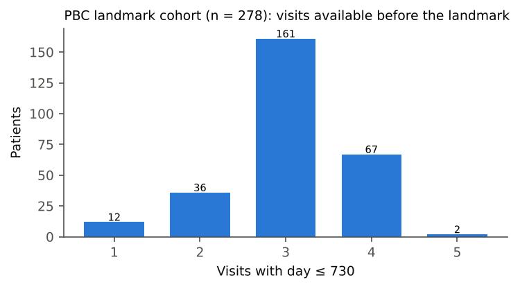
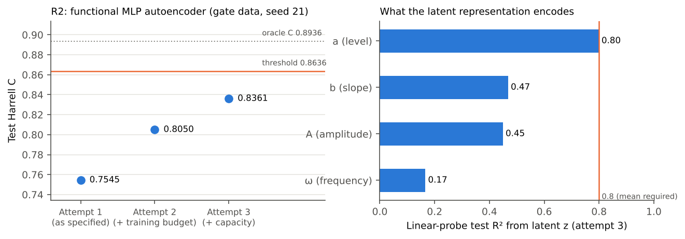
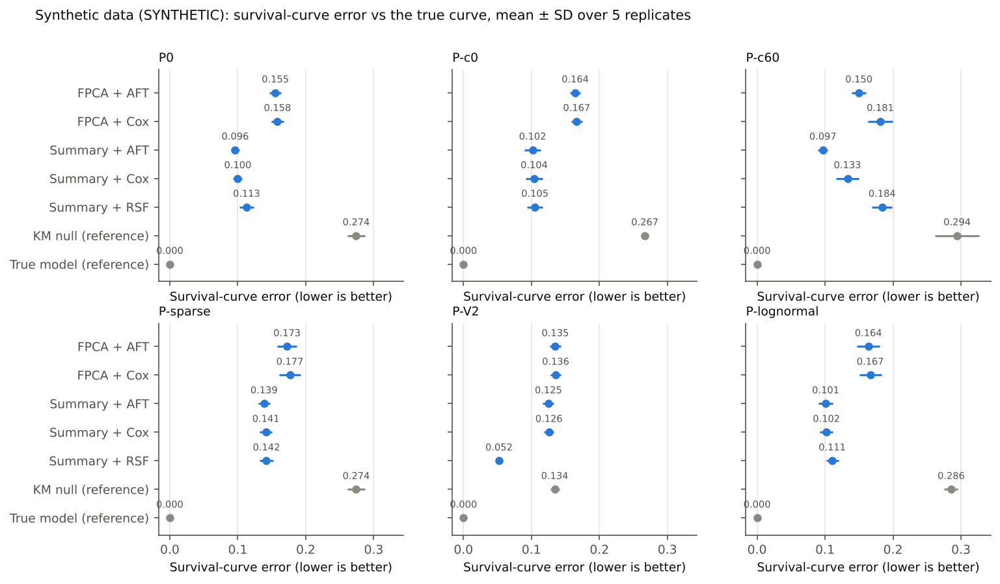
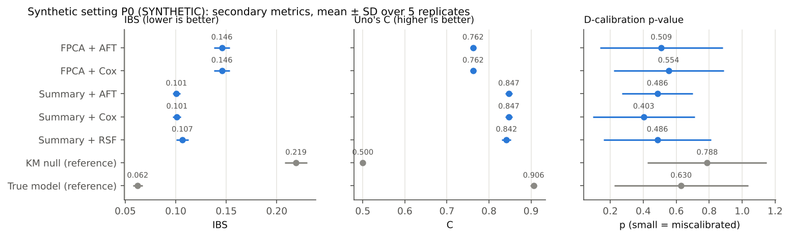
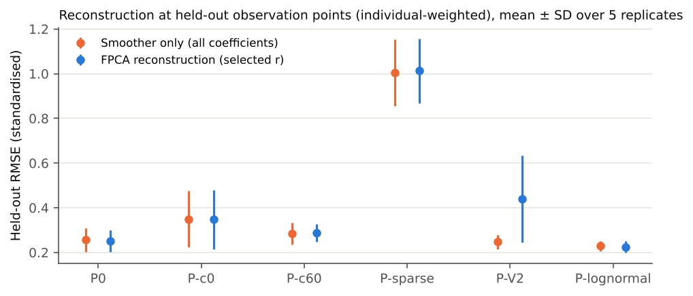
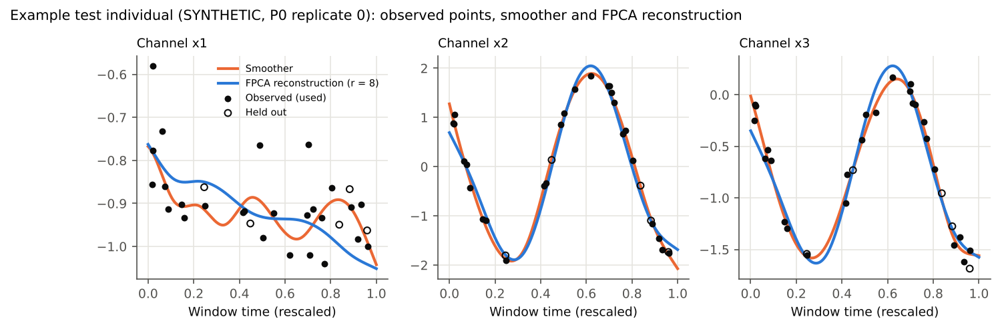
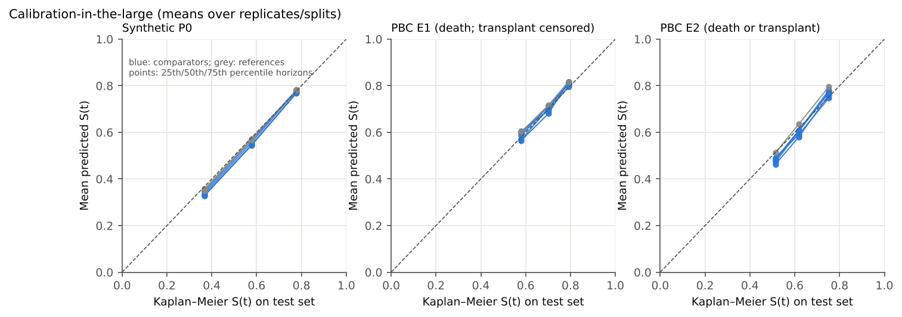
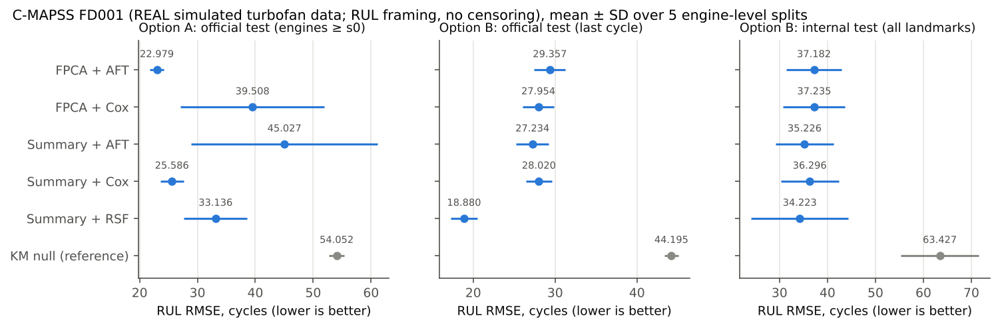
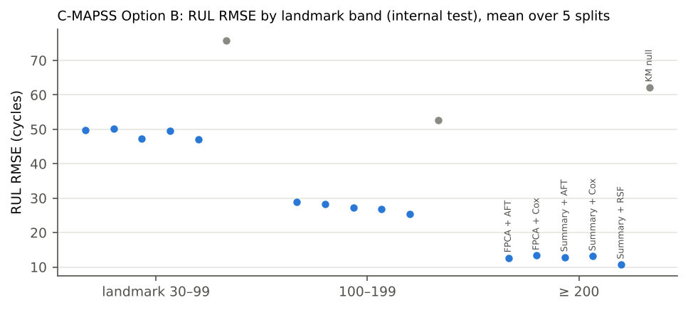
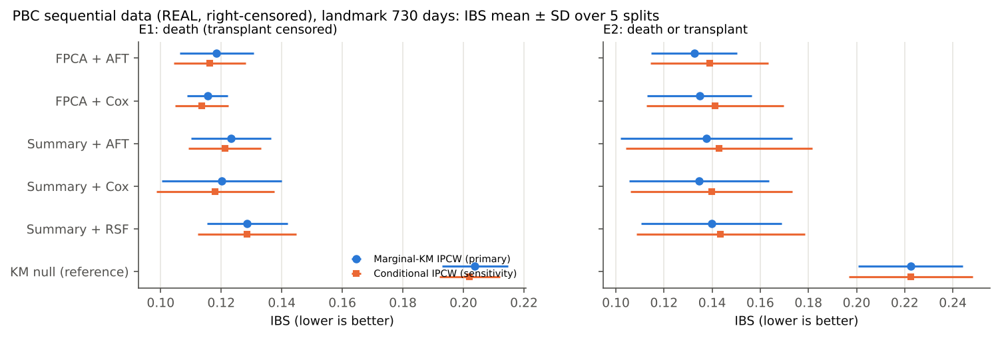

<p class="small">Research prototype report · generated 2026-10-16 from saved results by <code>scripts/build_report.py</code> ·
git <code>{{V:git_head}}</code> (local branch <code>claude/blissful-faraday-2unozw</code>, not pushed) · status:
<b>research prototype, not publication-ready</b> · no novelty claim is made.</p>

## 1. Executive summary (plain English)

**What we set out to test.** Whether a new kind of neural network building block, the Kolmogorov–Arnold
network (KAN), helps a "functional autoencoder" predict *time-to-event* from patient-like or machine-like
measurements that change over time, compared with a matched conventional network (an MLP).

**What we did.**
- Built the prototype in small validated stages:
  - a survival-likelihood module that correctly handles incomplete (censored) follow-up;
  - a simulator with a known answer;
  - the functional representation and our own KAN layer;
  - the models;
  - evaluation metrics.
- Checked each stage against independent reference calculations before moving on.

**The most important result.**
- Before comparing KAN with MLP, we required the conventional functional autoencoder to pass a pre-agreed
  *learnability check*: on simulated data with a known answer, it had to get close to the best achievable
  accuracy. **It did not.**
  - Required: a concordance (C-index) of at least {{V:R2_threshold}}.
  - Achieved: {{V:R2C_3}}, even after the two permitted repairs (longer training, more capacity).
- The likely reason is that the risk depended on the *size of an oscillation*, and the model's first layer can
  only take weighted averages of the curves, which cannot directly measure size when the oscillation's timing
  varies.
- Under the rule we fixed in advance, this **blocked the KAN-vs-MLP comparison**.

> **So this prototype provides no evidence that KAN helps, and no evidence that it does not. The key
> comparison was correctly not run.**

**What did run.**
- Validated, conventional baselines on:
  - **simulated data**;
  - **NASA C-MAPSS turbofan data** (real benchmark data with no genuinely incomplete follow-up; mainly a
    remaining-useful-life benchmark);
  - **PBC liver-disease data** (real data with genuinely incomplete follow-up).
- On simulated data, simple per-channel summaries (last value, mean, spread, trend) beat the "weighted-average"
  FPCA approach. This is consistent with the learnability finding.
- On PBC, all baselines clearly beat a no-information reference, but they could not be told apart reliably.
  The PBC patients had only about 3 measurements each before the prediction time, too few for functional
  modelling to be reliable.

**What is still open (your decisions).**
- How to revise the architecture so that it can pass the gate.
- Which PBC endpoint to adopt.
- Which C-MAPSS landmark design to adopt.

**Test status.** {{V:n_tests_latest}} test cases; latest outcomes: {{V:latest_passed}} passed,
{{V:latest_failed}} failed (the learnability check R2), {{V:latest_skipped}} skipped (documented not-applicable
case). Every attempt, including failures, is logged.


## 2. Research objective and hypotheses

**Narrow research question.** Does a KAN-based functional representation improve survival prediction from
multivariate time-varying trajectories over parameter-matched conventional baselines?

Hypotheses were fixed in `docs/design.md` §8.3 and `docs/experiment_protocol.md` §6 **before** any experiment
ran (decision D24):

| ID | Status | Hypothesis | Outcome in this prototype |
|---|---|---|---|
| H1 (primary) | pre-registered | On synthetic setting P0, the KAN functional autoencoder + AFT has lower survival-curve error than the parameter-matched functional MLP autoencoder + AFT (paired over 5 replicates). | **Not tested.** Blocked by the failed learnability gate (§10.1, D33). |
| H2 (secondary) | pre-registered | A reconstruction term (α > 0) reduces survival-curve error vs survival-only training (α = 0). | **Not tested** (blocked, D33). |
| H3 (secondary) | pre-registered | Functional encoders outperform the flattened autoencoder under sparse sampling. | **Not tested** (blocked, D33). |
| Gate R1–R3 | pre-specified engineering checks | The pipeline can learn a known relationship under controlled conditions. | R1 PASS, **R2 FAIL**, R3 PASS. |

The project makes **no novelty claim**. No literature review was performed (D27).

## 3. Files and modules created or modified

The existing `README.md` was not modified (D28). Everything else was created in this session.

| Path | Purpose |
|---|---|
| `docs/design.md`, `docs/experiment_protocol.md`, `docs/decisions.md` | Design (revision 2), pre-registered protocol, dated decision log (D0–D36) |
| `pyproject.toml`, `requirements-lock.txt`, `.gitignore` | Package definition, exact lock file, ignore rules (`.venv/`, `data/raw/`, `data/processed/`) |
| `scripts/setup_env.sh`, `scripts/verify_env.sh` | Project-local environment and its verification (E-1, E-5) |
| `scripts/run_logged.sh` | Runs every test/experiment command and records the command, exit code and timing in `reports/logs/commands.jsonl` |
| `src/kanfae/survival/aft.py`, `linear_aft.py` | Weibull / log-normal / log-logistic AFT likelihoods, survival functions, linear AFT fitter |
| `src/kanfae/data/schema.py`, `synthetic.py` | Observed/Oracle separation, synthetic generator |
| `src/kanfae/functional/basis.py`, `smoothing.py`, `fpca.py`, `layers.py` | B-spline basis, quadrature-weighted smoother, FPCA, functional linear layer |
| `src/kanfae/models/kan.py` | In-house B-spline KAN layer (tested: F-KAN-1..4) |
| `src/kanfae/models/fae.py`, `pipelines.py` | Functional / flattened autoencoders, AFT heads, parameter matching, uniform model interface, baselines |
| `src/kanfae/data/splits.py`, `preprocess.py` | Individual-level splits; training-only preprocessing |
| `src/kanfae/data/cmapss.py`, `pbc.py` | C-MAPSS (Options A/B) and PBC (E1/E2) loaders |
| `src/kanfae/evaluation/metrics.py` | IBS (marginal and conditional IPCW), Harrell/Uno C, D-calibration, survival-curve error, calibration-in-the-large |
| `src/kanfae/experiments/runner.py` | Tuning rule, evaluation, resumable result records |
| `scripts/run_synthetic.py`, `run_cmapss.py`, `run_pbc.py`, `run_all_experiments.sh` | Experiments |
| `scripts/diagnostics/r2_budget.py`, `r2_capacity.py`, `scripts/inspect/inspect_cmapss.py` | Gate diagnostics, data inspection |
| `scripts/compile_test_results.py`, `aggregate_results.py`, `make_figures.py`, `build_report.py`, `build_manifest.py`, `build_pdf.sh` | Reporting pipeline (all numbers are generated from saved results) |
| `tests/` (11 files) | Acceptance tests for Stages A–G |

## 4. Environment, package versions and hardware limitations

- **Interpreter:** Python 3.13 in a project-local virtual environment `.venv`, created by `scripts/setup_env.sh`.
- **Global environment unchanged:** `pip list` diff is empty (E-1).
- **Lock file:** reinstalling from `requirements-lock.txt` into a throwaway virtualenv reproduced `pip freeze`
  exactly (E-5).
- **Dependency check:** `pip check` is clean (E-6).
- **Hardware:** 4 CPUs, 15 GB RAM, **no GPU**. CPU-only PyTorch (`torch.version.cuda is None`).
- **Git:** all work is committed locally on branch `claude/blissful-faraday-2unozw` and **not pushed** (owner
  instruction, D21).

{{T:env}}

## 5. Model architecture, equations and key design choices

The full specification is in `docs/design.md`.

### 5.1 Landmark prediction

A trajectory observed on a window ending at landmark `s` is used to predict the residual time `T* − s` for
individuals at risk at `s`. No input is dated after `s` (test K4).

### 5.2 Censoring-aware AFT likelihood

```
log T = η + σ ε,    w = (log y − η)/σ,    S(t) = S_ε((log t − η)/σ)
ℓ_i = δ_i [log f_ε(w_i) − log σ − log y_i] + (1 − δ_i) log S_ε(w_i)
Weibull: log f = w − e^w,          log S = −e^w
Log-normal: log f = −w²/2 − ½ log 2π,   log S = log Φ(−w)
Log-logistic: log f = w − 2 softplus(w),  log S = −softplus(w)
```

### 5.3 Functional representation

- **Smoother:** a quadrature-weighted penalised B-spline smoother (D20):
  `c = (ΦᵀQΦ + λR + λ₀I)⁻¹ ΦᵀQy`, with cell-length weights `Q`. The data term therefore approximates
  `∫ (y − x)² dt` and is consistent under refinement of the sampling (test F3).
- **Functional linear layer:** `h_j = b_j + Σ_d ∫ β_jd(t) x_d(t) dt = b_j + Σ_d c_dᵀ J b_jd`.

### 5.4 Autoencoders

- **Encoder and decoder:** `z = g_enc(h)`; `ĉ = g_dec(z)`; `x̂(t) = Σ_k ĉ_k φ_k(t)`; head `η = wᵀ[z, u] + b`.
- **Reconstruction loss:** weights every **individual** equally (D19).
- **Total loss:** `L = mean(−ℓ) + α·L_rec + λ_β Σ bᵀR_βb`.

### 5.5 KAN layer and parameter matching

- **KAN layer** (in-house; passed F-KAN-1..4):
  `out_q = Σ_p [w^b_pq SiLU(x_p) + w^s_pq Σ_g a_pqg B_g(x_p)] + bias_q`.
  Cubic B-splines on a uniform grid of 5 intervals on [−2, 2], preceded by a per-feature BatchNorm (D30).
- **Parameter matching (D31):** KAN encoder and decoder blocks are chosen automatically to be within ±10% of
  the MLP blocks, avoiding bottlenecks narrower than r.
  - Original defaults: 2120 vs 2024 parameters (+4.7%).
  - Repaired defaults: 5090 vs 5032 (+1.2%).
  - For D ≥ 6, a decoder hidden width of 3 < r is unavoidable under matching; this is a recorded limitation.

### 5.6 Key corrections made before any training

- D30: BatchNorm instead of LayerNorm. A per-sample LayerNorm would have removed 2 of the 4 latent degrees of
  freedom.
- D31: the matching rule.
- D32: M2 targets that each model can represent.
- D36 (later): linear-AFT penalty scaling, found during the C-MAPSS smoke test.

## 6. Datasets, sources, dimensions, missingness and preprocessing

| Dataset | Kind | Source / provenance | Dimensions used | Outcome |
|---|---|---|---|---|
| Synthetic | **SYNTHETIC** | `src/kanfae/data/synthetic.py`; replicate seeds 1000–1004; gate seed 21 | N = 1000 per replicate, D = 3 channels, 8–40 points per channel (dense) or 3–8 (sparse) | Weibull or log-normal AFT with known η; independent censoring 0 / 30 / 60% |
| C-MAPSS FD001 | **REAL** (simulated turbofan) | PHM Society mirror of the NASA Prognostics Data Repository; SHA-256 in `run_manifest.json`; Saxena & Goebel (2008) | 100 training engines (life {{V:cm_life_min}}–{{V:cm_life_max}} cycles, median {{V:cm_life_med}}); 100 official test engines (length {{V:cm_tlen_min}}–{{V:cm_tlen_max}}); 15 informative sensors (constant: {{V:cm_const}}) | Run to failure; **no censoring**; RUL benchmark |
| PBC sequential | **REAL** (right-censored) | CRAN `survival` 3.8-12, object `pbcseq`; SHA-256 in `run_manifest.json` | 312 patients, 1945 visits; landmark cohort 278 at 730 days; 6 lab channels plus age and sex | Status 0/1/2 = censored / transplant / dead; E1 and E2 sensitivity analyses |

**Synthetic data.**
- Observed and oracle objects are separate (tests G5, G6, M5).
- Censoring is independent of everything, so marginal-KM IPCW is appropriate by construction (D17).
- 15% of each test individual's points (for individuals with ≥ 4 points) are held out for reconstruction metrics.

**C-MAPSS.**
- Inspected before any loader was written (`reports/logs/cmapss_inspection.json`). There are no missing values
  and cycles are consecutive.
- Note: the dataset readme lists the columns up to "sensor measurement 26", but there are 26 *columns* and 21
  sensors.
- Sensors are selected on training engines only (standard deviation ≥ 1e-6).
- Option A uses the full history `[1, s0]` with `s0` = minimum training-split life − 1.
- Option B uses trailing 30-cycle windows every 10 cycles, with `s/100` as a covariate. Engine-level splits
  (K3) and no input after the landmark (K4) are tested.

**PBC.**
- Help page vs data:
  - the follow-up column is `futime` (the help page says `time`);
  - `trig` and `copper` are listed but absent;
  - `chol` is 42% missing and was excluded (D26);
  - missing visit rows: `alk.phos` 3.1%, `platelet` 3.8%.
- Channels: log(bili), albumin, log(alk.phos), log(ast), platelet, log(protime). Missing values are masked
  (never imputed into the loss).
- The help page documents that extra visits were often prompted by worsening condition.



## 7. Tests performed, statuses and errors

### 7.1 Status of every acceptance criterion

All tests were run through `scripts/run_logged.sh`. Every attempt, including failed attempts, is in
`reports/test_results.csv` ({{V:n_test_records}} test records over {{V:n_test_runs}} pytest runs). The latest
outcome of each test is in `reports/test_results_latest.csv`: {{V:n_tests_latest}} test cases, of which
{{V:latest_passed}} passed, {{V:latest_failed}} failed and {{V:latest_skipped}} skipped.

Test types:
- **DET:** deterministic numerical checks.
- **STAT:** random-sample checks at a pre-specified seed. A STAT failure is never re-seeded (D18).

{{T:criteria}}

## 8. Test counts and the actual errors

### 8.1 Test-run counts (chronological)

{{T:run_counts}}

### 8.2 Actual errors and how each was handled

{{T:failures}}

**Explanations** (each failure got at most two targeted repairs; no threshold was changed, D11).

- **Stage A, A2 (all three families), attempts 1–2: test-harness bugs.**
  - Quadrature over (−∞, ∞) overflowed `exp(u)` and gave NaN.
  - A wide finite range then missed the narrow density peak at σ = 0.2.
  - Repair 2 integrates on the standardised scale `w`.
  - The likelihood code itself was never changed.
- **Stage A, A7 (log-logistic, then log-normal): the reference optimiser.**
  - Our maximised log-likelihood was 7.8e-4 *higher* than lifelines'.
  - lifelines' SLSQP stopped early.
  - A diagnostic showed our likelihood evaluated at lifelines' own estimates equals lifelines' value within
    1e-8.
  - Tightening lifelines' `ftol` resolved it.
- **Stage E, Q1, attempts 1–2: fixture issues.**
  - The scikit-survival reference cannot evaluate the training censoring KM beyond the largest training time.
  - Our IBS now evaluates G at `min(Y_i, t_last)`, which is exact.
  - The fixture uses test times inside the support.
- **Stage D, learnability gate: R2 FAILED after both permitted repairs** (§10.1).

## 9. Baselines, splits, seeds, tuning rules and metrics

**Models actually run (validated, non-neural).**

| Model | Representation | Head |
|---|---|---|
| FPCA + AFT | FPCA scores | Linear Weibull AFT |
| FPCA + Cox | FPCA scores (secondary reference) | Cox |
| Summary + AFT | Last value, mean, sd, OLS slope per channel, plus `u` | Penalised linear Weibull AFT |
| Summary + Cox | Same summary features | Penalised Cox |
| Summary + RSF | Same summary features | Random survival forest, 200 trees |

- **References (not comparators, no tuning):** a covariate-free Kaplan–Meier prediction (`km_null`, D35) and,
  on synthetic data only, the true model (`oracle_true`).
- **Not run (BLOCKED, D33):** functional MLP autoencoder, KAN functional autoencoder, flattened autoencoder, and
  all ablations AB1–AB8.

**Splits.**
- Synthetic: 5 independent replicate data sets (seeds 1000–1004), each split 60/20/20, stratified on δ.
- C-MAPSS: 5 engine-level splits (seeds 0–4). Official test engines are evaluated separately.
- PBC: 5 patient-level splits, stratified on δ.

**Leakage controls.** Fitted on training data only (test K2):
- channel standardisation;
- smoother λ;
- FPCA;
- sensor selection;
- summary-feature scaling;
- the censoring models;
- all hyperparameters.

**Tuning (D22).**
- Each model gets 4 configurations at seed 0, selected by validation IBS.
- Grids:
  - FPCA: r ∈ {2, 4, 8, 12}
  - Summary AFT: L2 ∈ {1e-3, 1e-2, 0.1, 1} (per observation)
  - Summary Cox: penaliser ∈ {0.01, 0.1, 1, 10}
  - RSF: min_samples_leaf ∈ {5, 10, 20, 40}
- The selected RSF configuration is re-run with seeds 1 and 2 and averaged within the replicate. Deterministic
  models run once.

**Metrics** (protocol §5, D6).
- **Synthetic primary:** survival-curve error, `mean_i (1/t_max) ∫₀^{t_max} |Ŝ_i − S_i| dt`.
- **Real data primary:** IBS with marginal-KM IPCW. For PBC this is flagged as a limitation (D17), with a
  conditional (Cox censoring model) IPCW sensitivity analysis.
- **Secondary:** Uno's C (truncated at the 90th percentile of test times); Harrell's C; D-calibration (10 bins);
  calibration-in-the-large at the 25th, 50th and 75th percentile horizons.
- **C-MAPSS RUL:** RMSE and MAE of the median predicted residual life (uncapped), reported **separately** from
  survival metrics.

**Uncertainty.** Mean ± SD over replicates or splits. The pre-registered paired test was planned for H1 only,
and H1 was not run. Comparisons between baselines are descriptive.

**Selected configurations:**

{{T:selected}}

**Run status (every record, including tuning):**

{{T:status}}


## 10. Experimental results

All results below are **actual outputs of logged runs** (`reports/experiment_results.jsonl` and `.csv`;
summaries in `reports/tables/`). Values are mean ± SD over 5 replicates or splits. For the random survival
forest, values are first averaged over seeds 0–2 within each replicate. `n` is the number of
replicates/splits contributing.

> **Data labels.** §10.2 is **SYNTHETIC**. §10.3 is **REAL (C-MAPSS, simulated turbofan; RUL benchmark, no
> natural censoring)**; its survival-framing metrics involve no censoring, except in §10.3.3, which is
> **ARTIFICIAL CENSORING**. §10.4 is **REAL (PBC, genuinely right-censored)**.

### 10.1 Learnability gate (SYNTHETIC; seed 21; N = 2000; stage D)

- **R1 PASS.** An MLP AFT head given the *true* latent parameters (a, b, A, ω) reached test C = {{V:R1C}}
  (oracle {{V:R2_oracle}}), with σ = {{V:R1sigma}} (truth 0.5). The survival head and likelihood can learn the
  known nonlinear relationship when the right features are available.
- **R2 FAIL** (pre-specified: C ≥ oracle − 0.03 = {{V:R2_threshold}}, and mean probe R² ≥ 0.8). For the
  functional MLP autoencoder:

  | Attempt | Change | Test C | Probe R² (a, b, A, ω) | Mean probe R² |
  |---|---|---|---|---|
  | 1 | As specified | {{V:R2C_1}} | {{V:R2probe_1}} | {{V:R2probe_mean_1}} |
  | 2 | Repair 1: training budget 400 → 3000 epochs (the cap was always hit) | {{V:R2C_2}} | {{V:R2probe_2}} | {{V:R2probe_mean_2}} |
  | 3 | Repair 2: capacity, H 16 → 32, hidden 32 → 64 | {{V:R2C_3}} | {{V:R2probe_3}} | {{V:R2probe_mean_3}} |

- **R3 PASS at attempt 3.**
  - |C − C_R2| = {{V:R3dC_3}}.
  - The censoring-aware model had a smaller survival-curve error than the naive model (censored times treated
    as events) at all 3 seeds: aware {{V:R3aware_3}} vs naive {{V:R3naive_3}}.
  - At attempts 1 and 2, the |C − C_R2| part failed ({{V:R3dC_1}}, {{V:R3dC_2}}) while the censoring part
    already passed.



**Diagnosis (interpretation, labelled as such).**
- The largest risk term is −0.8·A², where A is the amplitude of a sinusoid with a random phase. That is a
  phase-invariant (quadratic) functional of the trajectory.
- The architecture's first layer computes only *linear* functionals `∫β(t) x(t) dt`. The downstream network
  must learn the energy-like combination, and at N = 1200 training individuals it under-fits: train C ≈ test C
  ≈ 0.79–0.84 in `reports/logs/diag_R2_capacity.log`. Capacity beyond H = 32 did not help (plateau ≈ 0.836).
- **Consequence (pre-registered rule, D33):** the KAN-vs-MLP primary comparison (H1), H2, H3 and all ablations
  were **not run**.
- **Diagnostic observation only, not evidence for H1:** in one gate-data run at a single seed with a
  3000-epoch budget, the KAN autoencoder reached C = 0.837 vs 0.805 for the MLP at its original size
  (`reports/logs/diag_R2_budget.log`). This single-seed observation on the gate data set must not be read as
  a KAN advantage.

### 10.2 Synthetic experiments with validated baselines (SYNTHETIC)

**Pre-registered primary setting P0** (V1, dense, 30% censoring, Weibull):

{{T:syn_P0}}





**Secondary settings** (one factor changed from P0):

*P-c0 (no censoring)*

{{T:syn_P-c0}}

*P-c60 (60% censoring)*

{{T:syn_P-c60}}

*P-sparse (3–8 points, 10% channel missingness)*

{{T:syn_P-sparse}}

*P-V2 (risk = −0.7·log(1 + ∫x₁²))*

{{T:syn_P-V2}}

*P-lognormal (log-normal event times; misspecification for the Weibull AFT heads)*

{{T:syn_P-lognormal}}

**Reconstruction quality** (FPCA with the selected r vs the smoother using all coefficients; RMSE at held-out
observation points on the standardised scale, both weightings, D19):

{{T:recon}}





**Calibration:**




### 10.3 C-MAPSS FD001 (REAL simulated turbofan data; RUL benchmark)

**RUL results are reported separately from survival-framing metrics.**
- With no censoring, the IBS here is an unweighted Brier score, and Harrell's C equals Uno's C up to
  truncation.
- RUL RMSE and MAE use the median of each model's predicted survival curve, uncapped, in cycles.
- "Official" means the NASA test trajectories, which have true RUL.
- Neither landmark option is the approved design (D3b-R). They are separate, labelled analyses.

#### 10.3.1 Option A (single landmark s0 = minimum training-split life − 1; full history)

{{T:cmapss_A}}

#### 10.3.2 Option B (trailing 30-cycle windows every 10 cycles; landmark s as a covariate)

{{T:cmapss_B}}

Per landmark band (internal test; pooled metrics mix landmarks, so per-band metrics are shown):

{{T:cmapss_bands}}





#### 10.3.3 Option A with ARTIFICIAL CENSORING (code-path test only)

Training and validation targets were censored independently with `C ~ U(0, max training residual)`. Test
targets are uncensored. These numbers **test the censoring code path, not real censoring**.

{{T:cmapss_A_art}}

**Observations (descriptive; no significance claims).**
- **Option A, internal test.** RUL RMSE was {{V:S|cmapss_A|fpca_aft|rul_test_rmse}} (FPCA + AFT),
  {{V:S|cmapss_A|fpca_cox|rul_test_rmse}} (FPCA + Cox) and {{V:S|cmapss_A|sum_cox|rul_test_rmse}}
  (Summary + Cox) cycles, against {{V:S|cmapss_A|km_null|rul_test_rmse}} for the null reference.
- **Option A, official test.** Only engines whose observed length reaches `s0` can be evaluated (mean
  {{V:S|cmapss_A|fpca_aft|rul_official_n}} of 100). FPCA + AFT had the lowest RMSE,
  {{V:S|cmapss_A|fpca_aft|rul_official_rmse}}.
- **Option B, official test (all 100 engines at their last cycle).** Summary + RSF had the lowest RMSE,
  {{V:S|cmapss_B|sum_rsf|rul_official_rmse}}. The parametric/Cox baselines were at
  {{V:S|cmapss_B|sum_aft|rul_official_rmse}}–{{V:S|cmapss_B|fpca_aft|rul_official_rmse}}, and the null
  reference at {{V:S|cmapss_B|km_null|rul_official_rmse}}.
- **Option B, internal test pooled over all landmarks.** RMSE was ≈{{V:S|cmapss_B|sum_rsf|rul_test_rmse}}–{{V:S|cmapss_B|fpca_cox|rul_test_rmse}}.
  Per band it falls from ≈{{V:S|cmapss_B|sum_rsf|band_30_100_rmse}} at early landmarks (30–99) to
  ≈{{V:S|cmapss_B|sum_rsf|band_200_999_rmse}} at late landmarks (≥ 200). Discrimination within the early band
  is modest (C ≈ {{V:S|cmapss_B|fpca_aft|band_30_100_harrell_c}}), as expected when degradation is not yet
  visible.
- **The two options are not directly comparable.** They predict at different landmarks and evaluate different
  official-test subsets. This is one reason D3b remains an owner decision.
- **Artificial censoring (Option A).**
  - The parametric AFT predictions stayed close to their uncensored values: FPCA + AFT internal RMSE
    {{V:S|cmapss_A_artificial|fpca_aft|rul_test_rmse}} vs {{V:S|cmapss_A|fpca_aft|rul_test_rmse}}.
  - For the Cox models, some predicted survival curves never fell to 0.5 within the training follow-up, so
    their medians are undefined. On average {{V:S|cmapss_A_artificial|sum_cox|rul_test_median_not_reached}}
    test engines per split were affected for Summary + Cox; these are flagged in the records and set to the
    grid end. This inflates Cox RMSE ({{V:S|cmapss_A_artificial|sum_cox|rul_test_rmse}} ±
    {{V:S|cmapss_A_artificial|sum_cox|rul_test_rmse|std}}).
  - For Summary + AFT, all four configurations diverged in one split, so only
    {{V:S|cmapss_A_artificial|sum_aft|ibs|count}} of 5 splits contribute.
- **The neural autoencoders were not evaluated** (BLOCKED, D33).

### 10.4 PBC sequential data (REAL, right-censored; landmark 730 days)

The two endpoints estimate different quantities, and **neither is declared definitive** (D9-R).

#### 10.4.1 E1: death, with transplant treated as censoring (hypothetical no-transplant survival; relies on CA-1 for transplant)

{{T:pbc_E1}}

#### 10.4.2 E2: death or transplant, composite (transplant-free survival)

{{T:pbc_E2}}



#### 10.4.3 Visit process (descriptive; full cohort; not used as a model feature)

{{T:visits}}

**Observations (descriptive; no significance claims).**
- **All baselines improved substantially on the covariate-free reference for both endpoints.**
  - E1: IBS {{V:S|pbc_E1|fpca_cox|ibs}}–{{V:S|pbc_E1|sum_rsf|ibs}} vs {{V:S|pbc_E1|km_null|ibs}} for the null.
  - E2: IBS {{V:S|pbc_E2|fpca_aft|ibs}}–{{V:S|pbc_E2|sum_rsf|ibs}} vs {{V:S|pbc_E2|km_null|ibs}}.
- **Differences between baselines were small relative to their split-to-split SDs**, so no ranking is claimed.
  With about 56 test patients per split, the uncertainty is large.
- **The conditional-IPCW sensitivity analysis changed IBS values by less than about 0.01.**
  - E1: FPCA + Cox {{V:S|pbc_E1|fpca_cox|ibs}} (marginal) vs {{V:S|pbc_E1|fpca_cox|ibs_conditional_ipcw}}
    (conditional).
  - E2: {{V:S|pbc_E2|fpca_cox|ibs}} vs {{V:S|pbc_E2|fpca_cox|ibs_conditional_ipcw}}.
  - So, *under the Cox censoring model used*, the metric conclusions are not sensitive to the CA-2 assumption.
    This does not validate CA-1 for transplant under E1.
- **D-calibration p-values were all > 0.05.** With small test sets this test has little power.
- **FPCA-based and summary-feature baselines performed similarly.** This is unsurprising given a median of 3
  visits per patient (§14). The data are too sparse to make the functional representation informative.
- **Visit process (descriptive).** The univariate hazard ratio per additional visit in the window is reported
  in the table above. The absence of a clear association in this crude check does not rule out an informative
  visit process; the dataset documentation itself describes visits triggered by worsening condition.


## 11. Plots (index)

All figures are generated by `scripts/make_figures.py` from the saved tables. They are embedded in the sections
above.

| Figure | Content | Data |
|---|---|---|
| `figures/fig_gate.png` | Learnability gate R2 across repair attempts; linear-probe R² | SYNTHETIC |
| `figures/fig_synthetic_curve_error.png` | Survival-curve error, all settings | SYNTHETIC |
| `figures/fig_synthetic_P0_secondary.png` | IBS, Uno's C, D-calibration in P0 | SYNTHETIC |
| `figures/fig_reconstruction.png`, `fig_example_reconstruction.png` | Reconstruction quality at held-out points; example individual | SYNTHETIC |
| `figures/fig_calibration.png` | Calibration-in-the-large | SYNTHETIC and PBC (REAL) |
| `figures/fig_cmapss_rul.png`, `fig_cmapss_bands.png` | RUL RMSE (official and internal tests; per landmark band) | C-MAPSS (REAL, RUL framing) |
| `figures/fig_pbc_ibs.png`, `fig_pbc_visits.png` | IBS (marginal vs conditional IPCW); visits before the landmark | PBC (REAL, censored) |


## 12. Runtime, parameter counts and compute constraints

{{T:runtime}}

\*Parameter counts:
- FPCA/summary + AFT: number of features + 2 (intercept, log σ).
- Cox: number of features.
- RSF: total tree nodes over 200 trees (not comparable to parametric counts).

**Compute constraints.**
- CPU only (4 cores, no GPU).
- Neural models were run only for the unit tests, the learnability gate and the gate diagnostics, because the
  comparisons were blocked.
- The parameter-matched neural blocks (protocol M3) were verified, but never compared experimentally.

## 13. What was learned

1. **The censoring-aware AFT machinery is validated.** All three AFT likelihoods matched independent references:
   - scipy closed forms (`rtol = 1e-10`);
   - numerical integration and autograd hazards (1e-8);
   - lifelines maximum likelihood (1e-4);
   - recovery of the truth within 3 SE at a fixed seed.

   The synthetic generator passed all 12 generator criteria, including oracle isolation and invariance of the
   loss to hidden event times.
2. **The functional representation is numerically sound.** Discretisation consistency held at roughly O(1/n²)
   (F3), and the in-house KAN layer passed its own tests.
3. **The proposed functional autoencoder failed its learnability gate (R2).** Under controlled conditions it
   could not represent a phase-invariant amplitude feature well enough. This is a substantive, negative,
   architecture-level finding about the linear-functional-first design, and not an implementation bug as far
   as the diagnostics show. The pre-registered rule therefore prevented any KAN-vs-MLP comparison. **The
   prototype provides no evidence for or against a KAN advantage.**
4. **Consistent with point 3, linear-functional baselines (FPCA) were outperformed by simple summary features
   on synthetic data.** Per-channel standard deviation directly carries amplitude information (§10.2). When the
   risk depended on a non-monotone functional (P-V2), only the nonlinear random survival forest moved clearly
   away from the null. These are descriptive comparisons, not pre-registered tests.
5. **C-MAPSS and PBC baseline results are descriptive and must be read with the caveats in §14.** In
   particular, C-MAPSS contains no natural censoring, and the two PBC endpoints estimate different quantities.

## 14. Limitations, possible leakage, censoring assumptions and unresolved decisions

### Scope
- The neural comparisons that motivated the project were not run (D33). All experimental results concern
  baselines.

### Censoring assumptions (D17)
- The AFT likelihood assumes conditionally independent censoring (CA-1).
- Marginal-KM IPCW (IBS, Uno's C) assumes completely independent censoring (CA-2).
- CA-2 holds by construction for synthetic data and for artificial C-MAPSS censoring.
- For PBC, CA-2 is doubtful. Under E1, transplant (treated as censoring) plausibly depends on disease severity.
  The conditional-IPCW IBS is a sensitivity analysis. It replaces CA-2 with CA-1 plus a correctly specified Cox
  censoring model, so it is not assumption-free.

### C-MAPSS
- **No natural censoring.** Survival-framing metrics on C-MAPSS are effectively uncensored.
- **Artificial censoring** (§10.3.3) tests only the code path.
- **The data are simulated**, and failure is defined by the simulator.
- **Option A** excludes official test engines shorter than `s0`.
- **Option B** reuses engines across landmarks, so windows are correlated. Splits are engine-level (K3), but
  pooled metrics mix landmarks; per-band results are also reported.
- **The landmark design decision (D3b) remains unresolved.** Both options are reported, and neither is approved
  as definitive.
- **Integer cycles** are treated with the continuous approximation (D25).

### PBC
- **Small sample:** 278 at risk at 730 days; about 56 test patients per split.
- **Sparse measurements:** a median of 3 visits before the landmark (§6). The FPCA representation of such
  trajectories is weak. Functional modelling of PBC at this landmark should be regarded as **unreliable**.
- **Informative observation process:** documented by the dataset authors (§10.4.3).
- **Endpoint unresolved (D9):** E1 and E2 estimate different quantities. Neither is declared definitive.
  Competing-risks analysis (E3) is not implemented, and no competing-risk claims are made.
- **Baseline covariates:** only age and sex. Treatment arm and other baseline variables were not used.

### Possible leakage (checked)
- Splits are by individual or engine (K1, K3).
- Inputs end at the landmark (K4).
- Preprocessing, the censoring KM, FPCA and sensor selection are fitted on training data only (K2).
- Synthetic oracle quantities are isolated (G5, G6, M5).
- The test-set time grids for IBS and the Uno τ use observed test times. This is standard for evaluation and
  does not affect fitting.
- The synthetic `t_max` comes from the generator's pilot sample.

### Statistical
- 5 replicates or splits give low precision.
- Baseline comparisons are descriptive. No multiplicity-adjusted tests were run.
- STAT tests can fail by chance at their fixed seeds; none failed except R2, which was reproduced
  deterministically.

### Engineering
- **Two bugs were found and fixed during the experiments** (D36 penalty scaling, D37 constant Cox columns). All
  affected results were re-run. Superseded records are kept and labelled.
- **Summary + AFT on C-MAPSS Option A** (p ≈ n) often reported `converged: false`. Its results there are
  fragile (`fit_info`).

### Literature and status
- No literature review was performed. **The prototype is not publication-ready.**

## 15. Reproducibility

```bash
# environment (project-local; never touches the global Python)
bash scripts/setup_env.sh                          # or: KANFAE_FROM_LOCK=1 bash scripts/setup_env.sh
bash scripts/verify_env.sh                         # E-1 / E-5 evidence
# tests (every attempt is appended to reports/logs/test_records.jsonl)
KANFAE_RUN_ID=rerun .venv/bin/python -m pytest -v -rA tests/
# data (public sources; checksums in reports/run_manifest.json)
#   C-MAPSS: https://phm-datasets.s3.amazonaws.com/NASA/6.+Turbofan+Engine+Degradation+Simulation+Data+Set.zip
#            -> extract inner CMAPSSData.zip into data/raw/cmapss/
#   PBC:     https://cran.r-project.org/src/contrib/survival_3.8-12.tar.gz -> data/raw/pbc/{DESCRIPTION,data/pbc.rda}
# experiments (resumable; completed run IDs are skipped)
bash scripts/run_all_experiments.sh                # synthetic (5 replicates x 6 settings) + C-MAPSS (5 splits)
.venv/bin/python scripts/run_cmapss.py --splits 5 --analyses cmapss_A,cmapss_A_artificial --models sum_cox --code-version D37
.venv/bin/python scripts/run_pbc.py --splits 5
# report
.venv/bin/python scripts/compile_test_results.py && .venv/bin/python scripts/aggregate_results.py
.venv/bin/python scripts/make_figures.py && .venv/bin/python scripts/build_report.py
bash scripts/build_pdf.sh && .venv/bin/python scripts/build_manifest.py
```

Every executed command, with its exit code and timing, is in `reports/logs/commands.jsonl`. The full outputs
are in `reports/logs/*.log`. The resumable narrative log is `reports/logs/execution_log.md`.

## 16. Unfinished work and reasons

| Item | Status | Reason |
|---|---|---|
| H1: KAN vs MLP functional autoencoder (primary) | NOT RUN | Learnability gate R2 failed (D33); pre-registered rule |
| H2 (α > 0 vs α = 0), H3 (functional vs flattened under sparsity) | NOT RUN | Same |
| Ablations AB1–AB8 (α, strategy S1/S2/S3, encoder type, r, KAN grid, head, AFT family, basis size) | NOT RUN | Same; they depend on the validated neural models |
| Neural models on C-MAPSS and PBC | NOT RUN | Same |
| Design revision to unblock (e.g. the deferred `∫F(x(t),t)dt` variant or phase-invariant functional features), then re-run the gate | NOT STARTED | Substantive research decision for the owner (D33 options a–c) |
| PBC endpoint choice (E1 vs E2 vs competing risks) | UNRESOLVED | Owner decision (D9-R). E3 not implemented. |
| C-MAPSS landmark design choice (A vs B) | UNRESOLVED | Owner decision (D3b-R) |
| Interval likelihood for integer cycles | NOT IMPLEMENTED | D25 |
| C-MAPSS FD002–FD004 | NOT RUN | Budget; FD001 only (protocol §4.2) |
| Informative-censoring and further misspecification synthetic variants | NOT RUN | Planned for later (design §5.3) |
| Literature review; bibliographic verification of the method references | NOT DONE | D27 |

## 17. References

Sources with traceable links (accessed 2026-10-16). The bibliographic details are as stated by the cited source
pages; they were not checked against the original publications.

1. Saxena A., Goebel K. (2008). *Turbofan Engine Degradation Simulation Data Set.* NASA Prognostics Data
   Repository, NASA Ames Research Center. Mirror: https://data.phmsociety.org/nasa/ ; file:
   https://phm-datasets.s3.amazonaws.com/NASA/6.+Turbofan+Engine+Degradation+Simulation+Data+Set.zip
2. Saxena A., Goebel K., Simon D., Eklund N. (2008). "Damage Propagation Modeling for Aircraft Engine
   Run-to-Failure Simulation." Proc. 1st Int. Conf. on Prognostics and Health Management (PHM08). Cited in the
   dataset readme.
3. Therneau T., Grambsch P. (2000). *Modeling Survival Data: Extending the Cox Model.* Springer. Source of
   `pbcseq` per `survival/man/pbcseq.Rd`.
4. Murtaugh P.A. et al. (1994). "Primary biliary cirrhosis: prediction of short-term survival based on
   repeated patient visits." *Hepatology* 20(1.1):126–34. Cited in `pbcseq.Rd`.
5. Fleming T., Harrington D. (1991). *Counting Processes and Survival Analysis.* Wiley. Cited in `pbcseq.Rd`.
6. Therneau T. et al. R package `survival` 3.8-12 (2026-09-02), LGPL (≥ 2).
   https://cran.r-project.org/src/contrib/survival_3.8-12.tar.gz
7. Software: PyTorch 2.14.1 (https://pytorch.org), lifelines 0.30.3 (https://github.com/CamDavidsonPilon/lifelines),
   scikit-survival 0.28.0 (https://github.com/sebp/scikit-survival), SciPy, NumPy, pandas, scikit-learn,
   matplotlib, rdata. Exact versions are in `requirements-lock.txt`.
8. IEEE DataPort description of the NASA turbofan data: https://ieee-dataport.org/documents/nasa-turbofan-jet-engine-data-set
9. data.nasa.gov catalogue entry: https://data.nasa.gov/dataset/c-mapss-aircraft-engine-simulator-data

**Methods named but not bibliographically verified in this project** (to be verified before any manuscript):
Uno's IPCW C-index; Graf et al.'s IPCW Brier score (cited in scikit-survival's documentation as Graf, Schmoor,
Sauerbrei & Schumacher, *Statistics in Medicine* 18, 1999); Harrell's C; D-calibration (Haider et al.);
landmarking (van Houwelingen); the corrected resampled t-test (Nadeau & Bengio); Kolmogorov–Arnold networks
(Liu et al.); functional principal component analysis; random survival forests (Ishwaran et al.).


