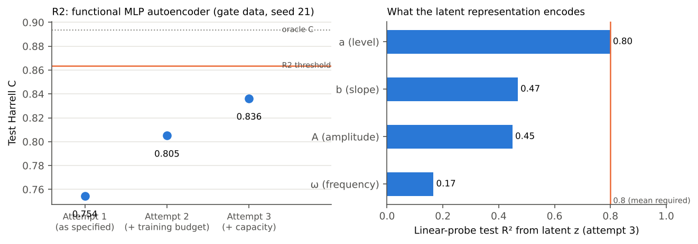
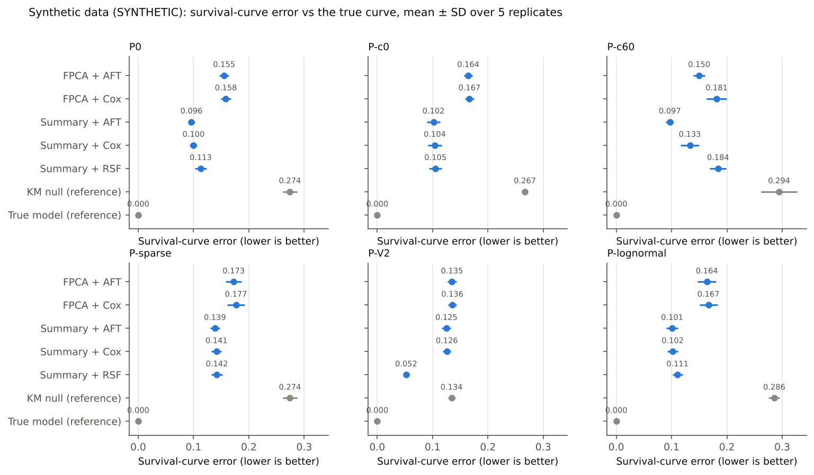
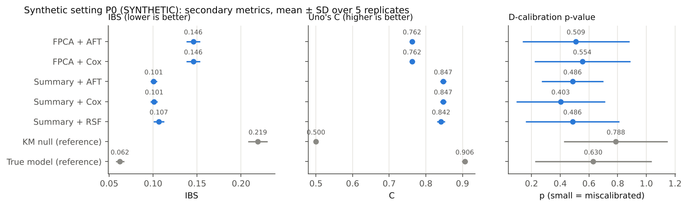
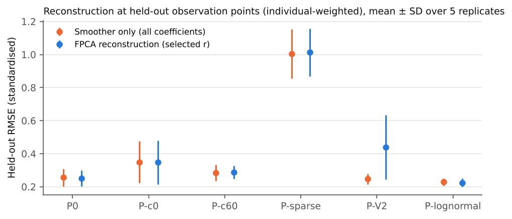
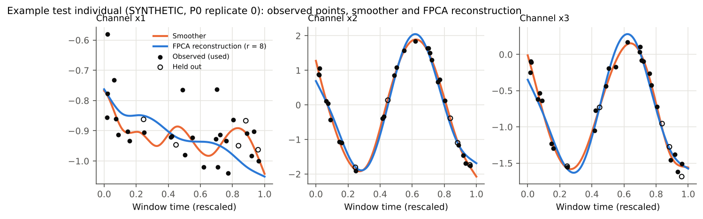
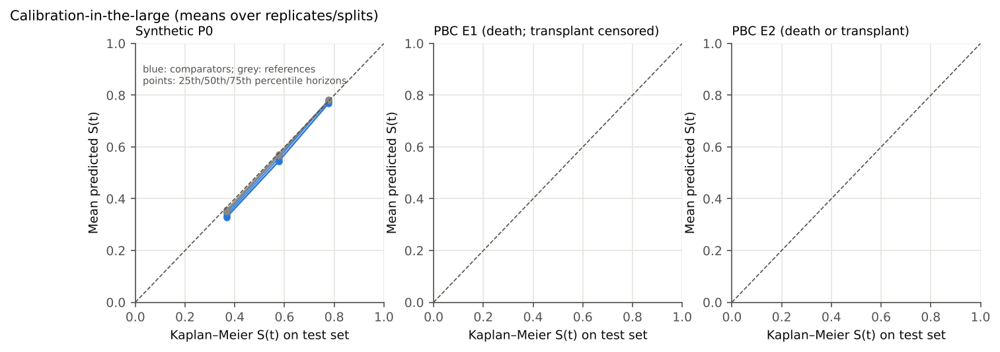

## 10. Experimental results

All results below are **actual outputs of logged runs** (`reports/experiment_results.jsonl` and `.csv`;
summaries in `reports/tables/`). Values are mean ± SD over 5 replicates or splits. For the random survival
forest, values are first averaged over seeds 0–2 within each replicate. `n` is the number of
replicates/splits contributing.

> **Data labels.** §10.2 is **SYNTHETIC**. §10.3 is **REAL (C-MAPSS, simulated turbofan; RUL benchmark, no
> natural censoring)**; its survival-framing metrics involve no censoring, except in §10.3.3, which is
> **ARTIFICIAL CENSORING**. §10.4 is **REAL (PBC, genuinely right-censored)**.

### 10.1 Learnability gate (SYNTHETIC; seed 21; N = 2000; stage D)

- **R1 PASS.** An MLP AFT head given the *true* latent parameters (a, b, A, ω) reached test C = {{V:R1C}}
  (oracle {{V:R2_oracle}}), with σ = {{V:R1sigma}} (truth 0.5). The survival head and likelihood can learn the
  known nonlinear relationship when the right features are available.
- **R2 FAIL** (pre-specified: C ≥ oracle − 0.03 = {{V:R2_threshold}}, and mean probe R² ≥ 0.8). For the
  functional MLP autoencoder:

  | Attempt | Change | Test C | Probe R² (a, b, A, ω) | Mean probe R² |
  |---|---|---|---|---|
  | 1 | As specified | {{V:R2C_1}} | {{V:R2probe_1}} | {{V:R2probe_mean_1}} |
  | 2 | Repair 1: training budget 400 → 3000 epochs (the cap was always hit) | {{V:R2C_2}} | {{V:R2probe_2}} | {{V:R2probe_mean_2}} |
  | 3 | Repair 2: capacity, H 16 → 32, hidden 32 → 64 | {{V:R2C_3}} | {{V:R2probe_3}} | {{V:R2probe_mean_3}} |

- **R3 PASS at attempt 3.**
  - |C − C_R2| = {{V:R3dC_3}}.
  - The censoring-aware model had a smaller survival-curve error than the naive model (censored times treated
    as events) at all 3 seeds: aware {{V:R3aware_3}} vs naive {{V:R3naive_3}}.
  - At attempts 1 and 2, the |C − C_R2| part failed ({{V:R3dC_1}}, {{V:R3dC_2}}) while the censoring part
    already passed.

**Diagnosis (interpretation, labelled as such).**
- The largest risk term is −0.8·A², where A is the amplitude of a sinusoid with a random phase. That is a
  phase-invariant (quadratic) functional of the trajectory.
- The architecture's first layer computes only *linear* functionals `∫β(t) x(t) dt`. The downstream network
  must learn the energy-like combination, and at N = 1200 training individuals it under-fits: train C ≈ test C
  ≈ 0.79–0.84 in `reports/logs/diag_R2_capacity.log`. Capacity beyond H = 32 did not help (plateau ≈ 0.836).
- **Consequence (pre-registered rule, D33):** the KAN-vs-MLP primary comparison (H1), H2, H3 and all ablations
  were **not run**.
- **Diagnostic observation only, not evidence for H1:** in one gate-data run at a single seed with a
  3000-epoch budget, the KAN autoencoder reached C = 0.837 vs 0.805 for the MLP at its original size
  (`reports/logs/diag_R2_budget.log`). This single-seed observation on the gate data set must not be read as
  a KAN advantage.

### 10.2 Synthetic experiments with validated baselines (SYNTHETIC)

**Pre-registered primary setting P0** (V1, dense, 30% censoring, Weibull):

{{T:syn_P0}}

**Secondary settings** (one factor changed from P0):

*P-c0 (no censoring)*

{{T:syn_P-c0}}

*P-c60 (60% censoring)*

{{T:syn_P-c60}}

*P-sparse (3–8 points, 10% channel missingness)*

{{T:syn_P-sparse}}

*P-V2 (risk = −0.7·log(1 + ∫x₁²))*

{{T:syn_P-V2}}

*P-lognormal (log-normal event times; misspecification for the Weibull AFT heads)*

{{T:syn_P-lognormal}}

**Reconstruction quality** (FPCA with the selected r vs the smoother using all coefficients; RMSE at held-out
observation points on the standardised scale, both weightings, D19):

{{T:recon}}

**Calibration:**

