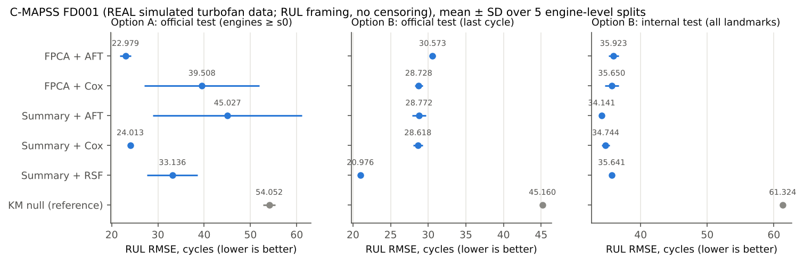
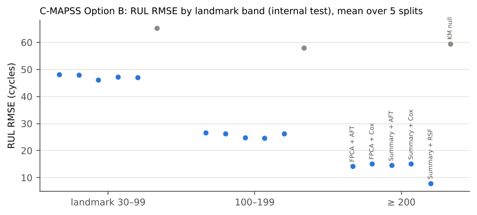
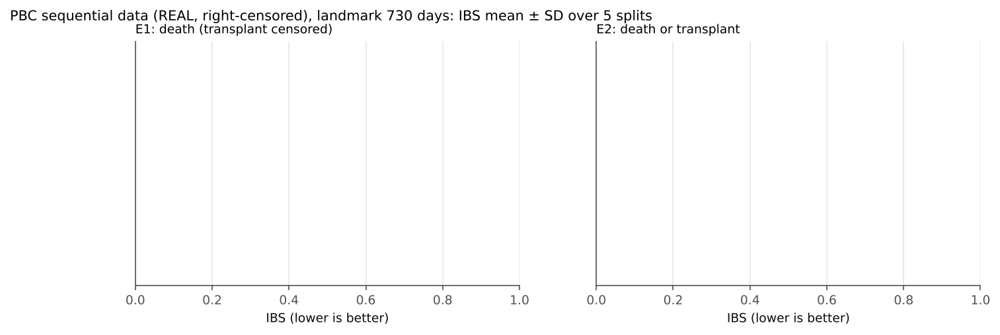

### 10.3 C-MAPSS FD001 (REAL simulated turbofan data; RUL benchmark)

**RUL results are reported separately from survival-framing metrics.**
- With no censoring, the IBS here is an unweighted Brier score, and Harrell's C equals Uno's C up to
  truncation.
- RUL RMSE and MAE use the median of each model's predicted survival curve, uncapped, in cycles.
- "Official" means the NASA test trajectories, which have true RUL.
- Neither landmark option is the approved design (D3b-R). They are separate, labelled analyses.

#### 10.3.1 Option A (single landmark s0 = minimum training-split life − 1; full history)

{{T:cmapss_A}}

#### 10.3.2 Option B (trailing 30-cycle windows every 10 cycles; landmark s as a covariate)

{{T:cmapss_B}}

Per landmark band (internal test; pooled metrics mix landmarks, so per-band metrics are shown):

{{T:cmapss_bands}}

#### 10.3.3 Option A with ARTIFICIAL CENSORING (code-path test only)

Training and validation targets were censored independently with `C ~ U(0, max training residual)`. Test
targets are uncensored. These numbers **test the censoring code path, not real censoring**.

{{T:cmapss_A_art}}

{{CMAPSS_TEXT}}

### 10.4 PBC sequential data (REAL, right-censored; landmark 730 days)

The two endpoints estimate different quantities, and **neither is declared definitive** (D9-R).

#### 10.4.1 E1: death, with transplant treated as censoring (hypothetical no-transplant survival; relies on CA-1 for transplant)

{{T:pbc_E1}}

#### 10.4.2 E2: death or transplant, composite (transplant-free survival)

{{T:pbc_E2}}

#### 10.4.3 Visit process (descriptive; full cohort; not used as a model feature)

{{T:visits}}

{{PBC_TEXT}}
