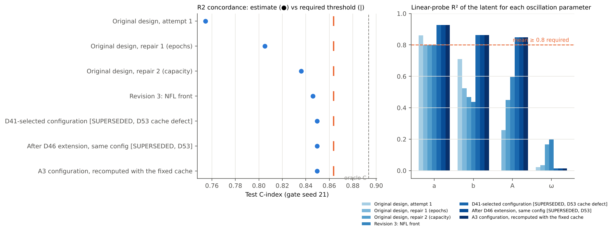
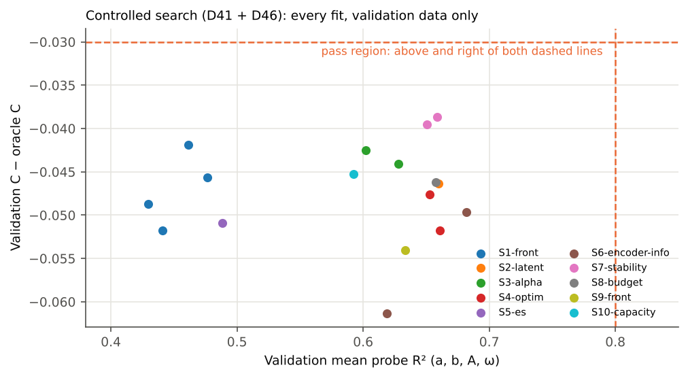
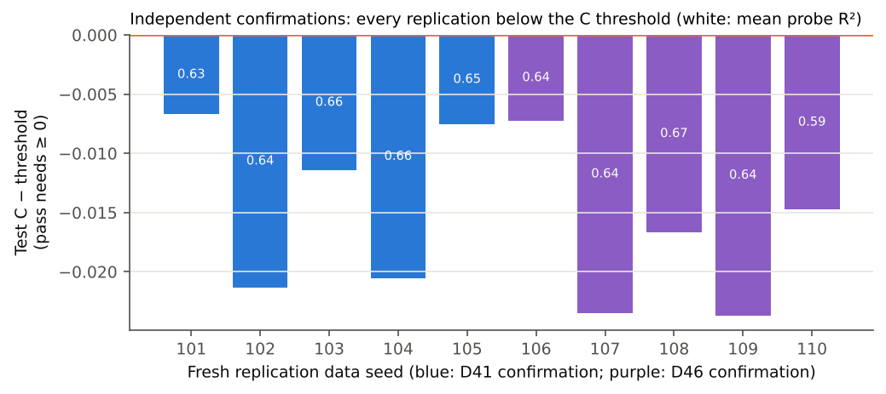
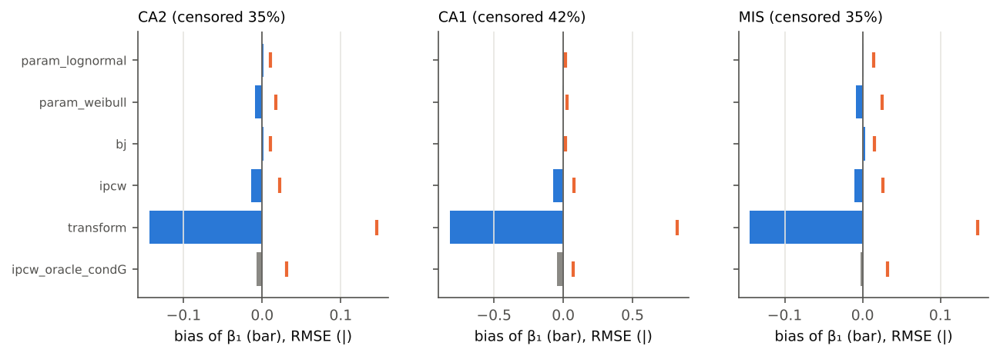
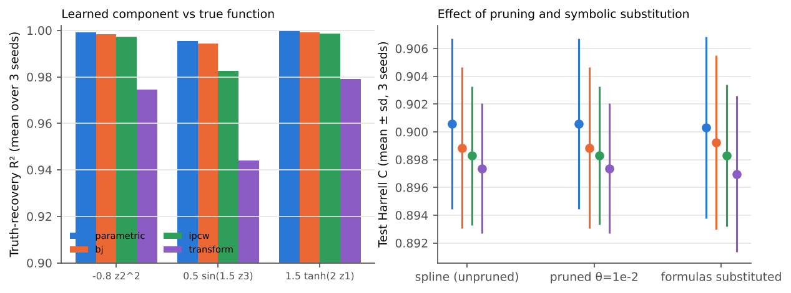
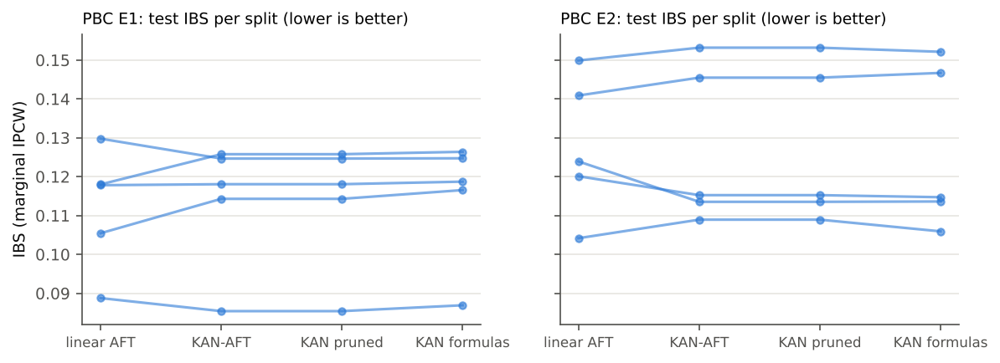

Research prototype report, revision 2 · generated from saved records by
<code>scripts/build_report_round2.py</code> · git <code>{{V:git_head}}</code> (local branch
<code>claude/blissful-faraday-2unozw</code>, <b>not pushed</b>) · status: <b>research prototype, not
publication-ready</b> · <b>no novelty claim</b> (see I.3). Part I covers round 2 (reference-based audit, failure
recovery, symbolic extraction). Part II is the round-1 report, kept as the historical record; where the two
disagree, Part I supersedes it.

## 0. Final summary (plain English)

### 0.1 Learnability gate: the result you asked to see

The gate checks, on simulated data with a known answer, whether the conventional functional autoencoder (MLP
version) learns the risk-relevant information well enough for a KAN-versus-MLP comparison to mean anything.
**Requirement R2:**
- test C-index ≥ oracle − 0.03;
- the latent code must linearly reveal the four hidden curve parameters (a, b, A, ω), with mean probe R² ≥ 0.8.

| | Result |
|---|---|
| Configuration selected by the controlled search (validation data only) | `{{V:selected_id}}`: tensor-spline functional front end, latent size 8, α = 1, Adam 3e-3 |
| Official gate (seed 21), final run | R1 **PASS** (C {{V:gate_R1C}}); **R2 FAIL**: C {{V:gate_C}} vs required {{V:gate_thr}}; probe a / b / A / ω = {{V:gate_probe}}, mean {{V:gate_probe_mean}} vs 0.8; R3 **PASS** (\|ΔC\| {{V:gate_R3dC}}) |
| Fresh replications, D41 (seeds 101–105) | **{{V:d41_pass}} pass** (C − threshold from {{V:d41_gap_min}} to {{V:d41_gap_max}}) |
| Fresh replications, D46 (seeds 106–110) | **{{V:d46_pass}} pass** (C − threshold from {{V:d46_gap_min}} to {{V:d46_gap_max}}) |
| Pre-registered verdict (D46) | **R2 FAILED. Not confirmed. No further extension.** |

**What this means.** Across the design iterations the gap to the required C-index shrank from −0.109 (first
attempt) to −0.014 (final gate run), and three of the four hidden parameters became well decoded (gate probe R²
0.85–0.93). The fourth, the oscillation frequency ω, stayed poorly decoded: probe R² ≤ 0.2 in every configuration
and ≈ 0 for the selected one. The exception was the derivative-energy front end (validation ω probe 0.43), and
that front end lost more elsewhere than it gained. Under the rules fixed before the
search, the KAN-versus-MLP comparison (H1) and everything that depends on it remain **blocked**. We therefore
have **no evidence for or against KAN in the functional autoencoder**.

### 0.2 What we achieved in this round

1. **Reference-based audit.** Every equation is mapped to its file, function and test (I.2). The audit found 3
   missing features (KAN regularisation, pruning, symbolic extraction), 1 mathematical limitation in a reference
   estimator (the transform estimator is biased on the log scale), and, during the round, 1 real code defect (a
   feature-cache defect; fixed, regression-tested, all affected results recomputed). It also found 1 process gap:
   unit tests were not re-run after the D45 change of defaults, so two tests went stale (fixed in D56; the final
   full-suite run is clean apart from R2).
2. **Survival losses.** Buckley–James, IPCW and transform least squares were implemented as separate validated
   variants. Their behaviour under different censoring assumptions was measured (I.4). The Cox partial likelihood
   was not inserted into the AFT model.
3. **Systematic recovery of the R2 failure.** A pre-registered, validation-only controlled search ({{V:n_search_fits}}
   fits) varied the front end, latent size, loss weight, optimiser, early stopping, encoder, training budget,
   derivative energy and capacity. It was followed by independent confirmations on 10 fresh data seeds (I.1).
   **Outcome: an honest FAIL.**
4. **KAN regularisation, pruning and mandatory symbolic extraction** (linear → library → PySR, accepted only at
   validation R² > 0.99), validated on known truth with KAN-AFT. The true shapes (tanh, quadratic, sine) were
   recovered under the parametric, Buckley–James and IPCW losses. {{V:sym_acc}} edge formulas were accepted
   overall. Substituting the formulas changed test C by at most 0.002 (I.5, I.6).
5. **Real-data KAN-AFT on PBC** with formulas ({{V:pbc_acc}} accepted), against a linear AFT on the same inputs:
   no consistent difference (I.7).
6. **Ledger items closed:**
   - interval likelihood (L14);
   - censoring-assumption and misspecification study (L16);
   - C-MAPSS FD003 baselines (L15, partial);
   - targeted literature review (L17).

### 0.3 What improved compared with round 1

| Aspect | Round 1 | Round 2 |
|---|---|---|
| Gate R2 test C (threshold 0.8636) | 0.7545 → 0.8361 (2 repairs) | **{{V:gate_C}}** (best; still FAIL) |
| Probe mean / ω probe | 0.398–0.471 / 0.02–0.17 | **{{V:gate_probe_mean}}** / ≈ 0.01 |
| KAN regularisation / pruning / symbolic extraction | absent | implemented, tested, validated on known truth |
| Censoring-adjusted estimators | absent | BJ, IPCW, transform; assumptions tested (CA-1 vs CA-2) |
| Known code defects | none found | 1 found and fixed (D53), with a regression test; 2 stale tests fixed (D56) |
| Literature basis | none (D27) | targeted review; references cited for each adopted method |
| Interval likelihood, FD003, censoring variants | not run | done |

### 0.4 Objective status (final)

| Objective | Status | Evidence |
|---|---|---|
| Audit: equations → code → tests | **COMPLETED** | I.2 |
| Literature review (targeted) and reference use | **COMPLETED** (no novelty claim) | I.3 |
| Survival-loss variants (BJ / IPCW / transform) | **COMPLETED; tests PASSED** (LS-1..5) | I.4 |
| Censoring-assumption / misspecification study (L16) | **COMPLETED** | I.4 |
| R2 learnability recovery | **COMPLETED as a process; R2 FAILED** (gate + {{V:d41_pass}} + {{V:d46_pass}}) | I.1 |
| KAN regularisation and pruning | **COMPLETED** for KAN-AFT; pruning at θ = 1e-2 removed an edge in 1 of 22 fits (the true null; explained, D54) | I.5 |
| Symbolic extraction (stages 1–3) | **COMPLETED** for KAN-AFT (synthetic and PBC); **BLOCKED** for KAN-FAE (by R2) | I.6 |
| H1 KAN vs MLP, H2 α, H3 functional vs flat, controls, ablations | **BLOCKED** by R2 (D33/D41/D46) | ledger L2–L6 |
| Neural models on C-MAPSS / PBC | **BLOCKED** by R2 | ledger L7 |
| Interval likelihood (L14) | **COMPLETED; tests PASSED** (after a test-reference repair) | I.9 |
| C-MAPSS FD003 (L15) | **COMPLETED** (baselines); FD002/FD004 **NOT RUN** (need condition normalisation) | I.8 |
| PBC endpoint (L12), C-MAPSS landmark design (L13) | **OPEN: owner decisions** | I.15 |
| Test suite (latest outcome per test) | {{V:n_tests_latest}} tests: {{V:latest_passed}} passed, {{V:latest_failed}} failed (R2), {{V:latest_skipped}} skipped (documented N/A) | I.11 |

## I.1 Learnability gate R2: history, controlled search, confirmation

### I.1.1 Gate history (every look at the gate test split)

{{T:gate_history}}

The "SUPERSEDED" rows were computed with the defective feature cache (D53). Their recomputation with the fixed code
(last row) gives identical numbers: the defect did not affect the gate run. The gate data were looked at after each
design iteration; this is disclosed, and it is why fresh replication seeds decide the confirmation.

### I.1.2 Controlled search (validation data only; D41 steps S1–S7, D46 steps S8–S10)

- **Selection rule (fixed in D41 before any fit).** Maximise validation C among configurations whose mean
  validation probe R² ≥ 0.8; if none qualifies, maximise validation C + 0.1 × probe mean. Ties keep the simpler
  configuration. *(Wording corrected 2026-10-18, D73: an earlier version of this sentence said "passing both
  validation criteria", which misdescribed the registered rule; the code always implemented the registered rule.)*
- **Search order.** Greedy, one factor at a time:
  - S1 front end: A0 linear (Wu et al.), A1 pointwise-MLP NFL, A2 energy `∫γx²`, A3 tensor spline `∫F(x(t), t)dt`;
  - S2 latent size;
  - S3 α;
  - S4 optimiser (Adam / AdamW / learning rate);
  - S5 early-stopping target;
  - S6 encoder (linear / MLP / KAN; information only);
  - S7 seeds;
  - S8 epoch budget;
  - S9 derivative-energy front A4;
  - S10 capacity.
- **What the search never used:** the test split, the gate seed's test data and the replication seeds.

{{T:search}}

**Recomputation check (D53).** The original search records, computed before the cache fix, are compared with the
recomputation below. Validation values agree to within ±0.002 (floating-point differences from a different thread
count), and the selection is unchanged.

{{T:search_compare}}

### I.1.3 Independent confirmations (fresh data seeds; held-out test split)

**D41 confirmation (seeds 101–105)**

{{T:confirm_d41}}

**D46 confirmation (seeds 106–110)**

{{T:confirm_d46}}

**Seed 110 and the cache defect.**
- **Original result.** Before the fix, seed 110 gave test C 0.4913 (chance level), although its train and
  validation C were 0.856 and 0.838. That pattern was impossible for a sound model, so it was investigated
  rather than reported as a model failure.
- **Root cause (D53).**
  - `TensorSplineFunctional.features` cached features under the key `(memory address, shape, version)` without
    keeping the input alive.
  - The validation and test splits have the same size, so the test tensor could reuse the freed validation
    tensor's address and receive the validation features.
- **Fix.** The cache now keeps the input tensor and matches only the same object.
- **Regression test F8b** fails on the old code (74% of elements wrong) and passes on the fix.
- **Recomputed seed 110.** Test C 0.8413 (threshold 0.8561): still a FAIL, but now a legitimate one.
- **Everything else affected was recomputed:**
  - the search: same validation values, same selection;
  - the gate: identical result;
  - seeds 101–109: identical.
- **Records.** The superseded records are kept in `reports/superseded_D53/`.

### I.1.4 Interpretation

- **The failure is specific and repeatable.** Every selected-configuration fit decodes a, b and the amplitude A
  reasonably well (probe R² 0.68–0.94; mostly above 0.8), but not the frequency ω (|probe R²| ≤ 0.083), and C
  falls short of the threshold in all 11 evaluations (gate plus 10 replications) by {{V:gap_range}}.
- **The design reason (audit A-PROBE).** ω enters the risk through the oscillation's derivative energy, and a
  latent of size 8 that also has to reconstruct the curves does not linearly expose ω.
- **The direct fix did not pay off.** The derivative-energy front A4 raised the ω probe (validation 0.43) but
  lowered the others and C.
- **Conclusion: no legitimate configuration in the registered search space passed R2.** Changing the threshold,
  the probe definition or the data would invalidate the gate (D11, D39), so this is reported as a failure.

## I.2 Reference-based audit

{{F:docs/audit_report.md}}

## I.3 Literature review and how each reference was used

{{F:docs/literature_review.md}}

### Models, likelihoods and assumptions compared

| Method | Model for the event time | Loss / likelihood | Censoring assumption | What we adopted | What we did not adopt |
|---|---|---|---|---|---|
| **KAN-FAE (this prototype)** | AFT: `log T = η(z) + σε`; z = latent code of a functional autoencoder | Joint: parametric AFT log-likelihood + α × reconstruction | CA-1 (non-informative given the covariates) | – | – |
| Wu et al. 2024 (functional AE) | none (representation learning) | Reconstruction of irregularly sampled curves | – | Functional projection layer, basis decoder, individual-weighted reconstruction (front A0) | – |
| KAN-AFT (2512.20305v2) | AFT with a KAN `η(z)` | Least squares on BJ-imputed, IPCW-weighted or transformed responses | BJ: CA-1 with iid errors; IPCW / transform: CA-2 (marginal G) | Three estimators as separate variants (D42), L_R regularisation, node pruning θ = 1e-2, affine symbolic fitting, PySR | Transform on the log scale (biased, A-TRANSFORM, used only as a documented variant) |
| CoxKAN (btaf413) | Proportional hazards with a KAN log-partial hazard | Cox partial likelihood | CA-1 | Regularisation (Eqs. 5–8), L1 pruning, staged symbolic fitting with R² > 0.99 acceptance | **The Cox partial likelihood (a different model; not mixed into the AFT model)** |
| AESurv (bbae479) | Survival model on autoencoder features (vector omics + clinical) | Autoencoder reconstruction, then survival model | Standard right censoring | The idea of a jointly informative latent | Vector inputs, two-stage training |
| SAVAE (s41598-024-76047-z) | VAE with parametric time-to-event distributions | ELBO with a censored parametric likelihood | CA-1 | Parametric censored likelihood in an autoencoder objective (closest in spirit) | Variational (probabilistic) latent; vector inputs |

## I.4 Survival losses: parametric likelihood vs censoring-adjusted least squares

- **Estimator validation (all passed; details in I.11).**
  - LS-1: no censoring reduces every estimator to OLS.
  - LS-2: the KM and Buckley–James conditional means match a brute-force reference.
  - LS-3: the transform integral and non-negativity.
  - LS-4: slope recovery.
  - LS-5: unbiasedness of T* on the time scale.

**Censoring-assumption and misspecification study (L16, D50).**
- **Model:** `log T = 1 + 0.8x₁ − 0.5x₂ + ε`; n = 2000; 20 replicates per scenario.
- **Scenarios:**
  - CA2: censoring independent of everything;
  - CA1: censoring depends on x₁ (still independent of T given x);
  - MIS: skewed mixture errors.
- **Reading the results:**
  - **Only the parametric log-normal likelihood (correct family) and Buckley–James are close to unbiased in all
    three scenarios.**
  - Marginal-KM IPCW is biased once censoring depends on covariates, as theory predicts (it needs CA-2).
  - The transform estimator is biased on the log scale in every scenario (A-TRANSFORM).
  - The Weibull likelihood is mildly biased, being the wrong family here.
  - IPCW with the *true* conditional censoring distribution, an oracle reference only, still shows bias under CA1,
    because some subjects have censoring weights that are very large (practical positivity).

{{T:censoring}}

**KAN-AFT under the four losses (synthetic known truth; 3 seeds; 30% censoring; true null covariate z₄).**

{{T:kanaft_summary}}

**Consequence for KAN-FAE.** The parametric likelihood stays the loss for the functional autoencoders:
- it is the only one that is a fixed, differentiable per-individual loss that can be summed with the
  reconstruction loss;
- it is valid under CA-1;
- it gives survival curves directly.

Buckley–James is the robust alternative when the error family is in doubt, but it needs an outer
impute-and-refit loop.

## I.5 KAN regularisation and pruning (before/after)

- **Regularisation:** `λ(|Φ|₁ + λ_ent S(Φ) + λ_coef |C|₁)`, as in CoxKAN Eqs. 5–8 and KAN-AFT L_R, with λ chosen
  on validation data from {0, 1e-3, 1e-2}.
- **Pruning:** edge L1 < θ = 1e-2, plus node pruning `min(I, O) < θ` for deeper KANs (KAN-AFT).
- **Before/after metrics** are in the table above (spline → pruned → formulas) and in I.7 for PBC.
- **Only 1 of 22 fits pruned an edge** (synthetic seed 203, IPCW, λ = 1e-2: it removed exactly the true null
  edge z₄). In the other 21, "pruned" equals "unpruned".

The diagnostic below (D54, registered before running; not used for selection) explains why:
- the reference score mean |φ| includes each edge's constant offset, which is not identifiable in an additive
  model, so the null edge can score *higher* than a true edge;
- the offset-free (centred) score separates the null edge cleanly, but its value (~0.03) is above θ = 1e-2 unless
  λ ≥ 0.1, which validation did not select.

θ was not changed.

{{T:pruning_diag}}

## I.6 Symbolic formula extraction

- **Procedure (mandatory, staged).**
  - Stage 1: linear `a·x + b`.
  - Stage 2: a library of 15 functions in the affine form `c·f(a·x + b) + d`, fitted by grid search plus
    Levenberg–Marquardt, each with a domain check.
  - Stage 3: PySR 2.7.0.
- **Acceptance.** A formula is accepted only if its R² on held-out points (30% of the edge's training inputs,
  never used for fitting) exceeds 0.99, following CoxKAN.
- **Rejection.** A rejected edge keeps its learned spline, so nothing is fabricated.
- **Effect of substitution.** This is evaluated separately (test C, IBS and curve error in the I.4 table).
- **Inputs.** x is the standardised covariate.
- **Truth R²** compares the learned edge with the true component on z ∈ [−2, 2] (synthetic only).

{{T:kanaft_formulas}}

**PBC (real data): accepted formulas and their stability across the 5 splits.**
- An accepted formula means that the *fitted spline* is well described by that formula on that split.
- The family chosen for the same covariate changes between splits.
- So the formulas describe shapes and are not stable laws. The full per-split table is in Appendix A.

{{T:pbc_formula_stability}}

## I.7 KAN-AFT on PBC (real, right-censored; 730-day landmark; E1 and E2 as sensitivity analyses)

- **Inputs:** the last value of 6 longitudinal markers before the landmark, plus age and sex.
- **Comparator:** a linear Weibull AFT on the same inputs.
- **Tuning:** both models tuned on validation IBS only.

{{T:pbc_kan}}

{{T:pbc_kan_paired}}

**Reading.**
- With 5 splits and 22 (E1) or 27 (E2) test events per split, the KAN-AFT and linear AFT cannot be told apart. The
  sign of the difference varies between splits.
- No superiority is claimed in either direction.
- The round-1 baselines (Part II, §II.10.4) used different (summary) features, so they are not a like-for-like
  comparison.

## I.8 C-MAPSS FD003 (real simulated turbofan data; RUL benchmark; baselines; D51)

- **FD003** has one operating condition and two fault modes. It was run with the unchanged FD001 pipeline: 5 splits,
  the same models and tuning.
- **FD002/FD004** were not run. They need operating-condition normalisation, which is a new, untested
  preprocessing design.

**Option A (single landmark)**

{{T:fd003_A}}

**Option B (trailing windows; official-test RUL)**

{{T:fd003_B}}

**Option A with artificial censoring (code-path test only)**

{{T:fd003_A_art}}

Summary + AFT diverged in all 15 of its records under artificial censoring (recorded with status "diverged"), as it
did on FD001 (Part II, §II.10.3.3), so it has no row above. Every failed and diverged record is kept in
`reports/experiment_results.csv`.

## I.9 Interval (integer-cycle) likelihood (L14)

`aft_interval_log_likelihood` gives:
- events: `log[S(y − 1) − S(y)]`;
- censored observations: `log S(y)`;

computed in a stable log-difference form.

Tests:
- **INT-1** compares it with a 200-digit mpmath reference. It failed once because the original float64 scipy
  reference lost up to 7 digits to cancellation; that was a defect in the test reference, not in the code (D48).
  The tolerance was kept.
- **INT-2** checks that a narrow interval approaches the density.
- **INT-3** checks gradients and extreme values.

The likelihood is implemented and tested, but not yet used in an experiment.

## I.10 Correctness and validity, kept separate

| Kind | Question | Evidence | Status |
|---|---|---|---|
| Implementation correctness | Does the code compute the stated equations? | Deterministic tests against independent references (scipy, mpmath, lifelines, sksurv, brute force) | PASSED, except for the defects listed. Defects found: 1 (D53, fixed); 1 in a test reference (D48, fixed) |
| Estimator validity | Do the estimators estimate what they claim, under which assumptions? | STAT tests LS-4/5; the L16 study | Parametric (correct family) and BJ: valid. IPCW needs CA-2. Transform biased on the log scale |
| Learnability (design adequacy) | Can the conventional functional AE learn the known signal? | Gate R1–R3; fresh-seed confirmations | **R2 FAILED** |
| Predictive performance | Which model predicts better on real data? | IBS, Uno C over splits | Descriptive only; no consistent differences |
| Interpretability fidelity | Do the formulas faithfully describe the learned functions? | Validation R² > 0.99, max error, substitution effects; truth recovery on synthetic data | Faithful when accepted. Real-data formula identity not stable |
| Scientific claims | Is KAN better than MLP for functional survival? | H1 | **Not tested (blocked)**; no claim made |
| Novelty | Is the method new? | Targeted review | **No claim made** |

## I.11 Test history

Every pytest attempt is appended to `reports/logs/test_records.jsonl` and compiled to `reports/test_results.csv`
({{V:n_test_records}} records over {{V:n_test_runs}} runs). Failures are kept.

**Round-2 criteria (latest outcome and full attempt counts)**

{{T:round2_tests}}

**All test runs, in chronological order**

{{T:test_runs}}

## I.12 Task ledger (every failed, blocked or unrun item)

{{F:docs/task_ledger.md}}

## I.13 Decision log, round 2 (D38–D54)

{{T:decisions_r2}}

## I.14 Reproducibility

{{F:docs/reproducibility.md}}

## I.15 Limitations and decisions requested from the owner

- **R2 failed under the pre-registered protocol (D46: no further extension), so KAN-FAE is not ready for H1.**
  Legitimate next steps need your decision, because each changes the scientific question:
  - **(a)** Change the simulator's risk so that it does not hinge on a frequency that a reconstruction-driven
    latent cannot expose linearly. This changes the gate's question and needs a new pre-registration.
  - **(b)** Give the probe criterion a nonlinear decoder. This changes R2's definition; it is not done here,
    because D11 forbids relaxing it automatically.
  - **(c)** Adopt a front end with explicit spectral features, such as a learned Fourier/derivative energy at
    several scales, as a new design revision with a fresh gate.
  - **(d)** Proceed to H1 with the failure disclosed. This is not recommended: a KAN-vs-MLP comparison is
    uninformative when both arms fail to learn the signal.
- **PBC endpoint (E1 vs E2 vs competing risks) and C-MAPSS landmark design (A vs B)** are still your decisions.
- **Reference copies.** The uploaded reference PDFs were not available in the session, so the public arXiv
  versions were used. They may differ from the uploaded copies.
- **Pruning.** The pruning threshold θ = 1e-2 from the references did not remove a true null covariate at the
  validation-selected λ (D54). A centred score would, but it is not adopted without your decision.
- **Formula stability.** Real-data formulas are shape descriptions, not stable laws (I.6).
- **Statistical power.** With 5 splits on PBC, small differences cannot be detected.

## Appendix A: PBC symbolic fits, all edges and splits

{{T:pbc_formulas}}

# Part II: round-1 report (2026-10-16), historical record

The text below is the round-1 report, regenerated from the same records. Its gate and baseline sections are
unchanged history. Its "unfinished work" items are now tracked in the ledger (I.12), and its R2 conclusion is
superseded by I.1.
