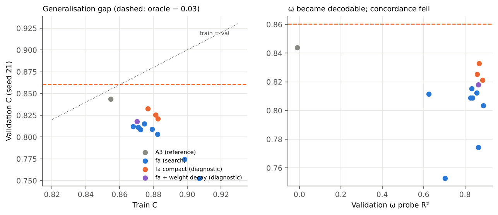
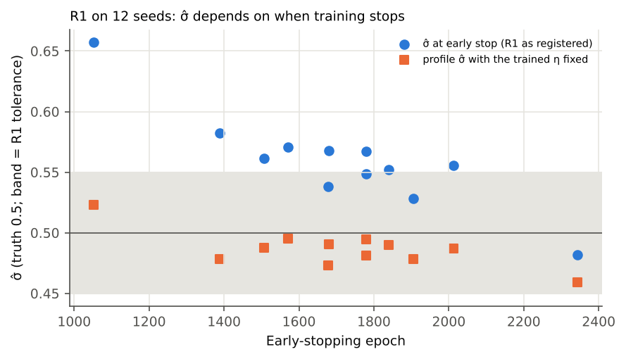

Research prototype report, revision 3 · generated from saved records by
<code>scripts/build_report_round3.py</code> · git <code>{{V:git_head}}</code> (local branch
<code>claude/blissful-faraday-2unozw</code>, <b>not pushed</b>) · status: <b>research prototype, not
publication-ready</b> · <b>no novelty claim</b>. Part A is round 3 (owner decisions D57–D59, frequency-aware
representation, revised gate). Parts B and C are the round-2 and round-1 reports, kept as historical records;
where they disagree, Part A supersedes them.

## 0. Round-3 summary (plain English)

### 0.1 The revised learnability gate

| | Result |
|---|---|
| New design (pre-registered, D61) | Frequency-aware functional front ("fa"): phase-invariant least-squares spectrum + derivative energies + soft frequency, on top of the A3 front |
| Selected by the validation-only search | `{{V:r4_sel_id}}` |
| Revised gate on **fresh** data (seed 41) | R2: C **{{V:r4_C}}** vs required {{V:r4_thr}}; probe mean {{V:r4_probe_mean}} (ω probe **{{V:r4_omega}}**). See R3.3 for R1 and R3 |
| Fresh confirmations (seeds 111–115) | **{{V:r4_conf}} pass** |
| Pre-registered verdict | **{{V:verdict}}.** The KAN-vs-MLP comparison and everything downstream stay blocked (enforced in code) |

**What we learned.**

1. **The new representation fixed the specific defect it was designed for.** The oscillation frequency ω, never
   decodable before (probe ≈ 0), is now decodable on every fresh seed (0.83–0.90). Phase explains only 0.2–1% of
   the frequency estimate's error (tests FQ-2, FQ-9).
2. **It created a new problem: overfitting.** The spectral block adds 114–408 inputs. Training C rises
   (0.87–0.91) while validation and test C fall to 0.80–0.83. A3's train–validation gap was 0.011; the new front's
   is 0.06–0.15.
3. **The diagnostic (validation only) found a partial fix.**
   - A compact phase-invariant summary (15 features) is the first configuration in the whole project to meet
     the probe criterion on validation (0.82, with ω 0.88).
   - Concordance still stays about 0.035 below what R2 requires.
   - That variant is a new design (revision 4b). It has **not** been gate-tested, because it needs your approval
     and its own pre-registration.
4. **The gate's own R1 check is not robust.**
   - R1 uses the *true* parameters as features. Its σ criterion fails on 8 of 12 seeds (only 4 pass).
   - The cause is that σ has not converged when early stopping fires (R3.4).
   - The original gate's R1 pass on seed 21 was a favourable draw.
   - No threshold was changed. This needs your decision (R3.9).

### 0.2 Owner decisions applied (D57–D59)

| Decision | Applied as | Section |
|---|---|---|
| R2 recovery by option (c): a frequency-aware representation with a fresh gate | Pre-registered design, search, fresh gate (seed 41) and confirmation seeds 111–115; old results kept | R3.1–R3.4 |
| PBC: E2 provisional primary, E1 sensitivity | E2 reported first and labelled *provisional primary*; E1 as sensitivity; interpretation and censoring assumptions stated; E3 future work | R3.5 |
| C-MAPSS: Option B primary, Option A secondary | Option B reported first with engine-cluster bootstrap CIs, engine-weighted RMSE and per-landmark-band metrics; RUL kept separate from right-censored evaluation | R3.6 |

### 0.3 Status of round-3 objectives

| Objective | Status |
|---|---|
| Frequency-aware representation: mathematical definition and numerical tests | **COMPLETED**; FQ-1..FQ-10 PASS (repairs disclosed, D63) |
| Pre-registration before the gate | **COMPLETED** (commit before any search fit) |
| Validation-only search; revised gate on fresh seed; fresh confirmations | **COMPLETED; R2 FAILED** ({{V:verdict}}) |
| Diagnosis of the failure | **COMPLETED**: overfitting (D65), R1 seed sensitivity (D66) |
| Matched MLP/KAN comparison (H1), reconstruction controls (H2), flattened AE (H3), ablations | **BLOCKED**: the conventional MLP has not passed the revised gate (owner rule, D57) |
| Symbolic extraction for KAN-FAE (R² > 0.99) | **BLOCKED** (it requires a model that passed its gate) |
| PBC endpoint reorganisation (E2 primary) | **COMPLETED** (reporting); clinical endpoint **provisional** pending the professor's confirmation |
| C-MAPSS Option B primary with within-engine correlation | **COMPLETED** (FD001, FD003; v3 re-run) |
| Full test suite after the changes | {{V:n_tests_latest}} tests: {{V:latest_passed}} passed, {{V:latest_failed}} failed, {{V:latest_xfailed}} expected failure (historical A3 gate, D64), {{V:latest_skipped}} skipped |

## R3.1 Motivation and diagnostic (before the design was fixed)

The revision-4 design was **motivated by the earlier failures**. In rounds 1–2, every front end (A0–A4) failed R2,
and ω was never linearly decodable. A diagnostic on the seed-21 **training split only** (D60) asked whether ω is
recoverable from the curves the models actually see, and with which features.

{{T:diag_freq}}

**Reading.**
- ω survives the 12-basis smoothing.
- Fourier power and derivative energy recover ω only partly, because with at most two cycles their values depend
  on the unknown phase (19–23% of the estimate's error on the smoothed curves).
- The quadrature-pair projection spectrum is essentially phase-free (0.5%).

## R3.2 The frequency-aware representation (definition and tests)

The full definition is in `docs/design.md` §3.2c. In brief, for each smoothed channel `x_d(t)`:

- **Projection spectrum.** `R_d(f) = (‖P_{1,t,sin 2πft,cos 2πft} x_d‖² − ‖P_{1,t} x_d‖²) / ‖x_d − P_{1,t} x_d‖²` on 17
  or 33 log-spaced frequencies in [0.25, 4]. It is exact up to quadrature, computed as fixed quadratic forms
  `cᵀ M_f c` of the spline coefficients.
- **Log gap.** `L = −log(1 − R + 10⁻⁴)`, which separates the exact peak R = 1 from the low-frequency plateau that a
  ≤ 2-cycle window produces.
- **Derivative energies.** log ∫(x − trend)², log ∫x′², log ∫x″².
- **Soft frequency.** `f̂_d = Σ_j f_j softmax(κ_d L_d(f_j))`.

These are standardised with training statistics, mapped linearly and added to the A3 front. With the spectral
weights at zero, the front equals A3 exactly (FQ-6).

{{T:fq_tests}}

## R3.3 Pre-registered search, revised gate and confirmation

**Search** (seed-21 train/validation only; the selection was restricted to "fa" variants; A3 was a reference only).

{{T:r4_search}}

**Revised gate.** Seed 41 is genuinely fresh: it was never generated before. The test code and thresholds are
those of the original gate, unchanged.

{{T:r4_gate}}

**Fresh confirmations (seeds 111–115).**

{{T:r4_confirm}}

**All gate looks so far.**

{{T:gate_overview}}

## R3.4 Diagnosis of the failure

**(a) Overfitting of the spectral block (D65; seed-21 train/validation only; not a selection and not a gate).**

{{T:diag_fa}}

**Reading.**
- Every "fa" variant fits the training data better than A3 but validates worse.
- Shrinking the spectral block to a 15-feature compact summary narrows the gap.
  - With r = 12 it meets the probe criterion on validation (mean 0.820; ω 0.88).
  - Its validation C (0.82–0.83) remains about 0.035 below oracle − 0.03.
- Global weight decay does not help.
- The KAN encoder overfits more than the MLP in every variant. This is information only; H1 is not tested.
- **Conclusion: on validation, the remaining obstacle to R2 is concordance (generalisation of the survival part),
  not the frequency information.**

**(b) R1 seed sensitivity (D66).**

 This is the identical R1 procedure (true parameters as inputs; the representation
is not involved) run on 12 seeds.

{{T:diag_r1}}

**Reading.**
- The C criterion passes on every seed.
- The σ criterion fails on most seeds, and σ̂ falls as the stopping epoch rises.
- The profile MLE of σ, with the learned η held fixed, separates two explanations:
  - non-convergence at the early-stopping epoch;
  - a genuine misfit.
- The σ̂ at early stopping correlates −0.91 with the stopping epoch, while the profile σ̂ lies within ±0.05 of the
  truth on **12 of 12 seeds** (mean 0.487).
- **The likelihood and the oracle head are sound. The registered σ check fails because σ, initialised at 0.69, has
  not converged when early stopping on the validation NLL fires.** The R1 threshold was not changed.

## R3.5 PBC: E2 provisional primary endpoint, E1 sensitivity (D58)

**E2: death or transplantation (transplant-free survival). Provisional primary endpoint.**
- *Interpretation:* time until the native liver fails (death or need for transplantation).
- *Censoring:* alive without transplant at last follow-up, assumed non-informative given the landmark covariates
  (CA-1).
- Transplantation is part of the event, so no assumption about transplant selection is needed.
- **Not claimed as a definitive clinical endpoint until confirmed with the owner's professor.**

{{T:pbc_E2}}

KAN-AFT vs linear AFT on the same 8 inputs, per split:

{{T:pbc_kan_E2}}

**E1: death with transplant censored (sensitivity analysis).**
- *Interpretation:* hypothetical survival had transplantation not been available.
- *Requires:* CA-1 for transplant, i.e. transplant unrelated to prognosis given the covariates. This is clinically
  doubtful, because patients are selected by severity.

{{T:pbc_E1}}

{{T:pbc_kan_E1}}

**Paired KAN-AFT − linear AFT differences (both endpoints).**

{{T:pbc_kan_paired}}

**E3 (competing risks: death vs transplant)** remains future work. A properly specified cause-specific or
Fine–Gray analysis would be needed first.

## R3.6 C-MAPSS: Option B primary RUL benchmark, Option A secondary (D59, D62)

**Option B (trailing 30-cycle windows every 10 cycles; landmark s as a covariate). Primary.**
- *Evaluation:* the internal test engines, plus the official test set (last window per engine).
- *Within-engine correlation:* windows from the same engine are correlated, so uncertainty comes from an
  **engine-cluster bootstrap** (test engines resampled with replacement, 1000 resamples), and the engine-weighted
  RMSE gives each engine equal weight.
- *Framing:* C-MAPSS has no genuine right censoring. These are RUL-benchmark metrics, separate from the
  right-censored evaluation on PBC.

**FD001**

{{T:cm_B_FD001}}

Per split, with engine-cluster 95% CIs:

{{T:cm_cluster_FD001}}

By landmark band (mean over splits, the range over splits, and the mean engine-cluster CI width):

{{T:cm_bands_FD001}}

**FD003** (single operating condition, two fault modes)

{{T:cm_B_FD003}}

{{T:cm_cluster_FD003}}

{{T:cm_bands_FD003}}

**Option A (single landmark; secondary)** for FD001. FD003 Option A is in Part B, §R2.8.

{{T:cm_A_FD001}}

## R3.7 Decisions in round 3 (D57–D66)

{{T:decisions_r3}}

## R3.8 Tests

All test records: `reports/test_results.csv` ({{V:n_test_records}} records over {{V:n_test_runs}} runs).
- The historical seed-21 gate (A3 design) is kept, pinned to its configuration.
- Its R2 is recorded as an **expected failure** (strict xfail, D64): it still runs, and it would be flagged if it
  ever passed.

{{T:round_tests}}

**All test runs, in chronological order**

{{T:test_runs}}

## R3.9 Unresolved items and decisions requested

1. **Whether to proceed with revision 4b.** This would be the compact phase-invariant summary (validation: probe
   criterion met; C about 0.035 short), plus a targeted fix for the survival-part generalisation gap. If you
   approve, it gets its own pre-registration, a fresh gate seed and fresh confirmation seeds. Otherwise R2 stays
   failed and H1 stays blocked.
2. **R1's σ criterion.** It fails on most seeds because σ has not converged at the early-stopping epoch, not
   because of the representation. Options:
   - keep it unchanged;
   - approve a protocol amendment (for example, judge σ by its profile MLE given the trained head, or train R1's
     head without early stopping).

   I have not changed it.
3. **PBC endpoint.** E2 is provisional until your professor confirms it.
4. **Still not run:** C-MAPSS FD002/FD004 (need operating-condition normalisation) and E3 (competing risks).

## R3.10 Task ledger

{{F:docs/task_ledger.md}}

## R3.11 Reproducibility

{{F:docs/reproducibility.md}}

# Part B and Part C: historical records

Part B is the round-2 report, and Part C, nested at its end, is the round-1 report. Both are regenerated from the
same records, with their sections renumbered R2.x and R1.x. Their conclusions on R2 are superseded by Part A; their
tables and numbers are unchanged history. Test counts quoted in their summaries are those of each round's own final
full-suite run. Embedded living documents (audit, ledger, decision rows, reproducibility) show their current version.
