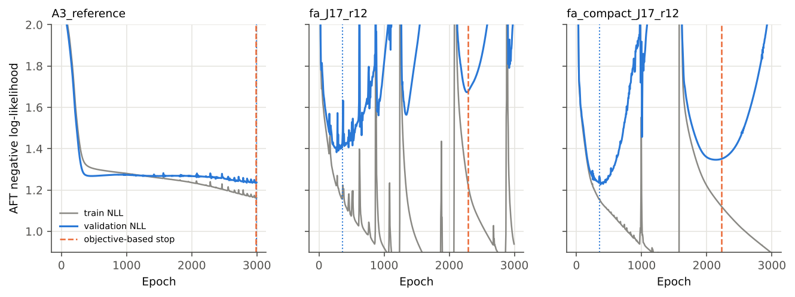
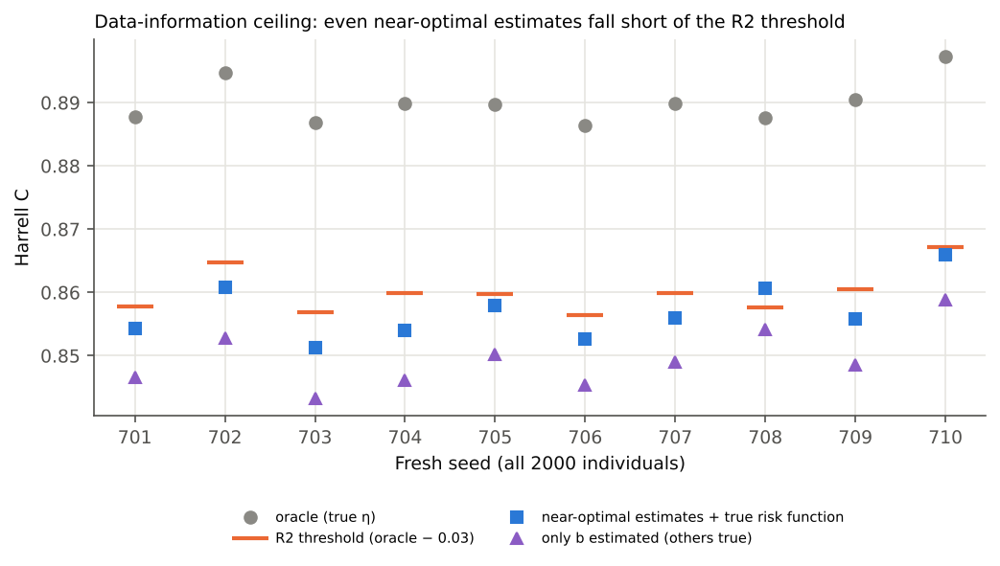

Research prototype report, revision 4 · generated from saved records by
<code>scripts/build_report_round4.py</code> · git <code>{{V:git_head}}</code> (local branch
<code>claude/blissful-faraday-2unozw</code>, <b>not pushed</b>) · status: <b>research prototype, not
publication-ready; no successful KAN-FAE model; no novelty claim</b>. Part A is round 4 (owner decisions D67–D69).
Parts B–D are the round-3, round-2 and round-1 reports, kept unchanged as historical records.

## 0. Round-4 summary (plain English)

### 0.1 Revision 4b and the revised gate

| | Result |
|---|---|
| Design (pre-registered, D71) | Compact frequency-aware front (15 phase-invariant spectral features) + survival-path regularisation |
| Selected (validation only, seed 21) | `{{V:sel_id}}`: head-specific weight decay 1e-2 |
| Revised gate, fresh seed 61 | R2: C **{{V:C}}** vs required {{V:thr}}; probe mean {{V:probe}} (ω {{V:omega}}) |
| Fresh confirmations, seeds 121–125 | **{{V:conf}} pass** |
| Pre-registered verdict | **{{V:verdict}}.** KAN vs MLP (H1) and all downstream experiments stay blocked (code guard verified) |

### 0.2 Why it failed, and the most important finding of this round

1. **The overfitting diagnosis was right, but the fixes are not enough.**
   - With the spectral features, the survival part overfits after about 360 epochs, while the reconstruction part
     keeps improving until about 2250 epochs.
   - The latent itself generalises.
   - Survival-path regularisation selected by the registered rule raised validation C only modestly (0.825 → 0.834).
2. **The latent does not contain enough risk information** (D74).
   - Replacing the linear head by an MLP head does not help.
   - The *true* risk formula applied to the parameters decodable from the latent does not help either.
3. **The R2 concordance criterion sits at the information limit of the data** (D75). This is the key finding.
   - Near-optimal estimates of the curve parameters from the raw observations, combined with the **true** risk
     formula, fall below oracle − 0.03 on **{{V:ceiling_below}} of 10** never-used seeds.
   - The limiting parameter is b, the slope of x₁, which the Gaussian-process noise blurs. Estimating b alone costs
     about 0.04 in C.
   - A learned model that does not know the risk formula cannot be expected to pass R2 reliably, whatever its
     architecture.
4. **The frequency-aware variants also train unstably**: repeated loss spikes, which A3 does not show (D77).

### 0.3 R1 amendment (owner decision D68): two different procedures, reported side by side

The original R1 (early-stopped σ̂) failed on fresh seeds 601–610 and on gate seed 61. **It is not relabelled.**
The amended R1-A uses the profile σ̂ on training data with the trained η held fixed, with the same tolerance. R1-A
passed on all 10 fresh seeds and on seed 61. The original check measures *optimisation convergence*; R1-A measures
*parameter recovery* (R4.4).

### 0.4 Recommended next scientific step (owner decision required; nothing has been run)

**Re-reference R2's concordance criterion before any further architecture work.**
- *Why:* the current reference, the true-η oracle, is not attainable from these observations.
- *How:* a prospective, owner-approved amendment would compare C with a **data-attainable reference**, for example
  the well-specified parametric estimator above evaluated on the same test split (C ≥ C_ref − margin).
- *Alternative:* keep the oracle reference but change the simulator (less Gaussian-process noise on x₁), which
  changes the data-generating process.
- *Either way*, the amended gate must be evaluated on new fresh seeds. The revision-4b results are **not**
  re-evaluated post hoc under a new reference.
- *Second, independent step:* a training-stability study (learning rate, gradient clipping, feature scaling) for
  the frequency-aware front.

### 0.5 Evidence, kept separate by kind

| Kind of evidence | Status |
|---|---|
| **Software correctness (tests)** | {{V:n_tests}} tests in the final suite: {{V:passed}} passed, {{V:failed}} failed (the current 4b gate's original R1 and R2: live, real failures), {{V:xfailed}} expected failures (historical A3 and revision-4 gates, strict), {{V:skipped}} skipped (documented N/A). The new tests HR-1..HR-3 passed on their first attempt; no test or threshold was changed to obtain a pass |
| **Learnability (gate)** | **Not achieved.** Every design so far fails R2 (R4.3). The concordance criterion appears unattainable from these data (R4.5) |
| **Survival prediction (real data)** | Descriptive only. On PBC (E2 provisional primary, E1 sensitivity), validated baselines beat the no-information reference; KAN-AFT and linear AFT cannot be told apart. C-MAPSS Option B with engine-cluster CIs (Part B, §R3.6) |
| **Symbolic approximation** | Validated **only for KAN-AFT** (synthetic known truth; PBC shape descriptions, not stable laws; Part C, §R2.6). **Not performed for KAN-FAE**, which has not passed its gate |
| **Scientific novelty** | **No claim.** A targeted (not systematic) review found closely related prior work (Part C, §R2.3) |
| **Publication readiness** | **No.** No successful KAN-FAE model, and the primary hypothesis H1 is untested |

## R4.1 Overfitting diagnosis (train/validation curves; latent and feature diagnostics)

{{T:curves}}

**Reading.**
- For A3, the survival and reconstruction parts reach their best validation values together.
- For the frequency-aware variants, they do not. The validation NLL is lowest near epoch 360 and then rises, while
  early stopping on the joint objective waits until about epoch 2250.
- The latent probes are nearly equal in-sample and on validation, so the representation generalises; the
  survival mapping overfits.
- The spectral path dominates the front's output.
- The curves also show repeated training-loss spikes in the frequency-aware variants (D77).

## R4.2 Revision 4b: definition and tests

- **Front.** The compact frequency-aware summary: per channel, the soft frequency f̂, the peak log gap, and the
  derivative energies e₀, e₁, e₂ (15 features; design §3.2c; FQ-10).
- **Survival-path options:**
  - `head_dropout`: dropout between the latent and the AFT head only (the decoder sees the undropped latent);
  - `head_wd`: L2 on the head weights only.
- Both default to off, which reproduces the earlier behaviour exactly (HR-1).

{{T:hr_tests}}

## R4.3 Pre-registered search, revised gate and confirmations

**Search** (seed-21 train/validation only; one factor at a time; the D41 rule: the best validation C among
configurations whose validation probe ≥ 0.8, otherwise C + 0.1 × probe).
- Note the first step: NLL early stopping gave the highest validation C (0.847) but a probe of 0.794 < 0.8, so the
  registered rule kept objective early stopping.
- The round-2 report had misdescribed this rule; it is now corrected with a dated note (D73).

{{T:r4b_search}}

**Revised gate (fresh seed 61).**

{{T:r4b_gate}}

**Fresh confirmations (seeds 121–125).**

{{T:r4b_confirm}}

**All gate looks so far.**

{{T:gate_overview}}

## R4.4 R1 amendment: original and amended procedures side by side (D68, D72)

These are **two different evaluation procedures**:
- the original check judges σ at the early-stopping epoch;
- R1-A judges the profile maximum-likelihood σ̂ on the **training data only**, with the trained η held fixed.

The tolerance (±0.05) is unchanged. The original registered check is **not** claimed to have passed anywhere it
failed. Seeds 21, 41 and 501–510 (D66) are earlier, separate results (Part B, §R3.4).

{{T:r1a_side}}

On gate seed 61: original R1 FAIL (σ̂ 0.581); R1-A PASS (profile σ̂ 0.492).

## R4.5 Why Revision 4b failed: information ceilings

**(a) The frozen latent's ceiling** (D74; seed-21 validation).

{{T:latent_ceiling}}

**(b) The data's ceiling** (D75): the true risk formula applied to the best available parameter estimates.

{{T:data_ceiling}}

**(c) The data's ceiling on 10 never-used seeds**: parametric estimates, all 2000 individuals per seed, no fitting
across individuals.

{{T:data_ceiling_seeds}}

**Conclusion.**
- The oracle in R2 uses the *true* η. These observations (8–40 noisy samples per curve, with Gaussian-process
  perturbation of x₁) do not identify the slope b well enough to reach oracle − 0.03.
- Even the near-optimal estimator that knows the risk formula falls short on most seeds.
- **R2's concordance criterion, as registered, is not a reachable target for a learned representation of these
  data.** This is not a property of KAN or MLP.

## R4.6 Recommendation

1. **(Owner decision) Amend R2's concordance reference prospectively** to a data-attainable benchmark computed on
   the same test split, or change the simulator's noise. Pre-register, and evaluate on new fresh seeds. The old
   results stay as they are.
2. **(Owner decision) A training-stability study** for the frequency-aware front (learning rate, gradient
   clipping, feature scaling) before any further gate look.
3. **Only after the conventional MLP passes an attainable, pre-registered gate:** run H1 (matched KAN vs MLP), H2,
   H3, the controls, and KAN-FAE pruning and symbolic extraction, as already specified. The guard remains in
   place.

## R4.7 PBC endpoint (D69): provisional

{{F:docs/pbc_endpoint_justification.md}}

**E2 (provisional primary)**

{{T:pbc_E2}}

**E1 (sensitivity)**

{{T:pbc_E1}}

## R4.8 Decisions in round 4 (D67–D78)

{{T:decisions_r4}}

## R4.9 Tests

{{T:suite_table}}

All test runs in chronological order. Every failure is kept; `reports/test_results.csv` has every record.

{{T:test_runs}}

## R4.10 Task ledger

{{F:docs/task_ledger.md}}

## R4.11 Reproducibility

{{F:docs/reproducibility.md}}

# Parts B–D: historical records

Part B (round 3), Part C (round 2) and Part D (round 1) are regenerated from the same records, with their sections
numbered R3.x, R2.x and R1.x. Their numbers are unchanged history; their conclusions on R2 are superseded by Part A.
Test counts quoted in their summaries are those of each round's own final suite run. Embedded living documents
(audit, ledger, decision rows, reproducibility) show their current version.
