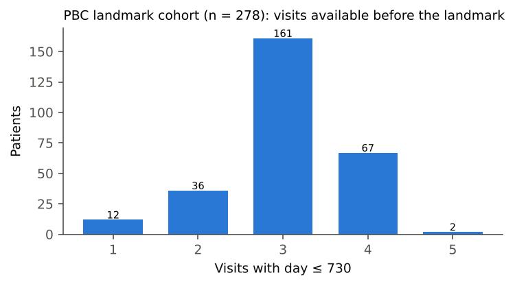

## 2. Research objective and hypotheses

**Narrow research question.** Does a KAN-based functional representation improve survival prediction from
multivariate time-varying trajectories over parameter-matched conventional baselines?

Hypotheses were fixed in `docs/design.md` §8.3 and `docs/experiment_protocol.md` §6 **before** any experiment
ran (decision D24):

| ID | Status | Hypothesis | Outcome in this prototype |
|---|---|---|---|
| H1 (primary) | pre-registered | On synthetic setting P0, the KAN functional autoencoder + AFT has lower survival-curve error than the parameter-matched functional MLP autoencoder + AFT (paired over 5 replicates). | **Not tested.** Blocked by the failed learnability gate (§7.3, D33). |
| H2 (secondary) | pre-registered | A reconstruction term (α > 0) reduces survival-curve error vs survival-only training (α = 0). | **Not tested** (blocked, D33). |
| H3 (secondary) | pre-registered | Functional encoders outperform the flattened autoencoder under sparse sampling. | **Not tested** (blocked, D33). |
| Gate R1–R3 | pre-specified engineering checks | The pipeline can learn a known relationship under controlled conditions. | R1 PASS, **R2 FAIL**, R3 PASS. |

The project makes **no novelty claim**. No literature review was performed (D27).

## 3. Files and modules created or modified

The existing `README.md` was not modified (D28). Everything else was created in this session.

| Path | Purpose |
|---|---|
| `docs/design.md`, `docs/experiment_protocol.md`, `docs/decisions.md` | Design (revision 2), pre-registered protocol, dated decision log (D0–D36) |
| `pyproject.toml`, `requirements-lock.txt`, `.gitignore` | Package definition, exact lock file, ignore rules (`.venv/`, `data/raw/`, `data/processed/`) |
| `scripts/setup_env.sh`, `scripts/verify_env.sh` | Project-local environment and its verification (E-1, E-5) |
| `scripts/run_logged.sh` | Runs every test/experiment command and records the command, exit code and timing in `reports/logs/commands.jsonl` |
| `src/kanfae/survival/aft.py`, `linear_aft.py` | Weibull / log-normal / log-logistic AFT likelihoods, survival functions, linear AFT fitter |
| `src/kanfae/data/schema.py`, `synthetic.py` | Observed/Oracle separation, synthetic generator |
| `src/kanfae/functional/basis.py`, `smoothing.py`, `fpca.py`, `layers.py` | B-spline basis, quadrature-weighted smoother, FPCA, functional linear layer |
| `src/kanfae/models/kan.py` | In-house B-spline KAN layer (tested: F-KAN-1..4) |
| `src/kanfae/models/fae.py`, `pipelines.py` | Functional / flattened autoencoders, AFT heads, parameter matching, uniform model interface, baselines |
| `src/kanfae/data/splits.py`, `preprocess.py` | Individual-level splits; training-only preprocessing |
| `src/kanfae/data/cmapss.py`, `pbc.py` | C-MAPSS (Options A/B) and PBC (E1/E2) loaders |
| `src/kanfae/evaluation/metrics.py` | IBS (marginal and conditional IPCW), Harrell/Uno C, D-calibration, survival-curve error, calibration-in-the-large |
| `src/kanfae/experiments/runner.py` | Tuning rule, evaluation, resumable result records |
| `scripts/run_synthetic.py`, `run_cmapss.py`, `run_pbc.py`, `run_all_experiments.sh` | Experiments |
| `scripts/diagnostics/r2_budget.py`, `r2_capacity.py`, `scripts/inspect/inspect_cmapss.py` | Gate diagnostics, data inspection |
| `scripts/compile_test_results.py`, `aggregate_results.py`, `make_figures.py`, `build_report.py`, `build_manifest.py`, `build_pdf.sh` | Reporting pipeline (all numbers are generated from saved results) |
| `tests/` (11 files) | Acceptance tests for Stages A–G |

## 4. Environment, package versions and hardware limitations

- **Interpreter:** Python 3.13 in a project-local virtual environment `.venv`, created by `scripts/setup_env.sh`.
- **Global environment unchanged:** `pip list` diff is empty (E-1).
- **Lock file:** reinstalling from `requirements-lock.txt` into a throwaway virtualenv reproduced `pip freeze`
  exactly (E-5).
- **Dependency check:** `pip check` is clean (E-6).
- **Hardware:** 4 CPUs, 15 GB RAM, **no GPU**. CPU-only PyTorch (`torch.version.cuda is None`).
- **Git:** all work is committed locally on branch `claude/blissful-faraday-2unozw` and **not pushed** (owner
  instruction, D21).

{{T:env}}

## 5. Model architecture, equations and key design choices

The full specification is in `docs/design.md`.

### 5.1 Landmark prediction

A trajectory observed on a window ending at landmark `s` is used to predict the residual time `T* − s` for
individuals at risk at `s`. No input is dated after `s` (test K4).

### 5.2 Censoring-aware AFT likelihood

```
log T = η + σ ε,    w = (log y − η)/σ,    S(t) = S_ε((log t − η)/σ)
ℓ_i = δ_i [log f_ε(w_i) − log σ − log y_i] + (1 − δ_i) log S_ε(w_i)
Weibull: log f = w − e^w,          log S = −e^w
Log-normal: log f = −w²/2 − ½ log 2π,   log S = log Φ(−w)
Log-logistic: log f = w − 2 softplus(w),  log S = −softplus(w)
```

### 5.3 Functional representation

- **Smoother:** a quadrature-weighted penalised B-spline smoother (D20):
  `c = (ΦᵀQΦ + λR + λ₀I)⁻¹ ΦᵀQy`, with cell-length weights `Q`. The data term therefore approximates
  `∫ (y − x)² dt` and is consistent under refinement of the sampling (test F3).
- **Functional linear layer:** `h_j = b_j + Σ_d ∫ β_jd(t) x_d(t) dt = b_j + Σ_d c_dᵀ J b_jd`.

### 5.4 Autoencoders

- **Encoder and decoder:** `z = g_enc(h)`; `ĉ = g_dec(z)`; `x̂(t) = Σ_k ĉ_k φ_k(t)`; head `η = wᵀ[z, u] + b`.
- **Reconstruction loss:** weights every **individual** equally (D19).
- **Total loss:** `L = mean(−ℓ) + α·L_rec + λ_β Σ bᵀR_βb`.

### 5.5 KAN layer and parameter matching

- **KAN layer** (in-house; passed F-KAN-1..4):
  `out_q = Σ_p [w^b_pq SiLU(x_p) + w^s_pq Σ_g a_pqg B_g(x_p)] + bias_q`.
  Cubic B-splines on a uniform grid of 5 intervals on [−2, 2], preceded by a per-feature BatchNorm (D30).
- **Parameter matching (D31):** KAN encoder and decoder blocks are chosen automatically to be within ±10% of
  the MLP blocks, avoiding bottlenecks narrower than r.
  - Original defaults: 2120 vs 2024 parameters (+4.7%).
  - Repaired defaults: 5090 vs 5032 (+1.2%).
  - For D ≥ 6, a decoder hidden width of 3 < r is unavoidable under matching; this is a recorded limitation.

### 5.6 Key corrections made before any training

- D30: BatchNorm instead of LayerNorm. A per-sample LayerNorm would have removed 2 of the 4 latent degrees of
  freedom.
- D31: the matching rule.
- D32: M2 targets that each model can represent.
- D36 (later): linear-AFT penalty scaling, found during the C-MAPSS smoke test.

## 6. Datasets, sources, dimensions, missingness and preprocessing

| Dataset | Kind | Source / provenance | Dimensions used | Outcome |
|---|---|---|---|---|
| Synthetic | **SYNTHETIC** | `src/kanfae/data/synthetic.py`; replicate seeds 1000–1004; gate seed 21 | N = 1000 per replicate, D = 3 channels, 8–40 points per channel (dense) or 3–8 (sparse) | Weibull or log-normal AFT with known η; independent censoring 0 / 30 / 60% |
| C-MAPSS FD001 | **REAL** (simulated turbofan) | PHM Society mirror of the NASA Prognostics Data Repository; SHA-256 in `run_manifest.json`; Saxena & Goebel (2008) | 100 training engines (life {{V:cm_life_min}}–{{V:cm_life_max}} cycles, median {{V:cm_life_med}}); 100 official test engines (length {{V:cm_tlen_min}}–{{V:cm_tlen_max}}); 15 informative sensors (constant: {{V:cm_const}}) | Run to failure; **no censoring**; RUL benchmark |
| PBC sequential | **REAL** (right-censored) | CRAN `survival` 3.8-12, object `pbcseq`; SHA-256 in `run_manifest.json` | 312 patients, 1945 visits; landmark cohort 278 at 730 days; 6 lab channels plus age and sex | Status 0/1/2 = censored / transplant / dead; E1 and E2 sensitivity analyses |

**Synthetic data.**
- Observed and oracle objects are separate (tests G5, G6, M5).
- Censoring is independent of everything, so marginal-KM IPCW is appropriate by construction (D17).
- 15% of each test individual's points (for individuals with ≥ 4 points) are held out for reconstruction metrics.

**C-MAPSS.**
- Inspected before any loader was written (`reports/logs/cmapss_inspection.json`). There are no missing values
  and cycles are consecutive.
- Note: the dataset readme lists the columns up to "sensor measurement 26", but there are 26 *columns* and 21
  sensors.
- Sensors are selected on training engines only (standard deviation ≥ 1e-6).
- Option A uses the full history `[1, s0]` with `s0` = minimum training-split life − 1.
- Option B uses trailing 30-cycle windows every 10 cycles, with `s/100` as a covariate. Engine-level splits
  (K3) and no input after the landmark (K4) are tested.

**PBC.**
- Help page vs data:
  - the follow-up column is `futime` (the help page says `time`);
  - `trig` and `copper` are listed but absent;
  - `chol` is 42% missing and was excluded (D26);
  - missing visit rows: `alk.phos` 3.1%, `platelet` 3.8%.
- Channels: log(bili), albumin, log(alk.phos), log(ast), platelet, log(protime). Missing values are masked
  (never imputed into the loss).
- The help page documents that extra visits were often prompted by worsening condition.



## 7. Tests performed, statuses and errors

### 7.1 Status of every acceptance criterion

All tests were run through `scripts/run_logged.sh`. Every attempt, including failed attempts, is in
`reports/test_results.csv` ({{V:n_test_records}} test records over {{V:n_test_runs}} pytest runs). The latest
outcome of each test is in `reports/test_results_latest.csv`: {{V:n_tests_latest}} test cases, of which
{{V:latest_passed}} passed, {{V:latest_failed}} failed and {{V:latest_skipped}} skipped.

Test types:
- **DET:** deterministic numerical checks.
- **STAT:** random-sample checks at a pre-specified seed. A STAT failure is never re-seeded (D18).

{{T:criteria}}

### 7.2 Test-run counts (chronological)

{{T:run_counts}}

### 7.3 Actual errors and how each was handled

{{T:failures}}

**Explanations** (each failure got at most two targeted repairs; no threshold was changed, D11).

- **Stage A, A2 (all three families), attempts 1–2: test-harness bugs.**
  - Quadrature over (−∞, ∞) overflowed `exp(u)` and gave NaN.
  - A wide finite range then missed the narrow density peak at σ = 0.2.
  - Repair 2 integrates on the standardised scale `w`.
  - The likelihood code itself was never changed.
- **Stage A, A7 (log-logistic, then log-normal): the reference optimiser.**
  - Our maximised log-likelihood was 7.8e-4 *higher* than lifelines'.
  - lifelines' SLSQP stopped early.
  - A diagnostic showed our likelihood evaluated at lifelines' own estimates equals lifelines' value within
    1e-8.
  - Tightening lifelines' `ftol` resolved it.
- **Stage E, Q1, attempts 1–2: fixture issues.**
  - The scikit-survival reference cannot evaluate the training censoring KM beyond the largest training time.
  - Our IBS now evaluates G at `min(Y_i, t_last)`, which is exact.
  - The fixture uses test times inside the support.
- **Stage D, learnability gate: R2 FAILED after both permitted repairs** (§11.1).

## 9. Baselines, splits, seeds, tuning rules and metrics

**Models actually run (validated, non-neural).**

| Model | Representation | Head |
|---|---|---|
| FPCA + AFT | FPCA scores | Linear Weibull AFT |
| FPCA + Cox | FPCA scores (secondary reference) | Cox |
| Summary + AFT | Last value, mean, sd, OLS slope per channel, plus `u` | Penalised linear Weibull AFT |
| Summary + Cox | Same summary features | Penalised Cox |
| Summary + RSF | Same summary features | Random survival forest, 200 trees |

- **References (not comparators, no tuning):** a covariate-free Kaplan–Meier prediction (`km_null`, D35) and,
  on synthetic data only, the true model (`oracle_true`).
- **Not run (BLOCKED, D33):** functional MLP autoencoder, KAN functional autoencoder, flattened autoencoder, and
  all ablations AB1–AB8.

**Splits.**
- Synthetic: 5 independent replicate data sets (seeds 1000–1004), each split 60/20/20, stratified on δ.
- C-MAPSS: 5 engine-level splits (seeds 0–4). Official test engines are evaluated separately.
- PBC: 5 patient-level splits, stratified on δ.

**Leakage controls.** Fitted on training data only (test K2):
- channel standardisation;
- smoother λ;
- FPCA;
- sensor selection;
- summary-feature scaling;
- the censoring models;
- all hyperparameters.

**Tuning (D22).**
- Each model gets 4 configurations at seed 0, selected by validation IBS.
- Grids:
  - FPCA: r ∈ {2, 4, 8, 12}
  - Summary AFT: L2 ∈ {1e-3, 1e-2, 0.1, 1} (per observation)
  - Summary Cox: penaliser ∈ {0.01, 0.1, 1, 10}
  - RSF: min_samples_leaf ∈ {5, 10, 20, 40}
- The selected RSF configuration is re-run with seeds 1 and 2 and averaged within the replicate. Deterministic
  models run once.

**Metrics** (protocol §5, D6).
- **Synthetic primary:** survival-curve error, `mean_i (1/t_max) ∫₀^{t_max} |Ŝ_i − S_i| dt`.
- **Real data primary:** IBS with marginal-KM IPCW. For PBC this is flagged as a limitation (D17), with a
  conditional (Cox censoring model) IPCW sensitivity analysis.
- **Secondary:** Uno's C (truncated at the 90th percentile of test times); Harrell's C; D-calibration (10 bins);
  calibration-in-the-large at the 25th, 50th and 75th percentile horizons.
- **C-MAPSS RUL:** RMSE and MAE of the median predicted residual life (uncapped), reported **separately** from
  survival metrics.

**Uncertainty.** Mean ± SD over replicates or splits. The pre-registered paired test was planned for H1 only,
and H1 was not run. Comparisons between baselines are descriptive.

**Selected configurations:**

{{T:selected}}

**Run status (every record, including tuning):**

{{T:status}}
